# 3D Animator: local game-asset toolkit

**English** · [Русский](README.ru.md)

A local Windows toolkit that turns pictures into game-ready 3D assets for Godot 4: models, skeletons, animations, equipment, PBR materials, tiling surfaces, VFX flipbooks, modular dungeon kits, destructible props and vegetation with wind.

Everything runs on your own GPU. The only cloud piece is the optional reference-image generator (your ChatGPT subscription through Codex CLI, or an OpenRouter key).

It glues several open-source models together (Stable Fast 3D, Hunyuan3D-2, UniRig) with Blender and Godot scripts. It has a Gradio GUI in English and Russian and two command-line tools.

> **Status: personal tool, shared as is.** It was built and tested on a single machine (Windows 11, RTX 4060 Laptop 8 GB VRAM, 31 GB RAM). Many paths are hardcoded, so read [Hardcoded paths](#hardcoded-paths) before installing.

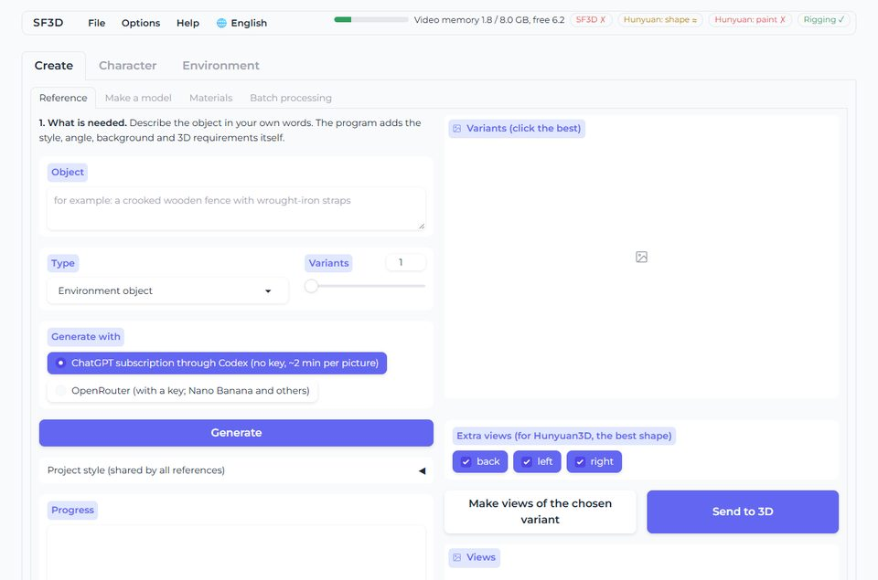

---

## Contents

- [What it does](#what-it-does)
- [How to work with the tools](#how-to-work-with-the-tools) (screenshots)
- [Requirements](#requirements) · [Hardcoded paths](#hardcoded-paths) · [Installation](#installation) · [Running](#running)
- [Armour fitting in detail](#armour-fitting-in-detail) · [Animation gallery](#animation-gallery-1)
- [Repository layout](#repository-layout) · [Third-party licences](#third-party-licences)

---

## What it does

| GUI tab | What you get | Engine |
|---|---|---|
| Create → Reference | Style card + reference pictures (single view or front/back/left/right) for a model, built from a text prompt | Codex CLI (ChatGPT) or OpenRouter |
| Create → Make a model | GLB from 1 picture (~20 s) or from 1–4 views (7–10 min), with pivot, real-world scale, collision proxy, PBR factors, previews and an icon. Categories: item, prop, building, character, vegetation | SF3D / Hunyuan3D-2mv + Hunyuan3D-Paint |
| Character → Skeleton (automatic UniRig or by hand with landmarks) | Skeleton + skin for humanoids and creatures, Mixamo or Godot bone names, seam welding, body split into regions | UniRig + Blender |
| Character → Animations: procedural | 12 procedural clips for any rigged humanoid (idle, walk, run, jump, attacks, cast, block, hit, death…) | Blender |
| Character → Animations: Mixamo (FBX) | Retarget Mixamo FBX clips (without skin) onto your rig, in-place option, three.js viewer | Blender |
| Character → Equipment | Move an outfit from a dressed character onto the base body, or fit a single armour piece and skin it to the shared skeleton | Blender + Robust Weight Transfer |
| Skeleton by landmarks → Armour | Fit a piece (bracer, greave, cuisse, boot, pauldron, breastplate, helmet) onto the built character in the editor, skin it in Blender, save the fitting, try it on in a Godot fitting room with the character's clips | three.js + Blender + Godot |
| Character → Equipment: procedural | A bracer, rerebrace, greave, cuisse, breastplate (plate up to the neck, a muscle one, with spaulders and mail), pauldron, tassets skirt or trousers built from the character's own skin, helmets, elbow pieces and footwear (six constructions each from the helmet, elbow and footwear generators, fitted to the head, the arms and the feet), gloves made of the hand's own skin, and cloth to wear under the armour by parameters in a live 3D editor (the piece on the character changes with the sliders): plates, scales, lamellar, mail, quilting or plain; rims, rivets, straps and buckles, iron/steel/bronze/leather/cloth with wear, baked PBR textures; put on like a fitted piece | Blender |
| Environment → Surfaces | Seamless ground/floor/wall materials (albedo, normal, height, roughness, AO) | numpy |
| Environment → Effects | Particle flipbooks (explosion, fire, smoke, magic) + ready Godot scenes | numpy + Godot |
| Environment → Modular kits | Procedural dungeon kit (walls, arches, stairs, doors) + ASCII plan → Godot scene | Blender + Godot |
| Environment → Destructible objects | Voronoi-fractured props + Godot scene that breaks on hit | Blender + Godot |
| Create → Materials | Recognises metal/wood/stone/cloth on an existing GLB and writes a metallic-roughness map | CLIP |
| Create → Batch processing (also the File menu) | Whole folder of pictures in one run (overnight) | all of the above |
| Options menu + GPU strip | Paths, OpenRouter key, who holds GPU memory, unload models; live VRAM strip at the top | – |
| Character → Weight fixing, Face parts, Lipsync | Weight repair, shared eyes/teeth/tongue kit with a live preview, lip-sync clip for the speech mouth watched right in the tab | Blender |

Every «Character» tool works on the **current character**, chosen once above the tabs and shown there in 3D with what it already has (the model, the skeleton, the body in parts for sets, lip-sync clips, pieces put on). A character is a folder `export\character\<name>\`; «Add a model…» makes one from a GLB. The choice is kept between runs. A tab's own «load a file» stays for a one-off job on a model that is not a character.

Outputs go to `export\<category>\<name>\` (GLB + JSON stats + icon). Scratch files go to `work\`. Neither folder is in the repository.

---

## How to work with the tools

### Interface language

The **🌐** menu at the top switches between English and Russian. The choice is saved in `tool/config.json` (`"lang"`), the server restarts by itself, and the page comes back in the new language after a few seconds. All texts live in `tool/lang/en.json` and `tool/lang/ru.json`; to add a language, copy one of them, translate the values and add the code to `LANGS` in `tool/i18n.py`.

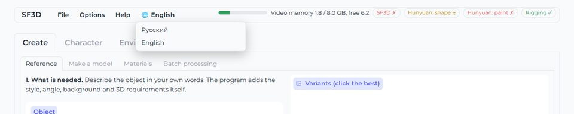

### Skeleton by landmarks

Character → Skeleton → «By hand with landmarks», then «Open the markup». Click the landmarks on the front view (chin, groin, shoulder, elbow, wrist, knee, ankle); the pelvis, spine, neck, clavicles, hips and feet are computed. Orange joints are landmarks, blue ones are computed; any joint can be moved or turned with the gizmo (G / R) or by numbers. «Mark the fingers» and «Mark the face» add fingers, jaw and eyes. Then «Build the skeleton and weights from the markup».

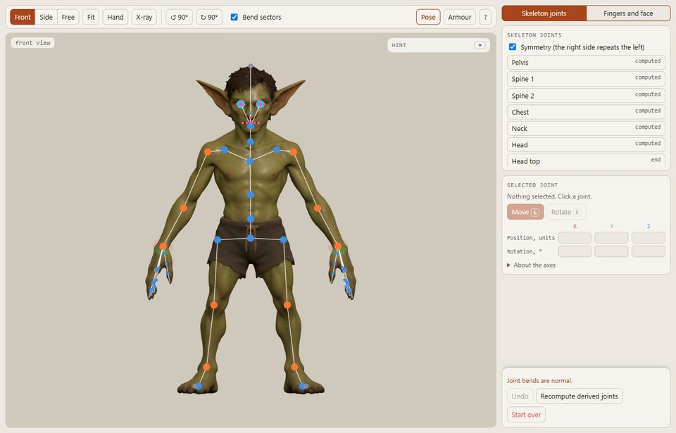

**Pose** shows the built model with its skeleton. Drag an arm or a leg to bend it; «Check pose» bends every limb at once, so creases and bad weights show.

| Pose mode | «Check pose» |
|---|---|
| 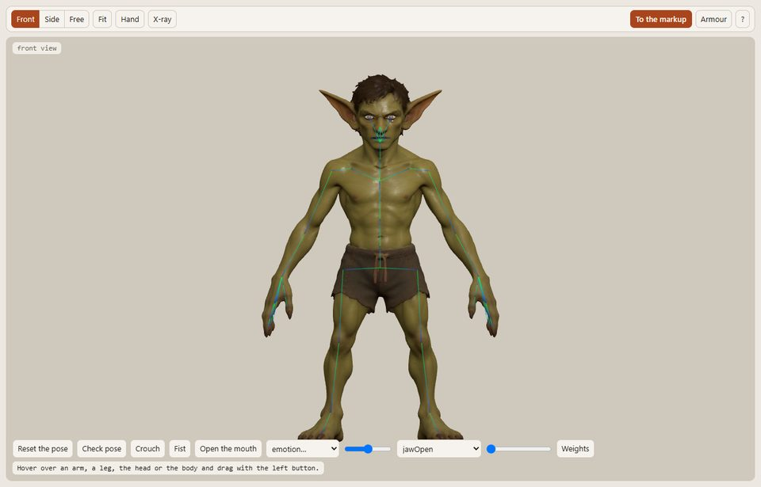 | 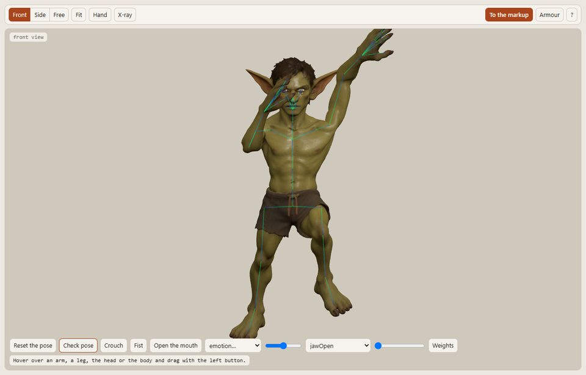 |

### Armour: place, put on, check

**Armour** opens the fitting panel. Choose the piece's GLB: a piece without its own skeleton gets its body part from the file name (cuisse → thigh, chest → torso, …), or choose it yourself. The piece is placed and fitted to the skin by its whole inner wall at once. The dots are the nodes of the inner wall: red — under the skin, green — on it, blue — air.

«Put on» sends the piece to Blender: it is pushed out of the skin, given the character's bones and weights, and saved next to the character. «Check pose» bends the body, and the piece must follow it.

| 1. Placed (fit nodes) | 2. «Put on» | 3. «Check pose» |
|---|---|---|
| 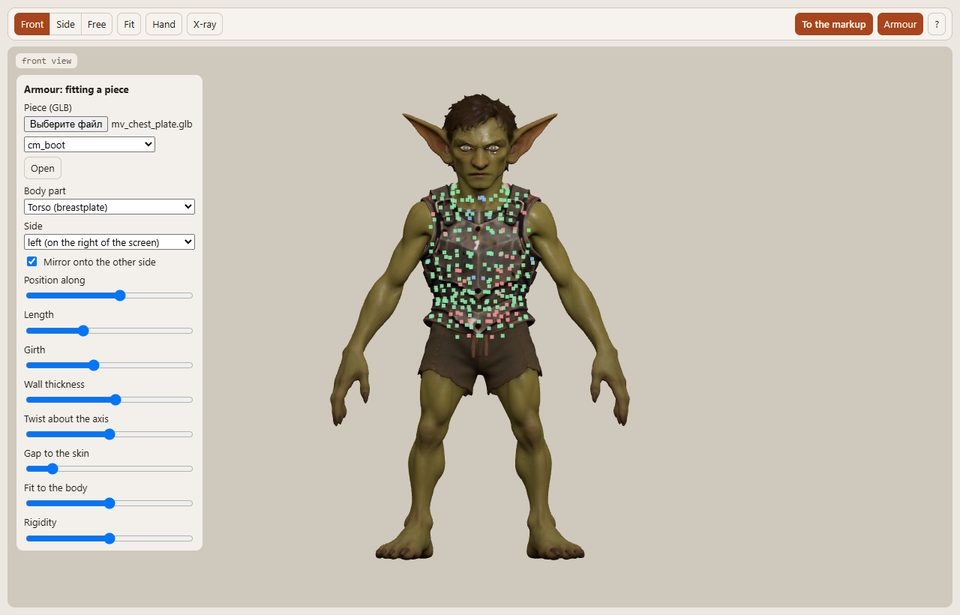 | 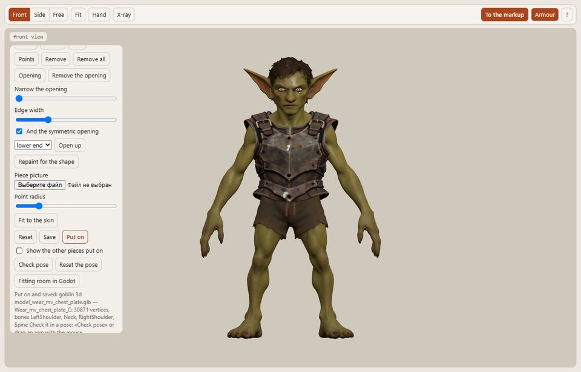 | 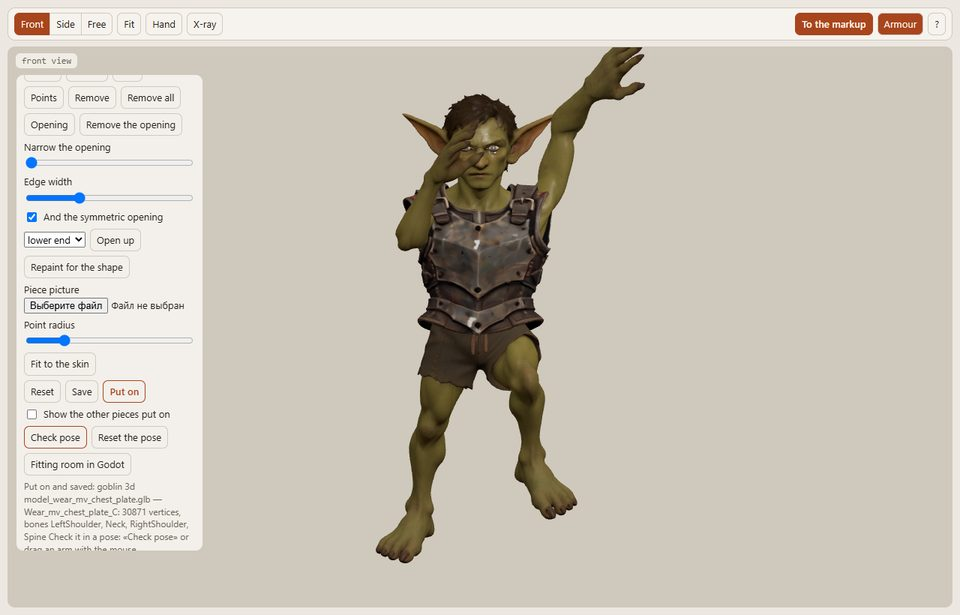 |

The sliders correct what the automatic fit got wrong: position along the limb, length, girth, wall thickness, twist about the axis, gap to the skin, fit to the body and rigidity. «Points» pulls the surface by hand, and «Fit to the skin» runs the automatic fit again after manual changes.

### Openings: an arm hole drawn in

«Opening»: click 3 or more points around the edge of an arm hole or a neck. «Narrow the opening» draws the edge and the surface around it toward the circle's centre, both walls together; «And the symmetric opening» does the other side too. Here the arm hole of a breastplate was too wide and left the armpit open.

| Before | «Narrow the opening» 0.25 |
|---|---|
| 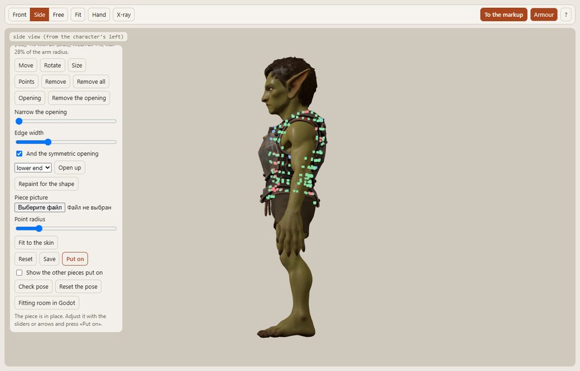 | 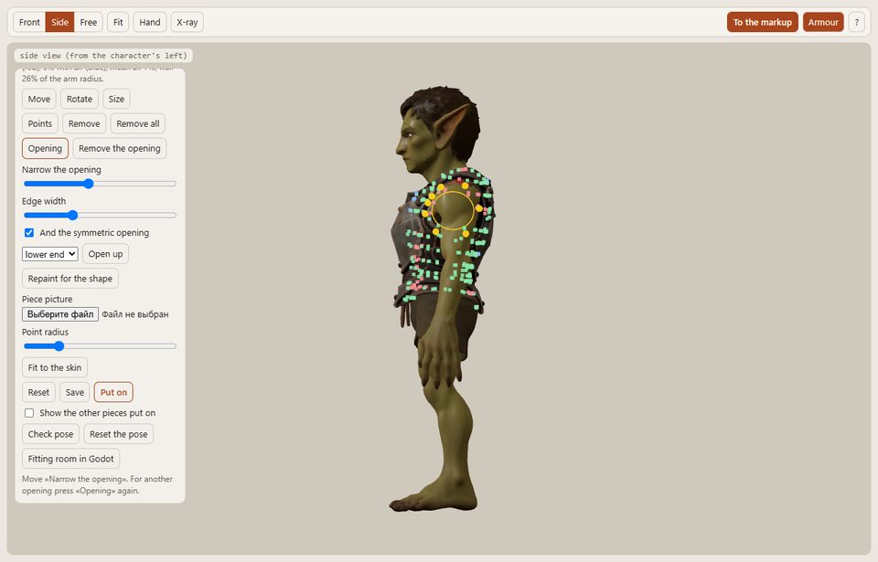 |

### Repaint for the shape

Drawing an opening in, points and the wall slider all stretch the texture. «Repaint for the shape» sends the reshaped piece to Hunyuan3D-Paint with the front picture it was made from (found by itself for generated armour, or chosen in «Piece picture»). The texture is painted anew on the new shape, sides not seen in the picture included (3–6 min on the GPU).

| The piece as generated | Arm hole narrowed and repainted |
|---|---|
| 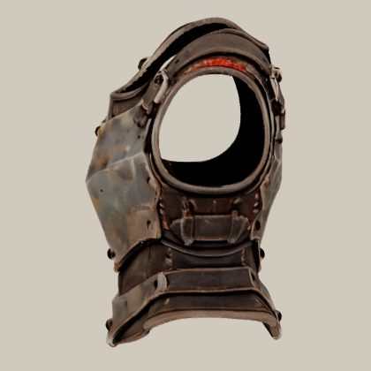 | 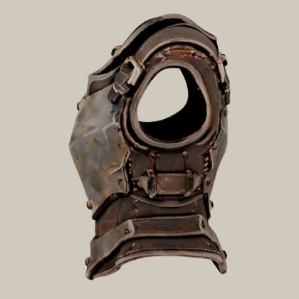 |

### Opening up a closed end

A generated piece is sometimes closed at an end: SF3D caps a bracer at both ends, and a Hunyuan cuisse may have a knee cop curling under it. Choose the end (lower — away from the body, upper, or both) and press «Open up». Blender cuts that end off with the texture kept; the piece's own wall stays, and a solid blank gets a wall inwards. The piece is then placed again.

### Layers: a piece over another

When pieces overlap (a boot over a greave, a cuisse over padding), the list «Over these pieces» says which pieces already put on go under this one. Pieces on other body parts that overlap it are ticked by themselves; two pieces on the same part are usually alternatives, so tick those by hand when they are layers. On «Put on» the outer wall of the ticked pieces counts as the skin: the new piece widens over them, and what a cell cannot widen enough moves out along the ray from the limb axis. Measured from 8 sides, a long cuisse put on over a Tripo thigh piece let 27% of it show through without layers and 4% with them (the lower piece's longer edge).

### What a piece hides

Every piece put on (fitted or procedural) also saves which part of the body it hides, `<character>_wear_<item>.mask.json` (`tool/body_mask.py`): the skin under it, which would poke through in motion, and what sticks out through it — the cords hanging from trousers under a skirt, the ears under a helmet. A face out of a helmet or a hand out of a bracer stays. The editor and the Godot fitting room take those triangles away while the piece is on, and bring them back when it is off; the body's edge at the piece's rim stays.

### Saving and the Godot fitting room

Every «Put on» also saves the fitting (`<character>_wear_<item>.fit.json`); «Open» brings it back with all the sliders and points. «Fitting room in Godot» builds a small Godot project with the character, its clips and every piece put on, and opens it. Here is a whole set in Godot during the walk clip: breastplate, helmet and short cuisses from Hunyuan3D, boots, and bracers taken off a Tripo character.

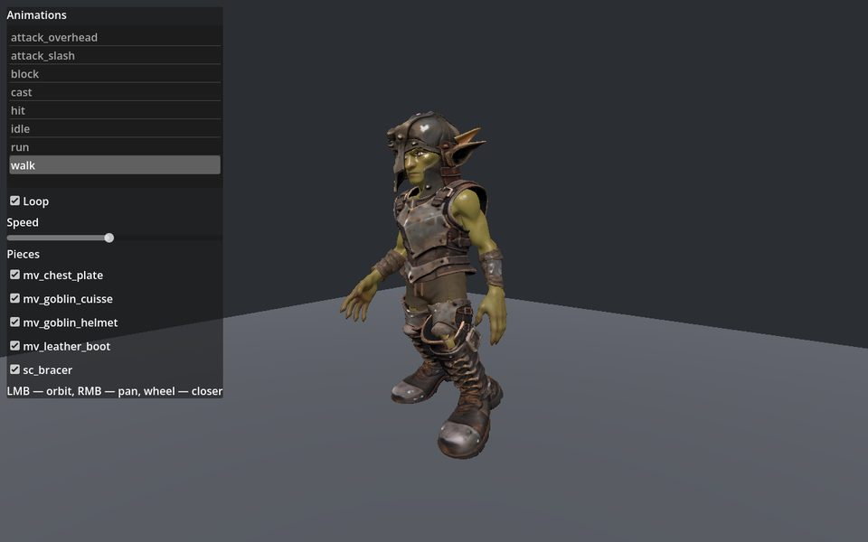

### Equipment: procedural

Character → «Equipment: procedural» makes a piece from parameters instead of a model: a bracer, a rerebrace, a greave, a cuisse, a breastplate, a skirt of tassets (from the waist, so there is no gap between the breastplate and the cuisses), a pauldron, trousers or a brayette (mail briefs), built from the skin of a character with a landmark skeleton. The editor opens on the current character at once: the page (`tool/armour_gen_editor.html`) shows the character with the piece on it and rebuilds the piece on every move of a slider, in a few hundredths of a second. What is on screen is what is made:

- Pointing at a group of parameters (plates, rivets, straps) lights up the part of the piece it changes.
- The views (front, side, close-up), the character in its own colours, plain or see-through (to see the gap to the skin).
- Poses: arms up, arms forward, elbows bent, a squat, a stride. The piece moves by the same weights it will have in the game.
- Pieces made before are listed and open again with their parameters.
- «Worn»: the pieces already put on the character show on it, and the new piece is fitted over the ticked ones (a mail skirt or a brayette over the trousers, two layers as worn for real). A cuirass always goes over a skirt, whichever is made first: a skirt made under a worn cuirass stays inside it, belt and all.
- «Style of a reference» sets a bracer, greave or breastplate to one of the reference sets (hardened leather, steel plate, mail, exposed splints, covered splints or brigandine, plate over mail, lamellar); the sliders change it from there.

«Generate» sends this very geometry and these weights to Blender (`tool/blender_armour_gen.py`), which bakes the materials; the baked piece then shows in the editor («Result») and follows the poses on the character's skeleton. How the piece is built:

1. Around the limb's middle line, rays take the skin's profile. Other limbs' skin does not count; a limb piece leaves out clothes hanging off the limb, a breastplate, the tassets and trousers go over the clothes.
2. The profile is smoothed by «Body relief», moved out by the gap and made thick. A breastplate goes up to the neck with a neckline in front and armholes round the arms, its bottom may come to a point, a ridge may run down its middle; it is convex round and never widens going down (the flare belongs to the skirt below it), «Narrowing to the waist» sets how far it follows the waist, «Anatomy» raises a chest and an abdomen on it. It can be made of two parts (a chest of one or two plates over lames, mail, scales and so on), with mail under the plates (a skirt below them and short sleeves) and spaulders: half-round lames across the shoulders, the upper over the lower, the top one a larger dome (also a piece of its own, «Pauldron»); each lame moves as one, the lower ones more with the arm («Pauldron follows the arm»), so they slide over each other instead of bending; the plates' rims can be trimmed in brass or gold, and «Hammering» goes from polished to forged; the tassets of lames hang straight from the hips and flare, cut into panels so the legs move, while a skirt of mail or cloth is soft and cut so the legs move freely: it starts at the waist and lies on the body: down each thigh at the front and the sides, hanging from the seat behind, a little flared, in folds with a wavy hem, open in front behind a loose panel (longer, widening to the hem) or a wrap; below the hip joints its front and sides go with their own thigh, the panel halfway with both; trousers are a seat down to the crotch and two legs, tight or loose, with folds and cuffs, any length (knee breeches too), a laced front, and over the thighs mail, plate cuisses, riveted leather panels or a plate over mail, tied to the belt with points, with knee cops (a wing on the outer side) or leather knee patches; a brayette is the same short and of mail, with a crotch piece between the legs; a mail skirt may have a leather-bound edge.
3. The surface: plates with rolled rims and rivets; metal splints riveted along a leather base; a brigandine (leather over hidden plates, columns of rivets, sewn seams); each a little wider than the next so the upper one overlaps it; scales or lamellae on a leather backing, every row over the next one's laced end; mail or quilting (a pattern baked into the texture); or plain. The scale and ring size is a share of the character's height, the same on every piece of a set.
4. An open piece fastens on its inner side the way the references do: short straps riveted to both edges with a buckle over the gap, or a laced cord; a plate one may have hinges on the other side. A bracer's or greave's edge is cut back at the joint on the inner side and comes down at the far end in front (over the instep), the ends a little flared; leather can have stitched edges. A breastplate is one piece, as a fitted armour is: a ring round the body to the armpits and over it, with no seam, a cap over the chest, the collarbones, the shoulders and the back; rays from the body's middle find its neckline and armholes themselves (where they meet the neck, an arm). A vest keeps the cap's shoulders; a plate keeps only the breast- and backplate's tops, joined by straps from the breastplate over the shoulder. It may open on a side and fasten there. Otherwise leather straps go round the part, with buckles. A breastplate gets straps over the shoulders, the tassets and trousers a belt; trousers' other straps wrap the shins.
5. The materials (iron, steel, bronze, leather, cloth; wear: rust or patina and worn edges; the leather's and the cloth's colours) are procedural shaders baked into colour, roughness and normal textures. The editor shows them approximately, the exact ones come with the bake.
6. The weights come from the skin under the piece, drawn to its main bone by «Rigidity».

A «Helmet» is not made of the skin: it is one of six constructions of the helmet generators in `tool/vendor/blender_armour` (a kettle hat, an open bascinet, a barbute, a visored bascinet with an aventail, a sallet, an armet; Blender scripts written for a human head, in metres). `tool/blender_helmet_gen.py` measures every character's own head on the skin: the eyes, its depth and width at the brow, its top, the chin (where the face's front goes back sharply), the neck and the shoulders' top. Nothing is set for one anatomy: the same code fits a goblin (a short face, almost no neck) and a big-headed cartoon fairy. The helmet is built in the generator's proportions with the head's and scaled to it as one piece, its eye slits at the eyes (a kettle hat's brim at the brow). Below the face it is drawn up to end just under the chin, not on the shoulders; an aventail hangs round the neck down to the shoulders' top, closing in to the neck, in front across from its carrier's ends behind the visor. It is bound to the head bone (an aventail's lower rings more and more to the neck). Its mask hides what is under it, everything on the head over the brow (hair, a hat modelled on the character) and the ears (`body_mask.ears`, `body_mask.above`): a goblin's would stick out through the sides. In the editor the chosen style's helmet is made for the character the same way (once per style and parameters, `work/helmets/<character>/`, 5–20 s) and shown on its bones; «Air over the head», the visor and the armet's cheeks, a sallet's tail and a kettle hat's brim are its parameters.

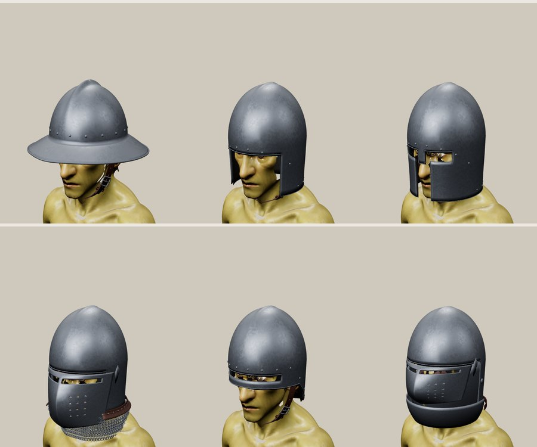

«Elbow» is the same with the elbow generators (`vendor/blender_armour/ElbowArmor`: leather, a mail sleeve section, a plain steel cup, a cup with a wing, a cup with lames, steel with a mail gusset; a man's elbow in metres, about the joint). `tool/blender_elbow_gen.py` measures each arm at its elbow on the skin (the middle of its round, its width and depth, how far out the elbow's point is, and how thick it is at the straps), puts the generator's frame along the upper arm (its lower half turned onto the forearm, an arm being a little bent at rest) with the cup on the elbow's point (away from the bend; behind for an arm straight at rest) so a right one's wing goes outward (the left one is it mirrored), sizes the cup a little wider than the arm and as deep as the elbow's point, and fits the straps (twice the generator's thickness, a little off the skin, joined to the cup at the sides), the lames and the mail round the arm at their heights. The upper strap and lames move with the upper arm, the lower ones with the forearm, the cup with what is on it half with each, mail and the inner leathers from one to the other; each elbow's mask is measured on its own, on the cup and the lames, kept in from their rims (the straps slide on the skin as the arm bends). The editor's «Elbows» pose shows them bent. «Air over the arm» and the wing's size are its parameters.

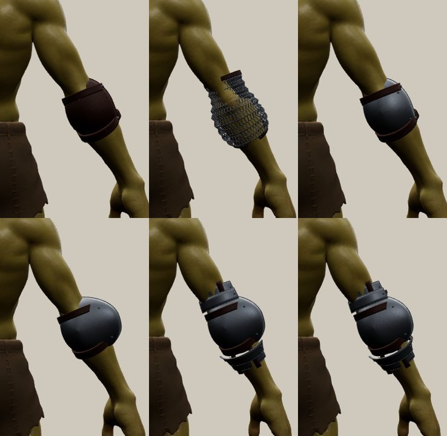

«Footwear» likewise (`vendor/blender_armour/Footwear`: leather shoes, ankle boots, a mail foot, round and pointed sabatons, leather with steel and mail; a man's right shoe on one last, the ankle at the origin). `tool/blender_footwear_gen.py` measures each foot on the skin (heel, the toes' tip with any claws, width and middle, the ground, the ankle's height), scales the last to it along, across and up, its toe along the foot and its sole on the ground, then fits it across to the foot at each height below the ankle and along it (slices of the skin, smoothed: a goblin's toes spread wide where the last narrows; one smooth field for leather and steel, so the lames neither cut through each other nor let the leather out) and the shaft round the leg above it (slices round the shin, the calf in it); the left shoe is the right one mirrored. It moves with the foot, its toe with the toes, its shaft more and more with the shin, steel whole with what it lies on; each foot's mask is measured on its own. «Air round the foot» is its parameter; the stride and squat poses show it walking.

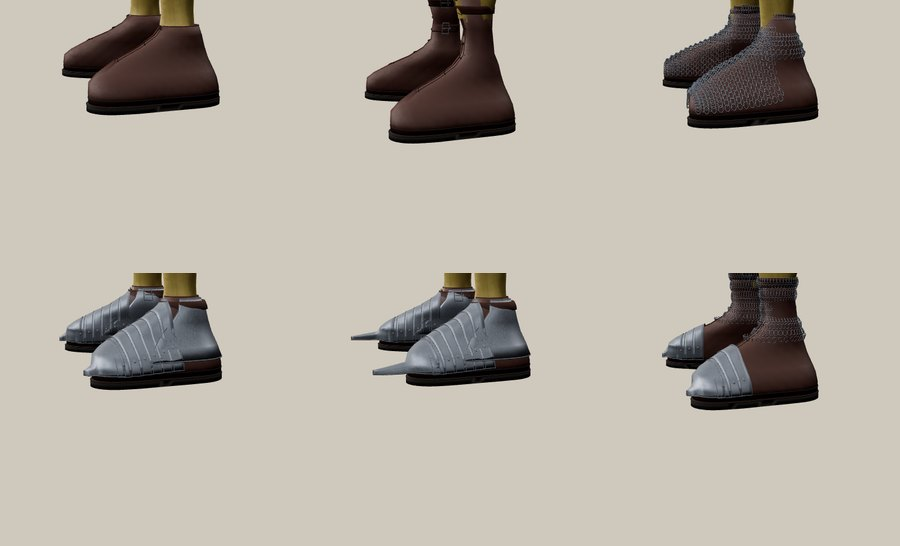

«Gloves» are built in the editor itself, of the hand's own skin (six styles after the reference sheets: a leather glove, reinforced leather, a mail mitten, an hourglass gauntlet, a plate mitten, steel with mail). The skin moving with the hand and the fingers is offset by the gap and made thick, each point with the skin's own weights, so the glove bends with every finger. A mitten's four fingers go into one bag, the convex hull of them and the knuckles, its points weighted as the nearest skin. On the back of the hand a plate (or a leather patch), on each finger's joint a scale a little longer than the joint (so they lie over one another), each whole with its bone, their outlines smoothed; a plate mitten has lames across its bag. The cuff is a bracer's round the wrist, flared towards the elbow (an hourglass), of leather, mail or plate, with a strap. The «Fist» pose closes the fingers.

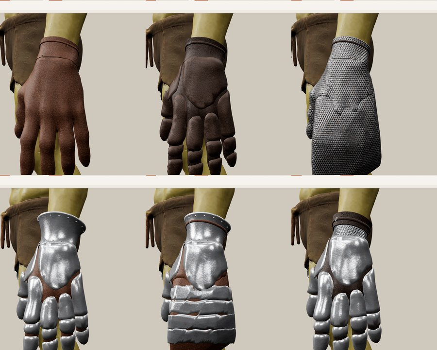

«Under the armour» is clothes, cut as clothes are, after the reference sheets: a linen shirt, a short aketon, a long gambeson, an arming doublet, a doublet with mail voiders, a quilted vest, and also braies (short or long) and a padded coif. They are made of the armour's own parts, loose on the body, not of the skin: the body is a vest's (a ring and a yoke over the shoulders; the armholes and the neckline are where the rays meet the arms and the neck), a skirt hangs on from it (never in to the waist, slit at the sides or behind), the sleeves go round the upper arm and the forearm (the forearm's under the upper one at the elbow, the armhole's edge turned in under the sleeve's top), a standing collar round the neck's root. They fasten down the front with ties or lacing; a doublet has arming points at the shoulders, the arms and the hem, the second one mail at the armpits. Quilting is in channels along or in diamonds. Braies are loose trousers, gathered at the ankle when long. A coif is a bag round the head (the hair may be sculpted on the skin, in lumps): the convex hull with the face cut out, the ears through it, the hair hidden under it. Their layer is the lowest: armour goes on over them.

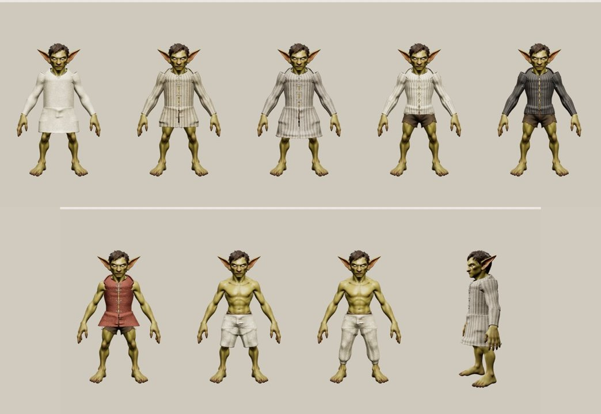

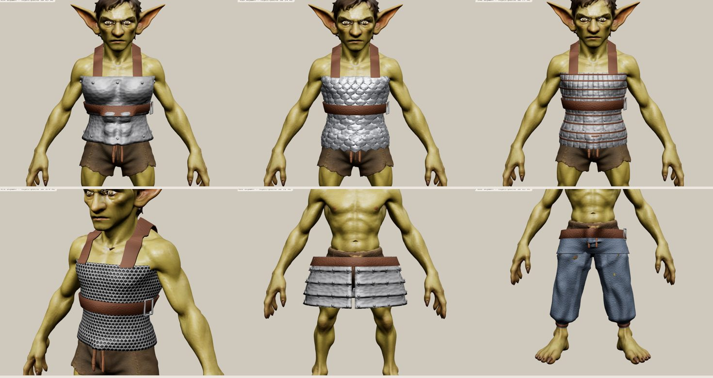

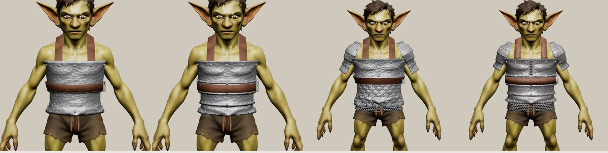

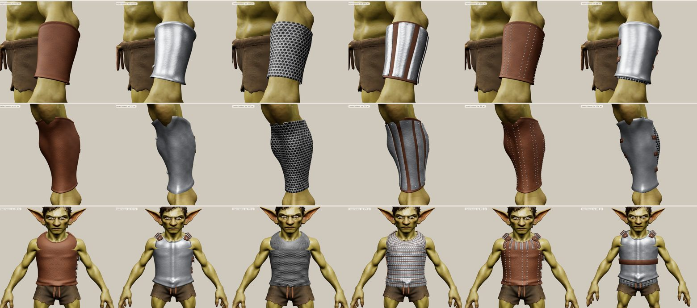

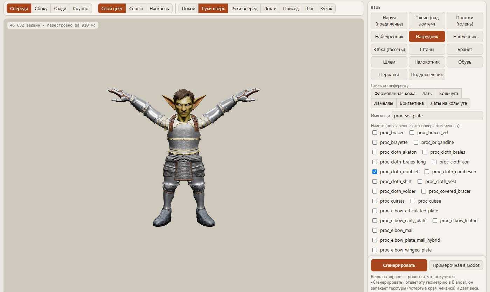

The piece is put on next to the character like one fitted in «Armour», so the Godot fitting room and the editor's other pieces have it. It fits by construction, needs no fitting, and a whole set comes out in one style, each piece made over the ones under it (the steel arms over the doublet's sleeves). It works on other bodies too: on the right, a sallet on a fairy. It can still be corrected by hand: in «Armour» any of them (helmets, elbows, footwear, gloves and clothes too) opens as made, part «The piece as made»: moved, turned and sized with the gizmo, reshaped with points, openings and the wall thickness; «Put on» keeps its own weights and what its mask hides (the ears under a helmet). Generating it again replaces the corrections.

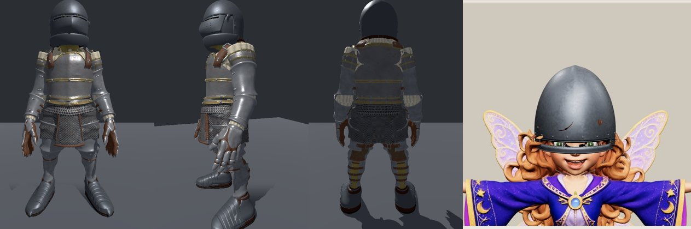

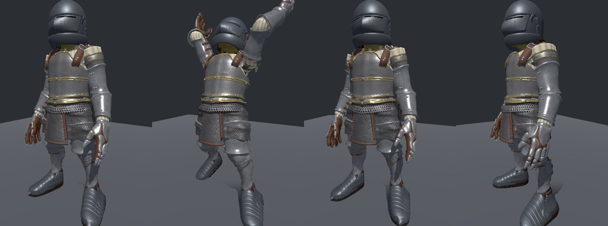

### Animation gallery

`tool/anim_gallery.py` puts about 90 clips (Mesh2Motion, CC0, plus procedural two-handed and shield clips) on a rigged character and writes one HTML page that opens with a double click. The clips are grouped: locomotion, jumps, dodges, sword, sword and shield, two-handed sword, defence, magic, unarmed, bow and throwing, hits and deaths, emotes.

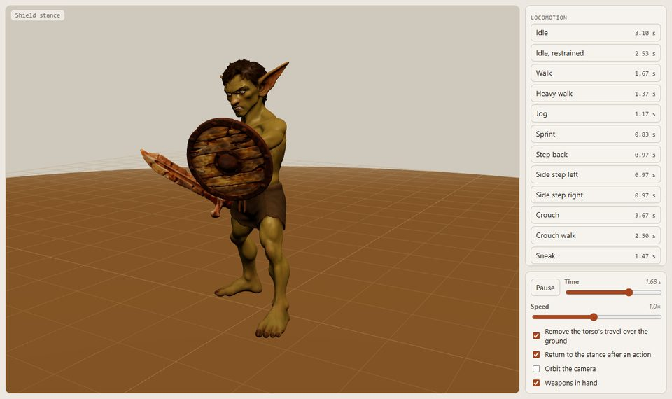

---

## Requirements

**Hardware:** an NVIDIA GPU with **8 GB VRAM** or more (CUDA 12.x driver), 32 GB RAM recommended, and about **60 GB** of free disk for environments, model weights and caches.

**Software you must install yourself** (none of it is bundled):

| What | Version used | Needed for |
|---|---|---|
| Windows 10/11 x64 | 11 | everything (scripts are `.bat`/`.ps1`) |
| [Miniconda](https://docs.anaconda.com/miniconda/) | any recent | the three Python environments |
| [Git for Windows](https://git-scm.com/download/win) | any | cloning; **its `bash.exe` runs UniRig** |
| [Visual Studio 2022 Build Tools](https://visualstudio.microsoft.com/visual-cpp-build-tools/) with "Desktop development with C++" | 2022 | compiling SF3D, Hunyuan3D-Paint and UniRig native extensions |
| [CUDA Toolkit 12.1](https://developer.nvidia.com/cuda-12-1-0-download-archive) | 12.1 | compiling SF3D's `texture_baker` (Hunyuan gets its own `nvcc` from conda) |
| [Blender](https://www.blender.org/download/) | 5.2 | rigging, animation, equipment, kits, destructibles, previews |
| [Godot](https://godotengine.org/download) (console exe) | 4.7.2 | building FX / kit / destructible scenes, the fitting room |
| [Hugging Face account](https://huggingface.co/join) | – | SF3D weights are **gated**: accept the licence at [stabilityai/stable-fast-3d](https://huggingface.co/stabilityai/stable-fast-3d) and log in |
| [Codex CLI](https://github.com/openai/codex) (`npm i -g @openai/codex`, then `codex login`) | 0.160 | *optional*: Reference tab with a ChatGPT subscription |
| OpenRouter API key | – | *optional*: Reference tab without Codex |

---

## Hardcoded paths

The scripts assume this layout. The easiest route is to reproduce it. Otherwise, edit the places listed below.

| Path | Purpose | Where it is set |
|---|---|---|
| `D:\conda\envs\sf3d`, `...\hunyuan`, `...\unirig` | Python environments | `sf3d-env.bat`, `tool\launch_ui.ps1`, `tool\sf3d_ui.py` (`HY_PY`), `tool\rigging.py` (`UNIRIG_ENV`), install scripts |
| `D:\conda\hf`, `D:\conda\hy3dgen` | Hugging Face / Hunyuan model cache | same files + `tool\hy_pipeline.py`, `tool\hy_texture_mv.py` |
| `D:\conda\tmp`, `D:\conda\pip-cache`, `D:\conda\pkgs` | temp files and caches (kept off C:) | launchers and install scripts |
| `D:\conda\rig` | staging folder for UniRig (its bash scripts break on spaces in paths) | `tool\rigging.py` (`STAGE`) |
| `D:\Git\bin\bash.exe` | Git Bash for UniRig | `tool\rigging.py` (`BASH`) |
| `<repo>\hunyuan3d-src` | Hunyuan3D source | `tool\sf3d_ui.py` (`HY_SRC`) |
| Blender, Godot, export/work/input folders, interface language | | `tool\config.json` (also editable in the Settings window) |

The repository itself can live anywhere. The original lives at `D:\My projects\SF3D`; paths with spaces are fine for everything except UniRig staging.

---

## Installation

Run everything from an **Anaconda/Miniconda PowerShell prompt** at the repository root.

### 1. Clone this repository and the three model repositories next to it

The model repositories are **not** included here. Clone them into these exact folder names:

```powershell
git clone https://github.com/Sergeyspb-source/3d-animator.git
cd 3d-animator

git clone https://github.com/Stability-AI/stable-fast-3d.git sf3d-src
git clone https://github.com/Tencent-Hunyuan/Hunyuan3D-2.git hunyuan3d-src
git clone https://github.com/VAST-AI-Research/UniRig.git unirig-src

# UniRig: use the community Windows support PR #70
git -C unirig-src fetch origin pull/70/head:pr70
git -C unirig-src checkout pr70
```

### 2. Apply the local patches (folder `patches\`)

```powershell
# Hunyuan3D-Paint: load the UNet from .safetensors so the 3.5 GB .bin is not needed
git -C hunyuan3d-src apply ..\patches\hunyuan3d-paint-safetensors.patch

# UniRig: low-memory skeleton configs for 8 GB GPUs
Copy-Item -Recurse -Force patches\unirig\configs\* unirig-src\configs\
```

### 3. SF3D environment (`sf3d`): GUI, SF3D, materials, glue code

There is no install script for this step yet. Run these commands by hand. Open the "x64 Native Tools Command Prompt for VS 2022" first, so the C++/CUDA extensions compile:

```powershell
conda create -p D:\conda\envs\sf3d python=3.10 -y
$py = 'D:\conda\envs\sf3d\python.exe'
& $py -m pip install torch==2.4.1 torchvision==0.19.1 --index-url https://download.pytorch.org/whl/cu121
& $py -m pip install setuptools==69.5.1 wheel
cd sf3d-src
& $py -m pip install -r requirements.txt          # builds texture_baker and uv_unwrapper
& $py -m pip install -r requirements-demo.txt     # gradio 4.41.0
cd ..
# extra modules used by this toolkit (not in SF3D's requirements)
& $py -m pip install scikit-image scipy matplotlib fast-simplification onnxruntime-gpu
# log in so the gated SF3D weights can download on first run
& $py -m huggingface_hub.commands.huggingface_cli login
```

### 4. Robust Weight Transfer dependencies (equipment tab)

`tool\vendor\rwt\weighttransfer.py` is vendored (GPL-3.0, see `tool\vendor\rwt\LICENSE` and `source_manifest.json`). Its compiled dependencies are **not** in git. Install them into the vendor folder:

```powershell
D:\conda\envs\sf3d\python.exe -m pip install --target tool\vendor\rwt\deps libigl==2.6.1 robust_laplacian==1.0.0
```

### 4b. Lip sync (optional, Character → Lipsync)

Self-contained: `tool\vendor\lipsync\transcribe.py` (local Whisper) and `lipsync.py` (ARKit face curves) run in the
`sf3d` env (numpy, scipy, torch, transformers; `soundfile` or ffmpeg for mp3/ogg). The `openai/whisper-small` model
(~1 GB) is downloaded on the first run into `hf_home` from `tool\config.json` (default `D:/conda/hf`); an existing
Hugging Face cache is reused. Output: `<model folder>\<voice>.face.json` + the audio copy. The clip is played right in the tab: the face close, the line with its sound; «▶ Watch» plays any clip the character has.

In Godot: copy `tool\godot\face_curves_clip.gd` and `face_curves_player.gd` into your project, add a
`FaceCurvesPlayer` node (`audio` = the voice `AudioStreamPlayer3D`, `face_root` = the character, `clip_path` = the
`.face.json`). It drives the blend shapes of the character's mouth plate (`jawOpen`, `mouthSmile`, …) from the audio clock.

### 5. Hunyuan3D-2 environment (`hunyuan`): multi-view models and texturing

```powershell
powershell -ExecutionPolicy Bypass -File hunyuan3d-install.ps1        # env + PyTorch 2.4.1 cu121 + hy3dgen
powershell -ExecutionPolicy Bypass -File hunyuan3d-texgen-install.ps1 # nvcc 12.1 from conda + builds custom_rasterizer / mesh_processor (needs VS 2022 Build Tools)
powershell -ExecutionPolicy Bypass -File hunyuan3d-weights.ps1        # shape model tencent/Hunyuan3D-2mv (fp16)
powershell -ExecutionPolicy Bypass -File hunyuan3d-texgen-weights.ps1 # delight + paint models
```

The build script `hunyuan3d-texgen-build.bat` has `TORCH_CUDA_ARCH_LIST=8.9` (RTX 40xx). **Change it to match your GPU** (8.6 for RTX 30xx, 12.0 for RTX 50xx).

### 6. UniRig environment (`unirig`): auto-rigging

```powershell
powershell -ExecutionPolicy Bypass -File unirig-install.ps1   # env py3.11 + torch cu128 + spconv + flash-attn shim
unirig-build-ext.bat                                          # only if torch_scatter / torch_cluster failed to install
```

UniRig weights (`VAST-AI/UniRig`) download from Hugging Face on the first rig.

### 7. Configure

On first start, `tool\config.example.json` is used. To change the paths or the language, copy it to `tool\config.json` (this file is git-ignored) and set `lang` (`en` or `ru`), `blender_exe`, `godot_exe`, `export_dir`, `work_dir` and `input_dir`. You can also do it in the Settings window and the 🌐 menu.

---

## Running

| How | What |
|---|---|
| `sf3d-ui.vbs` (double-click) | GUI with no console, opens an app window at `http://127.0.0.1:7861`. Closing the window stops the server and frees VRAM |
| `sf3d-ui.bat` | same GUI with a visible console (for debugging) |
| `sf3d-tool.bat generate <image or folder> --category prop` | one-off CLI: image(s) → game-ready GLB |
| `sf3d-tool.bat post work\item\axe\raw.glb --category item --name axe` | re-run post-processing only |
| `sf3d-batch.bat <folder> [--force] [--no-preview]` | batch: `<folder>\<category>\pic.png` → SF3D; `<folder>\<category>\<asset>\front.png [back/left/right.png]` → Hunyuan3D |
| `sf3d-gradio.bat` | the original SF3D demo UI (port 7860) |

**Run one GPU job at a time.** Approximate peak VRAM: SF3D 6.2 GB, Hunyuan shape 5.8 GB, Hunyuan paint 7.4 GB, UniRig 4.5 GB. The GUI checks free memory before each job.

---

## Armour fitting in detail

In the landmark editor's pose mode, **Armour** opens the armour panel:

1. Pick the piece's GLB and the body part. A piece without its own skeleton gets the part from its file name (cuisse/thigh → thigh, greave → shin, bracer/vambrace → forearm, rerebrace → upper arm, pauldron/shoulder → «Pauldron», gauntlet → hand, boot → «Boot», helmet → head, chest/cuirass → torso, in English or Russian); otherwise the choice stays as it was. The tube axis of a piece without a skeleton is the way it is open (rays from its middle pass straight through; the piece's own x/y/z are tried as well as its principal axes, since a short wide piece has no clear ones). The piece is placed along the limb's real middle line, then fitted by its whole inner wall. Nodes, one per cell of the piece (12 along × 24 around), are matched to the skin by ICP with a one-sided penalty: shift, tilt, scale across the limb and oval-ness change, the shape does not. «Fit to the skin» runs it again after manual changes. The nodes are shown red (under the skin), green (on it) and blue (air).
2. Adjust it with the sliders, the gizmo (G / R / S) or surface points. The sliders are position, length, «Girth» (the whole piece wider or narrower), «Wall thickness» (the inner wall stays, only the outer surface moves; the same about the piece's own axis in the editor and in Blender), twist and gap. The info line shows the air and the wall thickness as shares of the limb's radius.
3. **«Put on»** runs `tool/blender_wear_fit.py`. The piece is scaled away from the limb axis cell by cell, so the inner wall clears the skin and the wall keeps its shape. What is still under the skin is then pushed out along the skin's normal, spread over its neighbours, so the inner and outer wall move together. «Fit to the body» (conform) draws loose parts in towards the limb, by the share of their air (the wall measured on the same ray as the skin). A breastplate's sides towards the arms are drawn in fully, and the arms' skin (weighted to the arm bones, or past the shoulder joint on that side) does not count as the torso's: otherwise the breastplate widens round the deltoid and the raised arm seems to come out of its shoulder. A cell's inner wall is the tenth percentile of its vertices' distances from the axis, and what lies deeper than 3/4 of the skin's distance is left alone inside the limb: in a closed image-to-3D piece opened up, these are the remnants of its caps, and counting them blew the piece's ends up into a funnel. Skin weights come only from the limb's own bones and are smoothed over the piece. «Rigidity» makes it move with the bone (0.8 for bracers and greaves, 0.2 for gloves). The result is `<character>_wear_<item>.glb`: the character's skeleton plus the skinned piece.
   - A piece made on another body that carries its own skeleton (the Tripo extractions in `export/equipment`) is read with it. On one limb segment it is placed as above; over several segments (a boot over the shin and the foot, a whole arm) the part «The whole piece by its own skeleton» is chosen. Then each vertex moves from the piece's bones onto the character's same bones by its own weights, the way skinning moves skin, and the other side is the mirror with Left and Right swapped. Blender gets the moved copies, pushes them out of the skin, and weights them only to the bones the piece used.
   - Upright pieces as generated keep their own vertical as their axis and their proportions: «Torso (breastplate)» — no mirror, weights on the spine, never on the arms; «Head (helmet)» — the helmet's top at the top of the head, rigid on the head bone; «Boot» — the shaft on the shin, sized by it; the toe turned along the foot (the long axis of its sole, at the end farther from the shaft); the sole at the heel.
   - «Pauldron» is a dome on the shoulder joint, not a tube: it keeps the orientation it was made in (up is up), and the sphere of its upper part is its own shoulder ball — the centre goes onto the character's shoulder joint, the size by the skin around it, then the same ICP in cells of direction from the joint (shift, turn, one scale: the shape stays). The side it was made for comes from the file name (`_L`, `left`…), otherwise left (the generator is asked for a left one); choosing the other side reflects it. It is rigid: every vertex gets the same weights, the collarbone and the upper arm, and «Follows the arm» sets the arm's share (0.7 by default: in a measured side raise and forward raise the least skin showed through; 0.5 is worse, since blending two turns shrinks a rigid piece). Over a breastplate it goes as a layer: the breastplate's straps count as the skin, and Blender moves the pauldron out of them as a whole. A pauldron is the outer layer: it is never ticked under a breastplate by itself.
   - «Opening»: clicks around the rim of an arm hole or a neck give its circle. «Narrow the opening» draws the rim and the surface near it towards the circle's axis, both walls together, with a smooth falloff; «And the symmetric opening» does the other side too. This happens in the piece's own space, so the editor, the mirrored copy and Blender get the same shape.
   - «Over these pieces»: the job gets the fitted results of the ticked pieces (`under`). Along each cell's ray from the limb axis, the outer wall of the first shell lying on this limb (less than a limb radius from the skin) replaces the skin distance, and a second push moves what is still under them out along the ray, spread like the skin push. The report counts the cells laid over other pieces.
   - «Open up» (lower end / upper end / both ends): a generated piece closed at an end is cut open there by `blender_armour_hollow.py`, texture and all, and placed again. On a limb the lower end is the one away from the body (the wrist, the knee); an upright piece goes by its own vertical. The piece's own wall stays; a solid blank gets one inwards (rays from the middle out pass two surfaces when it has a wall).
   - «Repaint for the shape»: Hunyuan3D-Paint paints the reshaped piece anew from its reference picture (found in `refs_mv`, or chosen in «Piece picture»), so the texture follows the new shape instead of being stretched (3–6 min on the GPU). The result becomes the fitting's source piece.
   - Hunyuan3D from four views (Codex draws them: `export/equipment/generated_armour/make_refs_mv.py`) gives hollow armour that sits without any opening step. A piece generated from one picture is usually a closed solid; `tool/blender_armour_hollow.py in.glb out.glb [open=both|top|bottom] [axis=auto|z|x,y,z] [wall=0.08|auto]` is the same cut from the command line.
4. Every fitting is saved next to the character as `<character>_wear_<item>.fit.json` + `.src.glb`. «Open» brings it back with all the sliders and points, and «Save» saves without fitting.
5. **«Fitting room in Godot»** builds `work/wardrobe/<character>/`: the character with its clips (the procedural ones are made if none exist), every fitted piece on, pieces on/off, and an orbit camera. It then opens the project in Godot.

In your own Godot project, copy `tool/godot/sf3d_equip.gd` and the GLBs, then:

```gdscript
var bracers := SF3DEquip.wear($Goblin, preload("res://goblin_wear_bracer.glb"))   # put on (meshes move under the character's Skeleton3D)
SF3DEquip.take_off(bracers)                                                      # take off
SF3DEquip.show(bracers, false)                                                   # hide (the body under it comes back)
```

Copy the `.mask.json` beside each GLB: `wear` reads it and hides the body under the piece.

The piece follows every animation of the character by bone names. It must come from the same rigged model.

---

## Animation gallery

`tool/anim_gallery.py` puts the Mesh2Motion clips (`Animations/Mesh2Motion`, CC0) and the procedural two-handed and shield clips on a rigged character. The result is one self-contained HTML page with about 90 clips in groups (see [the screenshot above](#animation-gallery)). The page holds the GLB inside, so it opens with a double click. Its texts are in the interface language.

```powershell
D:\conda\envs\sf3d\python.exe tool\anim_gallery.py "<character>_landmarks_rigged.glb" Animations\goblin_gallery.html
```

`blender_retarget_fbx.py` reads the clips straight from the Mesh2Motion GLBs: Unreal-style bone names are mapped onto Mixamo ones. The weapons in the hands are approximate, because their presets were set on another goblin; the «Weapons in hand» checkbox hides them.

---

## Repository layout

```
sf3d-ui.vbs / sf3d-ui.bat     GUI launchers
sf3d-tool.bat / sf3d-batch.bat CLI launchers
sf3d-env.bat                  environment for the sf3d env
*-install.ps1, *-weights.ps1, *-build.bat   installers for Hunyuan3D and UniRig
patches/                      changes applied on top of the third-party repos
docs/images/                  README screenshots (en/, ru/)
tool/
  sf3d_ui.py                  Gradio GUI (all tabs)
  i18n.py, lang/*.json        interface language: every text by key (English, Russian)
  sf3d_tool.py, batch_cli.py  CLI and post-processing (pivot, scale, collision, materials)
  hy_*.py                     Hunyuan3D workers (run in the hunyuan env)
  rigging.py, outfit.py, hanim.py, fbxanim.py, materials.py, surfaces.py,
  fx_flipbook.py, modkit.py, destruct.py, refgen.py, anim_gallery.py, rwt_*.py   feature modules
  landmarks*.py, landmark_editor.html   skeleton from hand-placed landmarks and armour fitting (three.js editor)
  blender_*.py                headless Blender scripts (blender -b -P tool\blender_x.py -- args)
  godot/                      Godot scripts and shaders used by generated scenes (incl. FaceCurvesPlayer for lip sync,
                              SF3DEquip to put fitted armour on, the armour fitting room)
  rig_scripts/                Git-Bash wrappers for UniRig
  vendor/rwt/                 Robust Weight Transfer (GPL-3.0)
  vendor/lipsync/             Whisper word timings + lip-sync curves (vendored, see its README)
  vendor/blender_armour/      the helmet, elbow and footwear generators (KettleHat, HelmetVariants, ElbowArmor, Footwear: Blender scripts), see source_manifest.json
  config.example.json         settings template
```

Not in git (created locally): `sf3d-src/`, `hunyuan3d-src/`, `unirig-src/`, `export/`, `work/`, `input/`, `tool/config.json`, `tool/vendor/rwt/deps/`, all model weights.

---

## Third-party licences

This repository holds only the glue code. Each model keeps its own licence, so **check them before any commercial use**:

- **Stable Fast 3D**: [Stability AI Community License](https://huggingface.co/stabilityai/stable-fast-3d) (free under USD 1M annual revenue).
- **Hunyuan3D-2**: [Tencent Hunyuan 3D 2.0 Community License](https://github.com/Tencent-Hunyuan/Hunyuan3D-2/blob/main/LICENSE). **Not licensed in the EU, the UK and South Korea.**
- **UniRig**: MIT.
- **Robust Weight Transfer** (`tool/vendor/rwt`): GPL-3.0.
- **CLIP weights** (open_clip, LAION ViT-B/32): MIT.
- **Mesh2Motion animations** (gallery): CC0.
