# 3D Animator: local game-asset toolkit

**English** · [Русский](README.ru.md)

A local Windows toolkit that turns pictures into game-ready 3D assets for Godot 4: models, skeletons, animations, equipment, PBR materials, tiling surfaces, VFX flipbooks, modular dungeon kits, destructible props and vegetation with wind.

Everything runs on your own GPU. The only cloud piece is the optional reference-image generator (your ChatGPT subscription through Codex CLI, or an OpenRouter key).

It glues several open-source models together (Stable Fast 3D, Hunyuan3D-2, UniRig) with Blender and Godot scripts. It has a Gradio GUI in English and Russian and two command-line tools.

> **Status: personal tool, shared as is.** It was built and tested on a single machine (Windows 11, RTX 4060 Laptop 8 GB VRAM, 31 GB RAM). Many paths are hardcoded, so read [Hardcoded paths](#hardcoded-paths) before installing.

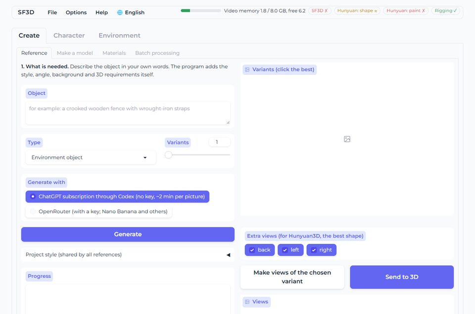

---

## Contents

- [What it does](#what-it-does)
- [How to work with the tools](#how-to-work-with-the-tools) (screenshots)
- [Requirements](#requirements) · [Hardcoded paths](#hardcoded-paths) · [Installation](#installation) · [Running](#running)
- [Armour fitting in detail](#armour-fitting-in-detail) · [Animation gallery](#animation-gallery-1)
- [Repository layout](#repository-layout) · [Third-party licences](#third-party-licences)

---

## What it does

| GUI tab | What you get | Engine |
|---|---|---|
| Create → Reference | Style card + reference pictures (single view or front/back/left/right) for a model, built from a text prompt | Codex CLI (ChatGPT) or OpenRouter |
| Create → Make a model | GLB from 1 picture (~20 s) or from 1–4 views (7–10 min), with pivot, real-world scale, collision proxy, PBR factors, previews and an icon. Categories: item, prop, building, character, vegetation | SF3D / Hunyuan3D-2mv + Hunyuan3D-Paint |
| Character → Skeleton (automatic UniRig or by hand with landmarks) | Skeleton + skin for humanoids and creatures, Mixamo or Godot bone names, seam welding, body split into regions | UniRig + Blender |
| Character → Animations: procedural | 12 procedural clips for any rigged humanoid (idle, walk, run, jump, attacks, cast, block, hit, death…), in a manner of the character's own (heavy, armoured, robed, light, swagger, limping, undead or one chosen by a seed) and with a death of choice (on the back, face down, to a side, to the knees) | Blender |
| Character → Animations: Mixamo (FBX) | Retarget Mixamo FBX clips (without skin) onto your rig, in-place option, three.js viewer | Blender |
| Character → Equipment: whole set | Move an outfit from a dressed character onto the base body | Blender + Robust Weight Transfer |
| Character → Equipment: fitting a piece | Put a finished piece (GLB) on the current character: placed by the skin, both sides at once, moved, reshaped, layered, with weights and a mask (the «Armour» mode below) | Blender |
| Skeleton by landmarks → Armour | Fit a piece (bracer, greave, cuisse, boot, pauldron, breastplate, helmet) onto the built character in the editor, skin it in Blender, save the fitting, try it on in a Godot fitting room with the character's clips | three.js + Blender + Godot |
| Character → Equipment: procedural | A bracer, rerebrace, greave, cuisse, breastplate (plate up to the neck, a muscle one, with spaulders and mail), pauldron, tassets skirt or trousers built from the character's own skin, helmets, elbow pieces and footwear (six constructions each from the helmet, elbow and footwear generators, fitted to the head, the arms and the feet), gloves made of the hand's own skin, and cloth to wear under the armour by parameters in a live 3D editor (the piece on the character changes with the sliders): plates, scales, lamellar, mail, quilting or plain; rims, rivets, straps and buckles, iron/steel/bronze/leather/cloth with wear, baked PBR textures; put on like a fitted piece | Blender |
| Environment → Surfaces | Seamless ground/floor/wall materials (albedo, normal, height, roughness, AO) | numpy |
| Environment → Effects | Particle flipbooks (explosion, fire, smoke, magic) + ready Godot scenes | numpy + Godot |
| Environment → Modular kits | Procedural dungeon kit (walls, arches, stairs, doors) + ASCII plan → Godot scene | Blender + Godot |
| Environment → Destructible objects | Voronoi-fractured props + Godot scene that breaks on hit | Blender + Godot |
| Create → Materials | Recognises metal/wood/stone/cloth on an existing GLB and writes a metallic-roughness map | CLIP |
| Create → Batch processing (also the File menu) | Whole folder of pictures in one run (overnight) | all of the above |
| Options menu + GPU strip | Paths, OpenRouter key, who holds GPU memory, unload models; live VRAM strip at the top | – |
| Character → Weight fixing, Face parts, Lipsync | Weight repair, shared eyes/teeth/tongue kit with a live preview, lip-sync clip for the speech mouth watched right in the tab | Blender |

Every «Character» tool works on the **current character**, chosen once under the row of tabs and shown there in 3D with what it already has (the model, the skeleton, the body in parts for sets, lip-sync clips, pieces put on). A character is a folder `export\character\<name>\`; «Add a model…» makes one from a GLB, «Delete» erases its whole folder after asking «Delete for good?»; the file it was loaded from stays where it was. The choice is kept between runs. A tab's own «load a file» stays for a one-off job on a model that is not a character.

A character's pieces lie in its folder by kind: `armor/` (plates, mail, helmets, gloves, shoes and the pieces fitted in «Armour»), `clothes/` (clothes under the armour, trousers, skirt, tabard, cloak), `weapons/` (weapons, shields, scabbards, quivers). Each piece is four files: `<item>.glb` and `<item>.mask.json` (what of the body it hides) for the game, `<item>.src.glb` and `<item>.fit.json` (the piece as made and its settings) for the editors. The name is given by the rule `<part>_<style>`, `_2`, `_3` for another of the same: `cuirass_steel`, `bracer_leather_2`, `helmet_barbute`, `shield_round`, `undercloth_fitted`, a weapon just `sword`. No model prefix: the folder says whose it is. The editor opens with the character as it is: no piece chosen or being built, only the worn pieces with their ticks. Work starts when a kind is chosen or a made piece opened (its name clicked in «Worn», or chosen in «Saved»); undo goes back to nothing. There is no name field any more: the rule names the piece. The name is given once, at the first «Generate», and kept even when the style changes (the game and the fitting room know the piece by it); the «Piece name» field can be typed over. The editors' answers lie in `work\status\`, not in the model's folder. A character in the old layout (`<model>_wear_<item>.*` next to the model) is moved over the first time its pieces are opened: the files renamed by the rule, the references between pieces (what each was made over) too, the old answers deleted.

Outputs go to `export\<category>\<name>\` (GLB + JSON stats + icon). Scratch files go to `work\`. Neither folder is in the repository.

---

## How to work with the tools

### Interface language

The **🌐** menu at the top switches between English and Russian. The choice is saved in `tool/config.json` (`"lang"`), the server restarts by itself, and the page comes back in the new language after a few seconds. All texts live in `tool/lang/en.json` and `tool/lang/ru.json`; to add a language, copy one of them, translate the values and add the code to `LANGS` in `tool/i18n.py`.

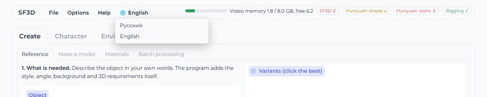

### Skeleton by landmarks

Character → Skeleton → «By hand with landmarks», then «Open the markup». Click the landmarks on the front view (chin, groin, shoulder, elbow, wrist, knee, ankle); the pelvis, spine, neck, clavicles, hips and feet are computed. Orange joints are landmarks, blue ones are computed; any joint can be moved or turned with the gizmo (G / R) or by numbers. «Mark the fingers» and «Mark the face» add fingers, jaw and eyes. Then «Build the skeleton and weights from the markup».

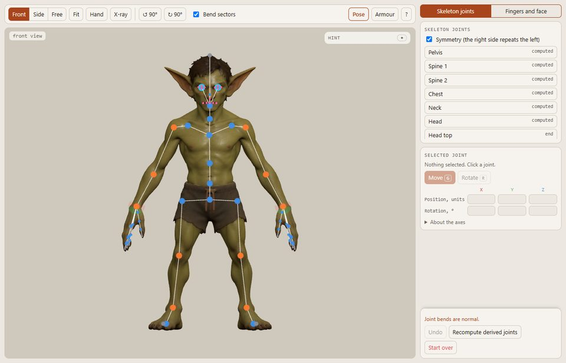

The eyeballs in the markup are the face-parts set's own eye (the set chosen in the build options, else the standard one): it sits in the socket as the build will put it, so a wrong place or size shows at once; a click on it selects the eye joint. The teeth: in the mouth mode (the mouth oval and eyelids) a grey fence behind the lips shows where the face-parts set's rows will stand. «Teeth» gives them a place of your own: a handle at the front of the upper incisors' edge (move it in height and depth; the view turns to the side, «X-ray» shows it through the skin), «Teeth −» / «Teeth +» make the rows narrower or wider; «Teeth» again goes back to automatic. Building the mouth then checks every pose (rest and each shape key): the teeth, gums, tongue or the cavity seen through the skin are taken in (a row of teeth as a whole, the soft parts where they show), and the build log says how many points came out and whether any are left.

Eyelids: the build puts an upper and a lower eyelid of their own on each eyeball — parts of spheres a little bigger than the eye (meshes `EyeLid_L` / `EyeLid_R` on the head bone), coloured like the skin round the eye, with a dark rim. They lie under the face's skin and show only in the eye opening. Blinking (`eyeBlink`) turns the upper lid down about the ball's centre and the lower one a little up; the upper covers the eye whole and closes over the lower, so the closing line is a smooth arch whatever the source's mesh round the eye is like (the face's skin stays: its ragged cut edge closed in teeth). Squint (`eyeSquint`) and wide (`eyeWide`) turn the lids part way. The keys have the skin's names, so the editor, lip sync and Godot move the lids with the face. A brown band of lid round the eye at rest means the eye opening is bigger than the ball: fix the ball in the markup («Eye +»).

**Pose** shows the built model with its skeleton. Drag an arm or a leg to bend it; «Check pose» bends every limb at once, so creases and bad weights show. «▶ Motion check» bends the joints to and fro by groups (fist, wrists, elbows, shoulders, knees, ankles, head, jaw) or all in turn — you see whether the bones sit right.

Expressions by hand: in «Pose» pick a shape key (jawOpen, mouthSmile, the brows…) and press «✎ Edit». The face shows that key at full strength and a brush moves its skin: «Grab» drags the skin under the brush with the mouse, «Raise» / «Press» push it along the surface, «Smooth» evens it out (bumps, creases; on the «Rest» key the surface itself); radius, strength and «Mirror» (the other half of the face the same) are in the panel, Ctrl+Z / Ctrl+Shift+Z undo and redo. «Save» writes the edit into the model at once, no skeleton rebuild (`tool/face_edits.py`; the light is corrected as the surface turns), and keeps it beside the character in `<character>_face_edits.json`, the model as built in `….noedit.glb`: a rebuilt skeleton gets the edits again, their points found by place. «Discard» drops the unsaved strokes, «Remove all edits» brings the key back as built. Lip sync, the emotions and Godot use the edited keys. The first entry of the list, «Rest (the face's base shape)», edits the face itself, as it is when no key is on: lower an upper eyelid over the iris and the stare goes; every expression starts from it, and a key that moves a point the same way (the blink) is made shorter by as much, so it still ends where it did.

The lips after the mouth cut: the build now tells the upper lip from the lower near the slit over the mesh (not by the line: the lower lip's top behind the slit edge lies above the line and stayed on the head before), gives the lower lip a smooth jaw weight from the middle to the corners (the mouth opens as an oval: the lower lip's edge follows an ellipse's arc and fades only right at the corners; the lower lip itself goes down whole, as the lower teeth's front does, a little over their roots and leaning onto them instead of turning out, the jaw's turn taken by the skin below it (job keys `lip_lean`, `lip_rise`); the cavity's sides stand outside the side teeth, not in front of them; the source's own mouth inside — the cheeks' inner sides deeper than 0.35 of the mouth's width behind the lips — is removed, or it stretched into strips beside the teeth as the mouth opened), never gives the jaw's weight to the corner bones, and at the end evens out the lips' turned-over triangles in every key by their neighbours — the open mouth has hardly any shards along the lower lip. To clean the lips up (or for a model built before), «✎ Edit» has «👄 Lip cage»: an even grid is laid on each lip, from the slit to the lip's edge, corner to corner. A node is the lip's points round it, averaged so that shards and points sticking out hardly count; an orange node is one «Apply» will move noticeably (one sticking out past its neighbours is put back between them), and a lip folded over itself in the key (its middle lagging behind its edge) is unfolded. The yellow row is the lip's edge: drag it onto the edge seen; blue nodes can be dragged to change the lip's shape (both halves with «Mirror (cage)»; off at first: a generated model's lips are seldom symmetric). «Apply»: in a key the lip's skin near the slit goes onto the grid (the slit's zigzag of old edges becomes a smooth line), further off the skin keeps its shape and takes the grid's smooth shift, the lip roll goes with its edge, and round the corners the shift passes smoothly into the skin left as it was; at «Rest» only the slit's line is straightened. The brush mode «Even out» draws sharp points in under the brush. Ctrl+Z undoes, «Save» writes it.

The fold between the lips: on a model sculpted with the lips shut, the lips' inside stays behind the mouth line — a jagged lump painted as skin — and the source's mouth floor lies deeper. Opened, the lump stood as a brown «shelf» between the lower lip and the teeth, and the floor stretched into grey teeth. The build now removes what lies hidden deep behind the cut at rest (the roll is the lips' inside) and the mouth floor under the line up to 1.25 mouth widths deep. What else is hidden takes the lip's inner colour (the `lip_shelf` material). The closed mouth looks as before.

The lips' seam: the mouth line is clicked as seen from the front, while inside the lips may meet below or above it. The upper lip's underside that dipped under the line used to be cut off with the jaw and hung as a jagged shelf when the mouth opened. The build now finds the seam itself: it walks over the skin from the front of the upper and of the lower lip, and each point near the mouth goes to the lip it is nearer to along the surface. The cut follows that seam instead of a plane through the line, so mouth points clicked a little off no longer leave artifacts. Turned off in the job with `"seam_follow": false`. With «Face retopology» the seam and the `lip_shelf` colouring are not needed and not applied.

«🔍 Check the mouth» (in the «Mouth oval and eyelids» mode): the build cuts the mouth with the markup as it is now, on the last build's model (the character itself does not change), and shows the result in a window over the editor: the mouth open, the shape keys listed with how many triangles each stretches, a slider for the key's amount, the stretched triangles in red. An orange line on the face shows where the cut really goes (the lips' seam); it goes away when a point is moved, until the next check. About a minute; needs a character already built with the «Cut» mouth.

«Cut line» (there too, on by default) shows where the cut will go at once, without a build: the lips' seam is found in the browser on the model's mesh the way the build finds it, and the line is redrawn as you drag the mouth points (about 20 ms). Orange: the cut follows your line; red: it leaves it for the lips' real seam. Another press hides the line.

Emotions by side: the mouth keys that move one side (smile, frown, stretch, upper and lower lip, press) are built as `...Left` / `...Right` pairs with a soft middle; together they make the key as before. Emotions and lip sync drive the sides apart, so a smirk lifts one corner. When the eyes are marked, «cheek squint» (`cheekSquintLeft/Right`: the cheek and the lower lid up) and «nose sneer» (`noseSneerLeft/Right`: the nose wing up, the fold to the lip deeper) are added. Brush edits saved for the former single key (`mouthSmile`, say) are split onto the left and right keys by side on a rebuild. Lip-sync clips made before the split (with `mouthSmile`, `mouthStretch` and so on without sides) play as before: such a curve drives both halves, in the editor and in Godot (`face_curves_player.gd`); new clips get the curves by side straight away.

The face on an automatic skeleton: «Skeleton» → «Pose and fist» of a character made by the auto-rigger has «Mark the face» and «Build the face». The markup opens on its model with the skeleton from its bones; the face is marked on the «Fingers and face» tab (by hand or «Find automatically»; check the eyes with «Eye −/+»). The build (`landmarks.build_face_on_rig`, `blender_face_bones.py`) adds the jaw and eye bones to its skeleton, gives the jaw the chin (as a markup build does) and then does what a markup build does: the mouth cut, brows, eyeballs, lids, brush edits. The rig without the face is kept once as `<name>_rigged.noface.glb`, and the next face build starts from it; the face markup and the face joints go into the passport `<name>_rig.json`.

Brows and how strong emotions are: the brow keys (`browInnerUp`, `browDownLeft/Right`, `browOuterUpLeft/Right`) are built in any build with the eyes marked, not only with «Face retopology». The keys only emotions use (brows, cheek squint, nose sneer, mouth corners down) go 1.6 times as far, the lids' squint and wide 1.5 times: the emotions, which take 0.04–0.5 of them, hardly showed before. The speech keys (jaw open, funnel, press, stretch, smile) are as they were, so lip sync does not change. Job settings: `face_expressivity`, `lid_expressivity`. With «Face retopology» the lips meet in a thin slit with a groove (`slit_gap`, `slit_sink`): without it the closed mouth looked glued. All emotions on the woman, the man and the goblin: `work/emotions_gallery/index.html` (a local page, made by hand; `#women`, `#man`, `#goblin` open that character). «Face retopology» is now off by default: on all three models the face is cleaner without it (with it the new mask's edge shows on the forehead and the temples), and the brows come without it now.

The face points are coloured by kind: on the model, in the point list and in the legend under the face buttons. Eye: green by the nose, cyan on the upper lid, red at the outer corner, violet on the lower lid. Mouth: orange corners, teal middles, blue centre, pink lip top. If the eye outline's points are clicked in another order, the editor and the build put them in their places and say so: before, the eye opening was cut the wrong shape and strips of skin stayed over the eye. The eye joint in «Skeleton joints» moves the whole eye, cornea and all, and its size stays.

A face that is not symmetric (common in generated models): in the face markup, «face mirrored» is separate from the skeleton's symmetry. Untick it and the right side's eye and mouth points are placed and moved on their own, while the body stays symmetric. The jaw hinge is placed even without the eye points, from the mouth corners and the head. If it is still missing, the build warns that the mouth will be cut but will not open.

Texture by hand: «🖌 Texture» in «Pose» paints on the model's own pictures (the skin, the face mask's): «Brush» in the colour chosen (the «Pipette» or Alt+click takes it off the model: the skin beside a painted eye left round the real eyeball, say), «Eraser» back to the picture as opened, radius, strength and «Mirror»; Ctrl+Z / Ctrl+Shift+Z. «Save» writes the strokes into the model at once and keeps them as see-through layers in `<character>_tex/`, laid on again after a rebuild; «Remove all edits» brings the pictures back as built.

The mesh by hand: «▦ Mesh» in «Pose» shows the wires; «Take away» removes the triangles under the brush (a flap of skin left by the eye's cut), «Patch»: a click by a hole lights its rim (points kept twice on a UV seam are one, so a seam is no hole), «Close the hole» covers it with a patch of the colour round it (it can be changed). A rim round an eye is the eye's own cut: closed only by «Close anyway». «Save» writes it into the model at once (the triangles found by place, the patch a part of its own with the rim's weights and shape keys) and keeps it beside the character: a rebuild lays it on again.

An auto-rigged skeleton (`<character>_rigged.glb`, «Make the skeleton» on the same tab) works with the equipment as well: the procedural editor, «Equipment: fitting a piece» (the joints a piece is placed between are read off its bones) and the Godot fitting room. «Pose and fist» at the bottom of the «Skeleton» tab opens the pose check of any skeleton; its «Remember the fist» is kept beside an auto-rig in `<character>_rig.json`. Only the face (the jaw, eyes and the speech mouth) needs the face marked by landmarks.

| Pose mode | «Check pose» |
|---|---|
| 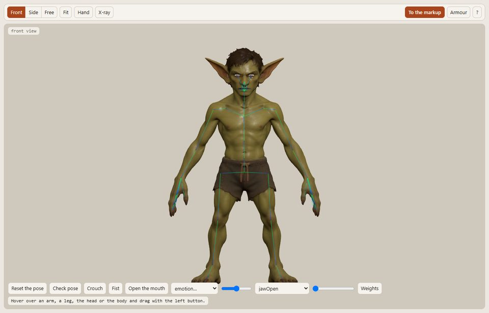 | 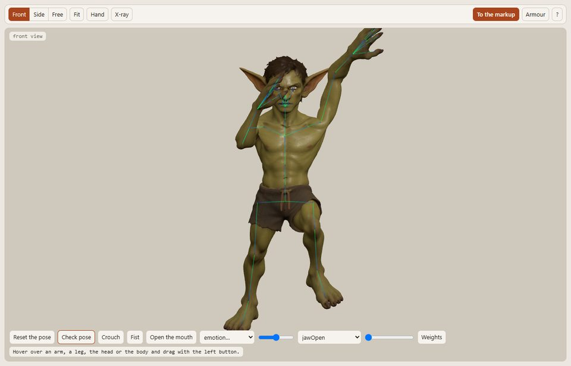 |

### Armour: place, put on, check

**Armour** opens the fitting panel; the «Equipment: fitting a piece» tab opens it at once on the current character. Choose the piece's GLB: a piece without its own skeleton gets its body part from the file name (cuisse → thigh, chest → torso, …), or choose it yourself. The piece is placed and fitted to the skin by its whole inner wall at once. The dots are the nodes of the inner wall: red — under the skin, green — on it, blue — air.

«Put on» sends the piece to Blender: it is pushed out of the skin, given the character's bones and weights, and saved next to the character. «Check pose» bends the body, and the piece must follow it.

| 1. Placed (fit nodes) | 2. «Put on» | 3. «Check pose» |
|---|---|---|
| 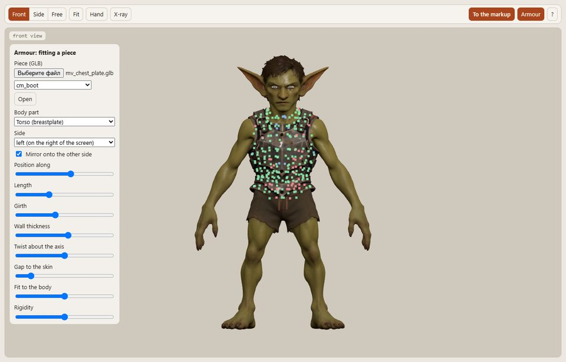 | 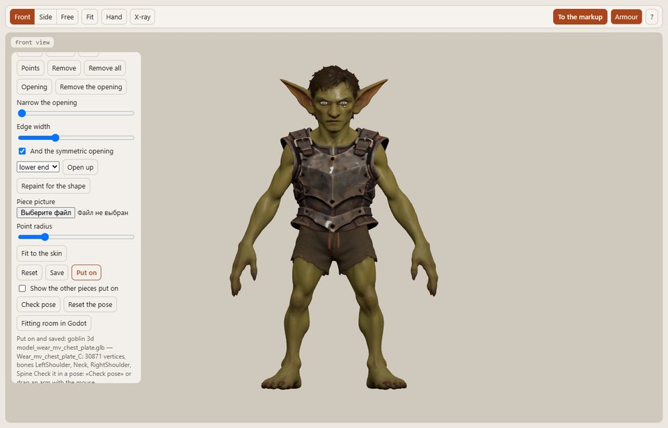 | 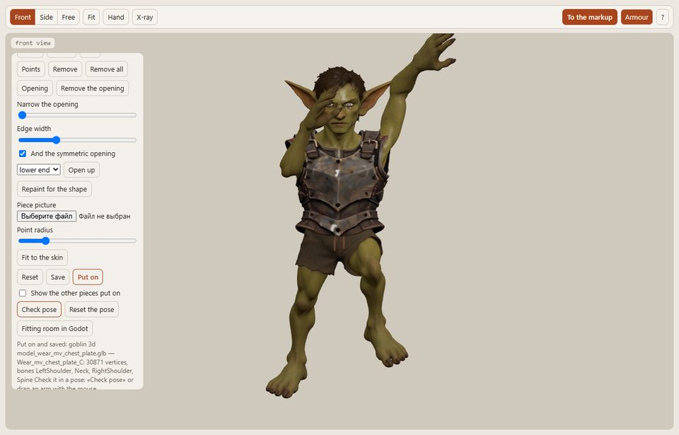 |

The sliders correct what the automatic fit got wrong: position along the limb, length, girth, wall thickness, twist about the axis, gap to the skin, fit to the body and rigidity. «Points» pulls the surface by hand, and «Fit to the skin» runs the automatic fit again after manual changes.

### Openings: an arm hole drawn in

«Opening»: click 3 or more points around the edge of an arm hole or a neck. «Narrow the opening» draws the edge and the surface around it toward the circle's centre, both walls together; «And the symmetric opening» does the other side too. Here the arm hole of a breastplate was too wide and left the armpit open.

| Before | «Narrow the opening» 0.25 |
|---|---|
| 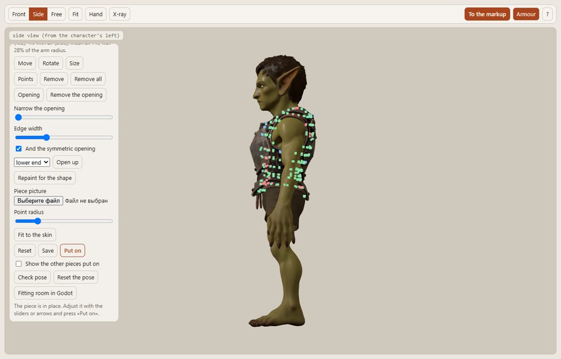 | 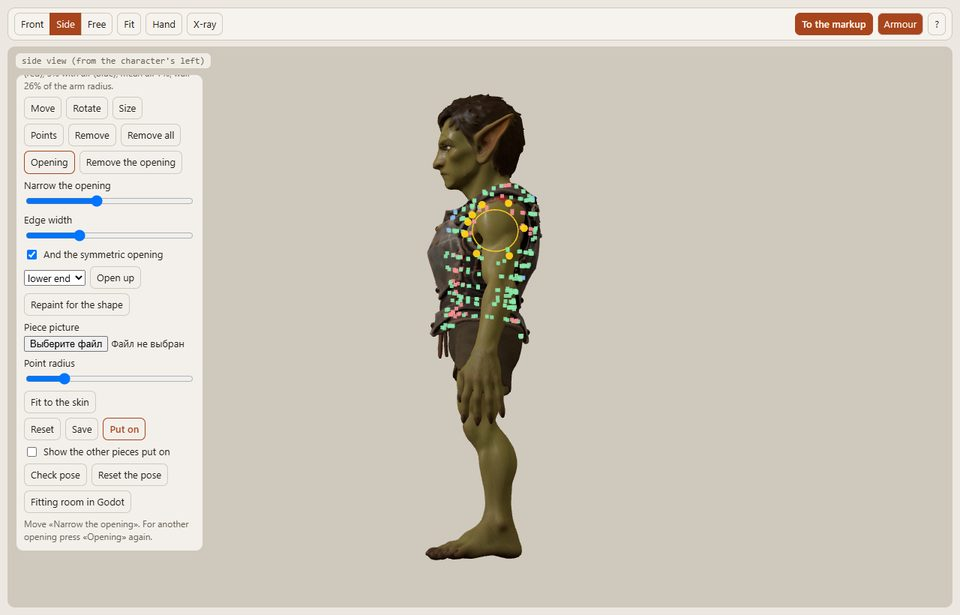 |

### Repaint for the shape

Drawing an opening in, points and the wall slider all stretch the texture. «Repaint for the shape» sends the reshaped piece to Hunyuan3D-Paint with the front picture it was made from (found by itself for generated armour, or chosen in «Piece picture»). The texture is painted anew on the new shape, sides not seen in the picture included (3–6 min on the GPU).

| The piece as generated | Arm hole narrowed and repainted |
|---|---|
| 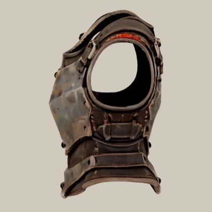 | 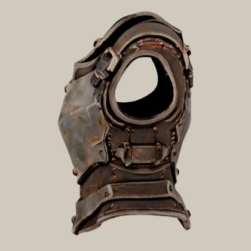 |

### Opening up a closed end

A generated piece is sometimes closed at an end: SF3D caps a bracer at both ends, and a Hunyuan cuisse may have a knee cop curling under it. Choose the end (lower — away from the body, upper, or both) and press «Open up». Blender cuts that end off with the texture kept; the piece's own wall stays, and a solid blank gets a wall inwards. The piece is then placed again.

### Layers: a piece over another

When pieces overlap (a boot over a greave, a cuisse over padding), the list «Over these pieces» says which pieces already put on go under this one. Pieces on other body parts that overlap it are ticked by themselves; two pieces on the same part are usually alternatives, so tick those by hand when they are layers. On «Put on» the outer wall of the ticked pieces counts as the skin: the new piece widens over them, and what a cell cannot widen enough moves out along the ray from the limb axis. Measured from 8 sides, a long cuisse put on over a Tripo thigh piece let 27% of it show through without layers and 4% with them (the lower piece's longer edge).

### What a piece hides

Every piece put on (fitted or procedural) also saves which part of the body it hides, `<item>.mask.json` (`tool/body_mask.py`): the skin under it, which would poke through in motion, and what sticks out through it — the cords hanging from trousers under a skirt, the ears under a helmet. A face out of a helmet or a hand out of a bracer stays. The editor and the Godot fitting room take those triangles away while the piece is on, and bring them back when it is off; the body's edge at the piece's rim stays.

### Saving and the Godot fitting room

Every «Put on» also saves the fitting (`<item>.fit.json`); «Open» brings it back with all the sliders and points. «Fitting room in Godot» builds a small Godot project with the character, its clips and every piece put on, and opens it. Here is a whole set in Godot during the walk clip: breastplate, helmet and short cuisses from Hunyuan3D, boots, and bracers taken off a Tripo character.

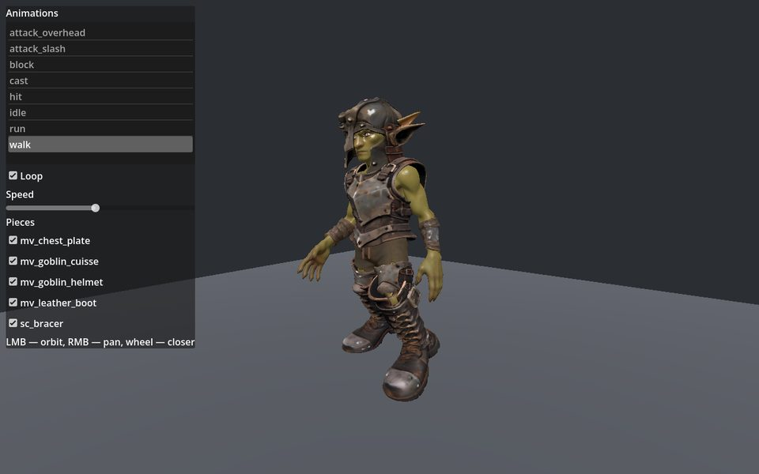

### Equipment: procedural

Character → «Equipment: procedural» makes a piece from parameters instead of a model: a bracer, a rerebrace, a greave, a cuisse, a breastplate, a skirt of tassets (from the waist, so there is no gap between the breastplate and the cuisses), a pauldron, trousers or a brayette (mail briefs), built from the skin of a character with a landmark skeleton. The editor opens on the current character at once: the page (`tool/armour_gen_editor.html`) shows the character with the piece on it and rebuilds the piece on every move of a slider, in a few hundredths of a second. What is on screen is what is made:

- Pointing at a group of parameters (plates, rivets, straps) lights up the part of the piece it changes.
- The views (front, side, close-up), the character in its own colours, plain or see-through (to see the gap to the skin).
- Poses: arms up, arms forward, elbows bent, a squat, a stride. The piece moves by the same weights it will have in the game.
- Pieces made before are listed and open again with their parameters.
- «✋ Pinch»: «Pull» — hold the left button on the piece and drag to lift the surface there or press it in; «Paint» — move with the button held and along the way the surface rises under the brush, presses in (never into the body) or smooths out (bumps, dents, hammering); Shift swaps raise and press. An orange grid shows what moves; where the armour is hidden by the body, the skin round the brush turns see-through so the hidden part can be pulled out. The brush is a circle, an oval, a square or a strip (its proportion and turn, Alt + wheel); radius, strength and edge softness are set in the panel (Shift + wheel or `[` `]` for the radius). Pinches are kept with the piece, stay through the other sliders and are made with it.
- «🖌 Paint» (in the same «Brush» box, with the same brush shapes): paint of a chosen colour, gilding, silver, rust, soot or blood — with the brush, on one part (a plate, a strap, the trim), on all parts alike, and an eraser; rust, soot and blood lie in patches. The layers go on in order and are kept with the piece. The editor shows them per vertex; Blender lays them on the baked colour, roughness and a metalness texture per pixel (a baked position map weighed against each stroke), so the result is sharp.
- «Picture» in «🖌 Paint» puts an emblem on the piece, projected onto it where clicked: a boar, bear, lion, dragon, werewolf or dog head, or a number (each digit side by side), in any look (gilded, painted…) or in the picture's own colours; size from the brush, turn, mirror. The shared set (drawn by `tool/decals/make_decals.py`) is copied into `export/decals` the first time; any PNG put there is offered too (its alpha is the shape).
- «Damage» in «🖌 Paint»: claw marks (five grooves), one scratch or a hole with a torn rim, soot and cracks, put on with a click (size from the brush, turn, depth from the opacity; a little different each time). The grooves are the bare metal, lit from above, over any paint.
- Ctrl+Z undoes and Ctrl+Shift+Z (or Ctrl+Y) redoes any change: a slider, a style, the piece, a pinch; the ↶ ↷ buttons do the same. «Armour» has redo too.
- «Cloak» is cloth that swings in the game: it sits on the shoulders, its collar at the neck, the chest closed down to a brooch clasp (a narrower cloak: a button in front of the throat on a cord to each edge), the edges parting below, a bell to the hem (length, wrap at the throat, flare); the neckline higher at the back than at the clasp («Collar at the back»: it lies on the trapezius up to the nape). Blender hangs it, from under the collar to the hem, on 13 chains of cloth bones (`Cloth_<column>_<link>`) and a hidden grid of the places they belong (`__clothhome`); in Godot `SF3DEquip` adds those bones to the character's skeleton and swings them with its own cloth simulator (`SF3DEquip.Cloth`, as the editor's «Cloth»: each point stays near its place on the trunk and never goes inside it, the limbs push it) — in any animation. The fitting room has a «Wind» slider. In the editor the «Cloth» button shows the cloak as cloth (any pose but «Arms down» turns it on by itself: skinned, a cloak would go through the body, and the game has it as cloth): it settles, flows round the body, moves as the pose changes and swings in the wind, its top lying on the skin as posed (raised shoulders, shoulder blades drawn forward lift it); raised arms (up, forward) slide it back, collar and all — behind the shoulder joints (the cords to the brooch drawn out), spread at the sides below the armpits like wings, the arms in front (the game does the same); the cloth is drawn as a smooth surface, its folds soft; «Collar height» and «Gap» sit it on the shoulders. The cloak is built over the arms hanging down (the «Arms down» pose is chosen by itself) and nowhere nearer the body than the «Gap».
- «Skirt» is the same cloth from the waist: it holds at the waist («Waist height» above the hip joint), a bell to the hem (length, flare, gap), sewn all round or with a «Front slit» from the hem up. The arms hanging beside it are left out of its shape and stay outside it. Blender hangs it on the same chains of cloth bones, from the hips; in Godot and the editor's «Cloth» the thighs push it and over a thigh it partly goes with it: a stride swings the hem forward, a squat lays it over the knees.
- «Tabard» is two panels, before and behind, from the collar over the shoulders (short «sleeves» there) to below the hips; open at the sides below the armpits, a leather belt round the waist holding both («Belt height» above the hip joint); length, flare, collar height, gap. Above the belt the cloth goes taut from the shoulders to it, below it hangs free; below the belt the thighs push it and over a thigh it goes with it, as a skirt. In Godot: the same chains of cloth bones, its cuts and the belt's row passed in the name of its grid of places (`__clothhome__o…`).
- Weapons and the shield are pieces too, each its own button in the «Weapons and gear» block, as the «Shield»: a sword, dagger, axe, mace, two-handed sword (a Zweihänder: a grip for both hands, a cross with its ends turned to the blade, a leather-wrapped ricasso with parrying hooks), two-handed axe (a Dane axe: a long haft, a broad crescent head, langets), war hammer (a square face crowned with four points, a beak bent down, a spike on top), war club (oak, thickening to its head, iron bands and spikes), spear or staff in the fist (its grip across the palm under the knuckles, rigid on the hand's bone; sliders for its sizes and for the grip's place, tilt and turn) and a shield on the forearm's outer side: round, kite, heater, tower (a pavise) or curved (a scutum); curvature, a bend round its long axis (as a scutum's), rim, boss (a kite's too, over the fist). The shield is placed as a node is in the markup: with the mouse in the view (arrows move it, rings turn it, cubes scale it; keys G, R, S; the gizmo sits on the board in the pose being looked at) or by the numbers «Position, cm» (X across the shield, Y along it, Z off the arm), «Rotation, °» about those axes (no ±90° limit: Z 90° puts it across the arm) and «Scale, %». A pavise follows the old ones: a ridge down the middle («Ridge», a channel behind), an arched top, a little narrower at the foot, no metal rim. In «Paint» → «Picture» a shield has «Picture over the whole shield»: the chosen picture, in its own colours, covers its whole face along its axis (your own pictures: PNG files in `export/decals`). There too is the «Painting generator» — a picture as the painted pavises were: a field, a pattern (lattice with dots, scales, vines, drops, checks, stars), a border with a thin line, in the middle a coat of arms, a cross or a saltire, or arms over the whole field. On a shield all of it follows its real outline (round, kite, heater, a pavise with its arch, a scutum): the border along the edge, the arms and the cross at the roomiest point (a kite's wide top), the flaking thicker at the edge; on a bent shield the picture is unrolled by the length round the bend, so the border is no wider at the sides; aged — darkened varnish, paint flaked to the gesso (more at the edges), crazing. The colours follow heraldry (a metal on a colour), one seed gives the same picture, 🎲 another. «Put on» saves it in `export/decals` (Blender bakes it from there) and on a shield puts it over the whole face; on other pieces it is put with the «Picture» brush. The arms are drawn by [Armoria](https://github.com/Azgaar/Armoria) (code MIT, `tool/vendor/armoria`, `update.py` downloads and builds it); only its CC0 charges — 108 of 354 (the rest are non-commercial or share-alike). The ageing noise is [FastNoiseLite](https://github.com/Auburn/FastNoiseLite) (MIT, `tool/vendor/fastnoiselite`). Instead of the procedural look a ready material can be taken: the «Materials library» in the material block searches [ambientCG](https://ambientcg.com/) and [Poly Haven](https://polyhaven.com/textures) (both CC0, fine for a game), with categories (wood, planks, leather, fabric, metal, rust, paint, gold) and the part of the piece it goes on: the base, leather and straps, small metal, mail, quilted cloth, trim, the back. A click on a preview downloads it once (1K: colour, normals, roughness, metalness — `export/materials/<source>_<id>`, `tool/matlib.py`); in the view it lies at its real size (the «sample, cm» field), and Blender bakes it box-projected with the same wear over it: dirt, worn edges, light scuffs from the texture's own colour. There too is «Own material…»: choose a photo of leather, cloth, metal (and its maps if you have them — told by the file's name: normal/nrm, rough, metal; a DirectX normal, «dx» in the name, is turned over). «Seamless» joins the picture's edges (it is cross-faded with itself moved by half), the relief and roughness maps it lacks are worked out from its brightness; «metal» makes it metallic. It goes on the part of the piece chosen and is kept in `export/materials/custom_<name>`; under the source «Own» it is there for every piece. Below is «Texture from a picture», as Tripo does it: a concept of the armour (front, back, left, right) is loaded for each view, «Align» shows it half seen over the character in the rest pose (drag to move, Shift + wheel to size round the pointer, the wheel alone zooms the view, «Fit» for the whole height), and it is projected onto the piece: each view onto what faces its way, the views blending at the sides; what no view sees keeps the piece's material. Blender bakes the projection into the piece's own unwrap, so any piece takes it however it is unwrapped; wear, paint and damage go over it. The pictures are kept in `export/concepts`; «Take the pictures of the last piece» puts the same concept on the next piece in one click. A flat picture projected on a piece with volume is always approximate; more exact is «Texture by the unwrap»: a piece made gives out its unwrap by parts (the base, the straps, the trim… each has its own unwrap and texture) into the folder `<piece>_uv` next to it — `<part>_layout.png` (the islands over the current colours), `<part>_mask.png` (where the islands are), `<part>_color.png`, `<part>_lines.png`. In «What to paint» you write the idea, and the editor makes a prompt for Codex of it («Copy»): which files lie where, the islands not to be moved, the colour carried past the edges, no painted light, the result as `<part>_user.png` in the same folder. «Take from the folder» (or «Load a texture…» for the part chosen) makes it that part's colour and makes the piece again at once; paint and damage go over it. There are three prompts. «Generator: on the unwrap» — a short one for models that edit a picture (Nano Banana 2, GPT Image 2.5 — tested, they keep the layout): they are given `<part>_color.png`, the prompt asks not to move the fragments and not to draw outlines or bevels along their edges (the islands' edges are the unwrap's seams). The button «Generate a texture for «…»» sends it through OpenRouter (the key is the one in «Settings» → OpenRouter; the models that edit a picture and their price per picture come from OpenRouter's Image API, `tool/texgen_ai.py`): the answer is kept as `<part>_ai_<model>_<time>.png` and goes on the piece at once (Nano Banana 2 — about 20 s and $0.07). Two more: «Codex: a script on the unwrap» — Codex writes and runs a Python script (noise, scratches, rust, blood over the whole square, multiplied by the current colours, details inside the islands by the mask) — and «Image generator: seamless» — for DALL·E, ChatGPT images, Midjourney: a seamless sample of the material, loaded with «Own material…» and laid by the piece's shape with no unwrap. An image generator does not repeat our unwrap — it draws a layout of its own; so the script prompt forbids generating an image and asks for a texture over the whole square with no empty background, and on loading the editor checks it against the mask: where islands fell on the picture's background it says how much and fills the holes with the texture itself (pieces from the places nearby, `<part>_user_fit.png`), the file given kept. The original `<part>_layout.png` and `_color.png` are not written over once a texture is on. A picture painted on the unwrap (an edit model on `color.png`) is recognised — what is not its background lies within our islands — and cleaned: the light rim generators paint along the fragments' edges (on the model it would be lit seams) and the background in the islands are taken from the nearest surface, the colour carried 8 px past the edge (after DeepSeek's `clean_generated.py`). When the piece has no paint and its parameters have not changed since it was made, the texture is put straight into its GLB (that part's colour picture replaced; the geometry, the unwrap and the weights the same) — in seconds, not made again; else the piece is made again with it. «Apply to the whole set» makes the whole outfit one texture: the open piece's texture is the sample, and every other piece ticked in «Worn» (with an unwrap) is repainted by the model chosen from two pictures — its own unwrap and the sample (ticks add the leather and straps, the small metal and mail); its colours are brought to the sample's (each YCbCr channel's mean and spread inside the islands) and the texture is put into it at once. The clothes (the undercloth, the trousers, the skirt, the tabard, the cloak) are left unless «and clothes» is ticked. Pieces made before their unwrap was given out the set offers to make again in the background (with their parameters; a helmet and the generators' other pieces too), then goes on. For strict sameness, «On every piece worn» in the materials library puts the chosen (or own) material on the same part of every piece ticked and makes them again by layers. The texture holds as long as the piece is not rebuilt with other parameters: the unwrap is another then, and the editor says to take it out again. The unwrap itself is kept next to the piece (`uv_loops.npz`: each face by its points) and given back when the same geometry is made again — `smart_project` cuts a big part's islands differently from run to run. The helmet, the elbows and the footwear (made by the `vendor/blender_armour` generators) are now baked into textures too (`tool/blender_texbake.py`): their materials go into parts — the steel into the base, the mail (an aventail's rings, mail inserts) apart, the leather into «leather and straps», the lining into «quilted cloth» — each with its own unwrap and texture; for them the «Material» group has «Texture by the unwrap» only (with the OpenRouter generation). Its face is the covering (the piece's material: leather, rawhide, canvas or painted planks), its back and edge the bare boards; scratches, soot, pictures and damage go only on the side they were put on (in the editor and in Blender) — «Battle wear» no longer reaches a shield's back or the inside of thin plates. They take the same materials, paint, emblems and damage. «Damage» has a «Dent» too — it presses the mesh itself (a crater with a rim round it, never into the body). The «Battle wear» button scatters dents, scratches, now and then claw marks and soot patches over the piece — where blows land (the bulges, in front and on top); pressed again — another set, what was put by hand stays, Ctrl+Z undoes. On a shield's back two leather straps go round the forearm (by the elbow and by the wrist), following the arm's own section. With «Bar in the fist» ticked the shield is held by hand, and «Strap by the elbow» (on by default for all but the round one) adds a second strap round the forearm — enarmes, at the place nearest the elbow that lies over the shield; the shield then sits on the forearm's bone (if the strap does not lie on it, the editor says to move or turn it). Its long axis goes from the elbow to the fist. across its back is a leather-wrapped bar whose two posts pass the index and the little finger, and the board lies against the back of the hand and the forearm — the outer side, as with straps, so a hanging arm does not press it into the thigh. The bar sits in the middle of a round shield (behind the boss) and on the wide part of a kite or a heater; the point goes towards the elbow and covers the forearm. The shield is rigid on the hand's bone and takes the weapon's grip sliders; «Along» moves the bar towards the edge, «Off the arm» moves the board off the hand, «Turn» turns it. The gap to the hand is found by rays over the back of the arm and by the closed fist's knuckles. In the GLB the mesh is named `…__hold_<side>`, so in Godot the fingers close round the bar as on a weapon. «Check in motion» works for them too: the clips are searched for where the piece goes through the body (not the arm holding it; a shield also for the frames it faces the body), and for a shield how far to move it off the arm so that the body goes into it in no frame — the button «Move the shield out by N cm» sets that in the position's Z field; when more than 8 cm is needed there is no button (the shield would hang in the air): the editor names the clips and suggests making the shield smaller, turning it or holding it higher. The spear's and the bow's clips (the other hand on the shaft or the bow) are not checked for a shield or another weapon. A shield of another shape is a new shield: the last one's paintings, damage, place and name do not carry over (the painting generator draws its picture again for the new outline). The «Move / Rotate / Scale» buttons and the G, R, S keys put down a brush that is on, which hides the gizmo. In both hands: the «Second hand» slider (sword, axe, mace, spear, staff; the two-handed sword and axe come with it set, on one side) — where on the haft the other hand holds, in shares of the arm's length from the first (plus towards the head, minus towards the butt). In the «Fist» pose the holding hand brings the weapon forward, the other one takes the haft (the arm's two bones, the elbow down and out) and closes with its own fist. To judge a piece as it is carried there are guard stances (the feet on the floor, the pelvis lower, the knees bent, the shield's shoulder and foot forward, the head to the front): «Guard: shield» — the shield before the chest facing forward, the sword over it pointing forward; «Shield, sword up» — the sword raised over the shoulder to strike; «Two-handed» — the grip before the belly, the point forward and up; «Two-handed high» — the hilt by the shoulder, the blade up and back (vom Tag). The other hand takes the grip where the «Second hand» slider says. A shield and a weapon from «Worn» take them too: a worn weapon's axis and grip are found from its mesh, a shield strapped by the elbow turns with the forearm. In Godot (`SF3DEquip.Grip`) the same after every frame: the clips are made for one hand, so when the other cannot reach, the holding hand comes towards it (the weapon's turn kept). A spear keeps its head forward: when a clip turns the hand so that it points more than 30° away from where the hips face, the hand turns back — a swing or a throw does not point it backwards. Scabbards and quivers have a block of their own, «Scabbards and quivers», each variant a button (sword scabbard, dagger sheath, quiver, hip quiver): a sword's or a dagger's scabbard hangs from a belt round the waist on the chosen side a little forward, down and back along the thigh; its length and width are the weapon's sliders, so a scabbard made after the sword fits it. A quiver sits on the back, its arrows over the chosen shoulder, on a strap across the chest; it is a tube (hollow, with a floor), and each arrow in it is its own object in the GLB (`…__arrow_<k>`, the «Arrows» slider): in the game `SF3DEquip.arrows(piece, n)` keeps n of them shown — the arrows are seen spent; the Godot fitting room has an «Arrows in the quiver» slider for it. The belt and the strap follow the body (over the pieces ticked in «Worn») and take the weights of the skin under them; the scabbard is rigid on the hips, the quiver on the chest. A quiver can also hang on the hip: from the belt at the side, the arrows up and forward. A bow is a kind of weapon: held in the fist by its wrapped grip, its limbs bending back to the archer, the string between the tips on the archer's side; its length and thickness are the weapon's sliders. They have clips in the «Animations» tab (and in the fitting room): «Spear: stance», «Spear: lunging thrust», «Spear: throw», «Bow: shot» — the bow in the left hand, the body side on, the right hand drawing the string to the chin and flying back at the loose. In Godot (`SF3DEquip`) the fingers of a hand holding a weapon close round its grip after every animation frame.
- «✎ Fix the pose» (by the poses) puts any pose or stance right by hand: the skeleton is shown, a click on one of its bones (or on the body, the armour on it) picks it and marks it red, the gizmo's rings turn it; in «Result» too. The fixes are kept per pose, on top of what the pose computes itself, saved for the character (`work/poses/<character>.json`) and given back the next time the editor opens; «Reset» takes the current pose's away.
- «Snap to the palm's middle» (a tick by a weapon, on for a new one): the grip lies on the palm's middle by itself - a ray from inside the hand out to the palm's skin, the grip on it by its radius; the fingers close round it by contact: each finger bends joint by joint until a bone of it meets the grip (the finger's thickness counted), so none goes through it whatever its girth. The same degrees close the other hand on a two-hander's haft (the holding, right one above, the other below) and the hand in the game (`SF3DEquip.Grip`, the mesh's name `__grasp_<15 degrees>`). Unticked, as before: the grip's sliders and the remembered fist.
- In the Godot fitting room a thrown spear (the `spear_throw` clip) leaves the hand at the release and flies in an arc, back in the hand when the clip starts again; in a throw the other hand is not brought to the haft. In `bow_shoot`, from the nock to the loose, the string is drawn to the right hand's fingers with an arrow on it.
- In the fitting room one thing in a hand: ticking a weapon unticks the others held in a hand it takes (a two-hander takes both, a shield on the forearm the left one); on opening, of several in one hand the first is kept. A weapon unticked lets its hands go (the fist, the other hand on its haft, the grasp).
- A two-hander in the quiet clips (idle, walking, running) is carried in one hand, its point down and a little forward, the other hand not reaching for it; in the fighting ones in both hands.
- «Check in motion» (`tool/blender_wear_qa.py`): the piece made is put on the character with its animations (the fitting room's clips) and every clip is played in Blender: where the skin that lies under the piece at rest comes out through it, and where the body its mask takes away shows a hole. The report gives each clip's worst frame and shares; the places are marked red on the character in the editor.
- The hand holding a weapon closes as round a grip: every finger bends in its own plane towards the palm (the thumb too), and the grip is put inside the ring the closed middle finger makes, as thick as it — the same in the editor («Fist» pose) and in Godot. If a fist was made by hand in «Skeleton → By hand by landmarks → Pose» and «Remember the fist» pressed, that one is used: it is written next to the built rig at once (`<model>_landmarks.json`, no rebuild), and the armour editor and the Godot fitting room (`fist.json` beside the character) put it in the hand's own axes (across, along, towards the palm), so it fits other exports of the same rig too. The grip goes into that fist's ring — after changing the fist, generate the weapon again. The pictures «Generate» makes (Blender) show the holding hand closed with that fist too.
- «Fitting room in Godot» shows the piece on screen: one changed since «Generate» is made first.
- «Worn»: the pieces already put on the character show on it, and the new piece is fitted over the ticked ones (a mail skirt or a brayette over the trousers, two layers as worn for real). A cuirass always goes over a skirt, whichever is made first: a skirt made under a worn cuirass stays inside it, belt and all. The rule is general now, the layers being: clothes under the armour → trousers → shoes → brayette → the limbs' plates and the skirt (a gauntlet over the vambrace, elbow cops over them) → cuirass → pauldrons and helmet → cloth over it all (tabard, cloth skirt, cloak). A piece made while pieces of higher layers are worn is kept under their inner wall: trousers made after the greaves and the cuirass no longer come out of them. Cloth worn over does not limit it: it is made again afterwards. When higher pieces were made before a lower one, the editor names them after «Generate». «Rebuild by layers (N)» makes again only the pieces out of date: those under which a piece of a lower layer on the same part of the body appeared or was remade since (a coif is no reason to remake the trousers), and everything over those; N on the button says how many, and with nothing to do it is greyed. It goes from the inside out, each with its own settings and over every piece under it, so the order they were first made in no longer matters. The shapes are all worked out at once in the editor (each over the lower ones just worked out — what is on the screen is what is made), and Blender makes them one after another in the background: the editor stays free, each piece is put on when done, the progress shows by the button («2 of 3 done, now …») with «Stop» — the current piece is finished, the rest are not. A piece waiting in the queue cannot be «Generated» meanwhile; helmets, elbows and shoes from the generators and weapons stay as they are. On the warrior: 9 pieces in 4 minutes; after it the trousers lie 1.6 cm off the skin at the belt and the cuirass 2.5 cm (before, the trousers at 1.9 cm were over the cuirass at 1.1 cm). The ✕ by a piece in «Worn» and «Remove» by the saved ones delete the piece for good (asked first): its files are erased, it leaves the lists and the character, and the Godot fitting room takes it off when next opened. The file of a piece a character already wears (its result or `.src.glb`) is not put on again in the fitting tab, and «Add a model…» does not make a character of it: both used to leave a copy over the piece and a stray «character».
- «Style of a reference» sets a bracer, greave or breastplate to one of the reference sets (hardened leather, steel plate, mail, exposed splints, covered splints or brigandine, plate over mail, lamellar); the sliders change it from there.

«Generate» sends this very geometry and these weights to Blender (`tool/blender_armour_gen.py`), which bakes the materials; the baked piece then shows in the editor («Result») and follows the poses on the character's skeleton. How the piece is built:

1. Around the limb's middle line, rays take the skin's profile. Other limbs' skin does not count; a limb piece leaves out clothes hanging off the limb, a breastplate, the tassets and trousers go over the clothes.
2. The profile is smoothed by «Body relief», moved out by the gap and made thick. A breastplate goes up to the neck with a neckline in front and armholes round the arms, its bottom may come to a point, a ridge may run down its middle; it is convex round and never widens going down (the flare belongs to the skirt below it), «Narrowing to the waist» sets how far it follows the waist, «Anatomy» raises a chest and an abdomen on it. It can be made of two parts (a chest of one or two plates over lames, mail, scales and so on), with mail under the plates (a skirt below them and short sleeves) and spaulders: half-round lames across the shoulders, the upper over the lower, the top one a larger dome (also a piece of its own, «Pauldron»); each lame moves as one, the lower ones more with the arm («Pauldron follows the arm»), so they slide over each other instead of bending; the plates' rims can be trimmed in brass or gold, and «Hammering» goes from polished to forged; the tassets of lames hang straight from the hips and flare, cut into panels so the legs move, while a skirt of mail or cloth is soft and cut so the legs move freely: it starts at the waist and lies on the body: down each thigh at the front and the sides, hanging from the seat behind, a little flared, in folds with a wavy hem, open in front behind a loose panel (longer, widening to the hem) or a wrap; below the hip joints its front and sides go with their own thigh, the panel halfway with both; trousers are a seat down to the crotch and two legs, tight or loose, with folds and cuffs, any length (knee breeches too), a laced front, and over the thighs mail, plate cuisses, riveted leather panels or a plate over mail, tied to the belt with points, with knee cops (a wing on the outer side) or leather knee patches; a brayette is the same short and of mail, with a crotch piece between the legs; a mail skirt may have a leather-bound edge.
3. The surface: plates with rolled rims and rivets; metal splints riveted along a leather base; a brigandine (leather over hidden plates, columns of rivets, sewn seams); each a little wider than the next so the upper one overlaps it; scales or lamellae on a leather backing, every row over the next one's laced end; mail or quilting (a pattern baked into the texture); or plain. The scale and ring size is a share of the character's height, the same on every piece of a set.
4. An open piece fastens on its inner side the way the references do: short straps riveted to both edges with a buckle over the gap, or a laced cord; a plate one may have hinges on the other side. A bracer's or greave's edge is cut back at the joint on the inner side and comes down at the far end in front (over the instep), the ends a little flared; a greave's bottom edge runs level with the floor, not square to the leaning shin (it went round the leg at a slant, up to 1.2 cm; now 0.05 cm), the instep cut kept; a piece over others (a greave on trousers) looks for the layer under it not only as far as 1.6 times the skin's distance but at least 3% of the height past the skin: where the bone is under the skin (a shin's, a forearm's inner side) the skin is near the axis, and trousers 2 cm off it (their strap at the knee 3.6 cm) were missed — the greave went on the skin and the cloth came out through the metal; on the warrior rebuilt by layers none of 72 rays round the shin finds the trousers past the greave; leather can have stitched edges. A breastplate is one piece, as a fitted armour is: a ring round the body to the armpits and over it, with no seam, a cap over the chest, the collarbones, the shoulders and the back; rays from the body's middle find its neckline and armholes themselves (where they meet the neck, an arm). A vest keeps the cap's shoulders; a plate keeps only the breast- and backplate's tops, joined by straps from the breastplate over the shoulder. It may open on a side and fasten there. Otherwise leather straps go round the part, with buckles. A breastplate gets straps over the shoulders, the tassets and trousers a belt; trousers' other straps wrap the shins.
5. The materials (iron, steel, bronze, leather, cloth; wear: rust or patina and worn edges; the leather's and the cloth's colours) are procedural shaders baked into colour, roughness and normal textures. The editor shows them approximately, the exact ones come with the bake.
6. The weights come from the skin under the piece, drawn to its main bone by «Rigidity».

A «Helmet» is not made of the skin: it is one of eleven constructions - six of the helmet generators in `tool/vendor/blender_armour` (a kettle hat, an open bascinet, a barbute, a visored bascinet with an aventail, a sallet, an armet; Blender scripts written for a human head, in metres) and five of ours in `tool/helmets_extra.py`, on their parts and in their frame: a nasal helm (a cone, a brow band, a nasal), a spangenhelm (a dome of four plates under a frame of bands, a nasal, cheek plates), a great helm (flat-topped, two eye slits over a cross of bands, breaths on the right), a morion (a dome under a high comb, its brim swept up before and behind) and a close helmet (the armet under a comb). With a coif worn under it (mail or padded) the head is measured with it: the helmet is made over it, not under; the pointed ones (the nasal helm, the spangenhelm) rise over the head so far that their sides, going in to the point, do not cut into the skull's dome. A helmet's mask hides only the skin it closes over on all sides: under a brim, behind an eye slit and at the face's edge the skin stays (holes showed there); an open helmet (a kettle hat, a nasal helm, a spangenhelm, a morion) leaves the ears - a long-eared character's tips may come out through its side. `tool/blender_helmet_gen.py` measures every character's own head on the skin: the eyes, its depth and width at the brow, its top, the chin (where the face's front goes back sharply), the neck and the shoulders' top. Nothing is set for one anatomy: the same code fits a goblin (a short face, almost no neck) and a big-headed cartoon fairy. The helmet is built in the generator's proportions with the head's and scaled to it as one piece, its eye slits at the eyes (a kettle hat's brim at the brow). Below the face it is drawn up to end just under the chin, not on the shoulders; the chin strap (made for a man's jaw, on a goblin it would hang under the neck) goes just under the chin, a little behind its tip; an aventail hangs round the neck down to the shoulders' top, closing in to the neck, in front across from its carrier's ends behind the visor. It is bound to the head bone (an aventail's lower rings more and more to the neck). Its mask hides what is under it, everything on the head over the brow (hair, a hat modelled on the character) and the ears (`body_mask.ears`, `body_mask.above`): a goblin's would stick out through the sides. In the editor the chosen style's helmet is made for the character the same way (once per style and parameters, `work/helmets/<character>/`, 5–20 s) and shown on its bones; «Air over the head», the visor and the armet's cheeks, a sallet's tail, a kettle hat's brim and the chin strap's height and depth (to correct it by hand) are its parameters.

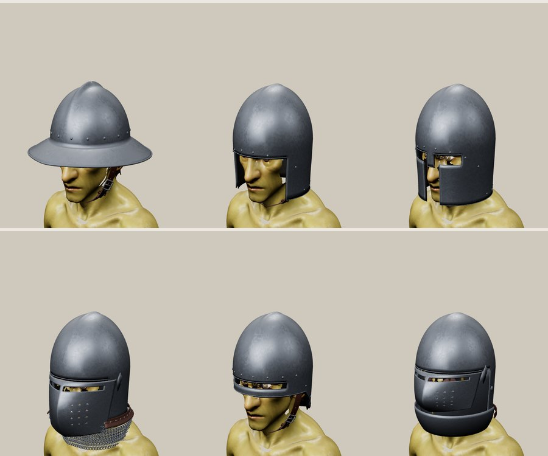

«Elbow» is the same with the elbow generators (`vendor/blender_armour/ElbowArmor`: leather, a mail sleeve section, a plain steel cup, a cup with a wing, a cup with lames, steel with a mail gusset; a man's elbow in metres, about the joint). `tool/blender_elbow_gen.py` measures each arm at its elbow on the skin (the middle of its round, its width and depth, how far out the elbow's point is, and how thick it is at the straps), puts the generator's frame along the upper arm (its lower half turned onto the forearm, an arm being a little bent at rest) with the cup on the elbow's point (away from the bend; behind for an arm straight at rest) so a right one's wing goes outward (the left one is it mirrored), sizes the cup a little wider than the arm and as deep as the elbow's point, and fits the straps (twice the generator's thickness, a little off the skin, joined to the cup at the sides), the lames and the mail round the arm at their heights. The upper strap and lames move with the upper arm, the lower ones with the forearm, the cup with what is on it half with each, mail and the inner leathers from one to the other; each elbow's mask is measured on its own, on the cup and the lames, kept in from their rims (the straps slide on the skin as the arm bends). The editor's «Elbows» pose shows them bent. «Air over the arm» and the wing's size are its parameters.

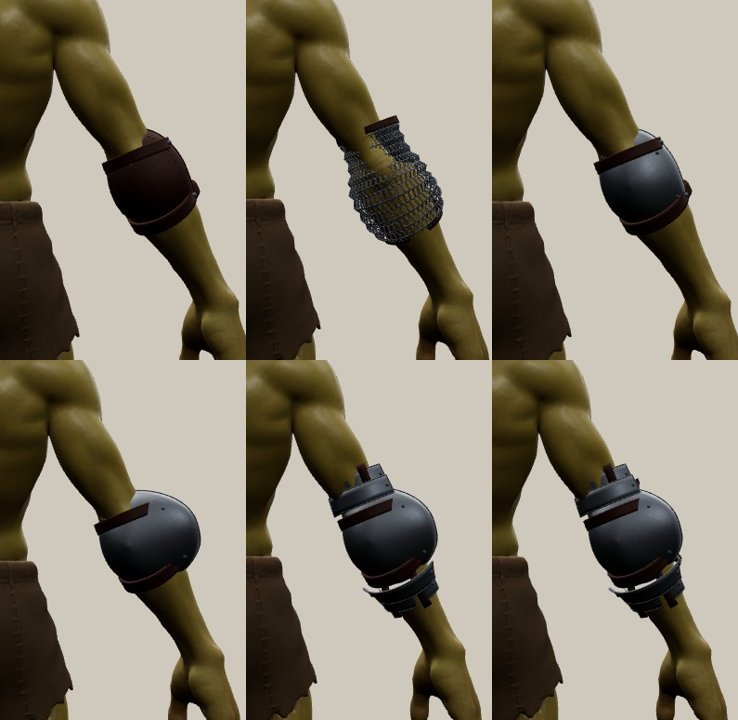

«Poleyn» is the same cups on the knees (`blender_elbow_gen.py` with `limb: leg`: the thigh, the knee, the shin; the cup's point in front, the wing outward — the right leg takes the mirrored one), the same six styles, «Air over the arm» and the wing's size. A poleyn's cup always faces forward (in an A-stance the legs are apart, and the bend between the thigh and the shin is sideways — the cup went inward by it). The elbows and the poleyns can be placed by hand: «Along, cm» (up or down the limb), «Turn round» (the cup to the outer or the inner side) and «Size» — they move the preview at once, in the view, and Blender makes the piece with them on «Generate». The straps go from under the cup's sides round the back of the limb (not over the cup's face), fitted to the skin by rays every 10°; the buckle and the rivets sit on the strap. The upper strap and lames go with the thigh, the lower ones with the shin, the cup half with each — the «Squat» pose shows it on the bent knee.

«Fauld» and «Culet» are short bands of lames at the waist: the fauld in front, under the breastplate's lower edge (the tassets hang from it), the culet behind, over the small of the back and the seat. They are built as the tassets are (plates, scales, lamellae; «Splits», «Flare», «Bottom» and «Top»), layered over the brayette, under the tassets and the cuirass.

«Gorget» is the neck's defence: a few lames round the neck, each a little wider than the one above (they overlap downwards), the lowest a collar on the shoulders and the chest (or on a cuirass worn under it), each ring by what is under it, smoothed round and never narrower going down; the upper lames go with the neck, the lower with the chest. Sliders «Lames», «Collar down», «Up the neck»; «Bevor» adds a plate over the chin and the mouth in front («Bevor up»: how far).

«Mail pelerine» is a short mantle of mail lying on the shoulders, on the skin (or on a cuirass worn under it), no collar (the throat under the chin open): from the neck's foot down over the trapezius, the shoulders' tops, the chest and the back, longer before and behind (a point), over the shoulders down to the arm's root; open behind, fastened by two thin straps with buckles (so it is put on). Always over the armour (the cuirass, the pauldrons, the besagews) - it lies on the outermost of what is worn; under a gorget and a helmet (their collar on it); its rings the size of the rest of the mail; it goes with the body under it (over the shoulders with the arms too). Sliders «Length», «Point before and behind», «Neckline», «Gap»; at any length the shoulders are covered - it is never shorter than to under the shoulders' joints and out to the arm's root, and a long one does not go down into the armpits.

«Besagews» are round plates in front of the armpits: «Plain», «Spiked», «Fluted». They are placed as the shield is - the gizmo in the view (arrows move, rings turn, cubes size; keys G, R, S) or by the numbers in «Placement»; the right one mirrors the left. They never go into the skin (the plate's back is kept off the body). They go half with the shoulder and half with the chest.

«Ailettes» are flat plates lying on the shoulders (sloping down and out with them, facing up and out) (a painting - arms - shows well on them), tied on by two laces: «Square», «Shield-shaped». Placed as the besagews are: the gizmo or the numbers in «Placement», the right one mirroring the left; they keep off the skin and what is worn by themselves. Over the pauldrons.

«Hauberk (mail shirt)» is a mail shirt: it lies as cloth does - on the skin (or over a gambeson worn under it), one surface from the neck over the shoulders down the sleeves, nothing between the body and the sleeves, moving with the skin; its rings round the body and round the arms. Below, the shirt itself goes on as its skirt (one mesh: the skirt's top row the shirt's edge's very vertices), hanging over the legs and their convex hull, not into the gap between them; «Hauberk to the knees» with its skirt slit before and behind (to ride) and sleeves to the wrists, «Haubergeon (short)» to the hips with sleeves to the elbows. Over the gambeson, under the cuirass. Sliders «Hem» (0 at the crotch, 100 to the knee), «Sleeves» (0 none, 50 to the elbow, 100 to the wrist), «Slits before and behind», «Looser».

«Coif (mail hood)» is one piece of mail: the hood and its cape one surface, as mail hangs - over the head and down onto the shoulders - first the convex hull of the head, the neck and the shoulders, then falling most of the way in where it bridges a hollow (before the throat, round the neck), as a heavy cloth, not standing as a frame; over them to the arm's root, longer before and behind (a point); an oval opening for the face from the brow to the chin; the ears go under it (hidden, as under a helmet) («Short cape», «Long cape»; slider «The coif's cape»). Over a padded coif when one is worn; under the helmet.

«Codpiece» is the 16th-century plate defence of the groin, with the brayette: a cup over the groin bulging forward, following the body under it (rays from in front; its bottom does not sink between the thighs), its rim rolled and riveted; rigid on the hips. It is under the plates (its layer: over the brayette, the hose and the undercloth): two 1 mm straps go from the cup up to the waist on the skin itself (over the undercloth if it is worn) — under the brayette, the hose and the cuirass; «Belt round the waist» adds such a belt round the waist. Where the skin under a piece worn is hidden by its mask, they lie on that piece's inner wall. Styles: plate, boiled leather (a brass rim), stuffed cloth as the landsknechts wore it (rounder, no rim). Sliders «Size», «Bulge», «Height».

«Footwear» likewise (`vendor/blender_armour/Footwear`: leather shoes, ankle boots, a mail foot, round and pointed sabatons, leather with steel and mail; a man's right shoe on one last, the ankle at the origin). `tool/blender_footwear_gen.py` measures each foot on the skin (heel, the toes' tip with any claws, width and middle, the ground, the ankle's height), scales the last to it along, across and up, its toe along the foot and its sole on the ground, then fits it across to the foot at each height below the ankle and along it (slices of the skin, smoothed: a goblin's toes spread wide where the last narrows; one smooth field for leather and steel, so the lames neither cut through each other nor let the leather out) and the shaft round the leg above it (slices round the shin, the calf in it); the left shoe is the right one mirrored. It moves with the foot, its toe with the toes, its shaft more and more with the shin, steel whole with what it lies on; each foot's mask is measured on its own. «Air round the foot» is its parameter; the stride and squat poses show it walking.

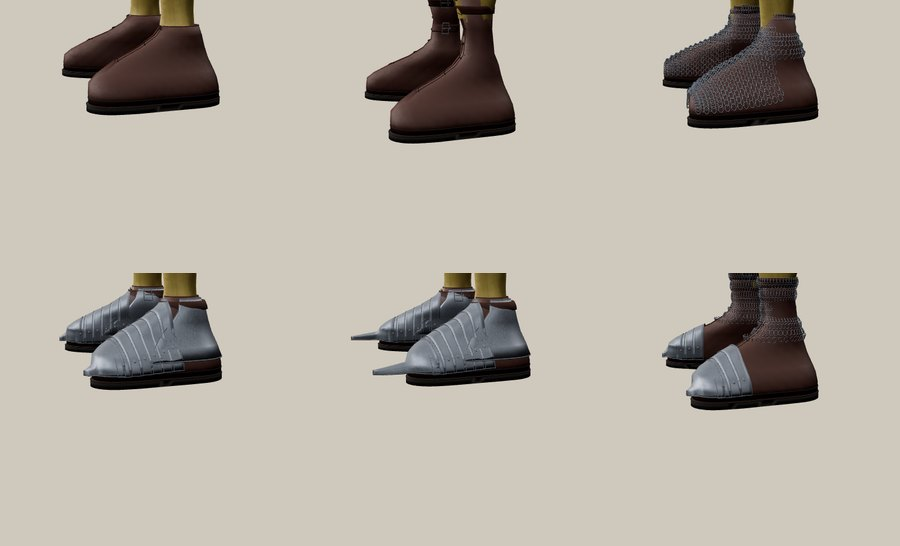

«Gloves» are built in the editor itself, of the hand's own skin (six styles after the reference sheets: a leather glove, reinforced leather, a mail mitten, an hourglass gauntlet, a plate mitten, steel with mail). The skin moving with the hand and the fingers is offset by the gap and made thick, each point with the skin's own weights, so the glove bends with every finger. A mitten's four fingers go into one bag, the convex hull of them and the knuckles, its points weighted as the nearest skin. On the back of the hand a plate (or a leather patch), on each finger's joint a scale a little longer than the joint (so they lie over one another), each whole with its bone, their outlines smoothed; a plate mitten has lames across its bag. The cuff is a bracer's round the wrist, flared towards the elbow (an hourglass), of leather, mail or plate, with a strap. The «Fist» pose closes the fingers.

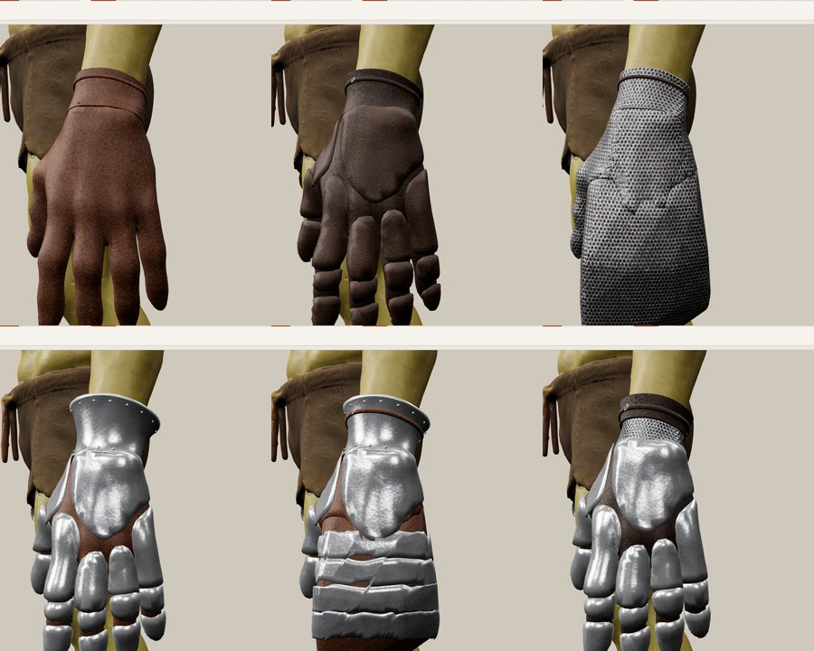

The first style, «Shirt under armour (thin cloth on the body)», is what goes under plates: a thin cloth made of the character's own skin (the torso to the hips, the shoulders, the armpits, the arms to the wrists), one surface with no gap between the body and the sleeves, no skirt, collar or ties; each point moves with its skin. The anatomy is smoothed as cloth lies: in the body's own size (a ball of about 3 cm, by area, not by the mesh's neighbours) the nipples, the chest's edge, the belly's squares and the arms' muscles go, and the cloth bridges the hollows. The skin under it is hidden in the editor and in the game (the mask), so the cloth may cut a bump by up to 4 cm. The trousers have the same style, «Under armour (thin cloth on the body)»: tights from the waist to the ankles. The other styles are quilted and thick, for a character without armour: a long gambeson's skirts would come out from under any armour, and extra geometry under plates is wasted. The editor's piece buttons are in blocks: «Armour», «Clothes», «Weapons and gear».

«Under the armour» is clothes, cut as clothes are, after the reference sheets: a linen shirt, a short aketon, a long gambeson, an arming doublet, a doublet with mail voiders, a quilted vest, and also braies (short or long) and a padded coif. They are made of the armour's own parts, loose on the body, not of the skin: the body is a vest's (a ring and a yoke over the shoulders; the armholes and the neckline are where the rays meet the arms and the neck), a skirt hangs on from it (never in to the waist, slit at the sides or behind), the sleeves go round the upper arm and the forearm (the forearm's under the upper one at the elbow, the armhole's edge turned in under the sleeve's top), a standing collar round the neck's root. They fasten down the front with ties or lacing; a doublet has arming points at the shoulders, the arms and the hem, the second one mail at the armpits. Quilting is in channels along or in diamonds. Braies are loose trousers, gathered at the ankle when long. A coif is a bag round the head (the hair may be sculpted on the skin, in lumps): the convex hull with the face cut out, the ears through it, the hair hidden under it. Their layer is the lowest: armour goes on over them.

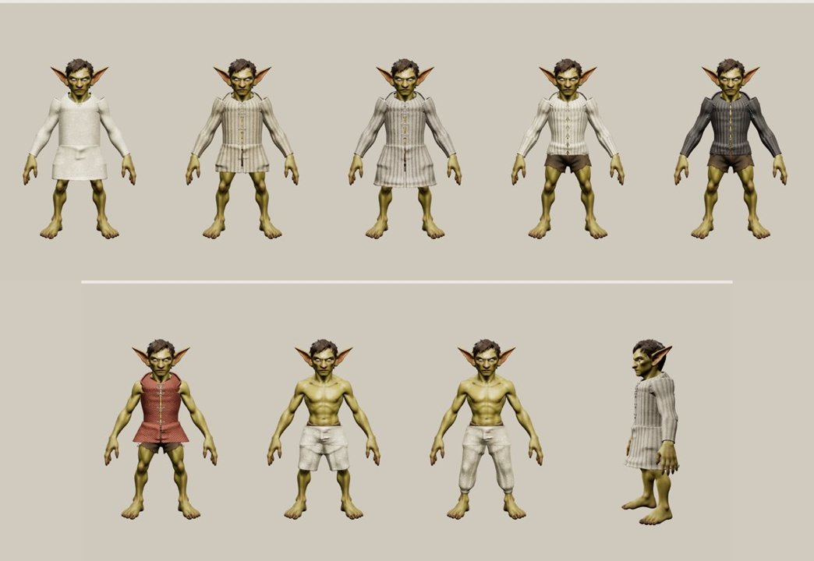

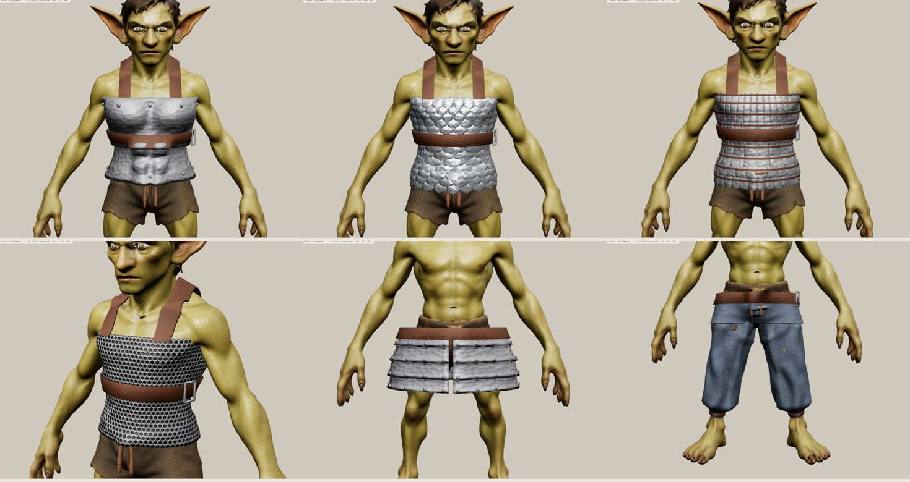

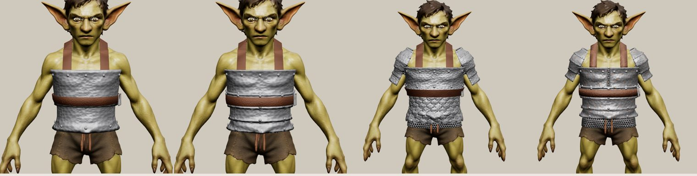

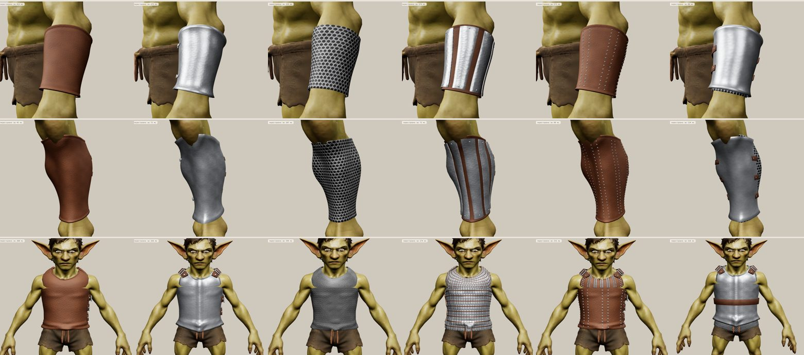

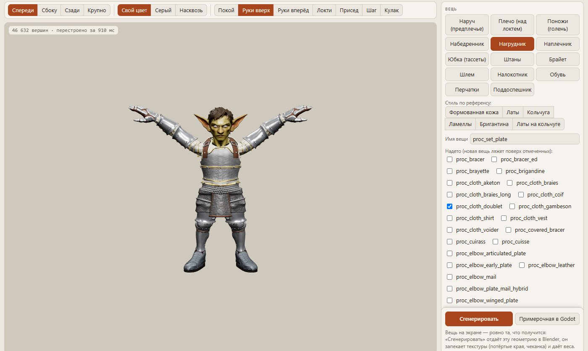

The piece is put on next to the character like one fitted in «Armour», so the Godot fitting room and the editor's other pieces have it. It fits by construction, needs no fitting, and a whole set comes out in one style, each piece made over the ones under it (the steel arms over the doublet's sleeves). It works on other bodies too: on the right, a sallet on a fairy. It can still be corrected by hand: in «Armour» any of them (helmets, elbows, footwear, gloves and clothes too) opens as made, part «The piece as made»: moved, turned and sized with the gizmo, reshaped with points, openings and the wall thickness; «Put on» keeps its own weights and what its mask hides (the ears under a helmet). Generating it again replaces the corrections.

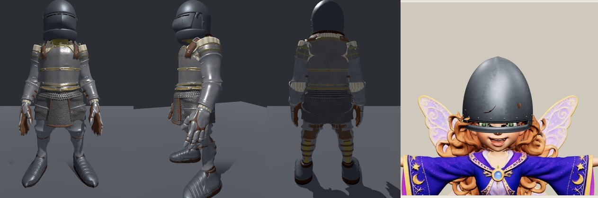

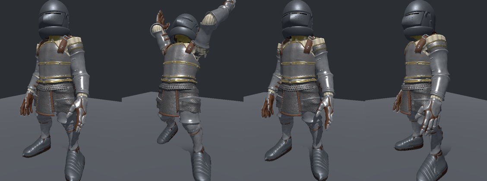

### Animation gallery

`tool/anim_gallery.py` puts about 90 clips (Mesh2Motion, CC0, plus procedural two-handed and shield clips) on a rigged character and writes one HTML page that opens with a double click. The clips are grouped: locomotion, jumps, dodges, sword, sword and shield, two-handed sword, defence, magic, unarmed, bow and throwing, hits and deaths, emotes.

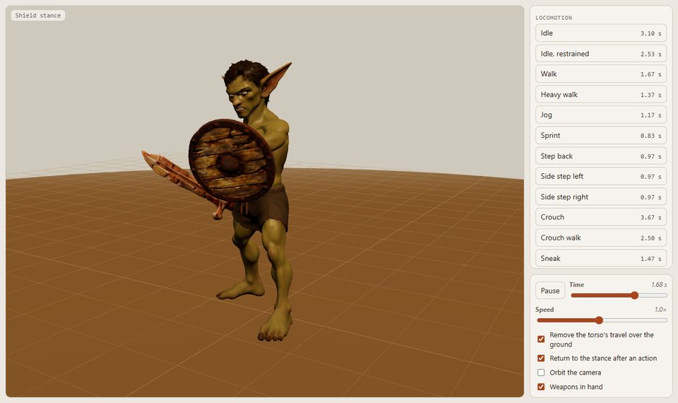

---

## Requirements

**Hardware:** an NVIDIA GPU with **8 GB VRAM** or more (CUDA 12.x driver), 32 GB RAM recommended, and about **60 GB** of free disk for environments, model weights and caches.

**Software you must install yourself** (none of it is bundled):

| What | Version used | Needed for |
|---|---|---|
| Windows 10/11 x64 | 11 | everything (scripts are `.bat`/`.ps1`) |
| [Miniconda](https://docs.anaconda.com/miniconda/) | any recent | the three Python environments |
| [Git for Windows](https://git-scm.com/download/win) | any | cloning; **its `bash.exe` runs UniRig** |
| [Visual Studio 2022 Build Tools](https://visualstudio.microsoft.com/visual-cpp-build-tools/) with "Desktop development with C++" | 2022 | compiling SF3D, Hunyuan3D-Paint and UniRig native extensions |
| [CUDA Toolkit 12.1](https://developer.nvidia.com/cuda-12-1-0-download-archive) | 12.1 | compiling SF3D's `texture_baker` (Hunyuan gets its own `nvcc` from conda) |
| [Blender](https://www.blender.org/download/) | 5.2 | rigging, animation, equipment, kits, destructibles, previews |
| [Godot](https://godotengine.org/download) (console exe) | 4.7.2 | building FX / kit / destructible scenes, the fitting room |
| [Hugging Face account](https://huggingface.co/join) | – | SF3D weights are **gated**: accept the licence at [stabilityai/stable-fast-3d](https://huggingface.co/stabilityai/stable-fast-3d) and log in |
| [Codex CLI](https://github.com/openai/codex) (`npm i -g @openai/codex`, then `codex login`) | 0.160 | *optional*: Reference tab with a ChatGPT subscription |
| OpenRouter API key | – | *optional*: Reference tab without Codex |

---

## Hardcoded paths

The scripts assume this layout. The easiest route is to reproduce it. Otherwise, edit the places listed below.

| Path | Purpose | Where it is set |
|---|---|---|
| `D:\conda\envs\sf3d`, `...\hunyuan`, `...\unirig` | Python environments | `sf3d-env.bat`, `tool\launch_ui.ps1`, `tool\sf3d_ui.py` (`HY_PY`), `tool\rigging.py` (`UNIRIG_ENV`), install scripts |
| `D:\conda\hf`, `D:\conda\hy3dgen` | Hugging Face / Hunyuan model cache | same files + `tool\hy_pipeline.py`, `tool\hy_texture_mv.py` |
| `D:\conda\tmp`, `D:\conda\pip-cache`, `D:\conda\pkgs` | temp files and caches (kept off C:) | launchers and install scripts |
| `D:\conda\rig` | staging folder for UniRig (its bash scripts break on spaces in paths) | `tool\rigging.py` (`STAGE`) |
| `D:\Git\bin\bash.exe` | Git Bash for UniRig | `tool\rigging.py` (`BASH`) |
| `<repo>\hunyuan3d-src` | Hunyuan3D source | `tool\sf3d_ui.py` (`HY_SRC`) |
| Blender, Godot, export/work/input folders, interface language | | `tool\config.json` (also editable in the Settings window) |

The repository itself can live anywhere. The original lives at `D:\My projects\SF3D`; paths with spaces are fine for everything except UniRig staging.

---

## Installation

Run everything from an **Anaconda/Miniconda PowerShell prompt** at the repository root.

### 1. Clone this repository and the three model repositories next to it

The model repositories are **not** included here. Clone them into these exact folder names:

```powershell
git clone https://github.com/Sergeyspb-source/3d-animator.git
cd 3d-animator

git clone https://github.com/Stability-AI/stable-fast-3d.git sf3d-src
git clone https://github.com/Tencent-Hunyuan/Hunyuan3D-2.git hunyuan3d-src
git clone https://github.com/VAST-AI-Research/UniRig.git unirig-src

# UniRig: use the community Windows support PR #70
git -C unirig-src fetch origin pull/70/head:pr70
git -C unirig-src checkout pr70
```

### 2. Apply the local patches (folder `patches\`)

```powershell
# Hunyuan3D-Paint: load the UNet from .safetensors so the 3.5 GB .bin is not needed
git -C hunyuan3d-src apply ..\patches\hunyuan3d-paint-safetensors.patch

# UniRig: low-memory skeleton configs for 8 GB GPUs
Copy-Item -Recurse -Force patches\unirig\configs\* unirig-src\configs\
```

### 3. SF3D environment (`sf3d`): GUI, SF3D, materials, glue code

There is no install script for this step yet. Run these commands by hand. Open the "x64 Native Tools Command Prompt for VS 2022" first, so the C++/CUDA extensions compile:

```powershell
conda create -p D:\conda\envs\sf3d python=3.10 -y
$py = 'D:\conda\envs\sf3d\python.exe'
& $py -m pip install torch==2.4.1 torchvision==0.19.1 --index-url https://download.pytorch.org/whl/cu121
& $py -m pip install setuptools==69.5.1 wheel
cd sf3d-src
& $py -m pip install -r requirements.txt          # builds texture_baker and uv_unwrapper
& $py -m pip install -r requirements-demo.txt     # gradio 4.41.0
cd ..
# extra modules used by this toolkit (not in SF3D's requirements)
& $py -m pip install scikit-image scipy matplotlib fast-simplification onnxruntime-gpu
# log in so the gated SF3D weights can download on first run
& $py -m huggingface_hub.commands.huggingface_cli login
```

### 4. Robust Weight Transfer dependencies (equipment tab)

`tool\vendor\rwt\weighttransfer.py` is vendored (GPL-3.0, see `tool\vendor\rwt\LICENSE` and `source_manifest.json`). Its compiled dependencies are **not** in git. Install them into the vendor folder:

```powershell
D:\conda\envs\sf3d\python.exe -m pip install --target tool\vendor\rwt\deps libigl==2.6.1 robust_laplacian==1.0.0
```

### 4b. Lip sync (optional, Character → Lipsync)

Self-contained: `tool\vendor\lipsync\transcribe.py` (local Whisper) and `lipsync.py` (ARKit face curves) run in the
`sf3d` env (numpy, scipy, torch, transformers; `soundfile` or ffmpeg for mp3/ogg). The `openai/whisper-small` model
(~1 GB) is downloaded on the first run into `hf_home` from `tool\config.json` (default `D:/conda/hf`); an existing
Hugging Face cache is reused. Output: `<model folder>\<voice>.face.json` + the audio copy. The clip is played right in the tab: the face close, the line with its sound; «▶ Watch» plays any clip the character has.

In Godot: copy `tool\godot\face_curves_clip.gd` and `face_curves_player.gd` into your project, add a
`FaceCurvesPlayer` node (`audio` = the voice `AudioStreamPlayer3D`, `face_root` = the character, `clip_path` = the
`.face.json`). It drives the blend shapes of the character's mouth plate (`jawOpen`, `mouthSmile`, …) from the audio clock.

### 5. Hunyuan3D-2 environment (`hunyuan`): multi-view models and texturing

```powershell
powershell -ExecutionPolicy Bypass -File hunyuan3d-install.ps1        # env + PyTorch 2.4.1 cu121 + hy3dgen
powershell -ExecutionPolicy Bypass -File hunyuan3d-texgen-install.ps1 # nvcc 12.1 from conda + builds custom_rasterizer / mesh_processor (needs VS 2022 Build Tools)
powershell -ExecutionPolicy Bypass -File hunyuan3d-weights.ps1        # shape model tencent/Hunyuan3D-2mv (fp16)
powershell -ExecutionPolicy Bypass -File hunyuan3d-texgen-weights.ps1 # delight + paint models
```

The build script `hunyuan3d-texgen-build.bat` has `TORCH_CUDA_ARCH_LIST=8.9` (RTX 40xx). **Change it to match your GPU** (8.6 for RTX 30xx, 12.0 for RTX 50xx).

### 6. UniRig environment (`unirig`): auto-rigging

```powershell
powershell -ExecutionPolicy Bypass -File unirig-install.ps1   # env py3.11 + torch cu128 + spconv + flash-attn shim
unirig-build-ext.bat                                          # only if torch_scatter / torch_cluster failed to install
```

UniRig weights (`VAST-AI/UniRig`) download from Hugging Face on the first rig.

### 7. Configure

On first start, `tool\config.example.json` is used. To change the paths or the language, copy it to `tool\config.json` (this file is git-ignored) and set `lang` (`en` or `ru`), `blender_exe`, `godot_exe`, `export_dir`, `work_dir` and `input_dir`. You can also do it in the Settings window and the 🌐 menu.

---

## Running

| How | What |
|---|---|
| `sf3d-ui.vbs` (double-click) | GUI with no console, opens an app window at `http://127.0.0.1:7861`. Closing the window stops the server and frees VRAM |
| `sf3d-ui.bat` | same GUI with a visible console (for debugging) |
| `sf3d-tool.bat generate <image or folder> --category prop` | one-off CLI: image(s) → game-ready GLB |
| `sf3d-tool.bat post work\item\axe\raw.glb --category item --name axe` | re-run post-processing only |
| `sf3d-batch.bat <folder> [--force] [--no-preview]` | batch: `<folder>\<category>\pic.png` → SF3D; `<folder>\<category>\<asset>\front.png [back/left/right.png]` → Hunyuan3D |
| `sf3d-gradio.bat` | the original SF3D demo UI (port 7860) |

**Run one GPU job at a time.** Approximate peak VRAM: SF3D 6.2 GB, Hunyuan shape 5.8 GB, Hunyuan paint 7.4 GB, UniRig 4.5 GB. The GUI checks free memory before each job.

---

## Armour fitting in detail

In the landmark editor's pose mode, **Armour** opens the armour panel:

1. Pick the piece's GLB and the body part. A piece without its own skeleton gets the part from its file name (cuisse/thigh → thigh, greave → shin, bracer/vambrace → forearm, rerebrace → upper arm, pauldron/shoulder → «Pauldron», gauntlet → hand, boot → «Boot», helmet → head, chest/cuirass → torso, in English or Russian); otherwise the choice stays as it was. The tube axis of a piece without a skeleton is the way it is open (rays from its middle pass straight through; the piece's own x/y/z are tried as well as its principal axes, since a short wide piece has no clear ones). The piece is placed along the limb's real middle line, then fitted by its whole inner wall. Nodes, one per cell of the piece (12 along × 24 around), are matched to the skin by ICP with a one-sided penalty: shift, tilt, scale across the limb and oval-ness change, the shape does not. «Fit to the skin» runs it again after manual changes. The nodes are shown red (under the skin), green (on it) and blue (air).
2. Adjust it with the sliders, the gizmo (G / R / S) or surface points. The sliders are position, length, «Girth» (the whole piece wider or narrower), «Wall thickness» (the inner wall stays, only the outer surface moves; the same about the piece's own axis in the editor and in Blender), twist and gap. The info line shows the air and the wall thickness as shares of the limb's radius.
3. **«Put on»** runs `tool/blender_wear_fit.py`. The piece is scaled away from the limb axis cell by cell, so the inner wall clears the skin and the wall keeps its shape. What is still under the skin is then pushed out along the skin's normal, spread over its neighbours, so the inner and outer wall move together. «Fit to the body» (conform) draws loose parts in towards the limb, by the share of their air (the wall measured on the same ray as the skin). A breastplate's sides towards the arms are drawn in fully, and the arms' skin (weighted to the arm bones, or past the shoulder joint on that side) does not count as the torso's: otherwise the breastplate widens round the deltoid and the raised arm seems to come out of its shoulder. A cell's inner wall is the tenth percentile of its vertices' distances from the axis, and what lies deeper than 3/4 of the skin's distance is left alone inside the limb: in a closed image-to-3D piece opened up, these are the remnants of its caps, and counting them blew the piece's ends up into a funnel. Skin weights come only from the limb's own bones and are smoothed over the piece. «Rigidity» makes it move with the bone (0.8 for bracers and greaves, 0.2 for gloves). The result is `<character>_wear_<item>.glb`: the character's skeleton plus the skinned piece.
   - A piece made on another body that carries its own skeleton (the Tripo extractions in `export/equipment`) is read with it. On one limb segment it is placed as above; over several segments (a boot over the shin and the foot, a whole arm) the part «The whole piece by its own skeleton» is chosen. Then each vertex moves from the piece's bones onto the character's same bones by its own weights, the way skinning moves skin, and the other side is the mirror with Left and Right swapped. Blender gets the moved copies, pushes them out of the skin, and weights them only to the bones the piece used.
   - Upright pieces as generated keep their own vertical as their axis and their proportions: «Torso (breastplate)» — no mirror, weights on the spine, never on the arms; «Head (helmet)» — the helmet's top at the top of the head, rigid on the head bone; «Boot» — the shaft on the shin, sized by it; the toe turned along the foot (the long axis of its sole, at the end farther from the shaft); the sole at the heel.
   - «Pauldron» is a dome on the shoulder joint, not a tube: it keeps the orientation it was made in (up is up), and the sphere of its upper part is its own shoulder ball — the centre goes onto the character's shoulder joint, the size by the skin around it, then the same ICP in cells of direction from the joint (shift, turn, one scale: the shape stays). The side it was made for comes from the file name (`_L`, `left`…), otherwise left (the generator is asked for a left one); choosing the other side reflects it. It is rigid: every vertex gets the same weights, the collarbone and the upper arm, and «Follows the arm» sets the arm's share (0.7 by default: in a measured side raise and forward raise the least skin showed through; 0.5 is worse, since blending two turns shrinks a rigid piece). Over a breastplate it goes as a layer: the breastplate's straps count as the skin, and Blender moves the pauldron out of them as a whole. A pauldron is the outer layer: it is never ticked under a breastplate by itself.
   - «Opening»: clicks around the rim of an arm hole or a neck give its circle. «Narrow the opening» draws the rim and the surface near it towards the circle's axis, both walls together, with a smooth falloff; «And the symmetric opening» does the other side too. This happens in the piece's own space, so the editor, the mirrored copy and Blender get the same shape.
   - «Over these pieces»: the job gets the fitted results of the ticked pieces (`under`). Along each cell's ray from the limb axis, the outer wall of the first shell lying on this limb (less than a limb radius from the skin) replaces the skin distance, and a second push moves what is still under them out along the ray, spread like the skin push. The report counts the cells laid over other pieces.
   - «Open up» (lower end / upper end / both ends): a generated piece closed at an end is cut open there by `blender_armour_hollow.py`, texture and all, and placed again. On a limb the lower end is the one away from the body (the wrist, the knee); an upright piece goes by its own vertical. The piece's own wall stays; a solid blank gets one inwards (rays from the middle out pass two surfaces when it has a wall).
   - «Repaint for the shape»: Hunyuan3D-Paint paints the reshaped piece anew from its reference picture (found in `refs_mv`, or chosen in «Piece picture»), so the texture follows the new shape instead of being stretched (3–6 min on the GPU). The result becomes the fitting's source piece.
   - Hunyuan3D from four views (Codex draws them: `export/equipment/generated_armour/make_refs_mv.py`) gives hollow armour that sits without any opening step. A piece generated from one picture is usually a closed solid; `tool/blender_armour_hollow.py in.glb out.glb [open=both|top|bottom] [axis=auto|z|x,y,z] [wall=0.08|auto]` is the same cut from the command line.
4. Every fitting is saved in the character's folder as `<item>.fit.json` + `.src.glb`. «Open» brings it back with all the sliders and points, and «Save» saves without fitting.
5. **«Fitting room in Godot»** builds `work/wardrobe/<character>/`: the character with its clips (the procedural ones are made if none exist), every fitted piece on, pieces on/off, and an orbit camera. It then opens the project in Godot.

In your own Godot project, copy `tool/godot/sf3d_equip.gd` and the GLBs, then:

```gdscript
var bracers := SF3DEquip.wear($Goblin, preload("res://armor/bracer_leather.glb"))   # put on (meshes move under the character's Skeleton3D)
SF3DEquip.take_off(bracers)                                                      # take off
SF3DEquip.show(bracers, false)                                                   # hide (the body under it comes back)
```

Copy the `.mask.json` beside each GLB: `wear` reads it and hides the body under the piece.

The piece follows every animation of the character by bone names. It must come from the same rigged model.

---

## Animation gallery

`tool/anim_gallery.py` puts the Mesh2Motion clips (`Animations/Mesh2Motion`, CC0) and the procedural two-handed and shield clips on a rigged character. The result is one self-contained HTML page with about 90 clips in groups (see [the screenshot above](#animation-gallery)). The page holds the GLB inside, so it opens with a double click. Its texts are in the interface language.

```powershell
D:\conda\envs\sf3d\python.exe tool\anim_gallery.py "<character>_landmarks_rigged.glb" Animations\goblin_gallery.html
```

`blender_retarget_fbx.py` reads the clips straight from the Mesh2Motion GLBs: Unreal-style bone names are mapped onto Mixamo ones. The weapons in the hands are approximate, because their presets were set on another goblin; the «Weapons in hand» checkbox hides them.

---

## Repository layout

```
sf3d-ui.vbs / sf3d-ui.bat     GUI launchers
sf3d-tool.bat / sf3d-batch.bat CLI launchers
sf3d-env.bat                  environment for the sf3d env
*-install.ps1, *-weights.ps1, *-build.bat   installers for Hunyuan3D and UniRig
patches/                      changes applied on top of the third-party repos
docs/images/                  README screenshots (en/, ru/)
tool/
  sf3d_ui.py                  Gradio GUI (all tabs)
  i18n.py, lang/*.json        interface language: every text by key (English, Russian)
  sf3d_tool.py, batch_cli.py  CLI and post-processing (pivot, scale, collision, materials)
  hy_*.py                     Hunyuan3D workers (run in the hunyuan env)
  rigging.py, outfit.py, hanim.py, fbxanim.py, materials.py, surfaces.py,
  fx_flipbook.py, modkit.py, destruct.py, refgen.py, anim_gallery.py, rwt_*.py   feature modules
  landmarks*.py, landmark_editor.html   skeleton from hand-placed landmarks and armour fitting (three.js editor)
  face_edits.py                 the expressions corrected by hand, laid on the model (and again after a rebuild)
  blender_*.py                headless Blender scripts (blender -b -P tool\blender_x.py -- args)
  godot/                      Godot scripts and shaders used by generated scenes (incl. FaceCurvesPlayer for lip sync,
                              SF3DEquip to put fitted armour on, the armour fitting room)
  rig_scripts/                Git-Bash wrappers for UniRig
  vendor/rwt/                 Robust Weight Transfer (GPL-3.0)
  vendor/lipsync/             Whisper word timings + lip-sync curves (vendored, see its README)
  vendor/blender_armour/      the helmet, elbow and footwear generators (KettleHat, HelmetVariants, ElbowArmor, Footwear: Blender scripts), see source_manifest.json
  config.example.json         settings template
```

Not in git (created locally): `sf3d-src/`, `hunyuan3d-src/`, `unirig-src/`, `export/`, `work/`, `input/`, `tool/config.json`, `tool/vendor/rwt/deps/`, all model weights.

---

## Third-party licences

This repository holds only the glue code. Each model keeps its own licence, so **check them before any commercial use**:

- **Stable Fast 3D**: [Stability AI Community License](https://huggingface.co/stabilityai/stable-fast-3d) (free under USD 1M annual revenue).
- **Hunyuan3D-2**: [Tencent Hunyuan 3D 2.0 Community License](https://github.com/Tencent-Hunyuan/Hunyuan3D-2/blob/main/LICENSE). **Not licensed in the EU, the UK and South Korea.**
- **UniRig**: MIT.
- **Robust Weight Transfer** (`tool/vendor/rwt`): GPL-3.0.
- **CLIP weights** (open_clip, LAION ViT-B/32): MIT.
- **Mesh2Motion animations** (gallery): CC0.
