# 3D Animator: локальный набор для игровых ассетов

[English](README.md) · **Русский**

Локальный набор инструментов для Windows, который превращает картинки в готовые 3D-ассеты для Godot 4: модели, скелеты, анимации, экипировку, PBR-материалы, бесшовные поверхности, листы эффектов, модульные наборы подземелья, разрушаемые объекты и растительность с ветром.

Всё работает на вашей видеокарте. В облако уходят только необязательные запросы на картинки-референсы (подписка ChatGPT через Codex CLI или ключ OpenRouter).

Набор связывает несколько открытых моделей (Stable Fast 3D, Hunyuan3D-2, UniRig) со скриптами Blender и Godot. У него графический интерфейс на Gradio на русском и английском и две утилиты командной строки.

> **Статус: личный инструмент, выложен как есть.** Он собран и проверен на одной машине (Windows 11, RTX 4060 Laptop 8 ГБ видеопамяти, 31 ГБ ОЗУ). Многие пути зашиты в код, поэтому перед установкой прочитайте раздел [Зашитые пути](#зашитые-пути).

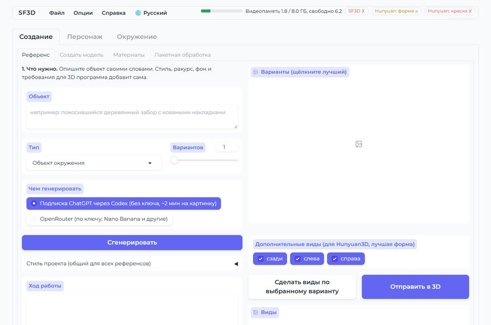

---

## Содержание

- [Что умеет](#что-умеет)
- [Как работать с инструментами](#как-работать-с-инструментами) (снимки)
- [Требования](#требования) · [Зашитые пути](#зашитые-пути) · [Установка](#установка) · [Запуск](#запуск)
- [Подгонка брони подробно](#подгонка-брони-подробно) · [Галерея анимаций](#галерея-анимаций-1)
- [Устройство репозитория](#устройство-репозитория) · [Лицензии сторонних моделей](#лицензии-сторонних-моделей)

---

## Что умеет

| Вкладка | Что получается | Чем |
|---|---|---|
| Создание → Референс | Карточка стиля и картинки-референсы (один вид или спереди/сзади/слева/справа) по текстовому описанию | Codex CLI (ChatGPT) или OpenRouter |
| Создание → Создать модель | GLB по 1 картинке (~20 с) или по 1–4 видам (7–10 мин): pivot, реальный масштаб, коллизия, PBR, превью и иконка. Категории: предмет, пропс, здание, персонаж, растительность | SF3D / Hunyuan3D-2mv + Hunyuan3D-Paint |
| Персонаж → Скелет (автоматически UniRig или вручную по ориентирам) | Скелет и веса для человекоподобных и существ, имена костей Mixamo или Godot, сшивка стыков, разбиение тела на области | UniRig + Blender |
| Персонаж → Анимации: процедурные | 12 процедурных клипов для любого человекоподобного со скелетом (покой, ходьба, бег, прыжок, удары, заклинание, блок, удар, смерть…), в манере персонажа (тяжёлая, в броне, в одеянии, лёгкая, развязная, хромая, нежить или случайная по зерну) и с выбранной смертью (на спину, лицом вниз, набок, на колени) | Blender |
| Персонаж → Анимации: Mixamo (FBX) | Перенос клипов Mixamo (FBX без кожи) на ваш скелет, режим «на месте», просмотр в three.js | Blender |
| Персонаж → Экипировка: сет целиком | Перенос одежды с одетого персонажа на базовое тело | Blender + Robust Weight Transfer |
| Персонаж → Экипировка: подгонка вещи | Готовая вещь (GLB) на текущем персонаже: ставится по коже, сразу на обе стороны, двигается, правится, надевается слоями, с весами и маской (режим «Броня» ниже) | Blender |
| Скелет по ориентирам → Броня | Подгонка вещи (наруч, поножи, набедренник, сапог, наплечник, нагрудник, шлем) на собранного персонажа в редакторе, веса в Blender, сохранение подгонки, примерочная в Godot с анимациями персонажа | three.js + Blender + Godot |
| Персонаж → Экипировка: процедурная генерация | Наруч, плечо, поножи, набедренник, нагрудник (латный до шеи, анатомический, с наплечниками и кольчугой), наплечник, юбка-тассеты или штаны, построенные по коже самого персонажа, а также шлемы, налокотники и обувь (по шесть конструкций из генераторов шлемов, налокотников и обуви, подогнанные к голове, рукам и стопам) перчатки из кожи самой кисти и поддоспешная одежда по параметрам в живом 3D-редакторе (вещь на персонаже меняется вместе с ползунками): пластины, чешуя, ламеллы, кольчуга, стёганка или гладкое; канты, заклёпки, ремни и пряжки; железо, сталь, бронза, кожа или ткань с износом, запечённые PBR-текстуры; вещь сразу надета, как подогнанная | Blender |
| Окружение → Поверхности | Бесшовные материалы земли, пола и стен (цвет, нормали, высота, шероховатость, AO) | numpy |
| Окружение → Эффекты | Листы частиц (взрыв, огонь, дым, магия) и готовые сцены Godot | numpy + Godot |
| Окружение → Модульные наборы | Процедурный набор подземелья (стены, арки, лестницы, двери) и ASCII-план → сцена Godot | Blender + Godot |
| Окружение → Разрушаемые объекты | Объекты, расколотые по Вороному, и сцена Godot, которая разваливается от удара | Blender + Godot |
| Создание → Материалы | Распознаёт металл, дерево, камень, ткань на готовом GLB и пишет карту металличности и шероховатости | CLIP |
| Создание → Пакетная обработка (и меню «Файл») | Целая папка картинок за один запуск (на ночь) | всё перечисленное |
| Меню «Опции» и полоска видеопамяти | Пути, ключ OpenRouter, кто занимает видеопамять, выгрузка моделей; полоска занятости сверху | – |
| Персонаж → Исправление весов, Детали лица, Липсинк | Починка весов, общий набор глаз, зубов и языка с живым предпросмотром, клип липсинка для рта для речи с просмотром прямо во вкладке | Blender |

Все инструменты «Персонажа» работают с **текущим персонажем**. Он выбирается один раз под строкой вкладок и показан там в 3D вместе с тем, что у него уже есть: модель, скелет, тело по частям для сетов, клипы липсинка, надетые вещи. Персонаж — это папка `export\character\<имя>\`; «Добавить модель…» делает его из GLB, «Удалить» стирает его папку целиком, спросив «Удалить окончательно?»; исходный файл, из которого он загружен, остаётся на месте. Выбор запоминается между запусками. Загрузка файла во вкладке осталась для разовой правки модели, которая не персонаж.

Вещи персонажа лежат в его папке по видам: `armor/` (латы, кольчуга, шлемы, перчатки, обувь и вещи, подогнанные в «Броне»), `clothes/` (поддоспешник, штаны, юбка, табард, плащ), `weapons/` (оружие, щиты, ножны, колчаны). На вещь четыре файла: `<вещь>.glb` и `<вещь>.mask.json` (что прячет на теле) нужны игре, `<вещь>.src.glb` и `<вещь>.fit.json` (вещь как сделана и её настройки) — редакторам. Имя даётся само по правилу `<часть>_<стиль>`, для второй такой же — `_2`, `_3`: `cuirass_steel`, `bracer_leather_2`, `helmet_barbute`, `shield_round`, `undercloth_fitted`, оружие просто `sword`. Префикса модели нет — папка и так говорит, чья вещь. Редактор открывается с персонажем как он есть: ни одна вещь не выбрана и не строится, справа только надетые вещи с галочками. Работа начинается, когда выбран вид вещи или открыта сделанная (клик по её имени в «Надето» или выбор в «Сделанные»); отмена возвращает к пустому состоянию. Поля для имени больше нет: имя даётся по правилу. Имя даётся один раз при первом «Сгенерировать» и потом не меняется, даже если поменять стиль (игра и примерочная знают вещь по нему); поле «Имя вещи» можно переписать вручную. Служебные ответы редакторов лежат в `work\status\`, не в папке модели. Персонаж в старой раскладке (`<модель>_wear_<вещь>.*` рядом с моделью) переезжает сам при первом открытии его вещей: файлы переименовываются по правилу, ссылки между вещами (поверх чего сделана) — тоже, старые ответы удаляются.

Результаты пишутся в `export\<категория>\<имя>\` (GLB, JSON со статистикой, иконка). Черновые файлы — в `work\`. Обеих папок в репозитории нет.

---

## Как работать с инструментами

### Язык интерфейса

Меню **🌐** вверху переключает русский и английский. Выбор сохраняется в `tool/config.json` (`"lang"`), сервер перезапускается сам, и через несколько секунд страница открывается на новом языке. Все тексты лежат в `tool/lang/ru.json` и `tool/lang/en.json`. Чтобы добавить язык, скопируйте один из файлов, переведите значения и добавьте код языка в `LANGS` в `tool/i18n.py`.

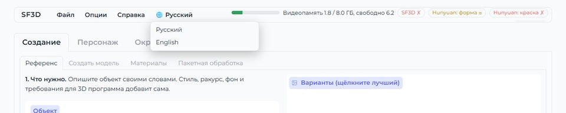

### Скелет по ориентирам

Персонаж → Скелет → «Вручную по ориентирам», затем «Открыть разметку». Кликните ориентиры на виде спереди (подбородок, пах, плечо, локоть, запястье, колено, щиколотка); таз, позвоночник, шея, ключицы, бёдра и стопы рассчитаются сами. Оранжевые узлы — ориентиры, синие — рассчитанные; любой узел можно сдвинуть или повернуть стрелками (G / R) или числами. «Разметить пальцы» и «Разметить лицо» добавляют пальцы, челюсть и глаза. Затем «Построить скелет и веса по разметке».

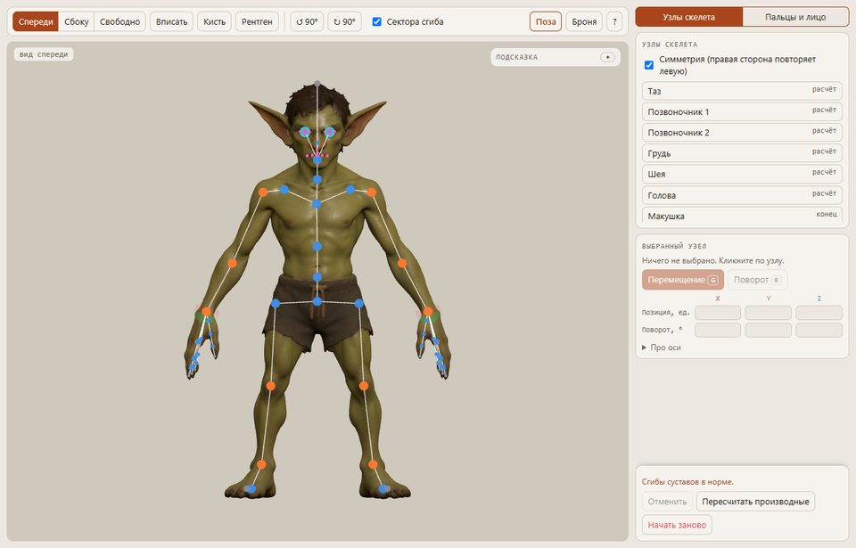

Глазные яблоки в разметке — настоящий глаз из набора «Детали лица» (выбранного в параметрах сборки, иначе стандартного): он сидит в глазнице так, как его вставит сборка, поэтому неверное место или размер видны сразу; щелчок по нему выбирает узел глаза. Зубы: в режиме рта (овал рта и веки) серый «забор» за губами показывает, где встанут ряды из набора «Детали лица». «Зубы» задаёт им своё место: точка у переднего края верхних резцов (двигайте по высоте и глубине; вид поворачивается сбоку, «Рентген» показывает её сквозь кожу), «Зубы −» / «Зубы +» делают ряды уже или шире; ещё раз «Зубы» — снова автоматически. Сборка рта затем проверяет каждую позу (покой и каждый ключ формы): зубы, дёсны, язык или полость, видные сквозь кожу, убираются внутрь (ряд зубов целиком, мягкие части — там, где видны), а в журнале сборки написано, сколько точек выходило наружу и осталось ли что-то.

Веки: сборка кладёт на каждое глазное яблоко отдельные верхнее и нижнее веко — части сфер чуть больше глаза (сетки `EyeLid_L` / `EyeLid_R` на кости головы), цвета кожи вокруг глаза, с тёмной кромкой. Они лежат под кожей лица и видны только в вырезе глаза. Моргание (`eyeBlink`) поворачивает верхнее веко вниз вокруг центра яблока, нижнее чуть вверх; верхнее закрывает глаз целиком и заходит поверх нижнего, так что линия смыкания — ровная дуга, какой бы ни была сетка вокруг глаза у исходной модели (кожа лица при этом стоит: её рваный край выреза при закрытии смыкался зубцами). Прищур (`eyeSquint`) и широко открытые глаза (`eyeWide`) поворачивают веки частично. Ключи называются как у кожи, так что редактор, липсинк и Godot двигают веки вместе с лицом. Если в покое вокруг глаза видна коричневая полоса века, вырез глаза больше яблока: поправьте яблоко в разметке («Глаз +»).

**Поза** показывает собранную модель со скелетом. Тяните руку или ногу, чтобы согнуть её; «Поза проверки» сгибает все конечности сразу, так видны заломы и плохие веса. «▶ Проверка движений» сгибает туда-обратно суставы по группам (кулак, запястья, локти, плечи, колени, стопы, голова, челюсть) или все по кругу — видно, правильно ли стоят кости.

Выражения вручную: в «Позе» выберите ключ формы (jawOpen, mouthSmile, брови…) и нажмите «✎ Править». Лицо показывается с этим ключом полностью, а кисть двигает кожу: «Тянуть» ведёт кожу под кистью за мышью, «Поднять» / «Вдавить» — по нормали к поверхности, «Сгладить» выравнивает (бугры, заломы; в ключе «Покой» — саму поверхность); радиус, сила и «Зеркально» (вторая половина лица так же) — в панели, Ctrl+Z / Ctrl+Shift+Z отменяют и возвращают. «Сохранить» сразу записывает правку в модель, без пересборки скелета (`tool/face_edits.py`; свет пересчитывается под новый наклон кожи), и хранит её рядом с персонажем в `<персонаж>_face_edits.json`, а модель как из сборки — в `….noedit.glb`: пересобранный скелет получает правки снова, их точки находятся по месту. «Отбросить» убирает несохранённые мазки, «Убрать все правки» возвращает ключ как из сборки. Липсинк, эмоции и Godot берут уже исправленные ключи. Первый пункт списка, «Покой (основная форма лица)», правит само лицо, каким оно бывает без ключей: опустите верхнее веко на радужку — и испуганный взгляд уходит; все выражения строятся от него, а ключ, двигающий точку в ту же сторону (моргание), укорачивается на столько же, так что заканчивается там же, где раньше.

Губы после выреза рта: сборка теперь сама делит кожу у разреза на верхнюю и нижнюю губу по сетке (а не по линии: верх нижней губы за краем разреза лежит выше линии и раньше оставался на голове), даёт нижней губе гладкий вес челюсти от середины к уголкам (рот открывается овалом: край нижней губы идёт по дуге эллипса и гаснет только у самых уголков; сама нижняя губа опускается целиком, как передний край нижних зубов, чуть прикрывает их корни и прижимается к ним, не выворачиваясь вперёд, а поворот челюсти забирает кожа ниже неё (ключи задания `lip_lean`, `lip_rise`); бока полости рта стоят снаружи боковых зубов, а не перед ними; внутренность рта исходной модели — щёки изнутри глубже 0.35 ширины рта за губами — убирается, иначе при открытии она тянулась полосками рядом с зубами), не отдаёт вес челюсти костям уголков и в конце выравнивает во всех ключах вывернутые треугольники губ по соседям — осколков вдоль нижней губы при открытом рте почти нет. Чтобы дочистить губы (или для моделей, собранных раньше), в «✎ Править» есть «👄 Каркас губ»: на каждую губу ложится ровная сетка — от разреза до края губы, от уголка до уголка. Узел сетки — это точки губы вокруг него, усреднённые так, что осколки и торчащие точки почти не считаются; оранжевый узел — тот, который «Применить» заметно сдвинет (выпирающий мимо соседей ставится между ними), а губа, сложенная в ключе сама на себя (середина отстаёт от края), расправляется. Жёлтый ряд — край губы: перетащите его на видимый край; голубые узлы можно тянуть, чтобы поменять форму губы (с «Зеркально (каркас)» — обе половины; по умолчанию выключено: губы сгенерированных моделей редко симметричны). «Применить»: в ключе кожа губы у разреза ложится на сетку (зубчатый край разреза из старых рёбер становится ровной линией), дальше от разреза кожа сохраняет свою форму и берёт гладкий сдвиг сетки, валик губы идёт за своим краем, у уголков сдвиг плавно переходит в нетронутую кожу; в «Покое» выпрямляется только линия разреза. Режим кисти «Выровнять» подтягивает острые точки под кистью. Ctrl+Z отменяет, «Сохранить» записывает.

Складка между губами: если модель вылеплена с сомкнутыми губами, за линией рта остаётся внутренняя сторона губ — неровный ком, раскрашенный как кожа, — а глубже лежит исходное дно рта. При открытом рте ком вставал коричневым «козырьком» между нижней губой и зубами, а дно рта растягивалось в серые зубцы. Теперь сборка убирает то, что в покое спрятано глубоко за разрезом (внутреннюю сторону губ делает подворот), и дно рта под линией до 1.25 ширины рта вглубь. Оставшееся спрятанное красится в цвет внутренней стороны губы (материал `lip_shelf`). Закрытый рот выглядит как раньше.

Шов губ: линию рта ставят по виду спереди, а внутри губы могут сходиться ниже или выше неё. Нижняя сторона верхней губы, ушедшая под линию, раньше отрезалась вместе с челюстью и при открытии рта висела зубчатой полкой. Теперь сборка сама находит шов: она идёт по коже от передней стороны верхней и нижней губы, и каждая точка у рта достаётся той губе, к которой ближе по поверхности. Разрез проходит по этому шву, а не по плоскости через линию, так что чуть неточно поставленные точки рта больше не дают артефактов. Отключается в задании ключом `"seam_follow": false`. С «Ретопологией лица» шов и окраска `lip_shelf` не нужны и не применяются.

«🔍 Проверить рот» (в режиме «Овал рта и веки»): сборка режет рот по разметке, какая она сейчас, на модели последней сборки (сам персонаж не меняется), и показывает результат в окне поверх редактора: рот открыт, список ключей формы с числом растянутых граней, ползунок силы ключа, растянутые грани красным. На лице появляется оранжевая линия — где на самом деле пройдёт разрез (шов губ); при правке точек она пропадает до следующей проверки. Около минуты; нужна уже собранная модель с ртом «Разрез».

«Линия разреза» (там же, включена по умолчанию) показывает, где пройдёт разрез, сразу, без сборки: в браузере на сетке модели тем же способом, что и сборка, ищется шов губ, и линия перерисовывается, пока тянете точки рта (около 20 мс). Оранжевая часть — разрез идёт по вашей линии, красная — уходит от неё к настоящему шву губ. Ещё одно нажатие скрывает линию.

Эмоции по сторонам: ключи рта, которые двигают одну сторону (улыбка, грусть, растяжение, верхняя и нижняя губа, сжатие), собираются парами `...Left` / `...Right` с плавным переходом по середине; вместе они дают прежний ключ. Эмоции и липсинк двигают стороны раздельно, например ухмылка поднимает один уголок. Если глаза размечены, добавляются «прищур щёк» (`cheekSquintLeft/Right`: щека и нижнее веко вверх) и «морщить нос» (`noseSneerLeft/Right`: крыло носа вверх, складка к губе глубже). Правки кистью, сохранённые для прежнего общего ключа (например `mouthSmile`), при пересборке раскладываются на левый и правый ключ по сторонам лица. Реплики липсинка, сделанные до разделения (в них `mouthSmile`, `mouthStretch` и т.п. без сторон), играются как раньше: такая кривая ведёт обе половины — и в редакторе, и в Godot (`face_curves_player.gd`); новые реплики сразу получают кривые по сторонам.

Лицо на автоматическом скелете: в «Скелет» → «Поза и кулак» у персонажа, собранного авторигом, есть «Разметить лицо» и «Собрать лицо». Разметка открывается на его модели со скелетом из костей; во вкладке «Пальцы и лицо» размечается лицо (вручную или «Найти автоматически», глаза стоит проверить «Глаз −/+»). Сборка (`landmarks.build_face_on_rig`, `blender_face_bones.py`) добавляет в его скелет кости челюсти и глаз, отдаёт челюсти подбородок (как сборка по разметке) и дальше делает то же, что сборка по разметке: разрез рта, брови, глазные яблоки, веки, правки кистью. Риг без лица один раз сохраняется как `<имя>_rigged.noface.glb` — следующая сборка лица начинается с него; разметка лица и суставы лица — в паспорте `<имя>_rig.json`.

Брови и сила эмоций: ключи бровей (`browInnerUp`, `browDownLeft/Right`, `browOuterUpLeft/Right`) строятся в любой сборке, где размечены глаза, а не только с «Ретопологией лица». Ключи, которые нужны только эмоциям (брови, прищур щёк, сморщенный нос, уголки рта вниз), сделаны в 1,6 раза сильнее, прищур и широко открытые глаза век — в 1,5 раза: раньше эмоции, которые берут от них доли 0,04–0,5, были почти не видны. Ключи речи (открытие челюсти, трубочка, сжатие, растяжение, улыбка) остались прежними, чтобы не менять липсинк. Параметры задания: `face_expressivity`, `lid_expressivity`. С «Ретопологией лица» линия смыкания губ — тонкая щель с бороздкой (`slit_gap`, `slit_sink`): без неё закрытый рот выглядел склеенным. Все эмоции на женщине, мужчине и гоблине: `work/emotions_gallery/index.html` (локальная страница, создаётся вручную; `#women`, `#man`, `#goblin` — сразу нужный персонаж). «Ретопология лица» теперь по умолчанию выключена: на всех трёх моделях без неё лицо чище (с ней видна граница новой маски на лбу и у висков), а брови теперь есть и так.

Точки лица раскрашены по видам: на модели, в списке точек и в легенде под кнопками лица. Глаз: зелёная точка у носа, голубая на верхнем веке, красная во внешнем уголке, фиолетовая на нижнем веке. Рот: оранжевые уголки, бирюзовые середины, синий центр, розовый верх губы. Если точки контура глаза кликнуты не в том порядке, редактор и сборка сами расставят их по местам и скажут об этом: раньше вырез под глаз получался неправильной формы, и над глазом оставались полоски кожи. Узел глаза в «Узлах скелета» двигает глаз целиком, вместе с роговицей, и его размер не меняется.

Несимметричное лицо (так часто бывает у сгенерированных моделей): в разметке лица галочка «лицо зеркально» отделена от симметрии скелета. Снимите её, и точки глаз и рта правой стороны ставятся и двигаются отдельно, а тело остаётся симметричным. Шарнир челюсти ставится и без точек глаз, по уголкам рта и голове. Если его всё же нет, сборка предупреждает: рот вырежется, но открываться не будет.

Текстура вручную: «🖌 Текстура» в «Позе» рисует по картинкам самой модели (кожа, маска лица): «Кисть» выбранным цветом («Пипетка» или Alt+щелчок берёт его с модели — например, кожу рядом с остатками нарисованного глаза вокруг настоящего яблока), «Ластик» возвращает картинку как при открытии, радиус, сила и «Зеркально»; Ctrl+Z / Ctrl+Shift+Z. «Сохранить» сразу записывает мазки в модель и хранит их прозрачными слоями в `<персонаж>_tex/`, при пересборке они накладываются снова; «Убрать все правки» возвращает картинки как из сборки.

Сетка вручную: «▦ Сетка» в «Позе» показывает каркас; «Убрать» удаляет треугольники под кистью (клочок кожи, оставшийся от выреза глаза), «Залатать»: щелчок у края дыры подсвечивает её край (точки, повторённые на шве развёртки, считаются одной, так что шов дырой не считается), «Закрыть дыру» закрывает её заплаткой цвета кожи вокруг (цвет можно сменить). Край вокруг глаза — это вырез самого глаза: он закрывается только кнопкой «Закрыть всё равно». «Сохранить» сразу записывает правку в модель (треугольники находятся по месту, заплатка — отдельная часть со своими весами и ключами формы, взятыми с края) и хранит её рядом с персонажем: пересборка накладывает её заново.

Автоматический скелет (`<персонаж>_rigged.glb`, «Создать скелет» на той же вкладке) тоже работает с экипировкой: процедурный редактор, «Экипировка: подгонка вещи» (суставы, между которыми ставится вещь, берутся из его костей) и примерочная в Godot. «Поза и кулак» внизу вкладки «Скелет» открывает проверку позы любого скелета; «Запомнить кулак» у автоматического сохраняет кулак рядом с ним, в `<персонаж>_rig.json`. Только лицу (челюсть, глаза, рот для речи) нужна разметка лица по ориентирам.

| Режим «Поза» | «Поза проверки» |
|---|---|
| 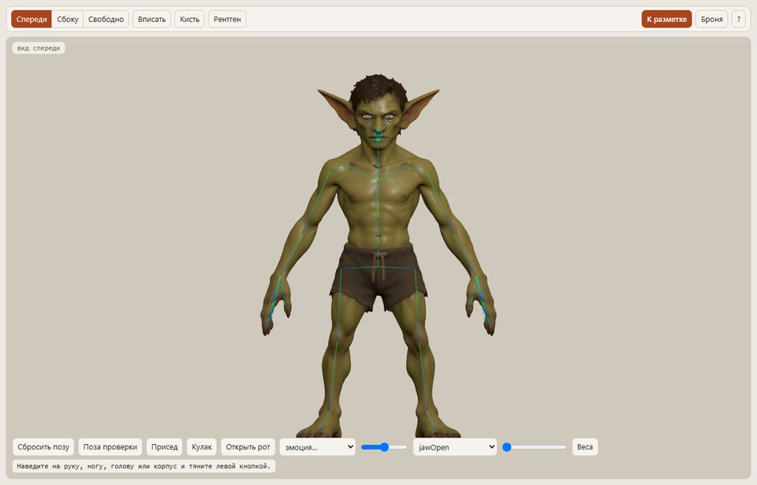 | 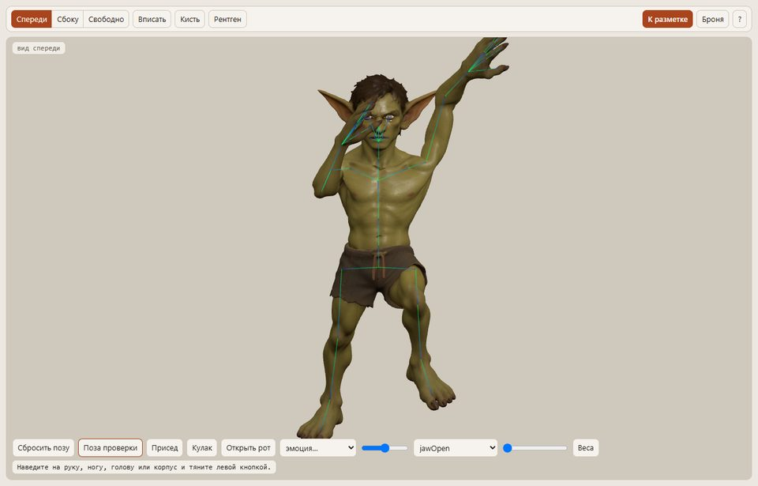 |

### Броня: поставить, надеть, проверить

**Броня** открывает панель подгонки; вкладка «Экипировка: подгонка вещи» открывает её сразу на текущем персонаже. Выберите GLB вещи: вещь без своего скелета сама получает часть тела по имени файла (cuisse/набедренник → бедро, chest/нагрудник → торс, …), либо выберите часть вручную. Вещь ставится на место и подгоняется к коже сразу всей внутренней стенкой. Точки — узлы внутренней стенки: красные под кожей, зелёные на коже, синие — с воздухом.

«Надеть» отправляет вещь в Blender: её выталкивает из кожи, она получает кости и веса персонажа и сохраняется рядом с ним. «Поза проверки» сгибает тело, и вещь должна идти за ним.

| 1. Поставлена (узлы прилегания) | 2. «Надеть» | 3. «Поза проверки» |
|---|---|---|
| 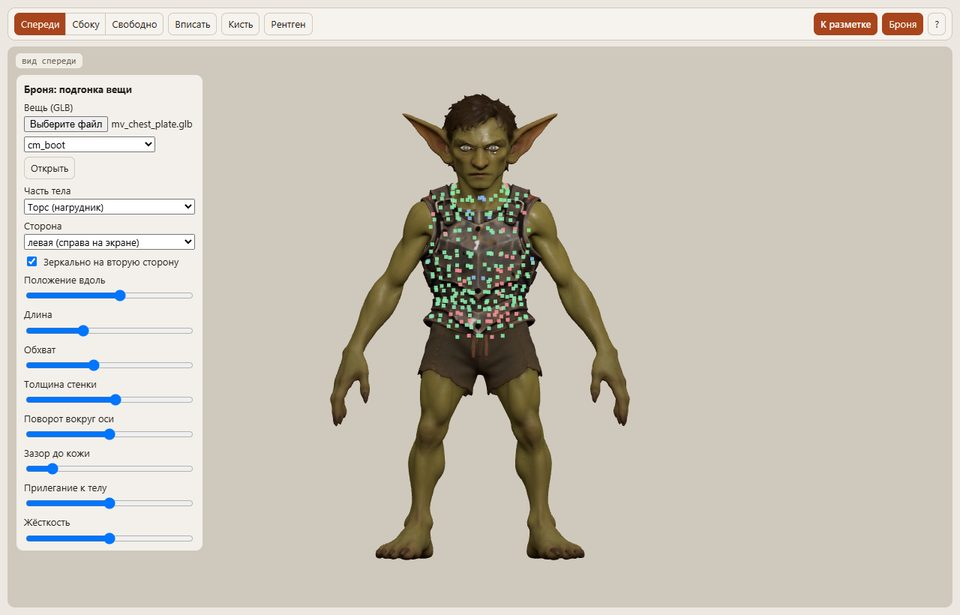 | 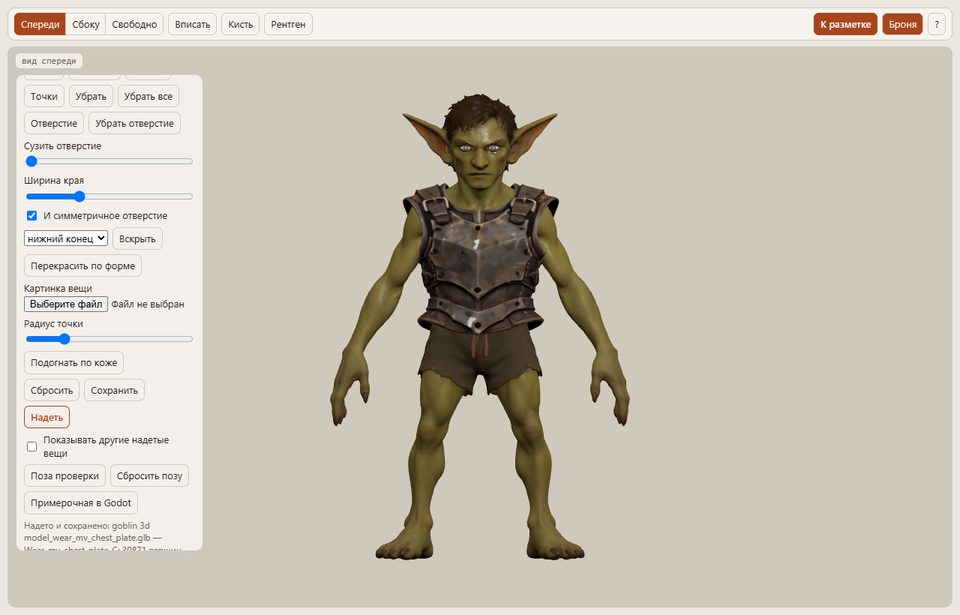 | 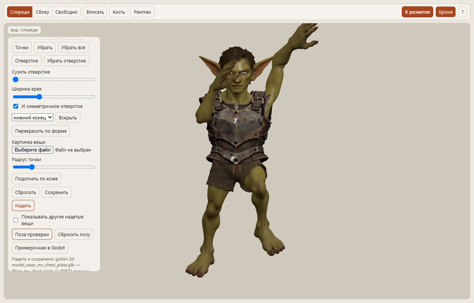 |

Ползунки поправляют то, в чём ошиблась автоподгонка: положение вдоль руки или ноги, длина, обхват, толщина стенки, поворот вокруг оси, зазор до кожи, прилегание к телу и жёсткость. «Точки» тянут поверхность вручную, «Подогнать по коже» заново запускает автоподгонку после ручных правок.

### Отверстие: сузить пройму

«Отверстие»: кликните 3 и больше точек по краю проймы или горловины. «Сузить отверстие» стягивает край и поверхность вокруг него к центру окружности, обе стенки сразу; «И симметричное отверстие» делает то же с другой стороны. Здесь пройма нагрудника была слишком широкой и оставляла подмышку открытой.

| До | «Сузить отверстие» 0,25 |
|---|---|
| 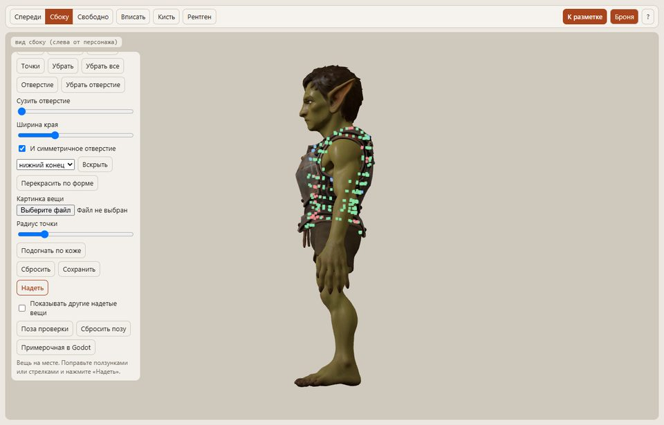 | 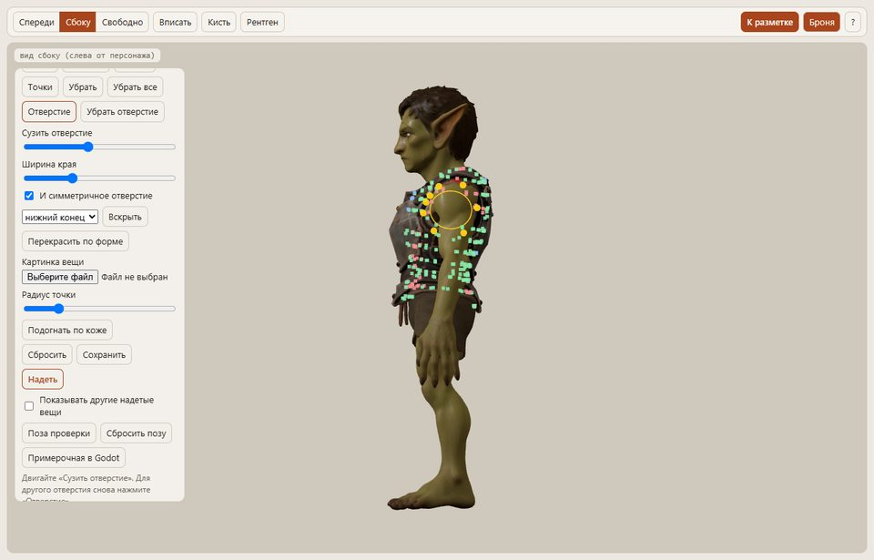 |

### Перекрасить по форме

Суженное отверстие, точки и ползунок стенки растягивают текстуру. «Перекрасить по форме» отправляет изменённую вещь в Hunyuan3D-Paint вместе с картинкой спереди, по которой она делалась (для сгенерированной брони картинка находится сама, иначе выберите её в «Картинка вещи»). Текстура рисуется заново по новой форме, включая стороны, которых не было на картинке (3–6 минут на видеокарте).

| Вещь как сгенерирована | Пройма сужена и перекрашена |
|---|---|
| 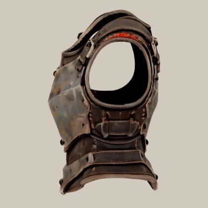 | 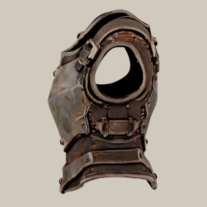 |

### Вскрыть закрытый конец

Сгенерированная вещь иногда закрыта с конца: SF3D закрывает наруч с обоих концов, а у набедренника из Hunyuan наколенник может загибаться под низ. Выберите конец (нижний — дальний от тела, верхний или оба) и нажмите «Вскрыть». Blender срежет этот конец, текстура сохранится; своя стенка вещи остаётся, а у сплошной болванки делается стенка внутрь. Затем вещь ставится заново.

### Слои: вещь поверх другой

Когда вещи перекрываются (сапог поверх поножей, набедренник поверх поддоспешника), список «Поверх этих вещей» говорит, какие уже надетые вещи лежат под этой. Вещи на других частях тела, которые с ней пересекаются, отмечаются сами; две вещи на одной части обычно варианты, поэтому, если это слои, отметьте их вручную. При «Надеть» наружная стенка отмеченных вещей считается кожей: новая вещь раздвигается над ними, а то, что ячейка не может раздвинуть достаточно, выталкивается наружу вдоль луча от оси конечности. Замер с 8 сторон: длинный набедренник поверх бедра из Tripo без слоёв пропускал наружу 27% нижней вещи, со слоями — 4% (это более длинный край нижней вещи).

### Что вещь прячет

Каждая надетая вещь (подогнанная или процедурная) сохраняет ещё и то, какую часть тела она прячет, — `<вещь>.mask.json` (`tool/body_mask.py`): кожу под ней, которая иначе проступала бы в движении, и то, что торчит сквозь неё, — шнуры штанов под юбкой, уши под шлемом. Лицо из шлема и кисть из наруча остаются. Редактор и примерочная в Godot убирают эти треугольники, пока вещь надета, и возвращают, когда её сняли; край тела у кромки вещи остаётся.

### Сохранение и примерочная в Godot

Каждое «Надеть» заодно сохраняет подгонку (`<вещь>.fit.json`); «Открыть» возвращает её со всеми ползунками и точками. «Примерочная в Godot» собирает небольшой проект Godot с персонажем, его анимациями и всеми надетыми вещами и открывает его. Здесь целый комплект в Godot во время ходьбы: нагрудник, шлем и короткие набедренники из Hunyuan3D, сапоги и наручи, снятые с Tripo-персонажа.

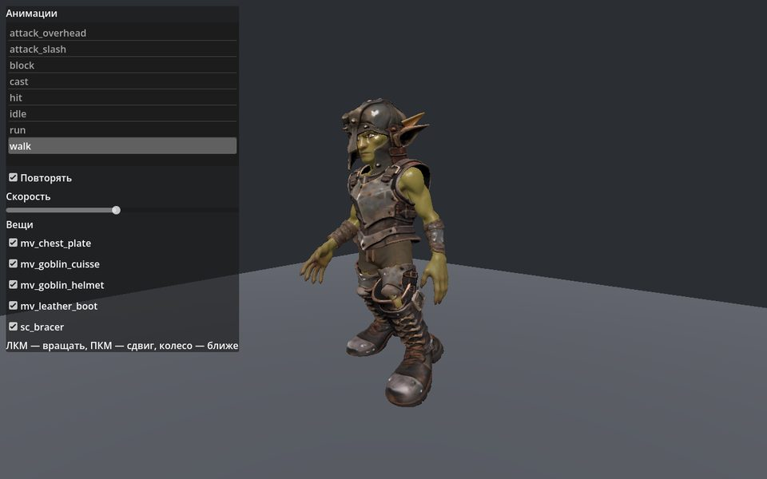

### Экипировка: процедурная генерация

Персонаж → «Экипировка: процедурная генерация» делает вещь не из модели, а по параметрам: наруч, плечо, поножи, набедренник, нагрудник, юбку-тассеты (от талии — чтобы между нагрудником и набедренниками не было зазора), наплечник, штаны или брайет (кольчужные трусы). Вещь строится прямо по коже персонажа с собранным скелетом. Редактор сразу открывается на текущем персонаже: страница (`tool/armour_gen_editor.html`) показывает персонажа с вещью и перестраивает вещь при каждом движении ползунка, за сотые доли секунды. Что на экране, то и получится:

- Наведите на группу параметров (пластины, заклёпки, ремни) — подсветится часть вещи, которую она меняет.
- Виды: спереди, сбоку, крупно. Персонаж в своём цвете, серый или насквозь — чтобы видеть зазор до кожи.
- Позы: руки вверх, руки вперёд, согнутые локти, присед, шаг. Вещь двигается по тем же весам, что будут у неё в игре.
- Сделанные раньше вещи есть в списке и открываются с их параметрами.
- «✋ Щипок»: «Тянуть» — зажмите левую кнопку на вещи и тяните, поверхность там выпирает или вминается; «Рисовать» — ведите с зажатой кнопкой, и под кистью по всему пути поверхность поднимается, вдавливается (не глубже кожи) или сглаживается (бугры, вмятины, чеканка); Shift меняет «поднять» и «вдавить» местами. Оранжевая сетка показывает, что сдвинется; если броня спрятана под телом, кожа вокруг кисти становится прозрачной, и спрятанный кусок можно вытянуть. Кисть — круг, овал, квадрат или полоса (вытянутость и поворот, Alt + колесо); радиус, сила и мягкость края — в панели (радиус ещё Shift + колесо или `[` `]`). Щипки хранятся с вещью, остаются при смене других ползунков и попадают в результат.
- «🖌 Роспись» (в том же блоке «Кисть», с теми же формами): краска нужного цвета, позолота, серебро, ржавчина, копоть или кровь — кистью, на одну деталь (пластину, ремень, окантовку), на все такие детали; есть ластик; ржавчина, копоть и кровь ложатся пятнами. Слои ложатся по порядку и хранятся с вещью. В редакторе роспись видна по вершинам, Blender накладывает её на запечённые цвет, шероховатость и карту металличности попиксельно (по запечённой карте положения), поэтому в результате она чёткая.
- «Рисунок» в «🖌 Росписи» ставит герб туда, куда щёлкнули, проецируя его на вещь: голова кабана, медведя, льва, дракона, оборотня или собаки, либо число (цифры встают рядом), любым видом (позолота, краска…) или цветами самой картинки; размер — от кисти, поворот, отражение. Общий набор (его рисует `tool/decals/make_decals.py`) при первом запуске копируется в `export/decals`; любой PNG, положенный туда, тоже появится в выборе (форма — по альфе).
- «Повреждение» в «🖌 Росписи»: следы когтей (пять борозд), одна царапина или дырка с рваным краем, копотью и трещинами — щелчком (размер от кисти, поворот, глубина — «Плотность»; каждый раз немного по-разному). Дно борозды — голый металл, свет сверху, поверх любой краски.
- Ctrl+Z отменяет, Ctrl+Shift+Z (или Ctrl+Y) возвращает любое изменение: ползунок, стиль, вещь, щипок; то же делают кнопки ↶ ↷. В «Броне» возврат тоже есть.
- «Плащ» — ткань, которая качается в игре: держится на плечах, ворот у шеи, грудь закрыта до застёжки-броши (у узкого плаща — пуговица перед горлом на шнурке к каждому краю), ниже края расходятся, книзу колокол (длина, охват у горла, расклёшенность); вырез ворота сзади выше, чем у застёжки («Ворот сзади»: плащ лежит на трапеции до затылка). Blender вешает его от ворота до подола на 13 цепочек тканевых костей (`Cloth_<столбец>_<звено>`) и скрытую сетку их мест (`__clothhome`); в Godot `SF3DEquip` добавляет эти кости в скелет персонажа и качает их своим симулятором ткани (`SF3DEquip.Cloth`, как «Ткань» редактора: каждая точка держится рядом со своим местом на туловище и не уходит внутрь, руки и ноги её отталкивают) — в любой анимации. В примерочной есть ползунок «Ветер». В редакторе кнопка «Ткань» показывает плащ тканью (любая поза, кроме «Руки вниз», включает её сама: неподвижная модель плаща в позе прошла бы сквозь тело, а в игре он — ткань): он оседает, обтекает тело, перестраивается при смене позы и качается от ветра, верх лежит на коже в позе (поднятые плечи, сведённые вперёд лопатки его приподнимают); с поднятых рук (вверх, вперёд) плащ съезжает назад вместе с воротом — за плечевые суставы (шнурки к броши натягиваются), ниже подмышек расходится по бокам «крыльями», руки впереди (так же и в игре); ткань рисуется гладкой поверхностью, складки мягкие; «Высота ворота» и «Зазор» сажают его на плечи. Плащ строится поверх опущенных рук (поза «Руки вниз» выбирается сама) и нигде не ближе «Зазора» к телу.
- «Юбка» — та же ткань от пояса: держится на поясе («Высота пояса» над тазобедренным суставом), книзу колокол (длина, расклёшенность, зазор), сшита по кругу или с «Разрезом спереди» от подола вверх. Висящие вдоль тела руки в её форму не попадают и остаются снаружи. Blender вешает её на те же цепочки тканевых костей, только от таза; в Godot и в «Ткани» редактора бёдра её отталкивают и над бедром она частично едет с ним: в шаге подол выносит вперёд, в приседе он ложится на колени.
- «Табард» — два полотнища, спереди и сзади, от ворота через плечи (на плечах короткие «рукава») ниже бёдер; по бокам ниже подмышек открыто, на поясе кожаный ремень держит оба полотнища («Высота пояса» над тазобедренным суставом); длина, расклёшенность, высота ворота, зазор. Выше пояса ткань натянута от плеч к ремню, ниже свободно висит; ниже пояса бёдра её толкают и над бедром она едет с ним, как у юбки. В Godot — те же цепочки тканевых костей, разрезы и ряд ремня передаются в имени сетки мест (`__clothhome__o…`).
- Оружие и щит — тоже вещи, в блоке «Оружие и снаряжение» каждое своей кнопкой, как «Щит»: меч, кинжал, топор, булава, двуручный меч (цвайхендер: рукоять под две руки, гарда с загнутыми к клинку концами, рикассо в коже с «усами»), двуручный топор (датская секира: длинное древко, широкое лезвие полумесяцем, лангеты), боевой молот (квадратный боёк с четырьмя зубцами, клюв вниз, шип сверху), палица (дубовая, утолщается к концу, железные обручи и шипы), копьё или посох в кулаке (рукоять поперёк ладони под костяшками, жёстко на кости кисти; ползунки размеров и места хвата, наклона, поворота) и щит на внешней стороне предплечья: круглый, каплевидный, треугольный, ростовой (павеза) или выгнутый (скутум); выпуклость, изгиб вокруг продольной оси (как у скутума), окантовка, умбон (у каплевидного тоже, над кулаком). Положение щита задаётся как у узла в разметке: мышкой в окне (стрелки — сдвиг, кольца — поворот, кубики — масштаб; клавиши G, R, S, манипулятор стоит на щите в той позе, в которой смотрите) или числами: «Положение, см» (X поперёк щита, Y вдоль, Z от руки), «Поворот, °» вокруг этих осей (без ограничения ±90°, Z 90° ставит щит поперёк руки) и «Масштаб, %». Павеза — по образцам: продольный гребень посередине (ползунок «Гребень», изнутри жёлоб), арочный верх, чуть уже книзу, без металлического обода. В «Росписи» → «Картинка» для щита есть кнопка «Картинка на весь щит»: выбранная картинка в своих цветах обтягивает всю лицевую сторону вдоль оси щита (свои картинки — PNG в папке `export/decals`). Там же «Генератор росписи» — картинка по образцу расписных павез: поле, узор (сетка с точками, чешуя, побеги, капли, шахматы, звёзды), кайма с тонкой линией, в центре герб, крест или косой крест, либо герб на всё поле. На щите всё рисуется по его настоящему контуру (круг, капля, треугольник, павеза с аркой, скутум): кайма идёт по краю, герб и крест — в самом просторном месте (у каплевидного — в широком верху), сколы гуще у края; у выгнутого щита картинка разворачивается по длине дуги, чтобы кайма по бокам не была шире; состаривание — потемневший лак, сколы краски до грунта (больше по краям), кракелюр. Цвета подбираются по геральдике (металл на цвете), одно зерно — одна и та же картинка, 🎲 — другой вариант. «Наложить» сохраняет картинку в `export/decals` (её же запекает Blender) и на щит кладёт на всю лицевую сторону; на другие вещи её ставят кистью «Картинка». Гербы рисует [Armoria](https://github.com/Azgaar/Armoria) (код MIT, `tool/vendor/armoria`, `update.py` скачивает и собирает его); фигуры только под CC0 — 108 из 354 (остальные некоммерческие или требуют той же лицензии). Шум для старения — [FastNoiseLite](https://github.com/Auburn/FastNoiseLite) (MIT, `tool/vendor/fastnoiselite`). Вместо процедурного вида можно взять готовый материал: в блоке материала «Библиотека материалов» — поиск по [ambientCG](https://ambientcg.com/) и [Poly Haven](https://polyhaven.com/textures) (оба CC0, можно в игру), категории (дерево, доски, кожа, ткань, металл, ржавчина, краска, золото) и выбор, на какую часть вещи: основа, кожа и ремни, мелкий металл, кольчуга, стёганая ткань, окантовка, изнанка. Щелчок по превью скачивает материал один раз (1K: цвет, нормали, шероховатость, металличность — `export/materials/<источник>_<id>`, `tool/matlib.py`), в окне он ложится по своему настоящему размеру (поле «образец, см»), а Blender запекает его проекцией «коробкой» с тем же износом поверх: грязь, потёртые края, светлые потёртости из цвета самой текстуры. Там же «Свой материал…»: выберите фото кожи, ткани, металла (и, если есть, его карты — их узнают по имени файла: normal/nrm, rough, metal; нормаль DirectX, «dx» в имени, переворачивается). Галочка «бесшовная» сводит края картинки (она смешивается с собой, сдвинутой на половину), карты рельефа и шероховатости, которых нет, выводятся из яркости; «металл» делает его металлическим. Материал ложится на выбранную часть вещи и хранится в `export/materials/custom_<имя>`, в источнике «Свои» он виден для всех вещей. Ниже — «Текстура по картинке», как у Tripo: концепт брони (спереди, сзади, слева, справа) загружается для каждого вида, кнопка «Совместить» показывает его полупрозрачно поверх персонажа в позе покоя (тяните мышкой — сдвиг, Shift + колесо — размер вокруг указателя, просто колесо — зум вида, «Вписать» — на весь рост), и он проецируется на вещь: каждый вид — на то, что смотрит в его сторону, на боках виды плавно смешиваются, где ни один вид не виден, остаётся материал вещи. Blender запекает проекцию в развёртку самой вещи, так что подходит любая вещь, как бы она ни была развёрнута; износ, роспись и повреждения ложатся поверх. Картинки хранятся в `export/concepts`; кнопка «Взять картинки с прошлой вещи» переносит тот же концепт на следующую вещь одним щелчком. Проекция плоской картинки на объёмную вещь всегда приблизительна; точнее — «Текстура по развёртке»: у сделанной вещи развёртка выдаётся по частям (у основы, ремней, окантовки и т. д. у каждой своя развёртка и своя текстура) в папку `<вещь>_uv` рядом с ней — `<часть>_layout.png` (острова поверх текущих цветов), `<часть>_mask.png` (где острова), `<часть>_color.png`, `<часть>_lines.png`. В поле «Что нарисовать» пишете задумку, редактор собирает из неё промт для Codex (кнопка «Скопировать»): какие файлы где лежат, что острова не двигать, цвет заводить за край, без нарисованного света, результат — `<часть>_user.png` в той же папке. «Взять из папки» (или «Загрузить текстуру…» для выбранной части) кладёт эту текстуру цветом части и сразу пересобирает вещь; роспись и повреждения ложатся поверх. Промтов три. «Генератор: по развёртке» — короткий, для моделей, которые редактируют картинку (Nano Banana 2, GPT Image 2.5 — проверено, они держат раскладку): им даётся `<часть>_color.png`, промт просит не двигать фрагменты и не рисовать обводок и фасок по краям (края островов — швы развёртки). Его же отправляет кнопка «Сгенерировать текстуру для «…»» через OpenRouter (ключ — тот же, что в «Настройки» → OpenRouter; список моделей, умеющих редактировать картинку, и примерная цена за картинку — из OpenRouter Image API, `tool/texgen_ai.py`): ответ сохраняется как `<часть>_ai_<модель>_<время>.png` и сразу ложится на вещь (Nano Banana 2 — около 20 с и $0.07). Ещё два: «Codex: скрипт по развёртке» — Codex пишет и запускает Python-скрипт (шум, царапины, ржавчина, кровь на весь квадрат, умноженные на текущие цвета, детали внутри островов по маске) — и «Генератор картинок: бесшовная» — для DALL·E, картинок ChatGPT, Midjourney: бесшовный образец материала, который загружается через «Свой материал…» и ложится по форме вещи без развёртки. Генератор картинок нашу развёртку не повторяет — рисует свою выкройку; поэтому скриптовый промт прямо запрещает генерацию изображения и просит текстуру на весь квадрат без пустого фона, а при загрузке редактор сверяет её с маской: если острова попали на фон картинки, он пишет, сколько процентов, и заливает дыры самой текстурой (кусками из соседних мест, `<часть>_user_fit.png`), исходный файл остаётся. Исходные `<часть>_layout.png` и `_color.png` после наложения не перезаписываются. Картинку, нарисованную по развёртке (модель-редактор по `color.png`), редактор узнаёт сам — всё, что не фон, лежит внутри наших островов — и чистит: светлую кромку, которую генераторы рисуют по краям фрагментов (на модели она легла бы светлыми швами), и фон внутри островов заменяет цветом ближайшей поверхности, цвет заводит на 8 px за край (по образцу `clean_generated.py` от DeepSeek). Если у вещи нет росписи и её параметры не менялись с последней генерации, текстура вписывается прямо в готовый GLB (его картинка цвета этой части заменяется, геометрия, развёртка и веса те же) — за секунды, без пересборки; иначе вещь собирается заново с текстурой. Текстура держится, пока вещь не перестроена с другими параметрами: развёртка тогда другая, и редактор скажет скачать её заново. Сама развёртка хранится рядом с вещью (`uv_loops.npz`: каждая грань по своим вершинам) и при сборке той же геометрии возвращается как была — `smart_project` на больших деталях от запуска к запуску режет острова по-разному. Шлем, налокотник и обувь (их делают генераторы `vendor/blender_armour`) теперь тоже запекаются в текстуры (`tool/blender_texbake.py`): их материалы раскладываются по частям — сталь в основу, кольчуга (кольца бармицы, кольчужные вставки) отдельно, кожа в «кожу и ремни», подкладка в «стёганую ткань» — у каждой своя развёртка и текстура; для них в группе «Материал» есть только «Текстура по развёртке» (вместе с генерацией через OpenRouter). Лицевая сторона щита — обтяжка (материал вещи: кожа, сыромятная кожа, холст или крашеные доски), изнанка и торец — голое дерево; царапины, копоть, рисунки и повреждения ложатся только на ту сторону, куда их поставили (и в редакторе, и в Blender), — «Боевой износ» больше не попадает на изнанку щита или внутрь тонких пластин. К ним применимы те же материалы, роспись, гербы и повреждения. В «Повреждениях» есть и «Вмятина» — она продавливает саму сетку (кратер с валиком по краю, не в тело). Кнопка «Боевой износ» раскидывает по вещи вмятины, царапины, иногда следы когтей и пятна копоти — туда, куда приходятся удары (выпуклые места, спереди и сверху); ещё нажатие — другой набор, сделанное вручную остаётся, Ctrl+Z отменяет. На изнанке щита — два кожаных ремня вокруг предплечья (у локтя и у запястья), по сечению самой руки. С галочкой «Рукоять в кулаке» щит держится рукой, а «Ремень у локтя» (по умолчанию у всех, кроме круглого) добавляет второй ремень вокруг предплечья — как настоящие enarmes, на ближайшем к локтю месте, которое лежит над щитом; тогда щит сидит на кости предплечья (если ремень не ложится на щит, редактор подскажет сдвинуть или развернуть его). Длинная ось щита идёт от локтя к кулаку. на его изнанке поперечная рукоять в кожаной обмотке, её две стойки проходят мимо указательного пальца и мизинца, а сам щит лежит на тыльной стороне кисти и предплечья — снаружи, как на ремнях, так что опущенная рука не вдавливает его в бедро. Рукоять стоит посередине круглого щита (за умбоном) и на широкой части каплевидного и треугольного; острие смотрит к локтю и закрывает предплечье. Щит жёстко сидит на кости кисти, и для него работают ползунки хвата, как у оружия; «Вдоль» сдвигает рукоять к краю, «От руки» отодвигает щит от кисти, «Поворот» вращает его. Зазор до кисти считается лучами по тыльной стороне руки и по костяшкам сжатого кулака. В GLB сетка называется `…__hold_<сторона>`, и в Godot пальцы смыкаются на рукояти, как на оружии. «Проверить в движении» работает и для них: в клипах ищется, где вещь проходит сквозь тело (рука, которая держит, не в счёт; щит — ещё и кадры, где он смотрит на тело), а для щита считается, насколько отодвинуть его от руки, чтобы тело не входило в него ни в одном кадре, — кнопка «Отодвинуть щит наружу на N см» ставит это в поле Z положения; если нужно больше 8 см, кнопки нет: щит повис бы в воздухе, редактор называет клипы и советует уменьшить, повернуть или поднять щит. Клипы копья и лука (там вторая рука на древке или на луке) для щита и другого оружия не проверяются. Другая форма щита — новый щит: роспись, повреждения, положение и имя прошлого не переносятся (генератор росписи перерисовывает картинку под новый контур). Кнопки «Перемещение / Поворот / Масштаб» и клавиши G, R, S убирают включённую кисть, иначе манипулятор скрыт. Двумя руками: ползунок «Вторая рука» (меч, топор, булава, копьё, посох; у двуручного меча и топора вторая рука стоит сразу, и они берутся одной стороной) — где на древке вторая рука, в долях длины руки от первой (плюс — к острию, минус — к концу). В позе «Кулак» держащая рука выносит оружие вперёд, вторая берётся за древко (две кости руки, локоть вниз-наружу) и сжимается своим кулаком. Чтобы оценить вещь так, как её носят, есть боевые стойки (ноги на полу, таз ниже, колени согнуты, плечо щита и нога впереди, голова смотрит вперёд): «Стойка: щит» — щит перед грудью лицом вперёд, меч над щитом остриём вперёд; «Щит, меч вверх» — меч поднят над плечом для удара; «Двуручное» — рукоять перед животом, остриё вперёд-вверх; «Двуручное вверх» — рукоять у плеча, клинок вверх и назад (vom Tag). Вторая рука берётся за рукоять там, где задано ползунком «Вторая рука». Щит и оружие из «Надето» тоже встают в стойки: ось надетого оружия и место хвата находятся по его сетке, щит на ремне у локтя поворачивается вместе с предплечьем. В Godot (`SF3DEquip.Grip`) то же после каждого кадра: клипы сделаны для одной руки, поэтому, если вторая не дотягивается, держащая подтягивается к ней (поворот оружия сохраняется). Копьё держит острие вперёд: если в клипе кисть разворачивает его больше чем на 30° от того, куда смотрят бёдра, кисть доворачивается — при замахе и броске острие не уходит назад. Ножны и колчаны — свой блок «Ножны и колчан», каждый вариант кнопкой (ножны меча, ножны кинжала, колчан, колчан на бедре): ножны меча или кинжала висят на ремне вокруг талии на выбранном боку чуть впереди, уходят вниз и назад вдоль бедра; их длина и ширина — ползунки оружия, так что ножны, сделанные после меча, ему впору. Колчан — за спиной, стрелы над выбранным плечом, на ремне наискосок через грудь; это тубус (полый, с дном), а стрелы в нём — каждая отдельный объект в GLB (`…__arrow_<k>`, ползунок «Стрел»): в игре `SF3DEquip.arrows(вещь, n)` оставляет видимыми n стрел — так виден расход; в примерочной Godot для этого ползунок «Стрелы в колчане». Ремень и перевязь идут по телу (поверх отмеченных в «Надето» вещей) и берут веса кожи под собой; ножны жёстко на тазе, колчан — на груди. Колчан бывает и на бедре: на ремне сбоку, стрелы вверх и вперёд. Лук — вид оружия: держится в кулаке за обмотанную рукоять, плечи изогнуты назад к лучнику, тетива между концами со стороны лучника; длина и толщина — ползунки оружия. Для них есть клипы во вкладке «Анимации» (и в примерочной): «Копьё: стойка», «Копьё: укол с выпадом», «Копьё: бросок», «Лук: выстрел» — лук в левой руке, корпус боком, правая кисть натягивает тетиву к подбородку и уходит назад при выпуске. В Godot (`SF3DEquip`) пальцы руки с оружием смыкаются на рукояти после каждого кадра анимации.
- «Проверить в движении» (`tool/blender_wear_qa.py`): сделанная вещь надевается на персонажа с его анимациями (клипы примерочной), и каждый клип проигрывается в Blender: где кожа, лежащая под вещью в покое, выходит сквозь неё, и где тело, убранное маской, открывает дыру. В отчёте — худший кадр и доли по каждому клипу, места отмечаются красным на персонаже в редакторе.
- Рука с оружием сжимается как на рукояти: каждый палец гнётся в своей плоскости к ладони (и большой тоже), а рукоять ставится внутрь кольца, которое образует сжатый средний палец, и такой же толщины — одинаково в редакторе (поза «Кулак») и в Godot. Если кулак сложен вручную в «Скелет → Вручную по ориентирам → Поза» и нажато «Запомнить кулак», берётся он: он сразу записывается к построенному ригу (`<модель>_landmarks.json`, пересборка не нужна), а редактор брони и примерочная Godot (`fist.json` рядом с персонажем) ставят его в осях кисти (поперёк, вдоль, к ладони), так что он подходит и к другим экспортам того же рига. Рукоять встаёт в кольцо этого кулака — после смены кулака оружие нужно сгенерировать заново. На картинках после «Сгенерировать» (Blender) рука с оружием тоже сжата этим кулаком.
- «Примерочная в Godot» показывает вещь с экрана: если её меняли после «Сгенерировать», она сначала генерируется.
- «Надето»: уже надетые на персонажа вещи видны на нём, а новая вещь подгоняется поверх отмеченных (кольчужная юбка или брайет поверх штанов — два слоя, как носили на самом деле). Нагрудник всегда ложится поверх юбки, что бы ни сделали первым: юбка, сделанная при надетом нагруднике, вместе с поясом остаётся под ним. Это правило теперь общее, слои такие: бельё и поддоспешник → штаны → обувь → брайет → латы на руках и ногах и юбка (латная перчатка поверх наруча, налокотник поверх них) → нагрудник → наплечники и шлем → ткань поверх (табард, юбка из ткани, плащ). Вещь, которую делают при надетых вещах верхних слоёв, ужимается под их внутреннюю стенку: штаны, сделанные после поножей и нагрудника, не вылезают из‑под них. Вещь из ткани поверх не мешает: её потом делают заново. Если верхние вещи сделаны раньше нижней, редактор после «Сгенерировать» перечисляет их. «Пересобрать по слоям (N)» делает заново только устаревшие вещи: те, под которыми с тех пор появилась или переделана вещь нижнего слоя на той же части тела (подшлемник не повод переделывать штаны), и всё, что поверх них; число N на кнопке — сколько их, а если всё в порядке, кнопка неактивна. Делает изнутри наружу, каждую со своими настройками и поверх всех нижних, так что порядок, в котором их делали, больше не важен. Формы всех вещей считаются сразу в редакторе (каждая поверх только что посчитанных нижних — вещь на экране ровно та, что получится), а запекание в Blender идёт в фоне одна за другой: редактор свободен, готовые вещи сами надеваются на персонажа, рядом с кнопкой виден ход («2 из 3 готово, сейчас …») и кнопка «Остановить» — текущая вещь доделается, остальные нет. Вещь, которая ждёт в очереди, нельзя «Сгенерировать» одновременно. Шлем, налокотники и обувь из генераторов, а также оружие не трогаются. На воине: 9 вещей за 4 минуты; после пересборки штаны на поясе на 1,6 см от кожи, нагрудник — на 2,5 см (до неё штаны 1,9 см были поверх нагрудника 1,1 см). ✕ рядом с вещью в «Надето» и «Удалить» у сохранённых удаляют вещь окончательно (после вопроса): её файлы стираются, вещь пропадает из списков и с персонажа, а примерочная Godot снимает её при следующем открытии. Файл вещи, уже надетой на персонажа (её результат или `.src.glb`), во вкладке подгонки второй раз не надевается, а «Добавить модель…» не делает из него персонажа: обе ошибки давали копию поверх вещи и лишнего «персонажа».
- «Стиль по референсу» выставляет наруч, поножи или нагрудник под один из наборов референсов: формованная кожа, латы, кольчуга, открытые шины, шины под кожей или бригантина, латы на кольчуге, ламеллы. Дальше его меняют ползунками.

«Сгенерировать» отдаёт эту самую геометрию и эти веса в Blender (`tool/blender_armour_gen.py`): он запекает материал. Запечённая вещь сразу показывается в редакторе («Результат») и следует позам на скелете персонажа. Как строится вещь:

1. Вокруг средней линии конечности лучами снимается профиль кожи. Кожа других конечностей не считается. Вещь на конечность не учитывает свисающую с неё одежду, а нагрудник, тассеты и штаны ложатся поверх одежды.
2. Профиль сглаживается ползунком «Рельеф тела», отодвигается на зазор и получает толщину. Нагрудник поднимается до шеи: спереди вырез горловины, по бокам проймы под руки; низ может уходить мысом, по центру может идти ребро. Он выпуклый в сечении и книзу не расширяется (расклёш — у юбки под ним); «Сужение к талии» задаёт, насколько он идёт за талией, «Анатомия» выдавливает грудь и пресс. Его можно собрать из двух частей: грудь из одной или двух пластин, а под ней полосы, кольчуга, чешуя и так далее. Под пластины можно надеть кольчугу (подол ниже кирасы и короткие рукава), сверху — наплечники: полукруглые полосы поперёк плеча, верхняя поверх нижней, первая — купол побольше (наплечник есть и отдельной вещью). Каждая полоса движется целиком, нижние сильнее идут с рукой («Наплечник идёт с рукой»), поэтому полосы скользят друг по другу, а не мнутся. Канты пластин можно окантовать латунью или золотом, «Чеканка» меняет металл от полированного до кованого. Тассеты из пластин висят от бёдер прямо, расширяются книзу и разрезаны на полосы, чтобы ноги двигались; юбка из кольчуги или ткани мягкая и скроена так, чтобы ноги двигались свободно: она начинается от талии и лежит на теле: спереди и по бокам идёт по бёдрам, сзади свисает с ягодиц, чуть расширяется книзу, идёт складками с волнистым подолом, а спереди открыта под свободным клином (он длиннее и расширяется к подолу) или под запахом. Ниже тазобедренных суставов перед и бока юбки идут за своим бедром, клин — наполовину за обоими. Штаны — это сиденье до паха и две штанины: облегающие или широкие, со складками и манжетами, любой длины (и до колена), со шнуровкой спереди; на бёдрах — кольчуга, латные бедренники, кожаные панели с заклёпками или пластина на кольчуге, подвязанные к поясу шнурами; на коленях — наколенник с крылом снаружи или кожаная накладка. Брайет — то же, но короткое и из кольчуги, с паховой частью между ног. У кольчужной юбки бывает кожаный кант по краю.
3. Покрытие: пластины с завёрнутыми кантами и заклёпками; металлические шины вдоль кожаной основы на заклёпках; бригантина (кожа поверх скрытых пластин, столбцы заклёпок, швы); каждая чуть шире следующей, поэтому верхняя заходит на неё; чешуя или ламеллы на кожаной основе, каждый ряд поверх шнуровки следующего; кольчуга или стёганка (узор запекается в текстуру); или гладкое. Размер чешуи и колец задаётся в доле роста персонажа, поэтому на всех вещах комплекта он одинаковый.
4. Открытая вещь застёгивается на внутренней стороне, как на референсах: короткие ремни приклёпаны к обоим краям, пряжка над разрезом; либо шнуровка. У латной на другой стороне могут быть петли. Край наруча и поножей у сустава срезан с внутренней стороны, а у дальнего конца спереди спускается ниже (у поножей — на подъём стопы); концы слегка расширяются. Нижний край поножей идёт ровно по высоте над полом, а не поперёк наклонной голени (раньше край обходил ногу под углом, разница доходила до 1,2 см; теперь 0,05 см); вырез над подъёмом остаётся. Вещь поверх других (поножи на штанах) ищет нижний слой не только в 1,6 раза дальше кожи, но и не меньше чем на 3% роста за ней. Там, где кость под самой кожей (внутренняя сторона голени, предплечья), кожа близко к оси, и штаны в 2 см от кожи (их ремешок у колена — 3,6 см) раньше не находились. Поножи ложились прямо на кожу, а ткань выпирала сквозь металл. На воине после пересборки по слоям: из 72 лучей вокруг голени ни одного, где штаны проходят сквозь поножи. У кожи может быть строчка по краю. Нагрудник — цельная вещь, как подогнанный доспех: кольцо вокруг тела до подмышек и над ним без шва — верх через грудь, ключицы, плечи и спину. Горловину и проймы находят сами лучи из середины тела: где они упираются в шею или руку. У жилета плечи — продолжение самого доспеха; у лат остаются верх нагрудной и спинной пластин, их соединяют ремни от нагрудной пластины через плечо. Может открываться сбоку и застёгиваться там же. Иначе вокруг идут кожаные ремни с пряжками. У открытой пластины ремни проходят сзади, у нагрудника — через плечи, у тассет и штанов это пояс. Остальные ремни штанов — обмотки на голенях.
5. Материал задаётся параметрами: железо, сталь, бронза, кожа или ткань, износ (ржавчина или патина и потёртые края), цвет кожи и ткани. Процедурные шейдеры запекаются в текстуры цвета, шероховатости и нормалей. В редакторе материал показан примерно, точный — после запекания.
6. Веса берутся с кожи под вещью и стягиваются к её главной кости ползунком «Жёсткость».

«Шлем» строится не по коже: это одна из шести конструкций генераторов шлемов из `tool/vendor/blender_armour` — железная шляпа, открытый бацинет, барбют, бацинет с забралом и бармицей, салад, армэ. Это скрипты Blender, написанные под человеческую голову в метрах.

`tool/blender_helmet_gen.py` надевает такой шлем на персонажа. Голова каждого персонажа меряется по его же коже:
- глаза, глубина и ширина на уровне лба, макушка;
- подбородок — там, где перед лица резко уходит назад;
- шея и верх плеч.

Ничего не задано под одну анатомию: тот же код подгоняет шлем к гоблину (короткое лицо, почти нет шеи) и к большеголовой мультяшной фее.

Шлем строится в пропорциях генератора с пропорциями головы и масштабируется к ней целиком: прорези для глаз — на глаза, поля шляпы — на лоб. Ниже лица шлем поджимается, чтобы кончаться чуть ниже подбородка, а не на плечах. Подбородочный ремень (сделан под челюсть человека, у гоблина висел бы под шеей) встаёт сразу под подбородок, чуть позади его кончика. Бармица висит вокруг шеи до верха плеч и сходится к шее; спереди она идёт поперёк от концов ремня-держателя, за забралом. Шлем привязан к кости головы, нижние кольца бармицы всё больше к шее.

Маска шлема прячет то, что под ним, всё, что на голове выше лба (волосы, шляпа, вылепленная на персонаже), и уши (`body_mask.ears`, `body_mask.above`): у гоблина они торчали бы сквозь бока.

В редакторе шлем выбранного стиля делается под персонажа так же (один раз на стиль и параметры, `work/helmets/<персонаж>/`, 5–20 с) и показывается на его костях. Параметры: «Зазор над головой», забрало и щёки армэ, хвост салада, поля шляпы, а также высота и вынос ремня — чтобы поправить его руками.

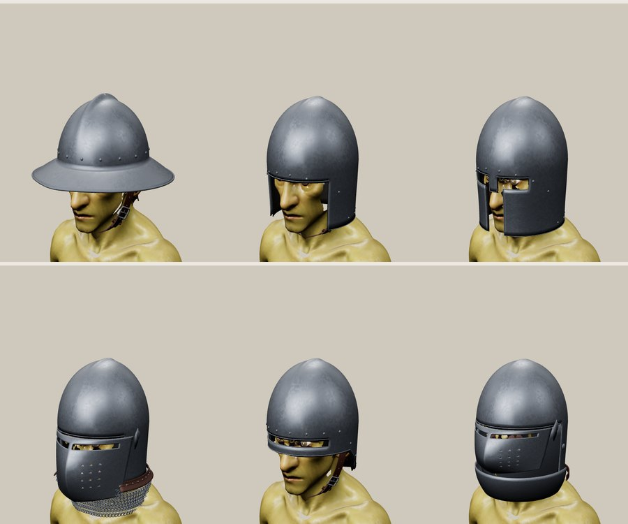

«Налокотник» устроен так же, на генераторах налокотников (`vendor/blender_armour/ElbowArmor`): кожаный, кольчужный участок рукава, простая стальная чашка, чашка с крылом, чашка с набором пластин, сталь с кольчужной вставкой. Генератор строит локоть человека в метрах вокруг сустава.

`tool/blender_elbow_gen.py` подгоняет его к каждой руке:
- меряет руку у локтя по коже: центр сечения, ширину и толщину, насколько выступает локоть, толщину руки на высоте ремней;
- ставит систему генератора вдоль плеча (нижнюю половину доворачивает к предплечью: рука в покое чуть согнута), чашкой на локтевой отросток: от сгиба, а у прямой в покое руки назад. Крыло правого налокотника уходит наружу, левый — его зеркальная копия;
- делает чашку чуть шире руки и глубиной по выступу локтя;
- подгоняет по руке на их высоте ремни, пластины и кольчугу. Ремни вдвое толще, чем у генератора, чуть отстоят от кожи и по бокам сходятся с чашкой.

Верхний ремень и пластины идут с плечом, нижние — с предплечьем. Чашка со всем, что на ней, — поровну на обе кости. Кольчуга и внутренние кожаные полосы — плавно от одной кости к другой.

Маска каждого локтя считается отдельно, только по чашке и пластинам, с отступом от их края: ремни при сгибе скользят по коже. Поза редактора «Локти» показывает руки согнутыми. Параметры: «Зазор над рукой» и размер крыла.

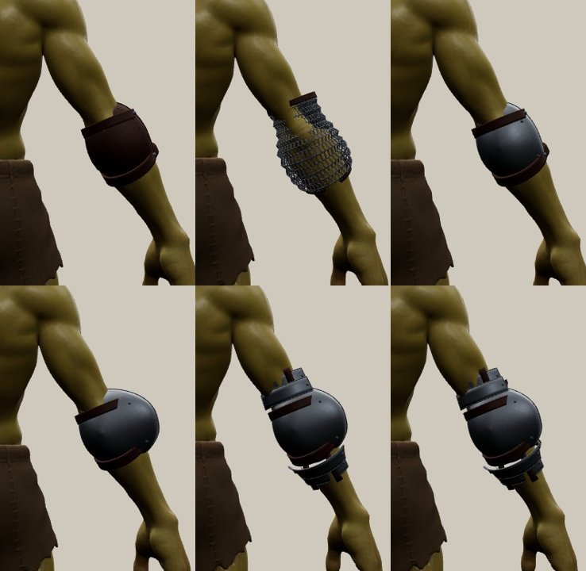

«Наколенник» — те же чашки на коленях (`blender_elbow_gen.py` с `limb: leg`: бедро, колено, голень; острие чашки спереди, крыло наружу — у правой ноги зеркальная заготовка), те же шесть стилей, «Воздух над рукой» и размер крыла. Верхний ремень и пластины идут с бедром, нижние с голенью, чашка наполовину с каждым — в «Приседе» видно, как она садится на согнутое колено.

«Гульфик» — латная защита паха XVI века, к брайету: чашка над пахом, выпуклая вперёд, по телу под ней (лучи спереди, низ между бёдрами не проваливается), с закатанным краем и заклёпками; жёстко на тазе. Он под латами (в слоях — над брайетом, штанами и поддоспешником): два ремешка толщиной 1 мм уходят от чашки к талии прямо по коже (над поддоспешником, если он надет) — под брайетом, штанами и кирасой; галочка «Ремень на талии» добавляет такой же ремень вокруг талии. Где кожа под надетым спрятана маской, они ложатся на внутреннюю стенку надетого. Стили: латный, варёная кожа (латунный кант), стёганый тканевый, как у ландскнехтов (круглее, без канта). Ползунки «Размер», «Выпуклость», «Высота».

«Обувь» устроена так же, на генераторах обуви (`vendor/blender_armour/Footwear`): кожаные башмаки, короткие сапоги, кольчужная стопа, округлые и заострённые сабатоны, кожа со сталью и кольчугой. Генератор строит правую человеческую обувь на одной колодке, начало координат — в голеностопе.

`tool/blender_footwear_gen.py` подгоняет её к каждой стопе:
- меряет стопу по коже: пятку, кончик пальцев вместе с когтями, ширину и середину, землю, высоту голеностопа;
- масштабирует колодку по длине, ширине и высоте: носок по направлению стопы, подошва на земле;
- ниже лодыжки подгоняет к стопе в ширину на каждой высоте и по длине (по сглаженным срезам кожи): у гоблина пальцы веером, а колодка к носку сужается. Поле подгонки одно для кожи и стали: пластины не врезаются друг в друга, кожа не проступает сквозь сталь;
- голенище подгоняет по ноге на каждой высоте выше лодыжки по срезам кожи вокруг голени, так что икра остаётся внутри.

Левая обувь — зеркальная копия правой.

Обувь движется со стопой, носок — с пальцами, голенище всё больше с голенью, сталь — целиком с тем, на чём лежит. Маска считается для каждой стопы отдельно. Параметр — «Зазор вокруг стопы»; позы «Шаг» и «Присед» показывают её в движении.

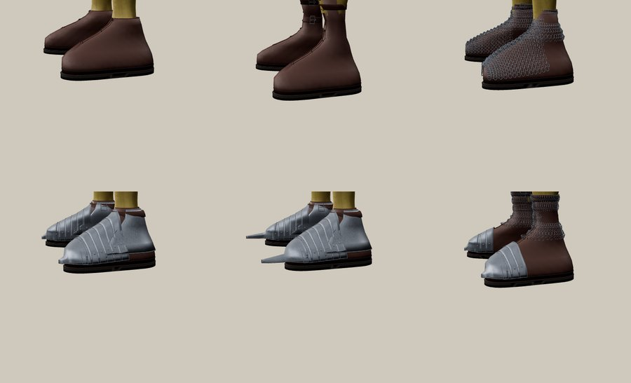

«Перчатки» строятся в самом редакторе из кожи кисти. Шесть стилей по референсам: кожаная перчатка, усиленная кожа, кольчужная рукавица, латная перчатка «песочные часы», латная рукавица, сталь с кольчугой.

Как они строятся:
- кожа, которая движется с кистью и пальцами, отодвигается на зазор и получает толщину. Каждая точка сохраняет веса самой кожи, поэтому перчатка гнётся с каждым пальцем;
- у рукавицы четыре пальца уходят в общий мешок — выпуклую оболочку пальцев и костяшек. Его точки берут веса ближайшей кожи;
- на тыле кисти лежит пластина или кожаная нашивка. На каждой фаланге — чешуйка чуть длиннее фаланги, чтобы они ложились внахлёст; каждая идёт целиком со своей костью, края сглажены. У латной рукавицы поперёк мешка идут пластины;
- манжета устроена как наруч вокруг запястья, с раструбом к локтю («песочные часы»). Она из кожи, кольчуги или стали, с ремнём.

Поза «Кулак» сжимает пальцы.

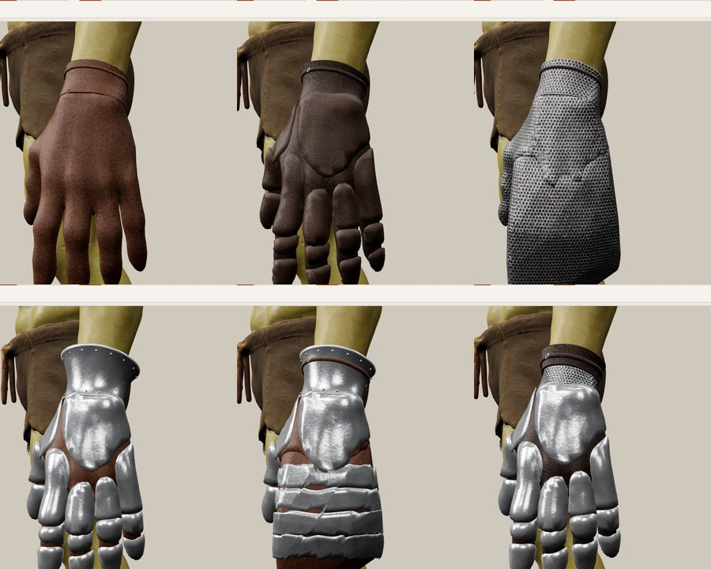

Первый вариант «Рубашка под доспех (тонкая ткань по телу)» — то, что надевают под латы: тонкая ткань из самой кожи персонажа (туловище до бёдер, плечи, подмышки, руки до запястий), одной поверхностью, без щелей между телом и рукавами, без юбки, воротника и завязок. Каждая точка движется со своей кожей. Анатомия сглажена, как у настоящей ткани: в масштабе тела (шар около 3 см, по площади, а не по соседям сетки) уходят соски, края груди, кубики пресса, мышцы рук; ткань перекидывается через впадины. Кожа под ней скрыта и в редакторе, и в игре (маска), поэтому ткань может срезать выступ до 4 см. У штанов есть такой же вариант «Под доспех (тонкая ткань по телу)»: облегающие штаны от пояса до щиколоток. Остальные варианты стёганые и толстые; они для персонажа без доспеха. Например, полы длинного гамбезона торчали бы из‑под любой брони, а лишняя геометрия под латами — пустая нагрузка. Кнопки вещей в редакторе разбиты на блоки: «Броня», «Одежда», «Оружие и снаряжение».

«Поддоспешная одежда» кроится как одежда, по листам-референсам: льняная рубаха, короткий акетон, длинный гамбезон, подлатный дублет, дублет с кольчужными вставками, стёганый жилет. Кроме них есть брэ (короткие и длинные) и стёганый подшлемник.

Как она строится:
- из частей самого доспеха, свободно по телу, а не из кожи. Торс — как у жилета: кольцо и кокетка через плечи, проймы и горловина находятся там, где лучи встречают руки и шею;
- юбка продолжает торс вниз и не сужается к талии; разрезы по бокам или сзади;
- рукава — трубы вокруг плеча и предплечья. У локтя нижняя часть уходит под верхнюю, край проймы подвёрнут под верх рукава;
- стоячий ворот — вокруг основания шеи;
- спереди завязки или шнуровка; у дублетов шнурки для лат на плечах, руках и по подолу, у второго — кольчужные вставки под мышками;
- стёжка — продольными каналами или ромбами;
- брэ — свободные штаны, длинные собраны у щиколотки;
- подшлемник — мешок вокруг головы (волосы бывают вылеплены прямо на коже, комками): выпуклая оболочка с вырезом для лица, уши проходят насквозь, волосы скрыты под ним.

Это самый нижний слой: доспех надевается поверх.

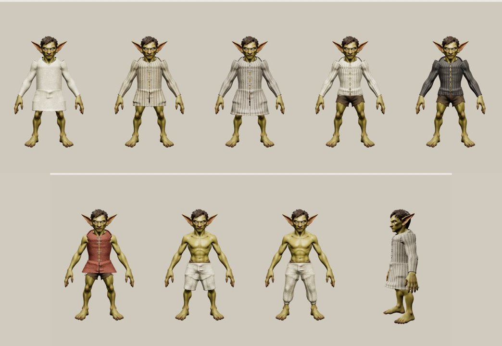

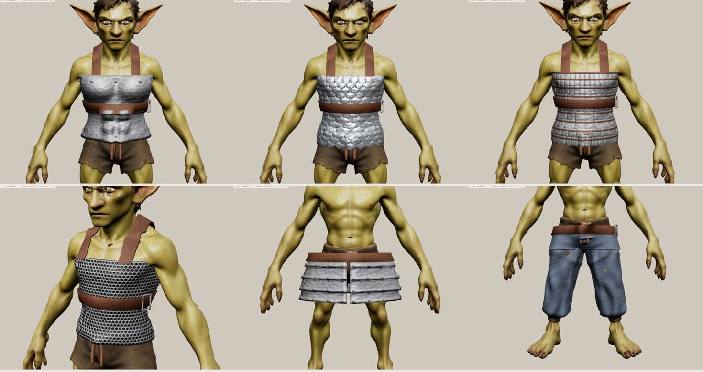

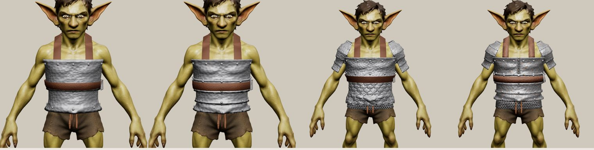

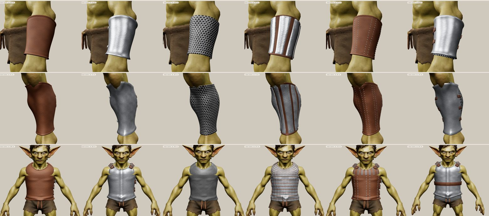

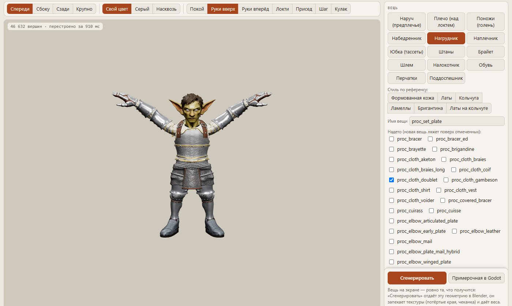

Готовая вещь ложится рядом с персонажем как надетая в «Броне», поэтому её видят примерочная в Godot и список надетых вещей в редакторе. Она садится сразу, без подгонки, и весь комплект получается в одном стиле, каждая вещь делается поверх надетых под ней (стальные руки — поверх рукавов дублета). На других телах тоже работает: справа салад на фее. Править руками её всё равно можно. В «Броне» любая такая вещь, включая шлемы, налокотники, обувь, перчатки и одежду, открывается как сделана — часть тела «Готовая вещь». Её можно двигать, поворачивать и менять размер гизмо, править форму точками, проёмами и толщиной стенки. «Надеть» сохраняет её собственные веса и то, что прячет её маска (уши под шлемом). Новая генерация заменяет эти правки.

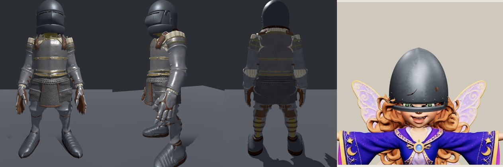

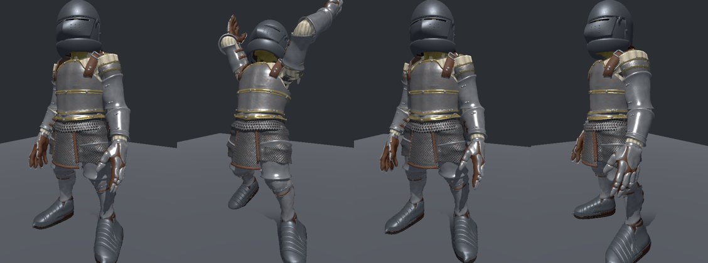

### Галерея анимаций

`tool/anim_gallery.py` переносит около 90 клипов (Mesh2Motion, CC0, плюс процедурные клипы с двуручником и щитом) на персонажа со скелетом и пишет одну HTML-страницу, которая открывается двойным щелчком. Клипы разбиты на группы: передвижение, прыжки, уклонения, меч, меч и щит, двуручный меч, защита, магия, рукопашная, лук и метание, урон и смерть, эмоции.

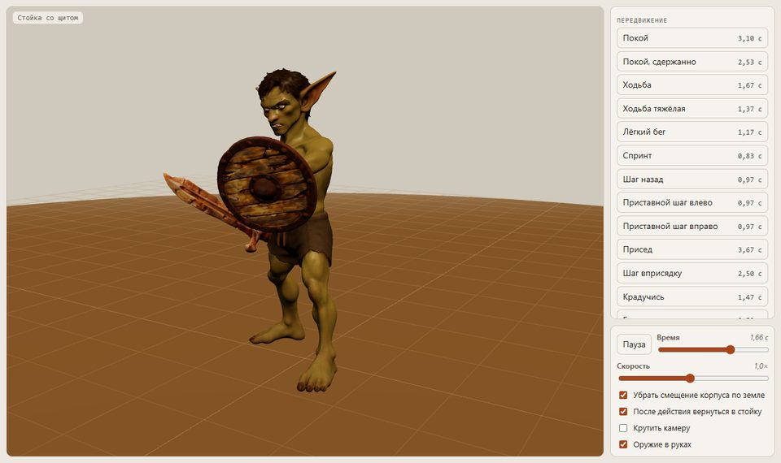

---

## Требования

**Железо:** видеокарта NVIDIA с **8 ГБ видеопамяти** и больше (драйвер CUDA 12.x), желательно 32 ГБ ОЗУ и около **60 ГБ** свободного места под окружения, веса моделей и кеши.

**Программы, которые нужно поставить самому** (в репозиторий ничего не входит):

| Что | Версия | Для чего |
|---|---|---|
| Windows 10/11 x64 | 11 | всё (скрипты `.bat`/`.ps1`) |
| [Miniconda](https://docs.anaconda.com/miniconda/) | любая свежая | три окружения Python |
| [Git for Windows](https://git-scm.com/download/win) | любая | клонирование; **его `bash.exe` запускает UniRig** |
| [Visual Studio 2022 Build Tools](https://visualstudio.microsoft.com/visual-cpp-build-tools/) с «Desktop development with C++» | 2022 | сборка расширений SF3D, Hunyuan3D-Paint и UniRig |
| [CUDA Toolkit 12.1](https://developer.nvidia.com/cuda-12-1-0-download-archive) | 12.1 | сборка `texture_baker` для SF3D (Hunyuan берёт свой `nvcc` из conda) |
| [Blender](https://www.blender.org/download/) | 5.2 | риггинг, анимации, экипировка, наборы, разрушаемые объекты, превью |
| [Godot](https://godotengine.org/download) (консольный exe) | 4.7.2 | сборка сцен эффектов, наборов и разрушаемых объектов, примерочная |
| [Аккаунт Hugging Face](https://huggingface.co/join) | – | веса SF3D **закрыты**: примите лицензию на [stabilityai/stable-fast-3d](https://huggingface.co/stabilityai/stable-fast-3d) и войдите |
| [Codex CLI](https://github.com/openai/codex) (`npm i -g @openai/codex`, затем `codex login`) | 0.160 | *необязательно*: вкладка «Референс» через подписку ChatGPT |
| Ключ OpenRouter | – | *необязательно*: вкладка «Референс» без Codex |

---

## Зашитые пути

Скрипты рассчитаны на такое расположение. Проще всего повторить его, иначе поправьте места из таблицы.

| Путь | Зачем | Где задан |
|---|---|---|
| `D:\conda\envs\sf3d`, `...\hunyuan`, `...\unirig` | окружения Python | `sf3d-env.bat`, `tool\launch_ui.ps1`, `tool\sf3d_ui.py` (`HY_PY`), `tool\rigging.py` (`UNIRIG_ENV`), скрипты установки |
| `D:\conda\hf`, `D:\conda\hy3dgen` | кеш моделей Hugging Face / Hunyuan | те же файлы + `tool\hy_pipeline.py`, `tool\hy_texture_mv.py` |
| `D:\conda\tmp`, `D:\conda\pip-cache`, `D:\conda\pkgs` | временные файлы и кеши (не на диске C:) | запуск и скрипты установки |
| `D:\conda\rig` | папка для UniRig (его bash-скрипты ломаются на пробелах в путях) | `tool\rigging.py` (`STAGE`) |
| `D:\Git\bin\bash.exe` | Git Bash для UniRig | `tool\rigging.py` (`BASH`) |
| `<репозиторий>\hunyuan3d-src` | исходники Hunyuan3D | `tool\sf3d_ui.py` (`HY_SRC`) |
| Blender, Godot, папки export/work/input, язык интерфейса | | `tool\config.json` (можно менять и в окне «Настройки») |

Сам репозиторий может лежать где угодно. Оригинал лежит в `D:\My projects\SF3D`; пути с пробелами подходят для всего, кроме папки UniRig.

---

## Установка

Все команды выполняются в **Anaconda/Miniconda PowerShell** в корне репозитория.

### 1. Клонируйте этот репозиторий и три репозитория моделей рядом

Репозиториев моделей здесь **нет**. Клонируйте их точно под этими именами:

```powershell
git clone https://github.com/Sergeyspb-source/3d-animator.git
cd 3d-animator

git clone https://github.com/Stability-AI/stable-fast-3d.git sf3d-src
git clone https://github.com/Tencent-Hunyuan/Hunyuan3D-2.git hunyuan3d-src
git clone https://github.com/VAST-AI-Research/UniRig.git unirig-src

# UniRig: поддержка Windows из PR #70 сообщества
git -C unirig-src fetch origin pull/70/head:pr70
git -C unirig-src checkout pr70
```

### 2. Наложите локальные патчи (папка `patches\`)

```powershell
# Hunyuan3D-Paint: UNet грузится из .safetensors, файл .bin на 3,5 ГБ не нужен
git -C hunyuan3d-src apply ..\patches\hunyuan3d-paint-safetensors.patch

# UniRig: настройки скелета с малым расходом памяти для видеокарт на 8 ГБ
Copy-Item -Recurse -Force patches\unirig\configs\* unirig-src\configs\
```

### 3. Окружение SF3D (`sf3d`): интерфейс, SF3D, материалы, связующий код

Скрипта установки для этого шага пока нет, команды выполняются вручную. Сначала откройте «x64 Native Tools Command Prompt for VS 2022», чтобы собрались расширения на C++/CUDA:

```powershell
conda create -p D:\conda\envs\sf3d python=3.10 -y
$py = 'D:\conda\envs\sf3d\python.exe'
& $py -m pip install torch==2.4.1 torchvision==0.19.1 --index-url https://download.pytorch.org/whl/cu121
& $py -m pip install setuptools==69.5.1 wheel
cd sf3d-src
& $py -m pip install -r requirements.txt          # собирает texture_baker и uv_unwrapper
& $py -m pip install -r requirements-demo.txt     # gradio 4.41.0
cd ..
# модули, которые нужны этому набору (их нет в требованиях SF3D)
& $py -m pip install scikit-image scipy matplotlib fast-simplification onnxruntime-gpu
# вход, чтобы закрытые веса SF3D скачались при первом запуске
& $py -m huggingface_hub.commands.huggingface_cli login
```

### 4. Зависимости Robust Weight Transfer (вкладка «Экипировка»)

`tool\vendor\rwt\weighttransfer.py` лежит в репозитории (GPL-3.0, см. `tool\vendor\rwt\LICENSE` и `source_manifest.json`). Его собранных зависимостей в git **нет**, поставьте их в папку vendor:

```powershell
D:\conda\envs\sf3d\python.exe -m pip install --target tool\vendor\rwt\deps libigl==2.6.1 robust_laplacian==1.0.0
```

### 4b. Липсинк (необязательно, Персонаж → Липсинк)

Всё своё: `tool\vendor\lipsync\transcribe.py` (локальный Whisper) и `lipsync.py` (кривые лица ARKit) работают в окружении
`sf3d` (numpy, scipy, torch, transformers; `soundfile` или ffmpeg для mp3/ogg). Модель `openai/whisper-small`
(~1 ГБ) скачивается при первом запуске в `hf_home` из `tool\config.json` (по умолчанию `D:/conda/hf`); готовый кеш
Hugging Face используется повторно. Результат: `<папка модели>\<голос>.face.json` и копия аудио. Клип сразу играет прямо во вкладке: лицо крупно, реплика со звуком; «▶ Посмотреть» проигрывает любой клип персонажа.

В Godot: скопируйте `tool\godot\face_curves_clip.gd` и `face_curves_player.gd` в проект и добавьте узел
`FaceCurvesPlayer` (`audio` — `AudioStreamPlayer3D` с голосом, `face_root` — персонаж, `clip_path` — файл
`.face.json`). Он двигает ключи формы рта персонажа (`jawOpen`, `mouthSmile`, …) по времени звука.

### 5. Окружение Hunyuan3D-2 (`hunyuan`): модели по нескольким видам и покраска

```powershell
powershell -ExecutionPolicy Bypass -File hunyuan3d-install.ps1        # окружение + PyTorch 2.4.1 cu121 + hy3dgen
powershell -ExecutionPolicy Bypass -File hunyuan3d-texgen-install.ps1 # nvcc 12.1 из conda + сборка custom_rasterizer / mesh_processor (нужны VS 2022 Build Tools)
powershell -ExecutionPolicy Bypass -File hunyuan3d-weights.ps1        # модель формы tencent/Hunyuan3D-2mv (fp16)
powershell -ExecutionPolicy Bypass -File hunyuan3d-texgen-weights.ps1 # модели delight и покраски
```

В скрипте сборки `hunyuan3d-texgen-build.bat` стоит `TORCH_CUDA_ARCH_LIST=8.9` (RTX 40xx). **Поменяйте под свою видеокарту** (8.6 для RTX 30xx, 12.0 для RTX 50xx).

### 6. Окружение UniRig (`unirig`): автоматический риггинг

```powershell
powershell -ExecutionPolicy Bypass -File unirig-install.ps1   # окружение py3.11 + torch cu128 + spconv + заглушка flash-attn
unirig-build-ext.bat                                          # только если torch_scatter / torch_cluster не поставились
```

Веса UniRig (`VAST-AI/UniRig`) скачиваются с Hugging Face при первом риггинге.

### 7. Настройка

При первом запуске используется `tool\config.example.json`. Чтобы поменять пути или язык, скопируйте его в `tool\config.json` (этот файл в git не попадает) и задайте `lang` (`ru` или `en`), `blender_exe`, `godot_exe`, `export_dir`, `work_dir` и `input_dir`. То же можно сделать в окне «Настройки» и в меню 🌐.

---

## Запуск

| Как | Что |
|---|---|
| `sf3d-ui.vbs` (двойной щелчок) | интерфейс без консоли, окно приложения на `http://127.0.0.1:7861`. Закрытие окна останавливает сервер и освобождает видеопамять |
| `sf3d-ui.bat` | тот же интерфейс с видимой консолью (для отладки) |
| `sf3d-tool.bat generate <картинка или папка> --category prop` | разовый запуск из командной строки: картинки → готовый GLB |
| `sf3d-tool.bat post work\item\axe\raw.glb --category item --name axe` | только постобработка |
| `sf3d-batch.bat <папка> [--force] [--no-preview]` | пакет: `<папка>\<категория>\pic.png` → SF3D; `<папка>\<категория>\<объект>\front.png [back/left/right.png]` → Hunyuan3D |
| `sf3d-gradio.bat` | исходное демо SF3D (порт 7860) |

**Запускайте одну задачу на видеокарте за раз.** Пик видеопамяти примерно такой: SF3D 6,2 ГБ, форма Hunyuan 5,8 ГБ, покраска Hunyuan 7,4 ГБ, UniRig 4,5 ГБ. Интерфейс проверяет свободную память перед каждой задачей.

---

## Подгонка брони подробно

В режиме «Поза» редактора разметки кнопка **Броня** открывает панель брони:

1. Выберите GLB вещи и часть тела. Вещь без своего скелета получает часть тела по имени файла (cuisse/thigh/набедренник → бедро, greave/поножи → голень, bracer/vambrace/наруч → предплечье, rerebrace → плечо, pauldron/shoulder/наплечник → «Наплечник», gauntlet/перчатка → кисть, boot/сапог → «Сапог», helmet/шлем → голова, chest/cuirass/нагрудник → торс); если имя ничего не говорит, выбор остаётся прежним. Ось трубы у вещи без скелета — направление, вдоль которого она сквозная (лучи из середины проходят насквозь; кроме главных осей пробуются собственные x/y/z вещи, потому что у короткой широкой вещи главные оси неопределённы). Вещь ставится вдоль настоящей средней линии конечности и подгоняется всей внутренней стенкой. Узлы, по одному на ячейку вещи (12 вдоль × 24 по кругу), совмещаются с кожей методом ICP с односторонним штрафом: меняются сдвиг, наклон, масштаб поперёк конечности и овальность, форма — нет. «Подогнать по коже» повторяет это после ручных правок. Узлы показаны красными (под кожей), зелёными (на коже) и синими (воздух).
2. Поправьте ползунками, стрелками (G / R / S) или точками на поверхности. Ползунки: положение, длина, «Обхват» (вся вещь шире или уже), «Толщина стенки» (внутренняя стенка остаётся, двигается только внешняя поверхность; одинаково вокруг собственной оси вещи в редакторе и в Blender), поворот и зазор. Строка под ползунками показывает воздух и толщину стенки в долях радиуса конечности.
3. **«Надеть»** запускает `tool/blender_wear_fit.py`. Вещь раздвигается от оси конечности по ячейкам, чтобы внутренняя стенка вышла из кожи, а стенка сохранила форму. То, что всё ещё под кожей, выталкивается вдоль нормали кожи с захватом соседей, так что внутренняя и внешняя стенки двигаются вместе. «Прилегание к телу» прижимает отошедшие части к конечности на эту долю воздуха (стенка меряется на том же луче, что и кожа). Бока нагрудника, обращённые к рукам, прижимаются полностью, а кожа рук (с весами на костях руки или дальше плечевого сустава с этой стороны) не считается кожей торса: иначе нагрудник раздувается вокруг дельты, и поднятая рука будто вылезает из его плеча. Внутренняя стенка ячейки — 10-й процентиль расстояний её вершин до оси, а то, что глубже 3/4 расстояния до кожи, остаётся внутри конечности как есть: у вскрытой сплошной вещи из картинки это остатки крышек, и, если их учитывать, концы вещи раздувались воронкой. Веса берутся только с костей самой конечности и сглаживаются по вещи. «Жёсткость» заставляет вещь двигаться вместе с костью (0,8 для наручей и поножей, 0,2 для перчаток). Результат — `<персонаж>_wear_<вещь>.glb`: скелет персонажа и вещь с весами.
   - Вещь, сделанная на другом теле и несущая свой скелет (вещи, снятые с Tripo-персонажей, в `export/equipment`), читается вместе с ним. На одном сегменте конечности она ставится как выше; на нескольких сегментах (сапог на голени и стопе, рука целиком) выбирается «Вся вещь по её скелету». Тогда каждая вершина переходит с костей вещи на те же кости персонажа по своим весам, как кожа при скиннинге, а вторая сторона — зеркало с заменой Left и Right. Blender получает перенесённые копии, выталкивает их из кожи и даёт веса только тех костей, которые были у вещи.
   - Вертикальные вещи сохраняют свою вертикаль как ось и свои пропорции: «Торс (нагрудник)» — без зеркала, веса на позвоночнике и никогда на руках; «Голова (шлем)» — верх шлема на макушке, жёстко на кости головы; «Сапог» — голенище на голени и размер по нему, носок по стопе (по длинной оси подошвы, к концу дальше от голенища), подошва у пятки.
   - «Наплечник» — купол на плечевом суставе, а не труба. Он сохраняет ориентацию, в которой сделан (верх — это верх), а сфера его верхней части считается его собственным плечевым шаром: центр ставится на плечевой сустав персонажа, размер подбирается по коже вокруг, затем тот же ICP в ячейках направлений от сустава (сдвиг, поворот, один масштаб: форма не меняется). Сторона, для которой вещь сделана, берётся из имени файла (`_L`, `left`…), иначе левая (генератор просим сделать левый); выбор другой стороны отражает вещь. Наплечник жёсткий: у всех вершин одинаковые веса ключицы и плечевой кости, а ползунок «Идёт за рукой» задаёт долю руки (по умолчанию 0,7: при замере с рукой вбок и вперёд кожа проглядывала меньше всего; 0,5 хуже, потому что смесь двух поворотов сжимает жёсткую вещь). Поверх нагрудника он надевается слоем: ремни нагрудника считаются кожей, и Blender выталкивает наплечник из них целиком. Наплечник — внешний слой: под нагрудник он сам не отмечается.
   - «Отверстие»: клики по краю проймы или горловины задают окружность. «Сузить отверстие» стягивает край и поверхность рядом с ним к оси окружности, обе стенки сразу, с плавным спадом; «И симметричное отверстие» делает то же с другой стороны. Всё происходит в собственном пространстве вещи, поэтому редактор, зеркальная копия и Blender получают одну форму.
   - «Поверх этих вещей»: задание получает готовые результаты отмеченных вещей (`under`). На луче каждой ячейки от оси конечности наружная стенка первой оболочки, лежащей на этой конечности (не дальше радиуса конечности от кожи), заменяет расстояние до кожи, а второй толчок выводит то, что всё ещё под ними, наружу вдоль луча, с тем же плавным захватом соседей, что и у толчка из кожи. В отчёте считаются ячейки, легшие поверх других вещей.
   - «Вскрыть» (нижний конец / верхний конец / оба конца): сгенерированная вещь, закрытая с конца, срезается там скриптом `blender_armour_hollow.py` вместе с текстурой и ставится заново. На конечности нижний конец — дальний от тела (у кисти, у колена); вертикальная вещь — по своей вертикали. Своя стенка вещи остаётся; у сплошной болванки делается стенка внутрь (если у вещи есть стенка, луч из середины наружу проходит две поверхности).
   - «Перекрасить по форме»: Hunyuan3D-Paint заново красит изменённую вещь по её картинке-референсу (находится в `refs_mv` или выбирается в «Картинка вещи»), и текстура идёт по новой форме, а не растягивается (3–6 минут на видеокарте). Результат становится исходной вещью подгонки.
   - Hunyuan3D по четырём видам (их рисует Codex: `export/equipment/generated_armour/make_refs_mv.py`) даёт полую броню, которую не нужно вскрывать. Вещь по одной картинке обычно сплошная; `tool/blender_armour_hollow.py in.glb out.glb [open=both|top|bottom] [axis=auto|z|x,y,z] [wall=0.08|auto]` делает то же вскрытие из командной строки.
4. Каждая подгонка сохраняется в папке персонажа как `<вещь>.fit.json` + `.src.glb`. «Открыть» возвращает её со всеми ползунками и точками, «Сохранить» сохраняет без надевания.
5. **«Примерочная в Godot»** собирает `work/wardrobe/<персонаж>/`: персонаж с анимациями (если их нет, делаются процедурные), все подогнанные вещи надеты, вещи включаются и выключаются, камера вращается. Затем проект открывается в Godot.

В своём проекте Godot скопируйте `tool/godot/sf3d_equip.gd` и GLB-файлы, затем:

```gdscript
var bracers := SF3DEquip.wear($Goblin, preload("res://armor/bracer_leather.glb"))   # надеть (сетки переходят под Skeleton3D персонажа)
SF3DEquip.take_off(bracers)                                                      # снять
SF3DEquip.show(bracers, false)                                                   # скрыть (тело под ней вернётся)
```

Положите рядом с каждым GLB его `.mask.json`: `wear` читает его и прячет тело под вещью.

Вещь идёт за всеми анимациями персонажа по именам костей. Она должна быть сделана для той же модели со скелетом.

---

## Галерея анимаций

`tool/anim_gallery.py` переносит клипы Mesh2Motion (`Animations/Mesh2Motion`, CC0) и процедурные клипы с двуручником и щитом на персонажа со скелетом. Получается одна самодостаточная HTML-страница примерно с 90 клипами по группам (см. [снимок выше](#галерея-анимаций)). GLB лежит внутри страницы, поэтому она открывается двойным щелчком. Её тексты — на языке интерфейса.

```powershell
D:\conda\envs\sf3d\python.exe tool\anim_gallery.py "<персонаж>_landmarks_rigged.glb" Animations\goblin_gallery.html
```

`blender_retarget_fbx.py` читает клипы прямо из GLB Mesh2Motion: имена костей в стиле Unreal сопоставляются с именами Mixamo. Оружие в руках приблизительное, потому что его настройки делались на другом гоблине; галочка «Оружие в руках» его прячет.

---

## Устройство репозитория

```
sf3d-ui.vbs / sf3d-ui.bat     запуск интерфейса
sf3d-tool.bat / sf3d-batch.bat запуск из командной строки
sf3d-env.bat                  окружение sf3d
*-install.ps1, *-weights.ps1, *-build.bat   установка Hunyuan3D и UniRig
patches/                      правки поверх сторонних репозиториев
docs/images/                  снимки для README (en/, ru/)
tool/
  sf3d_ui.py                  интерфейс Gradio (все вкладки)
  i18n.py, lang/*.json        язык интерфейса: все тексты по ключам (русский, английский)
  sf3d_tool.py, batch_cli.py  командная строка и постобработка (pivot, масштаб, коллизия, материалы)
  hy_*.py                     обработчики Hunyuan3D (работают в окружении hunyuan)
  rigging.py, outfit.py, hanim.py, fbxanim.py, materials.py, surfaces.py,
  fx_flipbook.py, modkit.py, destruct.py, refgen.py, anim_gallery.py, rwt_*.py   модули функций
  landmarks*.py, landmark_editor.html   скелет по ориентирам и подгонка брони (редактор на three.js)
  face_edits.py                 выражения, поправленные вручную: накладываются на модель (и заново после пересборки)
  blender_*.py                скрипты Blender без окна (blender -b -P tool\blender_x.py -- args)
  godot/                      скрипты и шейдеры Godot для собираемых сцен (FaceCurvesPlayer для липсинка,
                              SF3DEquip для надевания брони, примерочная)
  rig_scripts/                обёртки Git Bash для UniRig
  vendor/rwt/                 Robust Weight Transfer (GPL-3.0)
  vendor/lipsync/             тайминги слов Whisper и кривые липсинка (см. его README)
  vendor/blender_armour/      генераторы шлемов, налокотников и обуви (KettleHat, HelmetVariants, ElbowArmor, Footwear: скрипты Blender), см. source_manifest.json
  config.example.json         шаблон настроек
```

Не в git (создаётся на месте): `sf3d-src/`, `hunyuan3d-src/`, `unirig-src/`, `export/`, `work/`, `input/`, `tool/config.json`, `tool/vendor/rwt/deps/`, все веса моделей.

---

## Лицензии сторонних моделей

В репозитории только связующий код. У каждой модели своя лицензия, поэтому **проверьте их перед коммерческим использованием**:

- **Stable Fast 3D**: [Stability AI Community License](https://huggingface.co/stabilityai/stable-fast-3d) (бесплатно при годовом доходе до 1 млн долларов).
- **Hunyuan3D-2**: [Tencent Hunyuan 3D 2.0 Community License](https://github.com/Tencent-Hunyuan/Hunyuan3D-2/blob/main/LICENSE). **Не лицензирована в ЕС, Великобритании и Южной Корее.**
- **UniRig**: MIT.
- **Robust Weight Transfer** (`tool/vendor/rwt`): GPL-3.0.
- **Веса CLIP** (open_clip, LAION ViT-B/32): MIT.
- **Анимации Mesh2Motion** (галерея): CC0.
