# 3D Animator: локальный набор для игровых ассетов

[English](README.md) · **Русский**

Локальный набор инструментов для Windows, который превращает картинки в готовые 3D-ассеты для Godot 4: модели, скелеты, анимации, экипировку, PBR-материалы, бесшовные поверхности, листы эффектов, модульные наборы подземелья, разрушаемые объекты и растительность с ветром.

Всё работает на вашей видеокарте. В облако уходят только необязательные запросы на картинки-референсы (подписка ChatGPT через Codex CLI или ключ OpenRouter).

Набор связывает несколько открытых моделей (Stable Fast 3D, Hunyuan3D-2, UniRig) со скриптами Blender и Godot. У него свой интерфейс (страница в окне приложения) на русском и английском и две утилиты командной строки.

> **Статус: личный инструмент, выложен как есть.** Он собран и проверен на одной машине (Windows 11, RTX 4060 Laptop 8 ГБ видеопамяти, 31 ГБ ОЗУ). Многие пути зашиты в код, поэтому перед установкой прочитайте раздел [Зашитые пути](#зашитые-пути).

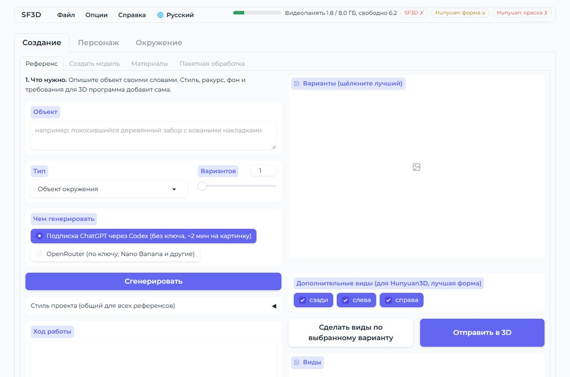

---

## Содержание

- [Что умеет](#что-умеет)
- [Как работать с инструментами](#как-работать-с-инструментами) (снимки)
- [Требования](#требования) · [Зашитые пути](#зашитые-пути) · [Установка](#установка) · [Запуск](#запуск)
- [Существа](#существа) · [Подгонка брони подробно](#подгонка-брони-подробно) · [Галерея анимаций](#галерея-анимаций-1)
- [Устройство репозитория](#устройство-репозитория) · [Лицензии сторонних моделей](#лицензии-сторонних-моделей)

---

## Что умеет

| Раздел интерфейса | Что получается | Чем |
|---|---|---|
| Создание → Референс | Карточка стиля и картинки-референсы (один вид или спереди/сзади/слева/справа) по текстовому описанию | Codex CLI (ChatGPT) или OpenRouter |
| Создание → Создать модель | GLB по 1 картинке (~20 с), по 1–4 видам (7–10 мин, с быстрой формой ~5 мин) или по 1 картинке со своей картой металла и шероховатости (1–4 мин): pivot, реальный масштаб, коллизия, PBR, превью и иконка. Категории: предмет, пропс, здание, персонаж, растительность | SF3D / Hunyuan3D-2mv + Hunyuan3D-Paint / TRELLIS.2 (trellis.cpp) |
| Персонаж → Скелет (автоматически UniRig или вручную по ориентирам) | Скелет и веса для человекоподобных, имена костей Mixamo или Godot, сшивка стыков, разбиение тела на области; «Кости и веса» показывает любой скелет | UniRig + Blender |
| Существа → Окраска | Варианты цвета существа: цветовые зоны, готовые тона, узоры (пятна, полосы, спина, живот, кровь) вживую; вариант — отдельная модель со всеми клипами | three.js |
| Существа → Скелет | Скелет существа по шаблону — четвероногое, птица, змея: суставы расставлены по модели и правятся руками, тепловые веса, свои процедурные походки — или скелет UniRig с понятными именами костей, разворот мордой вперёд, челюсть по линии рта; просмотр разметки скелета (цепочки, имена, кожа по костям, веса, проверка позы) | UniRig + Blender + three.js |
| Персонаж → Анимации: процедурные | 12 процедурных клипов для любого человекоподобного со скелетом (покой, ходьба, бег, прыжок, удары, заклинание, блок, удар, смерть…), в манере персонажа (тяжёлая, в броне, в одеянии, лёгкая, развязная, хромая, нежить или случайная по зерну) и с выбранной смертью (на спину, лицом вниз, набок, на колени) | Blender Клипы стоят на земле (2026-11-19): стоящая стопа идёт ровно и лежит плоско (двухкостная IK бедра и голени), ни одна стопа не уходит в пол, лежащее или стоящее на коленях тело поднимается на пол; в ходьбе одна стопа всегда на земле. Замер на всех 16 клипах: «в пол» — с 182 мм (смерть) до 4 мм максимум, скольжение стоящей стопы — с 34 % роста до 6 % максимум (`ground=0` отключает). |
| Персонаж → Анимации: Mixamo (FBX) | Перенос клипов Mixamo (FBX без кожи) на ваш скелет, режим «на месте», просмотр в three.js | Blender |
| Персонаж → Экипировка: сет целиком | Перенос одежды с одетого персонажа на базовое тело | Blender + Robust Weight Transfer |
| Персонаж → Экипировка: подгонка вещи | Готовая вещь (GLB) на текущем персонаже: ставится по коже, сразу на обе стороны, двигается, правится, надевается слоями, с весами и маской (режим «Броня» ниже) | Blender |
| Скелет по ориентирам → Броня | Подгонка вещи (наруч, поножи, набедренник, сапог, наплечник, нагрудник, шлем) на собранного персонажа в редакторе, веса в Blender, сохранение подгонки, примерочная в Godot с анимациями персонажа | three.js + Blender + Godot |
| Персонаж → Экипировка: процедурная генерация | Наруч, плечо, поножи, набедренник, нагрудник (латный до шеи, анатомический, с наплечниками и кольчугой), наплечник, юбка-тассеты или штаны, построенные по коже самого персонажа, а также шлемы, налокотники и обувь (по шесть конструкций из генераторов шлемов, налокотников и обуви, подогнанные к голове, рукам и стопам) перчатки из кожи самой кисти и поддоспешная одежда по параметрам в живом 3D-редакторе (вещь на персонаже меняется вместе с ползунками): пластины, чешуя, ламеллы, кольчуга, стёганка или гладкое; канты, заклёпки, ремни и пряжки; железо, сталь, бронза, кожа или ткань с износом, запечённые PBR-текстуры; вещь сразу надета, как подогнанная | Blender |
| Окружение → Поверхности | Бесшовные материалы земли, пола и стен (цвет, нормали, высота, шероховатость, AO) | numpy |
| Окружение → Эффекты | Листы частиц (взрыв, огонь, дым, магия) и готовые сцены Godot | numpy + Godot |
| Окружение → Модульные наборы | Процедурный набор подземелья (стены, арки, лестницы, двери) и ASCII-план → сцена Godot | Blender + Godot |
| Окружение → Разрушаемые объекты | Объекты, расколотые по Вороному, и сцена Godot, которая разваливается от удара | Blender + Godot |
| Создание → Материалы | Распознаёт металл, дерево, камень, ткань на готовом GLB и пишет карту металличности и шероховатости | CLIP |
| Создание → Пакетная обработка (и меню «Файл») | Целая папка картинок за один запуск (на ночь) | всё перечисленное |
| Меню «Опции» и полоска видеопамяти | Пути, ключ OpenRouter, кто занимает видеопамять, выгрузка моделей; полоска занятости сверху | – |
| Персонаж → Исправление весов, Детали лица, Липсинк | Починка весов, общий набор глаз, зубов и языка с живым предпросмотром, клип липсинка для рта для речи с просмотром прямо во вкладке | Blender |

Все инструменты «Персонажа» работают с **текущим персонажем**. Он выбирается один раз под строкой вкладок и показан там в 3D вместе с тем, что у него уже есть: модель, скелет, тело по частям для сетов, клипы липсинка, надетые вещи. Персонаж — это папка `export\character\<имя>\`; «Добавить модель…» делает его из GLB, «Удалить» стирает его папку целиком, спросив «Удалить окончательно?»; исходный файл, из которого он загружен, остаётся на месте. Выбор запоминается между запусками. Загрузка файла во вкладке осталась для разовой правки модели, которая не персонаж.

Вещи персонажа лежат в его папке по видам: `armor/` (латы, кольчуга, шлемы, перчатки, обувь и вещи, подогнанные в «Броне»), `clothes/` (поддоспешник, штаны, юбка, табард, плащ, повседневная одежда, волосы), `weapons/` (оружие, щиты, ножны, колчаны). На вещь четыре файла: `<вещь>.glb` и `<вещь>.mask.json` (что прячет на теле) нужны игре, `<вещь>.src.glb` и `<вещь>.fit.json` (вещь как сделана и её настройки) — редакторам. Имя даётся само по правилу `<часть>_<стиль>`, для второй такой же — `_2`, `_3`: `cuirass_steel`, `bracer_leather_2`, `helmet_barbute`, `shield_round`, `undercloth_fitted`, оружие просто `sword`. Префикса модели нет — папка и так говорит, чья вещь. Редактор открывается с персонажем как он есть: ни одна вещь не выбрана и не строится, справа только надетые вещи с галочками. Работа начинается, когда выбран вид вещи или открыта сделанная (клик по её имени в «Надето» или выбор в «Сделанные»); отмена возвращает к пустому состоянию. Поля для имени больше нет: имя даётся по правилу. Имя даётся один раз при первом «Сгенерировать» и потом не меняется, даже если поменять стиль (игра и примерочная знают вещь по нему); поле «Имя вещи» можно переписать вручную. Служебные ответы редакторов лежат в `work\status\`, не в папке модели. Персонаж в старой раскладке (`<модель>_wear_<вещь>.*` рядом с моделью) переезжает сам при первом открытии его вещей: файлы переименовываются по правилу, ссылки между вещами (поверх чего сделана) — тоже, старые ответы удаляются.

Результаты пишутся в `export\<категория>\<имя>\` (GLB, JSON со статистикой, иконка). Черновые файлы — в `work\`. Обеих папок в репозитории нет.

---

## Как работать с инструментами

### Язык интерфейса

Кнопка языка вверху сразу переключает русский и английский. Выбор сохраняется в `tool/config.json` (`"lang"`). Все тексты лежат в `tool/lang/ru.json` и `tool/lang/en.json`. Чтобы добавить язык, скопируйте один из файлов, переведите значения и добавьте код языка в `LANGS` в `tool/i18n.py`.

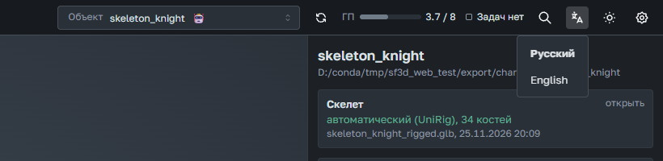

### Скелет по ориентирам

Персонаж → Скелет → «Вручную по ориентирам», затем «Открыть разметку». Кликните ориентиры на виде спереди (подбородок, пах, плечо, локоть, запястье, колено, щиколотка); таз, позвоночник, шея, ключицы, бёдра и стопы рассчитаются сами. Оранжевые узлы — ориентиры, синие — рассчитанные; любой узел можно сдвинуть или повернуть стрелками (G / R) или числами. «Разметить пальцы» и «Разметить лицо» добавляют пальцы, челюсть и глаза. Затем «Построить скелет и веса по разметке».

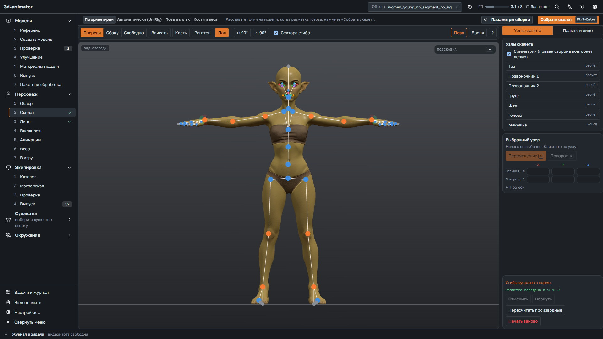

Глазные яблоки в разметке — настоящий глаз из набора «Детали лица» (выбранного в параметрах сборки, иначе стандартного): он сидит в глазнице так, как его вставит сборка, поэтому неверное место или размер видны сразу; щелчок по нему выбирает узел глаза. Зубы: в режиме рта (овал рта и веки) серый «забор» за губами показывает, где встанут ряды из набора «Детали лица». «Зубы» задаёт им своё место: точка у переднего края верхних резцов (двигайте по высоте и глубине; вид поворачивается сбоку, «Рентген» показывает её сквозь кожу), «Зубы −» / «Зубы +» делают ряды уже или шире; ещё раз «Зубы» — снова автоматически. Сборка рта затем проверяет каждую позу (покой и каждый ключ формы): зубы, дёсны, язык или полость, видные сквозь кожу, убираются внутрь (ряд зубов целиком, мягкие части — там, где видны), а в журнале сборки написано, сколько точек выходило наружу и осталось ли что-то.

Веки своей топологией (2026-11-26, по умолчанию): сборка делает веки каждого глаза из рядов полигонов прямо в сетке лица (`tool/eyelid_topo.py`, его вызывает `blender_eye_insert.py`) — край века с толщиной (влажная кромка чуть над яблоком, линия ресниц перед ней, материал `eyelid_rim`; под веком рукав назад по яблоку, чтобы между веком и яблоком ничего не просвечивало), тело века (3 ряда на верхнем, 2 на нижнем) на сферах вокруг центра яблока, складка над верхним веком и подъём от неё к коже, две петли глазницы на коже. Ряды — концентрические петли вокруг выреза; в уголках они расходятся вбок вокруг яблока. Кожа исходника вокруг выреза (лоскуты век, нарисованные веко и ресницы, ямка у уголка) вырезается внутри петли между петлями глазницы, а её новый край прижимается к веку, лежащему чуть под кожей: веко вырастает из лица без шва. У века своя развёртка и своя текстура (`eyelid_skin`): цвета лица там, где оно на коже, плавно продолженные на само веко, с множителем цвета и шероховатостью лица. Ключи: `eyeBlink` / `eyeSquint` / `eyeWide` по сторонам поворачивают ряды века вокруг поперечной оси яблока, всё веко на один угол (оно скользит по яблоку, тянутся только складка и подъём), не задевая роговицу; петли глазницы идут за кожей. Ключ формы — прямая от открытого к закрытому, на середине она уходила глубоко в яблоко, поэтому у моргания есть помощник `eyeBlink<Сторона>_arc` с весом 4v(1-v): его ставят `sf3d_face_rig.gd` и `face_curves_player.gd`, и наполовину закрытое веко остаётся на яблоке. Ресницы (вещь `lashes`) находят линию ресниц по граням `eyelid_rim` и идут за её ключами (и за помощником). Персонажей, собранных раньше, пересоберите как обычно («Собрать»): новые веки заменят скорлупы. Прежние скорлупы (ниже) остаются с ключом задания глаз `"lid_topo": false`.

Скорлупы (до 2026-11-26; `lid_topo: false`): сборка кладёт на каждое глазное яблоко отдельные верхнее и нижнее веко — части сфер чуть больше глаза (сетки `EyeLid_L` / `EyeLid_R` на кости головы), цвета кожи вокруг глаза, с тёмной кромкой. Они лежат под кожей лица и видны только в вырезе глаза. Моргание (`eyeBlink`) поворачивает верхнее веко вниз вокруг центра яблока, нижнее чуть вверх; верхнее закрывает глаз целиком и заходит поверх нижнего, так что линия смыкания — ровная дуга, какой бы ни была сетка вокруг глаза у исходной модели (кожа лица при этом стоит: её рваный край выреза при закрытии смыкался зубцами). Прищур (`eyeSquint`) и широко открытые глаза (`eyeWide`) поворачивают веки частично. Ключи называются как у кожи, так что редактор, липсинк и Godot двигают веки вместе с лицом. Если в покое вокруг глаза видна коричневая полоса века, вырез глаза больше яблока: поправьте яблоко в разметке («Глаз +»). Края выреза (2026-11-23): у моделей из других программ глаз часто нарисован в ямке, а над ним висят тонкие лоскуты век с зубчатыми краями, полосками кожи поперёк глаза и нарисованной бахромой ресниц. Сборка теперь убирает полоски шириной в одну грань и кожу прямо над яблоком внутри выреза (как его видит центр глаза), сглаживает край выреза вдоль него самого (без стягивания) и кожу в нескольких рядах от него, ничего не оставляет внутри яблока, а нарисованную бахрому в полосе у края переводит в цвет кожи рядом (ресницы теперь отдельная вещь); ключи формы сохраняют свои движения. Скорлупы век темнее и матовые: светлая блестящая скорлупа сбоку принималась за белок глаза.

**Поза** показывает собранную модель со скелетом. Тяните руку или ногу, чтобы согнуть её; «Поза проверки» сгибает все конечности сразу, так видны заломы и плохие веса. «▶ Проверка движений» сгибает туда-обратно суставы по группам (кулак, запястья, локти, плечи, колени, стопы, голова, челюсть) или все по кругу — видно, правильно ли стоят кости.

Выражения вручную: в «Позе» выберите ключ формы (jawOpen, mouthSmile, брови…) и нажмите «✎ Править». Лицо показывается с этим ключом полностью, а кисть двигает кожу: «Тянуть» ведёт кожу под кистью за мышью, «Поднять» / «Вдавить» — по нормали к поверхности, «Сгладить» выравнивает (бугры, заломы; в ключе «Покой» — саму поверхность); радиус, сила и «Зеркально» (вторая половина лица так же) — в панели, Ctrl+Z / Ctrl+Shift+Z отменяют и возвращают. «Сохранить» сразу записывает правку в модель, без пересборки скелета (`tool/face_edits.py`; свет пересчитывается под новый наклон кожи), и хранит её рядом с персонажем в `<персонаж>_face_edits.json`, а модель как из сборки — в `….noedit.glb`: пересобранный скелет получает правки снова, их точки находятся по месту. «Отбросить» убирает несохранённые мазки, «Убрать все правки» возвращает ключ как из сборки. Липсинк, эмоции и Godot берут уже исправленные ключи. Первый пункт списка, «Покой (основная форма лица)», правит само лицо, каким оно бывает без ключей: опустите верхнее веко на радужку — и испуганный взгляд уходит; все выражения строятся от него, а ключ, двигающий точку в ту же сторону (моргание), укорачивается на столько же, так что заканчивается там же, где раньше.

Губы после выреза рта: сборка теперь сама делит кожу у разреза на верхнюю и нижнюю губу по сетке (а не по линии: верх нижней губы за краем разреза лежит выше линии и раньше оставался на голове), даёт нижней губе гладкий вес челюсти от середины к уголкам (рот открывается овалом: край нижней губы идёт по дуге эллипса и гаснет только у самых уголков; сама нижняя губа опускается целиком, как передний край нижних зубов, чуть прикрывает их корни и прижимается к ним, не выворачиваясь вперёд, а поворот челюсти забирает кожа ниже неё (ключи задания `lip_lean`, `lip_rise`); бока полости рта стоят снаружи боковых зубов, а не перед ними; внутренность рта исходной модели — щёки изнутри глубже 0.35 ширины рта за губами — убирается, иначе при открытии она тянулась полосками рядом с зубами), не отдаёт вес челюсти костям уголков и в конце выравнивает во всех ключах вывернутые треугольники губ по соседям — осколков вдоль нижней губы при открытом рте почти нет. Чтобы дочистить губы (или для моделей, собранных раньше), в «✎ Править» есть «👄 Каркас губ»: на каждую губу ложится ровная сетка — от разреза до края губы, от уголка до уголка. Узел сетки — это точки губы вокруг него, усреднённые так, что осколки и торчащие точки почти не считаются; оранжевый узел — тот, который «Применить» заметно сдвинет (выпирающий мимо соседей ставится между ними), а губа, сложенная в ключе сама на себя (середина отстаёт от края), расправляется. Жёлтый ряд — край губы: перетащите его на видимый край; голубые узлы можно тянуть, чтобы поменять форму губы (с «Зеркально (каркас)» — обе половины; по умолчанию выключено: губы сгенерированных моделей редко симметричны). «Применить»: в ключе кожа губы у разреза ложится на сетку (зубчатый край разреза из старых рёбер становится ровной линией), дальше от разреза кожа сохраняет свою форму и берёт гладкий сдвиг сетки, валик губы идёт за своим краем, у уголков сдвиг плавно переходит в нетронутую кожу; в «Покое» выпрямляется только линия разреза. Режим кисти «Выровнять» подтягивает острые точки под кистью. Ctrl+Z отменяет, «Сохранить» записывает.

Складка между губами: если модель вылеплена с сомкнутыми губами, за линией рта остаётся внутренняя сторона губ — неровный ком, раскрашенный как кожа, — а глубже лежит исходное дно рта. При открытом рте ком вставал коричневым «козырьком» между нижней губой и зубами, а дно рта растягивалось в серые зубцы. Теперь сборка убирает то, что в покое спрятано глубоко за разрезом (внутреннюю сторону губ делает подворот), и дно рта под линией до 1.25 ширины рта вглубь. Оставшееся спрятанное красится в цвет внутренней стороны губы (материал `lip_shelf`). Закрытый рот выглядит как раньше.

Шов губ: линию рта ставят по виду спереди, а внутри губы могут сходиться ниже или выше неё. Нижняя сторона верхней губы, ушедшая под линию, раньше отрезалась вместе с челюстью и при открытии рта висела зубчатой полкой. Теперь сборка сама находит шов: она идёт по коже от передней стороны верхней и нижней губы, и каждая точка у рта достаётся той губе, к которой ближе по поверхности. Разрез проходит по этому шву, а не по плоскости через линию, так что чуть неточно поставленные точки рта больше не дают артефактов. Отключается в задании ключом `"seam_follow": false`. С «Ретопологией лица» шов и окраска `lip_shelf` не нужны и не применяются.

«🔍 Проверить рот» (в режиме «Овал рта и веки»): сборка режет рот по разметке, какая она сейчас, на модели последней сборки (сам персонаж не меняется), и показывает результат в окне поверх редактора: рот открыт, список ключей формы с числом растянутых граней, ползунок силы ключа, растянутые грани красным. На лице появляется оранжевая линия — где на самом деле пройдёт разрез (шов губ); при правке точек она пропадает до следующей проверки. Около минуты; нужна уже собранная модель с ртом «Разрез».

«Линия разреза» (там же, включена по умолчанию) показывает, где пройдёт разрез, сразу, без сборки: в браузере на сетке модели тем же способом, что и сборка, ищется шов губ, и линия перерисовывается, пока тянете точки рта (около 20 мс). Оранжевая часть — разрез идёт по вашей линии, красная — уходит от неё к настоящему шву губ. Ещё одно нажатие скрывает линию.

Эмоции по сторонам: ключи рта, которые двигают одну сторону (улыбка, грусть, растяжение, верхняя и нижняя губа, сжатие), собираются парами `...Left` / `...Right` с плавным переходом по середине; вместе они дают прежний ключ. Эмоции и липсинк двигают стороны раздельно, например ухмылка поднимает один уголок. Если глаза размечены, добавляются «прищур щёк» (`cheekSquintLeft/Right`: щека и нижнее веко вверх) и «морщить нос» (`noseSneerLeft/Right`: крыло носа вверх, складка к губе глубже). Правки кистью, сохранённые для прежнего общего ключа (например `mouthSmile`), при пересборке раскладываются на левый и правый ключ по сторонам лица. Реплики липсинка, сделанные до разделения (в них `mouthSmile`, `mouthStretch` и т.п. без сторон), играются как раньше: такая кривая ведёт обе половины — и в редакторе, и в Godot (`face_curves_player.gd`); новые реплики сразу получают кривые по сторонам.

Лицо на автоматическом скелете: в «Скелет» → «Поза» у персонажа, собранного авторигом, есть «Разметить лицо» и «Собрать лицо». Разметка открывается на его модели со скелетом из костей; во вкладке «Пальцы и лицо» размечается лицо (вручную или «Найти автоматически», глаза стоит проверить «Глаз −/+»). Сборка (`landmarks.build_face_on_rig`, `blender_face_bones.py`) добавляет в его скелет кости челюсти и глаз, отдаёт челюсти подбородок (как сборка по разметке) и дальше делает то же, что сборка по разметке: разрез рта, брови, глазные яблоки, веки, правки кистью. Риг без лица один раз сохраняется как `<имя>_rigged.noface.glb` — следующая сборка лица начинается с него; разметка лица и суставы лица — в паспорте `<имя>_rig.json`.

Брови и сила эмоций: ключи бровей (`browInnerUp`, `browDownLeft/Right`, `browOuterUpLeft/Right`) строятся в любой сборке, где размечены глаза, а не только с «Ретопологией лица». Ключи, которые нужны только эмоциям (брови, прищур щёк, сморщенный нос, уголки рта вниз), сделаны в 1,6 раза сильнее, прищур и широко открытые глаза век — в 1,5 раза: раньше эмоции, которые берут от них доли 0,04–0,5, были почти не видны. Ключи речи (открытие челюсти, трубочка, сжатие, растяжение, улыбка) остались прежними, чтобы не менять липсинк. Параметры задания: `face_expressivity`, `lid_expressivity`. С «Ретопологией лица» линия смыкания губ — тонкая щель с бороздкой (`slit_gap`, `slit_sink`): без неё закрытый рот выглядел склеенным. Все эмоции на женщине, мужчине и гоблине: `work/emotions_gallery/index.html` (локальная страница, создаётся вручную; `#women`, `#man`, `#goblin` — сразу нужный персонаж). «Ретопология лица» теперь по умолчанию выключена: на всех трёх моделях без неё лицо чище (с ней видна граница новой маски на лбу и у висков), а брови теперь есть и так.

Точки лица раскрашены по видам: на модели, в списке точек и в легенде под кнопками лица. Глаз: зелёная точка у носа, голубая на верхнем веке, красная во внешнем уголке, фиолетовая на нижнем веке. Рот: оранжевые уголки, бирюзовые середины, синий центр, розовый верх губы. Если точки контура глаза кликнуты не в том порядке, редактор и сборка сами расставят их по местам и скажут об этом: раньше вырез под глаз получался неправильной формы, и над глазом оставались полоски кожи. Узел глаза в «Узлах скелета» двигает глаз целиком, вместе с роговицей, и его размер не меняется.

Несимметричное лицо (так часто бывает у сгенерированных моделей): в разметке лица галочка «лицо зеркально» отделена от симметрии скелета. Снимите её, и точки глаз и рта правой стороны ставятся и двигаются отдельно, а тело остаётся симметричным. Шарнир челюсти ставится и без точек глаз, по уголкам рта и голове. Если его всё же нет, сборка предупреждает: рот вырежется, но открываться не будет.

Текстура вручную: «🖌 Текстура» в «Позе» рисует по картинкам самой модели (кожа, маска лица): «Кисть» выбранным цветом («Пипетка» или Alt+щелчок берёт его с модели — например, кожу рядом с остатками нарисованного глаза вокруг настоящего яблока), «Ластик» возвращает картинку как при открытии, радиус, сила и «Зеркально»; Ctrl+Z / Ctrl+Shift+Z. «Сохранить» сразу записывает мазки в модель и хранит их прозрачными слоями в `<персонаж>_tex/`, при пересборке они накладываются снова; «Убрать все правки» возвращает картинки как из сборки.

Сетка вручную: «▦ Сетка» в «Позе» показывает каркас; «Убрать» удаляет треугольники под кистью (клочок кожи, оставшийся от выреза глаза), «Залатать»: щелчок у края дыры подсвечивает её край (точки, повторённые на шве развёртки, считаются одной, так что шов дырой не считается), «Закрыть дыру» закрывает её заплаткой цвета кожи вокруг (цвет можно сменить). Край вокруг глаза — это вырез самого глаза: он закрывается только кнопкой «Закрыть всё равно». «Сохранить» сразу записывает правку в модель (треугольники находятся по месту, заплатка — отдельная часть со своими весами и ключами формы, взятыми с края) и хранит её рядом с персонажем: пересборка накладывает её заново.

Автоматический скелет (`<персонаж>_rigged.glb`, «Создать скелет» на той же вкладке) тоже работает с экипировкой: процедурный редактор, «Экипировка: подгонка вещи» (суставы, между которыми ставится вещь, берутся из его костей) и примерочная в Godot. «Поза» внизу вкладки «Скелет» (раздел раскрыт сразу) открывает проверку позы любого скелета — согнуть суставы, проиграть его клипы; «Запомнить кулак» у автоматического сохраняет кулак рядом с ним, в `<персонаж>_rig.json`. Только лицу (челюсть, глаза, рот для речи) нужна разметка лица по ориентирам.

| Режим «Поза» | «Поза проверки» |
|---|---|
| 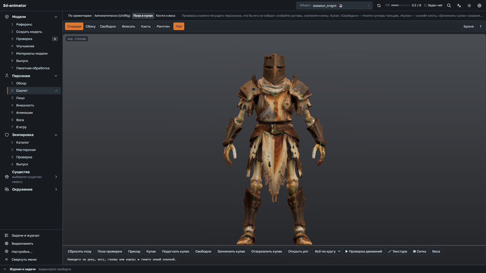 | 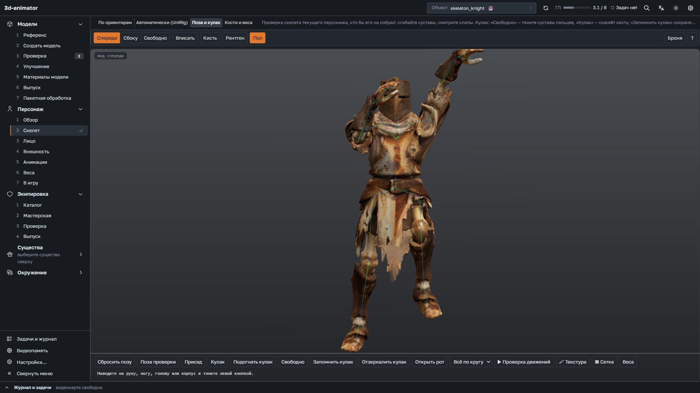 |

### Броня: поставить, надеть, проверить

**Броня** открывает панель подгонки; вкладка «Экипировка: подгонка вещи» открывает её сразу на текущем персонаже. Выберите GLB вещи: вещь без своего скелета сама получает часть тела по имени файла (cuisse/набедренник → бедро, chest/нагрудник → торс, …), либо выберите часть вручную. Вещь ставится на место и подгоняется к коже сразу всей внутренней стенкой. Точки — узлы внутренней стенки: красные под кожей, зелёные на коже, синие — с воздухом.

«Надеть» отправляет вещь в Blender: её выталкивает из кожи, она получает кости и веса персонажа и сохраняется рядом с ним. «Поза проверки» сгибает тело, и вещь должна идти за ним.

| 1. Поставлена (узлы прилегания) | 2. «Надеть» | 3. «Поза проверки» |
|---|---|---|
| 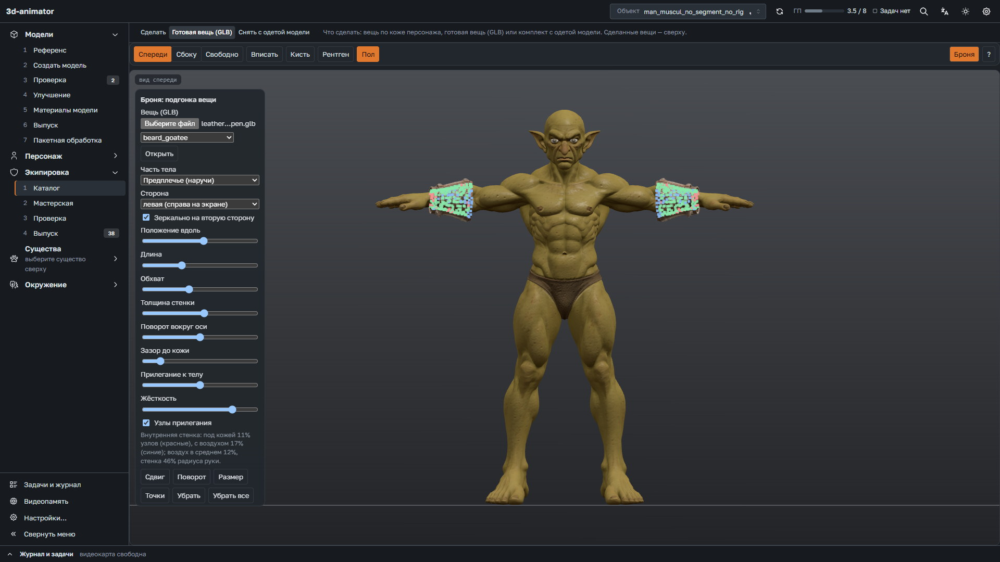 | 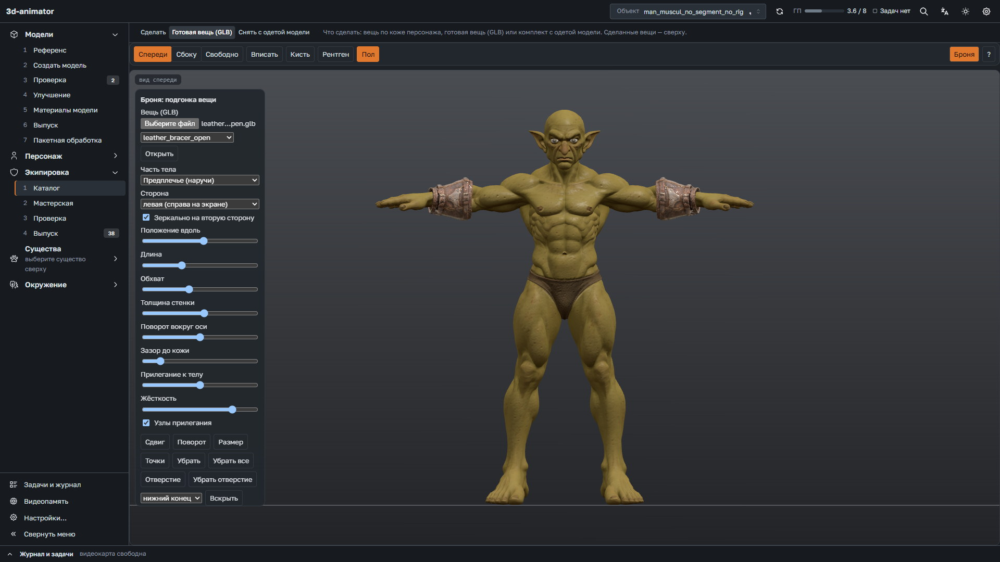 | 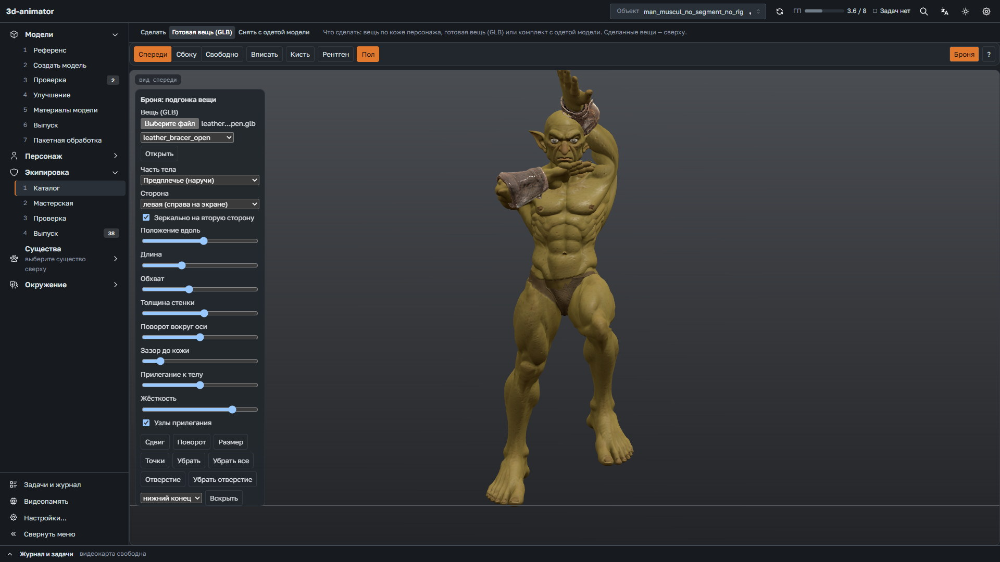 |

Ползунки поправляют то, в чём ошиблась автоподгонка: положение вдоль руки или ноги, длина, обхват, толщина стенки, поворот вокруг оси, зазор до кожи, прилегание к телу и жёсткость. «Точки» тянут поверхность вручную, «Подогнать по коже» заново запускает автоподгонку после ручных правок.

### Отверстие: сузить пройму

«Отверстие»: кликните 3 и больше точек по краю проймы или горловины. «Сузить отверстие» стягивает край и поверхность вокруг него к центру окружности, обе стенки сразу; «И симметричное отверстие» делает то же с другой стороны. Здесь пройма нагрудника была слишком широкой и оставляла подмышку открытой.

| До | «Сузить отверстие» 0,25 |
|---|---|
| 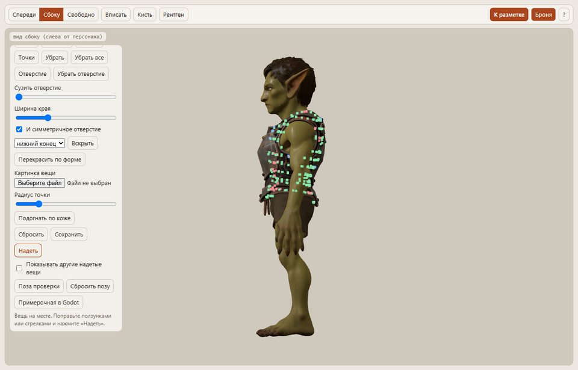 | 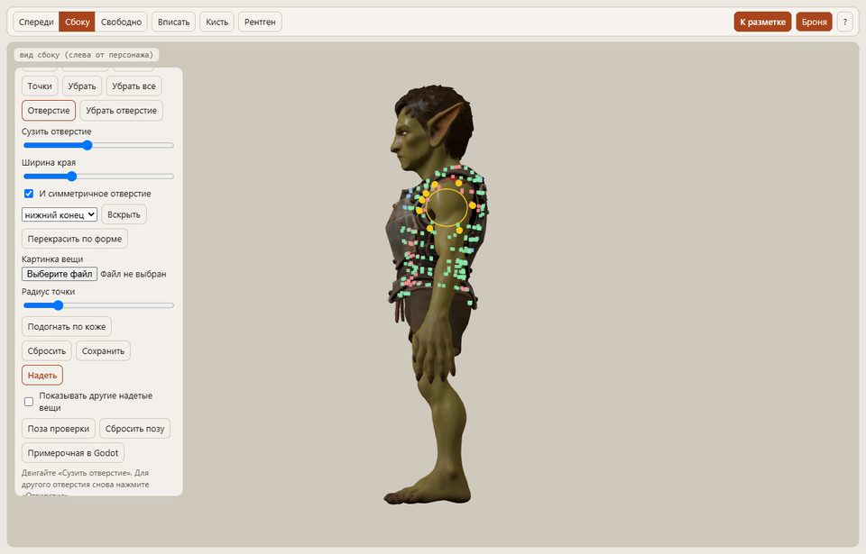 |

### Перекрасить по форме

Суженное отверстие, точки и ползунок стенки растягивают текстуру. «Перекрасить по форме» отправляет изменённую вещь в Hunyuan3D-Paint вместе с картинкой спереди, по которой она делалась (для сгенерированной брони картинка находится сама, иначе выберите её в «Картинка вещи»). Текстура рисуется заново по новой форме, включая стороны, которых не было на картинке (3–6 минут на видеокарте).

| Вещь как сгенерирована | Пройма сужена и перекрашена |
|---|---|
| 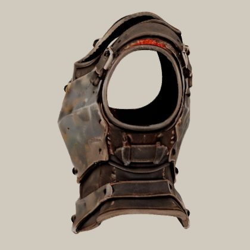 | 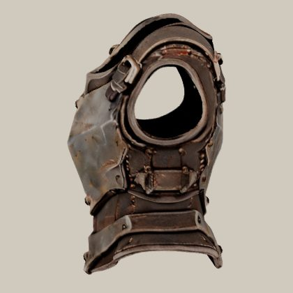 |

### Вскрыть закрытый конец

Сгенерированная вещь иногда закрыта с конца: SF3D закрывает наруч с обоих концов, а у набедренника из Hunyuan наколенник может загибаться под низ. Выберите конец (нижний — дальний от тела, верхний или оба) и нажмите «Вскрыть». Blender срежет этот конец, текстура сохранится; своя стенка вещи остаётся, а у сплошной болванки делается стенка внутрь. Затем вещь ставится заново.

### Слои: вещь поверх другой

Когда вещи перекрываются (сапог поверх поножей, набедренник поверх поддоспешника), список «Поверх этих вещей» говорит, какие уже надетые вещи лежат под этой. Вещи на других частях тела, которые с ней пересекаются, отмечаются сами; две вещи на одной части обычно варианты, поэтому, если это слои, отметьте их вручную. При «Надеть» наружная стенка отмеченных вещей считается кожей: новая вещь раздвигается над ними, а то, что ячейка не может раздвинуть достаточно, выталкивается наружу вдоль луча от оси конечности. Замер с 8 сторон: длинный набедренник поверх бедра из Tripo без слоёв пропускал наружу 27% нижней вещи, со слоями — 4% (это более длинный край нижней вещи).

### Что вещь прячет

Каждая надетая вещь (подогнанная или процедурная) сохраняет ещё и то, какую часть тела она прячет, — `<вещь>.mask.json` (`tool/body_mask.py`): кожу под ней, которая иначе проступала бы в движении, и то, что торчит сквозь неё, — шнуры штанов под юбкой, уши под шлемом. Лицо из шлема и кисть из наруча остаются. Редактор и примерочная в Godot убирают эти треугольники, пока вещь надета, и возвращают, когда её сняли; край тела у кромки вещи остаётся.

### Сохранение и примерочная в Godot

Каждое «Надеть» заодно сохраняет подгонку (`<вещь>.fit.json`); «Открыть» возвращает её со всеми ползунками и точками. «Примерочная в Godot» собирает небольшой проект Godot с персонажем, его анимациями и всеми надетыми вещами и открывает его. Здесь целый комплект в Godot во время ходьбы: нагрудник, шлем и короткие набедренники из Hunyuan3D, сапоги и наручи, снятые с Tripo-персонажа.

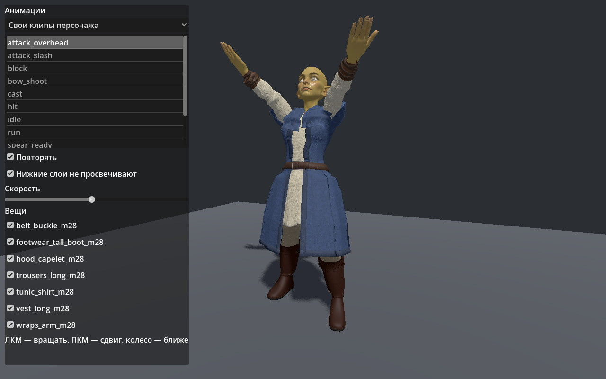

### Экипировка: процедурная генерация

Персонаж → «Экипировка: процедурная генерация» делает вещь не из модели, а по параметрам: наруч, плечо, поножи, набедренник, нагрудник, юбку-тассеты (от талии — чтобы между нагрудником и набедренниками не было зазора), наплечник, штаны или брайет (кольчужные трусы). Вещь строится прямо по коже персонажа с собранным скелетом. Редактор сразу открывается на текущем персонаже: страница (`tool/armour_gen_editor.html`) показывает персонажа с вещью и перестраивает вещь при каждом движении ползунка, за сотые доли секунды. Что на экране, то и получится:

- Наведите на группу параметров (пластины, заклёпки, ремни) — подсветится часть вещи, которую она меняет.
- Виды: спереди, сбоку, крупно. Персонаж в своём цвете, серый или насквозь — чтобы видеть зазор до кожи.
- Позы: руки вверх, руки вперёд, согнутые локти, присед, шаг. Вещь двигается по тем же весам, что будут у неё в игре.
- Сделанные раньше вещи есть в списке и открываются с их параметрами.
- «✋ Щипок»: «Тянуть» — зажмите левую кнопку на вещи и тяните, поверхность там выпирает или вминается; «Рисовать» — ведите с зажатой кнопкой, и под кистью по всему пути поверхность поднимается, вдавливается (не глубже кожи) или сглаживается (бугры, вмятины, чеканка); Shift меняет «поднять» и «вдавить» местами. Оранжевая сетка показывает, что сдвинется; если броня спрятана под телом, кожа вокруг кисти становится прозрачной, и спрятанный кусок можно вытянуть. Кисть — круг, овал, квадрат или полоса (вытянутость и поворот, Alt + колесо); радиус, сила и мягкость края — в панели (радиус ещё Shift + колесо или `[` `]`). Щипки хранятся с вещью, остаются при смене других ползунков и попадают в результат.
- «🖌 Роспись» (в том же блоке «Кисть», с теми же формами): краска нужного цвета, позолота, серебро, ржавчина, копоть или кровь — кистью, на одну деталь (пластину, ремень, окантовку), на все такие детали; есть ластик; ржавчина, копоть и кровь ложатся пятнами. Слои ложатся по порядку и хранятся с вещью. В редакторе роспись видна по вершинам, Blender накладывает её на запечённые цвет, шероховатость и карту металличности попиксельно (по запечённой карте положения), поэтому в результате она чёткая.
- «Рисунок» в «🖌 Росписи» ставит герб туда, куда щёлкнули, проецируя его на вещь: голова кабана, медведя, льва, дракона, оборотня или собаки, либо число (цифры встают рядом), любым видом (позолота, краска…) или цветами самой картинки; размер — от кисти, поворот, отражение. Общий набор (его рисует `tool/decals/make_decals.py`) при первом запуске копируется в `export/decals`; любой PNG, положенный туда, тоже появится в выборе (форма — по альфе).
- «Повреждение» в «🖌 Росписи»: следы когтей (пять борозд), одна царапина или дырка с рваным краем, копотью и трещинами — щелчком (размер от кисти, поворот, глубина — «Плотность»; каждый раз немного по-разному). Дно борозды — голый металл, свет сверху, поверх любой краски.
- Ctrl+Z отменяет, Ctrl+Shift+Z (или Ctrl+Y) возвращает любое изменение: ползунок, стиль, вещь, щипок; то же делают кнопки ↶ ↷. В «Броне» возврат тоже есть.
- «Плащ» — ткань, которая качается в игре: держится на плечах, ворот у шеи, грудь закрыта до застёжки-броши (у узкого плаща — пуговица перед горлом на шнурке к каждому краю), ниже края расходятся, книзу колокол (длина, охват у горла, расклёшенность); вырез ворота сзади выше, чем у застёжки («Ворот сзади»: плащ лежит на трапеции до затылка). Blender вешает его от ворота до подола на 13 цепочек тканевых костей (`Cloth_<столбец>_<звено>`) и скрытую сетку их мест (`__clothhome`); в Godot `SF3DEquip` добавляет эти кости в скелет персонажа и качает их своим симулятором ткани (`SF3DEquip.Cloth`, как «Ткань» редактора: каждая точка держится рядом со своим местом на туловище и не уходит внутрь, руки и ноги её отталкивают) — в любой анимации. В примерочной есть ползунок «Ветер». В редакторе кнопка «Ткань» показывает плащ тканью (любая поза, кроме «Руки вниз», включает её сама: неподвижная модель плаща в позе прошла бы сквозь тело, а в игре он — ткань): он оседает, обтекает тело, перестраивается при смене позы и качается от ветра, верх лежит на коже в позе (поднятые плечи, сведённые вперёд лопатки его приподнимают); с поднятых рук (вверх, вперёд) плащ съезжает назад вместе с воротом — за плечевые суставы (шнурки к броши натягиваются), ниже подмышек расходится по бокам «крыльями», руки впереди (так же и в игре); ткань рисуется гладкой поверхностью, складки мягкие; «Высота ворота» и «Зазор» сажают его на плечи. Плащ строится поверх опущенных рук (поза «Руки вниз» выбирается сама) и нигде не ближе «Зазора» к телу.
- «Юбка» — та же ткань от пояса: держится на поясе («Высота пояса» над тазобедренным суставом), книзу колокол (длина, расклёшенность, зазор), сшита по кругу или с «Разрезом спереди» от подола вверх. Висящие вдоль тела руки в её форму не попадают и остаются снаружи. Blender вешает её на те же цепочки тканевых костей, только от таза; в Godot и в «Ткани» редактора бёдра её отталкивают и над бедром она частично едет с ним: в шаге подол выносит вперёд, в приседе он ложится на колени.
- «Табард» — два полотнища, спереди и сзади, от ворота через плечи (на плечах короткие «рукава») ниже бёдер; по бокам ниже подмышек открыто, на поясе кожаный ремень держит оба полотнища («Высота пояса» над тазобедренным суставом); длина, расклёшенность, высота ворота, зазор. Выше пояса ткань натянута от плеч к ремню, ниже свободно висит; ниже пояса бёдра её толкают и над бедром она едет с ним, как у юбки. В Godot — те же цепочки тканевых костей, разрезы и ряд ремня передаются в имени сетки мест (`__clothhome__o…`).
- Оружие и щит — тоже вещи, в блоке «Оружие и снаряжение» каждое своей кнопкой, как «Щит»: меч, кинжал, топор, булава, двуручный меч (цвайхендер: рукоять под две руки, гарда с загнутыми к клинку концами, рикассо в коже с «усами»), двуручный топор (датская секира: длинное древко, широкое лезвие полумесяцем, лангеты), боевой молот (квадратный боёк с четырьмя зубцами, клюв вниз, шип сверху), палица (дубовая, утолщается к концу, железные обручи и шипы), копьё или посох в кулаке (рукоять поперёк ладони под костяшками, жёстко на кости кисти; ползунки размеров и места хвата, наклона, поворота) и щит на внешней стороне предплечья: круглый, каплевидный, треугольный, ростовой (павеза) или выгнутый (скутум); выпуклость, изгиб вокруг продольной оси (как у скутума), окантовка, умбон (у каплевидного тоже, над кулаком). Положение щита задаётся как у узла в разметке: мышкой в окне (стрелки — сдвиг, кольца — поворот, кубики — масштаб; клавиши G, R, S, манипулятор стоит на щите в той позе, в которой смотрите) или числами: «Положение, см» (X поперёк щита, Y вдоль, Z от руки), «Поворот, °» вокруг этих осей (без ограничения ±90°, Z 90° ставит щит поперёк руки) и «Масштаб, %». Павеза — по образцам: продольный гребень посередине (ползунок «Гребень», изнутри жёлоб), арочный верх, чуть уже книзу, без металлического обода. В «Росписи» → «Картинка» для щита есть кнопка «Картинка на весь щит»: выбранная картинка в своих цветах обтягивает всю лицевую сторону вдоль оси щита (свои картинки — PNG в папке `export/decals`). Там же «Генератор росписи» — картинка по образцу расписных павез: поле, узор (сетка с точками, чешуя, побеги, капли, шахматы, звёзды), кайма с тонкой линией, в центре герб, крест или косой крест, либо герб на всё поле. На щите всё рисуется по его настоящему контуру (круг, капля, треугольник, павеза с аркой, скутум): кайма идёт по краю, герб и крест — в самом просторном месте (у каплевидного — в широком верху), сколы гуще у края; у выгнутого щита картинка разворачивается по длине дуги, чтобы кайма по бокам не была шире; состаривание — потемневший лак, сколы краски до грунта (больше по краям), кракелюр. Цвета подбираются по геральдике (металл на цвете), одно зерно — одна и та же картинка, 🎲 — другой вариант. «Наложить» сохраняет картинку в `export/decals` (её же запекает Blender) и на щит кладёт на всю лицевую сторону; на другие вещи её ставят кистью «Картинка». Гербы рисует [Armoria](https://github.com/Azgaar/Armoria) (код MIT, `tool/vendor/armoria`, `update.py` скачивает и собирает его); фигуры только под CC0 — 108 из 354 (остальные некоммерческие или требуют той же лицензии). Шум для старения — [FastNoiseLite](https://github.com/Auburn/FastNoiseLite) (MIT, `tool/vendor/fastnoiselite`). Вместо процедурного вида можно взять готовый материал: в блоке материала «Библиотека материалов» — поиск по [ambientCG](https://ambientcg.com/) и [Poly Haven](https://polyhaven.com/textures) (оба CC0, можно в игру), категории (дерево, доски, кожа, ткань, металл, ржавчина, краска, золото) и выбор, на какую часть вещи: основа, кожа и ремни, мелкий металл, кольчуга, стёганая ткань, окантовка, изнанка. Щелчок по превью скачивает материал один раз (1K: цвет, нормали, шероховатость, металличность — `export/materials/<источник>_<id>`, `tool/matlib.py`), в окне он ложится по своему настоящему размеру (поле «образец, см»), а Blender запекает его проекцией «коробкой» с тем же износом поверх: грязь, потёртые края, светлые потёртости из цвета самой текстуры. Там же «Свой материал…»: выберите фото кожи, ткани, металла (и, если есть, его карты — их узнают по имени файла: normal/nrm, rough, metal; нормаль DirectX, «dx» в имени, переворачивается). Галочка «бесшовная» сводит края картинки (она смешивается с собой, сдвинутой на половину), карты рельефа и шероховатости, которых нет, выводятся из яркости; «металл» делает его металлическим. Материал ложится на выбранную часть вещи и хранится в `export/materials/custom_<имя>`, в источнике «Свои» он виден для всех вещей. Ниже — «Текстура по картинке», как у Tripo: концепт брони (спереди, сзади, слева, справа) загружается для каждого вида, кнопка «Совместить» показывает его полупрозрачно поверх персонажа в позе покоя (тяните мышкой — сдвиг, Shift + колесо — размер вокруг указателя, просто колесо — зум вида, «Вписать» — на весь рост), и он проецируется на вещь: каждый вид — на то, что смотрит в его сторону, на боках виды плавно смешиваются, где ни один вид не виден, остаётся материал вещи. Blender запекает проекцию в развёртку самой вещи, так что подходит любая вещь, как бы она ни была развёрнута; износ, роспись и повреждения ложатся поверх. Картинки хранятся в `export/concepts`; кнопка «Взять картинки с прошлой вещи» переносит тот же концепт на следующую вещь одним щелчком. Проекция плоской картинки на объёмную вещь всегда приблизительна; точнее — «Текстура по развёртке»: у сделанной вещи развёртка выдаётся по частям (у основы, ремней, окантовки и т. д. у каждой своя развёртка и своя текстура) в папку `<вещь>_uv` рядом с ней — `<часть>_layout.png` (острова поверх текущих цветов), `<часть>_mask.png` (где острова), `<часть>_color.png`, `<часть>_lines.png`. В поле «Что нарисовать» пишете задумку, редактор собирает из неё промт для Codex (кнопка «Скопировать»): какие файлы где лежат, что острова не двигать, цвет заводить за край, без нарисованного света, результат — `<часть>_user.png` в той же папке. «Взять из папки» (или «Загрузить текстуру…» для выбранной части) кладёт эту текстуру цветом части и сразу пересобирает вещь; роспись и повреждения ложатся поверх. Промтов три. «Генератор: по развёртке» — короткий, для моделей, которые редактируют картинку (Nano Banana 2, GPT Image 2.5 — проверено, они держат раскладку): им даётся `<часть>_color.png`, промт просит не двигать фрагменты и не рисовать обводок и фасок по краям (края островов — швы развёртки). Его же отправляет кнопка «Сгенерировать текстуру для «…»» через OpenRouter (ключ — тот же, что в «Настройки» → OpenRouter; список моделей, умеющих редактировать картинку, и примерная цена за картинку — из OpenRouter Image API, `tool/texgen_ai.py`): ответ сохраняется как `<часть>_ai_<модель>_<время>.png` и сразу ложится на вещь (Nano Banana 2 — около 20 с и $0.07). Ещё два: «Codex: скрипт по развёртке» — Codex пишет и запускает Python-скрипт (шум, царапины, ржавчина, кровь на весь квадрат, умноженные на текущие цвета, детали внутри островов по маске) — и «Генератор картинок: бесшовная» — для DALL·E, картинок ChatGPT, Midjourney: бесшовный образец материала, который загружается через «Свой материал…» и ложится по форме вещи без развёртки. Генератор картинок нашу развёртку не повторяет — рисует свою выкройку; поэтому скриптовый промт прямо запрещает генерацию изображения и просит текстуру на весь квадрат без пустого фона, а при загрузке редактор сверяет её с маской: если острова попали на фон картинки, он пишет, сколько процентов, и заливает дыры самой текстурой (кусками из соседних мест, `<часть>_user_fit.png`), исходный файл остаётся. Исходные `<часть>_layout.png` и `_color.png` после наложения не перезаписываются. Картинку, нарисованную по развёртке (модель-редактор по `color.png`), редактор узнаёт сам — всё, что не фон, лежит внутри наших островов — и чистит: светлую кромку, которую генераторы рисуют по краям фрагментов (на модели она легла бы светлыми швами), и фон внутри островов заменяет цветом ближайшей поверхности, цвет заводит на 8 px за край (по образцу `clean_generated.py` от DeepSeek). Если у вещи нет росписи и её параметры не менялись с последней генерации, текстура вписывается прямо в готовый GLB (его картинка цвета этой части заменяется, геометрия, развёртка и веса те же) — за секунды, без пересборки; иначе вещь собирается заново с текстурой. «Применить ко всему сету» делает весь комплект одной текстурой: текстура открытой вещи — образец, и каждая другая вещь, отмеченная в «Надето» (с развёрткой), перерисовывается выбранной моделью по двум картинкам — своей развёртке и образцу (галочками — ещё кожа и ремни, мелкий металл и кольчуга); её цвета подгоняются под образец (среднее и разброс каждого канала YCbCr внутри островов), и текстура сразу вписывается в вещь. Одежду (поддоспешник, штаны, юбку, табард, плащ) сет не трогает, если не отмечено «и одежда». Вещи, сделанные до появления развёртки, сет предлагает пересобрать в фоне (с их параметрами, шлем и другие вещи генераторов тоже) и после этого продолжает. Для строгой одинаковости — «На все надетые вещи» в библиотеке материалов: выбранный (или свой) материал ложится на ту же часть всех отмеченных вещей, и они пересобираются по слоям. Текстура держится, пока вещь не перестроена с другими параметрами: развёртка тогда другая, и редактор скажет скачать её заново. Сама развёртка хранится рядом с вещью (`uv_loops.npz`: каждая грань по своим вершинам) и при сборке той же геометрии возвращается как была — `smart_project` на больших деталях от запуска к запуску режет острова по-разному. Шлем, налокотник и обувь (их делают генераторы `vendor/blender_armour`) теперь тоже запекаются в текстуры (`tool/blender_texbake.py`): их материалы раскладываются по частям — сталь в основу, кольчуга (кольца бармицы, кольчужные вставки) отдельно, кожа в «кожу и ремни», подкладка в «стёганую ткань» — у каждой своя развёртка и текстура; для них в группе «Материал» есть только «Текстура по развёртке» (вместе с генерацией через OpenRouter). Лицевая сторона щита — обтяжка (материал вещи: кожа, сыромятная кожа, холст или крашеные доски), изнанка и торец — голое дерево; царапины, копоть, рисунки и повреждения ложатся только на ту сторону, куда их поставили (и в редакторе, и в Blender), — «Боевой износ» больше не попадает на изнанку щита или внутрь тонких пластин. К ним применимы те же материалы, роспись, гербы и повреждения. В «Повреждениях» есть и «Вмятина» — она продавливает саму сетку (кратер с валиком по краю, не в тело). Кнопка «Боевой износ» раскидывает по вещи вмятины, царапины, иногда следы когтей и пятна копоти — туда, куда приходятся удары (выпуклые места, спереди и сверху); ещё нажатие — другой набор, сделанное вручную остаётся, Ctrl+Z отменяет. На изнанке щита — два кожаных ремня вокруг предплечья (у локтя и у запястья), по сечению самой руки. С галочкой «Рукоять в кулаке» щит держится рукой, а «Ремень у локтя» (по умолчанию у всех, кроме круглого) добавляет второй ремень вокруг предплечья — как настоящие enarmes, на ближайшем к локтю месте, которое лежит над щитом; тогда щит сидит на кости предплечья (если ремень не ложится на щит, редактор подскажет сдвинуть или развернуть его). Длинная ось щита идёт от локтя к кулаку. на его изнанке поперечная рукоять в кожаной обмотке, её две стойки проходят мимо указательного пальца и мизинца, а сам щит лежит на тыльной стороне кисти и предплечья — снаружи, как на ремнях, так что опущенная рука не вдавливает его в бедро. Рукоять стоит посередине круглого щита (за умбоном) и на широкой части каплевидного и треугольного; острие смотрит к локтю и закрывает предплечье. Щит жёстко сидит на кости кисти, и для него работают ползунки хвата, как у оружия; «Вдоль» сдвигает рукоять к краю, «От руки» отодвигает щит от кисти, «Поворот» вращает его. Зазор до кисти считается лучами по тыльной стороне руки и по костяшкам сжатого кулака. В GLB сетка называется `…__hold_<сторона>`, и в Godot пальцы смыкаются на рукояти, как на оружии. «Проверить в движении» работает и для них: в клипах ищется, где вещь проходит сквозь тело (рука, которая держит, не в счёт; щит — ещё и кадры, где он смотрит на тело), а для щита считается, насколько отодвинуть его от руки, чтобы тело не входило в него ни в одном кадре, — кнопка «Отодвинуть щит наружу на N см» ставит это в поле Z положения; если нужно больше 8 см, кнопки нет: щит повис бы в воздухе, редактор называет клипы и советует уменьшить, повернуть или поднять щит. Клипы копья и лука (там вторая рука на древке или на луке) для щита и другого оружия не проверяются. Другая форма щита — новый щит: роспись, повреждения, положение и имя прошлого не переносятся (генератор росписи перерисовывает картинку под новый контур). Кнопки «Перемещение / Поворот / Масштаб» и клавиши G, R, S убирают включённую кисть, иначе манипулятор скрыт. Двумя руками: ползунок «Вторая рука» (меч, топор, булава, копьё, посох; у двуручного меча и топора вторая рука стоит сразу, и они берутся одной стороной) — где на древке вторая рука, в долях длины руки от первой (плюс — к острию, минус — к концу). В позе «Кулак» держащая рука выносит оружие вперёд, вторая берётся за древко (две кости руки, локоть вниз-наружу) и сжимается своим кулаком. Чтобы оценить вещь так, как её носят, есть боевые стойки (ноги на полу, таз ниже, колени согнуты, плечо щита и нога впереди, голова смотрит вперёд): «Стойка: щит» — щит перед грудью лицом вперёд, меч над щитом остриём вперёд; «Щит, меч вверх» — меч поднят над плечом для удара; «Двуручное» — рукоять перед животом, остриё вперёд-вверх; «Двуручное вверх» — рукоять у плеча, клинок вверх и назад (vom Tag). Вторая рука берётся за рукоять там, где задано ползунком «Вторая рука». Щит и оружие из «Надето» тоже встают в стойки: ось надетого оружия и место хвата находятся по его сетке, щит на ремне у локтя поворачивается вместе с предплечьем. В Godot (`SF3DEquip.Grip`) то же после каждого кадра: клипы сделаны для одной руки, поэтому, если вторая не дотягивается, держащая подтягивается к ней (поворот оружия сохраняется). Копьё держит острие вперёд: если в клипе кисть разворачивает его больше чем на 30° от того, куда смотрят бёдра, кисть доворачивается — при замахе и броске острие не уходит назад. Ножны и колчаны — свой блок «Ножны и колчан», каждый вариант кнопкой (ножны меча, ножны кинжала, колчан, колчан на бедре): ножны меча или кинжала висят на ремне вокруг талии на выбранном боку чуть впереди, уходят вниз и назад вдоль бедра; их длина и ширина — ползунки оружия, так что ножны, сделанные после меча, ему впору. Колчан — за спиной, стрелы над выбранным плечом, на ремне наискосок через грудь; это тубус (полый, с дном), а стрелы в нём — каждая отдельный объект в GLB (`…__arrow_<k>`, ползунок «Стрел»): в игре `SF3DEquip.arrows(вещь, n)` оставляет видимыми n стрел — так виден расход; в примерочной Godot для этого ползунок «Стрелы в колчане». Ремень и перевязь идут по телу (поверх отмеченных в «Надето» вещей) и берут веса кожи под собой; ножны жёстко на тазе, колчан — на груди. Колчан бывает и на бедре: на ремне сбоку, стрелы вверх и вперёд. Лук — вид оружия: держится в кулаке за обмотанную рукоять, плечи изогнуты назад к лучнику, тетива между концами со стороны лучника; видов лука девять, каждый своей кнопкой: короткий, длинный (английский), плоский, рекурсивный (концы загнуты вперёд, тетива лежит на них), скифский (рукоять утоплена, «купидонов» изгиб), монгольский (жёсткие «уши» с мостиками для тетивы), турецкий (короткий, сильно изогнутый), юми (японский, рукоять на трети высоты: верхнее плечо вдвое длиннее) и спортивный (плечи на жёсткой рукояти-райзере); для лука блок называется «Лук», в нём «Длина», «Толщина плеч», «Натяжение» (насколько плечи отогнуты к стрелку), «Толщина рукояти», наклон и поворот («куда смотрит тетива»); длина и толщина — ползунки оружия. Для них есть клипы во вкладке «Анимации» (и в примерочной): «Копьё: стойка», «Копьё: укол с выпадом», «Копьё: бросок», «Лук: выстрел» — лук в левой руке, корпус боком, правая кисть натягивает тетиву к подбородку и уходит назад при выпуске. В Godot (`SF3DEquip`) пальцы руки с оружием смыкаются на рукояти после каждого кадра анимации.
- «✎ Поправить позу» (рядом с позами) — ручная правка любой позы и стойки: показывается скелет, клик по его кости (или по телу, по надетой броне) выбирает её и отмечает красным, кольца гизмо её поворачивают; работает и в «Результате». Правки хранятся отдельно для каждой позы поверх того, что она вычисляет сама, сохраняются для персонажа (`work/poses/<персонаж>.json`) и возвращаются при следующем открытии редактора; «Сбросить» убирает правки текущей позы.
- «Примагничивать к центру ладони» (галочка у оружия, у новых включена): рукоять сама ложится на середину ладони — луч изнутри кисти до кожи ладони, рукоять на ней своим радиусом; пальцы обхватывают её по касанию: каждый палец сгибается сустав за суставом, пока его фаланга не коснётся рукояти (с учётом толщины пальца), — так они не проходят сквозь рукоять при любой её толщине. Те же углы закрывают вторую руку на древке двуручного (держащая, правая, выше, другая ниже) и кисть в игре (`SF3DEquip.Grip`, имя сетки `__grasp_<15 углов>`). Без галочки — как раньше: ползунки места хвата и запомненный кулак.
- В примерочной Godot брошенное копьё (клип `spear_throw`) в момент выпуска улетает из руки по дуге и возвращается с началом клипа; при броске вторая рука не тянется к древку. В клипе `bow_shoot` от наложения стрелы до выпуска тетива натягивается к пальцам правой кисти, на ней лежит стрела.
- Койф и кольчужная пелерина — два покроя одной кольчужной накидки: надевается одно из двух. Галочка на одном снимает другое и в «Надето» редактора, и в примерочной; при открытии примерочной из нескольких остаётся первое.
- Щит не проходит сквозь ноги. Клипы сделаны под щит поменьше, и ростовой уходил нижним краем в колено. Щит — около 400 его точек, бёдра и голени — капсулы (толщина по коже плюс 2 % роста на броню); насколько щит в ноге — сумма глубин его точек в капсулах. Щит двигается только так, как двигается тело, пятью способами, по порядку предпочтения: предплечье поворачивается вокруг своей оси так, что низ щита уходит наружу от тела, а верх внутрь (в клипах низ щита впереди ног, развёрнутый наружу — уходит с них, до 40°); рука в плече поворачивается вокруг вертикали, «как дверь» (в обе стороны, до 40°); рука отводится в сторону (до 30°); вперёд и вверх (до 35°); локоть сгибается (до 30°). Низ щита никогда не заворачивается внутрь, локоть не разгибается сам по себе (так ростовой щит вставал ребром, низом в колено), и ничто не гнёт локоть вбок (сдвиг руки с параллельным предплечьем выглядел сломанной рукой). В каждом кадре каждый способ пробуется на 15° вперёд в три шага, и шаг идёт по тем способам, что дают больше выигрыша на свою цену. Способ, на пути которого щит сначала глубже входит в ногу, не засчитывается: так щит прошёл бы сквозь ногу на другую сторону. Поправка живёт от кадра к кадру и меняется шагами: щит в ноге — шаг наружу, если глубина уменьшилась (или почти не выросла, а путь впереди хорошо выводит: колено посреди щита ничего не даёт, пока край не пройдёт); вышел — шаг назад к позе клипа, пока остаётся запас 2 % роста; другой клип начинается с нуля; показываемая поза плавно догоняет решение. Около 2 мс на кадр. Замеры на ростовом щите (суммарная глубина щита в ногах, тысячные роста, среднее за 6 с при 60 к/с; без → с): Mixamo «block» 39.5 → 3.6, «block idle» 22.5 → 0, «idle» (нога сильно впереди) 31.6 → 5.8 (в ноге только первую секунду), «attack (2)» 12.3 → 0.9, ходьба 3.1 → 0, удар щитом Mesh2Motion 12.1 → 0.2, стойка Mesh2Motion 11.1 → 0.7; щит движется так же плавно, как в клипе, разворот хода только на стыке повтора клипа. В игре: `SF3DEquip.keep_off_body`, `SF3DEquip.keep_flex`; в примерочной для сравнения `--nokeep`, `--keepflex=0` (локоть не сгибается), числа по кадрам `--keepdebug`.
- В примерочной в руке одна вещь: галочка у оружия снимает галочки у других, держащих ту же руку (двуручное занимает обе, щит на предплечье — левую); при открытии из нескольких в одной руке остаётся первое. Снятое оружие отпускает руки (кулак, вторую руку на рукояти, обхват).
- Двуручное оружие в спокойных клипах (idle, ходьба, бег) несётся одной рукой остриём вниз и чуть вперёд, вторая рука к рукояти не тянется; в боевых — обеими руками.
- Слой каждой вещи задаётся числом напротив неё в «Надето» (чем больше, тем выше; по умолчанию — по виду вещи: нательное и штаны ниже всего, потом кольчуга, пелерина, латы, горжет, наплечники, табард, плащ). Новая вещь строится под надетыми с большим слоем и над теми, у кого меньше; заданное вручную число выделено и пишется в `<вещь>.fit.json` (`layer`, сохраняется и при пересборке вещи), пустое поле возвращает слой по виду. Примерочная Godot берёт эти числа (`layers.json` рядом с персонажем, `SF3DEquip.wear(..., layer)`).
- Часть вещи нижнего слоя, вылезшая сквозь шлем (койф, оттопыренный ушами), не показывается — и в редакторе, и в примерочной. Только под шлемом: это закрытая скорлупа вокруг головы, за её краями только голова. В других местах (гульфик под набедренниками, кираса под наплечником, койф под кирасой) спрятанная часть открывала под косым взглядом то, что глубже, — дыры; там работает правило глубины. Точка считается вылезшей, если линия от кости внутри тела (той, что её ведёт) до неё пересекает по пути вещь слоя выше; под краем шлема линия шлем не задевает, и койф там виден. Только там, где обе вещи ведёт одна кость или соседние по цепочке (койф на шее и шлем на голове двигаются вместе; кираса с корпусом и наплечник с рукой — нет, под наплечником кираса не прячется), точка вылезла не дальше 5 % роста, линия от кости верхней вещи тоже её пересекает, и вокруг точки на 1.5 % роста есть верхняя вещь или сама нижняя (у края верхней не открывается дыра на кожу). Кольчуга шлема (бармица из колец со щелями) сквозная: под ней ничего не прячется. В редакторе это считается сразу при надевании и смене слоя, в примерочной — Blender при её сборке (`tool/blender_layer_hide.py` → `under.json`, заново только когда меняются вещи или слои), `SF3DEquip.hide_under` прячет такие треугольники, пока верхняя вещь показана.
- Нижний слой не просвечивает сквозь верхний: в Godot каждая надетая вещь рисуется по своему слою (порядок редактора: поддоспешник → кольчуга → пелерина → латы → горжет → наплечники и шлем → табард → плащ) так, будто она ближе к камере на ступень за каждый слой ниже неё среди надетых (ступень — 4.5 % роста на число надетых слоёв, не больше 1.2 %: при девяти слоях ~0.5 %, около 9 мм). На экране вещь не сдвигается, меняется только глубина. Поэтому вещь снизу, вылезшая в движении поверх верхней на эти сантиметры, там не видна, как поверхность чуть позади другой, а то, что действительно впереди (рука перед кирасой), видно. Материал вещи при надевании заменяется своим шейдером `SF3DEquip` с теми же параметрами (цвет и текстура, металл и шероховатость, карта нормалей, прозрачность по порогу); тени считаются без сдвига. В примерочной правило выключается галочкой «Нижние слои не просвечивают», в игре — `SF3DEquip.layered = false` до `wear()` или `SF3DEquip.layers(meshes, false)`.
- В примерочной клипы разбиты на блоки (список над клипами): первый — свои клипы персонажа, дальше группы галереи анимаций (`tool/anim_gallery.py`: Mesh2Motion и паки Mixamo из `Animations/Mixamo/<пак>/`) — передвижение, прыжки, уклонения, меч, меч и щит, двуручный меч, топор, защита, магия, без оружия, без оружия: мужчина и женщина, лук и метание, урон и смерть, эмоции, существа. Пак Mixamo (FBX без скина) идёт целиком в свой блок, подписи — имена файлов; если пак Great Sword или Sword and Shield есть, процедурные двуручные и щитовые клипы из блоков убираются. Примерочная открывается сразу, блоки галереи подгружаются по мере выбора: выбранный блок, если он ещё не готов, пересаживается на персонажа в Blender в фоне (около минуты на 50 клипов; под списком блоков — полоска и секунды), потом его GLB (только клипы, без меша, `work/anim_gallery/<персонаж>/blocks/<блок>.glb`) читается во время работы и кладётся в проигрыватель персонажа отдельной библиотекой. Пока блок собирается, можно выбирать другие; собранный блок при следующих открытиях загружается сразу. Выбор блока с оружием надевает вещь того же вида: двуручное, меч, щит (по имени, иначе по хвату). В двуручных клипах галереи меч держится обеими руками и в стойке, и при ходьбе. Клипы Mesh2Motion поднимают ключицы: плечевой сустав выше покоя примерно на 3 % роста в каждом клипе (у Mixamo плечи наоборот опущены), и на широком персонаже плечи уходят к шее, а наплечники — под кольчугу. При пересадке у ключиц Mesh2Motion остаётся 30 % их собственного поворота (`clavicle=` в `blender_retarget_fbx.py`), руки сохраняют направления из клипа; подъём плеч падает до ~1 %. Процедурные двуручные клипы (`blender_humanoid_anim.py`, twohand) держат кисти перед торсом: передняя поверхность груди меряется по коже персонажа в каждом кадре, и запястья ставятся впереди неё на 7 % роста (толщина предплечья и брони), левая ладонь на рукояти — тоже вне тела; раньше кисти сходились у середины тела и меч с гардой уходил в грудь и в кирасу. Процедурные клипы галереи пересобираются сами, когда меняется этот скрипт. Шея и ключицы берут из клипа поворот от позы покоя, а не направление: у персонажа шея в покое наклонена вперёд примерно на 55° и ключицы опущены на 10°, у Mixamo шея прямая, а ключицы опущены на 18°. Когда их направляли как у Mixamo, голова во всех клипах Mixamo стояла над плечами на 4–6 % роста выше (шея вытягивалась вверх и назад, между шлемом и наплечниками — длинный койф). Теперь отличие от покоя в пределах 1–2 % (`delta=Neck,Shoulder` в `blender_retarget_fbx.py`; руки и ноги по-прежнему следуют направлениям клипа). Блоки галереи пересоберутся сами при следующем выборе; клипы, сделанные в «Анимации: Mixamo (FBX)», нужно перенести заново («Перенести на модель»).
- «Проверить в движении» (`tool/blender_wear_qa.py`): сделанная вещь надевается на персонажа с его анимациями (клипы примерочной), и каждый клип проигрывается в Blender: где кожа, лежащая под вещью в покое, выходит сквозь неё, и где тело, убранное маской, открывает дыру. Кожа у самой кромки вещи (в 2,5 % её размера) считается отдельно: она выглядывает из-под края на сгибе и обычно не страшна; главная цифра — кожа сквозь середину вещи. Три худших клипа снимаются в худшем кадре (кожа, вышедшая сквозь середину, — красными точками поверх всего, видно и под рукой), картинки — в «Предпросмотрах». В отчёте — худший кадр и доли по каждому клипу, места отмечаются красным на персонаже в редакторе.
- Рука с оружием сжимается как на рукояти: каждый палец гнётся в своей плоскости к ладони (и большой тоже), а рукоять ставится внутрь кольца, которое образует сжатый средний палец, и такой же толщины — одинаково в редакторе (поза «Кулак») и в Godot. Если кулак сложен вручную в «Скелет → Вручную по ориентирам → Поза» и нажато «Запомнить кулак», берётся он: он сразу записывается к построенному ригу (`<модель>_landmarks.json`, пересборка не нужна), а редактор брони и примерочная Godot (`fist.json` рядом с персонажем) ставят его в осях кисти (поперёк, вдоль, к ладони), так что он подходит и к другим экспортам того же рига. Рукоять встаёт в кольцо этого кулака — после смены кулака оружие нужно сгенерировать заново. На картинках после «Сгенерировать» (Blender) рука с оружием тоже сжата этим кулаком.
- «Примерочная в Godot» показывает вещь с экрана: если её меняли после «Сгенерировать», она сначала генерируется.
- «Надето»: уже надетые на персонажа вещи видны на нём, а новая вещь подгоняется поверх отмеченных (кольчужная юбка или брайет поверх штанов — два слоя, как носили на самом деле). Нагрудник всегда ложится поверх юбки, что бы ни сделали первым: юбка, сделанная при надетом нагруднике, вместе с поясом остаётся под ним. Это правило теперь общее, слои такие: бельё и поддоспешник → штаны → обувь → брайет → латы на руках и ногах и юбка (латная перчатка поверх наруча, налокотник поверх них) → нагрудник → наплечники и шлем → ткань поверх (табард, юбка из ткани, плащ). Вещь, которую делают при надетых вещах верхних слоёв, ужимается под их внутреннюю стенку: штаны, сделанные после поножей и нагрудника, не вылезают из‑под них. Вещь из ткани поверх не мешает: её потом делают заново. Если верхние вещи сделаны раньше нижней, редактор после «Сгенерировать» перечисляет их. «Пересобрать по слоям (N)» делает заново только устаревшие вещи: те, под которыми с тех пор появилась или переделана вещь нижнего слоя на той же части тела (подшлемник не повод переделывать штаны), и всё, что поверх них; число N на кнопке — сколько их, а если всё в порядке, кнопка неактивна. Делает изнутри наружу, каждую со своими настройками и поверх всех нижних, так что порядок, в котором их делали, больше не важен. Формы всех вещей считаются сразу в редакторе (каждая поверх только что посчитанных нижних — вещь на экране ровно та, что получится), а запекание в Blender идёт в фоне одна за другой: редактор свободен, готовые вещи сами надеваются на персонажа, рядом с кнопкой виден ход («2 из 3 готово, сейчас …») и кнопка «Остановить» — текущая вещь доделается, остальные нет. Вещь, которая ждёт в очереди, нельзя «Сгенерировать» одновременно. Шлем, налокотники и обувь из генераторов, а также оружие не трогаются. На воине: 9 вещей за 4 минуты; после пересборки штаны на поясе на 1,6 см от кожи, нагрудник — на 2,5 см (до неё штаны 1,9 см были поверх нагрудника 1,1 см). ✕ рядом с вещью в «Надето» и «Удалить» у сохранённых удаляют вещь окончательно (после вопроса): её файлы стираются, вещь пропадает из списков и с персонажа, а примерочная Godot снимает её при следующем открытии. Файл вещи, уже надетой на персонажа (её результат или `.src.glb`), во вкладке подгонки второй раз не надевается, а «Добавить модель…» не делает из него персонажа: обе ошибки давали копию поверх вещи и лишнего «персонажа».
- «Стиль по референсу» выставляет наруч, поножи или нагрудник под один из наборов референсов: формованная кожа, латы, кольчуга, открытые шины, шины под кожей или бригантина, латы на кольчуге, ламеллы. Дальше его меняют ползунками.

«Сгенерировать» отдаёт эту самую геометрию и эти веса в Blender (`tool/blender_armour_gen.py`): он запекает материал. Запечённая вещь сразу показывается в редакторе («Результат») и следует позам на скелете персонажа. Как строится вещь:

1. Вокруг средней линии конечности лучами снимается профиль кожи. Кожа других конечностей не считается. Вещь на конечность не учитывает свисающую с неё одежду, а нагрудник, тассеты и штаны ложатся поверх одежды.
2. Профиль сглаживается ползунком «Рельеф тела», отодвигается на зазор и получает толщину. Нагрудник поднимается до шеи: спереди вырез горловины, по бокам проймы под руки; низ может уходить мысом, по центру может идти ребро. Он выпуклый в сечении и книзу не расширяется (расклёш — у юбки под ним); «Сужение к талии» задаёт, насколько он идёт за талией, «Анатомия» выдавливает грудь и пресс. Его можно собрать из двух частей: грудь из одной или двух пластин, а под ней полосы, кольчуга, чешуя и так далее. Под пластины можно надеть кольчугу (подол ниже кирасы и короткие рукава), сверху — наплечники: полукруглые полосы поперёк плеча, верхняя поверх нижней, первая — купол побольше (наплечник есть и отдельной вещью). Каждая полоса движется целиком, нижние сильнее идут с рукой («Наплечник идёт с рукой»), поэтому полосы скользят друг по другу, а не мнутся. Канты пластин можно окантовать латунью или золотом, «Чеканка» меняет металл от полированного до кованого. Тассеты из пластин висят от бёдер прямо, расширяются книзу и разрезаны на полосы, чтобы ноги двигались; юбка из кольчуги или ткани мягкая и скроена так, чтобы ноги двигались свободно: она начинается от талии и лежит на теле: спереди и по бокам идёт по бёдрам, сзади свисает с ягодиц, чуть расширяется книзу, идёт складками с волнистым подолом, а спереди открыта под свободным клином (он длиннее и расширяется к подолу) или под запахом. Ниже тазобедренных суставов перед и бока юбки идут за своим бедром, клин — наполовину за обоими. Штаны — это сиденье до паха и две штанины: облегающие или широкие, со складками и манжетами, любой длины (и до колена), со шнуровкой спереди; на бёдрах — кольчуга, латные бедренники, кожаные панели с заклёпками или пластина на кольчуге, подвязанные к поясу шнурами; на коленях — наколенник с крылом снаружи или кожаная накладка. Брайет — то же, но короткое и из кольчуги, с паховой частью между ног. У кольчужной юбки бывает кожаный кант по краю.
3. Покрытие: пластины с завёрнутыми кантами и заклёпками; металлические шины вдоль кожаной основы на заклёпках; бригантина (кожа поверх скрытых пластин, столбцы заклёпок, швы); каждая чуть шире следующей, поэтому верхняя заходит на неё; чешуя или ламеллы на кожаной основе, каждый ряд поверх шнуровки следующего; кольчуга или стёганка (узор запекается в текстуру); или гладкое. Размер чешуи и колец задаётся в доле роста персонажа, поэтому на всех вещах комплекта он одинаковый.
4. Открытая вещь застёгивается на внутренней стороне, как на референсах: короткие ремни приклёпаны к обоим краям, пряжка над разрезом; либо шнуровка. У латной на другой стороне могут быть петли. Край наруча и поножей у сустава срезан с внутренней стороны, а у дальнего конца спереди спускается ниже (у поножей — на подъём стопы); концы слегка расширяются. Нижний край поножей идёт ровно по высоте над полом, а не поперёк наклонной голени (раньше край обходил ногу под углом, разница доходила до 1,2 см; теперь 0,05 см); вырез над подъёмом остаётся. Вещь поверх других (поножи на штанах) ищет нижний слой не только в 1,6 раза дальше кожи, но и не меньше чем на 3% роста за ней. Там, где кость под самой кожей (внутренняя сторона голени, предплечья), кожа близко к оси, и штаны в 2 см от кожи (их ремешок у колена — 3,6 см) раньше не находились. Поножи ложились прямо на кожу, а ткань выпирала сквозь металл. На воине после пересборки по слоям: из 72 лучей вокруг голени ни одного, где штаны проходят сквозь поножи. У кожи может быть строчка по краю. Нагрудник — цельная вещь, как подогнанный доспех: кольцо вокруг тела до подмышек и над ним без шва — верх через грудь, ключицы, плечи и спину. Горловину и проймы находят сами лучи из середины тела: где они упираются в шею или руку. У жилета плечи — продолжение самого доспеха; у лат остаются верх нагрудной и спинной пластин, их соединяют ремни от нагрудной пластины через плечо. Может открываться сбоку и застёгиваться там же. Иначе вокруг идут кожаные ремни с пряжками. У открытой пластины ремни проходят сзади, у нагрудника — через плечи, у тассет и штанов это пояс. Остальные ремни штанов — обмотки на голенях.
5. Материал задаётся параметрами: железо, сталь, бронза, кожа или ткань, износ (ржавчина или патина и потёртые края), цвет кожи и ткани. Процедурные шейдеры запекаются в текстуры цвета, шероховатости и нормалей. В редакторе материал показан примерно, точный — после запекания.
6. Веса берутся с кожи под вещью и стягиваются к её главной кости ползунком «Жёсткость».

«Шлем» строится не по коже: это одна из одиннадцати конструкций — шесть генераторов шлемов из `tool/vendor/blender_armour` (железная шляпа, открытый бацинет, барбют, бацинет с забралом и бармицей, салад, армэ) и пять наших в `tool/helmets_extra.py` на их же деталях и в их же размерах: норманнский шлем с наносником (конус, налобный обод, наносник), шпангенхельм (купол из четырёх пластин под каркасом из полос, наносник, нащёчники), топфхельм-«ведро» (плоский верх, две смотровые щели над крестом из полос, отверстия для дыхания справа), морион (купол под высоким гребнем, поля загнуты вверх спереди и сзади) и закрытый шлем (армэ с гребнем). Если под шлемом надет койф (кольчужный или стёганый), голова измеряется вместе с ним — шлем делается поверх, а не под ним; острые шлемы (норманнский, шпангенхельм) поднимаются над головой настолько, чтобы их сходящиеся к острию стенки не врезались в купол головы. Маска шлема прячет только ту кожу, которую он закрывает со всех сторон: под полями, за смотровыми щелями и у края лица кожа остаётся (иначе там были просветы); у открытых шлемов (железная шляпа, норманнский, шпангенхельм, морион) уши не убираются — у длинноухих персонажей их кончики могут выйти сквозь стенку. Это скрипты Blender, написанные под человеческую голову в метрах. **Лицо и уши под шлемом** (2026-11-18): оболочка перед лицом выходит вперёд над тем, что она резала бы, — плавный выступ над носом у наносника, полосы салада, Т-выреза барбюта, передней стенки топфхельма (`clear_face`, замер спереди по сетке над лицом; толщина пластины и заклёпки сохраняются). Маска (`body_mask.head_cover`) скрывает только кожу, которую ниоткуда не видно мимо шлема: вокруг глаз, у носа и под краем больше ничего не вскрывается. Ухо, которое встречает оболочку, прижимается к голове и уходит под шлем целым (записи маски из шести чисел: где вершина и насколько она сдвигается; редактор и `SF3DEquip` применяют их, пока шлем надет); остальное, вышедшее сквозь оболочку (выпуклость черепа, волосы), обрывается на ней. Уже сделанные шлемы нужно сгенерировать заново. **Голова под шлемом без пустоты** (2026-11-24): маска шлема прячет и части лица — глаза, зубы, дёсны, язык, полость рта, — но только целиком и только если их нигде не видно (глаз, видный в смотровую щель, остаётся весь: он поворачивается, челюсть открывается). Видимость считается по 800 направлениям, и заслоняет только то, что движется вместе со шлемом: сама голова, без шеи, плеч и ушей (уши прижимаются под шлем или обрываются на нём). Вокруг видимой кожи остаётся полоса: «Кожа внутри у края» (20 мм на человеке ростом 1,75 м) у кожи, которая движется с шеей, — голова поворачивается, край шлема отходит от шеи, — и треть этого вокруг кожи, которая движется со шлемом (под полями, у щелей). Торчащее сквозь металл обратно не возвращается. Где череп входит в металл, оболочка отходит от него наружу (`clear_head`): поперёк от вертикальной оси головы, по высоте и кругу, плавно и не меньше нужного, поля сдвигаются целиком и остаются плоскими. У гоблина с его яйцевидной головой поля шапеля резали затылок, и при наклоне головы под полями была видна пустота. Проверка: стенд `work/wear_test/helmets_hide` (`check.py`) поворачивает голову на шее в 8 позах и пускает лучи с 200 сторон, в том числе снизу под край. Дырой считается луч, который упирается в скрытую грань и уходит за ней глубже чем на 1,5 см; скрытое снаружи металла дырой не считается. Сумма дыр по 8 позам до и после: морион 10 072 → 0, наносник 10 030 → 10, шпангенхельм 9 573 → 2, шапель 4 193 → 0, салад 212 → 0, бацинет с забралом 111 → 0, топфхельм 108 → 37 (единичные точки у щелей снизу), открытый бацинет 98 → 1, барбют 94 → 0, армэ 42 → 5, закрытый шлем 29 → 2. Прячется при этом меньше, чем раньше (700–1000 граней против 1500–3700): старая маска прятала и видимое. **Поножи и наручи без дыр у краёв** (2026-11-24): их пластины — своя гладкая труба (`Profile.tube`): в каждом сечении выпуклая оболочка конечности (впадины между мышцами заполнены), сглаженная вдоль неё и никогда не внутри сечения; «Рельеф» теперь говорит, сколько на ней формы самой кожи. Маска (`body_mask.limb_cover`) прячет только кожу, которую ниоткуда не видно мимо пластины: лучи по 800 направлениям наружу от линии кости, не ближе 25° к ней (иначе они проскальзывают по тонкому зазору над кожей до края трубы), заслоняет вся кожа этой конечности; вокруг видимого остаётся «Кожа внутри у края» (20 мм на человеке). Старая маска на сгибах локтя, запястья, колена и щиколотки давала пустоту у краёв: на лучнике-гоблине 340–920 дырявых лучей на позу у наручей и поножей, теперь 0 у наручей и 12–21 одиночная точка у поножей (`work/wear_test/helmets_hide/limb_check.py`). Наручи у гоблина почти ничего не прячут: у запястья край широк, внутрь видно под многими углами. **Материалы готовых конструкций** (шлемы, налокотники, наколенники, обувь; 2026-11-18): «Как задумано» оставляет собственный материал конструкции (материал из библиотеки можно положить и на отдельную часть, остальное не изменится); его можно заменить любым материалом редактора — с цветом кожи, износом, чеканкой, библиотекой материалов, вариантом и размером текстуры. «Основа» — это тело вещи, её наибольшая внешняя поверхность (кожа сапога или кожаного налокотника); кольчуга берёт металл, набивка — только материал из библиотеки. Предпросмотр показывает сразу, «Сгенерировать» запекает цвет, шероховатость и рельеф (`blender_lookmat.py`, `blender_texbake.bake_made`). У любой вещи список частей библиотеки предлагает только то, что у неё есть, и открывается на части, которая составляет её большую долю.
- **Позы «Присед» и «Шаг»** (2026-11-18): колено сгибается вокруг той же оси, вокруг которой идёт бедро (раньше — вокруг линии поперёк голени, почти совпадавшей с ней, и любой наклон ноги наружу усиливался в несколько раз: стопы расходились). Замер в клипах: развёрнутые наружу колени в ходьбе Mixamo — свойство самого клипа (`Sword And Shield Walk`: 25° / 6° в источнике, 25,5° / 6° после переноса); процедурная ходьба — в пределах 1°.

`tool/blender_helmet_gen.py` надевает такой шлем на персонажа. Голова каждого персонажа меряется по его же коже:
- глаза, глубина и ширина на уровне лба, макушка;
- подбородок — там, где перед лица резко уходит назад;
- шея и верх плеч.

Ничего не задано под одну анатомию: тот же код подгоняет шлем к гоблину (короткое лицо, почти нет шеи) и к большеголовой мультяшной фее.

Шлем строится в пропорциях генератора с пропорциями головы и масштабируется к ней целиком: прорези для глаз — на глаза, поля шляпы — на лоб. Ниже лица шлем поджимается, чтобы кончаться чуть ниже подбородка, а не на плечах. Подбородочный ремень (сделан под челюсть человека, у гоблина висел бы под шеей) встаёт сразу под подбородок, чуть позади его кончика. Бармица висит вокруг шеи до верха плеч и сходится к шее; спереди она идёт поперёк от концов ремня-держателя, за забралом. Шлем привязан к кости головы, нижние кольца бармицы всё больше к шее.

Маска шлема прячет то, что под ним, всё, что на голове выше лба (волосы, шляпа, вылепленная на персонаже), и уши (`body_mask.ears`, `body_mask.above`): у гоблина они торчали бы сквозь бока.

В редакторе шлем выбранного стиля делается под персонажа так же (один раз на стиль и параметры, `work/helmets/<персонаж>/`, 5–20 с) и показывается на его костях. Параметры: «Зазор над головой», забрало и щёки армэ, хвост салада, поля шляпы, а также высота и вынос ремня — чтобы поправить его руками.

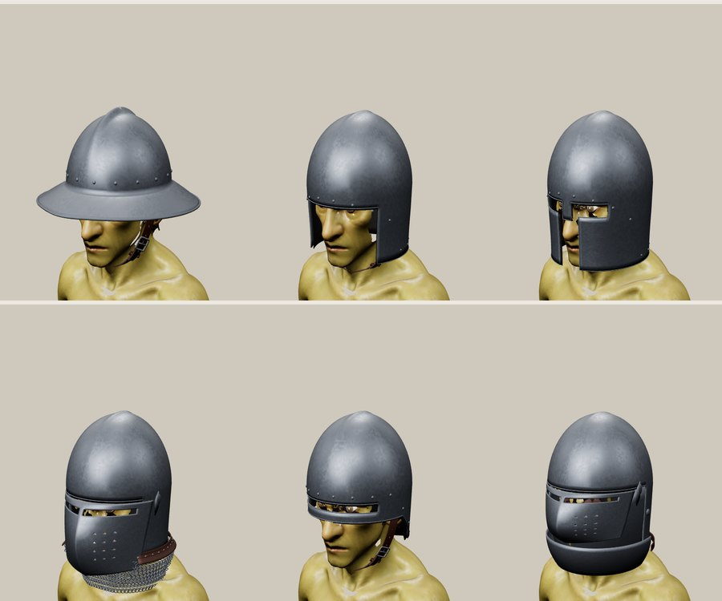

«Налокотник» устроен так же, на генераторах налокотников (`vendor/blender_armour/ElbowArmor`): кожаный, кольчужный участок рукава, простая стальная чашка, чашка с крылом, чашка с набором пластин, сталь с кольчужной вставкой. Генератор строит локоть человека в метрах вокруг сустава.

`tool/blender_elbow_gen.py` подгоняет его к каждой руке:
- меряет руку у локтя по коже: центр сечения, ширину и толщину, насколько выступает локоть, толщину руки на высоте ремней;
- ставит систему генератора вдоль плеча (нижнюю половину доворачивает к предплечью: рука в покое чуть согнута), чашкой на локтевой отросток: от сгиба, а у прямой в покое руки назад. Крыло правого налокотника уходит наружу, левый — его зеркальная копия;
- делает чашку чуть шире руки и глубиной по выступу локтя;
- подгоняет по руке на их высоте ремни, пластины и кольчугу. Ремни вдвое толще, чем у генератора, чуть отстоят от кожи и по бокам сходятся с чашкой.

Верхний ремень и пластины идут с плечом, нижние — с предплечьем. Чашка со всем, что на ней, — поровну на обе кости. Кольчуга и внутренние кожаные полосы — плавно от одной кости к другой.

Маска каждого локтя считается отдельно, только по чашке и пластинам, с отступом от их края: ремни при сгибе скользят по коже. Поза редактора «Локти» показывает руки согнутыми. Параметры: «Зазор над рукой» и размер крыла.

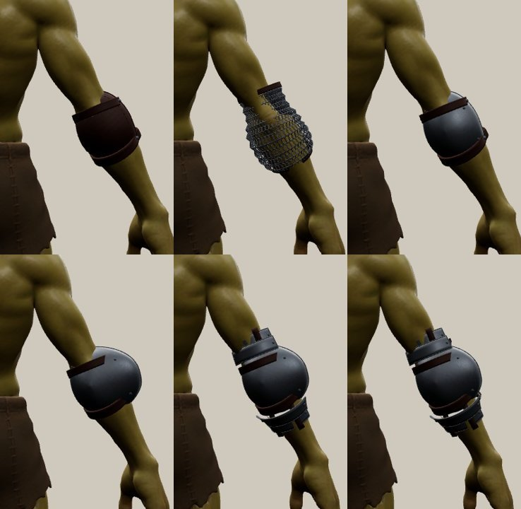

«Наколенник» — те же чашки на коленях (`blender_elbow_gen.py` с `limb: leg`: бедро, колено, голень; острие чашки спереди, крыло наружу — у правой ноги зеркальная заготовка), те же шесть стилей, «Воздух над рукой» и размер крыла. Чашка наколенника всегда смотрит вперёд (в A-позе ноги разведены, и сгиб между бедром и голенью боковой — по нему чашку уводило внутрь). У налокотника и наколенника есть и ручная подгонка: «Сдвиг вдоль, см» (выше или ниже по конечности), «Поворот вокруг» (чашку к внешней или внутренней стороне) и «Размер» — они двигают готовое превью сразу, в окне, а Blender делает вещь с ними при «Сгенерировать». Ремни идут от-под краёв чашки вокруг задней стороны конечности (по лицу чашки — нет) и подогнаны к коже лучами каждые 10°; пряжка и заклёпки сидят на ремне. Верхний ремень и пластины идут с бедром, нижние с голенью, чашка наполовину с каждым — в «Приседе» видно, как она садится на согнутое колено.

«Набрюшник» и «Гузно» — короткие полосы пластин на талии: набрюшник спереди, под нижним краем кирасы (на нём висят тассеты), гузно сзади, над поясницей и ягодицами. Строятся тем же, что и юбка-тассеты (пластины, чешуя, ламеллы; «Разрезы», «Расклёшенность», «Снизу» и «Сверху»), в слоях — над брайетом, под тассетами и кирасой.

«Горжет» — защита шеи: несколько пластин-колец вокруг шеи, каждая чуть шире верхней (перекрываются вниз), нижняя ложится воротником на плечи и грудь (или на верх надетой кирасы), каждое кольцо по тому, что под ним, сглаженное по окружности и не сужающееся книзу; верхние пластины идут с шеей, нижние — с грудью. Ползунки «Пластин», «Воротник вниз», «Вверх по шее»; галочка «Бувигер» добавляет пластину, закрывающую подбородок и рот спереди («Бувигер вверх» — докуда).

«Кольчужная пелерина» — короткая кольчужная накидка, лежащая на плечах по коже (или по надетой под ней кирасе), без воротника (горло под подбородком открыто): от основания шеи вниз по трапециям, верху плеч, груди и спине, спереди и сзади длиннее (мысом), на плечах — до начала руки; сзади разрез, застёгнутый двумя тонкими ремешками с пряжками (так её надевают). Поверх кольчуги (хауберка, пелерины койфа), под латами: кираса, наплечники, бесагью, горжет и шлем ложатся поверх неё (если они надеты, пелерина строится внутри их внутренней стенки; сделанные после неё ложатся сверху); кольца того же размера, что у остальной кольчуги; идёт с телом под ней (на плечах — и с руками). Ползунки «Длина», «Мыс спереди и сзади», «Вырез у шеи», «Зазор»; при любой длине плечи закрыты — короче, чем до уровня плечевых суставов и до начала руки, она не бывает, а длинная не уходит под мышки.

«Бесагью» — круглые щитки спереди подмышек: «Гладкое», «С шипом», «Рифлёное». Ставятся как щит — гизмо в окне (стрелки — сдвиг, кольца — поворот, кубики — размер; клавиши G, R, S) или числами в блоке «Положение»; правая повторяет левую зеркально. В кожу не уходят никогда (задняя сторона щитка отодвигается от тела). Идут с плечом и грудью пополам.

«Айлеты» — плоские щитки, лежащие на плечах (наклонены вниз-наружу по скату плеча, лицом вверх и наружу) (на них хорошо видна роспись — герб), привязанные двумя шнурками: «Квадратные», «Щитком». Ставятся так же, как бесагью: гизмо или числа в «Положении», правый повторяет левый зеркально; от кожи и надетого отодвигаются сами. Поверх наплечников.

«Хауберк (кольчуга)» — кольчужная рубаха: ложится как ткань — по самой коже (или поверх надетого поддоспешника) одной поверхностью от шеи через плечи до рукавов, без щелей между телом и рукавами, двигается вместе с кожей; кольца идут вокруг тела и вокруг рук. Ниже рубаха сама продолжается подолом (одна сетка: верхний ряд подола — те же вершины, что край рубахи): подол висит по ногам и их выпуклой оболочке, не уходя между ними; «Хауберк до колен» с разрезами подола спереди и сзади (для езды верхом) и рукавами до запястий, «Хаубержон (короткая)» — до бёдер, рукава до локтя. Надевается поверх поддоспешника, под кирасу. Ползунки «Подол» (0 — у паха, 100 — до колена), «Рукава» (0 — без, 50 — до локтя, 100 — до запястья), «Разрезы спереди и сзади», «Свободнее».

«Койф (кольчужный капюшон)» — одна кольчужная деталь: капюшон и пелерина одной поверхностью, как висит настоящая кольчуга — по голове и вниз на плечи — сначала по выпуклой оболочке головы, шеи и плеч, затем она провисает почти до тела там, где оболочка перекрывает впадины (перед горлом, вокруг шеи), как тяжёлая ткань, не стоит каркасом; по плечам до начала руки, спереди и сзади длиннее клином; овальный вырез под лицо от брови до подбородка; уши уходят под капюшон (прячутся, как под шлемом) («С короткой пелериной», «С длинной пелериной»; ползунок «Пелерина койфа»). Поверх стёганого подшлемника, если он надет; под шлемом.

«Гульфик» — латная защита паха XVI века, к брайету: чашка над пахом, выпуклая вперёд, по телу под ней (лучи спереди, низ между бёдрами не проваливается), с закатанным краем и заклёпками; жёстко на тазе. Он под латами (в слоях — над брайетом, штанами и поддоспешником): два ремешка толщиной 1 мм уходят от чашки к талии прямо по коже (над поддоспешником, если он надет) — под брайетом, штанами и кирасой; галочка «Ремень на талии» добавляет такой же ремень вокруг талии. Где кожа под надетым спрятана маской, они ложатся на внутреннюю стенку надетого. Стили: латный, варёная кожа (латунный кант), стёганый тканевый, как у ландскнехтов (круглее, без канта). Ползунки «Размер», «Выпуклость», «Высота».

«Обувь» устроена так же, на генераторах обуви (`vendor/blender_armour/Footwear`): кожаные башмаки, короткие сапоги, кольчужная стопа, округлые и заострённые сабатоны, кожа со сталью и кольчугой. Генератор строит правую человеческую обувь на одной колодке, начало координат — в голеностопе.

`tool/blender_footwear_gen.py` надевает её на каждую стопу:
- меряет стопу по коже: пятку, кончик пальцев вместе с когтями, ширину и середину, землю, высоту голеностопа;
- ставит обувь носком по направлению стопы, подошвой на землю;
- колодка — как у настоящей стопы (с 2026-11-23, по ортогональным референсам средневековых сапог от Codex, `work/footwear_refs`): шире всего на подъёме, уже в талии и пятке, низкий скруглённый нос высотой около 2 см, ровно поднимающийся подъём, приподнятый носок;
- **закрытая обувь прячет стопу**: ниже лодыжки она сохраняет форму колодки при длине стопы (ширина и высота как у мужской обуви той же длины; широкие когтистые пальцы гоблина проходят сквозь неё невидимо), а маска прячет стопу и голень целиком до чуть ниже края голенища (вдоль голени). Столько кожи («Кожа внутри у края», 20 мм на человеке) остаётся внутри у края, и там обувь подогнана вокруг неё: при сгибе голеностопа у края не открываются дыры;
- голенище подгоняет по ноге на каждой высоте выше лодыжки по срезам кожи вокруг голени эллипсом вокруг всего среза, так что углы икры не выходят наружу; на редкой сетке голени срез расширяется, пока не наберёт кожу;
- сандалии, как и раньше, облегают стопу (подгонка в ширину на каждой высоте, стопа видна).

Поле подгонки одно для кожи и стали: пластины не врезаются друг в друга, кожа не проступает сквозь сталь. Левая обувь — зеркальная копия правой.

Обувь движется со стопой, носок — с пальцами, голенище всё больше с голенью, сталь — целиком с тем, на чём лежит. Маска считается для каждой стопы отдельно. Ползунки: «Зазор вокруг стопы», «Кожа внутри у края, мм», «Подъём носка, мм», «Ширина обуви»; позы «Шаг» и «Присед» показывают её в движении.

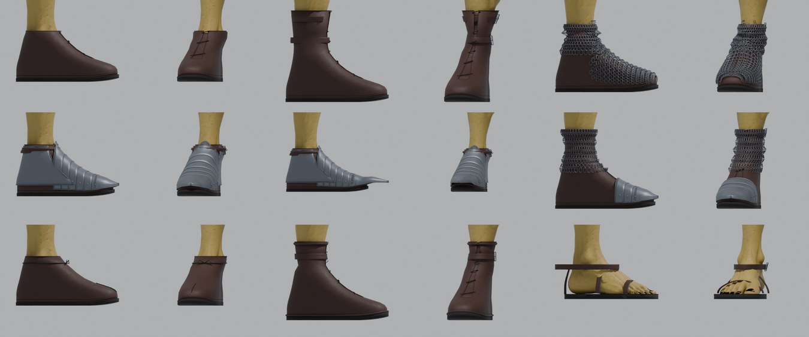

«Перчатки» строятся в самом редакторе из кожи кисти. Шесть стилей по референсам: кожаная перчатка, усиленная кожа, кольчужная рукавица, латная перчатка «песочные часы», латная рукавица, сталь с кольчугой. Перчатка ложится на сглаженную кожу кисти: пальцы и ладонь остаются, а ногти, складки на костяшках и вены не проступают; кисть под ней скрыта.

**Причёски и бороды** (2026-11-20): «Причёска» (короткая стрижка, короткие, до подбородка, длинные, зачёсанные назад, ирокез) делается в Blender (`tool/blender_hair_gen.py`, вещь от генератора, как шлемы: выбранный стиль собирается под персонажа и показывается в редакторе серым, цвет волос редактор накладывает сам; «Сгенерировать» запекает цвет в текстуру). Два способа, как волосы делают в играх: длинные и каре — полоски-«карты» с текстурой прядей и срезом по альфе (glTF MASK) вдоль прядей, которые растут от пробора в стороны и вниз по черепу, отходят от него у самого широкого места и падают цепочками под гравитацией, встречая тело (и уши: волосы с них соскальзывают), не сгибаясь на себя, не заходя на лицо и середину груди и не шире, чем сошли с головы (передние пряди — на бока груди, остальные — по спине); три слоя над шапочкой цвета волос; каре обрезается по челюсти. Короткие (зачёсанные назад, короткая стрижка, короткие) — оболочка в форме стрижки: кожа головы приподнята (объём сверху, кок, к краям сходит на нет), развёртка по укладке (ото лба через макушку назад, с висков назад, на затылке вниз), пряди-бороздки в форме, мелкие волоски в текстуре и карте нормалей; у короткой стрижки бока сходят на нет (альфа); ирокез — толстые пучки вдоль середины головы на такой основе и хвост с двумя перехватами. Веса — головы, ниже челюсти — шеи и груди. Кожа под шапочкой или оболочкой скрыта. Ползунки: длина; десять цветов и палитра. Парик: положите GLB головы с волосами, сделанной в другом месте (например, в Tripo), в `export/hair_models` — появится стиль «Парик»: волосы отделяются от кожи по цвету (два кластера; волосы — тот, что сверху на голове), мелкие островки отбрасываются (брови, нарисованные усы), голова совмещается с головой персонажа (точки кожи на кожу головы персонажа, с масштабом: ICP), борода модели не берётся, модель сшивается (файл режет вершины по швам развёртки), край волос рисуется текстурой (мягкая альфа по тому, насколько пиксель — волосы, на двух рядах граней вокруг), волосы выталкиваются из тела, тёмная шапочка — только под сплошными волосами; текстура остаётся своя; уши под париком не скрываются. Борода из модели: положите GLB головы с бородой (лучше лысой) в `export/beard_models` — появится стиль «Борода: …», его так же делает генератор (борода — цвет на подбородке, только ниже глаз), на кости головы, ниже рта — челюсти; кожу она не скрывает. «Борода» (щетина, короткая, полная, длинная, эспаньолка, усы) тоже делается в Blender, по образцу вылепленной (голова с бородой из Tripo): где она растёт — гладкое поле по разметке лица (рот, его уголки, губы; без разметки — по профилю): щёки до концов усов с подъёмом к бакенбардам, челюсть, подбородок, горло под ним, без губ, с голой кожей под нижней губой; кожа там приподнята на толщину бороды (толсто у края у рта, тонко у внешнего края), под челюстью её наружная сторона вытянута вниз к острию (больше всего у переда подбородка, у горла — нисколько, чуть вперёд, длинная ложится на грудь) — одно тело через воксельный ремеш, ушедшее под кожу срезано, край прижат к коже. Развёртка идёт по падению волос: каждая точка берёт прядь от тех, что выше по самому крутому подъёму поверхности, поэтому волосы идут прямо вниз по щекам и подбородку и от горла к острию, сходясь к нему; мелкие волоски и пряди в текстуре и карте нормалей, пряди — бороздками в форме, край сходит на нет. Усы — две толстые сужающиеся пряди из-под носа вдоль верхней губы через уголки рта: с подкрученными вверх концами (полная, усы), свисающие (длинная, эспаньолка), короткие; щетина — короткие волоски в прозрачной текстуре на коже. Ползунки: длина (насколько свисает), толщина; цвета волос. На кости головы, ниже рта — челюсти; кожу не скрывает. Усы сидят прямо под носом: верх идёт по нижнему контуру носа (под крыльями выше), низ — над линией рта. У кожи борода густая, к концам пряди редеют. «Подогнать контур» показывает её узлы на коже, как разметку лица: жёлтые — край, где она растёт (бакенбарды, щёки, у концов усов, уголки губ, пара под нижней губой, челюсть, горло; на экране — несколько пикселей при любом масштабе), зелёные — контур усов (середина под носом и над губой, верх и низ каждой половины — их расстояние задаёт толщину — и конец из двух точек, верхней и нижней: вместе — остриё, разведены — тупой конец; усы, заходящие на бороду, сливаются с ней в одно тело, у каждой части свой ход волос; «Усы»: вливаются в бороду (концы уходят в неё, по её толщине), поверх бороды (длинные, концы выступают и подкручены), без усов; волоски в усах идут сверху вниз, как в бороде), синий — острие бороды (её длина и наклон); борода доходит до своего контура (сходит на нет сразу за ним); их тащат мышью (пара на другой стороне идёт следом, «Симметрично»), потом «Обновить предпросмотр» собирает бороду заново: контур — гладкая кривая через них по коже, разрезающая сетку кожи, всё внутри — борода. Причёска так же: узлы линии роста волос (лоб, виски, над ушами и за ними, затылок). Ползунок или узел, сдвинутые, не отправляют предпросмотр в Blender: остаётся прежний с пометкой, пока не нажата «Обновить предпросмотр» (уже собранное состояние возвращается сразу; «Сгенерировать» и так сделает вещь по новым значениям; выбор стиля собирает сразу). У всех волос свои тени запечены в модель (затенение в цвете вершин: темнота между прядями и под ними, которую показывает рендер с лучами и сам не считает редактор или игра в реальном времени). Волосы бороды (2026-11-22) — пряди, как у вылепленной бороды: заострённые пряди постоянного размера разложены по самой её поверхности, растут по всей ней, каждая — вниз по ходу волос (к острию сходятся), кончик поверх корней прядей под ней, в пряди волоски, сходящиеся к кончику; всё это запекается в цвет, альфу и карту нормалей по своей развёртке (развёртка по ходу волос вниз по бороде с острием сжата поперёк во много раз — текстура на ней размазывалась горизонтальными полосами) и рельефом в форму; у усов те же пряди. Подкрученные усы (полная, усы, эспаньолка; поверх бороды) заканчиваются завитком, повёрнутым к зрителю: наружу, вверх и внутрь, сужаясь в остриё, — куда бы ни шёл конец уса; поверх бороды усы лежат на ней (на её толщине под ними), а не в ней. Эспаньолка шириной со рот и тонкая, свисает только с передней части подбородка (раньше это была масса полной бороды от подбородка до горла), усы у неё над губами, с завитками. Контур по умолчанию — узлы, расставленные пользователем вручную (полная, эспаньолка, короткая; длинная берёт от полной, щетина — от короткой), сохранённые в `tool/beard_template.json` в мерах лица: у рта — в ширинах рта от его середины и передней точки, остальные — в полуширинах головы и по высотам подбородка, рта и глаз; на любом лице ставятся по ним (на внешнюю кожу, не внутрь рта). «Запомнить как по умолчанию» (рядом с «Подогнать контур», у бород) делает узлы, как они стоят сейчас, расстановкой этого стиля по умолчанию для всех персонажей — в `export/beard_template.json` (поверх поставляемого; бороды, подогнанные вручную, сохраняют свои узлы; предпросмотры по старой расстановке собираются заново). Линия роста волос у причёсок так же: «Запомнить как по умолчанию» сохраняет её узлы — каждый углом вокруг головы и высотой между шеей, глазами и макушкой — как расстановку этого стиля и всех причёсок без своей, в `export/hair_template.json`; без неё линия идёт по встроенному правилу. Где сетка кожи не держит контур (разрез, губа над подбородком, челюсть отдельно от шеи), внутренняя часть определяется по кривой, видимой изнутри челюсти на высоте рта.

**Ещё причёски** (2026-11-22, по референсам пользователя). Собранные: две косы на грудь, коса через плечо, коса-корона вокруг головы, пучок из кос на макушке, низкий пучок из косы с прядками у лица, два хвостика за ушами, хвост. Поверх гладкой основы — кожа головы под линией роста чуть приподнята, по ней нарисованы длинные тонкие пряди от прямого пробора к месту сбора (край идёт по линии роста, прозрачностью) — косы: три пряди, переплетающиеся поверх и под друг другом (открытая сужается к кожаной резинке и кисточке, замкнутая обвивает голову); свисающие — цепочка под гравитацией по телу, вперёд на грудь; пучок — коса, свёрнутая спиралью на голове. Резинки в редакторе сохраняют свой кожаный цвет. Распущенные: длинные волнистые (волна пучками: карточки с соседними корнями — одна S), полураспущенные (волнистые, косы от висков назад поверх), волнистые до плеч, убранные назад от лица, с косичками у висков, с узлом на макушке (маленький пучок из косы на резинке), лохматые. Короткие: «горшок» (ровный срез вокруг головы, чёлка до него), тонзура (макушка голая), «цезарь» (короткая прямая чёлка); волосы у них падают от макушки, развёртка оболочки без шва (пять целых плиток вокруг головы). Собранные и волнистые стили по умолчанию берут более низкую линию роста дугой. Длинные на карточках (2026-11-23): на черепе — гладкая основа (пряди от пробора вниз и в стороны), карточки — только с того места, где прядь отходит от головы (их корни на черепе были плоскими пластинами над лбом), каждая выгнута поперёк, в ней много тонких волосков, гуще к середине, каждый своей длины до рваного кончика (атлас был перевёрнут: каждая карточка кончалась прямым срезом), лицо свободно на его измеренную ширину и после всех сглаживаний; все края волос на голове — гладкие линии через прозрачность (линия роста, ровный срез, лысина, уши — по их собственному телу), без дыр за ушами.

**Волосы, которые качаются** (2026-11-26, опция): флажок «Пружины (качаются в игре)» в блоке «Волосы», для причёсок из прядей (длинные, каре, волнистые, полураспущенные, волнистые до плеч, лохматые, воинская, с узлом на макушке). Пряди группируются по месту, где отходят от головы (14 секторов вокруг), на каждую группу — цепочка костей `Hair_<цепочка>_<звено>` по их средней линии, первая — дочерняя к кости головы; вершины пряди вдоль неё переходят от головы (и шеи, груди ниже челюсти) к звеньям цепочки, у корня прядь держит голова (так HairDeck привязывает свои карты). В Godot (`SF3DEquip.wear`) кости цепочек добавляются в скелет персонажа, как у плаща, и их качают встроенные пружины Godot (`SpringBoneSimulator3D`: жёсткость 0,5, торможение 0,5, гравитация 1,5) с коллайдерами головы, лица, шеи, груди и плеч — каждый не толще, чем позволяют суставы прядей в покое (коллайдер, внутри которого прядь лежит в покое, ставил волосы дыбом). После скачка позы (перемотка клипа, перенос или появление персонажа) — `SF3DEquip.reset_springs(персонаж)`; снимки примерочной его вызывают, `--nosprings` выключает пружины. Цена по замеру (40 персонажей, Godot без окна, этот ноутбук): ~4–5 мкс на сустав за кадр — длинные волосы (14 цепочек, ~100 суставов) ~0,5 мс на персонажа, подол ~0,2 мс; `SF3DEquip.springs_active(персонаж, false)` выключает их у дальних и в толпе. Без флажка волосы, как раньше, двигаются вместе с головой целиком. У оболочек, кос и хвостов пружин нет.

**Подол, который качается** (2026-11-26, опция): флажок «Подол на пружинах (качается в игре)» у туники, жилета (и длинного распашного) и фартука. Ниже тазобедренных суставов вещь висит на 12 цепочках вокруг тела `Hem_<колонна>_<сустав>` (среднее её ткани в каждой колонне и на каждой высоте, 5 суставов до нижнего края); колонны над бедром крепятся к этому бедру, две между ног (ровно спереди и сзади) — к тазу, а ткань дальше четверти пути от середины к оси бедра идёт с колоннами этого бедра (на средних колоннах бедро проходило сквозь неё). Вершина переходит от своих весов к цепочке колонны за первую четверть длины вниз; кожа под подолом не скрывается (он от неё отходит). В Godot те же пружины, что у волос (`SF3DEquip._hem_springs`: жёсткость 3, торможение 0,5, гравитация 0,5 — при меньшей жёсткости и большей гравитации подол висел отвесно от бедра, и нога проходила сквозь него), таз, бёдра и голени — капсулами (по полной толщине ноги), колонна на бедре с этим бедром не сталкивается. Примерочная сбрасывает пружины при запуске клипа (шаг, начатый из позы покоя, оставлял ткань за бедром). Проверено на длинной и короткой туниках, длинном кафтане и фартуке кузнеца в ходьбе и беге: идут за ногами и качаются, дыр, где кожа бедра проступала сквозь ткань, почти не осталось. Плащ, юбка и табард — со своей тканью (`SF3DEquip.Cloth`).

**Брови и ресницы** (2026-11-23): две новые вещи в блоке «Волосы» рядом с причёской и бородой, их тоже делает Blender (`tool/blender_hair_gen.py`, `build_brows`, `build_lashes`). Брови — полоса на коже лба по форме брови, сама бровь с волосками нарисована в её текстуре: у начала волоски торчат вверх, дальше нижние идут вверх к хвосту, верхние — вниз к нему, к хвосту ложатся вдоль; под волосками лёгкая тень тела брови. Стили: естественные, тонкие, дугой, прямые, густые, кустистые; ползунок «Ширина бровей»; цвет — из цветов волос. Где они встают: узлы контура (начало — верх и низ, излом — верх и низ, хвост) в мерах глаза — от центра глазного яблока в его радиусах, и каждая часть брови подтягивается на надбровную дугу (самое выступающее место над глазом): на глубоко посаженных глазах гоблина бровь не уходит под нависающую кожу. «Подогнать контур» показывает узлы на коже, их тащат мышью (пара на другой стороне идёт следом); «Запомнить как по умолчанию» сохраняет расстановку стиля в `export/brows_template.json`. Полоса кладётся лучом снаружи на внешнюю поверхность кожи (у моделей из Tripo бывают вывернутые грани и второй слой под лбом — сквозь бровь проступала кожа). Ресницы (переделаны 2026-11-24) — сужающиеся пучки, своя геометрия, непрозрачные (лента с ресницами, нарисованными в альфе, выглядела серым мехом, где-то прозрачным, где-то нет), корни вдоль кромок век: верхние — на краю скорлупы верхнего века (часть сферы над яблоком: её ровный край и есть кромка века), нижние — на видимом краю нижнего века (кожа там часто выше нижней скорлупы и прячет её); к внешнему углу длиннее и наклонены наружу, сначала вперёд, потом загибаются вверх (нижние — вниз), второй ряд между ресницами первого. Где кожа нависает над краем века (нависшее веко), ресница наклоняется вниз и вперёд, пока не выйдет из-под складки, соседние — частично (по одной они вставали пучками с пропусками). Стили: естественные, короткие (без нижних), длинные, густые; ползунок «Длина ресниц»; цвет по умолчанию почти чёрный. Без скорлуп век корни идут по кромке, найденной лучами из центра глаза. Обе вещи двигаются с лицом: у них ключи формы с теми же именами, что у лица, поэтому редактор, липсинк, эмоции и Godot двигают их вместе с ним. Брови берут движение кожи под каждой своей точкой (browInnerUp, browDown, browOuterUp, прищур…), ресницы — поворот своего века вокруг центра глаза: у персонажей со скорлупами век — ровно поворот скорлупы (на её краю они идут туда же, куда край); без скорлуп — за кожей кромки. Материал бровей полупрозрачный (glTF BLEND, не срез по альфе: тонкие волоски на расстоянии пропадали бы), ресниц — непрозрачный; оба матовые; веса — кость головы; кожу не скрывают. В примерочной Godot брови и ресницы не отбрасывают тень, а вещи под шлемом сохраняют ключи формы. Нужны глаза, собранные сборкой по разметке (кости глаз, глазные яблоки). Снимки: `work/wear_test/brows/out/styles_sheet.png`.

**Швы текстур** (2026-11-24): запечённые текстуры вещей (цвет, шероховатость, рельеф) теперь без пустого фона между островами развёртки — фон заливается цветом ближайших островов (`tool/tex_pad.py`, `blender_texbake.pad_baked`). Раньше фон был чёрным, а в шероховатости — 0, то есть зеркальным; издалека игра берёт уменьшенные копии текстуры (мип-карты), и этот фон подмешивался в края островов: на одежде и броне появлялись тёмные и глянцевые рваные полосы по швам (лучники в казарме). Перенос лучников в игру (`work/archers/to_game.py`) заливает фон и у уже готовых вещей — по развёртке из самого GLB, перед сжатием в JPEG.

**Текстура с раскрашенной копии** (2026-11-26, `tool/tex_transfer.py` + `tool/blender_tex_transfer.py`): вещь, сделанную здесь, можно перекрасить другой программой, не теряя её развёртку, маски, кожу и подгонку. Копию вещи раскрашивают на стороне — Hunyuan3D-Paint (наш меш, своя развёртка), TRELLIS.2 или Meshy (новый меш по картинке вещи), — и цвет, металл и шероховатость копии запекаются обратно в нашу развёртку, по слотам. Копия ставится на вещь по габаритам и подгоняется ICP (с масштабом и поворотом), так что нормированную копию генератора двигать руками не нужно. Металл и шероховатость берутся только там, где у копии есть для них карта (голое «металл 1» у Hunyuan-Paint ничего не значит), иначе остаются свои. Тексели, куда луч не попал, и фон между островами заливаются тем, что попало (`tex_pad`). В GLB меняются только картинки: геометрия, кожа, веса и морфы остаются байт в байт. Пока из командной строки: `D:\conda\envs\sf3d\python.exe tool\tex_transfer.py <вещь.glb> <копия.glb> <выход.glb> [--align none] [--rotate-y ГРАД] [--keep-metal] [--keep-rough]`; `transfer_piece()` перекрашивает вещь и её `.src.glb` одинаково, с `.bak` рядом.

Как они строятся:
- кожа, которая движется с кистью и пальцами, отодвигается на зазор и получает толщину. Каждая точка сохраняет веса самой кожи, поэтому перчатка гнётся с каждым пальцем;
- у рукавицы четыре пальца уходят в общий мешок — выпуклую оболочку пальцев и костяшек. Его точки берут веса ближайшей кожи;
- на тыле кисти лежит пластина или кожаная нашивка. На каждой фаланге — чешуйка чуть длиннее фаланги, чтобы они ложились внахлёст; каждая идёт целиком со своей костью, края сглажены. У латной рукавицы поперёк мешка идут пластины;
- манжета устроена как наруч вокруг запястья, с раструбом к локтю («песочные часы»). Она из кожи, кольчуги или стали, с ремнём.

Поза «Кулак» сжимает пальцы.

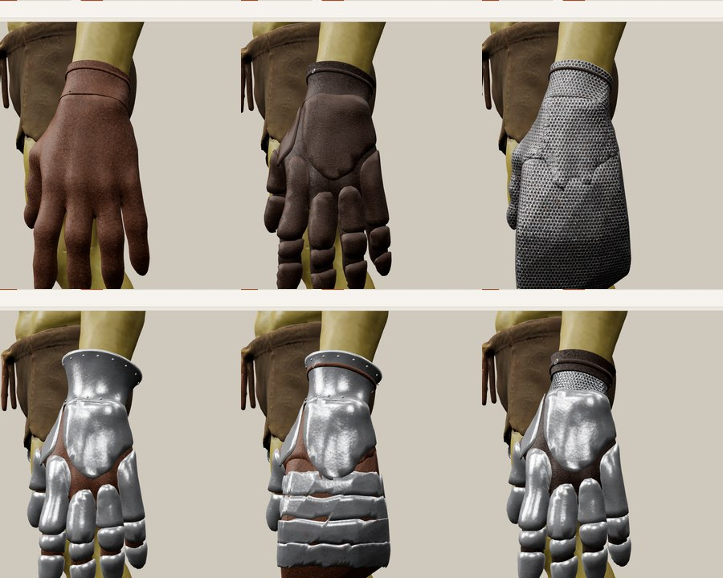

Первый вариант «Рубашка под доспех (тонкая ткань по телу)» — то, что надевают под латы: тонкая ткань из самой кожи персонажа (туловище до бёдер, плечи, подмышки, руки до запястий; с 2026-11-26 — по замечанию «как будто персонаж в рваной ткани» — низ и манжеты режутся по своим линиям: пояс ровным кольцом, рукав на 0,95 предплечья, ткань ложится поверх своих трусов или топа персонажа, каждая точка движется с кожей прямо под ней, кожа под ней скрыта вся, кроме 12 мм у краёв), одной поверхностью, без щелей между телом и рукавами, без юбки, воротника и завязок. Каждая точка движется со своей кожей. Анатомия сглажена, как у настоящей ткани: в масштабе тела (шар около 3 см, по площади, а не по соседям сетки) уходят соски, края груди, кубики пресса, мышцы рук; ткань перекидывается через впадины. Кожа под ней скрыта и в редакторе, и в игре (маска), поэтому ткань может срезать выступ до 4 см. У штанов есть такой же вариант «Под доспех (тонкая ткань по телу)»: облегающие штаны от пояса до щиколоток. Остальные варианты стёганые и толстые; они для персонажа без доспеха. Например, полы длинного гамбезона торчали бы из‑под любой брони, а лишняя геометрия под латами — пустая нагрузка. Кнопки вещей в редакторе разбиты на блоки: «Броня», «Одежда», «Оружие и снаряжение».

«Поддоспешная одежда» кроится как одежда, по листам-референсам: льняная рубаха (с 2026-11-26 кроится как повседневная — одним куском, с талией, подол лежит на бёдрах: из корпуса и отдельного подола она стояла над бёдрами куполом — пользователь), короткий акетон, длинный гамбезон, подлатный дублет, дублет с кольчужными вставками, стёганый жилет. Кроме них есть брэ (короткие и длинные) и стёганый подшлемник.

Как она строится:
- из частей самого доспеха, свободно по телу, а не из кожи. Торс — как у жилета: кольцо и кокетка через плечи, проймы и горловина находятся там, где лучи встречают руки и шею;
- юбка продолжает торс вниз и не сужается к талии; разрезы по бокам или сзади;
- рукава — трубы вокруг плеча и предплечья. У локтя нижняя часть уходит под верхнюю, край проймы подвёрнут под верх рукава;
- стоячий ворот — вокруг основания шеи;
- спереди завязки или шнуровка; у дублетов шнурки для лат на плечах, руках и по подолу, у второго — кольчужные вставки под мышками;
- стёжка — продольными каналами или ромбами;
- брэ — свободные штаны, длинные собраны у щиколотки;
- подшлемник — мешок вокруг головы (волосы бывают вылеплены прямо на коже, комками): выпуклая оболочка с вырезом для лица, уши проходят насквозь, волосы скрыты под ним.

Это самый нижний слой: доспех надевается поверх.

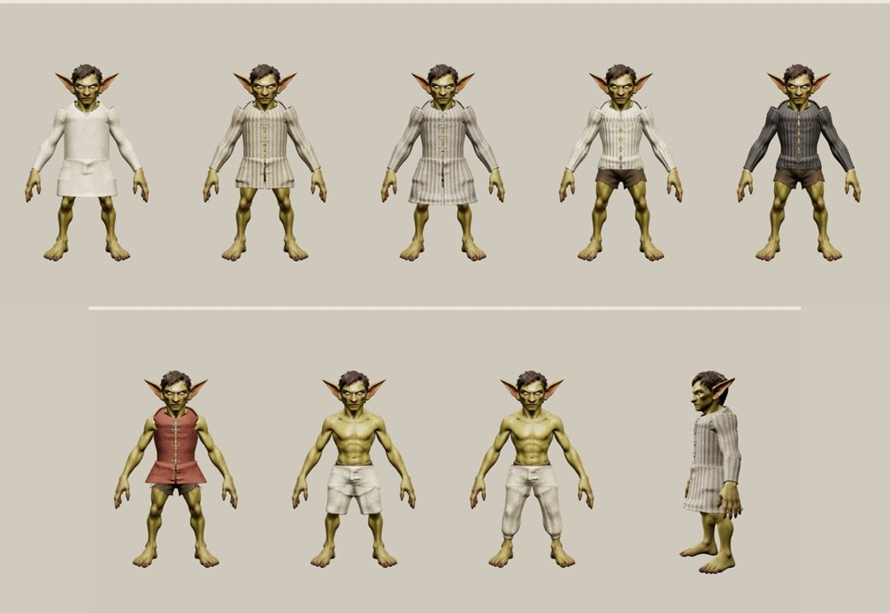

**Повседневная одежда** (2026-11-23): свой блок в редакторе, «Повседневная одежда», — одежда горожан и ремесленников (по картинкам пользователя: гоблин-портной, каменщик, кожевник, кузнец, гончар, плотник, коробейник), шесть видов, у каждого свой слой, поэтому они ложатся по порядку, что бы ни сделали первым: обмотки (0.9: под манжетами бриджей), рубаха или туника (1.2: подол поверх штанов), жилет (2.2), фартук (2.6), пояс с тем, что на нём висит (2.9), накидка с капюшоном (4.2); слои одни и те же в редакторе, `wear_files.LAYER` и `SF3DEquip.LAYER`, вещи ложатся в `clothes/`.
- **Рубаха / туника**: длинная льняная рубаха со шнуровкой у ворота (короткий разрез спереди, шнур крест-накрест, завязан бантом), туника с короткими рукавами, рубаха без рукавов (рваный подол), длинная туника с высокими разрезами по бокам, рукава закатаны до локтя (толстый валик на конце). Один кусок ткани (2026-11-24): корпус, рукава и подол — одна поверхность: кожа торса и рук, сглаженная широко (свободная рубаха — крупная форма тела и талия, а не каждая мышца), отодвинутая на свободу; текстура целыми плитками вокруг тела и вокруг каждой руки (без полос там, где переплетение замыкалось: рубаха казалась сшитой из кусков); нижний край — ровное кольцо чуть ниже талии, выше того места, где кожа торса кончается у бёдер (край прыгал вверх-вниз: уступ), подол идёт от него. Ниже талии ткань свисает и не заходит под живот или ягодицы, так что корпус плавно переходит в подол. В тело она не уходит: поверх бугров кожи её выталкивает одно гладкое поле — она лежит на вершинах мышц, а не в каждой (утопленная в плечи гоблина, при подъёме рук кожа выходила сквозь неё); у краёв, где кожа не скрыта (маска отступает от них), — ещё и поверх того, что надето на самом персонаже (трусы гоблина: их пояс проступал сзади); каждый ряд подола обходит контур тела на полряда выше и ниже себя. Складки везде: сборка под воротом, вдоль корпуса в лад со складками подола, морщины по рукавам (не глубже доли толщины руки: у тонкого запястья рукав выворачивался). Ворот и манжеты подшиты узкой полосой. Края выреза — расстёгнутый перед жилета, разрез рубахи, низ, горловина — режутся точно по своим линиям (2026-11-24, второй круг): ткань строится целиком по коже с запасом за ними и режется в конце, треугольники кожи поперёк линии разрезаются по ней (если резать сначала, край всё время был открытым краем: нормали там косят, при заполнении впадин он отставал и заворачивался, и кромка жилета уезжала на 5–16° от разреза кожи — кожа между ними была скрыта и ничем не закрыта, дыры насквозь; кайма сминалась в комки). Горловина идёт вокруг шеи у её основания, в 1,45 радиуса шеи от её оси (по весам кожи она лесенкой ходила вверх-вниз по шее; накидка с капюшоном берёт ту же линию — от сустава шеи вниз она поднималась трубкой до подбородка там, где этот сустав высоко). Кайма жилета ложится на ткань по всей ширине и рвётся там, где край круто поворачивает. Нормали ткани развёрнуты наружу, как у кожи (при сглаживании мелкие треугольники соска складывались друг на друга и разворачивались внутрь: ткань выталкивало на 4 см не в ту сторону, и топ под ней проступал). За мелкими буграми кожи ткань не идёт: форма уже 2,4 см (сосок) остаётся под ней (поле «не глубже» «открыто»; кончик под тканью прячется маской, как торчащий из неё), форма мышц остаётся. Ткань строится только по самой коже: топ или трусы, смоделированные отдельными оболочками поверх кожи, за кожу не принимаются (по обоим слоям у ткани там было два листа, перекрещенных) — она ложится поверх них. Кожа под ней скрыта только там, где ткань накрывает её вдоль нормали и на 30° вокруг (как лучи запекания, `body_mask` cover=30: у края, отстоящего от тела, кожа под ним видна наискось); с 2026-11-26 — вся, кроме 3 см от открытых краёв (ворот, разрез, манжеты, края переда жилета) и всего, что под подолом (он отходит от бёдер и ягодиц при шаге: скрытые там, они открывались дырами), — маска запекания, отданная кольцами от каждой щели, показывала половину кожи под рубахой, и в движении она проходила сквозь ткань. Каждая точка ткани движется с кожей прямо под ней (веса берутся там, а не там, откуда точка сделана: при сглаживании она уезжала вдоль тела, и над лопаткой, у подмышки шла с другими костями, чем кожа под ней). На гоблине за 12 клипов кожи, видной сквозь рубаху или мимо неё, стало около 84 точек на кадр вместо 136 (сквозь ткань 101 → 38, дыр 35 → 46), у жилета 33; осталось — бёдра сквозь подол в беге и броске, складки подмышек при взмахе руки. Последние 5 см руки внутри рукава и вся рука за ним не скрываются никогда: заглянув в рукав, видно, как рука уходит в него (стянутый к запястью рукав или тёмная пустота рукава вокруг руки выглядели «по-кукольному»). Ползунки «Длина подола» (ниже паха, доля бедра), «Рукава» (0 — без рукавов, 50 — до локтя, 100 — до запястья), «Свобода», «Бахрома», «Складки».
- **Жилет**: тот же один кусок без рукавов, близко к телу (без воздуха между), края выреза ровно вниз по переду: шерстяной, открытый спереди, с вышитой каймой по краям и подолу (отделка «вышивка»: лоза с листьями нитками цвета «Нитки», узор идёт вдоль каймы), или застёгнутый на пуговицы; «Расстёгнут» — ширина просвета спереди.
- **Фартук**: кузнечный холщовый (нагрудник держится на ремешке — от верхних углов вверх по груди, по бокам шеи и вокруг неё сзади, сзади выше (не вокруг горла спереди: ошейник); кожаный пояс, карман с молотком — кованая головка с круглым бойком и клином, вдоль фартука, рукоять сквозь неё (стальной брусок поперёк верха рукояти выглядел металлической пластиной на фартуке) — и зубилами), кожаный кожевника (шнуровка по бокам нагрудника, два кармана с ножом и шилом), гончарный тканевый с кушаком на узел сбоку (концы висят, цвет «Второй ткани»), плотницкий поясной без нагрудника, с разрезом спереди и двумя карманами с инструментом (киянка, стамески, угольник, линейка). Полотнище — построитель тассет (лист спереди, на бёдрах движется с ними), нагрудник натянут от груди до пояса (поверх живота, не в него), лямки лежат на том, что надето. Ремень на поясе — лента пояса (2026-11-24): каждая кромка на теле на своей высоте, спереди поверх верха полотнища и низа нагрудника, пряжка сбоку, по наклону ленты (ремень тассет был кольцом по радиусу полотнища: сзади отстоял от тела). «Длина», «Ширина», «Нагрудник» (0 — без него), «Ширина нагрудника», «Карманы», «Инструменты в карманах» (с 2026-11-24 выключено по умолчанию, пользователь: «кармашек сам оставь, предметы убери» — молоток, зубила, нож, торчащие из него).
- **Пояс и сумки**: кожаный с пряжкой, конец продет в неё и лежит вдоль ремня под шлёвкой (2026-11-24: висел зря), кушак на узел сбоку, верёвка с узлом спереди; галочки для того, что на нём висит, — поясная сумка с клапаном и пряжкой, кошель на шнурке, сумка через плечо (ремень через другое плечо, крест на спине), тряпка за поясом, моток верёвки. Пояс ложится на самое внешнее из надетого на талии (жилет, фартук) — но одежду под собой он стягивает (2026-11-24, пользователь: «ремень поверх одежды должен стягивать её на поясе»): ложится на самое внешнее у самого персонажа (кожу, смоделированный на нём топ) плюс толщину ткани (2,5 мм на слой рубахи, жилета, штанов, поддоспешника), а не на рыхлую поверхность рубахи; рубаха, жилет, штаны, поддоспешник под поясом втягиваются под его ленту там, где их надели вместе, что бы с чем ни делали — сама вещь делается как есть (рубаха без пояса не перетянута): внешняя сторона не дальше внутренней стороны ленты, выше и ниже выходит из-под неё наклонно на 3 см (дальше свободно: штанины бриджей, расклёшенный подол), толщина сохраняется, в тело не уходит (где под тканью нет тела — между ног — не втягивается), и собирается над и под ним девятью складками там, где её пришлось прижать (по поясу сидящая — без них). Слои — изнутри наружу, каждый поверх уже прижатых (жилет, прижатый сам по себе, проходил сквозь рубаху); где их толще, чем места под поясом (сделан поверх одного слоя, надет поверх трёх), пояс целиком отодвигается на них (он прятался внутри). Одно правило в редакторе на экране (`cinchPoints`, `cinchShown`: надетые рубахи и та, что делается), в Godot (`SF3DEquip._cinch` при надевании, снятии и показе: лента — те ряды пояса, что идут по кругу, а не сумки и не рамка пряжки) и в рендерах комплектов. Затянут — вокруг талии идёт по телу (перекрывает только ложбинку позвоночника; по выпуклой оболочке он отстоял от живота и спины, под ним был воздух), каждая его кромка лежит на теле на своей высоте, так что полоса наклонена, как тело в этом месте (подсказка пользователя для всех ремней: места верхней и нижней кромки различаются; полоса по радиусу более широкой кромки отходила узкой), — и движется как кожа под ним; ремни (фартука, сумки через плечо) так же: каждая кромка опущена на то, что под ней; вещи на нём висят по бокам, поверх внешней стороны одежды под ним, наполовину с бедром своей стороны (нога, уходя в сторону, отводит сумку).
- **Накидка с капюшоном**: короткая пелерина по плечам от горловины у основания шеи (2026-11-24: поднималась по шее до подбородка — «лишняя деталь одежды на шее»), открыта спереди — края переда расходятся книзу, у подола на 10° в каждую сторону (2026-11-26: разрез был ровный), — у горла застёжка-палочка на шнуровых петлях, капюшон опущен и лежит на спине, как настоящий (2026-11-24; валик вокруг шеи и мешок выглядели мешком на шее): край лицевого выреза — мягкий валик, провисающий буквой U поперёк верха спины, под ним несколько дугообразных складок и складки, сходящиеся к закруглённому концу; второй стиль — с длинными концами по обе стороны застёжки. Движется как кожа под ней, а над плечом отчасти с плечом руки (поднятая рука поднимает её, как плечо плаща), вокруг плечевого сустава ткань чуть отстоит. «Длина», «Концы спереди», «Капюшон»; «Капюшон поднят» (2026-11-26): капюшон на голове — тканевый мешок вокруг головы и шеи в 12 мм от них, лицо открыто от бровей до подбородка, уши внутри и скрыты, верх оттянут назад и вверх мягким острием («колпак»).
- **Обмотки**: лён на голенях от-под колена до щиколотки, поверх две ленты винтом в разные стороны (чуть темнее: «Вторая ткань») — до колена или короткие.
- Новые штаны: «Бриджи под коленом» (широкие, ткань нависает над манжетой: «Напуск»), «Длинные прямые штаны», «Короткие широкие до колен» (с завязками: «Завязки у подола»); свободные штанины расширяются вниз по бедру, а не у таза. Новая обувь (`tool/footwear_extra.py`, на той же колодке генератора): «Мягкие туфли со шнурком» (без язычка, шнурок вокруг щиколотки с бантом спереди, шов по подъёму), «Грубые рабочие ботинки» (толстая подошва с рантом, шнуровка, отворот сверху), «Сандалии» (подошва, ремешки поверх пальцев и подъёма, вокруг щиколотки и по пятке; стопа открыта).
- Ткань с переплетением: «Переплетение ткани» — полотно (лён), саржа, ёлочка или гладкая — узор нитей в текстуре и её рельеф, Blender запекает его так же, как кольца кольчуги; «Вторая ткань» — цвет кушака, тряпки, верёвки, лент обмоток.
- Тест: `work/wear_test/ui/test_garb.mjs <снимки> <порт>` (каждый вид и стиль на персонаже, его ползунки, галочки пояса, переплетения, новые штаны и обувь, слои). Наряды по референсам: `work/commoners/outfits.py <персонаж>` (вещи — `work/commoners/specs/full.json`, делает `work/wear_test/ui/commoners/ag_gen.mjs`).

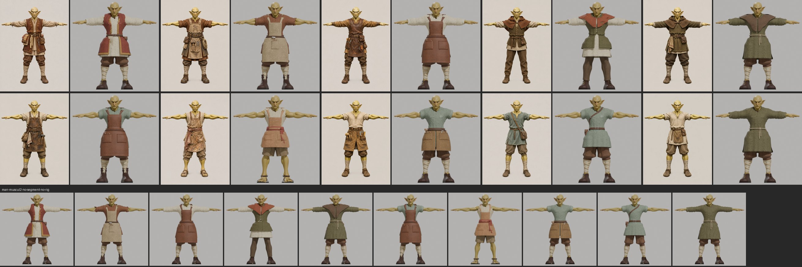

**Одежда воинов-магов** (2026-11-24, по десяти концептам пользователя — гоблин-маг в Т-позе; только одежда: бутылочки, свитки, сумки, подвески, символы и вышивка не делаются; первым сделан «ученик», концепт 28): новые стили видов повседневной одежды, поэтому слои и папки те же.
- **Жилет «Длинный распашной, до колена (маг)»**: тот же один кусок ткани до колена, распашной от V у ворота, чуть расширяется книзу, высокие разрезы по бокам и сзади (ноги проходят в шаге), кайма по краям и подолу. Передние края подола продолжают край полочки (2026-11-24, замечание пользователя: «более плавные линии, а не как сейчас на бёдрах поднято»: угол между краем полочки и низом корпуса скруглялся — на 5 мм наружу и 3 см вверх, — и край подола шёл вниз оттуда, ступенькой под краем полочки); подол отходит от тела плавно, на половине длины (`ramp`), а не на трети.
- **Отделка «кайма»** (повседневная одежда): гладкая полоса «Второй ткани» по краям и подолу, без узора.
- **Обувь «Высокие сапоги на пряжках»** (`tool/footwear_extra.py`): сапоги без шнуровки до-под колена, рант, подшитый верх, ремешок с пряжкой вокруг щиколотки и вокруг верха. Высота голенища меряется на каждом персонаже (три четверти пути от щиколотки до колена; профиль колодки продолжен выше 21 см генератора); голенище подгоняется поверх надетого на голени (штаны, обмотки — редактор передаёт их, как койф под шлемом) и выталкивается наружу там, где штаны прошли бы сквозь него (у щиколотки сапог держит форму колодки). В примерочной (и в редакторе) закрытая обувь теперь прячет части нижних слоёв внутри себя, как шлем (`blender_layer_hide.py`, `hideUnder`; кроме сандалий): заправленная штанина больше не выглядывает у щиколотки, когда стопа поворачивается.
- **Обмотки «На предплечьях»**: кожаные полосы на предплечье от середины до запястья, поверх рукава рубахи — стиль на своём слое (1,4, над рубахой 1,2: записывается в `.fit.json` вещи, поэтому примерочная и `SF3DEquip` кладут его поверх рукава).
- «Ученик» в сборе: длинные прямые штаны, длинная льняная рубаха со шнуровкой, длинный распашной жилет, пояс с пряжкой поверх него (стягивает рубаху и жилет в талии, когда надет, — в редакторе и в `SF3DEquip`), накидка с капюшоном, высокие сапоги, обмотки на предплечьях. «Проверить в движении» (12 клипов) на мускулистом гоблине и девушке-гоблине: кожа сквозь жилет 0–0,6 %, сапоги 0 %, обмотки 0 %, накидка 0,7–1,4 % (рубаха — как раньше, 2,5–3 %; пояс на голом теле 3–9 %: он лежит в 5 мм от кожи, рассчитан на два слоя ткани под ним). В примерочной Godot штаны сквозь сапоги не видны, пояс и обмотки лежат поверх жилета и рукавов.
- **Второй круг (2026-11-26): маг пустыни (концепт 23), тёмный маг (26) и маг бури (19).** Новые стили: накидка «Шаль вокруг шеи» (накидка закрыта, без застёжки, по ней мягкие складки, вокруг горловины два валика ткани — сечение каждого эллипс, сплющенный по ткани под ним, — и один конец свисает по груди поверх надетого, каждая его полоса уложена на поверхность под ней, с бахромой), «Драпированный ворот с капюшоном» (те же валики провисают к острию на груди, сзади лежит капюшон), штаны «Шаровары, собраны на голени» (очень свободные, ткань нависает над манжетой на середине голени), туника «Многослойная без рукавов, острый подол» (до середины икры, подол вырезан четырьмя большими углами, поверх — короче слой второй ткани с тремя углами, бахромой) и «Мантия из зубчатых полотнищ» (до щиколотки, с короткими рукавами, двенадцать разрезов по подолу и острый конец у каждого полотнища, поверх — короче такой же слой). Подол с углами — `pointsAt` в построителе юбки; слои поверх подола туники — `skirtLayers` (каждый от талии, чуть снаружи нижнего, шире книзу). «Длина подола» теперь до 180 (почти до щиколотки). Остальное — готовые вещи: у мага пустыни туника с коротким рукавом, длинный распашной жилет бирюзового цвета с оранжевой каймой, кушак, обмотки на голенях и мягкие туфли; у тёмного мага высокие сапоги, пояс и обмотки на голых предплечьях вместо наручей; у мага бури накидка с концами без капюшона, тканевые обмотки на предплечьях, пояс и высокие сапоги. Длинный подол ниже колена идёт и с голенями (`legRide`: передние полотнища всё больше с голенью своей стороны, задние — с ногами), а полотнища стоят каждое над своей ногой (разрез точно спереди): в шаге колено и голень проходили сквозь перед. «Проверить в движении» на голых гоблине и девушке-гоблине (худший клип): мантии 2–5 % (икры в шаге — в комплектах ноги в штанах и высоких сапогах), шаль 2,5 % и ворот 5 % с руками над головой, обмотки на голых руках 0–1 %; у шаровар кожа выходит у тугой манжеты на голени (в комплекте пустыни под ней обмотки). В примерочной Godot все три комплекта держатся в ходьбе и беге на обоих телах.

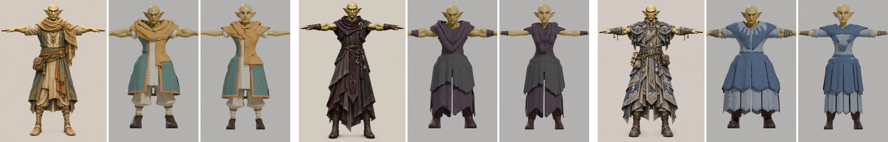

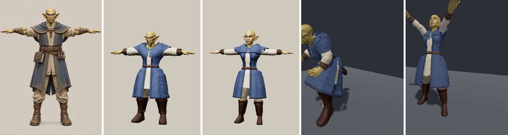

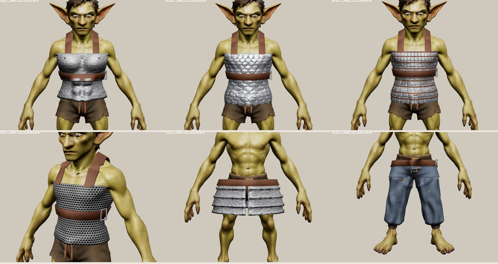

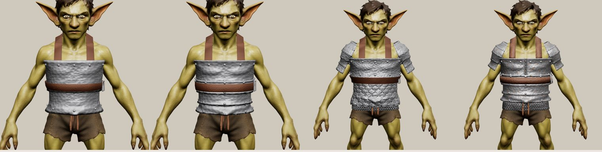

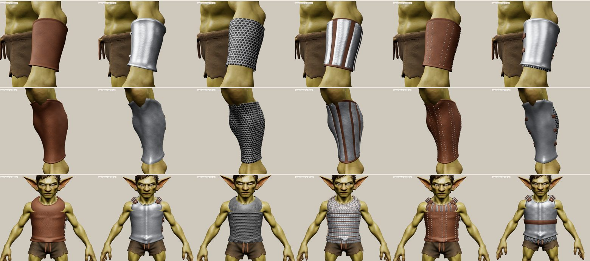

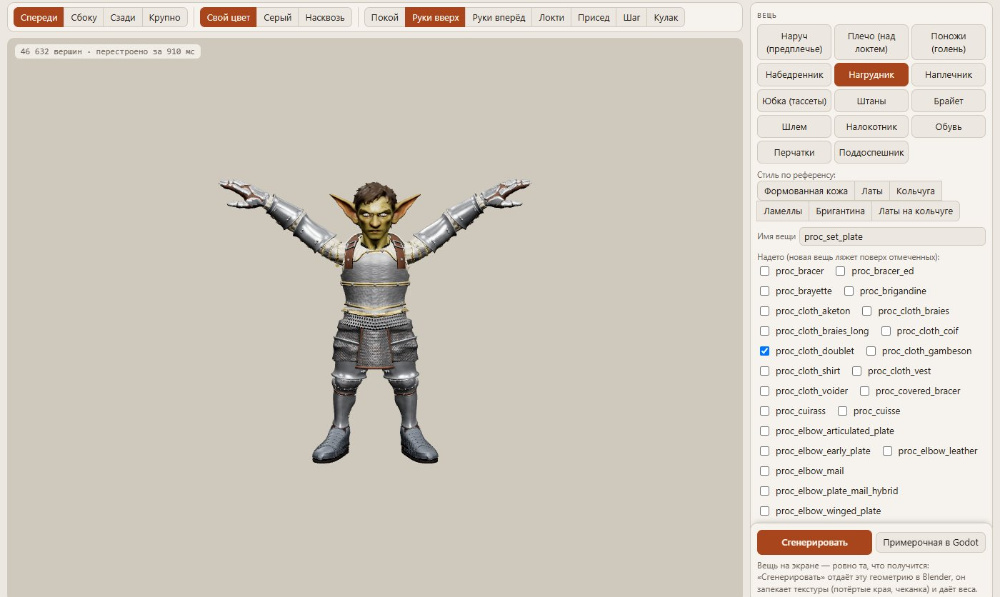

Готовая вещь ложится рядом с персонажем как надетая в «Броне», поэтому её видят примерочная в Godot и список надетых вещей в редакторе. Она садится сразу, без подгонки, и весь комплект получается в одном стиле, каждая вещь делается поверх надетых под ней (стальные руки — поверх рукавов дублета). На других телах тоже работает: справа салад на фее. Править руками её всё равно можно. В «Броне» любая такая вещь, включая шлемы, налокотники, обувь, перчатки и одежду, открывается как сделана — часть тела «Готовая вещь». Её можно двигать, поворачивать и менять размер гизмо, править форму точками, проёмами и толщиной стенки. «Надеть» сохраняет её собственные веса и то, что прячет её маска (уши под шлемом). Новая генерация заменяет эти правки.

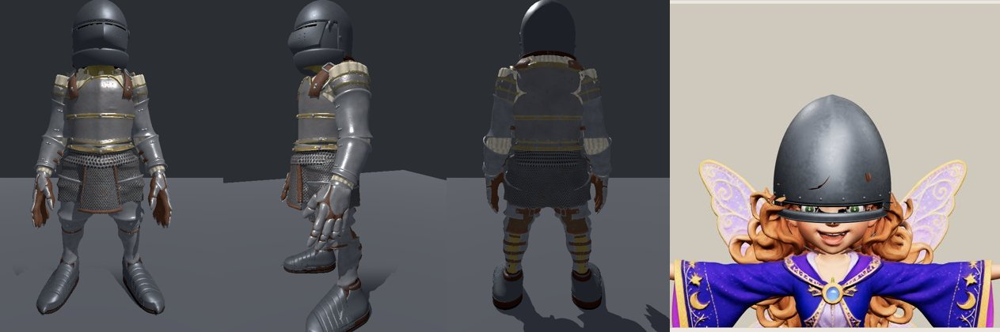

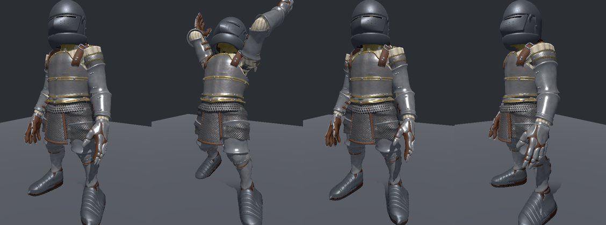

### Существа

У существ (четыре лапы, хвост, морда) свой раздел рядом с «Персонажем»: брони и подгонки вещей у них нет, поэтому их инструменты отдельно. В разделе своё текущее существо (в списке 🐾 — существо со скелетом, ○ — модель без скелета: такие модели есть в обоих списках, пока скелет не сделан, и чей это скелет, решает кнопка). Файлы существа лежат в `export/character/<имя>/`; его паспорт `<имя>_rig.json` говорит `"kind": "creature"` (модель, добавленная в этом разделе, получает его сразу), и в «Персонаже» оно больше не показывается.

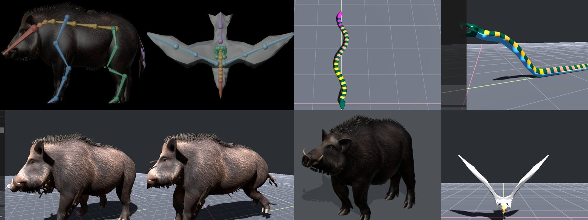

- **Скелет по шаблону** (2026-11-26, «Скелет → По шаблону»): для тела, на котором UniRig ошибается (кабану из `export` он дал три задние ноги и хвост из шеи), или когда видеокарта занята. Выберите шаблон по числу опор — **четвероногое** (позвоночник, шея, голова, хвост и четыре ноги по пять костей: лопатка или таз, плечо или бедро, предплечье или голень, пясть, пальцы), **птица** (две ноги, крылья по три кости, шея из трёх звеньев, хвост) или **змея / червь** (голова и 12 позвонков вдоль линии, которую вы проводите точками по телу), — и суставы расставятся по форме модели (`tool/creature_templates.py`): куда смотрит существо — по тому, где больше массы за лапами (у птицы — по средней полосе, голова на более высоком конце), лапы — по нижним точкам в четыре группы, спина — по силуэту, голова — спереди; начальный поворот угадан верно у кабана, чайки и змеи, как бы они ни стояли. Страница разметки (`tool/creature_markup.html`) показывает суставы поверх просвечивающей модели: сустав тянется мышью в плоскости вида (сбоку, спереди, сверху, сзади), средние держатся на средней линии, правая сторона повторяет левую, пока включено «Зеркально», промежуточные позвонки и звенья хвоста идут за концами; «Назад», «Повернуть на 90°» (оранжевая стрелка — куда смотрит существо), «Расставить заново». «Собрать скелет» (`tool/blender_creature_template.py`, ~20 с, без видеокарты): кости от сустава к суставу, кости цепочки соединены, у ног и крыльев локальная Z вперёд (сгиб вокруг X), тепловые веса на сшитой копии (`tool/blender_heat.py`; змея масштабируется по длине); мелкие отдельные куски кожи — щетина, бахрома на подбородке, клыки, рога (островки меньше 2 % вершин и 6 % размера) — целиком берут веса той кожи, на которой сидят (тепло отдавало бахрому кабана плечам, и она отлетала при шаге). Имена костей — как у инструментов существ (`hips`, `spine_01…`, `chest`, `neck_01…`, `head`, `tail_01…`, `leg_FL_1…5`, ноги птицы `leg_BL/BR`, `wing_L_1…3`; у змеи `spine_01…` от головы к кончику хвоста; простая латиница, Godot её не меняет), поэтому челюсть и глаза (режимы «Пасть» и «Глаза» просмотрщика), клипы Mesh2Motion, ключевые клипы, «Проверить клипы» и Godot принимают такой скелет так же, как от UniRig. Результат: `<имя>_auto.glb` (без челюсти) и `<имя>_rigged.glb`, разметка в паспорте (`"template"`), снимки `<имя>_tpl_side/front/top.png`; заменённый скелет UniRig сохраняется (`<имя>_auto.unirig.glb`, «Вернуть»). Отмеченные раньше челюсть и глаза остаются, если модель стоит там же; сделанные раньше клипы делаются заново.
- **Свои процедурные клипы** («Анимации», группа «Свои процедурные» — первая и отмечена, если скелет собран по шаблону; `tool/creature_gait.py`, в том же сеансе Blender, что и перенос Mesh2Motion, ~8 с): делаются по скелету самого существа, любого размера. Четвероногое: `idle_loop`, `walk_loop` (боковая последовательность: задняя, передняя через четверть цикла), `trot_loop` (диагональные пары), `run_loop` (поперечный галоп: спина сгибается и вытягивается, голова держится ровнее), `attack` (замах назад и вниз, выпад с ударом головой вверх, пасть открыта); птица: `idle_loop`, `walk_loop`, `run_loop` (голова замирает и выбрасывается вперёд), `flap_loop` (крылья машут вокруг оси тела, на подъёме складываются в кисти, ноги поджаты), `glide_loop`, `attack` (клевок с раскрытыми крыльями); змея: `idle_loop`, `walk_loop` и `run_loop` (тело лежит по серпеноиде, волна бежит назад вдоль него), `attack` (передняя треть поднимается буквой S, бросок вперёд, пасть открыта). Аллюры подогнаны под длину ног (динамическое подобие: число Фруда для каждого аллюра, шаг 2,3·Fr^0,3 высоты ноги), лапы ставятся IK: в опоре шар лапы стоит на месте и едет назад со скоростью тела, в махе поднимается по дуге, стопа запрокинута, пальцы загнуты не ниже пола; нижняя кость лапы наклоняется с махом ноги и «пружинит», как путо, если нога не дотягивается; в движении корпус чуть приседает, лопатка ходит. Клипы на месте: «speed» в `<имя>_clips.glb.json` и в журнале — с какой скоростью игра двигает существо, чтобы лапы не скользили (кабан: шаг 0,85, рысь 1,67, галоп 2,93 единицы в секунду). Циклы кончаются первой позой и названы с `_loop`: Godot импортирует их зацикленными и снимает суффикс (`walk`, `run`…). Проверка кабана: в пол 0, скольжение 0, шов цикла 0, над полом 2–5 мм; в Godot 4.7 `idle`, `walk`, `trot`, `run` зациклены, `attack` проигрывается один раз.
- **Повороты, прыжок, лапы по неровной земле** (2026-11-26): у процедурных клипов четвероногого ещё `walk_left_loop`, `walk_right_loop`, `run_left_loop`, `run_right_loop` — шаг и галоп по кругу радиусом 1,6 длины тела: стоящая лапа идёт по дуге вокруг центра поворота (внутренние лапы шагают короче), корпус изгибается и кренится в поворот, голова смотрит в него; `turn` в списке клипов — скорость поворота тела (градусов в секунду, + влево: у кабана шаг 37, галоп 129), — и `jump`: присед, толчок (передние лапы отрываются первыми), полёт по параболе с поджатыми лапами, приземление на передние, потом задние, амортизация корпусом; `air` в списке — когда существо в воздухе (тогда игра несёт его вперёд со скоростью `speed`). Проверка клипов: в пол 0, скольжение 0–1 мм у поворотов, 10 мм у прыжка. Лапы по неровной земле в самой игре: `tool/godot/sf3d_creature_feet.gd` (класс `SF3DCreatureFeet`, `SkeletonModifier3D` — положить под `Skeleton3D` существа): земля под каждой лапой ищется лучом вниз (`collision_mask`), корпус поднимается или опускается к самой низкой, две верхние кости каждой ноги доворачиваются, чтобы дотянуться (двухкостная IK со сгибом как в клипе), стоящая лапа наклоняется по склону; собственный подъём лапы в клипе сохраняется. В «Открыть в Godot» — «Земля под лапами» (ровная, склон 12°, ступенька под передними лапами) и «Лапы по земле (IK)»: без него передние копыта уходят в склон и в ступеньку, с ним стоят на них.
- **На нурглах** (2026-11-26): процедурные клипы ставятся и на существо от UniRig — нургла орды (`werewolf2_open`: зверь в присяде, задние лапы из четырёх костей без кости пальцев, передние лапы в покое далеко впереди плеч, правая задняя отставлена). Для него: лапа без кости пальцев — это сама стопа: лежит ровно, IK ведёт голеностоп, пятка поднимается вокруг кончика пальцев, когда нога уходит назад (длина стопы — по коже, которую она ведёт: длину концевой кости GLB не хранит); центр шага каждой лапы — там, где нога его достаёт (под плечом, если лапа в покое слишком впереди), мах ноги не больше 32° в каждую сторону, колено сгибается вдоль тела. Проверено на копии: в пол 0…−10 мм, как у его же клипов лисы и лошади (−10…−14), кабан без изменений (0). Модификатор лап понимает и две ноги человекоподобного (Mixamo, профиль Godot): предводитель нурглов (`nurgls_medium`) с ним стоит на ступеньке, без него ступни уходят в неё. В приложении: «Существа» → существо → «Анимации» → «Свои процедурные» → «Перенести клипы».
  В игре (2026-11-26, там G-D203): строка VAT орды `run` — этот галоп нургла (в `werewolf2_open_clips.glb` теперь ещё группы «Нургл» и «Свои процедурные»; прежние файлы в `werewolf2_open_backup/before_proc_clips/`), а предводитель стоит на склонах поля с модификатором лап (в игре `CreatureFeet`); `ground_height` (функция высоты земли в x, z; NAN — поза клипа как есть) заменяет физический луч, где у игры своя карта высот.
- **Скелет**: UniRig ставит кости, затем они получают понятные имена (`hips`, `spine_01`, `chest`, `head`, `snout`, `leg_FL_1…`, `leg_BR_4`, `tail_01…`), модель разворачивается мордой вперёд, по первой догадке линии рта появляется кость `jaw` (точно её задаёт режим «Пасть» в разметке). Под списком — скелет по частям: лапы и кости в них, кости хвоста, голова, челюсть.
- **Разметка скелета** (`tool/skeleton_view.html`, открывается под кнопкой скелета, пока вкладка на экране), три режима:
  - **Просмотр**: суставы и кости любой модели со скелетом по цепочкам — четыре лапы, таз и позвоночник, шея, голова, челюсть, хвост; у человекоподобных — руки, пальцы, ноги, лицо по именам Mixamo, Godot или Unreal; остальное — по ветвям самого скелета. Подписи костей на модели, дерево костей, виды спереди / сбоку / сверху / сзади, модель насквозь. Кожа окрашивается по кости, которая ведёт каждую вершину (видно, где кончается область каждой кости), или по весу выбранной кости (синий — 0, красный — 1). Клик выбирает сустав, кольца поворачивают кость — видно, как тянется кожа; «Сбросить позу». Клипы самой модели; счётчики (кости, лапы, хвост, голова и челюсть, вершины почти без веса). Если пасть размечена — ползунок закрывает челюсть (как сделана ↔ закрыта).
  - **Суставы**: каждый сустав и конец каждой кости без продолжения (кончик лапы, конец хвоста, морда) двигается стрелками; «Зеркало пар» двигает пару лапы вместе (FL ↔ FR, BL ↔ BR) и держит средние суставы на средней плоскости; «В середину тела» ставит сустав в середину тела вокруг него (лучами поперёк и спереди назад); «Уравнять длины пар» даёт костям пары длины той лапы, чей последний сустав ниже, ближе к полу (среднее, если они на одной высоте; сустав сдвигается вдоль своей кости, нижние — с ним), и пишет, на какой высоте над полом последний сустав каждой лапы — учтите, что длины разные и из-за позы (у оборотня левая задняя лапа прямее, правая согнута и отставлена: обе достают одинаково низко, а после уравнивания левая ушла в пол); «Отзеркалить лапу на пару» (выбран сустав правильной лапы) делает парную лапу — все суставы и конец — её зеркалом через среднюю линию, для лапы, которую UniRig поставил криво целиком, и говорит, сколько отзеркаленных суставов попало внутрь тела второй лапы; «Вернуть как было». «Пересобрать скелет и веса» (`tool/blender_creature_rebuild.py`, ~30 с): голова каждой кости — в её сустав, хвост — в следующий сустав цепочки или в её конец; веса — «заново у сдвинутых» (по умолчанию: тепловые веса, `tool/blender_heat.py` — способ рига по ориентирам со сваренной копией, только там, где кожу ведёт сдвинутая кость, её родитель или дети, и только этими костями или прежними костями вершины; остальное — веса UniRig: на мохнатом волке тепло везде отдало первым костям передних лап полосу гривы, а сдвинутая морда к лапам отношения не имеет), «заново везде» или «как были». Скелет с именами до первой пересборки сохраняется (`<имя>_auto.unirig.glb`), кнопка «Вернуть исходный скелет UniRig» (вкладка «Скелет») возвращает его; челюсть собирается заново по разметке пасти. На модели в кривой позе: сначала «Выровнять позу покоя», потом зеркалить правильную лапу на другую (в симметричной позе её суставы попадают во вторую лапу).
  - **Пасть** (идея пользователя для открытой пасти: резать нечего — челюсти уже разделены щелью, челюсть надо только «оживить»): четыре точки на средней плоскости — шарнир, уголок рта, передний край верхней и нижней челюсти. Линия рта идёт от середины щели через уголок к шарниру; челюсть — кожа ниже неё, до которой можно дойти по коже от переднего края нижней челюсти (стыки сварены: подбородок длинной открытой челюсти идёт с ней, а передняя лапа ниже — нет, её путь вверх по лапе проходит за шарниром), отдельные куски (зубы, язык) — целиком: с челюстью, если уходят ниже линии рта больше, чем выше (кончик нижнего клыка торчит выше линии); ширина челюсти — до уголка рта, если его сдвинуть вбок к настоящему углу пасти (с запасом: боковые клыки орка), иначе по прикидке. То, что не решить никаким правилом (нижние клыки орка — его кожа, их кончики выше линии рта), закрашивается кистью «+ челюсть» / «− челюсть» (размер — от размера пасти) по коже под курсором, красная подсветка меняется сразу; закрашенные точки хранятся вместе с разметкой пасти и в Blender ложатся на вершины модели при каждой пересборке челюсти. Пока рисуешь, камера свободна (правая кнопка вращает, средняя сдвигает, колесо приближает). «↶ Отменить» / «↷ Вернуть» (Ctrl+Z, Ctrl+Y) в «Суставах» и «Пасти»: мазок кисти, сдвиг точки или сустава, «Очистить», «Уравнять», «Отзеркалить», «В середину тела», «Вернуть как было». Красным показаны ровно те вершины, что возьмёт Blender (1122 = 1122 на оборотне). Угол раскрытия меряется (шарнир → верхний край против шарнир → нижний край), ползунок пробует её от «шире, чем сделана» (до 80 % сверху) до закрытой; такой же ползунок в «Просмотре» на готовой модели (клипы открывают челюсть от закрытой на свой угол — лепить пасть шире не нужно). «Пересобрать челюсть» (~30 с): кость челюсти от шарнира к нижнему краю, её снимки «как сделана» и «закрыта», поворот закрытия сохраняется в паспорте для ползунка и будущих клипов.
- **Выровнять позу покоя** (`tool/blender_creature_straighten.py`, ~20 с): клипы считаются от позы покоя, поэтому лапа, отставленная в модели в сторону, отставлена и в каждом кадре (у оборотня правая задняя лапа на шаге уходила вбок). Лапы поворачиваются в верхнем суставе так, чтобы каждая стояла под своим плечом или бедром без развала в стороны, пары — на одной линии вперёд-назад; позвоночник, голова и хвост — на среднюю линию; изгибы стойки сбоку остаются. Потом каждая лапа снова ставится на пол (отставленная лапа, выпрямленная вниз, достаёт ниже: её лапа уходила под пол, а остальные будто висели): колено и верхний сустав поворачиваются, пока низ лапы не встанет на пол, сама лапа поворачивается обратно ровно; вся модель сдвигается так, чтобы пол был на нуле. Поза становится покоем (кожа по своим весам), разметка пасти переезжает с головой, челюсть собирается заново; потом клипы переносятся заново. Что осталось кривым, правится вручную: в «Просмотре» разметки повернуть кости кольцами и нажать «Сохранить позу как покой» — то же самое, но от этой позы.
- **Глаза** (режим «Глаза» в разметке): щелчок по нарисованному глазу ставит вокруг него четыре точки контура (у носа, сверху, снаружи, снизу), второй глаз — зеркально; точки двигаются стрелками, «Вырез −/+» уменьшает или увеличивает контур. Кожа внутри контура вырезается, за ним встаёт глазное яблоко, и всё это видно сразу, с живыми цветами: белок, радужка и зрачок своего цвета, форма зрачка (круглый, щель как у кошки, поперёк как у козы), размер радужки и зрачка, узор радужки (0 — ровный цвет: весь глаз красный или белый), прожилки, свечение, размер яблока; готовые варианты — обычный, звериный, красный с белым зрачком, весь красный, весь белый, весь чёрный, призрачный. «Вставить глаза» (`tool/blender_creature_eyes.py`, ~10 с) делает то же в модели. У каждого глаза своя ось: взгляд идёт туда, куда обращена кожа вокруг глаза (вперёд у волка, вбок у лошади), и доворачивается вперёд ползунком «Взгляд вперёд» (0 — по коже, 1 — прямо вперёд, по умолчанию 0,5); в покое взгляд горизонтальный. Считается вся кожа вокруг глаза, а не четыре точки: раньше одна точка, сдвинутая на середину лица, разворачивала взгляд вбок, и глаз уезжал на плечо. Лучи и вырез берут только кожу рядом с глазом, поэтому точки двигаются без задержки. Края выреза идут точно по контуру. Яблоко (картинка — `tool/eye_tex.py`, та же, что у глаз персонажа) и глазница за ним (от самого края выреза назад вокруг яблока, цвета кожи у края, чуть темнее: тёмная выглядела дырой в уголках, которые яблоко не закрывает) привязаны к кости головы (или к кости под ней, которая ведёт кожу вокруг глаза; к плечам и челюсти — никогда: у тестового нургла кожа у глаз весила больше на плечах, чем на голове), поэтому в клипах глаза двигаются с головой. Модель до глаз хранится рядом (`<имя>_rigged.noeyes.glb`): каждая правка глаз начинается с неё, а новая челюсть или выпрямленная поза вставляют глаза заново (при выпрямлении контуры переезжают вместе с головой). «Убрать глаза» возвращает модели её нарисованные глаза. Веки (2026-11-17): над каждым яблоком верхнее и нижнее веко — части сфер чуть больше выпуклой роговицы, цвета кожи у края выреза с тёмной кромкой, в покое за кожей; ключи формы `eyeBlinkLeft` / `eyeBlinkRight` смыкают их (верхнее опускается к нижнему, нижнее чуть поднимается). В окне Godot существо моргает само раз в 2,5–5,5 секунды. Глаза сохраняются в модели сразу, отдельно сохранять не нужно; если клипы уже перенесены, они переносятся заново сами (те же, ~15 с), чтобы глаза были и в модели с клипами, в Godot и в вариантах окраски. То же после новой челюсти.
- **Дефекты модели** (вкладка «Окраска», кнопки над страницей; `tool/glb_fix.py`, правка прямо в GLB без Blender — клипы, скин и текстуры не трогаются): «Заделать дыры в модели» закрывает мелкие дыры в коже, которые оставляет Tripo (у нургла 51 дыра — сквозь них были видны тёмные и светлые квадраты): каждая петля краёв (до 40 рёбер, до 3 % размера модели) закрывается треугольниками на её же вершинах — цвет берётся из текстуры по краям, веса скелета и нормали оттуда же; вырезы глаз не трогаются. «Пересчитать нормали» заново считает гладкие нормали по граням (через швы развёртки, без полос). Обе кнопки правят все модели существа (исходник, со скелетом, клипы, варианты окраски); прежние копии кладутся в `<имя>_backup/`.
- **Окраска** (своя вкладка): варианты цвета одного существа — белый, чёрный, пятнистый и т. д. (`tool/creature_paint.html`). Текстура сама делится на цветовые зоны (до пяти, по цветам у вершин модели); каждой зоне можно дать новый цвет, рисунок и тени сохраняются: пиксель берёт новый цвет, умноженный на свою яркость относительно зоны. Светлая мелкая зона (когти, зубы, рога) сразу помечена «не трогать». Готовые тона раскладывают палитру по зонам от тёмной к светлой: белый, чёрный, пепельный, рыжий, болотный, кровавый, ледяной, альбинос. Клыки, когти, рога, которые по цвету не отличить от кожи (у нургла клыки того же коричневого), отмечаются кистью «Части»: до трёх частей, каждая «не трогать» (остаётся как на модели при любом тоне и узорах) или «свой цвет» (перекрашивается в него, рисунок сохраняется); ластик, размер кисти, отмена Ctrl+Z / Ctrl+Y, камера при кисти — правой кнопкой; отмеченные вершины сохраняются с вариантом и запекаются в текстуры. Размер кисти виден кольцом на коже под указателем (так же у кисти пасти в разметке). Всё, что меняется на странице, само держится черновиком в браузере: после перезагрузки или выбора другого существа работа продолжается с того же места; модель для игры даёт только «Сохранить вариант». Сверху — общий тон (оттенок, насыщенность, яркость, контраст) и узоры: спина, живот, пятна, полосы, грязь/кровь. Узоры лежат на модели в 3D, поэтому не рвутся на швах текстуры и двигаются с кожей; цвет пятен и полос по готовому тону сам выбирается контрастным к шерсти (светлые пятна на тёмной). Всё видно сразу; «Исходник», пока нажат, показывает модель как есть. «Сохранить вариант» запекает каждую текстуру тем же правилом в развёртке (края островов растянуты на 2 пикселя, чтобы на швах не было старого цвета), отправляет в приложение и делает `<имя>_v_<вариант>.glb` — модель клипов (или со скелетом) с новыми текстурами: картинки заменяются прямо в GLB, клипы не трогаются. Текстуры и настройки варианта лежат в `<имя>_paint/<вариант>/` и в паспорте; исходная модель не меняется. После новых клипов, челюсти или глаз варианты собираются заново сами. В «Открыть в Godot» варианты переключаются списком «Окраска», клип продолжает идти с того же места.
- **Другие тела** (2026-11-17): авторазметка существа (`tool/blender_creature_auto.py`) понимает не только четвероногих: лап любое число (две пары — `leg_FL/FR/BL/BR` как раньше; одна пара — задние ноги птицы `leg_BL/BR`; больше — `leg_L1…`, `leg_R1…` спереди назад, как у паука), руки двуногих (кайдзю) — передние лапы, крылья (`wing_L_1…` основной путь, `wingx_` перья и пальцы; кончики крыльев, свисающие до земли, не считаются лапами — у них больше развилок до тела), хвост, голову; без лап (змея) тело `spine_01…` идёт от головы к хвосту. Ось тела — по лапам; у обычного четвероногого — как раньше, от задних лап к передним. Перенос клипов (`tool/blender_creature_retarget.py`) сопоставляет лапы по месту вдоль тела, крылья с крыльями, тело змеи и акулы — от головы; лапы без пары в источнике не трогает. Во вкладке «Анимации» источники: лиса, лошадь, дракон, птица, кайдзю, паук, змея, акула (Mesh2Motion, CC0); отмечены сразу лиса и лошадь. Лапы на земле: в каждом кадре, где лапа источника стоит, лапа существа доводится до той же высоты над своей стойкой — сгибом колена (по длинам бедра и голени) и поворотом ноги в бедре, стопа сохраняет наклон; низ лапы считается по её коже (наклонённое копыто уходило краем на 9 см ниже конца кости), поднятая лапа никогда не уходит в пол. Рысь лошади на оборотне — до −9 мм вместо −73, шаг лисы −2 вместо −26. «Проверить клипы» (там же и в «Персонаж → Анимации: процедурные»; `tool/blender_clip_check.py`, `tool/clipcheck.py`) — таблица по каждому клипу: насколько кожа уходит в пол, где стоят ноги над полом, скольжение стоящей стопы (её отход от ровного пути в процентах роста: у клипов на месте стоящая стопа ровно едет назад, как на дорожке), шов цикла (скачок с последнего кадра на первый в шагах между кадрами) и оценка «норма / заметно / плохо».
- **Свои клипы нургла** (2026-11-17): прыжок, удар лапой и карабканье по стене, снятые с видео пользователя (сделаны в проекте игры), — во вкладке «Анимации» группой «Нургл» (`nurgle_jump`, `nurgle_paw_strike`, `nurgle_wall_climb`) и попадают в `<имя>_clips.glb` вместе с перенесёнными; раньше повторный перенос (и после смены глаз или челюсти) записывал файл без них. Ключевые позы — данные (`tool/creature_keys/nurgle.py`: времена, сдвиг бёдер, поворот каждой кости, челюсть, куда идёт каждая лапа — по земле, с телом, на стену), ключи ставит `tool/creature_keyer.py` в том же сеансе Blender: лапы двухкостной IK, стоящая подушечка плоско на земле или на стене, каждая кость в каждом кадре (30 к/с). На оборотне клипы совпадают с игровыми точно (каждый сустав, каждый кадр); существу с четырьмя лапами, hips и jaw другого размера расстояния масштабируются по высоте бёдер над когтями. При входе во вкладку отмечены клипы, которые у существа уже есть, — повторный перенос их сохранит.
- **Анимации**: клипы четвероногих Mesh2Motion (CC0) — лиса (покой, настороже, шаг, бег, крадётся, прыжок, лай, укус, вой, сидит, апорт, падение, смерть) и лошадь (покой, шаг, рысь, бег, повороты, ест, на дыбы, лягается, бодает, спит, ложится, смерть) — переносятся на существо по цепочкам (`tool/blender_creature_retarget.py`, ~15 с на 26 клипов): тело (от таза до кости перед головой) по доле длины, голова, морда и челюсть, каждая лапа (передняя / задняя, левая / правая) кость к кости при равном числе костей, иначе первая к первой, лапа к лапе, средние по длине, хвост. Кость берёт поворот кости источника в мире, отсчитанный от естественной стойки источника (первая поза его «Idle», а не поза привязки: от неё у присевшего оборотня передние лапы на шаге задирались до горизонтали), поэтому существо сохраняет свою позу покоя; бёдра двигаются в масштабе высоты таза, на месте, и в каждом кадре тело поднимается или опускается так, чтобы самая низкая лапа существа (её сустав или кончик) была над землёй на столько же, на сколько самая низкая лапа источника, в масштабе (лапы другой длины уводили задние лапы сидящего оборотня на 27 см в пол; теперь вой +5 мм, сидя −12 мм, покой на полу, прыжок до 51 см; рысь лошади ещё проседает в отдельных кадрах до 7 см); размеченная пасть двигается от закрытой. Результат — `<имя>_clips.glb` (клипы `fox_walk`, `horse_trot` …), играет в просмотре под кнопкой.
- **Открыть в Godot** (вкладка «Анимации»): существо с клипами в окне Godot, как его покажет игра (`tool/godot/sf3d_creature.gd`, проект в `work/creature_view/<имя>/`): список клипов, «Повторять», скорость, пол-сетка под лапами с осями и тенью, камера вокруг (левая кнопка вращает, правая сдвигает, колесо приближает). Без клипов открывается модель со скелетом.
- **Человекоподобные существа** (оборотень на двух ногах, орк): скелет делается в «Персонаже» (скелет человекоподобного: клипы Mixamo, галерея, броня); модель, добавленная в «Существах» и так оснащённая, есть в обоих разделах. В «Существах» её пасть размечается так же (если ещё не размечена, четыре точки сначала стоят перед костью головы; всё между камерой и головой — например, рука в Т-позе — отсекается), кость челюсти ставится в этот же скелет (при первой разметке сохраняется `<имя>.nojaw.glb`), под кость головы. Клипы лисы и лошади к человекоподобному скелету не подходят — вкладка «Анимации» об этом говорит.
- **Исправление весов**: тот же инструмент, что в «Персонаже», на текущем существе.

Тот же просмотр есть в «Персонаж → Скелет → Кости и веса (любой скелет)» для текущего персонажа. В нём и в редакторе разметки по ориентирам есть пол, как в 3D-программе: сетка на уровне ступней (клетки по 10 см, каждый метр ярче), ось X красная, ось «вперёд» зелёная, тень модели, тёмный фон с переходом; «Пол» его прячет.

### Галерея анимаций

`tool/anim_gallery.py` переносит клипы Mesh2Motion (CC0) и паков Mixamo из `Animations/Mixamo` (без них — процедурные клипы с двуручником и щитом) на персонажа со скелетом и пишет одну HTML-страницу, которая открывается двойным щелчком. Клипы разбиты на группы: передвижение, прыжки, уклонения, меч, меч и щит, двуручный меч, защита, магия, рукопашная, лук и метание, урон и смерть, эмоции.

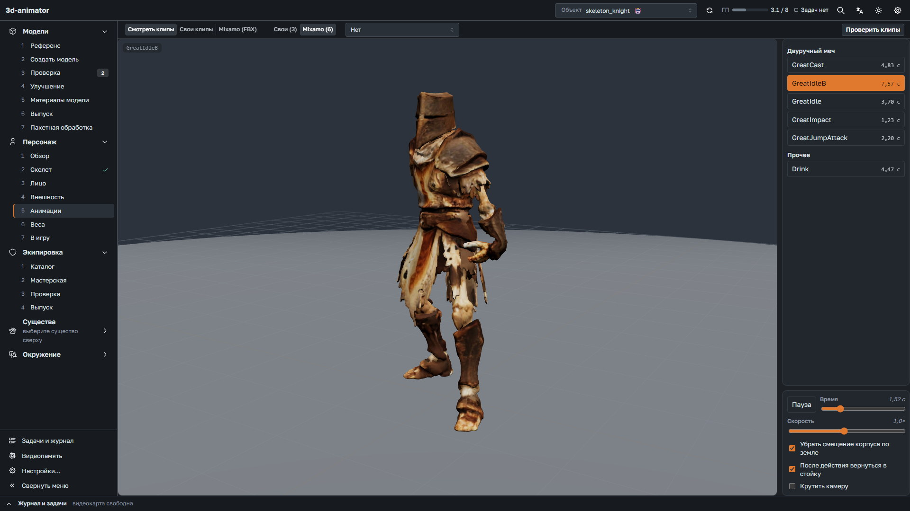

---

## Требования

**Железо:** видеокарта NVIDIA с **8 ГБ видеопамяти** и больше (драйвер CUDA 12.x), желательно 32 ГБ ОЗУ и около **60 ГБ** свободного места под окружения, веса моделей и кеши.

**Программы, которые нужно поставить самому** (в репозиторий ничего не входит):

| Что | Версия | Для чего |
|---|---|---|
| Windows 10/11 x64 | 11 | всё (скрипты `.bat`/`.ps1`) |
| [Miniconda](https://docs.anaconda.com/miniconda/) | любая свежая | три окружения Python |
| [Git for Windows](https://git-scm.com/download/win) | любая | клонирование; **его `bash.exe` запускает UniRig** |
| [Visual Studio 2022 Build Tools](https://visualstudio.microsoft.com/visual-cpp-build-tools/) с «Desktop development with C++» | 2022 | сборка расширений SF3D, Hunyuan3D-Paint и UniRig |
| [CUDA Toolkit 12.1](https://developer.nvidia.com/cuda-12-1-0-download-archive) | 12.1 | сборка `texture_baker` для SF3D (Hunyuan берёт свой `nvcc` из conda) |
| [Blender](https://www.blender.org/download/) | 5.2 | риггинг, анимации, экипировка, наборы, разрушаемые объекты, превью |
| [Godot](https://godotengine.org/download) (консольный exe) | 4.7.2 | сборка сцен эффектов, наборов и разрушаемых объектов, примерочная |
| [Аккаунт Hugging Face](https://huggingface.co/join) | – | веса SF3D **закрыты**: примите лицензию на [stabilityai/stable-fast-3d](https://huggingface.co/stabilityai/stable-fast-3d) и войдите |
| [Codex CLI](https://github.com/openai/codex) (`npm i -g @openai/codex`, затем `codex login`) | 0.160 | *необязательно*: вкладка «Референс» через подписку ChatGPT |
| Ключ OpenRouter | – | *необязательно*: вкладка «Референс» без Codex |

---

## Зашитые пути

Скрипты рассчитаны на такое расположение. Проще всего повторить его, иначе поправьте места из таблицы.

| Путь | Зачем | Где задан |
|---|---|---|
| `D:\conda\envs\sf3d`, `...\hunyuan`, `...\unirig` | окружения Python | `sf3d-env.bat`, `tool\launch_ui.ps1`, `tool\sf3d_ui.py` (`HY_PY`), `tool\rigging.py` (`UNIRIG_ENV`), скрипты установки |
| `D:\conda\hf`, `D:\conda\hy3dgen` | кеш моделей Hugging Face / Hunyuan | те же файлы + `tool\hy_pipeline.py`, `tool\hy_texture_mv.py` |
| `D:\conda\tmp`, `D:\conda\pip-cache`, `D:\conda\pkgs` | временные файлы и кеши (не на диске C:) | запуск и скрипты установки |
| `D:\conda\rig` | папка для UniRig (его bash-скрипты ломаются на пробелах в путях) | `tool\rigging.py` (`STAGE`) |
| `D:\Git\bin\bash.exe` | Git Bash для UniRig | `tool\rigging.py` (`BASH`) |
| `<репозиторий>\hunyuan3d-src` | исходники Hunyuan3D | `tool\sf3d_ui.py` (`HY_SRC`) |
| `D:\conda\trellis`, `D:\conda\hf\trellis2-gguf\q8` | сборка TRELLIS.2 (`trellis-cli.exe` + DLL ggml) и её веса | `trellis2-install.ps1`, `trellis2-weights.ps1`, `tool\sf3d_ui.py` (`TRELLIS_*`); ключи `trellis_exe`, `trellis_models`, `trellis_cuda_bin` в `tool\config.json` их меняют |
| Blender, Godot, папки export/work/input, язык интерфейса | | `tool\config.json` (можно менять и в окне «Настройки») |

Сам репозиторий может лежать где угодно. Оригинал лежит в `D:\My projects\SF3D`; пути с пробелами подходят для всего, кроме папки UniRig.

---

## Установка

Все команды выполняются в **Anaconda/Miniconda PowerShell** в корне репозитория.

### 1. Клонируйте этот репозиторий и три репозитория моделей рядом

Репозиториев моделей здесь **нет**. Клонируйте их точно под этими именами:

```powershell
git clone https://github.com/Sergeyspb-source/3d-animator.git
cd 3d-animator

git clone https://github.com/Stability-AI/stable-fast-3d.git sf3d-src
git clone https://github.com/Tencent-Hunyuan/Hunyuan3D-2.git hunyuan3d-src
git clone https://github.com/VAST-AI-Research/UniRig.git unirig-src

# UniRig: поддержка Windows из PR #70 сообщества
git -C unirig-src fetch origin pull/70/head:pr70
git -C unirig-src checkout pr70
```

### 2. Наложите локальные патчи (папка `patches\`)

```powershell
# Hunyuan3D-Paint: UNet грузится из .safetensors, файл .bin на 3,5 ГБ не нужен
git -C hunyuan3d-src apply ..\patches\hunyuan3d-paint-safetensors.patch

# UniRig: настройки скелета с малым расходом памяти для видеокарт на 8 ГБ
Copy-Item -Recurse -Force patches\unirig\configs\* unirig-src\configs\
```

### 3. Окружение SF3D (`sf3d`): интерфейс, SF3D, материалы, связующий код

Скрипта установки для этого шага пока нет, команды выполняются вручную. Сначала откройте «x64 Native Tools Command Prompt for VS 2022», чтобы собрались расширения на C++/CUDA:

```powershell
conda create -p D:\conda\envs\sf3d python=3.10 -y
$py = 'D:\conda\envs\sf3d\python.exe'
& $py -m pip install torch==2.4.1 torchvision==0.19.1 --index-url https://download.pytorch.org/whl/cu121
& $py -m pip install setuptools==69.5.1 wheel
cd sf3d-src
& $py -m pip install -r requirements.txt          # собирает texture_baker и uv_unwrapper
cd ..
& $py -m pip install -r tool\web\requirements.txt   # сервер интерфейса: FastAPI, uvicorn
# модули, которые нужны этому набору (их нет в требованиях SF3D)
& $py -m pip install scikit-image scipy matplotlib fast-simplification onnxruntime-gpu
# вход, чтобы закрытые веса SF3D скачались при первом запуске
& $py -m huggingface_hub.commands.huggingface_cli login
```

### 4. Зависимости Robust Weight Transfer (вкладка «Экипировка»)

`tool\vendor\rwt\weighttransfer.py` лежит в репозитории (GPL-3.0, см. `tool\vendor\rwt\LICENSE` и `source_manifest.json`). Его собранных зависимостей в git **нет**, поставьте их в папку vendor:

```powershell
D:\conda\envs\sf3d\python.exe -m pip install --target tool\vendor\rwt\deps libigl==2.6.1 robust_laplacian==1.0.0
```

### 4b. Липсинк (необязательно, Персонаж → Липсинк)

Всё своё: `tool\vendor\lipsync\transcribe.py` (локальный Whisper) и `lipsync.py` (кривые лица ARKit) работают в окружении
`sf3d` (numpy, scipy, torch, transformers; `soundfile` или ffmpeg для mp3/ogg). Модель `openai/whisper-small`
(~1 ГБ) скачивается при первом запуске в `hf_home` из `tool\config.json` (по умолчанию `D:/conda/hf`); готовый кеш
Hugging Face используется повторно. Результат: `<папка модели>\<голос>.face.json` и копия аудио. Клип сразу играет прямо во вкладке: лицо крупно, реплика со звуком; «▶ Посмотреть» проигрывает любой клип персонажа.

В Godot: скопируйте `tool\godot\face_curves_clip.gd` и `face_curves_player.gd` в проект и добавьте узел
`FaceCurvesPlayer` (`audio` — `AudioStreamPlayer3D` с голосом, `face_root` — персонаж, `clip_path` — файл
`.face.json`). Он двигает ключи формы рта персонажа (`jawOpen`, `mouthSmile`, …) по времени звука.

### 5. Окружение Hunyuan3D-2 (`hunyuan`): модели по нескольким видам и покраска

```powershell
powershell -ExecutionPolicy Bypass -File hunyuan3d-install.ps1        # окружение + PyTorch 2.4.1 cu121 + hy3dgen
powershell -ExecutionPolicy Bypass -File hunyuan3d-texgen-install.ps1 # nvcc 12.1 из conda + сборка custom_rasterizer / mesh_processor (нужны VS 2022 Build Tools)
powershell -ExecutionPolicy Bypass -File hunyuan3d-weights.ps1        # модели формы tencent/Hunyuan3D-2mv: обычная и turbo (fp16)
powershell -ExecutionPolicy Bypass -File hunyuan3d-texgen-weights.ps1 # модели delight и покраски
```

В скрипте сборки `hunyuan3d-texgen-build.bat` стоит `TORCH_CUDA_ARCH_LIST=8.9` (RTX 40xx). **Поменяйте под свою видеокарту** (8.6 для RTX 30xx, 12.0 для RTX 50xx).

### 5б. TRELLIS.2 (по желанию): одна картинка → модель с картами металла и шероховатости

[trellis.cpp](https://github.com/pwilkin/trellis.cpp) — перенос модели Microsoft TRELLIS.2 (картинка → 3D) на C++/GGML. Собирается из исходников на закреплённом коммите, тулкитом CUDA 12.1 из окружения `hunyuan` (сначала шаг 5) и VS 2022 Build Tools:

```powershell
powershell -ExecutionPolicy Bypass -File trellis2-install.ps1   # клон + сборка -> D:\conda\trellis\trellis-cli.exe (~25 мин)
powershell -ExecutionPolicy Bypass -File trellis2-weights.ps1   # ilintar/trellis2-gguf, Q8, набор для res 512: 8 файлов, 7,2 ГБ, с проверкой SHA-256 (-Quant q4: лёгкий набор)
```

Сборка идёт под `CMAKE_CUDA_ARCHITECTURES=89` (RTX 40xx); **поменяйте это в `trellis2-install.ps1` под свою видеокарту** (86 для RTX 30xx, 120 для RTX 50xx). Используется только путь res 512: каскаду 1024 нужна карта на 16 ГБ. При запуске приложение добавляет в PATH папку `bin` окружения `hunyuan`, где лежат DLL рантайма CUDA и cuBLAS.

### 6. Окружение UniRig (`unirig`): автоматический риггинг

```powershell
powershell -ExecutionPolicy Bypass -File unirig-install.ps1   # окружение py3.11 + torch cu128 + spconv + заглушка flash-attn
unirig-build-ext.bat                                          # только если torch_scatter / torch_cluster не поставились
```

Веса UniRig (`VAST-AI/UniRig`) скачиваются с Hugging Face при первом риггинге.

### 7. Настройка

При первом запуске используется `tool\config.example.json`. Чтобы поменять пути или язык, скопируйте его в `tool\config.json` (этот файл в git не попадает) и задайте `lang` (`ru` или `en`), `blender_exe`, `godot_exe`, `export_dir`, `work_dir` и `input_dir`. То же можно сделать в окне «Настройки» и в меню 🌐.

---

## Запуск

| Как | Что |
|---|---|
| `3d-animator.vbs` (двойной щелчок) | интерфейс без консоли: собирает страницу, если её исходники менялись, и открывает окно приложения на `http://127.0.0.1:7890`. Закрытие окна останавливает сервер и запущенные им программы и освобождает видеопамять |
| `3d-animator.bat` | тот же интерфейс с видимой консолью (для отладки) |
| `sf3d-tool.bat generate <картинка или папка> --category prop` | разовый запуск из командной строки: картинки → готовый GLB |
| `sf3d-tool.bat post work\item\axe\raw.glb --category item --name axe` | только постобработка |
| `sf3d-batch.bat <папка> [--force] [--no-preview] [--classic]` | пакет: `<папка>\<категория>\pic.png` → SF3D; `<папка>\<категория>\<объект>\front.png [back/left/right.png]` → Hunyuan3D. По умолчанию движок выбирается по категории: персонажи и предметы → TRELLIS.2 (по картинке или по `front.png`), здания → Hunyuan3D (и по одной картинке); `--classic` это выключает |
| `sf3d-gradio.bat` | исходное демо SF3D (порт 7860); ему нужен `pip install gradio==4.41.0`, сам набор Gradio больше не использует |

### Интерфейс (7890)

С 25.11.2026 интерфейс — своя страница; прежних вкладок Gradio (7861) больше нет. Их функции остались (`tool\sf3d_ui.py` и модули рядом), страница вызывает их.

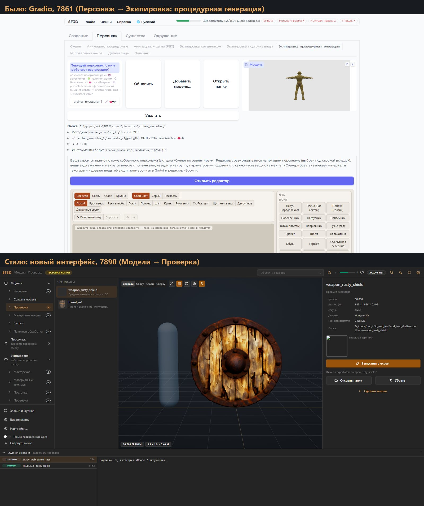

- **Меню слева по цепочкам работы:** Модели (референс → создать → проверка → улучшение → материалы → выпуск, пакетная), Персонаж (обзор, скелет, лицо, внешность, анимации, веса, в игру), Экипировка (каталог → мастерская → проверка → выпуск), Существа, Окружение. Alt+1…7 переключают шаги раздела.
- **Сверху:** текущий персонаж или существо (один на весь интерфейс), занятость видеопамяти, число задач, поиск по всем шагам (Ctrl+K), язык, светлая и тёмная тема.
- **Внизу журнал и задачи.** Всё, что идёт на видеокарте, встаёт в одну очередь и выполняется по одной задаче. Журнал приходит потоком; задачу можно отменить, тогда останавливаются и запущенные ею программы. Клавиша ` (буква Ё) сворачивает док.
- **Модели → Создать модель:** SF3D, Hunyuan3D (с быстрой формой) и TRELLIS.2 со всеми настройками движка. Результат сразу в 3D: виды, сетка, каркас, коллизия Godot, человек 1,75 м для масштаба, F показывает модель целиком. Модель ложится **черновиком** в `work\web_drafts\export\<категория>\<имя>\`.
- **Модели → Проверка:** черновики с размерами, числом граней, временем, превью и исходной картинкой. «Выпустить в export» переносит папку в `export\<категория>\<имя>\`; если там уже есть модель, спросит, а старая уйдёт в `work\web_drafts\replaced\` (ничего не удаляется). «Убрать» откладывает черновик в `work\web_drafts\discarded\`.
- **Модели → Улучшение** (2026-11-27, `tool\model_improve.py`, `tool\blender_improve.py`): черновик ближе к своим картинкам до выпуска. «Текстура по картинкам»: каждая картинка, по которой сделана модель (виды Hunyuan, картинка TRELLIS.2 или SF3D, своя для любой стороны), подгоняется по силуэту модели и переносится на её собственную развёртку; каждый участок берёт картинку, которая смотрит на него прямее, поэтому черты не двоятся на стыке двух картинок; где картинок нет — своя текстура, подогнанная по цвету; недостающий бок можно взять зеркалом другого. «Булавки»: картинка поверх модели, нарисованной серым с той же камеры; тяните черту картинки (угол глаза, ноздрю) к её месту на модели — картинка плавно изгибается, чтобы черта встала туда; на видах спереди и сзади булавки ставятся симметричными парами, Shift+щелчок — булавка, которая держит место; правая или средняя кнопка двигает вид. «Ориентиры» (персонажи, 2026-11-27): кончики ушей, ушные раковины, локти, кисти, колени — программа сама находит каждую точку на модели в 3D (синее кольцо; его можно потянуть, точка сдвинется по модели) и угадывает её на картинке (кончики ушей — по контуру); вы ставите точку картинки туда, где эта черта на самом деле. Одна точка модели служит всем видам, поэтому ухо, отмеченное на картинке спереди и сбоку, подгоняется в обеих плоскостях; на виде сбоку берутся только ухо и колено этой стороны. «Дорисовать стороны через ChatGPT»: модель рендерится с недостающей стороны, ChatGPT перерисовывает рендер по картинке спереди (через Codex, как шаг «Референс»: 1–5 минут на сторону по подписке); каждый вид можно взять или отбросить. «Симметрия» (персонажи): одна половина меша и текстуры зеркалится на другую — та, чей силуэт ближе к картинке. «Рельеф» (Hunyuan): плотная форма до упрощения до 50 000 граней запекается в карту нормалей (`hy_pipeline` сохраняет `shape_raw.ply` с 27.11.2026). «Улучшить» — одна задача (1–3 минуты на процессоре, видеокарта не нужна); GLB черновика заменяется на месте, файл генератора сохраняется для «Вернуть как было»; во вьюере «После / До». Замеры на гоблине, рыцаре и щите (`work\model_improve\REPORT.md`): цвет кожи, глаза и губы — как на концепте вместо догадок генератора; из одной картинки и трёх сторон от ChatGPT — почти как из трёх настоящих видов.
- **Модели → Выпуск:** что уже лежит в export, по категориям.
- **Экипировка** (с 26.11.2026 — четыре шага, каждый со своей работой): «Каталог» — все вещи плитками с фигуркой, на которой подсвечено место вещи, по блокам (броня, одежда, повседневная одежда, оружие, ножны), сверху — уже сделанные вещи персонажа; кроме «Сделать» там же «Готовая вещь (GLB)» (редактор «Броня»: поставить и надеть готовую вещь) и «Снять с одетой модели» (сегменты одетой модели по слотам → комплект на тело по частям). «Мастерская» — процедурный редактор с выбранной вещью, три вкладки: «Форма» (от и до, покрытие, плечи и кольчуга, ремни, стиль), «Посадка» (что надето под ней, зазор, толщина, движение, щипок, пересборка по слоям), «Материалы» (библиотека, проекция концепта, роспись, износ); под персонажем пол с сеткой; единственное действие — «Сгенерировать» (запекание). «Проверка» — сцена редактора, рядом состояние запекания, проверка в движении таблицей по клипам (сквозь вещь, дыры, у края, худший кадр) со снимками худших кадров и примерочная Godot. «Выпуск» — таблица вещей персонажа (вид, слой, итог проверки, когда изменена): открыть в мастерской, проверить, пересобрать по слоям, папка. Редактор остаётся загруженным под всеми четырьмя шагами. **Персонаж → Внешность** — тот же редактор с причёсками, бородами, бровями и ресницами. Запекание вещи, вид из генератора и проверка в движении идут в общую очередь задач.
- **Персонаж:** «Обзор» — что у персонажа есть (скелет и сколько в нём костей, рот и глаза, причёски и бороды, клипы, надетые вещи), каждая строка открывает свой шаг; добавить персонажа из GLB, открыть папку, удалить (с подтверждением). «Скелет» в четырёх режимах: «По ориентирам» (редактор разметки и «Собрать скелет» с параметрами сборки; после сборки редактор сам открывается в позе на новом скелете), «Автоматически (UniRig)» (плюс стыки между частями и тело по частям), «Поза и кулак» (любой скелет; кулак запоминается сразу), «Кости и веса». «Веса» — починка весов подмышек (Robust Weight Transfer), «В игру» — примерочная Godot. «Лицо»: «Лицо на скелете» (у скелета по ориентирам лицо собирается с ним, на авто-скелете — размечается и собирается здесь), «Глаза, зубы, язык» (общий набор с живым 3D-превью, сохраняется в `export\face_parts\<имя>`), «Речь» (клип липсинка по голосу и тексту, реплика проигрывается на лице). «Анимации»: «Смотреть клипы» (свои или Mixamo, с оружием в руках, «Проверить клипы» — отчёт над просмотром), «Свои клипы» (12 процедурных, манера, вид смерти), «Mixamo (FBX)» (таблица клипов папки с правкой имени, цикла, скорости, «на месте», группы; «Перенести на модель»).
- **Существа:** текущий объект сверху — персонаж или существо, один на весь интерфейс. «Обзор» (кости, лапы, хвост, челюсть, клипы, раскраски), «Скелет» («По шаблону»: четвероногое, птица, змея; UniRig с именами и челюстью, «Выровнять позу покоя», «Вернуть», просмотрщик разметки: суставы, пасть, кисть весов; снимки челюсти), «Глаза» (режим «Глаза» того же просмотрщика), «Анимации» (свои процедурные клипы, клипы по видам тела и ключевые, «Проверить клипы», «Открыть в Godot»), «Раскраска и починка» (варианты, «Заделать дыры», «Пересчитать нормали»), «Веса», «В игру».
- **Окружение** («Поверхности», «Эффекты», «Подземелья», «Разрушаемые»; «Растительность» — «Создать модель» с этой категорией), **Модели → Референс** (варианты, виды сзади и сбоку, стиль проекта; «Отправить в 3D» заполняет «Создать модель»: одна картинка — SF3D, с видами — Hunyuan3D) и **Модели → Материалы модели** (группы цвета и материал каждой); сделанные картинки — сеткой на месте 3D-окна.
- **Удаление моделей** (27.11.2026): «Удалить» в «Модели → Проверка» (черновик) и «Выпуск» (модель в export), в «Обзоре» персонажа и существа (текущий, а также «Весь список: удалить несколько» с галочками); в списках «Проверки» и «Выпуска» тоже галочки, чтобы убрать тестовые разом. Сначала окно со всеми путями модели и их размером: её папка, отложенные раньше копии, рабочая папка генерации (Hunyuan3D, TRELLIS.2, SF3D), папка «Улучшения», кэш просмотра, картинки страницы, а у персонажа или существа ещё его процедурные вещи, подгонки, работа над скелетом, позы, статус и клипы (след с именем «<имя>_…» принадлежит самому длинному имени: удаление «archer_1» не тронет вещи «archer_1_v2»). Всё уходит в Корзину Windows, насовсем ничего не стирается. Модель, над которой идёт задача (генерация, риг, запекание), не удаляется; если копия модели есть в проекте игры, удаляется только здесь, игру не трогаю (окно называет её файлы). Списки и текущий объект обновляются сами, и в других открытых вкладках тоже (`tool\web\remove.py`, `/api/models/remove/plan`, `/api/models/remove`).
- **Картинки открываются крупно по щелчку** (27.11.2026): лист видов и исходная картинка в «Проверке» и «Выпуске», картинки по сторонам в «Улучшении», виды и картинки в «Создать модель», кадры проверки в «Экипировке», картинки челюсти и шаблона у существ, галереи (у галереи, где щелчок выбирает, на картинке есть лупа). ← → — соседние картинки, колесо приближает к курсору, перетаскивание сдвигает, двойной щелчок или 0 — целиком, Esc или щелчок мимо — закрыть; оттуда же файл открывается в новой вкладке.
- **Отмена и возврат во всех редакторах** (27.11.2026): Ctrl+Z отменяет, Ctrl+Shift+Z или Ctrl+Y возвращает, при любой раскладке; кнопки ↶ ↷ на панели редактора показывают сочетание клавиш и гаснут, когда отменять нечего. Протяжка, ползунок или мазок кисти — один шаг; шагов около 100 (у кисти по текстуре кожи 30: каждый хранит картинки); другой персонаж, существо, вещь или вариант начинают историю заново. В текстовом поле клавиши остаются полю: там они отменяют набор. Нажатые на панелях самого приложения, клавиши уходят в редактор на экране. Отмена есть в редакторе разметки (разметка, поза, кисть, текстура и сетка кожи, подгонка брони), в генераторе брони (вещь и её параметры; у «Поправить позу» своя история), в шаблоне существа, в просмотре его скелета (точки, кисть челюсти), в раскраске (зоны, тон, узоры, кисть частей) и в булавках «Модели → Улучшение». Сохраняется то, что стало после отмены. Не отменяются сами задачи (генерация, запекание, сборка, «Улучшить»: у «Улучшить» своя кнопка «Отменить»).
- **Модели → Пакетная обработка:** папка картинок одной задачей; модели ложатся в черновики, «Проверка → Выпустить все» выпускает разом те, которых в export ещё нет. **Видеопамять:** что держит карту (по данным Windows) и «Закрыть» программу (с подтверждением; системные не предлагаются). **Настройки:** папка export и OpenRouter (ключ не показывается; пустое поле его сохраняет) пишутся в `config.json`.

Страница собрана на Vite + TypeScript + React + Mantine, 3D на three.js. Сервер на FastAPI в окружении `sf3d` (`tool\web\server.py`) вызывает функции приложения; Gradio больше не используется (с 25.11.2026; пакеты сервера — в `tool\web\requirements.txt`). `3d-animator.vbs` / `3d-animator.bat` при первом запуске и после изменений страницы собирают её (нужны Node.js 18+ и npm). Что дальше — в `docs\ROADMAP.md`, этап 9.

**Запускайте одну задачу на видеокарте за раз.** Пик видеопамяти примерно такой: SF3D 6,2 ГБ, форма Hunyuan 5,8 ГБ (быстрая 6,5 ГБ), покраска Hunyuan 7,4 ГБ, TRELLIS.2 1,7–4,2 ГБ (до 5,3 ГБ вместе с рабочим столом), UniRig 4,5 ГБ. Интерфейс проверяет свободную память перед каждой задачей.

**TRELLIS.2** («Движок» → «TRELLIS.2 — одна картинка»): одна картинка → GLB с базовым цветом и своей картой металла и шероховатости, отдельным процессом (`trellis-cli.exe --res 512 --faces 50000 --webp off`). Картинка с прозрачностью идёт как вырезана, остальные проходят через его BiRefNet. На RTX 4060 (8 ГБ, 24.11.2026) против Hunyuan3D-2mv + Paint при тех же 50 000 граней:

| | Hunyuan3D (видов) | TRELLIS.2 (одна картинка) |
|---|---|---|
| персонаж (рыцарь-скелет) | 517 с (4) | 62 с |
| предмет (щит) | 446 с (1) | 85 с |
| крупный пропс (бочка на весь кадр) | 415 с (2) | 284 с |
| здание (таверна) | 602 с (4) | 216 с |

Время TRELLIS.2 — это один `trellis-cli`; в приложении вместе с постобработкой, подгонкой палитры и превью персонаж занял 84–115 с, щит — 125 с.

Форма по одной картинке у персонажей лучше, чем у Hunyuan по четырём (тонкие кости, рваная ткань), у предметов и пропсов не хуже; металл на карте отмечен только на железе. Альбедо выходит в 1,4–2,2 раза темнее картинки, и оттенок может уплыть (оливково-зелёный гоблин вышел оранжевым), поэтому «Подгонка палитры под ваши картинки» для этого движка стоит на 1. Подгонка (2026-11-26, для всех движков: `sf3d_tool.color_match_fn`) сравнивает тексели, которые видны на каждой картинке с её стороны, — с весом по тому, насколько прямо они к ней повёрнуты, без спины и боков, которых на картинке спереди нет, — с пикселями объекта на картинке, в LCh: средняя яркость и её разброс, оттенок поворачивается на разницу средних оттенков, насыщенность масштабируется, серое остаётся серым; одно преобразование на всю модель. У гоблина, рыцаря, щита, бочки и таверны видимые спереди тексели после этого совпадают с картинкой (оттенок гоблина 65° → 84°, на картинке 85°). Цвет оценивайте по альбедо или при нейтральном свете: тёплый HDRI делает рыжей любую модель. Постобработка оставляет у карты факторы металла и шероховатости 1, а не значения пресета категории (заданные вручную — применяются). Слабые места: тёмные трещины могут стать сквозными дырами в тонких местах, у зданий текстура тёмная и плоская — **здания делайте в Hunyuan3D**. Время растёт с видимой поверхностью: крупный сплошной объект на весь кадр — самый долгий случай. Параметры: число граней (по умолчанию 50 000) и сид. Пакетная обработка выбирает движок по категории: персонажи и предметы — TRELLIS.2, здания — Hunyuan3D, пропсы и растительность — по папке (картинка → SF3D, виды → Hunyuan3D); без установленного TRELLIS.2 — только по папке.

**Веса Q4 и карта нормалей** (проверено 2026-11-26 на тех же четырёх моделях): набор Q4 (`trellis2-weights.ps1 -Quant q4`, ещё 4,1 ГБ; `ss_dec` и `birefnet` копируются из Q8) на RTX 4060 не быстрее (рыцарь 85 с против 62, таверна 182 против 216), экономит всего 0,1–0,5 ГБ видеопамяти (её занимают вычисления, а не веса), а форма уходит от Q8 вдвое дальше, чем два прогона Q8 друг от друга (0,5–0,75 % размера против 0,25–0,4 %). Поэтому остаётся Q8; попробовать Q4 можно, указав в `tool\config.json` ключ `trellis_models` = `D:\conda\hf\trellis2-gguf\q4`. Своя карта нормалей trellis-cli (`--normal-map on`) стоит на 25–95 % больше времени и 1,2–2,4 МБ на файл, а вблизи показала грани низкополигональной сетки на круглых местах — не используется.

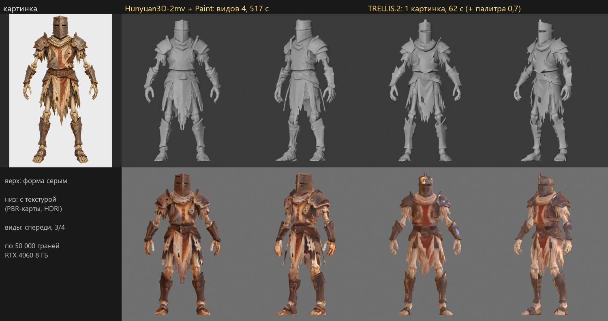

**Быстрая форма Hunyuan** («Параметры Hunyuan3D» → «Быстрая форма (turbo)»): форма строится turbo-моделью Hunyuan3D-2mv за 5 шагов с ускоренной сборкой меша FlashVDM. На RTX 4060 (8 ГБ) рыцарь по четырём видам вышел за 21–28 с вместо 254 с, с той же детальностью. Здание быстрее не стало (FlashVDM дошёл до 7,8 ГБ), а стены и окна получились бугристее, поэтому галочка сама включается для персонажей, предметов и пропсов и выключается для зданий и растительности. Если сборке меша не хватит памяти, она повторится обычным способом (~105 с); если turbo-модели нет на диске, берётся обычная. Пакетная обработка строит обычной моделью.

---

## Подгонка брони подробно

В режиме «Поза» редактора разметки кнопка **Броня** открывает панель брони:

1. Выберите GLB вещи и часть тела. Вещь без своего скелета получает часть тела по имени файла (cuisse/thigh/набедренник → бедро, greave/поножи → голень, bracer/vambrace/наруч → предплечье, rerebrace → плечо, pauldron/shoulder/наплечник → «Наплечник», gauntlet/перчатка → кисть, boot/сапог → «Сапог», helmet/шлем → голова, chest/cuirass/нагрудник → торс); если имя ничего не говорит, выбор остаётся прежним. Ось трубы у вещи без скелета — направление, вдоль которого она сквозная (лучи из середины проходят насквозь; кроме главных осей пробуются собственные x/y/z вещи, потому что у короткой широкой вещи главные оси неопределённы). Вещь ставится вдоль настоящей средней линии конечности и подгоняется всей внутренней стенкой. Узлы, по одному на ячейку вещи (12 вдоль × 24 по кругу), совмещаются с кожей методом ICP с односторонним штрафом: меняются сдвиг, наклон, масштаб поперёк конечности и овальность, форма — нет. «Подогнать по коже» повторяет это после ручных правок. Узлы показаны красными (под кожей), зелёными (на коже) и синими (воздух).
2. Поправьте ползунками, стрелками (G / R / S) или точками на поверхности. Ползунки: положение, длина, «Обхват» (вся вещь шире или уже), «Толщина стенки» (внутренняя стенка остаётся, двигается только внешняя поверхность; одинаково вокруг собственной оси вещи в редакторе и в Blender), поворот и зазор. Строка под ползунками показывает воздух и толщину стенки в долях радиуса конечности.
3. **«Надеть»** запускает `tool/blender_wear_fit.py`. Вещь раздвигается от оси конечности по ячейкам, чтобы внутренняя стенка вышла из кожи, а стенка сохранила форму. То, что всё ещё под кожей, выталкивается вдоль нормали кожи с захватом соседей, так что внутренняя и внешняя стенки двигаются вместе. «Прилегание к телу» прижимает отошедшие части к конечности на эту долю воздуха (стенка меряется на том же луче, что и кожа). Бока нагрудника, обращённые к рукам, прижимаются полностью, а кожа рук (с весами на костях руки или дальше плечевого сустава с этой стороны) не считается кожей торса: иначе нагрудник раздувается вокруг дельты, и поднятая рука будто вылезает из его плеча. Внутренняя стенка ячейки — 10-й процентиль расстояний её вершин до оси, а то, что глубже 3/4 расстояния до кожи, остаётся внутри конечности как есть: у вскрытой сплошной вещи из картинки это остатки крышек, и, если их учитывать, концы вещи раздувались воронкой. Веса берутся только с костей самой конечности и сглаживаются по вещи. «Жёсткость» заставляет вещь двигаться вместе с костью (0,8 для наручей и поножей, 0,2 для перчаток). Результат — `<персонаж>_wear_<вещь>.glb`: скелет персонажа и вещь с весами.
   - Вещь, сделанная на другом теле и несущая свой скелет (вещи, снятые с Tripo-персонажей, в `export/equipment`), читается вместе с ним. На одном сегменте конечности она ставится как выше; на нескольких сегментах (сапог на голени и стопе, рука целиком) выбирается «Вся вещь по её скелету». Тогда каждая вершина переходит с костей вещи на те же кости персонажа по своим весам, как кожа при скиннинге, а вторая сторона — зеркало с заменой Left и Right. Blender получает перенесённые копии, выталкивает их из кожи и даёт веса только тех костей, которые были у вещи.
   - Вертикальные вещи сохраняют свою вертикаль как ось и свои пропорции: «Торс (нагрудник)» — без зеркала, веса на позвоночнике и никогда на руках; «Голова (шлем)» — верх шлема на макушке, жёстко на кости головы; «Сапог» — голенище на голени и размер по нему, носок по стопе (по длинной оси подошвы, к концу дальше от голенища), подошва у пятки.
   - «Наплечник» — купол на плечевом суставе, а не труба. Он сохраняет ориентацию, в которой сделан (верх — это верх), а сфера его верхней части считается его собственным плечевым шаром: центр ставится на плечевой сустав персонажа, размер подбирается по коже вокруг, затем тот же ICP в ячейках направлений от сустава (сдвиг, поворот, один масштаб: форма не меняется). Сторона, для которой вещь сделана, берётся из имени файла (`_L`, `left`…), иначе левая (генератор просим сделать левый); выбор другой стороны отражает вещь. Наплечник жёсткий: у всех вершин одинаковые веса ключицы и плечевой кости, а ползунок «Идёт за рукой» задаёт долю руки (по умолчанию 0,7: при замере с рукой вбок и вперёд кожа проглядывала меньше всего; 0,5 хуже, потому что смесь двух поворотов сжимает жёсткую вещь). Поверх нагрудника он надевается слоем: ремни нагрудника считаются кожей, и Blender выталкивает наплечник из них целиком. Наплечник — внешний слой: под нагрудник он сам не отмечается.
   - «Отверстие»: клики по краю проймы или горловины задают окружность. «Сузить отверстие» стягивает край и поверхность рядом с ним к оси окружности, обе стенки сразу, с плавным спадом; «И симметричное отверстие» делает то же с другой стороны. Всё происходит в собственном пространстве вещи, поэтому редактор, зеркальная копия и Blender получают одну форму.
   - «Поверх этих вещей»: задание получает готовые результаты отмеченных вещей (`under`). На луче каждой ячейки от оси конечности наружная стенка первой оболочки, лежащей на этой конечности (не дальше радиуса конечности от кожи), заменяет расстояние до кожи, а второй толчок выводит то, что всё ещё под ними, наружу вдоль луча, с тем же плавным захватом соседей, что и у толчка из кожи. В отчёте считаются ячейки, легшие поверх других вещей.
   - «Вскрыть» (нижний конец / верхний конец / оба конца): сгенерированная вещь, закрытая с конца, срезается там скриптом `blender_armour_hollow.py` вместе с текстурой и ставится заново. На конечности нижний конец — дальний от тела (у кисти, у колена); вертикальная вещь — по своей вертикали. Своя стенка вещи остаётся; у сплошной болванки делается стенка внутрь (если у вещи есть стенка, луч из середины наружу проходит две поверхности).
   - «Перекрасить по форме»: Hunyuan3D-Paint заново красит изменённую вещь по её картинке-референсу (находится в `refs_mv` или выбирается в «Картинка вещи»), и текстура идёт по новой форме, а не растягивается (3–6 минут на видеокарте). Результат становится исходной вещью подгонки.
   - Hunyuan3D по четырём видам (их рисует Codex: `export/equipment/generated_armour/make_refs_mv.py`) даёт полую броню, которую не нужно вскрывать. Вещь по одной картинке обычно сплошная; `tool/blender_armour_hollow.py in.glb out.glb [open=both|top|bottom] [axis=auto|z|x,y,z] [wall=0.08|auto]` делает то же вскрытие из командной строки.
4. Каждая подгонка сохраняется в папке персонажа как `<вещь>.fit.json` + `.src.glb`. «Открыть» возвращает её со всеми ползунками и точками, «Сохранить» сохраняет без надевания.
5. **«Примерочная в Godot»** собирает `work/wardrobe/<персонаж>/`: персонаж с анимациями (если их нет, делаются процедурные), все подогнанные вещи надеты, вещи включаются и выключаются, камера вращается. Затем проект открывается в Godot.

В своём проекте Godot скопируйте `tool/godot/sf3d_equip.gd` и GLB-файлы, затем:

```gdscript
var bracers := SF3DEquip.wear($Goblin, preload("res://armor/bracer_leather.glb"))   # надеть (сетки переходят под Skeleton3D персонажа)
SF3DEquip.take_off(bracers)                                                      # снять
SF3DEquip.show(bracers, false)                                                   # скрыть (тело под ней вернётся)
```

Положите рядом с каждым GLB его `.mask.json`: `wear` читает его и прячет тело под вещью.

Вещь идёт за всеми анимациями персонажа по именам костей. Она должна быть сделана для той же модели со скелетом.

---

## Галерея анимаций

`tool/anim_gallery.py` переносит клипы Mesh2Motion (`Animations/Mesh2Motion`, CC0) и процедурные клипы с двуручником и щитом на персонажа со скелетом. Получается одна самодостаточная HTML-страница примерно с 90 клипами по группам (см. [снимок выше](#галерея-анимаций)). GLB лежит внутри страницы, поэтому она открывается двойным щелчком. Её тексты — на языке интерфейса.

```powershell
D:\conda\envs\sf3d\python.exe tool\anim_gallery.py "<персонаж>_landmarks_rigged.glb" Animations\goblin_gallery.html
```

`blender_retarget_fbx.py` читает клипы прямо из GLB Mesh2Motion: имена костей в стиле Unreal сопоставляются с именами Mixamo. Оружие в руках приблизительное, потому что его настройки делались на другом гоблине; галочка «Оружие в руках» его прячет.

---

## Устройство репозитория

```
3d-animator.vbs / 3d-animator.bat     запуск интерфейса (7890)
sf3d-tool.bat / sf3d-batch.bat запуск из командной строки
sf3d-env.bat                  окружение sf3d
*-install.ps1, *-weights.ps1, *-build.bat   установка Hunyuan3D, TRELLIS.2 и UniRig
patches/                      правки поверх сторонних репозиториев
docs/images/                  снимки для README (en/, ru/)
tool/
  sf3d_ui.py                  функции приложения, которые вызывает интерфейс (модели, персонажи, существа, окружение)
  web/                        интерфейс: server.py (FastAPI), tasks.py (очередь задач на ГП),
                              models.py (цепочка «Модели»), equip.py + adapters/ (редактор экипировки на новой странице),
                              lang_web.py (его тексты), front/ (страница: Vite + TypeScript)
  i18n.py, lang/*.json        язык интерфейса: все тексты по ключам (русский, английский)
  sf3d_tool.py, batch_cli.py  командная строка и постобработка (pivot, масштаб, коллизия, материалы)
  hy_*.py                     обработчики Hunyuan3D (работают в окружении hunyuan)
  rigging.py, outfit.py, hanim.py, fbxanim.py, materials.py, surfaces.py,
  fx_flipbook.py, modkit.py, destruct.py, refgen.py, anim_gallery.py, rwt_*.py   модули функций
  landmarks*.py, landmark_editor.html   скелет по ориентирам и подгонка брони (редактор на three.js)
  face_edits.py                 выражения, поправленные вручную: накладываются на модель (и заново после пересборки)
  blender_*.py                скрипты Blender без окна (blender -b -P tool\blender_x.py -- args)
  godot/                      скрипты и шейдеры Godot для собираемых сцен (FaceCurvesPlayer для липсинка,
                              SF3DEquip для надевания брони, примерочная)
  rig_scripts/                обёртки Git Bash для UniRig
  vendor/rwt/                 Robust Weight Transfer (GPL-3.0)
  vendor/lipsync/             тайминги слов Whisper и кривые липсинка (см. его README)
  vendor/blender_armour/      генераторы шлемов, налокотников и обуви (KettleHat, HelmetVariants, ElbowArmor, Footwear: скрипты Blender), см. source_manifest.json
  config.example.json         шаблон настроек
```

Не в git (создаётся на месте): `sf3d-src/`, `hunyuan3d-src/`, `unirig-src/`, `export/`, `work/`, `input/`, `tool/config.json`, `tool/vendor/rwt/deps/`, все веса моделей.

---

## Лицензии сторонних моделей

В репозитории только связующий код. У каждой модели своя лицензия, поэтому **проверьте их перед коммерческим использованием**:

- **Stable Fast 3D**: [Stability AI Community License](https://huggingface.co/stabilityai/stable-fast-3d) (бесплатно при годовом доходе до 1 млн долларов).
- **Hunyuan3D-2**: [Tencent Hunyuan 3D 2.0 Community License](https://github.com/Tencent-Hunyuan/Hunyuan3D-2/blob/main/LICENSE). **Не лицензирована в ЕС, Великобритании и Южной Корее.**
- **UniRig**: MIT.
- **TRELLIS.2** (Microsoft) и **trellis.cpp**: MIT. В наборе GGUF есть ещё DINOv3 ViT-L (лицензия Meta DINOv3 License) и BiRefNet (MIT).
- **Robust Weight Transfer** (`tool/vendor/rwt`): GPL-3.0.
- **Веса CLIP** (open_clip, LAION ViT-B/32): MIT.
- **Анимации Mesh2Motion** (галерея): CC0.
