# 3D Animator: локальный набор для игровых ассетов

[English](README.md) · **Русский**

Локальный набор инструментов для Windows, который превращает картинки в готовые 3D-ассеты для Godot 4: модели, скелеты, анимации, экипировку, PBR-материалы, бесшовные поверхности, листы эффектов, модульные наборы подземелья, разрушаемые объекты и растительность с ветром.

Всё работает на вашей видеокарте. В облако уходят только необязательные запросы на картинки-референсы (подписка ChatGPT через Codex CLI или ключ OpenRouter).

Набор связывает несколько открытых моделей (Stable Fast 3D, Hunyuan3D-2, UniRig) со скриптами Blender и Godot. У него графический интерфейс на Gradio на русском и английском и две утилиты командной строки.

> **Статус: личный инструмент, выложен как есть.** Он собран и проверен на одной машине (Windows 11, RTX 4060 Laptop 8 ГБ видеопамяти, 31 ГБ ОЗУ). Многие пути зашиты в код, поэтому перед установкой прочитайте раздел [Зашитые пути](#зашитые-пути).

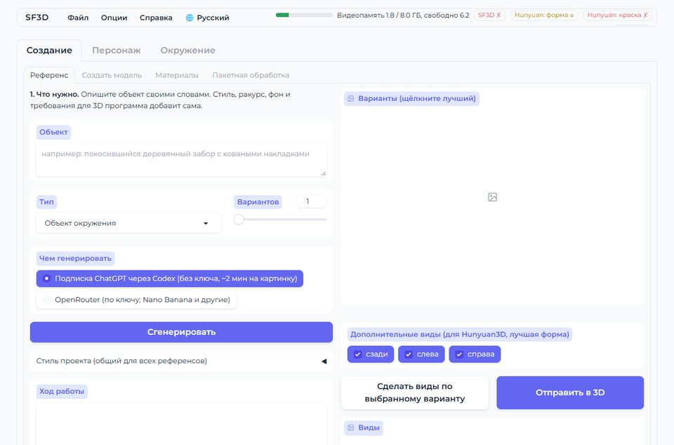

---

## Содержание

- [Что умеет](#что-умеет)
- [Как работать с инструментами](#как-работать-с-инструментами) (снимки)
- [Требования](#требования) · [Зашитые пути](#зашитые-пути) · [Установка](#установка) · [Запуск](#запуск)
- [Подгонка брони подробно](#подгонка-брони-подробно) · [Галерея анимаций](#галерея-анимаций-1)
- [Устройство репозитория](#устройство-репозитория) · [Лицензии сторонних моделей](#лицензии-сторонних-моделей)

---

## Что умеет

| Вкладка | Что получается | Чем |
|---|---|---|
| Создание → Референс | Карточка стиля и картинки-референсы (один вид или спереди/сзади/слева/справа) по текстовому описанию | Codex CLI (ChatGPT) или OpenRouter |
| Создание → Создать модель | GLB по 1 картинке (~20 с) или по 1–4 видам (7–10 мин): pivot, реальный масштаб, коллизия, PBR, превью и иконка. Категории: предмет, пропс, здание, персонаж, растительность | SF3D / Hunyuan3D-2mv + Hunyuan3D-Paint |
| Персонаж → Скелет (автоматически UniRig или вручную по ориентирам) | Скелет и веса для человекоподобных и существ, имена костей Mixamo или Godot, сшивка стыков, разбиение тела на области | UniRig + Blender |
| Персонаж → Анимации: процедурные | 12 процедурных клипов для любого человекоподобного со скелетом (покой, ходьба, бег, прыжок, удары, заклинание, блок, удар, смерть…) | Blender |
| Персонаж → Анимации: Mixamo (FBX) | Перенос клипов Mixamo (FBX без кожи) на ваш скелет, режим «на месте», просмотр в three.js | Blender |
| Персонаж → Экипировка | Перенос одежды с одетого персонажа на базовое тело или подгонка одной вещи с привязкой к общему скелету | Blender + Robust Weight Transfer |
| Скелет по ориентирам → Броня | Подгонка вещи (наруч, поножи, набедренник, сапог, наплечник, нагрудник, шлем) на собранного персонажа в редакторе, веса в Blender, сохранение подгонки, примерочная в Godot с анимациями персонажа | three.js + Blender + Godot |
| Персонаж → Экипировка: процедурная генерация | Наруч, плечо, поножи, набедренник, нагрудник (латный до шеи, анатомический, с наплечниками и кольчугой), наплечник, юбка-тассеты или штаны, построенные по коже самого персонажа, а также шлемы, налокотники и обувь (по шесть конструкций из генераторов шлемов, налокотников и обуви, подогнанные к голове, рукам и стопам) перчатки из кожи самой кисти и поддоспешная одежда по параметрам в живом 3D-редакторе (вещь на персонаже меняется вместе с ползунками): пластины, чешуя, ламеллы, кольчуга, стёганка или гладкое; канты, заклёпки, ремни и пряжки; железо, сталь, бронза, кожа или ткань с износом, запечённые PBR-текстуры; вещь сразу надета, как подогнанная | Blender |
| Окружение → Поверхности | Бесшовные материалы земли, пола и стен (цвет, нормали, высота, шероховатость, AO) | numpy |
| Окружение → Эффекты | Листы частиц (взрыв, огонь, дым, магия) и готовые сцены Godot | numpy + Godot |
| Окружение → Модульные наборы | Процедурный набор подземелья (стены, арки, лестницы, двери) и ASCII-план → сцена Godot | Blender + Godot |
| Окружение → Разрушаемые объекты | Объекты, расколотые по Вороному, и сцена Godot, которая разваливается от удара | Blender + Godot |
| Создание → Материалы | Распознаёт металл, дерево, камень, ткань на готовом GLB и пишет карту металличности и шероховатости | CLIP |
| Создание → Пакетная обработка (и меню «Файл») | Целая папка картинок за один запуск (на ночь) | всё перечисленное |
| Меню «Опции» и полоска видеопамяти | Пути, ключ OpenRouter, кто занимает видеопамять, выгрузка моделей; полоска занятости сверху | – |
| Персонаж → Исправление весов, Детали лица, Липсинк | Починка весов, общий набор глаз, зубов и языка, клип липсинка для рта для речи | Blender |

Результаты пишутся в `export\<категория>\<имя>\` (GLB, JSON со статистикой, иконка). Черновые файлы — в `work\`. Обеих папок в репозитории нет.

---

## Как работать с инструментами

### Язык интерфейса

Меню **🌐** вверху переключает русский и английский. Выбор сохраняется в `tool/config.json` (`"lang"`), сервер перезапускается сам, и через несколько секунд страница открывается на новом языке. Все тексты лежат в `tool/lang/ru.json` и `tool/lang/en.json`. Чтобы добавить язык, скопируйте один из файлов, переведите значения и добавьте код языка в `LANGS` в `tool/i18n.py`.

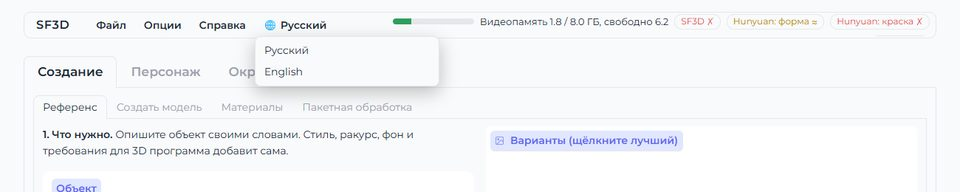

### Скелет по ориентирам

Персонаж → Скелет → «Вручную по ориентирам», затем «Открыть разметку». Кликните ориентиры на виде спереди (подбородок, пах, плечо, локоть, запястье, колено, щиколотка); таз, позвоночник, шея, ключицы, бёдра и стопы рассчитаются сами. Оранжевые узлы — ориентиры, синие — рассчитанные; любой узел можно сдвинуть или повернуть стрелками (G / R) или числами. «Разметить пальцы» и «Разметить лицо» добавляют пальцы, челюсть и глаза. Затем «Построить скелет и веса по разметке».

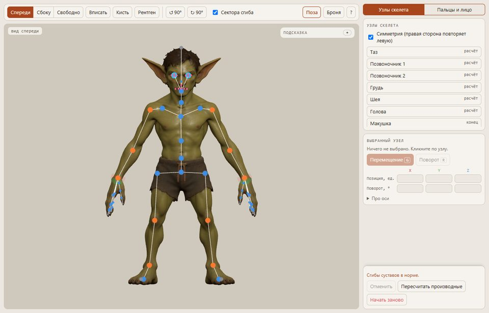

**Поза** показывает собранную модель со скелетом. Тяните руку или ногу, чтобы согнуть её; «Поза проверки» сгибает все конечности сразу, так видны заломы и плохие веса.

| Режим «Поза» | «Поза проверки» |
|---|---|
| 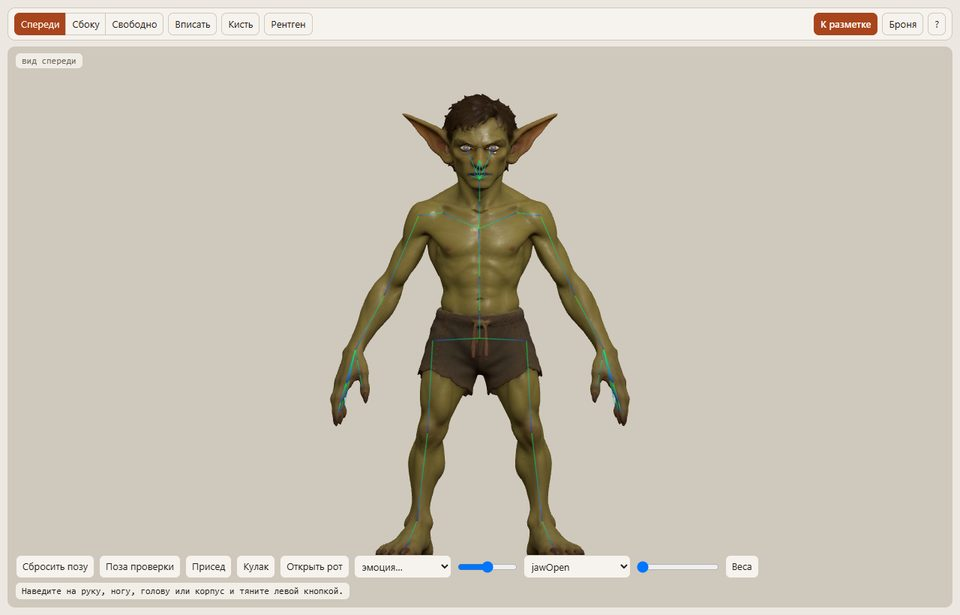 | 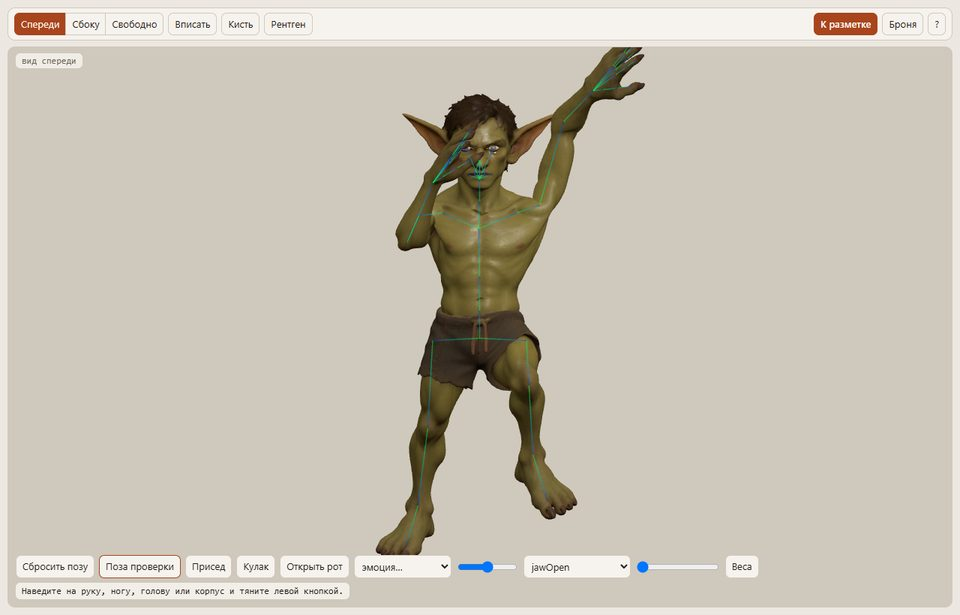 |

### Броня: поставить, надеть, проверить

**Броня** открывает панель подгонки. Выберите GLB вещи: вещь без своего скелета сама получает часть тела по имени файла (cuisse/набедренник → бедро, chest/нагрудник → торс, …), либо выберите часть вручную. Вещь ставится на место и подгоняется к коже сразу всей внутренней стенкой. Точки — узлы внутренней стенки: красные под кожей, зелёные на коже, синие — с воздухом.

«Надеть» отправляет вещь в Blender: её выталкивает из кожи, она получает кости и веса персонажа и сохраняется рядом с ним. «Поза проверки» сгибает тело, и вещь должна идти за ним.

| 1. Поставлена (узлы прилегания) | 2. «Надеть» | 3. «Поза проверки» |
|---|---|---|
| 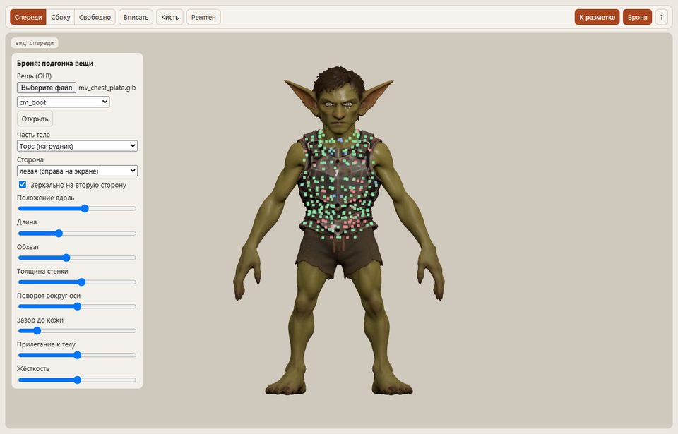 | 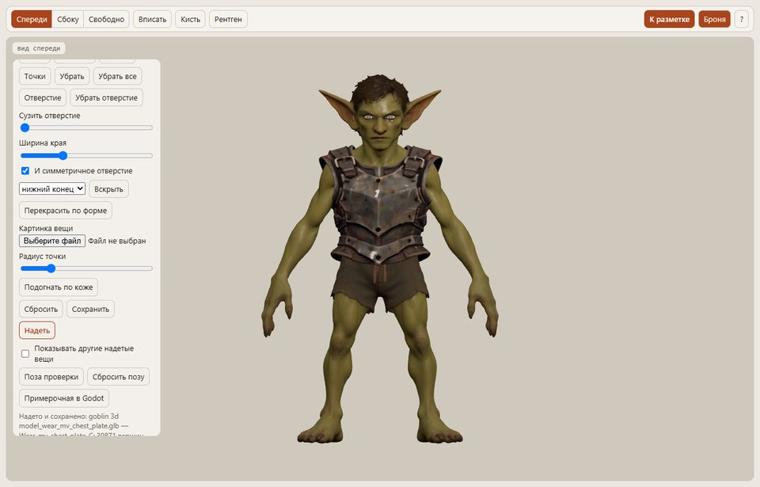 | 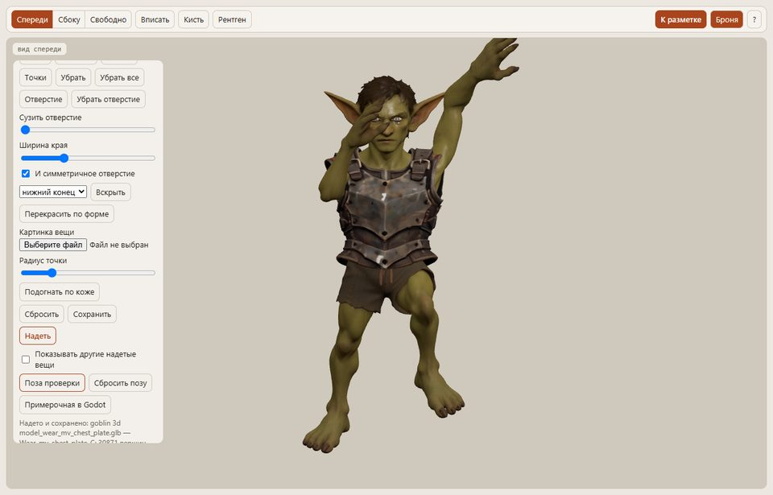 |

Ползунки поправляют то, в чём ошиблась автоподгонка: положение вдоль руки или ноги, длина, обхват, толщина стенки, поворот вокруг оси, зазор до кожи, прилегание к телу и жёсткость. «Точки» тянут поверхность вручную, «Подогнать по коже» заново запускает автоподгонку после ручных правок.

### Отверстие: сузить пройму

«Отверстие»: кликните 3 и больше точек по краю проймы или горловины. «Сузить отверстие» стягивает край и поверхность вокруг него к центру окружности, обе стенки сразу; «И симметричное отверстие» делает то же с другой стороны. Здесь пройма нагрудника была слишком широкой и оставляла подмышку открытой.

| До | «Сузить отверстие» 0,25 |
|---|---|
| 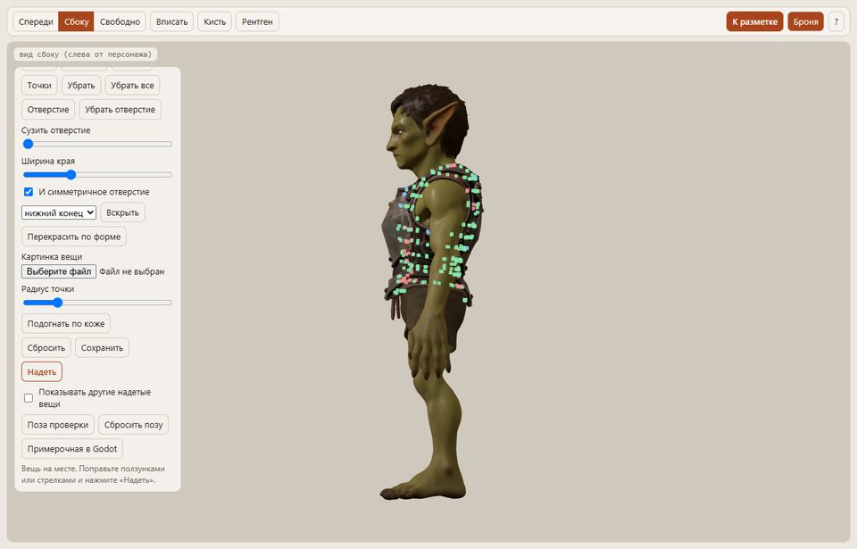 | 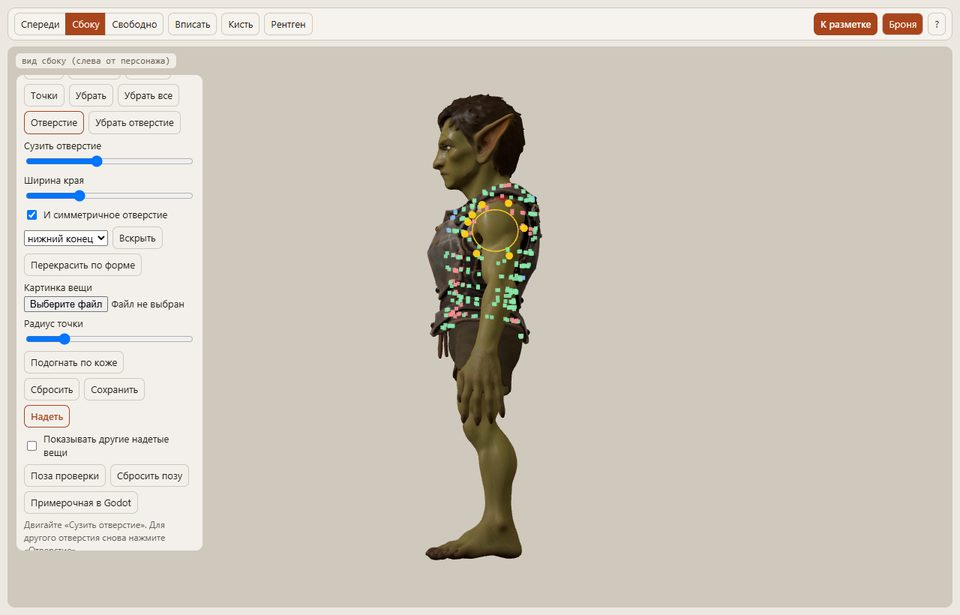 |

### Перекрасить по форме

Суженное отверстие, точки и ползунок стенки растягивают текстуру. «Перекрасить по форме» отправляет изменённую вещь в Hunyuan3D-Paint вместе с картинкой спереди, по которой она делалась (для сгенерированной брони картинка находится сама, иначе выберите её в «Картинка вещи»). Текстура рисуется заново по новой форме, включая стороны, которых не было на картинке (3–6 минут на видеокарте).

| Вещь как сгенерирована | Пройма сужена и перекрашена |
|---|---|
|  |  |

### Вскрыть закрытый конец

Сгенерированная вещь иногда закрыта с конца: SF3D закрывает наруч с обоих концов, а у набедренника из Hunyuan наколенник может загибаться под низ. Выберите конец (нижний — дальний от тела, верхний или оба) и нажмите «Вскрыть». Blender срежет этот конец, текстура сохранится; своя стенка вещи остаётся, а у сплошной болванки делается стенка внутрь. Затем вещь ставится заново.

### Слои: вещь поверх другой

Когда вещи перекрываются (сапог поверх поножей, набедренник поверх поддоспешника), список «Поверх этих вещей» говорит, какие уже надетые вещи лежат под этой. Вещи на других частях тела, которые с ней пересекаются, отмечаются сами; две вещи на одной части обычно варианты, поэтому, если это слои, отметьте их вручную. При «Надеть» наружная стенка отмеченных вещей считается кожей: новая вещь раздвигается над ними, а то, что ячейка не может раздвинуть достаточно, выталкивается наружу вдоль луча от оси конечности. Замер с 8 сторон: длинный набедренник поверх бедра из Tripo без слоёв пропускал наружу 27% нижней вещи, со слоями — 4% (это более длинный край нижней вещи).

### Что вещь прячет

Каждая надетая вещь (подогнанная или процедурная) сохраняет ещё и то, какую часть тела она прячет, — `<персонаж>_wear_<вещь>.mask.json` (`tool/body_mask.py`): кожу под ней, которая иначе проступала бы в движении, и то, что торчит сквозь неё, — шнуры штанов под юбкой, уши под шлемом. Лицо из шлема и кисть из наруча остаются. Редактор и примерочная в Godot убирают эти треугольники, пока вещь надета, и возвращают, когда её сняли; край тела у кромки вещи остаётся.

### Сохранение и примерочная в Godot

Каждое «Надеть» заодно сохраняет подгонку (`<персонаж>_wear_<вещь>.fit.json`); «Открыть» возвращает её со всеми ползунками и точками. «Примерочная в Godot» собирает небольшой проект Godot с персонажем, его анимациями и всеми надетыми вещами и открывает его. Здесь целый комплект в Godot во время ходьбы: нагрудник, шлем и короткие набедренники из Hunyuan3D, сапоги и наручи, снятые с Tripo-персонажа.

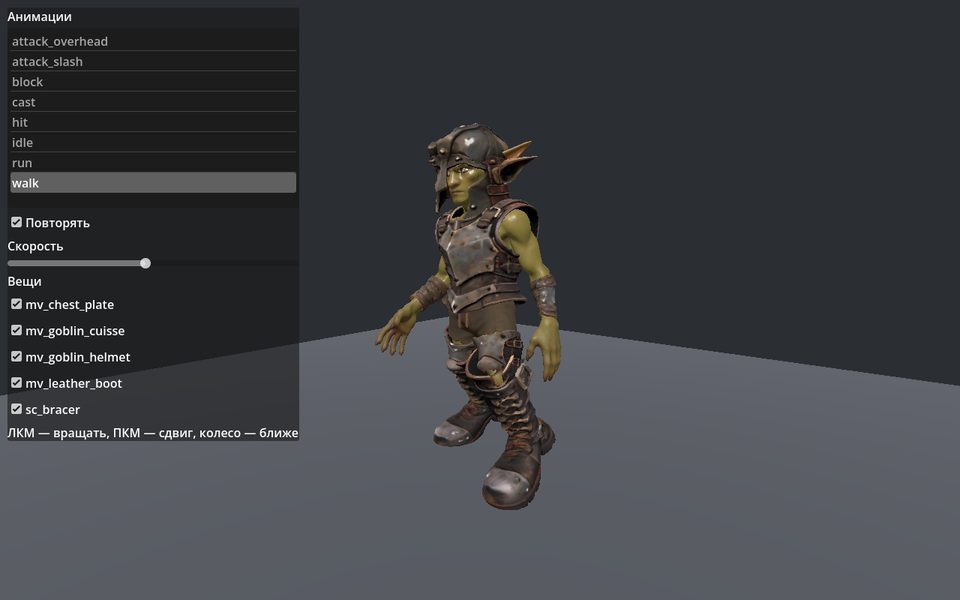

### Экипировка: процедурная генерация

Персонаж → «Экипировка: процедурная генерация» делает вещь не из модели, а по параметрам: наруч, плечо, поножи, набедренник, нагрудник, юбку-тассеты (от талии — чтобы между нагрудником и набедренниками не было зазора), наплечник, штаны или брайет (кольчужные трусы). Вещь строится прямо по коже персонажа с собранным скелетом. Выберите персонажа и нажмите «Открыть редактор»: страница (`tool/armour_gen_editor.html`) показывает персонажа с вещью и перестраивает вещь при каждом движении ползунка, за сотые доли секунды. Что на экране, то и получится:

- Наведите на группу параметров (пластины, заклёпки, ремни) — подсветится часть вещи, которую она меняет.
- Виды: спереди, сбоку, крупно. Персонаж в своём цвете, серый или насквозь — чтобы видеть зазор до кожи.
- Позы: руки вверх, руки вперёд, согнутые локти, присед, шаг. Вещь двигается по тем же весам, что будут у неё в игре.
- Сделанные раньше вещи есть в списке и открываются с их параметрами.
- «Надето»: уже надетые на персонажа вещи видны на нём, а новая вещь подгоняется поверх отмеченных (кольчужная юбка или брайет поверх штанов — два слоя, как носили на самом деле). Нагрудник всегда ложится поверх юбки, что бы ни сделали первым: юбка, сделанная при надетом нагруднике, вместе с поясом остаётся под ним.
- «Стиль по референсу» выставляет наруч, поножи или нагрудник под один из наборов референсов: формованная кожа, латы, кольчуга, открытые шины, шины под кожей или бригантина, латы на кольчуге, ламеллы. Дальше его меняют ползунками.

«Сгенерировать» отдаёт эту самую геометрию и эти веса в Blender (`tool/blender_armour_gen.py`): он запекает материал. Запечённая вещь сразу показывается в редакторе («Результат») и следует позам на скелете персонажа. Как строится вещь:

1. Вокруг средней линии конечности лучами снимается профиль кожи. Кожа других конечностей не считается. Вещь на конечность не учитывает свисающую с неё одежду, а нагрудник, тассеты и штаны ложатся поверх одежды.
2. Профиль сглаживается ползунком «Рельеф тела», отодвигается на зазор и получает толщину. Нагрудник поднимается до шеи: спереди вырез горловины, по бокам проймы под руки; низ может уходить мысом, по центру может идти ребро. Он выпуклый в сечении и книзу не расширяется (расклёш — у юбки под ним); «Сужение к талии» задаёт, насколько он идёт за талией, «Анатомия» выдавливает грудь и пресс. Его можно собрать из двух частей: грудь из одной или двух пластин, а под ней полосы, кольчуга, чешуя и так далее. Под пластины можно надеть кольчугу (подол ниже кирасы и короткие рукава), сверху — наплечники: полукруглые полосы поперёк плеча, верхняя поверх нижней, первая — купол побольше (наплечник есть и отдельной вещью). Каждая полоса движется целиком, нижние сильнее идут с рукой («Наплечник идёт с рукой»), поэтому полосы скользят друг по другу, а не мнутся. Канты пластин можно окантовать латунью или золотом, «Чеканка» меняет металл от полированного до кованого. Тассеты из пластин висят от бёдер прямо, расширяются книзу и разрезаны на полосы, чтобы ноги двигались; юбка из кольчуги или ткани мягкая и скроена так, чтобы ноги двигались свободно: она начинается от талии и лежит на теле: спереди и по бокам идёт по бёдрам, сзади свисает с ягодиц, чуть расширяется книзу, идёт складками с волнистым подолом, а спереди открыта под свободным клином (он длиннее и расширяется к подолу) или под запахом. Ниже тазобедренных суставов перед и бока юбки идут за своим бедром, клин — наполовину за обоими. Штаны — это сиденье до паха и две штанины: облегающие или широкие, со складками и манжетами, любой длины (и до колена), со шнуровкой спереди; на бёдрах — кольчуга, латные бедренники, кожаные панели с заклёпками или пластина на кольчуге, подвязанные к поясу шнурами; на коленях — наколенник с крылом снаружи или кожаная накладка. Брайет — то же, но короткое и из кольчуги, с паховой частью между ног. У кольчужной юбки бывает кожаный кант по краю.
3. Покрытие: пластины с завёрнутыми кантами и заклёпками; металлические шины вдоль кожаной основы на заклёпках; бригантина (кожа поверх скрытых пластин, столбцы заклёпок, швы); каждая чуть шире следующей, поэтому верхняя заходит на неё; чешуя или ламеллы на кожаной основе, каждый ряд поверх шнуровки следующего; кольчуга или стёганка (узор запекается в текстуру); или гладкое. Размер чешуи и колец задаётся в доле роста персонажа, поэтому на всех вещах комплекта он одинаковый.
4. Открытая вещь застёгивается на внутренней стороне, как на референсах: короткие ремни приклёпаны к обоим краям, пряжка над разрезом; либо шнуровка. У латной на другой стороне могут быть петли. Край наруча и поножей у сустава срезан с внутренней стороны, а у дальнего конца спереди спускается ниже (у поножей — на подъём стопы); концы слегка расширяются. У кожи может быть строчка по краю. Нагрудник — цельная вещь, как подогнанный доспех: кольцо вокруг тела до подмышек и над ним без шва — верх через грудь, ключицы, плечи и спину. Горловину и проймы находят сами лучи из середины тела: где они упираются в шею или руку. У жилета плечи — продолжение самого доспеха; у лат остаются верх нагрудной и спинной пластин, их соединяют ремни от нагрудной пластины через плечо. Может открываться сбоку и застёгиваться там же. Иначе вокруг идут кожаные ремни с пряжками. У открытой пластины ремни проходят сзади, у нагрудника — через плечи, у тассет и штанов это пояс. Остальные ремни штанов — обмотки на голенях.
5. Материал задаётся параметрами: железо, сталь, бронза, кожа или ткань, износ (ржавчина или патина и потёртые края), цвет кожи и ткани. Процедурные шейдеры запекаются в текстуры цвета, шероховатости и нормалей. В редакторе материал показан примерно, точный — после запекания.
6. Веса берутся с кожи под вещью и стягиваются к её главной кости ползунком «Жёсткость».

«Шлем» строится не по коже: это одна из шести конструкций генераторов шлемов из `tool/vendor/blender_armour` — железная шляпа, открытый бацинет, барбют, бацинет с забралом и бармицей, салад, армэ. Это скрипты Blender, написанные под человеческую голову в метрах.

`tool/blender_helmet_gen.py` надевает такой шлем на персонажа. Голова каждого персонажа меряется по его же коже:
- глаза, глубина и ширина на уровне лба, макушка;
- подбородок — там, где перед лица резко уходит назад;
- шея и верх плеч.

Ничего не задано под одну анатомию: тот же код подгоняет шлем к гоблину (короткое лицо, почти нет шеи) и к большеголовой мультяшной фее.

Шлем строится в пропорциях генератора с пропорциями головы и масштабируется к ней целиком: прорези для глаз — на глаза, поля шляпы — на лоб. Ниже лица шлем поджимается, чтобы кончаться чуть ниже подбородка, а не на плечах. Бармица висит вокруг шеи до верха плеч и сходится к шее; спереди она идёт поперёк от концов ремня-держателя, за забралом. Шлем привязан к кости головы, нижние кольца бармицы всё больше к шее.

Маска шлема прячет то, что под ним, всё, что на голове выше лба (волосы, шляпа, вылепленная на персонаже), и уши (`body_mask.ears`, `body_mask.above`): у гоблина они торчали бы сквозь бока.

В редакторе шлем выбранного стиля делается под персонажа так же (один раз на стиль и параметры, `work/helmets/<персонаж>/`, 5–20 с) и показывается на его костях. Параметры: «Зазор над головой», забрало и щёки армэ, хвост салада и поля шляпы.


«Налокотник» устроен так же, на генераторах налокотников (`vendor/blender_armour/ElbowArmor`): кожаный, кольчужный участок рукава, простая стальная чашка, чашка с крылом, чашка с набором пластин, сталь с кольчужной вставкой. Генератор строит локоть человека в метрах вокруг сустава.

`tool/blender_elbow_gen.py` подгоняет его к каждой руке:
- меряет руку у локтя по коже: центр сечения, ширину и толщину, насколько выступает локоть, толщину руки на высоте ремней;
- ставит систему генератора вдоль плеча (нижнюю половину доворачивает к предплечью: рука в покое чуть согнута), чашкой на локтевой отросток: от сгиба, а у прямой в покое руки назад. Крыло правого налокотника уходит наружу, левый — его зеркальная копия;
- делает чашку чуть шире руки и глубиной по выступу локтя;
- подгоняет по руке на их высоте ремни, пластины и кольчугу. Ремни вдвое толще, чем у генератора, чуть отстоят от кожи и по бокам сходятся с чашкой.

Верхний ремень и пластины идут с плечом, нижние — с предплечьем. Чашка со всем, что на ней, — поровну на обе кости. Кольчуга и внутренние кожаные полосы — плавно от одной кости к другой.

Маска каждого локтя считается отдельно, только по чашке и пластинам, с отступом от их края: ремни при сгибе скользят по коже. Поза редактора «Локти» показывает руки согнутыми. Параметры: «Зазор над рукой» и размер крыла.


«Обувь» устроена так же, на генераторах обуви (`vendor/blender_armour/Footwear`): кожаные башмаки, короткие сапоги, кольчужная стопа, округлые и заострённые сабатоны, кожа со сталью и кольчугой. Генератор строит правую человеческую обувь на одной колодке, начало координат — в голеностопе.

`tool/blender_footwear_gen.py` подгоняет её к каждой стопе:
- меряет стопу по коже: пятку, кончик пальцев вместе с когтями, ширину и середину, землю, высоту голеностопа;
- масштабирует колодку по длине, ширине и высоте: носок по направлению стопы, подошва на земле;
- ниже лодыжки подгоняет к стопе в ширину на каждой высоте и по длине (по сглаженным срезам кожи): у гоблина пальцы веером, а колодка к носку сужается. Поле подгонки одно для кожи и стали: пластины не врезаются друг в друга, кожа не проступает сквозь сталь;
- голенище подгоняет по ноге на каждой высоте выше лодыжки по срезам кожи вокруг голени, так что икра остаётся внутри.

Левая обувь — зеркальная копия правой.

Обувь движется со стопой, носок — с пальцами, голенище всё больше с голенью, сталь — целиком с тем, на чём лежит. Маска считается для каждой стопы отдельно. Параметр — «Зазор вокруг стопы»; позы «Шаг» и «Присед» показывают её в движении.


«Перчатки» строятся в самом редакторе из кожи кисти. Шесть стилей по референсам: кожаная перчатка, усиленная кожа, кольчужная рукавица, латная перчатка «песочные часы», латная рукавица, сталь с кольчугой.

Как они строятся:
- кожа, которая движется с кистью и пальцами, отодвигается на зазор и получает толщину. Каждая точка сохраняет веса самой кожи, поэтому перчатка гнётся с каждым пальцем;
- у рукавицы четыре пальца уходят в общий мешок — выпуклую оболочку пальцев и костяшек. Его точки берут веса ближайшей кожи;
- на тыле кисти лежит пластина или кожаная нашивка. На каждой фаланге — чешуйка чуть длиннее фаланги, чтобы они ложились внахлёст; каждая идёт целиком со своей костью, края сглажены. У латной рукавицы поперёк мешка идут пластины;
- манжета устроена как наруч вокруг запястья, с раструбом к локтю («песочные часы»). Она из кожи, кольчуги или стали, с ремнём.

Поза «Кулак» сжимает пальцы.


«Поддоспешная одежда» кроится как одежда, по листам-референсам: льняная рубаха, короткий акетон, длинный гамбезон, подлатный дублет, дублет с кольчужными вставками, стёганый жилет. Кроме них есть брэ (короткие и длинные) и стёганый подшлемник.

Как она строится:
- из частей самого доспеха, свободно по телу, а не из кожи. Торс — как у жилета: кольцо и кокетка через плечи, проймы и горловина находятся там, где лучи встречают руки и шею;
- юбка продолжает торс вниз и не сужается к талии; разрезы по бокам или сзади;
- рукава — трубы вокруг плеча и предплечья. У локтя нижняя часть уходит под верхнюю, край проймы подвёрнут под верх рукава;
- стоячий ворот — вокруг основания шеи;
- спереди завязки или шнуровка; у дублетов шнурки для лат на плечах, руках и по подолу, у второго — кольчужные вставки под мышками;
- стёжка — продольными каналами или ромбами;
- брэ — свободные штаны, длинные собраны у щиколотки;
- подшлемник — мешок вокруг головы (волосы бывают вылеплены прямо на коже, комками): выпуклая оболочка с вырезом для лица, уши проходят насквозь, волосы скрыты под ним.

Это самый нижний слой: доспех надевается поверх.


Готовая вещь ложится рядом с персонажем как надетая в «Броне», поэтому её видят примерочная в Godot и список надетых вещей в редакторе. Она садится сразу, без подгонки, и весь комплект получается в одном стиле, каждая вещь делается поверх надетых под ней (стальные руки — поверх рукавов дублета). На других телах тоже работает: справа салад на фее.


### Галерея анимаций

`tool/anim_gallery.py` переносит около 90 клипов (Mesh2Motion, CC0, плюс процедурные клипы с двуручником и щитом) на персонажа со скелетом и пишет одну HTML-страницу, которая открывается двойным щелчком. Клипы разбиты на группы: передвижение, прыжки, уклонения, меч, меч и щит, двуручный меч, защита, магия, рукопашная, лук и метание, урон и смерть, эмоции.

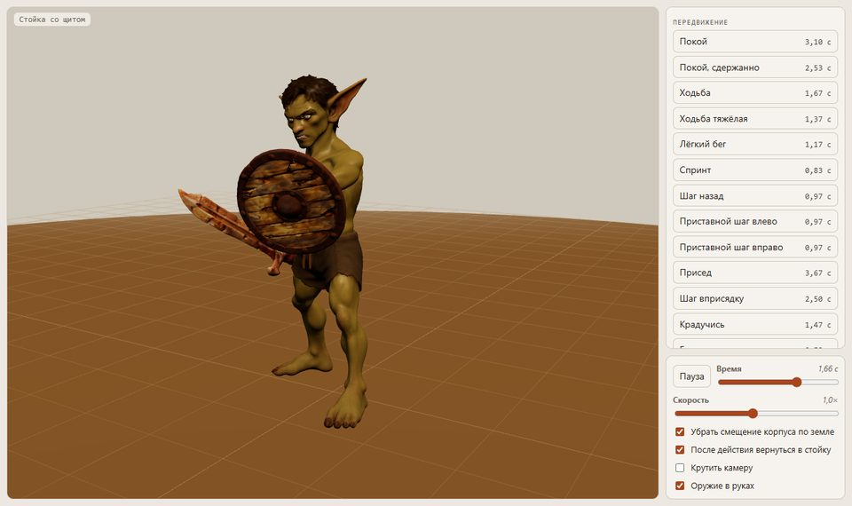

---

## Требования

**Железо:** видеокарта NVIDIA с **8 ГБ видеопамяти** и больше (драйвер CUDA 12.x), желательно 32 ГБ ОЗУ и около **60 ГБ** свободного места под окружения, веса моделей и кеши.

**Программы, которые нужно поставить самому** (в репозиторий ничего не входит):

| Что | Версия | Для чего |
|---|---|---|
| Windows 10/11 x64 | 11 | всё (скрипты `.bat`/`.ps1`) |
| [Miniconda](https://docs.anaconda.com/miniconda/) | любая свежая | три окружения Python |
| [Git for Windows](https://git-scm.com/download/win) | любая | клонирование; **его `bash.exe` запускает UniRig** |
| [Visual Studio 2022 Build Tools](https://visualstudio.microsoft.com/visual-cpp-build-tools/) с «Desktop development with C++» | 2022 | сборка расширений SF3D, Hunyuan3D-Paint и UniRig |
| [CUDA Toolkit 12.1](https://developer.nvidia.com/cuda-12-1-0-download-archive) | 12.1 | сборка `texture_baker` для SF3D (Hunyuan берёт свой `nvcc` из conda) |
| [Blender](https://www.blender.org/download/) | 5.2 | риггинг, анимации, экипировка, наборы, разрушаемые объекты, превью |
| [Godot](https://godotengine.org/download) (консольный exe) | 4.7.2 | сборка сцен эффектов, наборов и разрушаемых объектов, примерочная |
| [Аккаунт Hugging Face](https://huggingface.co/join) | – | веса SF3D **закрыты**: примите лицензию на [stabilityai/stable-fast-3d](https://huggingface.co/stabilityai/stable-fast-3d) и войдите |
| [Codex CLI](https://github.com/openai/codex) (`npm i -g @openai/codex`, затем `codex login`) | 0.160 | *необязательно*: вкладка «Референс» через подписку ChatGPT |
| Ключ OpenRouter | – | *необязательно*: вкладка «Референс» без Codex |

---

## Зашитые пути

Скрипты рассчитаны на такое расположение. Проще всего повторить его, иначе поправьте места из таблицы.

| Путь | Зачем | Где задан |
|---|---|---|
| `D:\conda\envs\sf3d`, `...\hunyuan`, `...\unirig` | окружения Python | `sf3d-env.bat`, `tool\launch_ui.ps1`, `tool\sf3d_ui.py` (`HY_PY`), `tool\rigging.py` (`UNIRIG_ENV`), скрипты установки |
| `D:\conda\hf`, `D:\conda\hy3dgen` | кеш моделей Hugging Face / Hunyuan | те же файлы + `tool\hy_pipeline.py`, `tool\hy_texture_mv.py` |
| `D:\conda\tmp`, `D:\conda\pip-cache`, `D:\conda\pkgs` | временные файлы и кеши (не на диске C:) | запуск и скрипты установки |
| `D:\conda\rig` | папка для UniRig (его bash-скрипты ломаются на пробелах в путях) | `tool\rigging.py` (`STAGE`) |
| `D:\Git\bin\bash.exe` | Git Bash для UniRig | `tool\rigging.py` (`BASH`) |
| `<репозиторий>\hunyuan3d-src` | исходники Hunyuan3D | `tool\sf3d_ui.py` (`HY_SRC`) |
| Blender, Godot, папки export/work/input, язык интерфейса | | `tool\config.json` (можно менять и в окне «Настройки») |

Сам репозиторий может лежать где угодно. Оригинал лежит в `D:\My projects\SF3D`; пути с пробелами подходят для всего, кроме папки UniRig.

---

## Установка

Все команды выполняются в **Anaconda/Miniconda PowerShell** в корне репозитория.

### 1. Клонируйте этот репозиторий и три репозитория моделей рядом

Репозиториев моделей здесь **нет**. Клонируйте их точно под этими именами:

```powershell
git clone https://github.com/Sergeyspb-source/3d-animator.git
cd 3d-animator

git clone https://github.com/Stability-AI/stable-fast-3d.git sf3d-src
git clone https://github.com/Tencent-Hunyuan/Hunyuan3D-2.git hunyuan3d-src
git clone https://github.com/VAST-AI-Research/UniRig.git unirig-src

# UniRig: поддержка Windows из PR #70 сообщества
git -C unirig-src fetch origin pull/70/head:pr70
git -C unirig-src checkout pr70
```

### 2. Наложите локальные патчи (папка `patches\`)

```powershell
# Hunyuan3D-Paint: UNet грузится из .safetensors, файл .bin на 3,5 ГБ не нужен
git -C hunyuan3d-src apply ..\patches\hunyuan3d-paint-safetensors.patch

# UniRig: настройки скелета с малым расходом памяти для видеокарт на 8 ГБ
Copy-Item -Recurse -Force patches\unirig\configs\* unirig-src\configs\
```

### 3. Окружение SF3D (`sf3d`): интерфейс, SF3D, материалы, связующий код

Скрипта установки для этого шага пока нет, команды выполняются вручную. Сначала откройте «x64 Native Tools Command Prompt for VS 2022», чтобы собрались расширения на C++/CUDA:

```powershell
conda create -p D:\conda\envs\sf3d python=3.10 -y
$py = 'D:\conda\envs\sf3d\python.exe'
& $py -m pip install torch==2.4.1 torchvision==0.19.1 --index-url https://download.pytorch.org/whl/cu121
& $py -m pip install setuptools==69.5.1 wheel
cd sf3d-src
& $py -m pip install -r requirements.txt          # собирает texture_baker и uv_unwrapper
& $py -m pip install -r requirements-demo.txt     # gradio 4.41.0
cd ..
# модули, которые нужны этому набору (их нет в требованиях SF3D)
& $py -m pip install scikit-image scipy matplotlib fast-simplification onnxruntime-gpu
# вход, чтобы закрытые веса SF3D скачались при первом запуске
& $py -m huggingface_hub.commands.huggingface_cli login
```

### 4. Зависимости Robust Weight Transfer (вкладка «Экипировка»)

`tool\vendor\rwt\weighttransfer.py` лежит в репозитории (GPL-3.0, см. `tool\vendor\rwt\LICENSE` и `source_manifest.json`). Его собранных зависимостей в git **нет**, поставьте их в папку vendor:

```powershell
D:\conda\envs\sf3d\python.exe -m pip install --target tool\vendor\rwt\deps libigl==2.6.1 robust_laplacian==1.0.0
```

### 4b. Липсинк (необязательно, Персонаж → Липсинк)

Всё своё: `tool\vendor\lipsync\transcribe.py` (локальный Whisper) и `lipsync.py` (кривые лица ARKit) работают в окружении
`sf3d` (numpy, scipy, torch, transformers; `soundfile` или ffmpeg для mp3/ogg). Модель `openai/whisper-small`
(~1 ГБ) скачивается при первом запуске в `hf_home` из `tool\config.json` (по умолчанию `D:/conda/hf`); готовый кеш
Hugging Face используется повторно. Результат: `<папка модели>\<голос>.face.json` и копия аудио.

В Godot: скопируйте `tool\godot\face_curves_clip.gd` и `face_curves_player.gd` в проект и добавьте узел
`FaceCurvesPlayer` (`audio` — `AudioStreamPlayer3D` с голосом, `face_root` — персонаж, `clip_path` — файл
`.face.json`). Он двигает ключи формы рта персонажа (`jawOpen`, `mouthSmile`, …) по времени звука.

### 5. Окружение Hunyuan3D-2 (`hunyuan`): модели по нескольким видам и покраска

```powershell
powershell -ExecutionPolicy Bypass -File hunyuan3d-install.ps1        # окружение + PyTorch 2.4.1 cu121 + hy3dgen
powershell -ExecutionPolicy Bypass -File hunyuan3d-texgen-install.ps1 # nvcc 12.1 из conda + сборка custom_rasterizer / mesh_processor (нужны VS 2022 Build Tools)
powershell -ExecutionPolicy Bypass -File hunyuan3d-weights.ps1        # модель формы tencent/Hunyuan3D-2mv (fp16)
powershell -ExecutionPolicy Bypass -File hunyuan3d-texgen-weights.ps1 # модели delight и покраски
```

В скрипте сборки `hunyuan3d-texgen-build.bat` стоит `TORCH_CUDA_ARCH_LIST=8.9` (RTX 40xx). **Поменяйте под свою видеокарту** (8.6 для RTX 30xx, 12.0 для RTX 50xx).

### 6. Окружение UniRig (`unirig`): автоматический риггинг

```powershell
powershell -ExecutionPolicy Bypass -File unirig-install.ps1   # окружение py3.11 + torch cu128 + spconv + заглушка flash-attn
unirig-build-ext.bat                                          # только если torch_scatter / torch_cluster не поставились
```

Веса UniRig (`VAST-AI/UniRig`) скачиваются с Hugging Face при первом риггинге.

### 7. Настройка

При первом запуске используется `tool\config.example.json`. Чтобы поменять пути или язык, скопируйте его в `tool\config.json` (этот файл в git не попадает) и задайте `lang` (`ru` или `en`), `blender_exe`, `godot_exe`, `export_dir`, `work_dir` и `input_dir`. То же можно сделать в окне «Настройки» и в меню 🌐.

---

## Запуск

| Как | Что |
|---|---|
| `sf3d-ui.vbs` (двойной щелчок) | интерфейс без консоли, окно приложения на `http://127.0.0.1:7861`. Закрытие окна останавливает сервер и освобождает видеопамять |
| `sf3d-ui.bat` | тот же интерфейс с видимой консолью (для отладки) |
| `sf3d-tool.bat generate <картинка или папка> --category prop` | разовый запуск из командной строки: картинки → готовый GLB |
| `sf3d-tool.bat post work\item\axe\raw.glb --category item --name axe` | только постобработка |
| `sf3d-batch.bat <папка> [--force] [--no-preview]` | пакет: `<папка>\<категория>\pic.png` → SF3D; `<папка>\<категория>\<объект>\front.png [back/left/right.png]` → Hunyuan3D |
| `sf3d-gradio.bat` | исходное демо SF3D (порт 7860) |

**Запускайте одну задачу на видеокарте за раз.** Пик видеопамяти примерно такой: SF3D 6,2 ГБ, форма Hunyuan 5,8 ГБ, покраска Hunyuan 7,4 ГБ, UniRig 4,5 ГБ. Интерфейс проверяет свободную память перед каждой задачей.

---

## Подгонка брони подробно

В режиме «Поза» редактора разметки кнопка **Броня** открывает панель брони:

1. Выберите GLB вещи и часть тела. Вещь без своего скелета получает часть тела по имени файла (cuisse/thigh/набедренник → бедро, greave/поножи → голень, bracer/vambrace/наруч → предплечье, rerebrace → плечо, pauldron/shoulder/наплечник → «Наплечник», gauntlet/перчатка → кисть, boot/сапог → «Сапог», helmet/шлем → голова, chest/cuirass/нагрудник → торс); если имя ничего не говорит, выбор остаётся прежним. Ось трубы у вещи без скелета — направление, вдоль которого она сквозная (лучи из середины проходят насквозь; кроме главных осей пробуются собственные x/y/z вещи, потому что у короткой широкой вещи главные оси неопределённы). Вещь ставится вдоль настоящей средней линии конечности и подгоняется всей внутренней стенкой. Узлы, по одному на ячейку вещи (12 вдоль × 24 по кругу), совмещаются с кожей методом ICP с односторонним штрафом: меняются сдвиг, наклон, масштаб поперёк конечности и овальность, форма — нет. «Подогнать по коже» повторяет это после ручных правок. Узлы показаны красными (под кожей), зелёными (на коже) и синими (воздух).
2. Поправьте ползунками, стрелками (G / R / S) или точками на поверхности. Ползунки: положение, длина, «Обхват» (вся вещь шире или уже), «Толщина стенки» (внутренняя стенка остаётся, двигается только внешняя поверхность; одинаково вокруг собственной оси вещи в редакторе и в Blender), поворот и зазор. Строка под ползунками показывает воздух и толщину стенки в долях радиуса конечности.
3. **«Надеть»** запускает `tool/blender_wear_fit.py`. Вещь раздвигается от оси конечности по ячейкам, чтобы внутренняя стенка вышла из кожи, а стенка сохранила форму. То, что всё ещё под кожей, выталкивается вдоль нормали кожи с захватом соседей, так что внутренняя и внешняя стенки двигаются вместе. «Прилегание к телу» прижимает отошедшие части к конечности на эту долю воздуха (стенка меряется на том же луче, что и кожа). Бока нагрудника, обращённые к рукам, прижимаются полностью, а кожа рук (с весами на костях руки или дальше плечевого сустава с этой стороны) не считается кожей торса: иначе нагрудник раздувается вокруг дельты, и поднятая рука будто вылезает из его плеча. Внутренняя стенка ячейки — 10-й процентиль расстояний её вершин до оси, а то, что глубже 3/4 расстояния до кожи, остаётся внутри конечности как есть: у вскрытой сплошной вещи из картинки это остатки крышек, и, если их учитывать, концы вещи раздувались воронкой. Веса берутся только с костей самой конечности и сглаживаются по вещи. «Жёсткость» заставляет вещь двигаться вместе с костью (0,8 для наручей и поножей, 0,2 для перчаток). Результат — `<персонаж>_wear_<вещь>.glb`: скелет персонажа и вещь с весами.
   - Вещь, сделанная на другом теле и несущая свой скелет (вещи, снятые с Tripo-персонажей, в `export/equipment`), читается вместе с ним. На одном сегменте конечности она ставится как выше; на нескольких сегментах (сапог на голени и стопе, рука целиком) выбирается «Вся вещь по её скелету». Тогда каждая вершина переходит с костей вещи на те же кости персонажа по своим весам, как кожа при скиннинге, а вторая сторона — зеркало с заменой Left и Right. Blender получает перенесённые копии, выталкивает их из кожи и даёт веса только тех костей, которые были у вещи.
   - Вертикальные вещи сохраняют свою вертикаль как ось и свои пропорции: «Торс (нагрудник)» — без зеркала, веса на позвоночнике и никогда на руках; «Голова (шлем)» — верх шлема на макушке, жёстко на кости головы; «Сапог» — голенище на голени и размер по нему, носок по стопе (по длинной оси подошвы, к концу дальше от голенища), подошва у пятки.
   - «Наплечник» — купол на плечевом суставе, а не труба. Он сохраняет ориентацию, в которой сделан (верх — это верх), а сфера его верхней части считается его собственным плечевым шаром: центр ставится на плечевой сустав персонажа, размер подбирается по коже вокруг, затем тот же ICP в ячейках направлений от сустава (сдвиг, поворот, один масштаб: форма не меняется). Сторона, для которой вещь сделана, берётся из имени файла (`_L`, `left`…), иначе левая (генератор просим сделать левый); выбор другой стороны отражает вещь. Наплечник жёсткий: у всех вершин одинаковые веса ключицы и плечевой кости, а ползунок «Идёт за рукой» задаёт долю руки (по умолчанию 0,7: при замере с рукой вбок и вперёд кожа проглядывала меньше всего; 0,5 хуже, потому что смесь двух поворотов сжимает жёсткую вещь). Поверх нагрудника он надевается слоем: ремни нагрудника считаются кожей, и Blender выталкивает наплечник из них целиком. Наплечник — внешний слой: под нагрудник он сам не отмечается.
   - «Отверстие»: клики по краю проймы или горловины задают окружность. «Сузить отверстие» стягивает край и поверхность рядом с ним к оси окружности, обе стенки сразу, с плавным спадом; «И симметричное отверстие» делает то же с другой стороны. Всё происходит в собственном пространстве вещи, поэтому редактор, зеркальная копия и Blender получают одну форму.
   - «Поверх этих вещей»: задание получает готовые результаты отмеченных вещей (`under`). На луче каждой ячейки от оси конечности наружная стенка первой оболочки, лежащей на этой конечности (не дальше радиуса конечности от кожи), заменяет расстояние до кожи, а второй толчок выводит то, что всё ещё под ними, наружу вдоль луча, с тем же плавным захватом соседей, что и у толчка из кожи. В отчёте считаются ячейки, легшие поверх других вещей.
   - «Вскрыть» (нижний конец / верхний конец / оба конца): сгенерированная вещь, закрытая с конца, срезается там скриптом `blender_armour_hollow.py` вместе с текстурой и ставится заново. На конечности нижний конец — дальний от тела (у кисти, у колена); вертикальная вещь — по своей вертикали. Своя стенка вещи остаётся; у сплошной болванки делается стенка внутрь (если у вещи есть стенка, луч из середины наружу проходит две поверхности).
   - «Перекрасить по форме»: Hunyuan3D-Paint заново красит изменённую вещь по её картинке-референсу (находится в `refs_mv` или выбирается в «Картинка вещи»), и текстура идёт по новой форме, а не растягивается (3–6 минут на видеокарте). Результат становится исходной вещью подгонки.
   - Hunyuan3D по четырём видам (их рисует Codex: `export/equipment/generated_armour/make_refs_mv.py`) даёт полую броню, которую не нужно вскрывать. Вещь по одной картинке обычно сплошная; `tool/blender_armour_hollow.py in.glb out.glb [open=both|top|bottom] [axis=auto|z|x,y,z] [wall=0.08|auto]` делает то же вскрытие из командной строки.
4. Каждая подгонка сохраняется рядом с персонажем как `<персонаж>_wear_<вещь>.fit.json` + `.src.glb`. «Открыть» возвращает её со всеми ползунками и точками, «Сохранить» сохраняет без надевания.
5. **«Примерочная в Godot»** собирает `work/wardrobe/<персонаж>/`: персонаж с анимациями (если их нет, делаются процедурные), все подогнанные вещи надеты, вещи включаются и выключаются, камера вращается. Затем проект открывается в Godot.

В своём проекте Godot скопируйте `tool/godot/sf3d_equip.gd` и GLB-файлы, затем:

```gdscript
var bracers := SF3DEquip.wear($Goblin, preload("res://goblin_wear_bracer.glb"))   # надеть (сетки переходят под Skeleton3D персонажа)
SF3DEquip.take_off(bracers)                                                      # снять
SF3DEquip.show(bracers, false)                                                   # скрыть (тело под ней вернётся)
```

Положите рядом с каждым GLB его `.mask.json`: `wear` читает его и прячет тело под вещью.

Вещь идёт за всеми анимациями персонажа по именам костей. Она должна быть сделана для той же модели со скелетом.

---

## Галерея анимаций

`tool/anim_gallery.py` переносит клипы Mesh2Motion (`Animations/Mesh2Motion`, CC0) и процедурные клипы с двуручником и щитом на персонажа со скелетом. Получается одна самодостаточная HTML-страница примерно с 90 клипами по группам (см. [снимок выше](#галерея-анимаций)). GLB лежит внутри страницы, поэтому она открывается двойным щелчком. Её тексты — на языке интерфейса.

```powershell
D:\conda\envs\sf3d\python.exe tool\anim_gallery.py "<персонаж>_landmarks_rigged.glb" Animations\goblin_gallery.html
```

`blender_retarget_fbx.py` читает клипы прямо из GLB Mesh2Motion: имена костей в стиле Unreal сопоставляются с именами Mixamo. Оружие в руках приблизительное, потому что его настройки делались на другом гоблине; галочка «Оружие в руках» его прячет.

---

## Устройство репозитория

```
sf3d-ui.vbs / sf3d-ui.bat     запуск интерфейса
sf3d-tool.bat / sf3d-batch.bat запуск из командной строки
sf3d-env.bat                  окружение sf3d
*-install.ps1, *-weights.ps1, *-build.bat   установка Hunyuan3D и UniRig
patches/                      правки поверх сторонних репозиториев
docs/images/                  снимки для README (en/, ru/)
tool/
  sf3d_ui.py                  интерфейс Gradio (все вкладки)
  i18n.py, lang/*.json        язык интерфейса: все тексты по ключам (русский, английский)
  sf3d_tool.py, batch_cli.py  командная строка и постобработка (pivot, масштаб, коллизия, материалы)
  hy_*.py                     обработчики Hunyuan3D (работают в окружении hunyuan)
  rigging.py, outfit.py, hanim.py, fbxanim.py, materials.py, surfaces.py,
  fx_flipbook.py, modkit.py, destruct.py, refgen.py, anim_gallery.py, rwt_*.py   модули функций
  landmarks*.py, landmark_editor.html   скелет по ориентирам и подгонка брони (редактор на three.js)
  blender_*.py                скрипты Blender без окна (blender -b -P tool\blender_x.py -- args)
  godot/                      скрипты и шейдеры Godot для собираемых сцен (FaceCurvesPlayer для липсинка,
                              SF3DEquip для надевания брони, примерочная)
  rig_scripts/                обёртки Git Bash для UniRig
  vendor/rwt/                 Robust Weight Transfer (GPL-3.0)
  vendor/lipsync/             тайминги слов Whisper и кривые липсинка (см. его README)
  vendor/blender_armour/      генераторы шлемов, налокотников и обуви (KettleHat, HelmetVariants, ElbowArmor, Footwear: скрипты Blender), см. source_manifest.json
  config.example.json         шаблон настроек
```

Не в git (создаётся на месте): `sf3d-src/`, `hunyuan3d-src/`, `unirig-src/`, `export/`, `work/`, `input/`, `tool/config.json`, `tool/vendor/rwt/deps/`, все веса моделей.

---

## Лицензии сторонних моделей

В репозитории только связующий код. У каждой модели своя лицензия, поэтому **проверьте их перед коммерческим использованием**:

- **Stable Fast 3D**: [Stability AI Community License](https://huggingface.co/stabilityai/stable-fast-3d) (бесплатно при годовом доходе до 1 млн долларов).
- **Hunyuan3D-2**: [Tencent Hunyuan 3D 2.0 Community License](https://github.com/Tencent-Hunyuan/Hunyuan3D-2/blob/main/LICENSE). **Не лицензирована в ЕС, Великобритании и Южной Корее.**
- **UniRig**: MIT.
- **Robust Weight Transfer** (`tool/vendor/rwt`): GPL-3.0.
- **Веса CLIP** (open_clip, LAION ViT-B/32): MIT.
- **Анимации Mesh2Motion** (галерея): CC0.
