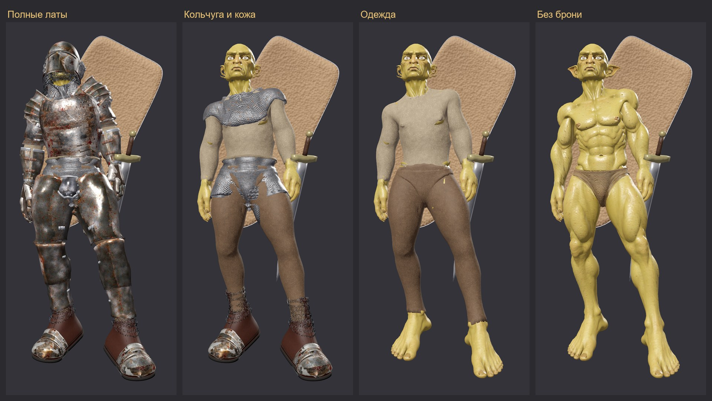
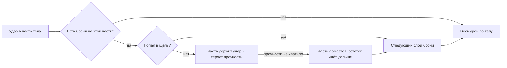
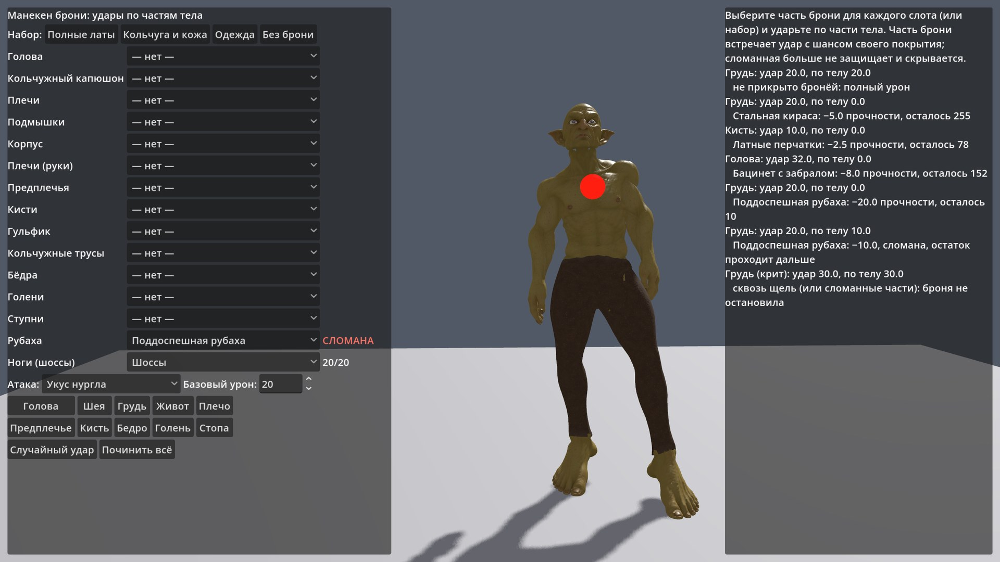
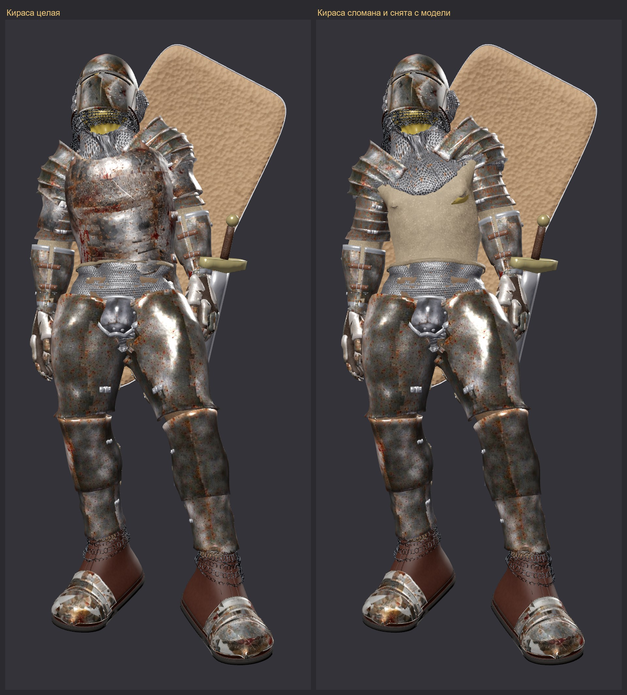

# Почему удар в кирасу не ранит, а такой же удар по голой груди снимает 20 здоровья?

> Пять ударов по 200 кираса держит, не пропуская ни капли. Шестой ломает её, и до тела доходит сразу 130.

**Статус:** решено (без сохранения прочности в сейв) · **Дата:** 2026-11-18 · **Ветка:** «Новая модель героя: латник с бронёй по частям тела» (запущена из «Расширение карты Home до большого мира»; правила попаданий днём раньше сделала главная ветка)

## Коротко

- **Было:** броня героя была одной вещью: она просто уменьшала весь входящий урон. Шлем, перчатки, поножи по отдельности не существовали.
- **Стало:** у тела 15 слотов: голова, корпус, предплечья, голени и другие. В каждый надевается своя часть со своей прочностью. Удар по груди в кирасе не ранит и съедает 5 прочности. Такой же удар по голой груди снимает 20 здоровья.
- **Как:** каждой части брони назначили слот. У героя появился «шкаф» надетого с прочностью каждой части. И сделали манекен, на котором видно каждый удар.

*Один латник в четырёх готовых наборах: полные латы (15 частей), кольчуга и кожа (5), одежда (2), без брони.*

## Что было не так

За день до этого главная ветка написала правила попаданий (решение G-D090). Удар попадает в часть тела: голову, руку,
бедро. Голова — урон в 1,6 раза больше, кисть — в 2 раза меньше. Часть брони, закрывающая это место, принимает удар на себя.

Но надеть эти части на героя было нельзя. В инвентаре у героя был один слот брони с общим множителем урона. Осада
выдавала ему набор «одежда» заново в каждом бою. Части брони по-настоящему носили только жители и воины на стенах.
И увидеть, что делают правила, можно было лишь по строчкам в журнале.

## Почему так происходило

Снаряжение героя придумывали раньше, как в большинстве игр: «доспех» — одна вещь. А пользователь решил иначе: «мы будем
подбирать броню, покупать отдельные её части и одевать». Значит, прочность тоже у каждой части своя. Помятая кираса не
должна чинить шлем.

Сравнение из жизни: раньше броня была как один зонт над героем. Теперь это набор доспехов: дыра в наруче не делает
дыру в шлеме.

## Что пробовали

| Попытка | Что вышло | Почему не подошло |
|---|---|---|
| Один слот брони с множителем урона (как было) | Просто | Не видно, какую часть тела закрыли и что сломалось |
| Набор брони, который осада заново выдаёт в каждом бою (первая версия G-D090) | Правила считаются | Прочность не переходит из боя в бой: после осады броня снова как новая |
| Слоты по частям тела, прочность хранится у героя | Подошло | — |

Одна тонкость со слотами: кольчужный капюшон и кольчужная пелерина — два покроя одной накидки. В SF3D их уже нельзя
надеть вместе, поэтому в игре у них один слот. Проверка данных теперь не даёт набору положить две части в один слот.

## Как решили

1. **Слоты.** У каждой из 16 частей в данных появился слот: голова, капюшон, плечи, подмышки, корпус, плечи рук,
   предплечья, кисти, гульфик, кольчужные трусы, бёдра, голени, ступни, рубаха, шоссы. Новая часть в занятом слоте
   снимает старую.
2. **Хозяин брони.** У героя появилась броня по слотам с прочностью каждой части. Укусы в осаде изнашивают именно её,
   и износ остаётся после осады. В журнал пишется, какая часть встретила укус, сколько прочности потеряла и сколько осталось.
3. **Манекен.** Отдельная сцена: латник в стойке, слева выбор части для каждого слота, справа журнал. Кнопка бьёт в
   выбранную часть тела теми же правилами, что и в осаде. Сломанная часть исчезает с модели.

Как удар проходит сквозь броню:

Прочность тратится по материалу. Латы теряют четверть урона: удар 20 снимает с кирасы 5. Кольчуга — почти половину, кожа —
70 %, ткань — весь урон.

*Манекен: слева слоты и прочность каждой части, справа журнал ударов. Рубаха помечена «СЛОМАНА»: в одежде латник получил три удара в грудь.*

## Как проверили

Прогон на манекене 27 ноября, удары по нарастающей. Атака «укус нургла», базовый урон 20, потом 200.

| Удар | Что надето | Урон удара | По телу | Что с бронёй |
|---|---|---|---|---|
| Грудь | ничего | 20 | **20** | — |
| Грудь | полные латы | 20 | **0** | кираса −5, осталось 255 из 260 |
| Кисть | полные латы | 10 | **0** | перчатки −2,5, осталось 78 из 80 |
| Голова | полные латы | 32 | **0** | шлем −8, осталось 152 из 160 |
| Грудь ×1 | одежда | 20 | **0** | рубаха −20, осталось 10 из 30 |
| Грудь ×2 | одежда | 20 | **10** | рубаха сломана, остаток прошёл |
| Грудь ×3 (крит) | одежда | 30 | **30** | рубаха уже сломана |
| Грудь ×5 | полные латы | 200 | **0** каждый | кираса 260 → 10 |
| Грудь ×6 | полные латы | 200 | **130** | кираса и рубаха сломаны |

Последний удар: остаток кирасы задержал 40 урона, рубаха — ещё 30, до тела дошло 130.

*Одна камера. Слева кираса целая, справа она сломана и снята с модели: видна рубаха под ней.*

Главная ветка ещё 16 ноября посчитала, сколько укусов нургла нужно до смерти (400 прогонов, укус 8, здоровье 100):
без брони 16, в одежде 23, в кольчуге и коже 32, в полных латах 161.

*Прогон манекена шёл с постоянным зерном случайности 90, поэтому повторяется один в один. Тесты игры не запускали.*

## Что осталось

- Прочность частей не сохраняется в сейв. После перезагрузки броня снова новая. Сохранение слотов — следующий шаг решения G-D090.
- В игре пока нет окна, где выбирать части брони, нет кузнеца и магазина. Для проверки сделана клавиша `'`: она надевает следующий набор.
- Чинит пока только кнопка манекена «Починить всё».
- Цифры прочности и покрытия — первая прикидка, баланс не проверяли.

## Словарик

| Термин | Простыми словами |
|---|---|
| Слот | Место на теле для одной части брони: голова, корпус, кисти. |
| Прочность | Запас части брони. Каждый остановленный удар его тратит. Ноль — часть сломана и больше не защищает. |
| Покрытие | Какую долю части тела закрывает броня. Шлем с забралом — 85 % головы: остальное щели. |
| Крит | Критический удар: сильнее обычного и легче находит щели в броне. |
| Износ материала | Сколько прочности теряет часть за единицу урона: латы 0,25, кольчуга 0,45, кожа 0,7, ткань 1. |
| Манекен | Тестовая сцена, где можно бить по выбранной части тела и сразу видеть результат. |
| Нургл | Враг из осады Дома, кусается. |

## Для видео

**Озвучка** (около 1 минуты 10 секунд):

Раньше доспех героя был одной вещью. Он просто срезал весь урон на сколько-то процентов. А пользователь захотел иначе:
подбирать броню по частям, покупать отдельно шлем, наручи, поножи. Так у тела появилось пятнадцать слотов, от головы
до ступней. В каждом своя часть брони со своей прочностью. Помятая кираса не значит помятый шлем: у каждой части
свой запас. Проверяем на манекене. Удар в голую грудь — двадцать урона,
всё по телу. Тот же удар в кирасу — ноль по телу, а кираса теряет пять прочности из двухсот шестидесяти. Латы гасят
удар легко: тратят только четверть его силы. Кольчуга тратит почти половину, ткань — всю. Рубаха выдерживает один удар, на втором ломается, и
остаток уходит в тело. Теперь бьём по латам изо всех сил: двести урона. Первый удар, второй, пятый — по телу ноль,
только кираса тает. Шестой удар её ломает. Кираса исчезает с модели, остаток пробивает рубаху, и до тела доходит
сразу сто тридцать. Броня держит до последнего, а потом сдаётся вся сразу.

**Вау-момент:** пять ударов по 200 без единой царапины, и шестой — сразу 130 по телу, кираса исчезает с модели.

**Обложка:** `src/s2_cuirass_broken.png` рядом с `src/s2_kit_full_plate.png`, текст «ШЕСТОЙ УДАР».

**Оценка для видео:** 3 — понятная игровая механика с цифрами и щелчком «сломалась», но визуально это в основном журнал и одна сцена без боя.

## Для любопытных

- Файлы игры: `data/combat/armor_pieces.json` (`slots` и `slot` у каждой части), `game/combat/anatomy/armor_wear.gd`
  (надевание в слот), `game/combat/anatomy/anatomy_rules.gd` (проверка слотов, удар в заданную часть),
  `game/characters/hero_armour.gd` (броня героя, узел `Armour` в `hero.tscn`), `game/horde/horde_town.gd` (укусы осады
  по броне героя, журнал), `game/combat/anatomy/armour_dummy.tscn` (манекен), строки EN/RU — `assets/localization/*.po`.
- Правила попаданий и числа: `data/combat/anatomy.json`, решение G-D090 (главная ветка, коммит игры `ac8b5b4d`, 17 ноября).
- Коммиты игры: `cd9fa813` (слоты, броня героя, манекен, модель), `e5d5d84f` (DECISIONS: G-D090, пункт 8).
- Ветки: «Новая модель героя» (эта сессия), задачу дала «Расширение карты Home до большого мира» (`local_b6e54bdd`).
- Как повторить: открыть `game/combat/anatomy/armour_dummy.tscn` в редакторе и нажать F6, или в игре `-- --hero-kit=full_plate`.
- Кадры разбора: стенды `.scratch/hero_story/dummy_stand.gd` и `stand.gd` в папке игры (не в git), запуск через `tools/run_queued.ps1 -Lane godot`.
