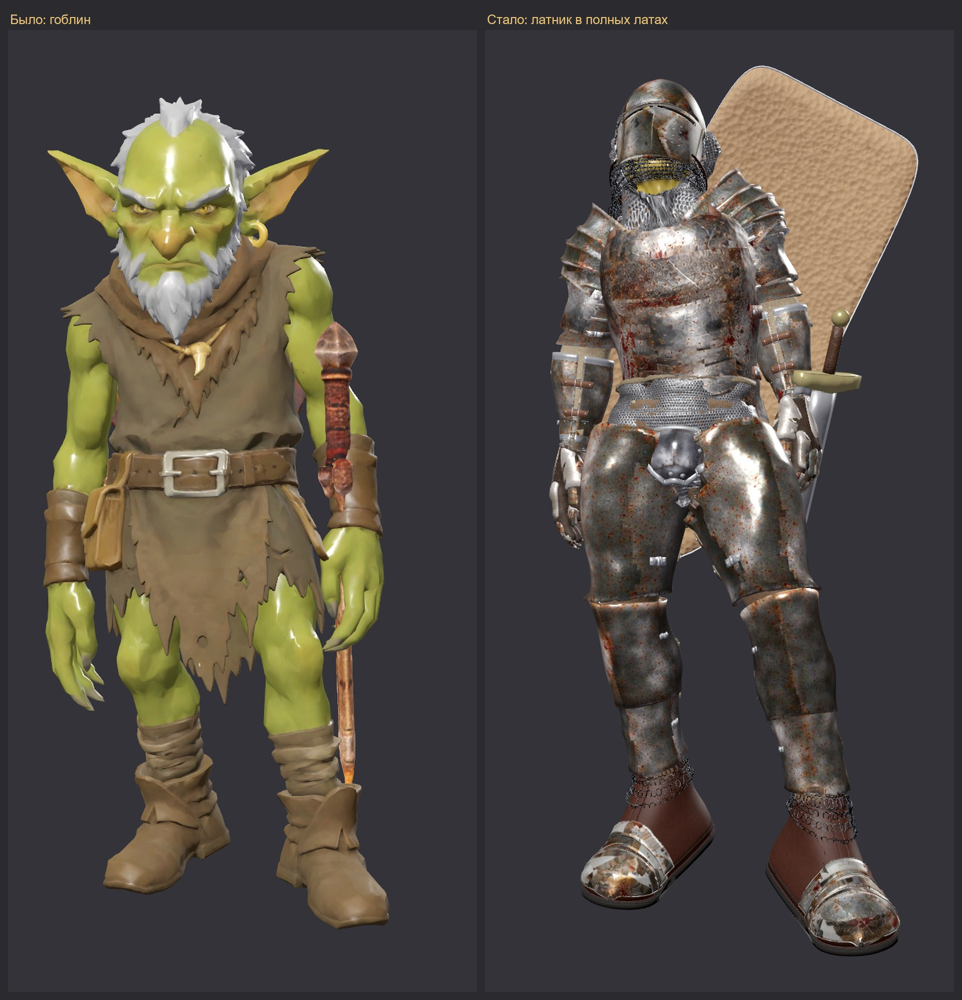
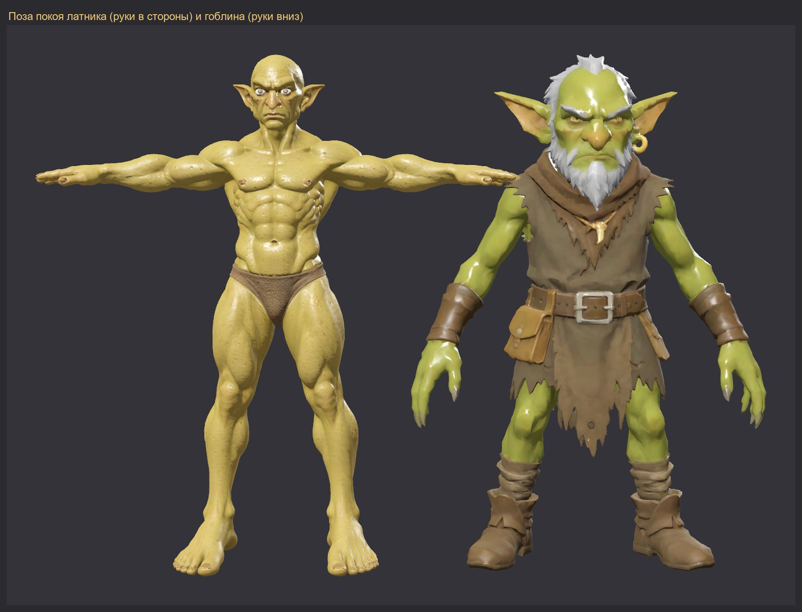
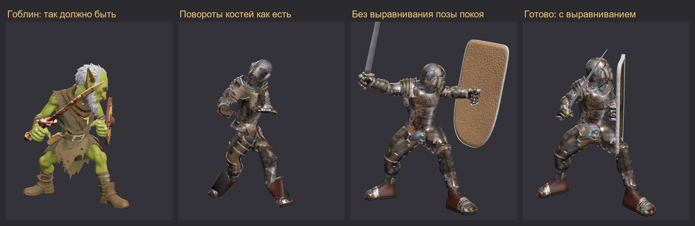
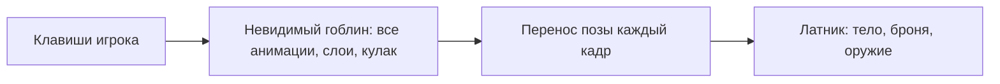
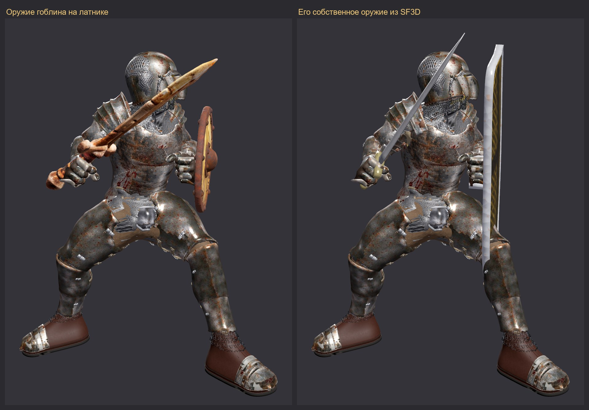
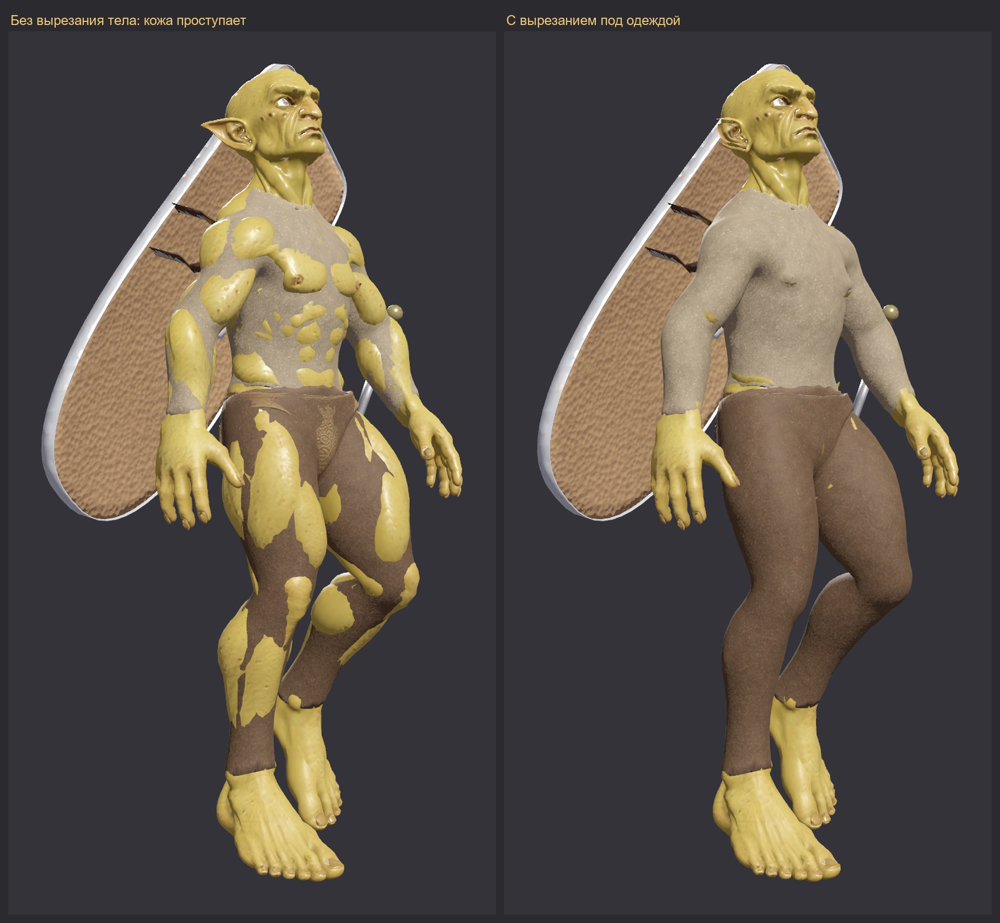
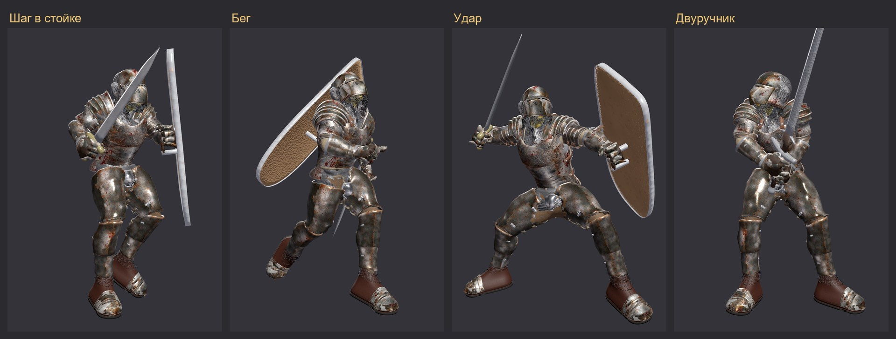

# Как переодеть героя в другое тело, не переделав ни одной анимации?

> Новый герой-латник двигается… руками невидимого гоблина: тот по-прежнему играет все анимации, а латник только повторяет его позу.

**Статус:** решено (пробный вариант, основной герой пока гоблин) · **Дата:** 2026-11-18 · **Ветка:** «Новая модель героя: латник с бронёй по частям тела» (запущена из ветки «Расширение карты Home до большого мира»)

## Коротко

- **Было:** героя в игре можно было сделать только гоблином. Все анимации, оружие и удары были настроены под его скелет.
- **Стало:** одна клавиша превращает героя в латника из SF3D. Он ходит, бегает, бьёт и носит броню из 16 частей. Ни одной анимации заново делать не пришлось.
- **Как:** гоблин остался внутри героя, но стал невидимым. Каждый кадр его поза переносится на латника кость за костью, с поправкой на то, что они по-разному стоят в покое.

*Одна и та же камера, одна анимация покоя. Слева прежний герой, справа латник в полных латах.*

## Что было не так

Пользователь хотел проверить урон по частям тела: голова, рука, бедро, и в доспехе, и без. Для этого нужен герой, на
которого можно надеть броню по частям. У гоблина такой брони нет. Зато в SF3D уже был мускулистый мужчина и 16 частей
брони и одежды, подогнанных прямо по нему: шлем, кираса, наручи, поножи, рубаха, шоссы. Были и его меч, ростовой щит и двуручник.

Но у героя в игре десятки анимаций: ходьба, бег, стойка с оружием, удары, лук, прыжок, перекат. Их подбирали и
доводили под гоблина неделями. Переделывать всё под новое тело ради пробы — слишком дорого.

## Почему так происходило

Анимация в игре — это не движение кожи. Это повороты костей скелета: «плечо повернуть на столько-то, локоть на столько-то».
Кожа просто тянется за костями.

У мужчины из SF3D кости называются так же, как у гоблина: 65 костей, имена от сервиса Mixamo. Казалось бы, бери повороты
гоблина и отдавай мужчине. Подвох в **позе покоя**. Гоблин в покое стоит с опущенными руками, а мужчина — с руками в
стороны, буквой «Т». Поворот «на 30 градусов от покоя» у них даёт разные руки.

*Слева мужчина в позе «Т», справа гоблин с опущенными руками. Имена костей одинаковые, а исходное положение рук разное.*

Сравнение из жизни: два человека получили инструкцию «подними руку на 45 градусов». Один в начале держал руки по швам,
другой — в стороны. Рука окажется в разных местах.

## Что пробовали

| Попытка | Что вышло | Почему не подошло |
|---|---|---|
| Отдать повороты костей как есть | Голова вывернута, руки и ноги перекручены | Повороты считаются от разных поз покоя |
| Переносить «поворот от покоя», без выравнивания | Ноги правильные, но руки задраны вверх и в стороны | Руки мужчины в покое на десятки градусов выше рук гоблина |
| Заранее пересчитать каждую анимацию в файл (так уже сделали стражникам на стенах: 13 клипов) | Работает | У героя клипов намного больше, а его анимации ещё смешиваются слоями: лук поверх ходьбы, сжатый кулак поверх клипа. Каждую правку пришлось бы пересчитывать |
| Переименовать кости через встроенный в Godot перенос анимаций | Не пробовали | Пришлось бы менять кости самого гоблина, а на их имена завязаны оружие, хват и стражники |
| Сделать анимации заново через SF3D | Не пробовали | Те же недели работы, ради пробной модели |

Первые две ошибки уже встречались раньше у стражников на стенах (другая ветка, 17 ноября: «головы вывернуты»,
«руки на 45 градусов выше»). Поэтому здесь сразу взяли их решение. Для разбора обе ошибки специально повторили на латнике:

*Одна поза «стойка с оружием». Гоблин — как должно быть; без поправок латник скрючен (оружие во втором кадре убрано); без
выравнивания у него задраны руки; с выравниванием — стойка как у гоблина.*

## Как решили

Гоблина не убрали. Он по-прежнему стоит внутри героя, играет все анимации, держит меч и щит. Но его не видно. Как
кукловод за ширмой: зритель видит только куклу-латника.

Каждый кадр делается так:

1. **Выравнивание покоя.** Один раз при старте каждую кость латника мысленно поворачиваем так, чтобы в покое она легла
   вдоль такой же кости гоблина. Руки «Т» становятся руками «по швам».
2. **Перенос поворота.** Смотрим, насколько кость гоблина повернулась от его покоя, и поворачиваем кость латника на столько же.
3. **Таз.** Латник выше в бёдрах (таз в покое на 0,551 высоты против 0,486 у гоблина). Поэтому подскоки и приседания
   таза увеличиваем в 1,13 раза, иначе ноги то висят, то проваливаются.

Дальше три доработки:

- **Оружие.** Меч и щит гоблина висят на его костях. Они спрятаны, а на те же кости латника вешается его собственное оружие
  из SF3D. В руке оно лежит ровно там, где SF3D его подогнал. Убранное висит у бедра и за спиной, там же, где у гоблина.
  Лук пока гоблинский.
- **Броня.** Каждая часть брони сделана на том же скелете, что и латник. Её просто пересаживают на его кости, и она
  двигается вместе с ним.
- **Кожа под одеждой.** В движении кожа проступает сквозь рубаху и шоссы. К каждой части SF3D сохраняет «маску»:
  список точек тела, которые она закрывает. Пока часть надета, эти куски кожи вырезаются из тела.

*Слева на латника перенесены ржавый меч и круглый щит гоблина, справа его собственные меч и ростовой щит.*

*Тот же шаг. Слева тело целое, и жёлтая кожа пятнами проступает сквозь рубаху и шоссы. Справа кожа под одеждой вырезана.*

Переключение — клавиша `;`. Обратно в гоблина — тоже `;`. Движение, удары и расчёт урона от модели не зависят: их по-прежнему
считает гоблин.

## Как проверили

- Запустили игру в Доме с латником в полных латах: стоит, идёт, бежит, переключается обратно в гоблина (снимки 18 ноября).
- Отдельно сняли стойку с оружием, шаг, бег, удар и двуручник. Для этого разбора все кадры пересняты 27 ноября тем же кодом.
- Тесты игры не запускали.

| Что | Гоблин | Латник |
|---|---|---|
| Костей в скелете | 65 | 65 |
| Высота таза в покое (доля роста) | 0,486 | 0,551 |
| Анимаций, переделанных вручную | — | 0 |
| Частей брони и одежды | — | 16 |
| Своего оружия из SF3D | — | 3 (меч, ростовой щит, двуручник) |

*Сколько миллисекунд занимает перенос позы, не мерили. В Доме FPS при съёмке не сравнивали.*

*Шаг в стойке, бег, удар мечом и двуручник: всё это анимации гоблина, перенесённые на латника.*

## Что осталось

- Латник — пробный вид. Сделать ли его основным героем, решит пользователь.
- Лук остался гоблинский: своего лука у латника нет.
- Тело чуть иначе сложено, чем у гоблина. Поэтому ступни на бегу могут немного скользить. Специально не мерили.
- На ростовом щите из SF3D нарисован крест, а в мире игры христианства нет. Щит надо перекрасить, прежде чем показывать его в ролике крупно.
- Позже другие ветки дописали к надеванию брони «вдавливание» кожи под пластинами и правило слоёв (рубаха не проступает
  сквозь кирасу). Делали это для гоблинов-лучников, на латнике отдельно не проверяли.

## Словарик

| Термин | Простыми словами |
|---|---|
| Скелет, кость | Невидимый каркас внутри модели. Кожа модели прикреплена к костям и тянется за ними. |
| Анимация (клип) | Записанные повороты костей по времени: ходьба, удар, прыжок. |
| Поза покоя | Как стоит модель без анимации. Все повороты в анимации считаются от неё. |
| Перенос анимации (ретаргет) | Проигрывание анимации одного скелета на другом, с поправкой на разницу в строении. |
| Mixamo | Сервис Adobe с готовыми анимациями. Он задаёт общие имена костей, поэтому у гоблина и латника они совпали. |
| Маска брони | Список точек тела, которые закрывает часть брони. Эти точки вырезают из тела, чтобы кожа не проступала. |
| SF3D | Наше приложение, которое делает модели, скелеты, броню и оружие для игры. |

## Для видео

**Озвучка** (около 1 минуты 20 секунд):

Наш герой — гоблин. Под него неделями собирали анимации: ходьбу, бег, стойку, удары, лук. А теперь нужен латник в
настоящих доспехах. Броня под него уже есть: шестнадцать частей, от шлема до шосс. Переделывать все анимации? Нет.
У гоблина и латника одинаковые скелеты: шестьдесят пять костей с одними и теми же именами. Берём повороты костей гоблина
и отдаём латнику. И получаем вот это. Голова вывернута, руки перекручены. Дело в позе покоя. Гоблин стоит с опущенными
руками, а латник раскинул их буквой «Т». Поправляем: переносим не сам поворот, а насколько кость повернулась от покоя.
Ноги встали, а руки задраны вверх. Последний шаг: перед переносом укладываем каждую кость латника вдоль кости гоблина.
И вот он стоит в той же стойке. Хитрость в том, что гоблин никуда не делся. Он стоит внутри героя невидимым, играет
все анимации и держит меч. А латник каждый кадр просто повторяет его позу, как кукла за кукловодом. Оружие гоблина
спрятано, вместо него у латника свой меч и свой щит. Кожа под одеждой вырезана, чтобы не проступала на ходу. Одна
клавиша, и герой снова гоблин. Ни одной новой анимации.

**Вау-момент:** скрюченный латник (повороты «как есть») рядом с ровной стойкой, и раскрытие, что внутри всё время ходит невидимый гоблин.

**Обложка:** `src/s1_raw_guard_q34.png` рядом с `src/s1_man_guard_q34.png`, текст «ГОБЛИН ВНУТРИ».

**Оценка для видео:** 4 — наглядные кривые позы и простая разгадка; минус — сравнения в самой игре мало, кадр из Дома снят издалека.

## Для любопытных

- Файлы игры: `game/characters/pose_retarget.gd` (перенос позы, оружие), `game/characters/armoured_man.gd` (латник и его
  броня), `game/characters/armour_dressing.gd` (надевание и вырезание тела), `game/characters/hero_model_variant.gd`
  (переключатель `;`), `game/horde/defence/rig_match.gd` (выравнивание покоя, взято у стражников), модели —
  `assets/models/hero/man_test/` (около 116 МБ).
- Исходники в SF3D: `export/character/man_muscul_no_segment_no_rig/` (скелет по меткам, броня, одежда, оружие).
- Коммиты игры: `cd9fa813` (модель, броня, перенос позы, переключатель), `e5d5d84f` (DECISIONS: G-D090, пункт 8).
- Ветки: «Новая модель героя» (эта сессия), задачу дала «Расширение карты Home до большого мира» (`local_b6e54bdd`).
- Как повторить: запустить игру с параметрами `-- --hero-model=man --hero-kit=full_plate` или нажать `;` в Доме.
- Кадры разбора: стенд вне проекта (`.scratch/hero_story/stand.gd` в папке игры, не в git) рисует каждую позу в буфер 2560×1440.
