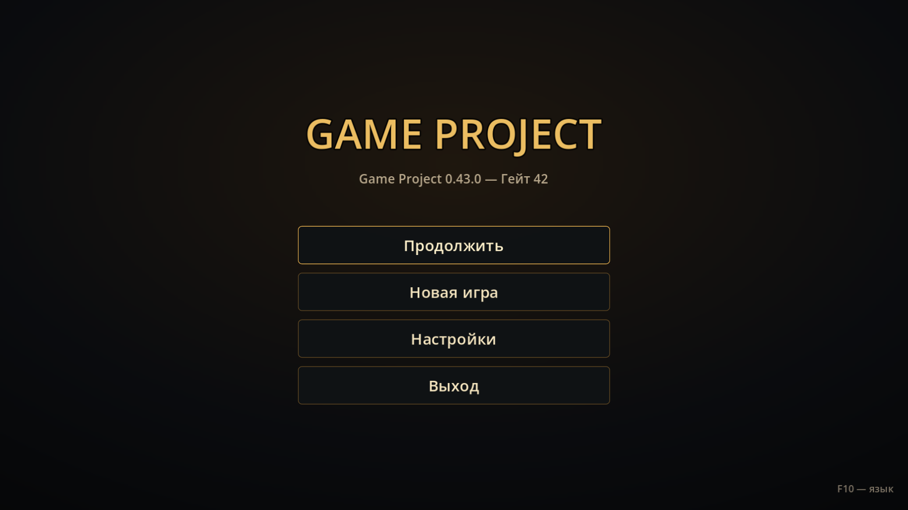
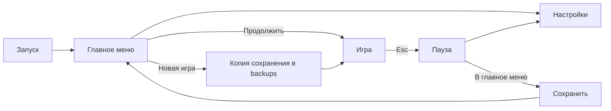
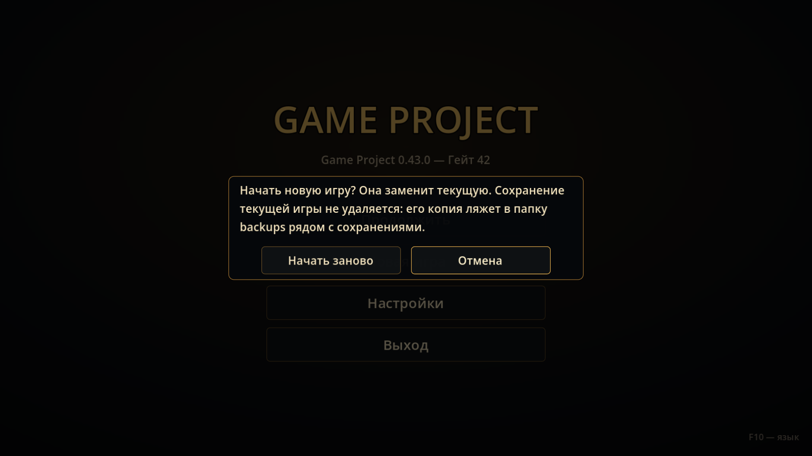
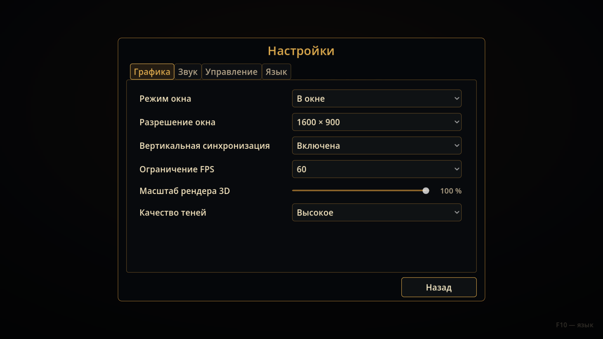
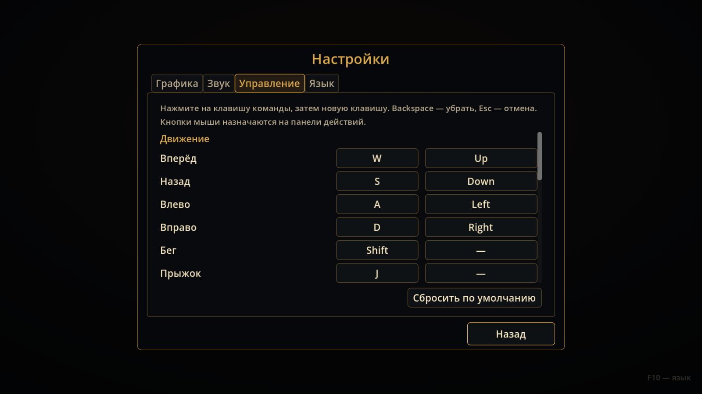
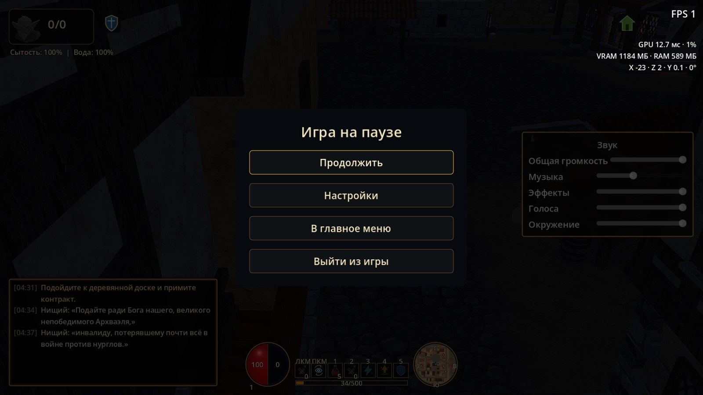
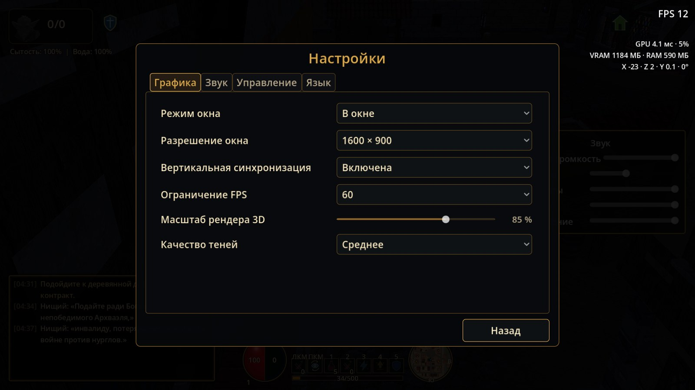
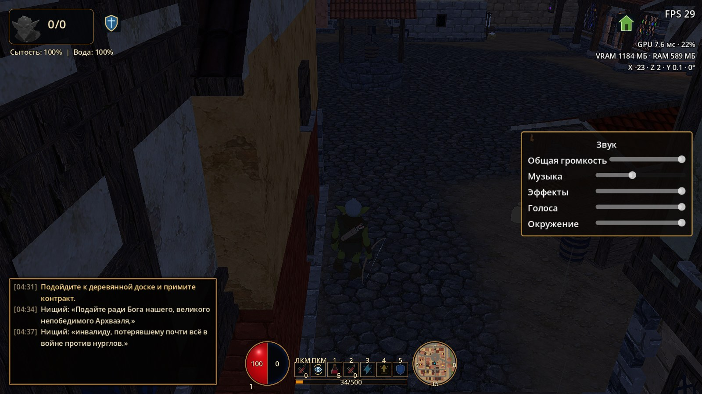

# Как у игры появилось главное меню, и почему «Новая игра» — самая опасная кнопка?

> Самая опасная кнопка в меню — «Новая игра»: одно нажатие могло стереть всё, что игрок наиграл.

**Статус:** решено · **Дата:** 2026-11-22 · **Ветка:** Главное меню игры: вход и настройки

## Коротко

- **Было:** игра открывалась сразу в мире. Ни меню, ни настроек графики, ни смены клавиш.
- **Стало:** при запуске — меню «Продолжить / Новая игра / Настройки / Выход». Настройки открываются и из паузы и
  сохраняются между запусками. Есть 4 вкладки: графика, звук, управление, язык.
- **Как:** меню стало первым экраном игры. Настройки пишутся в тот же файл, где уже хранились язык и громкость. Перед
  новой игрой старое сохранение копируется в отдельную папку.

*Главное меню. Снимок сделан до того, как игра получила название: вместо «GAME PROJECT» теперь «Мир гоблинов».*

## Что было не так

Игра — экшен про гоблина. До этой задачи она запускалась сразу в мире, у домов городка. Чтобы начать заново,
нужно было вручную удалить файл сохранения. Сменить разрешение, тени или клавишу прыжка было нельзя: всё было
зашито в проект.

Пауза по Esc была, но в ней только «Продолжить» и «Выйти из игры». Выйти из забега в меню было некуда, потому что
меню не было.

## Почему так происходило

Игру собирали «снизу вверх»: сначала мир, бой и сохранения, а оболочку вокруг откладывали. Похоже на дом без
прихожей: сразу заходишь в комнату.

Сложность была не в кнопках, а в трёх местах, где легко что-то испортить:

1. **Новая игра поверх старой.** Сохранение у игры одно. Если просто начать заново, старый забег пропадёт.
2. **Настройки — общий файл.** В нём уже хранились язык и громкость, и его читает сама игра. Если меню будет писать
   в свой отдельный файл, через месяц файлы начнут спорить, какой из них правильный.
3. **Клавиши.** Часть команд игра создаёт сама при запуске (магия на M, бросок зелья на G). В обычном списке клавиш
   проекта их нет, и меню о них просто не знало бы.

## Что пробовали

| Вариант | Что вышло бы | Что сделали |
|---|---|---|
| Хранить настройки в отдельном `settings.cfg`, как просила задача | Два файла с языком и громкостью, у одной вещи два хозяина | Оставили один файл, который уже был: с версиями и безопасной записью. В него добавили графику и клавиши. |
| Для новой игры просто стереть сохранение | Игра нашла бы сохранение прошлой версии и загрузила его | Игре явно говорят: «это новый забег, старое не читать», а старое сохранение копируют. |
| Игра при старте применяет все настройки | Она перебила бы размер окна и предел кадров в тестах скорости | Игра применяет язык, звук и клавиши, графику применяет меню. Панель применяет только то, что изменили: ползунок громкости не трогает окно. |

## Как решили

**Меню — первый экран.** «Продолжить» видно, только если есть сохранение. F10 меняет язык прямо в меню.

**Новая игра спрашивает.** Если сохранение есть, игра предупреждает и кладёт его копию в папку `backups` с датой и
временем в имени. Копию сразу проверяет: совпадает ли она с оригиналом. Если копия не получилась, старое сохранение
не трогается.

*Перед новой игрой: сохранение не удаляется, его копия ляжет в папку backups. Курсор стоит на «Отмена».*

**Настройки — одна панель на двоих.** Одна и та же панель открывается из меню и из паузы. Изменение сначала
записывается в файл, потом применяется. Если запись не удалась, на экране и в игре остаётся прежнее.

- **Графика:** режим окна, разрешение, вертикальная синхронизация, предел кадров, масштаб 3D и качество теней.
  Если масштаб 3D меньше 100 %, картинку дорисовывает FSR.
- **Звук:** пять ползунков (общая громкость, музыка, эффекты, голоса, окружение).
- **Управление:** 20 команд, по две клавиши на каждую. Нажмите на клавишу команды, потом новую клавишу. Если эта
  клавиша уже занята, она переедет сюда, и игра об этом скажет. Esc и служебные клавиши занять нельзя.
- **Язык:** русский или английский.

*Вкладка «Графика»: шесть настроек, все применяются сразу.*

*Вкладка «Управление»: у прыжка стоит J вместо пробела — это клавиша, выбранная в проверке.*

**Из паузы — в меню.** В паузе появились «Настройки» и «В главное меню». Перед выходом в меню игра сохраняется. Если
сохранить не удалось, игра остаётся на месте и показывает ошибку, а не теряет прогресс.

*Пауза по Esc: новые кнопки «Настройки» и «В главное меню».*

*Те же настройки поверх игры: масштаб 3D 85 % и средние тени, выбранные перед этим в меню, уже действуют.*

**Название.** Пользователь назвал игру «Мир гоблинов», по-английски «World of Goblins». Перед этим проверили, не
занято ли название. Игр с таким именем в Steam, на Яндекс Играх, в VK и в RuStore не нашли. Похожие есть:
джем-игра «Goblin World» на itch.io (2020), ролевая игра живого действия «Мир глазами гоблинов» и мобильная
«Империя гоблинов». Прямого совпадения нет. Это не юридическая проверка: перед продажей название стоит проверить в
реестрах товарных знаков.

## Как проверили

Отдельный автотест на меню и настройки: 54 проверки. Он проверяет и чтение старых версий файла настроек, и смену
клавиш, и то, что «Новая игра» не читает старое сохранение. Плюс прогнали старые тесты игры.

Потом игру гоняли с окном, по-настоящему, на копии сохранения пользователя:

1. Меню → Настройки: средние тени, масштаб 3D 85 %, музыка 40 %, прыжок на J.
2. «Продолжить» → игра → Esc → «Настройки» → Esc закрывает только панель, пауза остаётся → «В главное меню».
3. Перезапуск игры: все четыре выбора на месте. Музыка: −8 дБ (это и есть 40 %), прыжок: J.
4. «Новая игра»: появилась копия сохранения в `backups`, начался первый забег с нулём опыта.

| Что мерили | Результат |
|---|---|
| Автотест меню и настроек | 54 из 54 |
| Общие тесты игры | 807 из 807 (на всём рабочем дереве), 767 из 767 (на одном коммите) |
| Тесты сохранений, смерти, паузы у кузнеца, фокуса окна | 132, 67, 28, 6 — без ошибок |
| Настройки после перезапуска | 4 из 4 на месте |
| Новых строк перевода | 70 (каждая по-русски и по-английски) |

*Замеры: ноутбук с RTX 4060 Laptop, Godot 4.7.2.*

*После «Продолжить»: герой в городке, справа ползунок музыки стоит на 40 %, как выбрали в меню.*

## Что осталось

- Клавиши панели действий 1–5 в меню не переназначаются.
- Подсказки на экране игры (например, значок «E») показывают клавиши по умолчанию, даже если их сменили.
- Название — только в меню. Внутреннее имя проекта не меняли: от него зависит папка с сохранениями, и после смены
  игра «потеряла» бы их.
- Четыре проверки старого теста интерфейса падали ещё до этой задачи (правая кнопка мыши стала камерой, а тест
  ждёт заклинание). Их не трогали.

## Словарик

| Термин | Простыми словами |
|---|---|
| Сохранение | Файл, где игра хранит забег: уровень, опыт, вещи. |
| Бэкап | Копия файла на случай беды. Здесь — копия сохранения перед новой игрой. |
| Вертикальная синхронизация (VSync) | Кадр выводится вместе с обновлением монитора: картинка не «рвётся», но кадров не больше, чем у монитора. |
| Предел кадров (FPS) | Сколько кадров в секунду игра рисует самое большее. Меньше кадров — тише вентилятор. |
| Масштаб 3D | Мир рисуется в меньшем разрешении, а интерфейс — в полном. Так быстрее. |
| FSR | Технология AMD: аккуратно растягивает уменьшенную картинку до размера экрана. |
| Децибел (дБ) | Единица громкости. −8 дБ — заметно тише, но не шёпот. |
| Переназначение клавиш | Своя клавиша на команду: прыжок не на пробел, а на J. |
| Автотест | Программа, которая сама нажимает кнопки и проверяет результат, чтобы человеку не щёлкать сто раз. |

## Для видео

**Озвучка:**

Наша игра про гоблина долго обходилась без главного меню. Запускаешь — и ты сразу в городке. Хочешь начать заново —
иди удаляй файл руками.

Сделать четыре кнопки нетрудно. Трудно не сломать то, что за ними. Самая опасная кнопка — «Новая игра». Сохранение
у игры одно, и одно нажатие могло стереть всё, что игрок наиграл.

Поэтому новая игра сначала спрашивает. Потом кладёт копию старого сохранения в отдельную папку и проверяет, что копия
целая. Не получилось скопировать — ничего не трогаем.

Настройки тоже с подвохом. Игра и меню читают один файл. Два файла через месяц начали бы спорить, какой главный.
Поэтому файл один: меню пишет, игра читает.

Клавиши можно менять: по две на каждую из двадцати команд. Занятая клавиша переезжает, и игра об этом говорит.

А из паузы теперь можно выйти в меню. Игра перед этим сохраняется. Не сохранилось — остаёмся в игре, прогресс цел.

**Вау-момент:** вопрос «Начать новую игру?» и рядом папка backups, где появляется копия сохранения с датой в имени.

**Обложка:** главное меню с новым названием, крупно «НЕ СТЕРЕТЬ СЕЙВ».

**Оценка для видео:** 2 — привычная для игрока вещь, без зрелища. Держится на одной мысли: «Новая игра» не должна
стирать прогресс.

## Для любопытных

- Игра: репозиторий `D:\My projects\game-project-godot`, Godot 4.7.2.
- Файлы: `game/ui/menu/main_menu.gd/.tscn`, `settings_panel.gd`, `key_bindings_tab.gd`, `menu_theme.gd`;
  `game/settings/` (`settings_profile.gd`, `settings_apply.gd`, `control_actions.gd`); `game/bootstrap/game_launch.gd`
  (новая игра, копия сохранения); `game/persistence/settings_codec.gd` (версия 3 файла настроек: графика и клавиши);
  `game/ui/pause_menu.gd/.tscn`; `tests/settings_menu_tests.gd`.
- Коммиты игры: `2729f07` — главное меню, настройки, выход из паузы (решение G-D107); `cdc06e9` — микшер звука
  (G-D105, работа другой ветки, на которой стоит вкладка «Звук»).
- Ветка: Главное меню игры: вход и настройки (`local_5f72d0d3`), задание от «Правки проекта» (`local_e34b3455`).
- Настройки — `user://g4_settings.json`, копии сохранений — `user://backups/g4_run_v22_ГГГГММДД_ЧЧММСС.json`.
- Как повторить: запустить игру; в меню «Настройки», поменять тени и клавишу; перезапустить; «Новая игра» поверх
  сохранения и посмотреть папку backups в данных игры.
