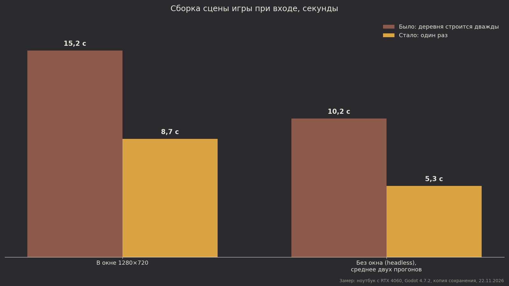
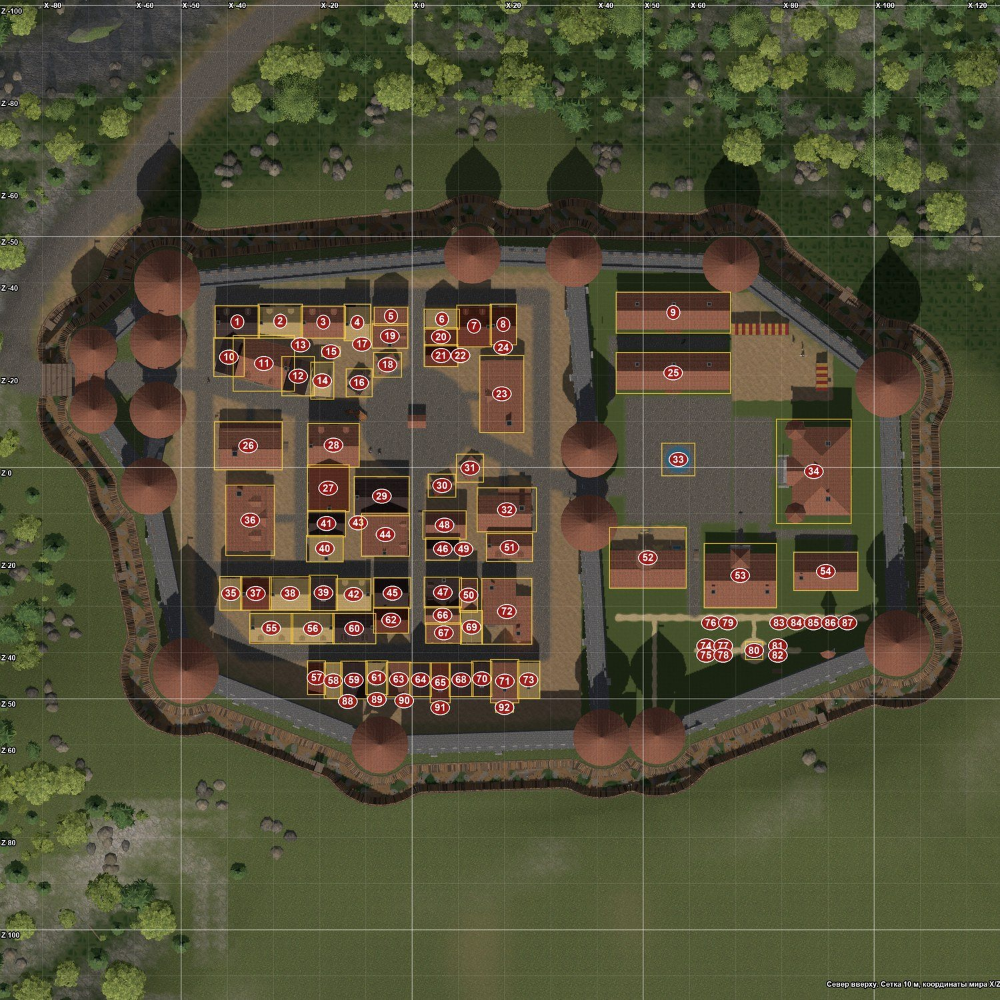
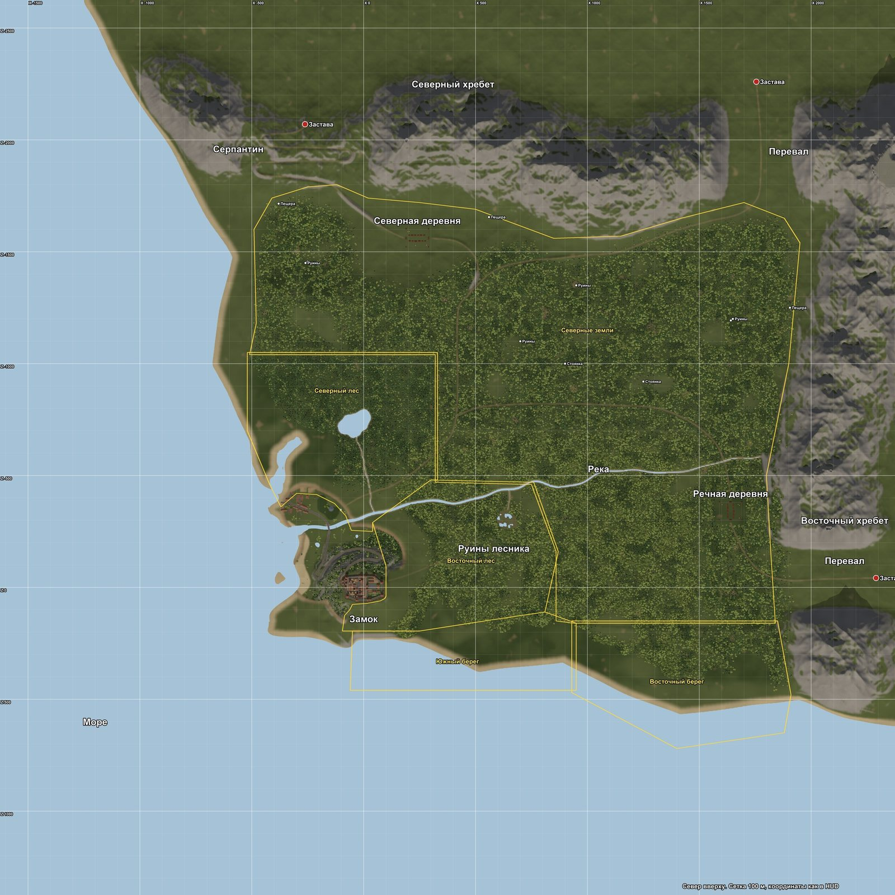
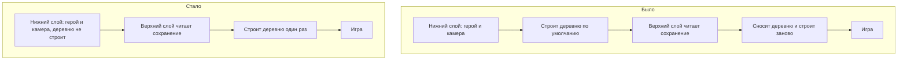
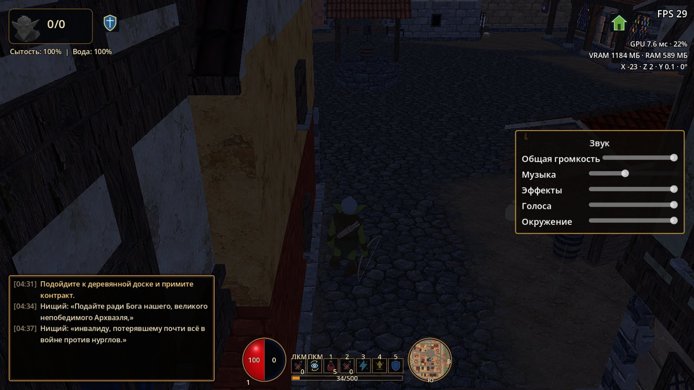

# Почему игра строила целую деревню дважды?

> На каждом входе в игру программа собирала деревню, тут же сносила её и собирала такую же заново.

**Статус:** решено · **Дата:** 2026-11-22 · **Ветка:** «Домашний мир строится один раз» (ответвление ветки «Главное меню игры: вход и настройки»)

## Коротко

- **Было:** после кнопки «Продолжить» сборка мира шла 15,2 секунды, и почти половина уходила на деревню, которую тут же выбрасывали.
- **Стало:** 8,7 секунды, деревня строится один раз.
- **Как:** убрали черновую сборку. Деревню теперь строит только та часть игры, которая знает, какое сохранение загружается.

*Сколько секунд игра собирает мир при входе. Коричневые столбики — как было, жёлтые — как стало. Слева замер в окне, справа без окна.*

## Что было не так

Наша игра «Мир гоблинов» — ролевой боевик про гоблинов. Дом героя — деревня-замок. Нажимаешь в меню «Продолжить» и
ждёшь около полуминуты. Раньше всё это время экран стоял неподвижно.

*Отсюда начинается ожидание: кнопка «Продолжить» в главном меню.*

Соседняя ветка делала для этого ожидания полосу загрузки (разбор [2026-11-22_loading-bar](../2026-11-22_loading-bar/)).
Сначала она замерила, куда уходят эти полминуты: около 10 секунд на чтение файлов с диска, около 17 на сборку мира и
около 3 на первый кадр. Внутри сборки она заметила странное: деревня собирается два раза, примерно по 8 секунд.

Деревня большая. На карте сверху 92 постройки и двора, стены, башни, ров. Вокруг — дикие земли: в замере их сборки
44 981 растение и 68 животных.

*Деревня-замок сверху. Всё это при каждом входе в игру собиралось дважды.*

*Карта вокруг деревни: леса, река, горы. Замок — маленький прямоугольник внизу слева. Дикие земли тоже входят в сборку.*

## Почему так происходило

Сцена игры собрана слоями, как торт. Нижний слой — самый старый: герой, камера и мир. Он появился раньше, чем
сохранения, и ничего о них не знает. Чтобы герою было где стоять, нижний слой на всякий случай строит деревню
«по умолчанию».

Сверху лежит слой поновее: сохранения, инвентарь, навыки. Он читает файл сохранения и просит построить мир для него.
Старая деревня сносится, новая строится с нуля.

Это как повар, который начинает готовить блюдо дня, пока вы ещё читаете меню. Вы делаете заказ, он выбрасывает
готовое и начинает заново.

Глазами это не видно: обе деревни одинаковые, и всё происходит за неподвижным экраном загрузки. Лишнюю работу
выдаёт только секундомер.

## Что пробовали

| Попытка | Что вышло | Почему не подошло |
|---|---|---|
| Замер полосы загрузки (соседняя ветка) | Нашли две сборки деревни по ~8 секунд | Чинить не стали: это отдельная задача, её отдали нашей ветке. |
| Первый заход нашей ветки | Прочитали код, нашли оба места сборки, записали план в заметку | Кончился лимит использования. Второй заход начал с этой заметки. |
| Первый скрипт-секундомер | Показал 0 секунд и ни одной деревни | Он засекал время раньше, чем игра начинает собирать сцену. Перенесли замер на первый кадр игры. |
| Убрать лишнюю сборку внутри загрузчика сохранений | Не стали делать | В загрузчике уже больше 500 строк, а правила проекта не дают таким файлам расти. И он отвечает за сохранения, а не за мир. |
| Попросить нижний слой «не строй сам» | Работает | Выбрали этот вариант. |

## Как решили

У нижнего слоя появился переключатель «не строй деревню сам». Верхний слой включает его до того, как нижний начнёт
работать. Деревню строит загрузка сохранения — один раз, сразу нужную.

Есть страховка. Если файл сохранения повреждён и ничего не загрузилось, игра строит деревню по умолчанию, как раньше.
Игрок оказывается в деревне, а не в пустоте, а сам файл остаётся нетронутым. Старые тестовые сцены, где есть только
нижний слой, строят деревню по-старому.

**Сюрприз — часы мира.** Время суток и дату в игре запускает сама деревня, когда её строят. Раньше их запускала
выброшенная черновая деревня, поэтому первое сохранение новой игры записывало «первое утро». Теперь в первом файле
новой игры даты нет. При загрузке это тоже значит «первое утро». Дата допишется при следующем сохранении: через минуту
игры или при выходе. Заодно пропала маленькая старая ошибка. Когда старое сохранение переводилось в новый формат,
его дата затиралась «первым утром» до следующего сохранения.

*Так выглядит игра после входа. Тут правка ничего не изменила: деревня та же, просто готова быстрее.*

## Как проверили

Написали скрипт-секундомер. Он загружает сцену игры так же, как меню, засекает сборку мира и каждый раз, когда в сцене
появляется деревня, записывает, кто её позвал. До правки деревня появлялась два раза: от нижнего слоя и от загрузки
сохранения. После — один раз, от загрузки.

| Что мерили | Было | Стало |
|---|---|---|
| Сборка мира в окне 1280×720 | 15,2 с | 8,7 с |
| Сборка мира без окна, два прогона | 9,9 и 10,5 с | 4,9 и 5,6 с |
| Сколько раз строится деревня | 2 | 1 |
| «Новая игра», без окна | не мерили | 4,6 с, деревня строится 1 раз |
| Повреждённый файл сохранения | — | деревня строится 1 раз, ошибка видна, файл не тронут |
| Автотесты: 18 наборов | — | 1698 проверок, 0 ошибок |

*Замеры: ноутбук с RTX 4060, Godot 4.7.2, копия настоящего сохранения в отдельной папке, 22.11.2026.*

Каждый тест работал со своей пустой папкой для сохранений, так что настоящие сохранения не тронуты. В первом прогоне
тест полосы загрузки дал 2 ошибки из 27. Виноват был сам тест: он ждал отказа 120 кадров, а под нагрузкой отказ
приходит позже. Его автор поправил тест, и после этого все 27 проверок прошли.

## Что осталось

- Весь вход из меню после правки в окне вручную не замеряли. Полоса загрузки запоминает время прошлого запуска и
  подстроится сама.
- Чтение файлов (~10 с) и первый кадр (~3 с) не трогали.
- Деревня по-прежнему строится одним куском, и на это время игра замирает. Идея на потом: строить её по частям или
  в фоне.
- Замер в окне сделан по одному прогону. Без окна два прогона расходятся на 0,6 секунды.

## Словарик

| Термин | Простыми словами |
|---|---|
| Сцена | Всё, из чего состоит уровень игры: герой, камера, деревня, интерфейс. |
| Сборка сцены | Момент, когда игра создаёт все эти объекты и расставляет их по местам. |
| Слой сцены | Часть сцены, которую сделали в своё время. Новые слои кладут поверх старых и не переделывают их. |
| Сохранение | Файл, где записано, где герой, что у него в сумке, какой день в мире. |
| Godot | Игровой движок, на котором сделана игра. |
| Без окна (headless) | Запуск игры без картинки, только расчёты. Так работают автотесты. |
| Кто позвал (стек вызовов) | Цепочка «кто кого попросил»: по ней видно, какая часть игры велела строить деревню. |
| Автотест | Программа, которая сама играет кусочек игры и проверяет, что всё работает как раньше. |
| Часы мира | Время суток и дата в игре: от них зависят день и ночь и времена года. |

## Для видео

**Озвучка:**

Нажимаешь в нашей игре «Продолжить» — и полминуты ждёшь. Мы стали выяснять, куда уходит время, и нашли странное:
игра строит деревню дважды.

Деревня немаленькая: девяносто две постройки и двора, стены, башни, а вокруг лес — сорок пять тысяч растений
и шестьдесят восемь животных.

Сцена игры собрана слоями, как торт. Нижний слой старше: он не знает про сохранения и на всякий случай строит
деревню по умолчанию. Верхний слой читает сохранение, сносит эту деревню и строит заново. Как повар, который готовит
блюдо дня, пока вы читаете меню, а потом выбрасывает его и готовит ваш заказ.

Глазами этого не видно: деревни одинаковые. Помог секундомер, который записывает, кто и когда позвал деревню.
Она появлялась два раза.

Решение — маленький переключатель: нижний слой больше не строит деревню сам. Её строит тот, кто знает, какое
сохранение загружено. А если файл сохранения повреждён, деревня по умолчанию строится, как раньше.

Сборка мира ускорилась с пятнадцати и двух десятых до восьми и семи десятых секунды. Восемнадцать наборов
автотестов — тысяча шестьсот девяносто восемь проверок — прошли без ошибок.

**Вау-момент:** деревня сверху появляется, исчезает и появляется снова, а рядом тикает секундомер: пятнадцать
секунд против восьми.

**Обложка:** деревня-замок сверху, крупно «ДЕРЕВНЯ ×2».

**Оценка для видео:** 3 — понятная история с бытовым сравнением и цифрой «почти вдвое быстрее», но глазами в игре
ничего не меняется: показывать придётся секундомер и схему.

## Для любопытных

- Файлы игры: `game:game/worlds/expedition_controller.gd` (`defer_first_world`, `ensure_world()`),
  `game:game/bootstrap/g4_main.gd` (включает переключатель до `super._ready()`, после `run_controller.setup` вызывает
  `ensure_world()`), `game:game/bootstrap/README.md`, `game:DECISIONS.md` — запись G-D111.
- Коммит: `game:3e53bf7a` — главное меню, полоса загрузки и эта правка вместе (G-D108, G-D110, G-D111), 23.11.2026.
- Ветки: «Главное меню игры: вход и настройки» (`local_5f72d0d3`) нашла двойную сборку, когда замеряла полосу
  загрузки. Ответвлённая от неё ветка «Домашний мир строится один раз» сделала правку, замеры и тесты.
- Цепочка до правки: `g3_main._ready` → `ExpeditionController.bind_actors` → `_replace_world` (сборка 1) и
  `g4_main._ready` → `RunController.setup` → `_load` → `_install` → `install_session` → `_replace_world` (сборка 2).
- Как повторить замер: скрипт `src/measure_ready.gd` (лежит только на диске). Скопируйте сохранение в отдельную папку
  и задайте её через `APPDATA`, затем запустите
  `Godot_v4.7.2-stable_win64_console.exe --path "D:\My projects\game-project-godot" --headless -s measure_ready.gd`.
  Скрипт печатает `MEASURE … add_child_ready_ms=…` и строку `HOME_ADDED` со стеком на каждую сборку деревни.
- График: `src/make_chart.py`.
