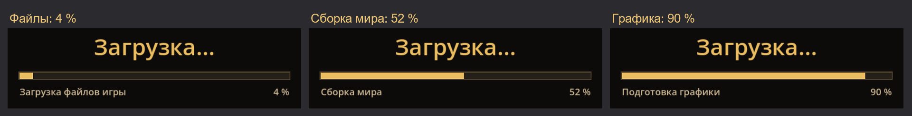
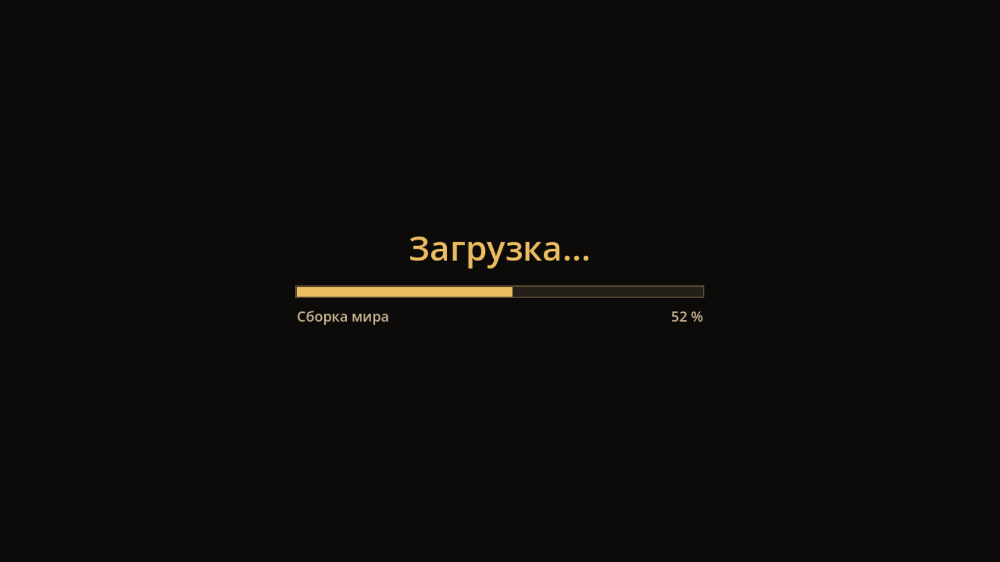
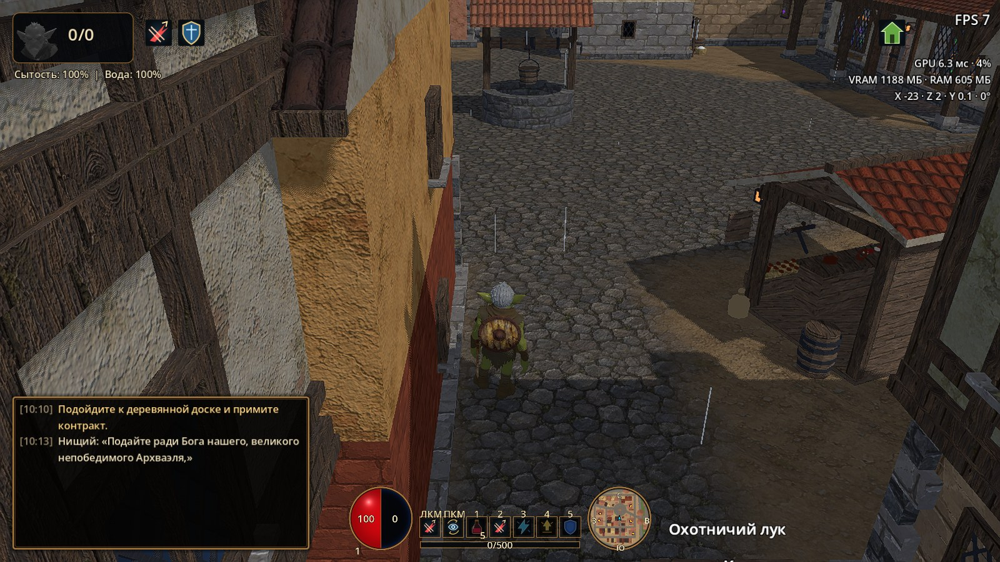

# Почему экран «Загрузка…» висел полминуты и не показывал, сколько осталось?

> Игра была так занята постройкой мира, что не могла даже нарисовать свою полосу загрузки. А мир она строила дважды.

**Статус:** решено · **Дата:** 2026-11-22 · **Ветка:** Главное меню игры: вход и настройки

## Коротко

- **Было:** после «Продолжить» около 30 секунд неподвижная надпись «Загрузка…». Непонятно, сколько осталось и не
  зависла ли игра.
- **Стало:** полоса с процентом и подписью этапа: «Загрузка файлов игры» → «Сборка мира» → «Подготовка графики». Она
  движется даже тогда, когда игра занята сборкой. Сами перерисовки стоят около полсекунды на весь вход.
- **Как:** файлы читаются в фоне. Пока строится мир, игру заставляют перерисовывать полосу раз в 150 миллисекунд.

*Одна и та же полоса в трёх местах загрузки: файлы — 4 %, сборка мира — 52 %, подготовка графики — 90 %.*

## Что было не так

Пользователь написал: «При „Загрузка" добавь ещё лоадер, а то пока она висит, непонятно, сколько всего загружено».

Экран был тёмный, с одной надписью. Он стоял неподвижно с нажатия «Продолжить» до появления игры. Если загрузка
идёт долго и ничего не шевелится, рука сама тянется к диспетчеру задач.

## Почему так происходило

Сначала мы замерили, куда уходит время. Вход в игру, ноутбук с RTX 4060:

Самое долгое — сборка мира: дома, лес, трава, жители. Это один длинный шаг. Пока он идёт, игра не рисует ни одного
кадра. Представьте повара, у которого заняты обе руки: он не может помахать и показать, сколько осталось.

Обычная полоса загрузки — это кнопки и надписи интерфейса. Они перерисовываются в начале следующего кадра. А кадра
нет, пока мир не готов. Поэтому полоса, сделанная «как обычно», дошла бы до конца чтения файлов и встала бы на
17 секунд.

По дороге нашлась вторая причина. Чтобы понять, что строится дольше всего, мы засекали время появления каждого
объекта мира. Оказалось, что мир деревни строится **дважды**. Сначала строится пустой мир по умолчанию, через
1,3 секунды после начала сборки. Потом загружается сохранение, и тот же мир сносится и строится заново, через
9,7 секунды. Каждая постройка занимает 6–8 секунд, больше всего — дома. Первую постройку никто не видит, её
сразу выбрасывают.

## Что пробовали

| Попытка | Что вышло | Почему не подошло |
|---|---|---|
| Читать файлы в фоне, «с помощниками» (вложенные потоки) | Полоса застыла на 0–2 % и не двигалась больше минуты, в двух запусках — пять минут | Загрузка не заканчивалась. Причину не искали, режим просто выключили. |
| Читать файлы в фоне одним потоком | Работает: около 10 секунд, процент честный, но рывками: до 41 %, потом сразу 100 % | Подошло для первого этапа. |
| Полоса из обычных элементов интерфейса | Во время сборки мира не обновляется ни разу | Им нужен новый кадр, а кадров нет. |
| Заставлять игру рисовать кадр во время сборки | Полоса живёт, но сборка шла 26,5 секунды вместо 17–19 | Вместе с полосой игра каждый раз рисовала и недостроенный мир под ней. |
| То же, но мир на это время не рисуется | Сборка 18–19 секунд, 55 перерисовок, на все вместе — 0,55 секунды | Подошло. |

## Как решили

1. **Файлы — в фоне.** Их читает отдельный поток, как помощник в соседней комнате. Главная часть игры свободна и
   рисует полосу каждый кадр.
2. **Сборка — с подглядыванием.** Каждый раз, когда в мир добавляется новый объект, полоса проверяет: прошло ли
   150 миллисекунд с прошлого раза? Если да, она перерисовывает себя и заставляет игру сразу показать кадр. Повар
   ставит тарелку — и заодно двигает отметку на доске. Объектов при входе почти 19 тысяч, поводов хватает.
3. **Рисует себя сама.** Полоса рисуется напрямую видеокарте, мимо обычного интерфейса. Мир под ней на время сборки
   выключен: его всё равно не видно, а рисовать его дорого.
4. **Проценты — по прошлому разу.** Игра запоминает, сколько длился каждый этап при прошлом запуске. Поэтому полоса
   идёт в том темпе, в каком загрузка идёт на самом деле, на этом компьютере. Этап никогда не показывается
   законченным раньше времени, а полоса не ползёт назад.
5. **Если не загрузилось,** меню снова доступно и пишет причину.

*Кадр снят в середине сборки мира, когда раньше экран стоял: «Сборка мира», 52 %.*

Двойную постройку мира починила отдельная ветка «Build the home world once when entering the game» (решение
G-D111). Теперь мир строится один раз, сразу для загруженного сохранения. По её замерам сборка в окне 1280 × 720
стала идти 8,7 секунды вместо 15,2. Полоса подстроилась сама: она берёт время прошлого запуска.

*Через пару кадров после полосы: мир на месте, 3D включено обратно.*

## Как проверили

Игру запускали с окном на копии сохранения пользователя, из меню через «Продолжить». Это сделали семь раз, один из них
с нуля, без кэша шейдеров. Полоса снималась прямо во время сборки мира: снимок делался сразу после принудительной
перерисовки.

| Что мерили | Без полосы | С полосой |
|---|---|---|
| Весь вход в игру | 34,4–34,8 с | 33,0 с (2 запуска); 40,4–40,7 с (3 запуска, пока компьютер грузили другие задачи) |
| Сборка мира | 16,3–18,7 с | 18,4–19,1 с; 22,3–22,8 с под нагрузкой |
| Сборка мира, если рисовать и мир под полосой | — | 26,5 с |
| Принудительные перерисовки | — | 55 раз, все вместе 0,55 с |
| Сборка мира после исправления двойной постройки (замер ветки G-D111, окно 1280 × 720) | 15,2 с | 8,7 с |

*Замеры: ноутбук с RTX 4060 Laptop, 8 ГБ, Godot 4.7.2, окно 1600 × 900.*

Автотесты: тест полосы — 27 проверок, тест меню — 54, общие тесты игры — 833, проверка ссылок проекта — 0 ошибок на
3004 файла. Потом в тесте полосы упали две проверки у другой ветки, когда та гоняла 18 тестов разом. Виноват был сам
тест: проверка «сцены нет» ждала отказа 120 кадров, а под нагрузкой отказ приходил позже. Тест исправили, теперь он
ждёт до 20 секунд. После этого дважды прошёл 27 из 27.

## Что осталось

- Внутри сборки мира есть места до 3 секунд без новых объектов. Там полоса стоит.
- Первый кадр игры (около 3 секунд, видеокарта готовит шейдеры) тоже проходит без движения полосы.
- Один ранний запуск, ещё с миром под полосой, завис дольше 150 секунд. После выключения мира на время сборки пять
  запусков прошли без зависаний. Причину того зависания не нашли.
- При переходе через портал в другой мир по-прежнему старый экран «Загрузка» без полосы. Тот же приём подойдёт и там.

## Словарик

| Термин | Простыми словами |
|---|---|
| Поток | Отдельный «работник» программы. Пока один читает файлы, другой рисует экран. |
| Кадр | Одна картинка на экране. Игра рисует их десятки в секунду. Нет кадров — экран застыл. |
| Принудительная перерисовка | Мы просим игру показать кадр прямо сейчас, не дожидаясь конца работы. |
| Объект мира (узел) | Кирпичик, из которого Godot собирает сцену: дом, дерево, житель, кнопка. |
| Шейдер | Маленькая программа для видеокарты: как рисовать камень, траву, воду. Перед первым показом её надо подготовить. |
| Кэш шейдеров | Уже подготовленные шейдеры, сохранённые на диск. С ними второй запуск быстрее. |
| Godot | Бесплатный игровой движок, на котором сделана игра. |
| Автотест | Программа, которая сама проходит сценарий и проверяет результат. |

## Для видео

**Озвучка:**

Нажимаешь «Продолжить» и полминуты смотришь на неподвижную надпись «Загрузка». Игра зависла? Или ещё чуть-чуть?

Мы засекли время. Десять секунд игра читает файлы. Семнадцать строит мир. Три готовит графику.

Файлы можно читать в фоне, а полосу рисовать спокойно. А вот мир игра строит одним куском. Пока строит, не рисует ни
одного кадра. Она не может даже показать свою полосу загрузки.

Тогда мы её подтолкнули. Каждый раз, когда в мир добавляется новый дом или дерево, полоса смотрит на часы. Прошло
полторы десятых секунды — рисуем кадр прямо сейчас. Мир под полосой на это время выключили. Иначе игра рисовала бы и
его, и загрузка шла бы на восемь секунд дольше.

А пока мы засекали время, нашли сюрприз: мир деревни строился дважды. Один раз впустую, его сразу выбрасывали.
Отдельная ветка это починила, и сборка мира стала почти вдвое быстрее.

Теперь полоса идёт честно: файлы, сборка мира, графика, проценты.

**Вау-момент:** застывшая надпись «Загрузка…», а рядом живая полоса, которая ползёт с 4 до 90 %. И замер: мир строится
два раза, первая постройка сразу летит в мусор.

**Обложка:** полоса на 52 % крупно, сверху «ИГРА СТРОИЛА МИР ДВАЖДЫ».

**Оценка для видео:** 4 — знакомая каждому боль, неожиданная причина (игра слишком занята, чтобы показать прогресс),
находка про двойную постройку и честные неудачи.

## Для любопытных

- Игра: `D:\My projects\game-project-godot`, Godot 4.7.2.
- Файлы: `game/ui/menu/game_loader.gd` — полоса и переход в игру (`ResourceLoader.load_threaded_request` без
  вложенных потоков, `SceneTree.change_scene_to_node`, `RenderingServer.force_draw` по сигналу `node_added` не чаще
  150 мс, на это время `Viewport.disable_3d`; рисует элементами `RenderingServer`, а не Control);
  `game/persistence/loading_times_codec.gd` — время этапов прошлого запуска (`user://g4_loading_times.json`);
  `game/ui/menu/main_menu.gd` — старый экран убран; `tests/game_loader_tests.gd`.
- Коммит игры: `3e53bf7a` — полоса загрузки (G-D110) вместе с именем героя (G-D108) и одной постройкой мира (G-D111).
- Ветки: Главное меню игры: вход и настройки (`local_5f72d0d3`) — полоса и замеры; Build the home world once when
  entering the game (`local_703193a4`) — исправление двойной постройки.
- Как повторить: запустить игру, в меню «Продолжить». Время этапов игра пишет в журнал строкой
  `GAME_LOADER files=… build=… frame=…`.
