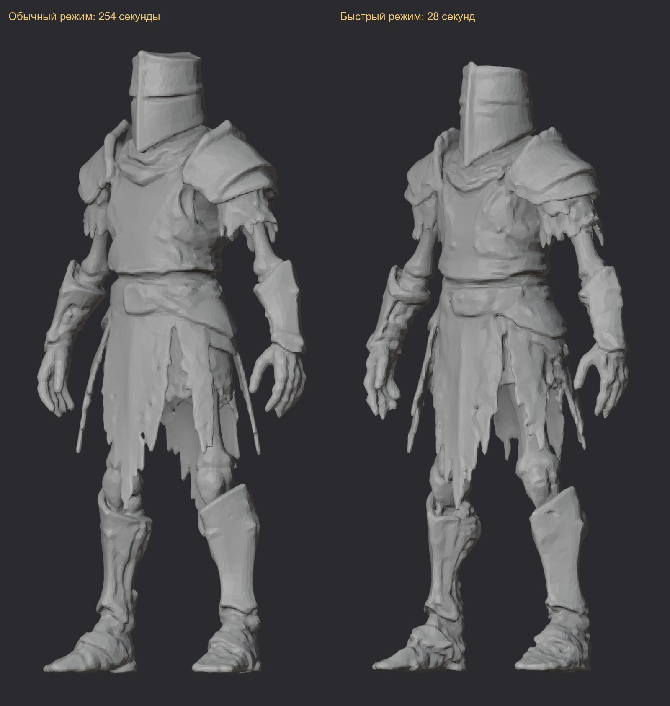
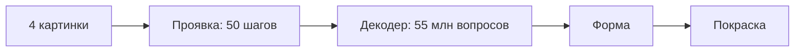
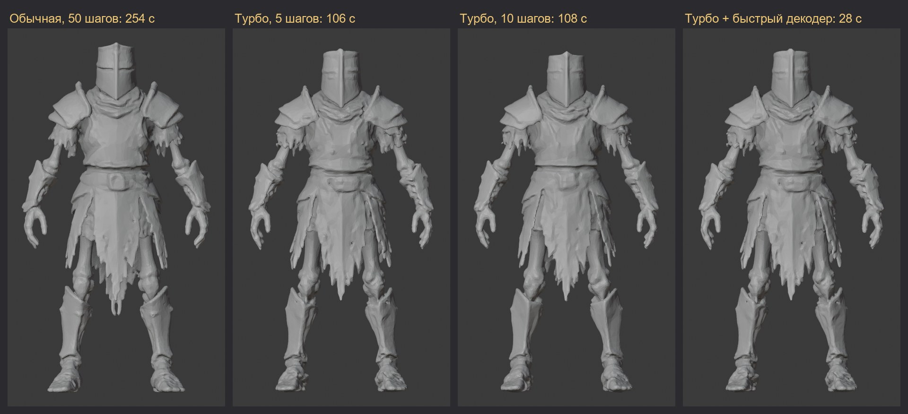
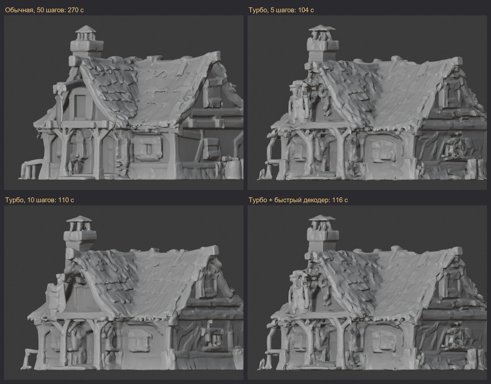
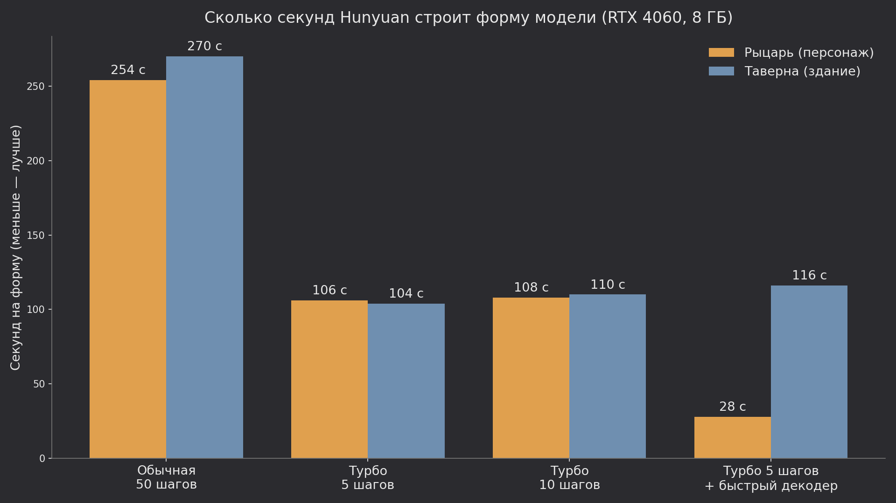

# Как заставить нейросеть строить 3D-модель в 9 раз быстрее?

> «Ускоренная» нейросеть сама по себе почти ничего не дала: главный тормоз сидел совсем в другом месте.

**Статус:** решено · **Дата:** 2026-11-24 · **Ветка:** Правки проекта (координатор)

## Коротко

- **Было:** форма персонажа строилась больше четырёх минут (254 секунды), и только потом начиналась покраска.
- **Стало:** в быстром режиме форма персонажа готова за 28 секунд, детали те же.
- **Как:** взяли ускоренную версию той же нейросети и быстрый способ собирать поверхность. Для зданий этот режим
  выключен: там он не помогает.

*Одни и те же четыре картинки рыцаря на входе. Слева обычный режим, справа быстрый: шлем, пластины и рваная ткань на месте.*

## Что было не так

Наше приложение делает 3D-модели для игры из картинок. Работает нейросеть Hunyuan3D от Tencent. Сначала она строит
форму — серую «глину» без цвета. Потом другая нейросеть раскрашивает эту форму.

На рыцаря уходило восемь с половиной минут: четыре с лишним на форму, три с лишним на покраску, остальное на подготовку.
Для игры нужны десятки персонажей, и с первого раза модель удаётся не всегда. Три попытки — почти полчаса ожидания.

## Почему так происходило

Форма строится в два этапа.

1. **Проявка.** Нейросеть получает картинки и за 50 шагов постепенно «проявляет» форму, как фотографию в проявителе:
   с каждым шагом она чуть чётче.
2. **Сборка поверхности.** Нейросеть держит форму у себя «в голове», а не в виде треугольников. Чтобы получить настоящую
   модель, декодер опрашивает пространство вокруг неё по сетке 380 × 380 × 380 точек. Это 55 миллионов вопросов
   «здесь модель или пустота?».

Казалось, что долго идёт проявка: 50 шагов — это много. Оказалось, нет.

## Что пробовали

| Попытка | Что вышло | Почему не подошло |
|---|---|---|
| Новая версия Hunyuan3D-2.1 | Форма точнее, покраска с металлом и шероховатостью | Ей нужно 10 ГБ видеопамяти на форму и 21 ГБ на покраску, а у нас 8 ГБ. И она берёт одну картинку, а мы даём четыре вида. |
| Лёгкие модели (2mini, Shape Small) | Помещаются в память | Тоже по одной картинке, и наша модель в память и так помещается. |
| Турбо-версия нашей модели, 5 шагов | 106 секунд вместо 254 | Ждали ускорения в 10 раз, получили в 2,4 раза. |
| Турбо, 10 шагов | 108 секунд | Пять лишних шагов стоят 2 секунды. Значит, время уходит не на проявку, а на декодер. |
| Турбо + быстрый декодер FlashVDM | **28 секунд** | Подошло для персонажей. |

Турбо-модель обучена делать за 5 шагов то, что обычная делает за 50. Но проявка и раньше занимала малую часть времени.
Почти всё съедал декодер со своими 55 миллионами вопросов.

FlashVDM — декодер, который спрашивает умнее. Сначала он грубо находит, где проходит поверхность, а потом уточняет
только рядом с ней. Пустой воздух вокруг рыцаря он почти не опрашивает.

*Все четыре варианта по одним и тем же картинкам. По детализации они почти не отличаются, а по времени — в 9 раз.*

Сюрприз ждал на таверне. С быстрым декодером она строилась 116 секунд — дольше, чем просто на турбо. Видеопамять
поднялась до 7,8 ГБ из 8, а стены вышли бугристыми. Причина в размере поверхности: у здания огромные стены и крыша.
Сырая модель таверны — 1,4 миллиона треугольников, у рыцаря — 0,44 миллиона. Уточнять приходится почти везде,
и экономить не на чем.

*Таверна: быстрый декодер не ускоряет, а на боковой стене турбо-вариантов появились бугры.*

*Рыцарь с быстрым декодером ускоряется в 9 раз. Таверна с ним — только в 2,3 раза, медленнее, чем без него.*

## Как решили

В приложении появился переключатель **«Быстрая форма (turbo): ~30 с вместо ~4 мин»** (раздел «Модели → Создание»,
движок Hunyuan3D).

- Для персонажей, предметов и пропсов он включается сам.
- Для зданий он выключен: обычный режим даёт стены ровнее.
- Если быстрому декодеру не хватило видеопамяти, программа сама повторяет форму обычным декодером (около 105 секунд).
- Если турбо-модель не скачана, программа берёт обычную модель. Установщик скачивает турбо-модель вместе с остальными
  (4,9 ГБ).

## Как проверили

Все варианты строились по одним и тем же подготовленным картинкам, с одним и тем же «зерном» случайности и одной
детальностью сетки. Потом каждый упрощали до 50 000 треугольников, как в игре. Проверяли на двух моделях: персонаже
(рыцарь-скелет) и здании (таверна). Затем запустили быстрый режим через само приложение: форма заняла 21 секунду.

| Что мерили | Обычный режим | Быстрый режим |
|---|---|---|
| Форма рыцаря | 254 с | 28 с (в приложении 21 с) |
| Форма таверны | 270 с | 116 с (режим для зданий выключен) |
| Видеопамять, рыцарь | 5,8 ГБ | 6,5 ГБ |
| Видеопамять, таверна | 5,8 ГБ | 7,8 ГБ из 8 |

*Замеры: RTX 4060, 8 ГБ видеопамяти. Качество сравнивали на глаз.*

На глаз детали у рыцаря те же: шлем, наплечники, рваная ткань. Складки ткани чуть другие. Это как другой бросок кубика:
не хуже и не лучше.

## Что осталось

- Покраска не ускорилась и занимает около трёх минут. Теперь главный тормоз — она. Весь рыцарь по расчёту выходит
  около пяти минут вместо восьми с половиной. Целиком с покраской в быстром режиме не замеряли.
- Здания не ускорились. Для них нужен другой путь.
- Качество сравнивали на глаз и на двух моделях.

## Словарик

| Термин | Простыми словами |
|---|---|
| Hunyuan3D | Нейросеть Tencent, которая делает 3D-модель из одной или нескольких картинок. |
| Форма | Модель без цвета, серая «глина». |
| Покраска (текстура) | Картинка, натянутая на форму, как обои. Из неё модель получает цвет. |
| Шаг (диффузии) | Один проход «проявки»: нейросеть делает форму чуть чётче. |
| Турбо-модель | Нейросеть, которую дообучили делать за 5 шагов то, что раньше делалось за 50. |
| Декодер | Часть, которая превращает форму «в голове» нейросети в настоящую поверхность из треугольников. |
| FlashVDM | Быстрый декодер: уточняет форму только рядом с поверхностью, а не во всём пространстве. |
| Видеопамять | Память видеокарты. Если нейросеть в неё не влезает, она не запустится или будет очень медленной. |
| Треугольники | Из них состоит любая 3D-модель в игре. Чем их больше, тем подробнее модель и тяжелее для игры. |
| Hugging Face | Сайт, где выкладывают нейросети, как GitHub для моделей. |
| Зерно (seed) | Число, от которого зависит «бросок кубика» нейросети. С одним зерном сравнение честное. |

## Для видео

**Озвучка:**

Чтобы сделать персонажа для игры, наша программа ждала нейросеть восемь с половиной минут. Четыре из них уходили
только на форму — серую глину без цвета.

Tencent выпустила турбо-версию этой нейросети. Её научили делать за пять шагов то, что раньше делалось за пятьдесят.
Казалось бы, ускорение в десять раз. Мы проверили — и получили всего в два с половиной.

Пять шагов или десять — разница две секунды. Значит, тормоз не в шагах. После шагов работает декодер. Он строит
поверхность, задавая пятьдесят пять миллионов вопросов: здесь модель или пустота?

Есть декодер умнее. Он находит поверхность грубо и уточняет только рядом с ней. С ним рыцарь строится за двадцать
восемь секунд вместо двухсот пятидесяти четырёх. В девять раз быстрее, а детали те же.

Но на таверне быстрый декодер не помог: стены огромные, уточнять приходится везде. Видеокарта забилась почти до отказа,
а стены пошли буграми.

Поэтому в программе теперь переключатель. Для персонажей и предметов — быстрый режим. Для зданий — обычный.

**Вау-момент:** две одинаковые модели рыцаря рядом, а под ними таймеры — двести пятьдесят четыре и двадцать восемь секунд.

**Обложка:** рыцарь крупно, слева серый, справа такой же, сверху «В 9 РАЗ БЫСТРЕЕ».

**Оценка для видео:** 4 — понятная цифра, неожиданный поворот (ускоряли не то) и честный провал на здании.

## Для любопытных

- Файлы: `tool/hy_pipeline.py` (флаг `--fast`, `load_shape`, откат при нехватке памяти), `tool/sf3d_ui.py`
  (`HY_FAST_CATEGORIES`), `tool/web/front/src/screens/ModelCreate.tsx` (переключатель), `hunyuan3d-weights.ps1` (скачивание).
- Коммит: `c79fa86` — быстрая форма: турбо-модель на 5 шагов с FlashVDM, по умолчанию для персонажей, предметов и пропсов.
- Ветка: Правки проекта (`local_e34b3455`).
- Модель: `tencent/Hunyuan3D-2mv`, папка `hunyuan3d-dit-v2-mv-turbo`. FlashVDM включается как
  `enable_flashvdm(replace_vae=False)`: работает на родном декодере модели, отдельный турбо-декодер качать не нужно.
- Замеры: `work/hy_turbo_test/` (`turbo_shape.py`, `out/*/stats.json`).
