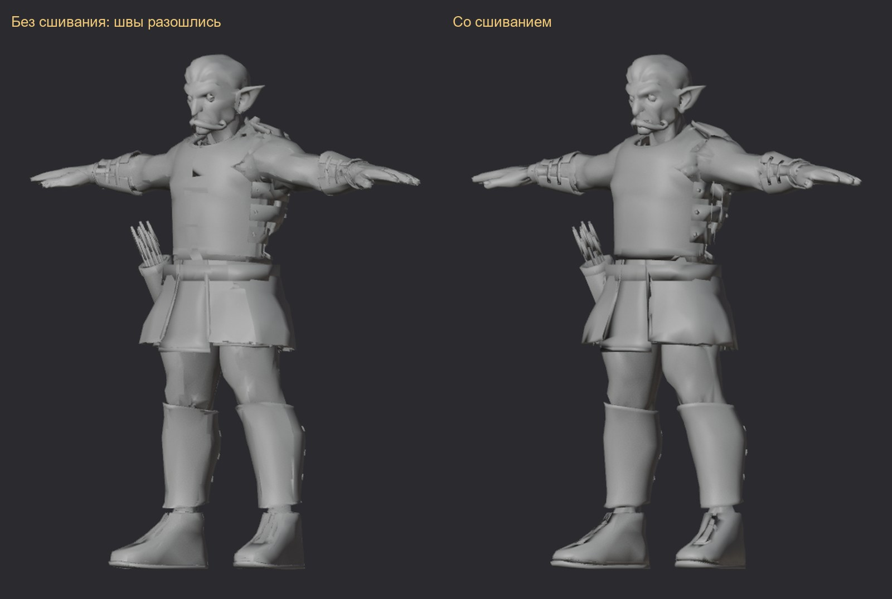
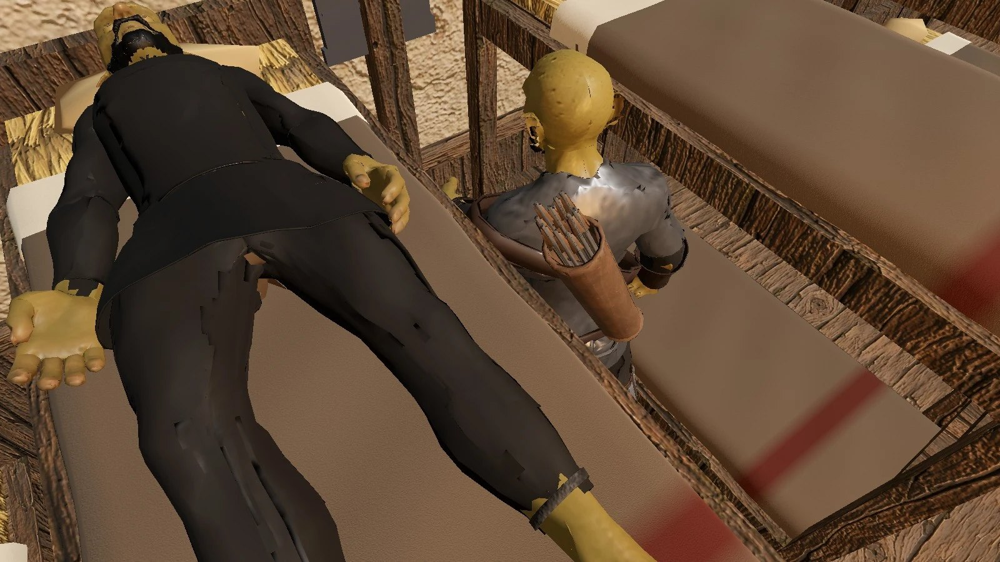
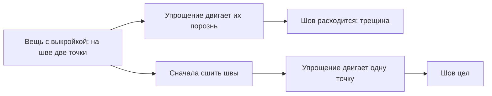

# Почему штаны стражника выглядели рваными?

> Ткань не рвалась. Её разрезали по швам выкройки, а упрощение модели растащило края в разные стороны.

**Статус:** решено · **Дата:** 2026-11-24 · **Ветка:** Лучники: мускулистые и жилистые (начата из «Правки проекта»)

## Коротко

- **Было:** на стражах в игре штаны, рукава и броня шли трещинами, будто ткань порвана в клочья.
- **Стало:** новых трещин после упрощения почти нет: из 242 метров щелей на одном гоблине осталось 2.
- **Как:** перед упрощением сшиваем каждую вещь по её швам, чтобы края не расходились.

*Один и тот же страж, собранный двумя способами, серой глиной без краски. Слева без сшивания: тёмные щели на груди и бёдрах, рваный край юбки. Справа со сшиванием.*

## Что было не так

Пользователь заглянул в казарму. Стражник спит на койке, а его штаны и рукав будто изодраны: тёмные рваные полосы
по всей ноге.

*Снимок из игры. Смотрите на штаны спящего стражника: рваные полосы — это трещины в модели.*

Это не рисунок и не износ. Сквозь щели в модели видно то, что за ней.

## Почему так происходило

Каждый страж собран из тела и десятка вещей: штанов, рубахи, кирасы, шлема. Всего у гоблина до полумиллиона точек.
Для игры это слишком много. Поэтому модель упрощают до 26 тысяч треугольников. Это называется децимация.

Подвох в швах. Каждая вещь раскрашена картинкой, которая натянута на неё, как выкройка на ткань. Там, где выкройка
разрезана, у модели на одном месте стоят две точки: одна для левого куска выкройки, другая для правого.

Упрощение не знает, что эти две точки — одно место. Оно двигает их порознь. Шов расходится, и получается щель.
Так у спящего стражника и «порвались» штаны.

## Что пробовали

| Попытка | Что вышло | Почему не подошло |
|---|---|---|
| Сшить всё, включая кольца кольчуги | Швы целы | Сшитые колечки упрощение не может сплющить: у одного стража осталось 36 тысяч треугольников вместо 26. |
| **Сшивать каждую вещь отдельно, кольца заменить пластинками** | **Трещин почти нет, 26 тысяч треугольников** | Подошло. |

Каждую вещь сшиваем отдельно, а не всего гоблина разом: иначе штаны слиплись бы с телом в одно целое. Кольчужные кольца
теперь заменяем плоскими пластинками с картинкой колец. А сквозные дырочки в латах, например прорези забрала,
закрываем: после упрощения через них «дышала» пустота.

## Как решили

Перед упрощением программа запекания проходит по каждой вещи отдельно:

1. Находит пары точек, которые стоят в одном месте, и сливает их в одну. Швы выкройки сшиты.
2. Запоминает, как была освещена поверхность у шва, чтобы острые рёбра брони не стали круглыми.
3. Мелочь меньше 2,5 сантиметра, если её в вещи много, не сшивает. Кольца кольчуги заменяет плоскими пластинками.
4. Закрывает маленькие сквозные дыры в латах.

Только потом модель упрощается до 26 тысяч треугольников.

## Как проверили

Посчитали открытые края — места, где у треугольника нет соседа. У целой модели такие края есть законно: подол рубахи,
край рукава. Новые трещины — это края, которых нет в неупрощённой модели.

| Что мерили | Было | Стало |
|---|---|---|
| Открытые края у стража `muscular_01` | 22 086 | 3 376 |
| Открытые края у той же модели без упрощения | 5 897 | — |
| Новые трещины после упрощения, штук | 18 857 | 168 |
| Новые трещины после упрощения, длина | 242 м | 2 м |

*Замеры 24 ноября: страж `muscular_01`, 26 тысяч треугольников; трещины сравнивали с моделью без упрощения.*

28 ноября пересчитали тем же способом на сегодняшнем `muscular_01`: без сшивания 21 899 открытых краёв, со
сшиванием 4 121. За это время страж немного поменялся, но разница та же — в пять с лишним раз.

Оставшиеся 2 метра — кромки заклёпок и шнурков. После этого перепекли всех 28 стражей. Тесты стражи прошли: 765 проверок,
0 ошибок.

## Что осталось

- Тряпичный вид у манжеты в позе лёжа остался. Но это уже не трещина, а кожа, которая вылезает сквозь рубаху.
  Его решали отдельно: вдавливанием кожи под одеждой.
- Сшивание работает в нашем запекании стражи. Другие места, где модели упрощаются, мы не проверяли.

## Словарик

| Термин | Простыми словами |
|---|---|
| Запекание | Сборка гоблина из тела и вещей в одну лёгкую модель для игры. |
| Децимация (упрощение) | Уменьшение числа треугольников: из полумиллиона точек оставляем 26 тысяч треугольников. |
| Треугольник | Кусочек поверхности. Из них состоит любая 3D-модель. |
| Выкройка (UV-развёртка) | Плоская раскладка поверхности модели, на которую рисуют краску, как выкройка ткани. |
| Шов | Место, где выкройка разрезана. На шве у модели две точки в одном месте. |
| Сшивание (сварка) | Слияние двух точек в одном месте в одну, чтобы края не расходились. |
| Открытый край | Край треугольника без соседа. У подола он законный, посреди штанов это трещина. |

## Для видео

**Озвучка:**

Заходим в казарму. Стражник спит на койке, а штаны у него будто изодраны в клочья. Но ткань тут ни при чём.

Каждый гоблин собран из тела и десятка вещей. В нём до полумиллиона точек, а игре нужно двадцать шесть тысяч треугольников.
Поэтому модель упрощают.

Каждая вещь раскрашена картинкой, натянутой как выкройка. Там, где выкройка разрезана, на одном месте стоят две точки.
Упрощение об этом не знает и тянет их в разные стороны. Шов расходится, и сквозь щель видно, что за моделью.

Решение простое: перед упрощением сшить каждую вещь по швам. Не всего гоблина целиком, а каждую вещь отдельно, иначе всё
слипнется.

Но сшивание задело кольчугу. Сшитое колечко уже не сплющить, и страж в латах выходил на тридцать шесть тысяч
треугольников вместо двадцати шести. Поэтому колечки заменили плоскими пластинками с картинкой колец, а дырочки в забрале
закрыли.

На одном стражнике было двести сорок два метра щелей. Осталось два — это кромки заклёпок.

**Вау-момент:** шторка по штанам стражника: рваные полосы исчезают, ткань становится целой.

**Обложка:** нога в рваных штанах крупно, надпись «НЕ РВАНЫЕ, А РАСШИТЫЕ».

**Оценка для видео:** 3 — понятная картинка и сравнение с выкройкой, но решение короткое и без поворотов.

## Для любопытных

- Файлы: `work/archers/game_bake.py` (вне git): `weld` — сшивание каждой вещи перед упрощением, `ring_quads` — кольца
  кольчуги пластинками, `close_vents` — закрыть сквозные дыры; ключи задания `weld`, `weld_small`, `vent_reach`.
- Замер трещин: `work/seam_check/cracks.py`; новые трещины считали против запекания без упрощения (`target_tris 0`).
- Само запекание лежит вне git. Стражи, запечённые со сшиванием, попали в игру с коммитами начиная с 25 ноября
  (`49e4429b` и следующие).
- Ветки: «Лучники: мускулистые и жилистые»; казарма перепекла свои стадии со сшиванием (`local_1e53064e`).
