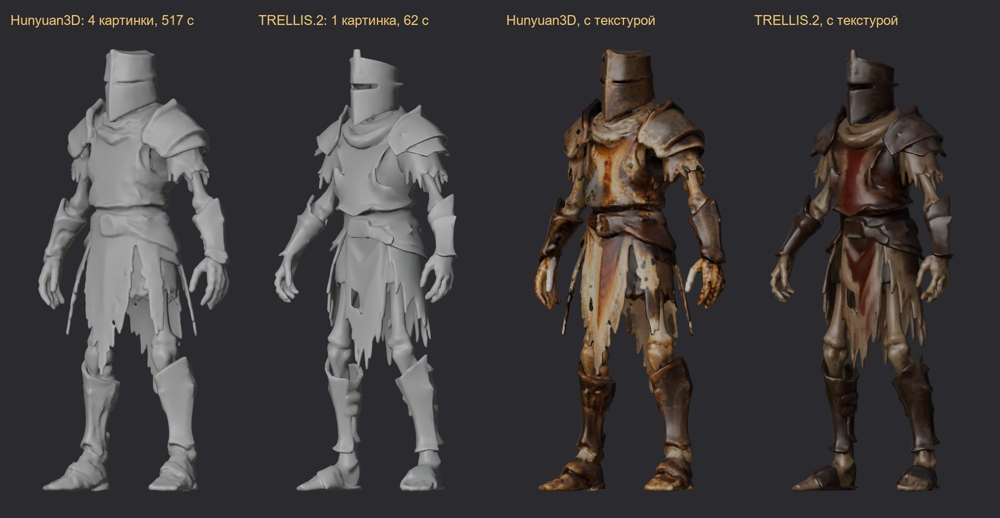
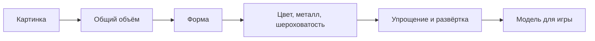
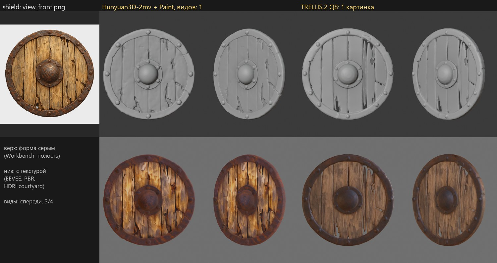
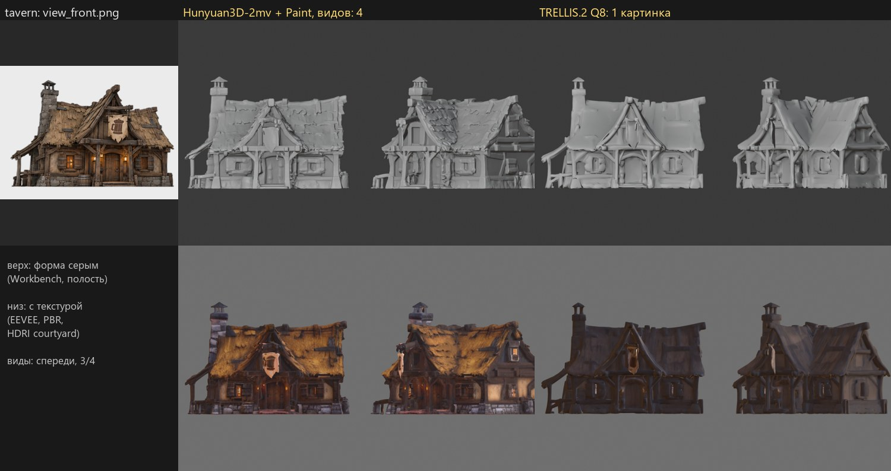
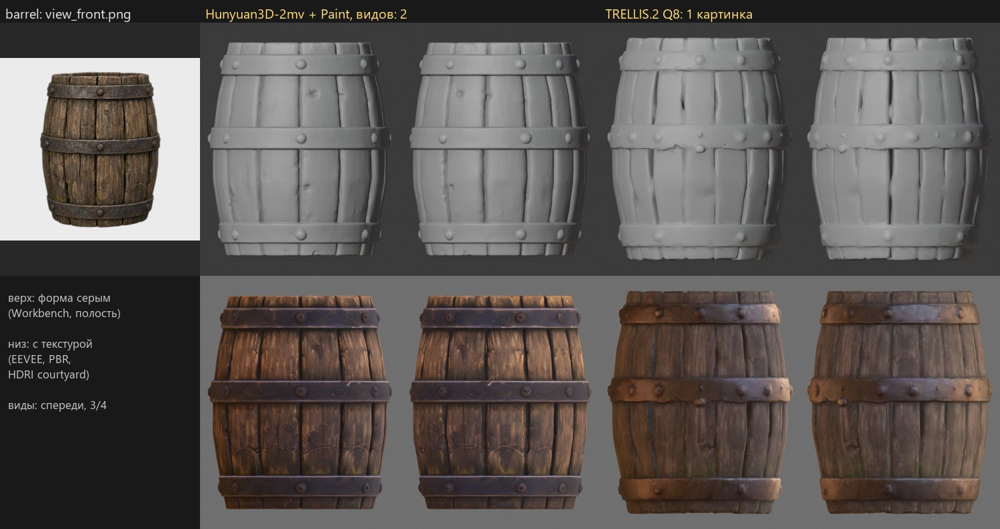
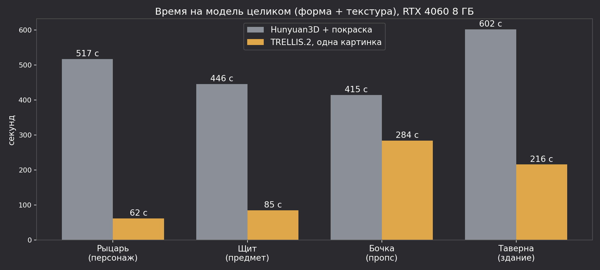

# Может ли нейросеть сделать 3D-героя по одной картинке лучше, чем другая по четырём?

> TRELLIS.2 по одной картинке слепил рыцаря точнее, чем Hunyuan3D по четырём, и в 8 раз быстрее. А на таверне проиграл.

**Статус:** решено (проверка проведена, вывод сделан) · **Дата:** 2026-11-24 · **Ветка:** TRELLIS.2 — проверка и встраивание (запущена из «Правки проекта»)

## Коротко

- **Было:** 3D-модели для игры делала нейросеть Hunyuan3D. Персонаж выходил за 8,5 минуты, а видеопамяти уходило 7,4 ГБ из 8.
- **Стало:** проверили новую нейросеть TRELLIS.2 на той же видеокарте. Рыцарь готов за 62 секунды, памяти нужно всего 2,7 ГБ.
- **Как:** собрали программу из исходного кода под нашу видеокарту и прогнали одни и те же четыре картинки через обе нейросети.

*Один и тот же рыцарь-скелет. Hunyuan3D получил четыре вида и думал 517 секунд, TRELLIS.2 — одну картинку и 62 секунды. Смотрите на тонкие кости ног и рваную ткань: у TRELLIS они чётче.*

## Что было не так

Наше приложение делает модели для игры из картинок. Hunyuan3D от Tencent работает в два этапа: сначала лепит форму,
потом раскрашивает её. На рыцаря уходило 517 секунд, на таверну — 602.

Были и другие минусы:
- Покраска занимала 7,4 ГБ видеопамяти из 8. Если в это время запущено что-то ещё, программа падала.
- Металл у Hunyuan выходил голубоватым. Отдельной карты «где металл, а где дерево» он не делает.
- Лицензия Hunyuan не действует в Евросоюзе, Великобритании и Южной Корее.

Вышла новая нейросеть Microsoft TRELLIS.2. Она умеет сразу выдавать модель с картами металла и шероховатости,
и лицензия у неё свободная (MIT). Но официально ей нужна видеокарта на 16–24 ГБ. Вопрос был простой: заработает ли
она на нашей 8-гигабайтной и будет ли лучше.

## Почему так происходило

Нейросеть — это огромная таблица чисел, «весов». Обычно веса хранят с большой точностью, и вся таблица не влезает
в 8 ГБ. Энтузиаст переписал TRELLIS.2 на C++ (проект trellis.cpp) и сжал веса до 8 бит на число вместо 16. Это как
фото в JPEG вместо RAW: меньше места, почти без потерь. Вдобавок программа держит в памяти только ту часть нейросети,
которая работает прямо сейчас.

## Что пробовали

| Попытка | Что вышло | Почему не подошло (или подошло) |
|---|---|---|
| Готовая программа из интернета | Не запускали | Правило проекта: чужие программы не запускаем, собираем сами из исходного кода. |
| Сборка из исходников | Собралось за 25 минут | Пришлось уговорить старый компилятор видеокарты работать с новым компилятором Windows. |
| Детализация 1024 | Не пробовали | Нужно 16 ГБ видеопамяти. Взяли режим 512. |
| Одна картинка, режим 512 | Рыцарь за 62 с, 2,7 ГБ памяти | Подошло. |
| TRELLIS по тем же четырём видам, что у Hunyuan | Вдвое дольше, форма мягче | Не нужно: одна картинка даёт результат лучше. |
| Облегчённые веса (4 бита) и карта рельефа | Не быстрее, форма шумнее; рельеф показал грани | Проверили 26 ноября, не взяли. |

Неожиданность на щите: тёмные трещины между досками TRELLIS превратил в сквозные дыры.

*Справа, у TRELLIS, сквозь щит видно фон там, где на картинке были тёмные трещины. Hunyuan сделал неглубокие бороздки.*

Таверну TRELLIS проиграл: текстура вышла тёмной и плоской, солома на крыше пропала.

*Слева Hunyuan по четырём видам: тёплая солома, светящиеся окна. Справа TRELLIS: дом темнее и глаже.*

*На бочке TRELLIS по одной картинке сделал обручи медными, хотя на картинке тёмное железо.*

## Как решили

Вывод проверки: **брать TRELLIS.2 третьим движком**, но не вместо Hunyuan.

- Персонажи и предметы — TRELLIS.2: форма лучше, быстрее в 5–8 раз.
- Здания — Hunyuan3D: у TRELLIS текстура зданий тёмная и плоская.
- Цвет TRELLIS нужно подтягивать к картинке: он темнее исходника на 30–50%.

## Как проверили

Четыре модели: персонаж (рыцарь-скелет), предмет (щит), пропс (бочка), здание (таверна). Каждую прогнали через обе
нейросети с одинаковым числом треугольников — 50 тысяч, как в игре.

*TRELLIS быстрее везде. Дольше всего у него бочка: она занимает весь кадр, и поверхности у неё много.*

| Что мерили | Hunyuan3D | TRELLIS.2 |
|---|---|---|
| Рыцарь, время | 517 с | 62 с |
| Щит, время | 446 с | 85 с |
| Бочка, время | 415 с | 284 с |
| Таверна, время | 602 с | 216 с |
| Пик видеопамяти | 7,4 ГБ | 2,7–5,3 ГБ |
| Карты | только цвет | цвет, металл, шероховатость |
| Яркость текстуры рыцаря (0–1) | 0,49 | 0,32 (на картинке 0,55) |

*Замеры: ноутбук с RTX 4060, 8 ГБ. Качество формы сравнивали на глаз по листам, яркость — по средним цветам текстуры.*

Первый замер бочки показал 391 секунду: в это время другая задача пекла текстуры в Blender на той же видеокарте.
Повторили на свободной видеокарте — 284 секунды.

## Что осталось

- Тёмный цвет TRELLIS — его поправили отдельно (разбор «Подгонка палитры под картинку»).
- Трещины в тонких местах могут стать дырами.
- Сравнение — на четырёх моделях и на глаз.

## Словарик

| Термин | Простыми словами |
|---|---|
| Hunyuan3D | Нейросеть Tencent: делает 3D-модель из 1–4 картинок, потом другая нейросеть её раскрашивает. |
| TRELLIS.2 | Нейросеть Microsoft: делает модель по одной картинке сразу с цветом, металлом и шероховатостью. |
| trellis.cpp | Перевод TRELLIS.2 на язык C++, чтобы она работала без Python и на маленькой видеокарте. |
| Веса | Числа, из которых состоит нейросеть. Их миллиарды. |
| Квантование (8 бит, 4 бита) | Хранить каждое число грубее, чтобы нейросеть занимала меньше памяти. Как JPEG вместо RAW. |
| Видеопамять | Память видеокарты. Если нейросеть в неё не влезает, она не запустится. |
| Карта металла и шероховатости | Картинка-подсказка для игры: где поверхность блестит как железо, а где матовая как дерево. |
| Треугольники | Из них состоит любая 3D-модель в игре. |

## Для видео

**Озвучка:**

Наша программа делает трёхмерных героев для игры из картинок. Нейросеть Hunyuan тратила на рыцаря восемь с половиной
минут и забирала почти всю видеопамять. Тут вышла TRELLIS два от Майкрософт. Ей официально нужна видеокарта на
шестнадцать гигабайт, а у нас восемь. Энтузиаст переписал её на C++ и сжал. Мы собрали её сами и проверили на тех же
картинках. Рыцарь — шестьдесят две секунды вместо пятисот семнадцати. И форма лучше: тонкие кости, рваная ткань.
Причём TRELLIS видел одну картинку, а Hunyuan — четыре. Но не всё так гладко. На щите тёмные трещины стали сквозными
дырами. А таверну TRELLIS проиграл: дом вышел тёмным и плоским. Поэтому мы оставили обе нейросети: героев и предметы
делает TRELLIS, здания — Hunyuan.

**Вау-момент:** два рыцаря рядом и таймеры под ними: 517 и 62 секунды. Причём у быстрого — одна картинка на входе.

**Обложка:** `src/knight_trellis_clay_q34.png` рядом с `src/knight_hunyuan_clay_q34.png`, текст «8 РАЗ БЫСТРЕЕ».

**Оценка для видео:** 5 — понятная дуэль двух нейросетей, большая цифра, честный провал на таверне и дырявый щит.

## Для любопытных

- Отчёт с таблицами: `work/trellis_test/REPORT.md`; листы: `work/trellis_test/sheets/`.
- Скрипты проверки: `work/trellis_test/run_trellis.py` (время и пик видеопамяти), `glb_stats.py`, `tex_stats.py`, `render_pair.py`, `make_sheets.py`.
- Сборка: `trellis2-install.ps1` (trellis.cpp, коммит `7c600c6`, CUDA 12.1 из окружения hunyuan); веса: `trellis2-weights.ps1`.
- Коммиты: проверка жила в `work/` (не в git); вывод вошёл в коммиты встраивания `116c700` и `69bb9e5`, Q4 и карта рельефа — `b5372a6`.
- Ветки: «TRELLIS.2 — проверка и встраивание», запущена из «Правки проекта» (`local_e34b3455`).
