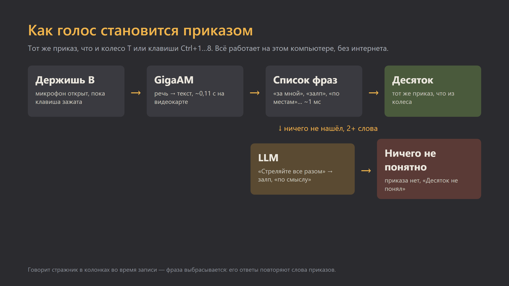
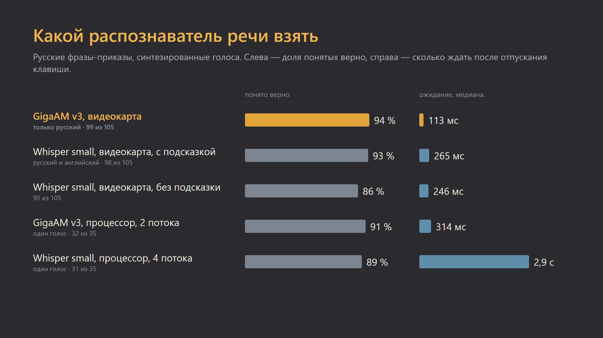
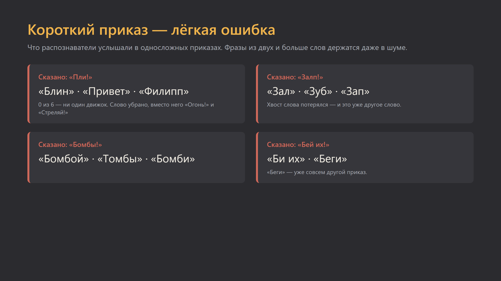
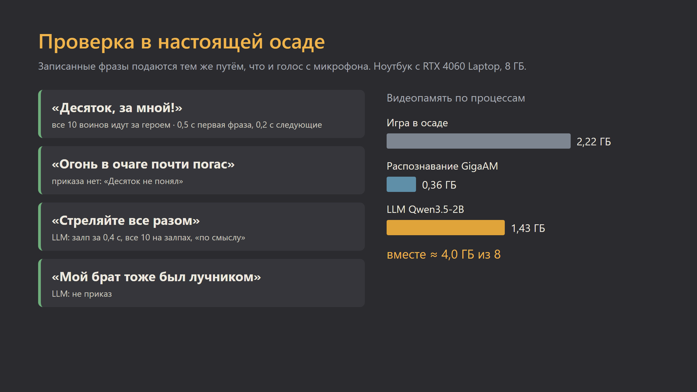

# Можно ли командовать своим десятком голосом?

> Слово «Пли!» не понял ни один распознаватель речи: он слышал «Блин», «Привет» и «Филипп».

**Статус:** решено (прототип) · **Дата:** 2026-11-24 · **Ветка:** Голосовые команды НПЦ (`claude/voice-commands-62e907`)

## Коротко

- **Было:** десяток лучников героя слушался только колеса приказов и горячих клавиш.
- **Стало:** в осаде держишь B, говоришь «Десяток, за мной!», отпускаешь — и все десять идут за героем. Ответ — 0,2–0,5 с.
- **Как:** речь в текст переводит маленькая нейросеть на своей видеокарте. Текст сверяется со списком фраз. Нейросеть
  покрупнее слушает только то, чего в списке нет.

*Путь фразы: клавиша B, распознаватель, список фраз, десяток. Нейросеть-собеседник — только запасной путь, когда список ничего не нашёл.*

## Что было не так

В осаде у героя есть свой десяток лучников. Им можно приказать: «за мной», «по местам», «залп», «огонь по готовности»,
«не стрелять», «горшки», «не ввязываться», «в атаку». Приказы отдаются колесом на клавише T или сочетаниями Ctrl+1…8.
В разгар боя это неудобно. Хотелось просто крикнуть, как настоящий десятник.

Условия были жёсткие. Всё должно работать на ноутбуке игрока, без интернета. Игре нельзя тормозить. А солдаты не
должны выполнять то, чего им не приказывали.

## Почему так происходило

Голосовой приказ — это две разные задачи.

1. **Услышать.** Перевести звук в текст. Это делает распознаватель речи — нейросеть, обученная на тысячах часов записей.
2. **Понять.** Решить, какой из восьми приказов имелся в виду. «Ребята, за мной!» и «Все ко мне!» — одно и то же.

Первую задачу без нейросети не решить. Вторую можно решить и без неё, если приказов немного.

## Что пробовали

Я сравнил распознаватели, которые уже стояли у пользователя в Subtitle Edit, и ничего не скачивал. Тестовые фразы
озвучили синтезированные голоса: спокойные, «кричащий сержант» и те же фразы под музыку осады и дождь.

*GigaAM на видеокарте — самый точный и самый быстрый на русском. Whisper на процессоре ждать почти три секунды.*

| Попытка | Что вышло | Почему не подошло |
|---|---|---|
| Whisper small на процессоре | 89 % верно, но 2,9 с на фразу | Whisper всегда слушает окно в 30 секунд, даже для «Залп!» |
| Whisper small на видеокарте | 86 % верно | С подсказкой (список слов приказов) — 93 %. Подходит для двух языков |
| **GigaAM на видеокарте** | **94 % верно, 0,11 с** | Только русский. Выбран |
| Односложные приказы | «Пли!» — 0 из 6, «Залп!» → «Зал», «Бей их!» → «Беги» | Короткому слову не за что зацепиться. «Пли» убрали |
| Понимать приказы нейросетью | Нужна отдельная модель и видеопамять | Для восьми приказов хватило списка фраз |

*Чем короче приказ, тем легче ошибиться. Фразы из двух слов держатся даже в шуме.*

Ещё одна ловушка — эхо. Стражники в игре отвечают голосом: «Залп!», «Руби их, братцы!». Через колонки это попадает
в микрофон, и распознаватель честно пишет приказ. Так ошиблись все движки: 6–8 реплик из 16.

## Как решили

1. **Микрофон открыт, только пока зажата B** (рация: нажал — говоришь). Если в это время говорил стражник, фраза
   выбрасывается.
2. **GigaAM** переводит речь в текст на видеокарте, в отдельной программе рядом с игрой. Упадёт она — игра работает
   дальше, клавиши тоже.
3. **Список фраз.** Для каждого приказа 5–8 вариантов. Сравнение прощает ошибки распознавания: «позиции» и «позициям»
   совпадают, «огон подготовности» читается как «огонь по готовности». «Не» перед фразой отменяет её. Разбор занимает
   около 1 мс. Ложных приказов на ловушках — ноль.
4. **«Огонь!» и «Стреляй!»** вместо «Пли» (решил пользователь): залп, но только если больше ничего не сказано. «Огонь
   в очаге погас» — не приказ.
5. **Свободная речь.** Пользователь захотел, чтобы десяток понимал и своими словами. Если список не нашёл ничего, текст
   из двух и больше слов уходит языковой модели Qwen3.5-2B. Она может ответить только одним из восьми приказов или «не
   приказ». Под экраном такой приказ помечен «по смыслу».

## Как проверили

В настоящей осаде, с записанными фразами, тем же путём, что и голос с микрофона.

*Все четыре фразы сработали как надо. Игра, распознавание и модель вместе заняли около 4 ГБ видеопамяти из 8.*

| Что мерили | Было | Стало |
|---|---|---|
| Приказ десятку | колесо или Ctrl+1…8 | голосом, 0,2 с после отпускания B (первая фраза в осаде — 0,5 с) |
| Верно понятые русские приказы | — | 94 % (99 из 105), в шуме 62 из 70 |
| Ложные приказы на фразах-ловушках | — | 0 |
| Кадр игры, если говорить без перерыва | 18,3 мс | 19,2 мс |
| Свободные фразы мимо списка (Qwen3.5-2B) | «не понял» | 27 из 31 верно, болтовня 10 из 10 — не приказ |
| Видеопамять: распознавание / модель | — | 0,36 ГБ / 1,43 ГБ |

*Замеры: ноутбук с RTX 4060 Laptop, 8 ГБ; рядом работали другие задачи. Фразы озвучены синтезом, живой голос пользователя
ещё не проверен.*

## Что осталось

- Живой голос, плохой микрофон и крик в бою не проверены: тестовые фразы синтезированы.
- Английский нужен своей моделью: GigaAM понимает только русский.
- Эхо стражи отсекается по громкости. С гарнитурой его нет совсем.
- Модель для свободной речи потом заменили на Gemma — с защитой от ложных приказов. Это
  [отдельный разбор](../2026-11-26_voice-orders-gemma-locks/README.md).

## Словарик

| Термин | Простыми словами |
|---|---|
| Распознаватель речи (STT) | Нейросеть, которая превращает звук голоса в текст. |
| GigaAM | Русский распознаватель речи от Сбера. Маленький (249 МБ) и быстрый. |
| Whisper | Распознаватель от OpenAI, понимает много языков. Всегда слушает кусок в 30 секунд. |
| Подсказка | Список слов, которые распознаватель должен ожидать. Для Whisper — бесплатная прибавка точности. |
| Push-to-talk | Как рация: микрофон работает, пока держишь кнопку. |
| Языковая модель (LLM) | Нейросеть, которая понимает и пишет текст. Здесь она только выбирает приказ из списка. |
| JSON-схема | Бланк ответа: модель может вписать только одно из разрешённых слов. |
| Видеопамять | Память видеокарты. Игра и нейросети делят её: не хватит — всё тормозит. |
| Медиана | Середина: половина ответов быстрее, половина медленнее. |

## Для видео

**Озвучка:**

В осаде у героя есть свой десяток лучников. Приказы им отдаются колесом или горячими клавишами. А хотелось просто
крикнуть, как настоящий десятник.

Голос в текст переводит распознаватель речи — небольшая нейросеть. Я сравнил несколько распознавателей прямо на ноутбуке, без
интернета. Лучшим оказался русский Гигаэй-эм: девяносто четыре процента верно, одна десятая секунды на фразу.

Но короткие приказы не понимал никто. «Пли!» превращалось в «Блин», «Привет» и даже «Филипп». «Бей их!» — в «Беги».
Короткому слову не за что зацепиться. «Пли» мы убрали, вместо него — «Огонь!» и «Стреляй!».

Ещё одна ловушка — эхо. Стражники отвечают голосом: «Залп!» Через колонки это попадает в микрофон и звучит как приказ.
Поэтому микрофон слушает, только пока зажата клавиша, а фразу, сказанную под голос стражника, игра выбрасывает.

Понимать восемь приказов можно и без нейросети: хватает списка фраз, который прощает ошибки. А что в список не
попало, разбирает языковая модель, но ответить она может только одним из восьми приказов.

И вот осада. «Десяток, за мной!» — и через полсекунды все десять идут за героем.

**Вау-момент:** «Пли!» превращается в «Филипп», а потом герой командует голосом, и десяток идёт за ним.

**Обложка:** карточка «Пли!» → «Филипп», крупно «ПЛИ? ФИЛИПП!».

**Оценка для видео:** 4 — понятная мечта («скомандовать голосом»), смешные ошибки распознавания и честный результат в
настоящей осаде. Минус: кадров из игры нет, только схемы и графики; запись осады с голосом надо снять отдельно.

## Для любопытных

- Файлы игры (`game:`): `Docs/Research/voice_commands.md` — исследование и все замеры; `game/voice/` — голосовые приказы
  (`voice_orders.gd`, `voice_intent.gd`, `voice_capture.gd`, `voice_stt_client.gd`, `voice_llm_client.gd`);
  `data/voice/` — список фраз, настройки, промпт модели; `tools/voice_bench/` — стенды: озвучка фраз, сравнение
  распознавателей, стенд с микрофоном `voice_stand.tscn`, замер кадра, проверка в осаде `voice_siege_check.gd`.
- Коммиты игры (ветка `claude/voice-commands-62e907`): `07078259` — исследование, стенды, сравнение распознавателей;
  `deacd64a` — прототип в осаде (клавиша B, GigaAM, список фраз); `7a872493` — свободная речь через Qwen3.5-2B.
  В main они пришли слиянием `1d1c3fbc` (решение G-D143).
- Ветки: Голосовые команды НПЦ (`local_158bdd70-3235-47c9-9959-9986dcc7b6d7`); модель и сервер llama.cpp —
  из «Локальный ИИ в игре» (`local_2babc752-1892-4b93-9ec7-3870939aaa81`).
- Как повторить: README стенда `tools/voice_bench/README.md`. Godot — только через очередь `tools/run_queued.ps1 -Lane godot`.
- Картинки: `node "docs/Solve problems/2026-11-24_voice-orders-squad/pictures.mjs"`.
