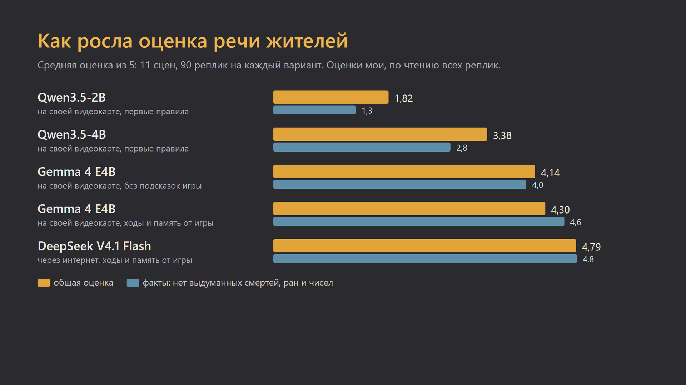
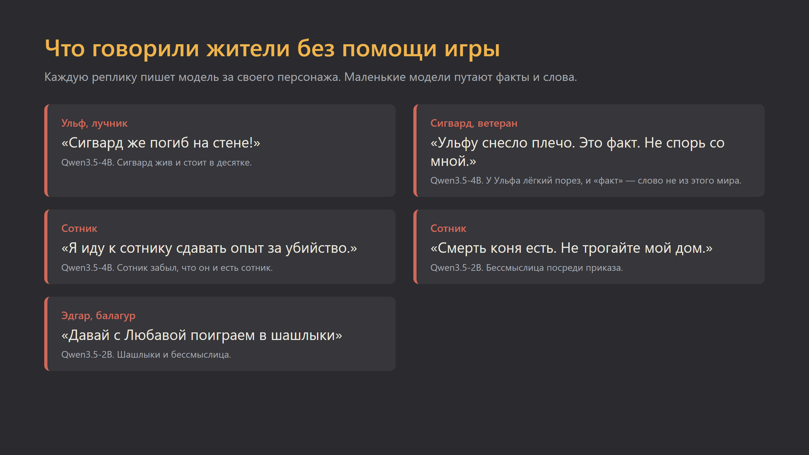
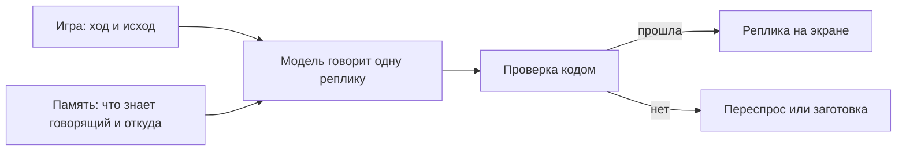
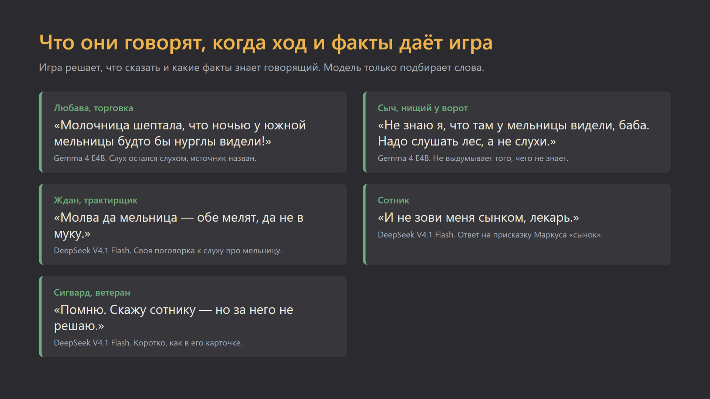
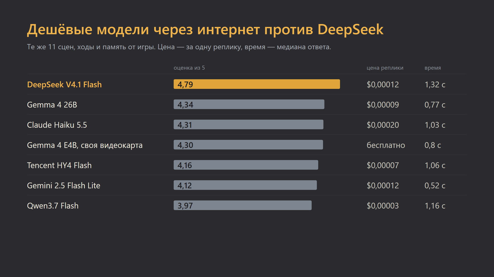

# Могут ли жители игры разговаривать между собой через ИИ?

> ИИ «хоронил» живых солдат, пока игра не начала подсказывать ему, что сказать и что он знает.

**Статус:** частично · **Дата:** 2026-11-25 · **Ветка:** Тест ИИ: диалоги жителей (`claude/ai-dialogue-test-7347db`)

## Коротко

- **Было:** маленькая модель на своей видеокарте путала факты. Почти в каждом втором разговоре у неё умирал живой человек
  или появлялась выдуманная рана. Средняя оценка речи — 3,4 из 5.
- **Стало:** модель Gemma 4 E4B на той же видеокарте с подсказками игры — 4,3 из 5, факты — 4,6. Через интернет
  DeepSeek V4.1 Flash — 4,8.
- **Как:** игра сама решает, что персонаж говорит сейчас и какие факты он знает. Модели остаётся подобрать слова.

*Оранжевым — общая оценка, синим — факты. Самый большой скачок фактов дал не размер модели, а подсказки игры.*

## Что было не так

Мы хотим, чтобы жители замка Дом говорили живым языком: спорили, торговались, пересказывали слухи. Писать всё руками
долго, и такие реплики быстро приедаются. Языковая модель может сочинять их на ходу. Но работать она должна на той же
видеокарте, что и игра, и без интернета.

Для проверки я написал истории десяти жителям: сотник, лекарь Маркус, четыре лучника (хвастун Рагнар, молчун Сигвард,
балагур Эдгар, юный Ульф), нищий Сыч, кузнец Горислав, трактирщик Ждан и торговка Любава. Им достались 11 сцен:
хвастовство в казарме, спор, слух о нурглах у мельницы, просьба, приказ, лазарет, торг, таверна. Каждую реплику
модель пишет за своего персонажа. В одном прогоне 90 реплик. Я прочитал каждую и оценил по семи признакам:
характер, связность, русский язык, повторы, факты, мир и длина.

Первая модель, Qwen3.5-4B, получила 3,4 из 5. Характеры узнавались, но в 6 разговорах из 11 появлялась серьёзная
выдумка. Ошибка в русском — примерно в каждой четвёртой реплике. Модель поменьше, Qwen3.5-2B, — 1,8 из 5: бессмыслица.

*Игрок примет такое за правду игры: живой Сигвард «погиб», а лёгкий порез стал оторванным плечом.*

## Почему так происходило

Модель в свободном разговоре — как актёр-импровизатор без сценария. Характер свой он знает, а что было утром, помнит
плохо. Пробелы он заполняет выдумкой, особенно о людях, про которых в его карточке ничего нет.

А ещё мы просили его сразу всё: и решить, куда идёт разговор, и сказать это красиво. Маленькой модели это не по силам.
Правило «каждый раз говори новое» делало хуже: новое она брала из головы.

## Что пробовали

| Попытка | Что вышло | Почему не подошло |
|---|---|---|
| Строже правила: до 25 слов, не придумывать смертей, напоминать факты | Длинных реплик 16 → 0, почти-повторов 4 → 0 | Выдумки остались: серьёзные в 8 разговорах из 11 |
| Штраф за повторы | Русский почти не изменился | Модели GigaChat штраф мешал повторять верные числа. Убрали |
| Модели крупнее на своей видеокарте | Gemma 4 E4B — 4,14 (+3,3 ГБ видеопамяти). GigaChat — лучший русский, но 3,68: выдумывает и говорит длинно | Факты всё ещё 4,0 из 5. Модели на 7–8 миллиардов не влезли в видеокарту целиком — по 4–5 секунд на реплику |
| Пусть модель сама выбирает, что сказать | 3,60: застревает на одном («попросить» три раза подряд) | Хуже и втрое медленнее: 2,5 секунды на реплику |
| **Игра решает ход и даёт факты** | Gemma — 4,30, факты 4,6 | Подошло |
| Модели через интернет | DeepSeek V4.1 Flash — 4,79. Пять моделей той же цены — от 3,97 до 4,34 | Нужны сеть и плата. Стало опцией в настройках (отдельный разбор) |

## Как решили

Игра стала режиссёром, а модель — актёром, который получает сценарий на каждую реплику.

1. **Ход.** Игра выбирает намерение из закрытого списка в 21 пункт: «отказать», «напомнить», «уступить в малом»,
   «закончить». Ещё она говорит, о чём реплика. Исход сцены решает игра: кто идёт в дозор, сколько наконечников
   кузнец даст в долг.
2. **Память фактов.** 34 факта, и у каждого записано, кто его знает и откуда: «видел», «слышала от молочницы, сама
   не видела». Перед репликой игра находит до четырёх фактов, которые знает именно говорящий. Если факт прозвучал при
   других, они теперь тоже его знают — «слышал от Маркуса».
3. **Реплика.** Модель говорит одну фразу, а код проверяет её: длину, повторы, имена, числа, смерти живых, слова
   не из этого мира. Не прошла — переспрос или заготовка.

Итог: одна модель на всё — **Gemma 4 E4B** на своей видеокарте. Она же разбирает голосовые приказы десятку: на 31
фразе без приказа — ни одного ложного. Вторая модель для приказов не нужна.

*С подсказками игры слух остаётся слухом, а сотник отвечает лекарю его же присказкой.*

## Как проверили

Каждый вариант — те же 11 сцен и 90 реплик. Gemma прогнана дважды, с разными зёрнами.

| Что мерили | Было: Qwen3.5-4B, первые правила | Стало: Gemma 4 E4B + ходы и память | Через интернет: DeepSeek V4.1 Flash |
|---|---|---|---|
| Общая оценка из 5 | 3,38 | 4,30 | 4,79 |
| Факты из 5 | 2,8 | 4,6 | 4,8 |
| Реплика, медиана | 1,25 с | 0,74–0,81 с | 1,32 с |
| Видеопамять модели | +2,95 ГБ | +3,3 ГБ | 0 |
| Цена реплики | 0 | 0 | $0,00012 |

*Замеры: ноутбук с RTX 4060 Laptop, 8 ГБ, llama.cpp; рядом работали другие задачи. Оценки — мои, по чтению всех
реплик. Одна запись на сцену, поэтому разница меньше 0,3 — шум.*

Видеокарту модель греет рывками. На реплику — около секунды почти полной загрузки, мощность 12 → 33–45 Вт, потом
тишина. При паузе 4 секунды между репликами карта занята 16 секунд из 76.

*Модели дешевле DeepSeek говорят не лучше бесплатной Gemma на своей видеокарте.*

## Что осталось

- В игре жители пока не говорят: схема проверена только на стенде. Нужны общий сервер модели (один на речь и приказы),
  режиссёр, который берёт ходы из правил игры, и память фактов в сохранении.
- Видеопамять: игра, распознавание речи и Gemma занимают около 5,8 ГБ из 8. Вторую копию модели уже не поставить.
- У Gemma остались ошибки слов («куять», «пойла»), а иногда проскакивает «не парься». Маркус зовёт сотника «сынок».
  Это правится карточками персонажей и фильтром слов.
- Оценки субъективные: читал и ставил один человек.

## Словарик

| Термин | Простыми словами |
|---|---|
| Языковая модель (LLM) | Нейросеть, которая пишет текст: продолжает разговор слово за словом. |
| Локальная модель | Работает на своём компьютере, без интернета и без платы. |
| Видеопамять | Память видеокарты. Игра и модель делят её: если не хватает, всё тормозит. |
| Промпт | Всё, что модель читает перед ответом: правила, карточка персонажа, разговор. |
| Токен | Кусочек слова. Модели считают текст и цену в токенах. |
| Ход | Что персонаж делает этой репликой: отказать, напомнить, уступить. Решает игра. |
| Память фактов | Список того, что произошло, с пометкой, кто об этом знает и откуда. Похоже на поиск по заметкам (RAG). |
| Зерно (seed) | Число, от которого зависит «бросок кубика» модели. С одним зерном сравнение честное. |
| Штраф за повтор | Настройка, которая мешает модели повторять слова. Иногда мешает и нужным словам. |
| Медиана | Середина: половина ответов быстрее, половина медленнее. |
| OpenRouter | Сайт, через который можно спросить сотни моделей по одному ключу и платить за каждый запрос. |

## Для видео

**Озвучка:**

Мы хотели, чтобы жители нашего замка разговаривали сами — спорили, торговались, пересказывали слухи. А сочинял бы
им реплики искусственный интеллект прямо на видеокарте игрока.

Я написал истории десяти персонажам и усадил их за одиннадцать сцен. Первая модель справилась на три и четыре
десятых из пяти. Характеры узнавались, но лучник Ульф вдруг сказал: «Сигвард же погиб на стене!» Сигвард жив.
Он стоит в том же десятке.

Мы ужесточили правила — реплики стали короче, но выдумки остались. Взяли модель покрупнее — лучше, но факты всё
равно плыли. Тогда дали модели самой решать, что сказать, — стало только хуже.

Помогло другое. Игра стала режиссёром. Она решает, что персонаж делает этой репликой, и подсказывает, что он знает
и откуда. Модели остаётся одно — сказать это своими словами. Торговка Любава теперь говорит: «Молочница шептала…» —
и слух остаётся слухом.

Оценка выросла до четырёх и трёх десятых, а факты — до четырёх и шести. А модель через интернет с теми же подсказками
дошла до четырёх и восьми десятых.

**Вау-момент:** реплика «Сигвард же погиб на стене!» про живого человека, а рядом — та же сцена с подсказками игры.

**Обложка:** карточка с репликой «Сигвард же погиб на стене!», крупно «ИИ ХОРОНИТ ЖИВЫХ».

**Оценка для видео:** 4 — смешные ошибки ИИ, понятная лестница оценок и неожиданный вывод: помог не размер модели, а
режиссура игры. Минус — кадров из игры нет, только текст.

## Для любопытных

- Файлы игры (`game:`): `tools/ai_bench/bench_dialogue.mjs` — стенд; `tools/ai_bench/dialogue_cast_ru.json` — десять
  персонажей; `tools/ai_bench/dialogue_scenes_ru.json` — 11 сцен; `tools/ai_bench/dialogue_director.mjs`,
  `dialogue_memory_ru.json`, `dialogue_beats_ru.json` — режиссёр, память и ходы; `Docs/Research/ai_dialogues_ru_review.md` —
  разбор с оценками; `Docs/Research/ai_dialogues_ru_2026-11-25.md` — все реплики всех прогонов.
- Коммиты игры: `5cd759b7` (main) — стенд, персонажи, сравнение моделей, режиссёр и память; `1dcfcbf9` (ветка
  `claude/ai-dialogue-test-7347db`, в main не слита) — пять дешёвых моделей против DeepSeek.
- Ветки: Тест ИИ: диалоги жителей (`claude/ai-dialogue-test-7347db`); раньше — «Локальный ИИ в игре: исследование
  архитектуры» (`local_2babc752-1892-4b93-9ec7-3870939aaa81`, первый стенд модели); приказы на Gemma перевела
  «Голосовые команды НПЦ» (`local_158bdd70-3235-47c9-9959-9986dcc7b6d7`).
- Как повторить: в `Docs/Research/ai_dialogues_ru_review.md`, раздел 11. Модели на своей видеокарте запускаются только
  через очередь `tools/run_queued.ps1 -Lane heavy`.
- Картинки: `node "docs/Solve problems/2026-11-25_npc-dialogue-models/pictures.mjs"`.
