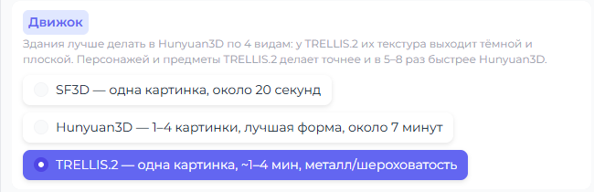
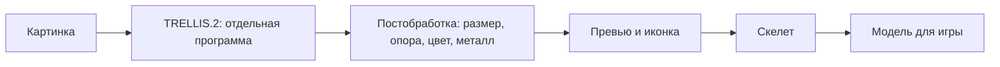
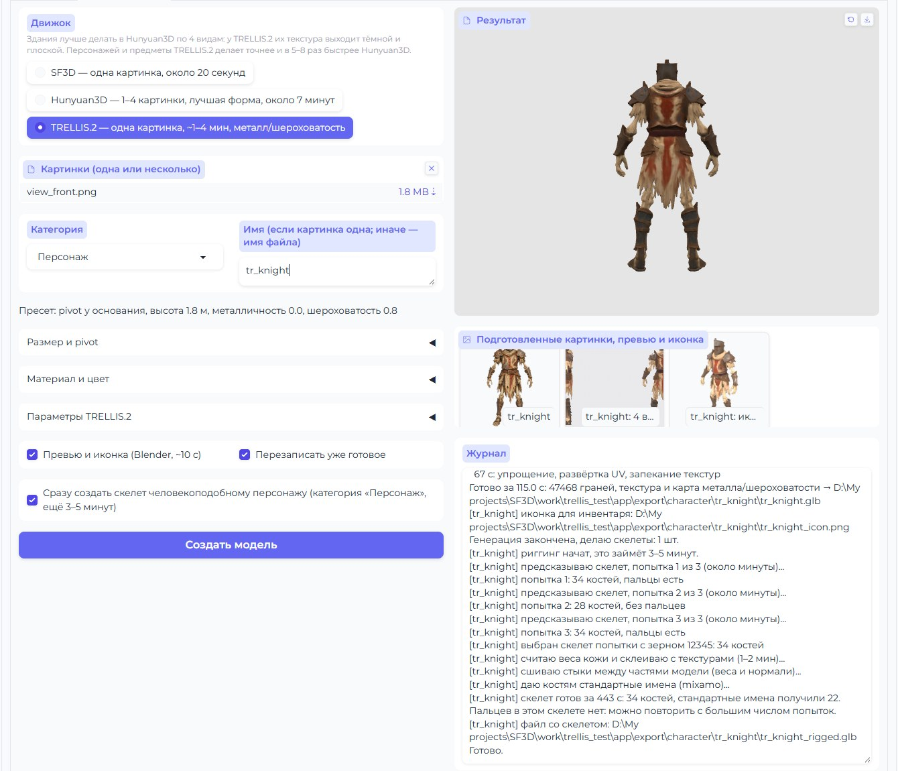
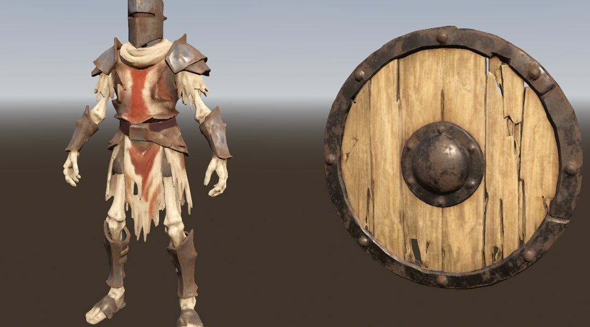

# Как встроить в программу третью нейросеть и не сломать первые две?

> Самая опасная строчка оказалась не в нейросети, а в «пресете»: он молча обнулил бы металл, который TRELLIS только что нарисовал.

**Статус:** решено · **Дата:** 2026-11-25 · **Ветка:** TRELLIS.2 — проверка и встраивание (запущена из «Правки проекта»)

## Коротко

- **Было:** в приложении два движка: быстрый SF3D и медленный Hunyuan3D. Персонаж — 8,5 минут ожидания.
- **Стало:** третий движок TRELLIS.2 — рыцарь со скелетом и картой металла за 2 минуты плюс 7 минут на скелет, прямо из приложения.
- **Как:** TRELLIS.2 запускается отдельной программой, а наша обработка научилась беречь его металл. Пакетная обработка сама выбирает движок по категории.

*Третий вариант в «Движок». Подсказка сверху честно предупреждает: здания лучше делать в Hunyuan3D.*

## Что было не так

Проверка показала: TRELLIS.2 лепит персонажей и предметы лучше и в 5–8 раз быстрее Hunyuan (разбор
«Может ли нейросеть сделать 3D-героя по одной картинке…»). Но пока он жил отдельной программой в тестовой папке.
Чтобы пользоваться им каждый день, нужно было:

- поставить его так, чтобы любой мог повторить установку;
- выбрать его в приложении, как Hunyuan, и получить готовую модель для игры: размер, точку опоры, коробку
  столкновений, превью, скелет;
- не испортить при этом два старых движка.

## Почему так происходило

После нейросети модель проходит нашу «постобработку»: масштаб, точка опоры, цвет, материал. У каждой категории
есть пресет. Например, у персонажа «металличность 0, шероховатость 0,8».

Для старых движков это было правильно: у них нет своей карты металла. А TRELLIS.2 рисует карту — где железо,
а где ткань. В формате модели (glTF) итоговый металл — это карта, умноженная на число из пресета. Пресет говорит
«0», а любая карта, умноженная на ноль, превращается в ноль. Латы рыцаря стали бы матовыми, как картон. Мы увидели
это, читая код обработки, и поправили до первого прогона.

## Что пробовали

| Попытка | Что вышло | Почему не подошло (или подошло) |
|---|---|---|
| Оставить сборку в тестовой папке | Работает только у нас | Папка `work` не попадает в репозиторий. Сделали скрипты установки с закреплённой версией и проверкой файлов. |
| Обычная постобработка как есть | Металл пропал бы | Пресет умножает карту металла на 0. Нашли по коду и поправили до первого прогона. |
| Одна яркость для всех моделей | На одних светло, на других темно | Модели темнее картинки по-разному: в 1,4–2,2 раза. Взяли подгонку к самой картинке (позже её улучшили). |
| Кнопка категорий в выпадающем списке (тест) | Первый прогон рыцаря ушёл как «пропс» | Ошибка в нашем тестовом скрипте, не в приложении. Прогнали ещё раз. |
| Коммит через общий файл сообщения | В историю попала чужая подпись | Другая ветка оставила там свой текст. Исправили отдельным коммитом-поправкой, историю не переписывали. |

## Как решили

- **Установка.** Два скрипта: один собирает TRELLIS.2 из исходного кода закреплённой версии (около 25 минут),
  другой скачивает веса и сверяет каждую контрольную сумму. Проверили: сборка с нуля прошла, все 8 файлов совпали.
- **В приложении.** Третий вариант «TRELLIS.2 — одна картинка». Перед запуском приложение ждёт свободные 5,5 ГБ
  видеопамяти и показывает в журнале этапы: «форма», «цвет, металл и шероховатость» и так далее.
- **Металл.** Если у модели своя карта металла, постобработка её не трогает. Числа из пресета применяются, только если
  пользователь сам задал их руками.
- **Пакет.** Папку картинок программа разбирает сама: персонажи и предметы — в TRELLIS.2, здания — в Hunyuan3D.

*Рыцарь прошёл весь путь в тестовой копии приложения: модель за 115 секунд, потом скелет из 34 костей.*

## Как проверили

Проверяли в отдельной копии приложения, не трогая рабочее приложение пользователя.

| Что мерили | Результат |
|---|---|
| Рыцарь как персонаж: модель | 115 с, 47 468 треугольников, карта металла на месте |
| Рыцарь: скелет | 443 с, 34 кости, карта металла сохранилась |
| Щит по картинке без прозрачного фона | 125 с, фон убран за ~19 с |
| Модели SF3D и Hunyuan до и после правки | совпали байт в байт |
| Пакет из 4 картинок | рыцарь и щит — TRELLIS, таверна — Hunyuan, бочка — SF3D |

*Замеры: RTX 4060, 8 ГБ.*

*Те же модели в игровом движке Godot 4.7: наплечники, поножи, умбон и обод щита блестят как металл.*

## Что осталось

- Окно «Результат» показывает модель со спины. Так у всех трёх движков: превью и игра показывают правильно.
- Позже ветка «Улучшение сгенерированной модели» нашла пятнистые грани по швам развёртки. Причина была в библиотеке
  для чтения моделей. Исправили 26 ноября: нормали теперь гладкие, как у самой TRELLIS.
- Цвет TRELLIS доводили отдельно: разбор «Подгонка палитры под картинку».

## Словарик

| Термин | Простыми словами |
|---|---|
| Движок | Нейросеть, которая делает модель: SF3D, Hunyuan3D или TRELLIS.2. |
| Постобработка | Доводка модели после нейросети: размер, точка опоры, цвет, материал, коробка столкновений. |
| Пресет | Набор настроек по категории: персонаж, предмет, здание. |
| Карта металла | Картинка-подсказка для игры: где поверхность металлическая. |
| Скелет | Кости внутри модели, за которые её двигают в анимации. |
| Контрольная сумма | «Отпечаток» файла. Если он совпал, файл скачан без ошибок и не подменён. |
| Видеопамять | Память видеокарты, в которую должна влезть нейросеть. |
| Пакетная обработка | Сделать модели из целой папки картинок за один запуск, например на ночь. |

## Для видео

**Озвучка:**

Мы нашли нейросеть, которая делает героев лучше и быстрее. Осталось встроить её в нашу программу. Первая ловушка
нашлась ещё до запуска. Нейросеть рисует карту металла, а наша доводка по привычке умножила бы её на ноль: у
персонажей металл по умолчанию выключен. Латы рыцаря стали бы матовыми, как картон. Научили доводку беречь чужую карту. Дальше скрипты установки:
сборка из исходного кода и проверка каждого файла весов. Потом рыцарь прошёл весь путь в приложении: модель за две
минуты, скелет из тридцати четырёх костей, и в игровом движке латы блестят. А папку картинок программа теперь
разбирает сама: героев отдаёт новой нейросети, здания — старой.

**Вау-момент:** рыцарь, сделанный из одной картинки, в игровом движке Godot — латы блестят, скелет внутри. Кадра «матовые латы» нет: баг поймали до запуска.

**Обложка:** `img/03_godot_metal.jpg`, текст «ТРЕТИЙ ДВИЖОК».

**Оценка для видео:** 3 — понятный баг «умножили на ноль» и путь до игры, но мало зрелищных кадров.

## Для любопытных

- Файлы: `tool/sf3d_ui.py` (`generate_trellis`, `_tr_run`, `BATCH_ENGINE`), `tool/sf3d_tool.py` (`postprocess`: карта
  металла, нормали), `tool/batch_cli.py` (`--classic`), `trellis2-install.ps1`, `trellis2-weights.ps1`,
  `tool/config.example.json` (`trellis_exe`, `trellis_models`, `trellis_cuda_bin`).
- Коммиты: `116c700` — встраивание (ушло с чужим сообщением), `69bb9e5` — поправка к нему, `b5372a6` — пакет по
  категориям, `623d476` и `7a138e7` — нормали.
- Ветки: «TRELLIS.2 — проверка и встраивание», запущена из «Правки проекта» (`local_e34b3455`); нормали нашла
  «Улучшение сгенерированной модели» (`local_1c2e5843`).
- Как повторить: `powershell -ExecutionPolicy Bypass -File trellis2-install.ps1`, затем `trellis2-weights.ps1`;
  тесты: `work/trellis_test/app7873.py`, `work/wear_test/ui/trellis/tr_gen.mjs`, `work/trellis_test/batch_test.py`.
