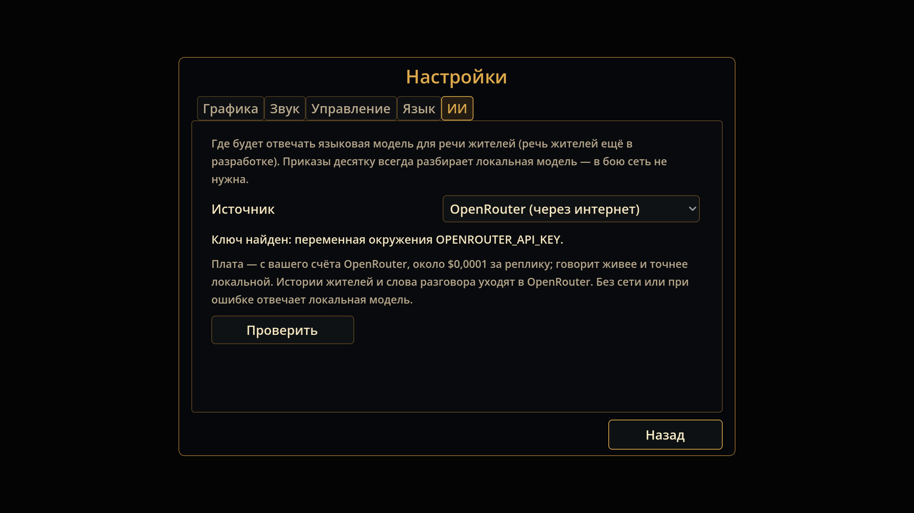
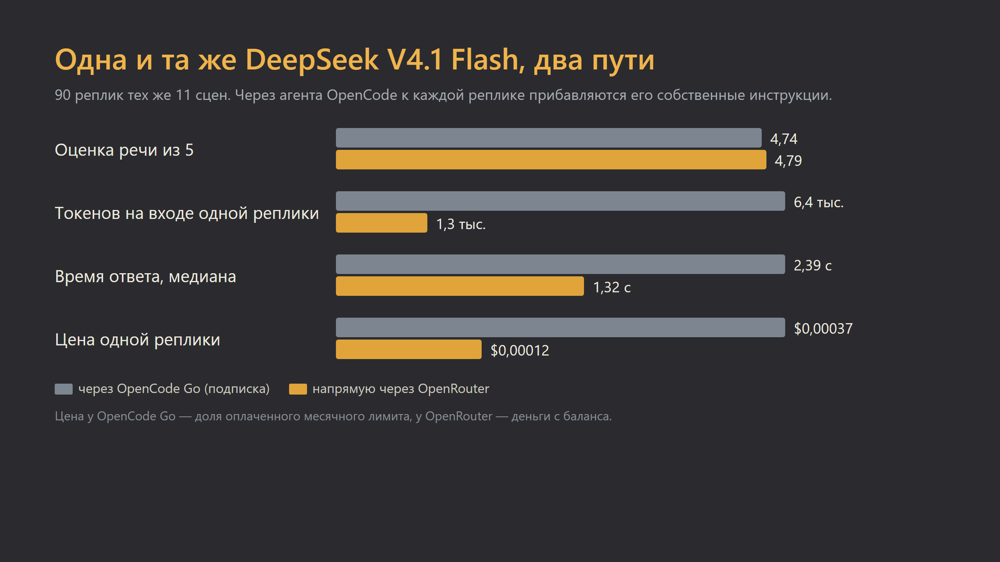
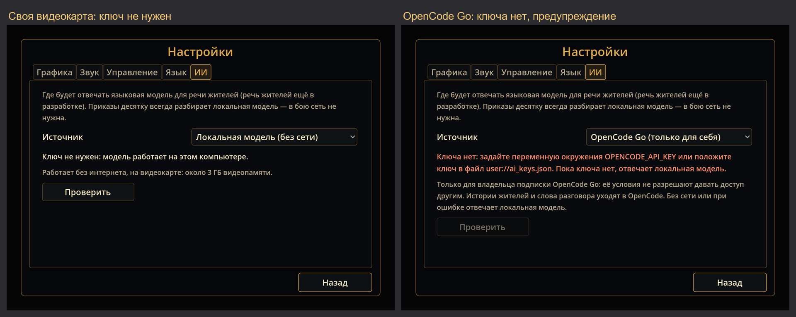

# Где думать ИИ игры: на своей видеокарте или в интернете?

> Одна и та же модель через подписку обходилась втрое дороже: к каждой реплике прилипало около пяти тысяч токенов
> чужих инструкций.

**Статус:** частично · **Дата:** 2026-11-26 · **Ветка:** Тест ИИ: диалоги жителей (`claude/ai-dialogue-test-7347db`)

## Коротко

- **Было:** речь жителей можно было сочинять только моделью на своей видеокарте. Это 4,3 из 5 и около 3 ГБ видеопамяти.
- **Стало:** в настройках игры появилась вкладка «ИИ» с тремя вариантами: своя видеокарта, OpenRouter или OpenCode Go.
  Через интернет речь — 4,8 из 5, около $0,0001 за реплику.
- **Как:** игрок выбирает источник, а ключ кладёт сам. В настройках ключ не хранится. Если сети нет, отвечает своя модель.

*Выбран OpenRouter. Игра пишет, что ключ найден (но не показывает его), сколько это стоит и что уйдёт в интернет.*

## Что было не так

Для разговоров жителей мы выбрали модель Gemma 4 E4B на своей видеокарте (об этом — разбор
[2026-11-25_npc-dialogue-models](../2026-11-25_npc-dialogue-models/README.md)). Она бесплатная и работает без сети.
Но ей нужно около 3 ГБ видеопамяти, а речь у неё — 4,3 из 5.

Модель DeepSeek V4.1 Flash в интернете говорит заметно лучше: 4,8 из 5. Пользователь спросил, можно ли сделать выбор
прямо в настройках: своя модель, OpenCode или OpenRouter. У него уже была подписка OpenCode Go, где на эту модель
даётся большой лимит.

## Почему так происходило

Сначала я прогнал DeepSeek через программу OpenCode, как у пользователя. Качество — 4,7 из 5, но каждая реплика
занимала 2,4 секунды. На вход уходило 6,4 тысячи токенов, а наш собственный текст — всего 1,3 тысячи.

Причина в том, что OpenCode — агент для программистов. К каждому запросу он прибавляет свои инструкции: как читать
файлы, как писать код. Для реплики трактирщика они не нужны, но за них платишь. Это как отправлять письмо в посылке
с инструкцией к стиральной машине.

У подписки OpenCode Go есть и условия: пользоваться ею можно только самому, раздавать доступ другим нельзя.
Значит, игрокам такой вариант не предложишь.

## Что пробовали

| Попытка | Что вышло | Почему не подошло |
|---|---|---|
| DeepSeek через программу OpenCode, уровень low | 4,74 из 5; 2,4 с; около $0,00037 за реплику из лимита подписки | Лишние 5 тысяч токенов на каждую реплику. Только для владельца подписки |
| То же на уровне high (medium у этой модели нет) | 4,69 из 5, не лучше | Дороже, а качество то же |
| **DeepSeek напрямую через OpenRouter** | **4,79 из 5; 1,32 с; $0,00012 за реплику** | Подошло. Платит владелец ключа |
| Пять других дешёвых моделей через OpenRouter | От 3,97 до 4,34 | Хуже DeepSeek и не лучше своей Gemma |

*Одна и та же модель: через OpenRouter вход впятеро меньше, ответ вдвое быстрее, реплика втрое дешевле.*

## Как решили

В настройках появилась пятая вкладка — «ИИ».

- **Источник:** «Локальная модель (без сети)» — по умолчанию, «OpenRouter (через интернет)» и «OpenCode Go
  (только для себя)».
- **Ключ** игра ищет в переменной окружения или в отдельном файле ключей. В файл настроек и в сохранения он не попадает:
  проверка настроек отвергает файл, если в нём есть ключ. Своих ключей игра не содержит.
- **Под выбором** вкладка пишет, найден ли ключ (только имя переменной), сколько это стоит и что уходит в интернет:
  истории жителей и слова разговора.
- **Кнопка «Проверить»** спрашивает у выбранного источника одну короткую фразу и показывает ответ и время.
- **Без ключа, без сети или при ошибке** отвечает своя модель. Бой сети не ждёт: голосовые приказы десятку всегда
  разбирает своя модель.

*Слева вариант по умолчанию, ключ не нужен. Справа OpenCode Go без ключа: красное предупреждение и серая кнопка проверки.*

## Как проверили

Отдельный проверочный прогон игры без окна прошёл 14 проверок из 14:

- старые настройки сами переходят на новую версию с вариантом «своя модель»;
- настройки с ключом внутри отвергаются;
- вкладка переведена на русский и сохраняет выбор;
- OpenCode Go без ключа отказывает сразу, без запроса.

Настоящий запрос к OpenRouter вернул «Стены стоят, как стояли, — только ветер сменился.» за 735 мс. Кнопка
«Проверить» на вкладке ответила за 549 мс.

| Что мерили | Через OpenCode Go | Через OpenRouter |
|---|---|---|
| Оценка речи из 5 | 4,74 | 4,79 |
| Токенов на входе одной реплики | ~6,4 тыс. | ~1,3 тыс. |
| Время ответа, медиана | 2,39 с | 1,32 с |
| Цена реплики | ~$0,00037 из лимита подписки | $0,00012 с баланса |
| Час игры, реплика раз в 10 секунд | ~$0,14 из лимита | ~$0,045 |

*Замеры: 90 реплик тех же 11 сцен; оценки — мои, по чтению. Цена у OpenCode Go посчитана по прайсу Go: сама программа
пишет $0, деньги идут из месячного лимита.*

## Что осталось

- Настройку пока никто не читает: жители в игре ещё не говорят.
- Прямой адрес OpenCode Go без программы-агента не проверялся: мерили только через OpenCode.
- Автотесты настроек обновлены, но не запускались.
- Ветка ещё не слита в main.

## Словарик

| Термин | Простыми словами |
|---|---|
| Языковая модель | Нейросеть, которая пишет текст: здесь — реплики жителей. |
| Своя (локальная) модель | Работает на видеокарте игрока, без интернета и без платы. |
| OpenRouter | Сайт, через который по одному ключу можно спросить сотни моделей. Платишь за каждый запрос. |
| OpenCode Go | Подписка для программистов: за $10 в месяц даёт лимит на модели в программе OpenCode. |
| Агент | Программа-помощник, которая сама добавляет к запросу свои инструкции: как читать файлы, как писать код. |
| API-ключ | Пароль для программ. По нему сервис понимает, с чьего счёта списать плату. |
| Переменная окружения | Настройка Windows, которую видят программы. Удобное место для ключа: не в файлах игры. |
| Токен | Кусочек слова. Модели считают текст и цену в токенах. |
| Медиана | Середина: половина ответов быстрее, половина медленнее. |

## Для видео

**Озвучка:**

Наши жители говорят с помощью модели на видеокарте игрока. Это бесплатно и без интернета. Но модель в интернете
говорит лучше — четыре и восемь против четырёх и трёх. Так появился вопрос: а пусть игрок сам выбирает?

Я проверил одну и ту же модель, DeepSeek, двумя путями. Первый — через подписку OpenCode, программу для
программистов. Реплика шла почти две с половиной секунды и стоила втрое дороже. Оказалось, программа к каждой фразе
трактирщика добавляла пять тысяч токенов своих инструкций: как читать файлы, как писать код.

Второй путь — напрямую через OpenRouter. Та же модель, тот же текст: секунда с третью и одна сотая цента за реплику.
Час разговоров — около пяти центов.

Теперь в настройках игры есть вкладка «ИИ». Своя видеокарта, OpenRouter или подписка — только для себя. Ключ игра
не хранит и не показывает, а честно пишет, что уйдёт в интернет. Нет сети — отвечает своя модель.

**Вау-момент:** одна и та же модель, а счётчик токенов — шесть тысяч четыреста против тысячи трёхсот.

**Обложка:** вкладка «ИИ» с выбранным OpenRouter, крупно «ИИ: СВОЙ ИЛИ ОБЛАЧНЫЙ?».

**Оценка для видео:** 3 — вкладка настроек сама по себе скромная, но история про лишние токены и цену понятна любому.

## Для любопытных

- Файлы игры (`game:`): `game/ui/menu/ai_source_tab.gd` — вкладка; `game/ai/ai_sources.gd`, `game/ai/ai_chat.gd`,
  `game/ai/README.md` — источники и запрос; `data/ai/ai_sources.json` — список источников;
  `game/persistence/settings_codec.gd` — настройки версии 4; `tools/ai_bench/opencode_client.mjs` — стенд через OpenCode;
  `Docs/Research/ai_dialogues_ru_review.md` §15–16 — замеры; `Docs/PendingDecisions/ai_dialogue_test.md` — решение
  `G-D:ai_dialogue_test.1`; дополнение в `Docs/Architecture/Decisions/ADR-0005-local-ai-sidecar.md`.
- Коммит игры: `8509160a` (ветка `claude/ai-dialogue-test-7347db`, в main не слита).
- Ветки: Тест ИИ: диалоги жителей (`claude/ai-dialogue-test-7347db`).
- Как повторить: в игре из этой ветки — Настройки → ИИ → Источник. Для OpenRouter нужна переменная окружения
  `OPENROUTER_API_KEY` со своим ключом.
- Картинки: кадры вкладки — `ai_tab_shot.gd` (команда в `case.json → regenerate`), остальное —
  `node "docs/Solve problems/2026-11-26_ai-source-setting/pictures.mjs"`.
