# Как научить кабана ходить, если нейросеть дала ему три задние ноги?

> Самый «умный» способ не сработал. Помогли три простых шаблона и старая формула из биологии: по ней шаг и слона, и мыши
> подгоняется под длину ног.

**Статус:** решено · **Дата:** 2026-11-26 · **Ветка:** скелеты и походки существ (запущена из «Правки проекта»)

## Коротко

- **Было:** скелет зверю ставила нейросеть UniRig. Кабану она дала три задние ноги и хвост, растущий из шеи. Своих
  движений у зверей не было, только чужие клипы лисы и лошади.
- **Стало:** скелет ставится по шаблону «четвероногое», «птица» или «змея» примерно за 20 секунд. Звери сами
  получают шаг, бег, повороты, прыжок и атаку, и копыта в этих клипах не уходят в пол (0 мм).
- **Как:** программа сама расставляет суставы по форме модели, человек при желании их поправляет. Движения
  считаются по законам ходьбы настоящих животных, а ноги ставятся на землю отдельной математикой.

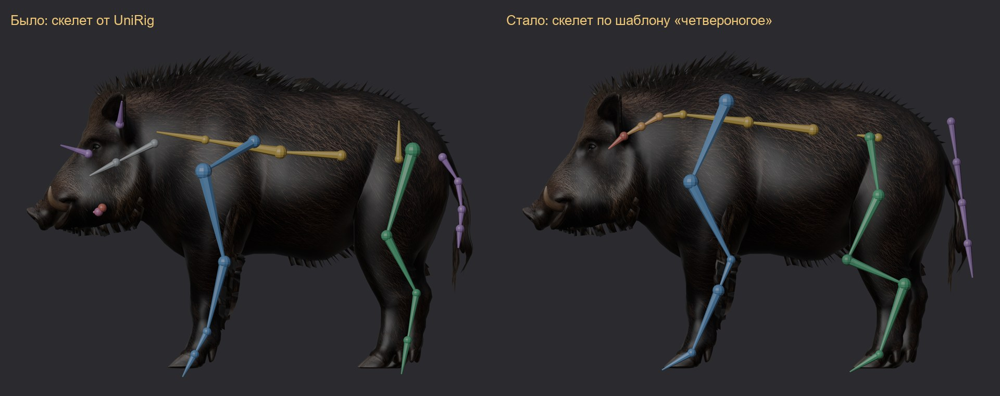
*Слева скелет от нейросети: лишняя задняя нога, хвост из шеи, серые кости непонятно чьи. Справа скелет по шаблону:
позвоночник, шея, голова, хвост, четыре ноги по пять костей.*

## Что было не так

Наша программа делает модели для игры, а игре нужны монстры: кабаны, волки, нурглы. Чтобы модель двигалась, у неё
внутри должен быть скелет — как у куклы-марионетки, у которой есть палочки в руках и ногах.

Для людей программа давно ставит скелет хорошо. Для зверей работала нейросеть UniRig, и с кабаном она ошиблась:
поставила три задние ноги, а хвост вырастила из шеи. С таким скелетом кабан не пойдёт.

Вторая беда — движения. Своих клипов у зверей не было. Брались чужие клипы лисы и лошади и переносились на зверя.
У нургла (это монстр нашей игры, похожий на волка-оборотня) лапы в беге лисы висели над землёй на 27 миллиметров.

## Почему так происходило

Нейросеть угадывает скелет по форме, как человек, которому показали силуэт в темноте. У кабана короткие толстые
ноги и щетина, и сеть путается: принимает щетину за кости, а складку у шеи — за хвост.

Чужие клипы не подходят по пропорциям. Лиса длинноногая и лёгкая, а кабан коренастый. Шаг, который хорош для лисы,
кабану либо велик (нога не дотягивается), либо мал (нога проваливается в землю). Это как надеть чужие ботинки.

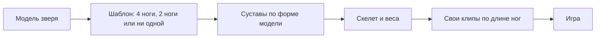

## Что пробовали

| Попытка | Что вышло | Почему не подошло |
|---|---|---|
| Скелет от нейросети UniRig | У кабана три задние ноги и хвост из шеи | Нейросеть угадывает, а поправить угадку трудно |
| Клипы лисы и лошади на кабане и нургле | Лапы висят над землёй до 27 мм или проваливаются | Чужие пропорции: шаг не по ногам |
| Ранний свой шаг кабана | Цикл шага всего 9 кадров, семенил | Ноги в позе покоя почти прямые, «вынести» лапу вперёд не получалось |
| Первый галоп | Нос то задирался, то нырял | Изгиб спины суммировался по всем позвонкам |
| Первая проверка клипов | Копыта уходили в пол на 15–18 мм | Загнутое копыто цепляло пол в конце шага |
| Первый шаг нургла | Голень уходила в пол на 7 см | У нургла лапы в покое далеко впереди плеч, нога уходила слишком далеко назад |

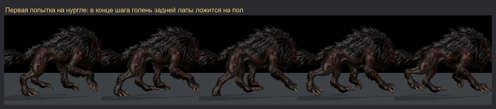
*Неудачная попытка: в конце шага задняя нога нургла уходит так далеко назад, что голень ложится на пол.*

Каждую неудачу чинили отдельно. Нижняя кость лапы стала наклоняться вместе с ногой, как путовый сустав у лошади.
Копыто загибается не ниже пола. Центр шага каждой лапы ставится туда, где нога его достаёт: под плечо. Нога
отклоняется не больше чем на 32 градуса вперёд или назад. У лап без отдельных пальцев в конце шага приподнимается
пятка, как у человека.

## Как решили

**Шаблоны.** Есть три заготовки скелета: четвероногое, птица и змея. Программа сама смотрит на модель: нижние точки
— это лапы, силуэт сверху — спина, самая тяжёлая часть спереди — голова. И сама расставляет суставы. Человек видит
их поверх полупрозрачной модели и может перетащить мышью. Правая сторона повторяет левую.

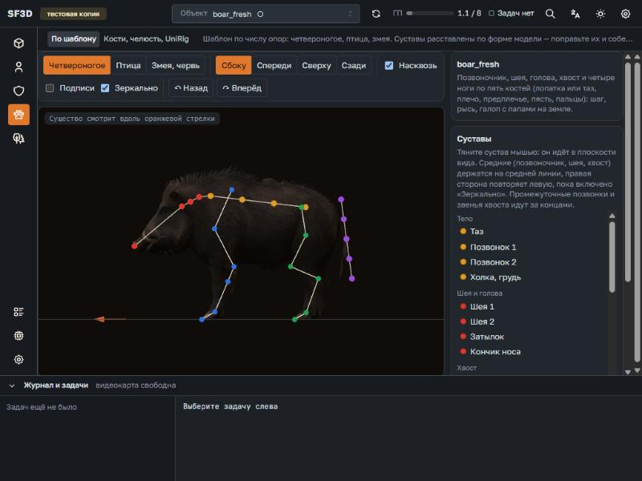
*Страница разметки в программе: кабан насквозь, суставы цветными точками, слева выбор шаблона, справа список суставов.*

**Сборка.** Кнопка «Собрать скелет» строит кости и решает, какую часть кожи двигает каждая кость. Мелкие отдельные
кусочки — щетина, бахрома на подбородке, клыки — двигаются вместе с кожей под ними. Раньше бахрома кабана отлетала
при шаге.

**Движения.** Клипы не рисуются вручную. Программа знает, как ходят звери:

- **Шаг** — лапы ставятся по очереди: задняя левая, передняя левая, задняя правая, передняя правая.
- **Рысь** — одновременно ставятся диагональные пары.
- **Галоп** — толкают задние лапы, спина то сгибается, то вытягивается.

Длина шага считается по числу Фруда. Это формула из биологии, по которой шаг слона и мыши подгоняется под длину ног.
Лапа в опоре стоит на земле и не скользит: её держит IK, «обратная кинематика», когда программа сама сгибает колено,
чтобы лапа попала в нужную точку.

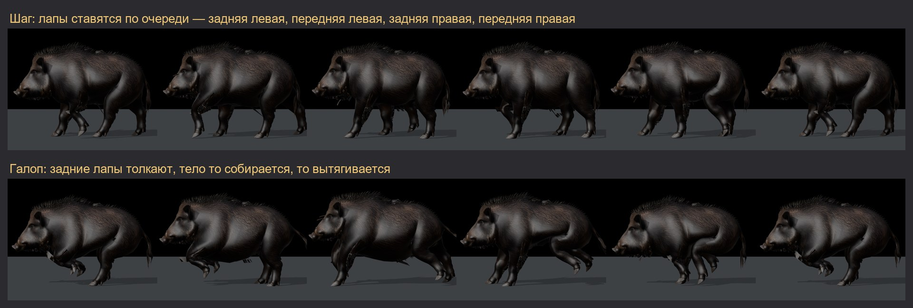
*Кадры шага и галопа: в опоре лапа стоит на месте, в махе поднимается и подгибается.*

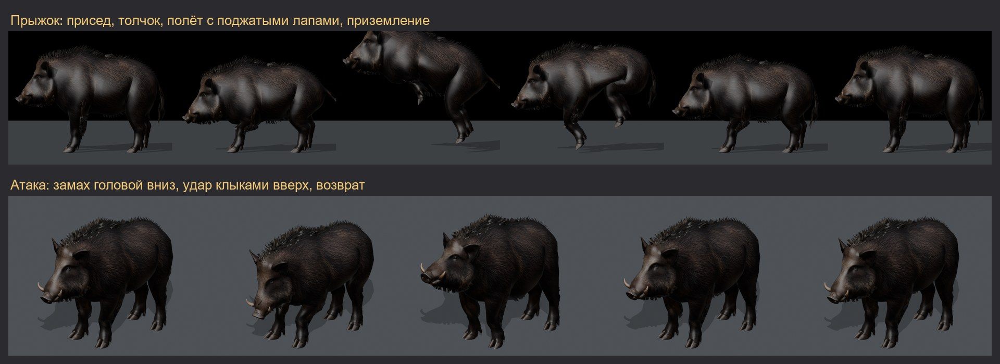
*Прыжок и атака: присед, толчок, полёт с поджатыми лапами; замах головой вниз и удар клыками.*

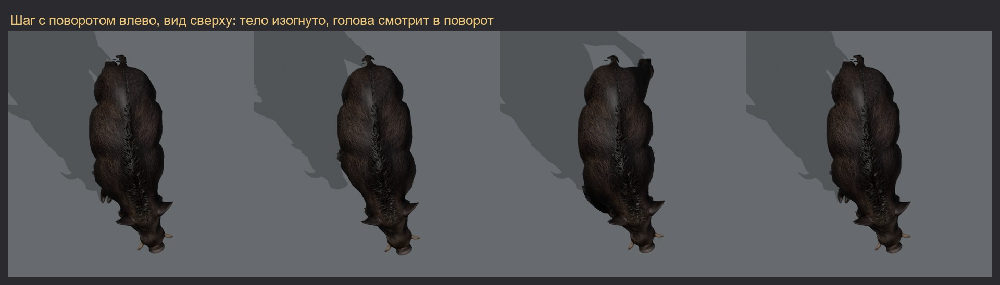
*Шаг с поворотом, вид сверху: внутренние лапы шагают короче, тело изогнуто, голова смотрит в поворот.*

**Птица и змея.** Птица ходит на двух ногах, машет крыльями и планирует. Змея ползёт волной, которая бежит от головы
к хвосту, и делает бросок.

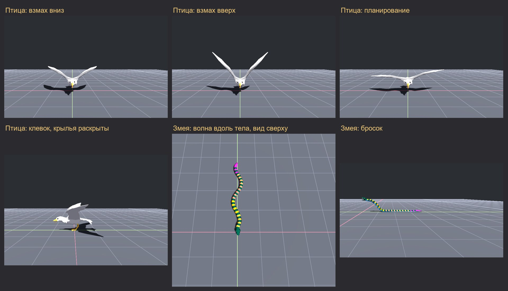
*Чайка: взмах вниз и вверх, планирование, клевок. Змея: волна вдоль тела и бросок с поднятой головой.*

**Лапы по неровной земле.** Все клипы сделаны на ровном полу. Для игры добавлен отдельный помощник: он смотрит,
где земля под каждой лапой, и доводит лапу до неё. На склоне или ступеньке лапы больше не тонут.

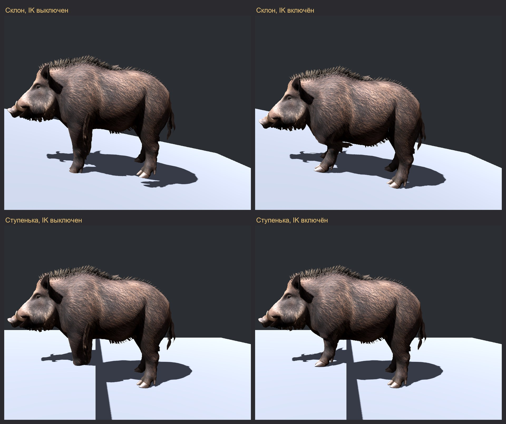
*Без помощника передние копыта утоплены в склон и ступеньку, с ним стоят на поверхности.*

**Нурглы в игре.** Всё это проверили на монстрах игры. Орда нурглов теперь бежит новым галопом. Предводитель нурглов
стоит на склонах поля обеими ногами.

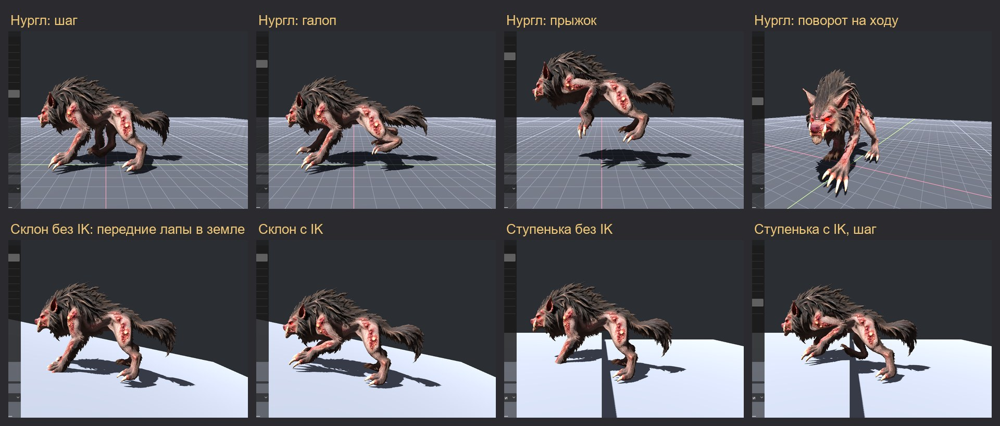
*Нургл в Godot: шаг, галоп, прыжок, поворот; на склоне и ступеньке без помощника и с ним.*

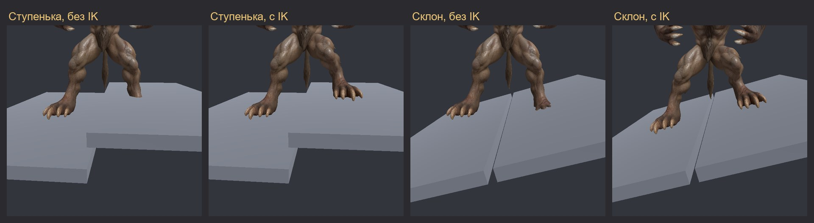
*Предводитель нурглов в игре: без помощника одна ступня в ступеньке или склоне, с ним обе стоят на поверхности.*

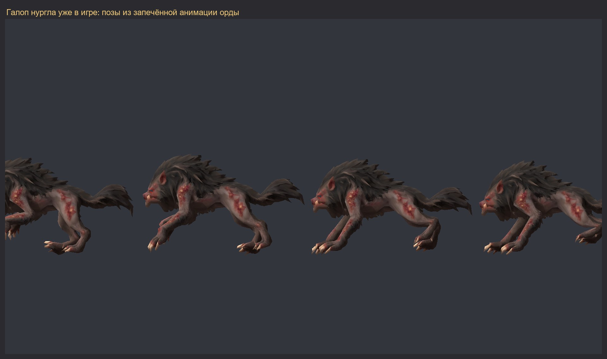
*Позы галопа нургла из анимации, запечённой для орды.*

## Как проверили

Каждый клип проверяли программой проверки: она смотрит каждый кадр и считает, насколько кожа уходит под пол,
насколько стоящая лапа скользит и есть ли рывок, когда клип начинается заново.

| Что мерили | Было | Стало |
|---|---|---|
| Кабан: кожа под полом в шаге, рыси, галопе | 15–18 мм в первой версии | 0 мм |
| Кабан: скольжение стоящей лапы | 85–128 мм в первой версии | 0 мм (повороты 0–1 мм, прыжок 10 мм) |
| Кабан: рывок на стыке цикла | — | 0 (бесшовно) |
| Нургл: кожа под полом в шаге и беге | до 74 мм в первой версии | 0–10 мм (у его клипов лисы и лошади 10–14 мм) |
| Нургл: бег, лапы над землёй | 27 мм (бег лисы) | 10 мм, в опоре касаются земли |
| Сборка скелета по шаблону | — | около 20 с, без видеокарты |
| Клипы кабана (5 штук) | — | около 8 с |

*Замеры: ноутбук с RTX 4060 8 ГБ, Blender 5.2, Godot 4.7.2. Модель кабана — около метра в длину.*

В Godot у кабана шаг, рысь, галоп и покой зациклены, прыжок и атака проигрываются один раз. Нургла, чайку и змею
проверили снимками из Godot. В игре прошли общий набор тестов (1450 проверок) и тесты стай нурглов (45 проверок).

## Что осталось

- Повороты и прыжок есть, но орда в игре их пока не использует: каждый её нургл всегда проигрывает только один клип.
- Птице и змее нужны модели в удобной позе. Сложенные крылья и свёрнутая кольцами змея анимируются хуже.
- Догадка о суставах иногда ошибается: у кабана слишком короткое предплечье. Это поправляется мышью.
- Помощник «лапы по земле» сделан своими силами. Встроенные IK-узлы Godot не проверяли.

## Словарик

| Термин | Простыми словами |
|---|---|
| Скелет (риг) | Невидимые «палочки» внутри модели, как у марионетки. Двигаешь кость — двигается кожа. |
| Кость, сустав | Кость — одна палочка скелета. Сустав — место, где кости соединяются. |
| UniRig | Нейросеть, которая сама ставит скелет в модель. |
| Шаблон скелета | Заготовка скелета для типа тела: четыре ноги, две ноги и крылья или ни одной. |
| Веса | Какую часть кожи двигает каждая кость. Плохие веса — и при шаге кожа рвётся или отлетает. |
| Клип | Одна анимация: шаг, бег, атака. |
| Цикл | Клип, который повторяется без остановки. Хороший цикл не дёргается на стыке. |
| IK (обратная кинематика) | Программа сама сгибает колено, чтобы лапа попала в нужную точку. |
| Число Фруда | Формула из биологии: по ней шаг животного подгоняется под длину его ног. |
| Аллюр | Способ движения: шаг, рысь, галоп. |
| VAT | Анимация, «запечённая» в картинку. Так тысячи нурглов бегают без отдельного скелета у каждого. |
| Godot | Игровой движок, в котором делается игра. |
| Blender | Программа для 3D, в ней программа строит скелеты и клипы. |

## Для видео

**Озвучка:**

Наша программа делает монстров для игры. Чтобы монстр двигался, внутри у него нужен скелет. Для зверей скелет
ставила нейросеть. Кабану она дала три задние ноги, а хвост вырастила из шеи.

Мы сделали проще. Есть три шаблона: четвероногое, птица и змея. Программа смотрит на модель. Нижние точки — это
лапы. Силуэт сверху — спина. Тяжёлый конец — голова. И сама расставляет суставы. Человек может их поправить мышью.
Скелет собирается за двадцать секунд.

Потом движения. Их не рисует художник. Программа знает, как ходят звери: шаг — лапы по очереди, рысь — диагональные
пары, галоп — толкают задние. Длину шага подсказывает формула из биологии. По ней шагает и слон, и мышь.

Первые попытки были смешными. Кабан семенил, галопом кивал носом, а копыта уходили в пол. У нургла голень ложилась на
землю. Каждую ошибку мы поймали проверкой и исправили. Теперь копыта стоят на земле: ноль миллиметров под полом.

А чтобы монстр не тонул на склоне, есть помощник. Он находит землю под каждой лапой и доводит лапу до неё.

Теперь орда нурглов в игре бежит этим галопом, а их предводитель стоит на склонах обеими ногами.

**Вау-момент:** кабан с тремя задними ногами — и тот же кабан с аккуратным скелетом идёт, переходит в галоп и прыгает.

**Обложка:** кабан в галопе с цветным скелетом поверх, крупно «ТРИ НОГИ → ГАЛОП».

**Оценка для видео:** 5 — смешная ошибка нейросети, наглядные скелеты и живые клипы, понятная «до/после» на склоне и
финал в настоящей игре.

## Для любопытных

- Файлы SF3D:
  - `tool/creature_templates.py` — шаблоны и догадка по форме;
  - `tool/creature_markup.html` — страница разметки;
  - `tool/blender_creature_template.py` — сборка скелета и весов;
  - `tool/creature_gait.py` — свои клипы;
  - `tool/godot/sf3d_creature_feet.gd` — лапы по земле;
  - `tool/creatures.py`, `tool/web/creature.py`, `tool/web/front/src/screens/Creatures.tsx`.
- Файлы игры: `game/characters/creature_feet.gd`, `game/horde/leader/nurgle_leader.gd`,
  `source_assets/nurgles/build_nurgle_vat.py`, решение G-D203.
- Коммиты SF3D:
  - `6748a81` — шаблоны и клипы;
  - `3d06ff4` — повороты, прыжок, лапы по земле;
  - `375f846` — клипы на нурглах;
  - `b38e60a` — земля по карте высот;
  - `1f027eb` — страница разметки больше не делает модель существом при просмотре;
  - документация: `71c0dd2`, `8b875b9`, `2bd7634`, `108c1ef`.
- Коммит игры: `a674337d` (G-D203).
- Ветки: скелеты и походки существ (запущена из «Правки проекта», `local_e34b3455-30a6-47ca-b378-81932d2b8d06`);
  интерфейс согласован с веткой «Новый интерфейс SF3D» (`local_7e21e9b7-a36d-4362-91a4-a369ec2ba4b4`).
- Как повторить: «Существа» → модель без скелета → «Скелет» → «По шаблону» → «Собрать скелет» → «Анимации» →
  «Свои процедурные» → «Перенести клипы на существо» → «Открыть в Godot» → «Земля под лапами: склон 12°» и
  «Лапы по земле (IK)».
- Ролики для монтажа: `src/gaits_montage.mp4` (29,9 с) и короткие `src/clip_*.mp4`.
