# Как научить 3D-персонажа моргать по-настоящему?

> Самая хитрая ошибка была не в форме века, а в математике: обычная анимация лица ведёт точку по прямой, и на середине моргания веко проваливалось внутрь глаза.

**Статус:** частично (у переносицы гоблина остались засечка и тонкая щёлочка) · **Дата:** 2026-11-26, доработка 2026-11-27 · **Ветка:** «Веки своей топологией» (ответвление «Правок проекта»)

## Коротко

- **Было:** веки были отдельными «скорлупками» под кожей. Сбоку они выглядывали, закрытый глаз превращался в светлый купол, а на середине моргания веко пряталось в глазу.
- **Стало:** веко сделано из самой кожи лица, рядами полигонов, как у настоящего века: кромка с толщиной, тело века, складка. Глаз закрывается чисто, а на середине моргания кромка остаётся над глазом, а не на 17 % радиуса внутри.
- **Как:** вырезали старую кожу вокруг глаза, построили веко заново кольцами вокруг глаза и научили его скользить по глазному яблоку.

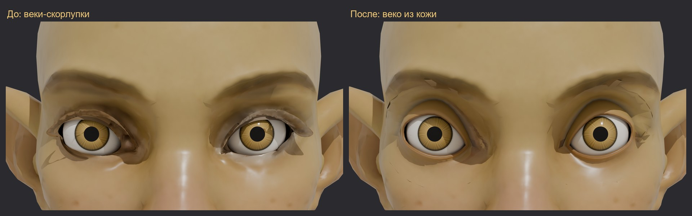
*Слева старые веки-скорлупки, справа новые. Смотрите на наружные уголки и на тёмную бахрому вокруг глаз: она ушла.*

## Что было не так

Наши персонажи делаются нейросетью по картинке (модели от Tripo). Глаза у такой модели просто нарисованы на коже.
Чтобы персонаж моргал и смотрел, приложение вырезает нарисованный глаз и ставит на его место настоящий шарик-яблоко.
Остаётся вопрос: чем этот шарик закрывать.

До этой задачи глаз закрывали «скорлупки» — два кусочка сферы чуть больше глаза. Они лежали под кожей лица и были видны
только в разрезе глаза. При моргании верхняя скорлупка поворачивалась вниз и накрывала глаз.

На двух тестовых персонажах это смотрелось плохо:

- у девушки сбоку у наружного уголка выглядывала скорлупка: в исходной модели там ямка;
- закрытый глаз выглядел светлым гладким куполом, а не веком;
- у гоблина при моргании в наружных уголках оставался клинышек белка, а в складке над веком — тонкая тёмная щель;
- вокруг глаз висели рваные лоскуты кожи и нарисованные ресницы исходной модели.

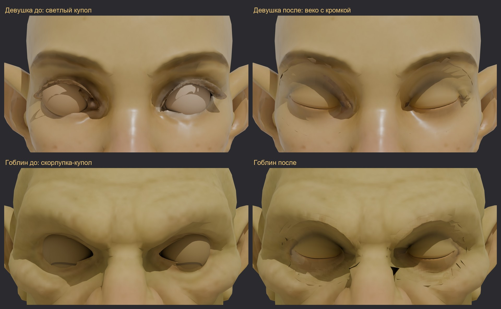
*Моргание, одна камера. Слева светлый купол скорлупки, справа закрытое веко с кромкой.*

## Почему так происходило

Причин три.

**1. Скорлупка — чужая деталь.** Это сфера, а кожа вокруг глаза у модели неровная: ямки, складки, лоскуты. Сфера не
повторяет лицо, поэтому где-то выглядывает, а где-то оставляет щель. Как пластиковая заглушка вместо века.

**2. Ключ формы движется по прямой.** Мимика лица в играх делается «ключами формы»: для каждой точки записано, где
она стоит при закрытом глазе. Игра плавно смешивает «открыто» и «закрыто». Но смешивание ведёт точку **по прямой**, а
веко должно идти **по дуге** вокруг глаза. На середине пути прямая проходит внутри шарика. Мы измерили: у скорлупок
девушки на полуморгании кромка века уходила в глаз на 17 % его радиуса, у гоблина — на 10 %.

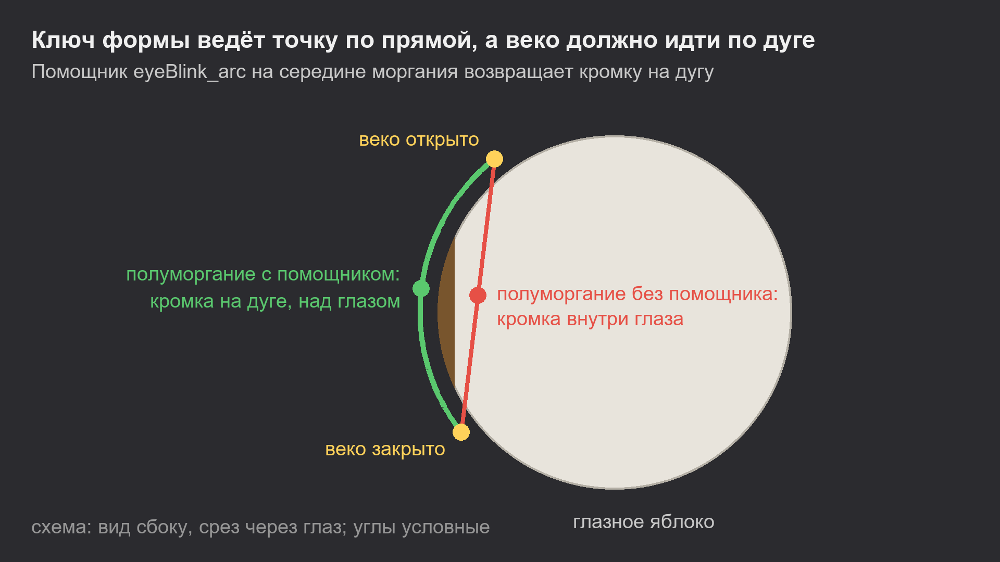
*Схема (углы условные): красная прямая — путь точки при обычном ключе, она проходит через глаз. Зелёная дуга — как
должно быть.*

**3. Исходные модели многослойные.** Под кожей у глаза у Tripo лежат ещё слои: внутренние оболочки, складка под бровью,
лоскуты. Любое «пришить новое к краю старого» натыкалось на все слои сразу.

## Что пробовали

| Попытка | Что вышло | Почему не подошло |
|---|---|---|
| Веко рядами, пришитое «молнией» к краю выреза старой кожи | Веко моргает правильно | Край выреза проходил по всем слоям модели: чёрные осколки, дыры и шипы у виска, у каждой модели свои |
| Сшивка, но выбирать только передний слой кожи | Меньше осколков | Дыры всё равно оставались: у носа, у брови, у виска |
| Раскладывать кольца по углам вокруг глаза, а не по виду спереди | Огромные дыры между глазами | Отказались сразу |
| «Обдирать» тонкие лоскуты с открытым краем перед работой | Лоскуты ушли | Обдирка съела и настоящие края кожи: дыры у носа и над бровью |
| **Веко лежит на волосок под кожей, край старой кожи прижат к нему** | Шва нет, дыр нет | Подошло |
| Чистка края старой кожи (срезать зубцы, сгладить) | У девушки чище | У гоблина появились тёмные чёрточки — выключили |

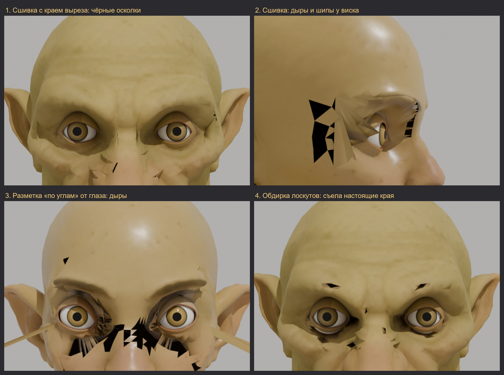
*Четыре неудачные попытки. Чёрное — дыры, через которые видно внутренность головы.*

## Как решили

**Веко из рядов.** Вокруг каждого глаза строятся кольца, как годовые кольца на срезе дерева: 28 точек по кругу,
11 колец от глаза наружу. Изнутри наружу это:

- «рукав» под веком, чтобы между веком и глазом ничего не просвечивало;
- кромка века с толщиной: влажная линия у самого глаза и линия ресниц перед ней;
- тело века: три ряда на верхнем, два на нижнем;
- складка над верхним веком и подъём от неё к коже;
- две петли вокруг глазницы, уже на коже лица.

В уголках глаза кольца расходятся вбок и обходят яблоко сбоку.

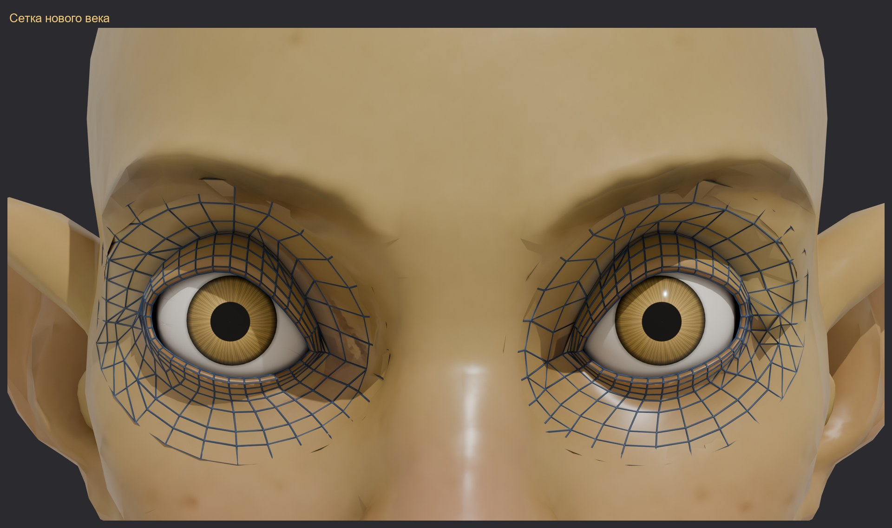
*Новое веко сеткой поверх лица: кольца вокруг глаза, от кромки до кожи.*

**Веко врастает в кожу без шва.** Старая кожа вокруг глаза (лоскуты, нарисованные ресницы, ямка у уголка) вырезается.
Новое веко кладётся на волосок под кожу, а край старой кожи прижимается к нему сверху. Как заплатка, подложенная
изнутри под край ткани: шва не видно, а дыре негде появиться.

**Веко скользит по глазу.** При моргании всё веко поворачивается вокруг горизонтальной оси глаза одним куском.
Растягиваются только складка и подъём к коже. А чтобы на середине моргания кромка не уходила внутрь, у ключа
моргания есть «помощник». На середине пути он выталкивает кромку обратно на дугу. Скрипты Godot включают его сами.

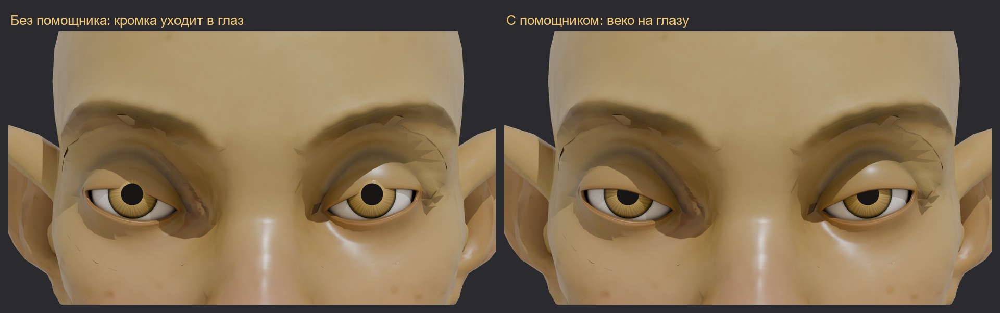
*Новое веко, полуморгание, одна камера. Слева только ключ моргания: кромка уходит в глаз, и глаз кажется открытым.
Справа с помощником: веко честно закрывает глаз наполовину.*

**Своя текстура.** У века своя маленькая текстура (512 × 384 на оба глаза). Цвета взяты с кожи лица и плавно
продолжены на само веко. Ресницы теперь садятся на новую кромку и следуют за ней.

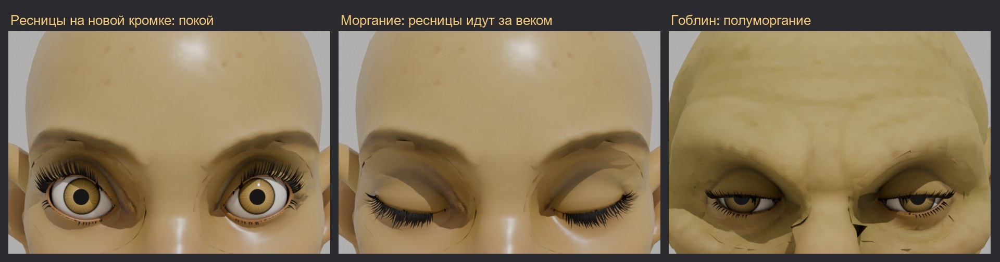
*Ресницы на кромке нового века: в покое, при моргании и на полуморгании.*

**Доработка (27 ноября).** После первой версии пользователь заметил две вещи: у девушки под глазами была видна тонкая
линия края старой кожи, у гоблина у переносицы — тёмные засечки. Причин нашлось три:

- веко одного глаза было **вывернуто наизнанку**: программа проверяла, куда смотрят новые грани, раньше, чем они были
  посчитаны, и читала нули;
- на крутой стенке носа веко уходило «под кожу» вдоль кожи, а не вглубь, и оставалась щель;
- край старой кожи и веко под ним освещались по-разному, и край читался линией.

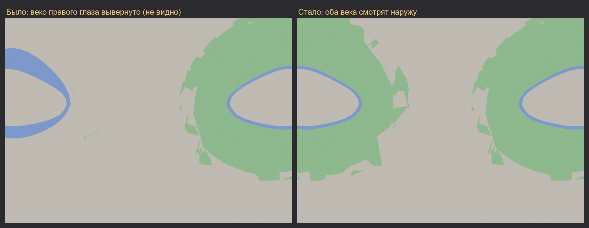
*Отладочный кадр без освещения: изнанка граней не рисуется. Слева веко правого глаза не видно — оно вывернуто. Справа
оба века на месте.*

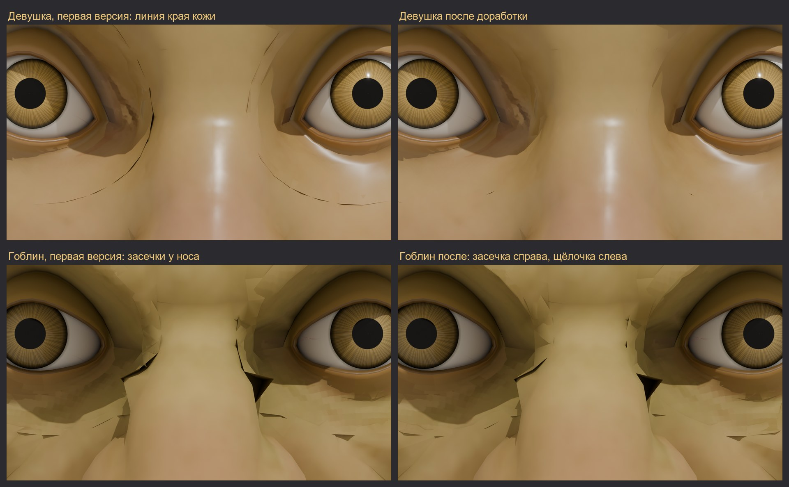
*Слева первая версия: под глазами тонкая линия края старой кожи. Справа после доработки: линии нет.*

## Как проверили

Девушку и гоблина собирали заново целиком, на копиях, и снимали в покое, при моргании, полуморгании, прищуре и широко
открытых глазах — спереди, в три четверти и сбоку. Потом проверили в игровом движке Godot 4.7: ключ моргания и
помощник работают на лице и на ресницах.

| Что мерили | Было (скорлупки) | Стало (новое веко) |
|---|---|---|
| Кромка века на полуморгании, девушка | внутри глаза на 17 % радиуса | снаружи, над глазом на 4 % |
| Кромка века на полуморгании, гоблин | внутри глаза на 10 % радиуса | снаружи, над глазом на 4 % |
| Новое веко без помощника, девушка / гоблин | — | внутри на 10 % / 5 % радиуса |
| Сетка века на один глаз | две сферы | 28 × 11 точек, 11 колец |
| Файл персонажа (девушка) | 13,1 МБ | 9,8 МБ |

*Замеры: Blender 5.2, по вершинам кромки века, глубина считалась от поверхности глазного яблока. Файл меньше, потому
что больше не нужна перерисованная текстура лица.*

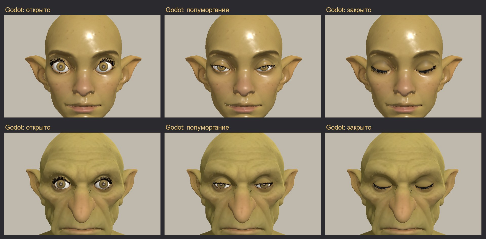
*Godot 4.7: открыто, полуморгание, закрыто. Сверху девушка, снизу гоблин (снято на первой версии века, ключи с тех пор не менялись).*

## Что осталось

- У гоблина у переносицы остались тёмная засечка справа (если смотреть спереди, под внутренним уголком его левого
  глаза) и тонкая тёмная щёлочка слева. Убрать их не удалось. Вблизи видны и короткие тёмные чёрточки под глазами по
  краю старой кожи.
- Другие персонажи (фея, первый гоблин) с новым веком не проверялись.
- Копию проигрывателя мимики в самой игре не обновляли (это не наш проект): там на полуморгании в репликах кромка
  пойдёт по прямой.

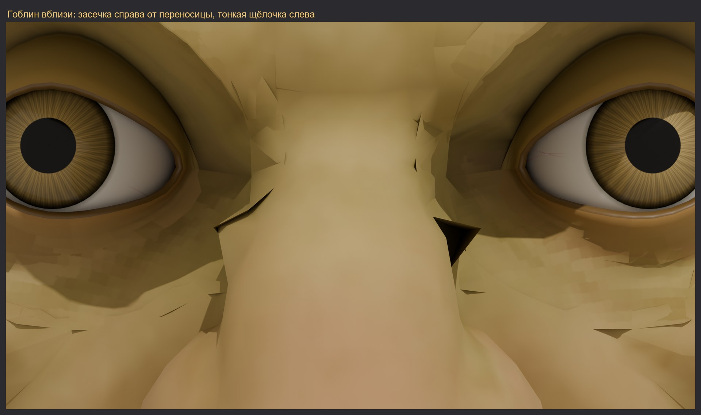
*Гоблин вблизи после доработки: тёмная засечка справа от переносицы и тонкая щёлочка слева от неё.*

## Словарик

| Термин | Простыми словами |
|---|---|
| Полигон | Маленькая плоская грань. Из тысяч таких граней складывается 3D-модель, как мозаика. |
| Топология | Как полигоны сложены друг с другом: рядами, кольцами, вкривь. От неё зависит, как модель гнётся. |
| Кольца (петли) вокруг глаза | Ряды полигонов, которые обходят глаз по кругу, как годовые кольца у дерева. Так устроены веки у моделей в играх. |
| Глазное яблоко | Шарик глаза, который вставляется вместо нарисованного глаза. |
| Ключ формы (shape key, blend shape) | Запись «куда сдвинуть каждую точку» для одного выражения лица: моргание, улыбка. Игра смешивает ключи от 0 до 1. |
| Помощник `_arc` | Второй ключ к морганию. Включается только на середине моргания и возвращает кромку века на дугу. |
| Текстура | Картинка, которая натягивается на модель, как обои. |
| Нормаль | Направление «наружу» у грани. По нему движок решает, как грань освещать и какую сторону рисовать. |
| Вывернутая грань | Грань, у которой «наружу» смотрит внутрь. Она темнеет или исчезает. |
| Godot | Игровой движок, в котором делается игра. |

## Для видео

**Озвучка** (около полутора минут):

Наши персонажи рождаются из одной картинки. Нейросеть делает модель, но глаза у неё просто нарисованы. Мы вырезаем
нарисованный глаз и ставим настоящий шарик. А чем его закрывать?

Сначала глаз закрывали две скорлупки — кусочки сферы под кожей. Сбоку они выглядывали, закрытый глаз был похож на
светлый купол, а у гоблина в уголках оставался клинышек белка.

Мы сделали веко из самой кожи. Вокруг глаза — одиннадцать колец полигонов: кромка с толщиной, тело века, складка,
петли глазницы. Старую рваную кожу вырезаем, новое веко подкладываем под её край, как заплатку изнутри.

А дальше началось самое интересное. Анимация лица в играх ведёт каждую точку по прямой. Веко должно идти по дуге
вокруг глаза, а прямая проходит прямо через глаз. На середине моргания веко проваливалось внутрь: у скорлупок на
семнадцать процентов радиуса глаза. Мы добавили ключ-помощник. Он работает только на середине моргания и выталкивает
кромку обратно на дугу.

Последний сюрприз нашёл пользователь: тёмные засечки у носа. Оказалось, веко одного глаза было вывернуто наизнанку,
и свет на нём ложился неправильно. Починили — и засечек стало меньше. Но у переносицы гоблина ещё сидят засечка
и тонкая щёлочка. Их мы оставили на потом.

**Вау-момент:** полуморгание без помощника и с ним, одной камерой: кромка века то исчезает в глазу, то идёт поверх него.

**Обложка:** крупный план девушки «до/после» (`src/girl_before_rest_front.png` и `src/girl_after_rest_front.png`), надпись «ВЕКИ ИЗ КОЖИ».

**Оценка для видео:** 4 — наглядно, понятная бытовая тема (моргание), есть зрелищные тупики с дырами и неожиданная
математическая причина. Минус: финал не идеальный, у гоблина у переносицы остались мелкие дефекты.

## Для любопытных

- Файлы: `tool/eyelid_topo.py` (новое веко), `tool/blender_eye_insert.py` (вставка глаз, `lid_topo` по умолчанию,
  старые скорлупки — `"lid_topo": false`), `tool/blender_hair_gen.py` (`lid_margin`: ресницы на кромке),
  `tool/godot/sf3d_face_rig.gd` и `tool/godot/face_curves_player.gd` (помощник `eyeBlink<Side>_arc` = 4v(1−v)).
- Коммиты: `cbac5a2` — веки своей топологией, ресницы, Godot, документация; `57e0f55` — вывернутое веко одного глаза,
  кольца под кожу по нормали кожи, нормали шва, чистка края выключена. Прежние скорлупки — `d7d109f` (6 ноября).
- Ветки: «Веки своей топологией» (ответвление «Правок проекта», `local_e34b3455-30a6-47ca-b378-81932d2b8d06`).
- Стенд: `work/wear_test/lid_topo/` — `run.py` (шаг глаз на готовой сборке), `render.py`, `measure_half.py` (замер
  глубины кромки), `case_render.py` (кадры этого разбора), `godot/` (проверка в Godot).
- Как повторить: собрать скелет персонажа «по ориентирам» с глазами (раздел «Персонаж → Скелет»), веки строятся сами.
