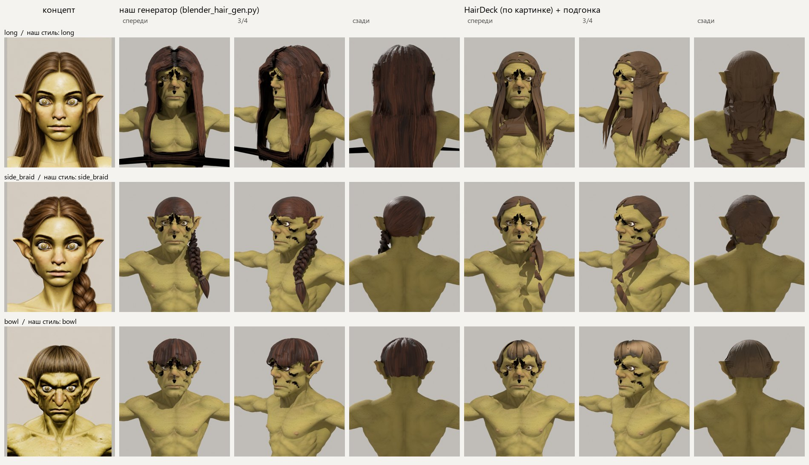
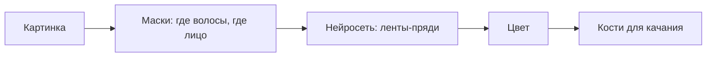
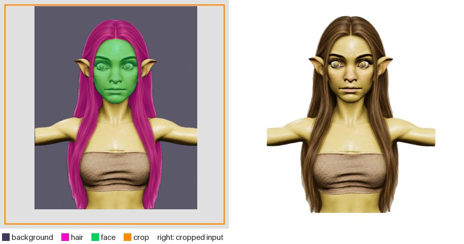
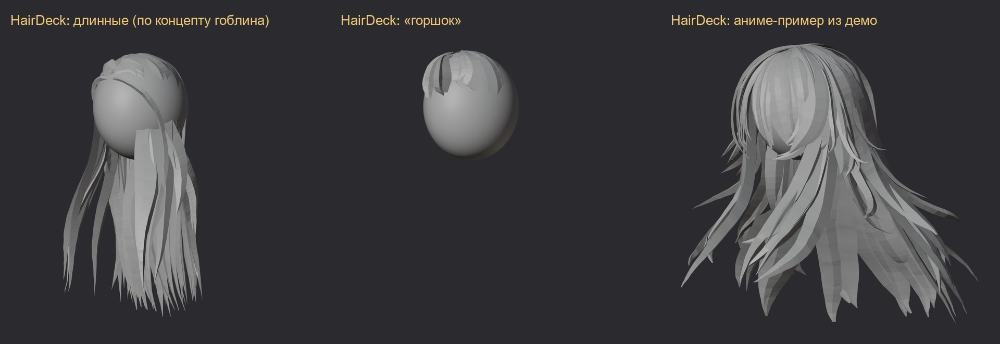
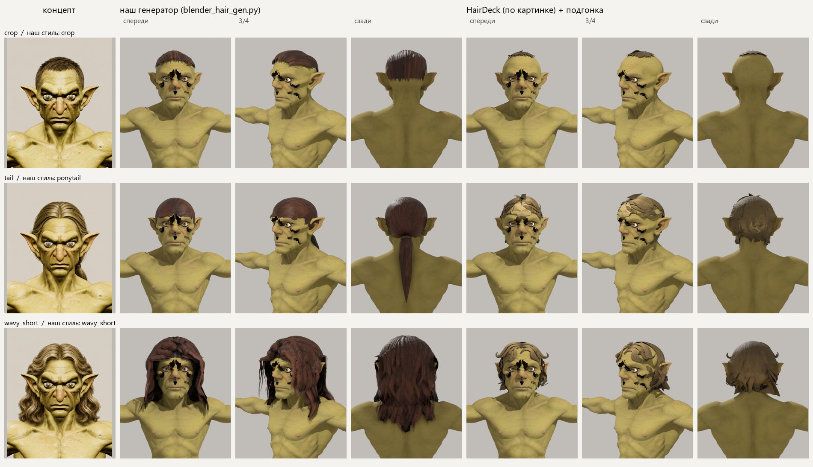
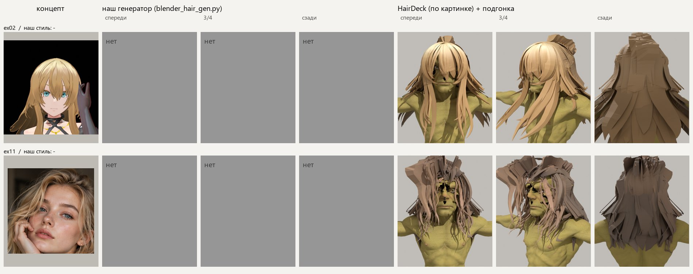
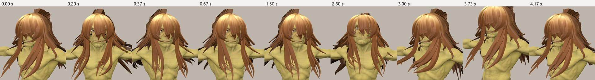

# Может ли нейросеть сделать причёску для игры по одной картинке?

> Нейросеть честно сделала причёску за 16 секунд, но научилась она этому на аниме, а наши герои — гоблины.

**Статус:** решено (ответ «пока нет», но одна идея пригодилась) · **Дата:** 2026-11-26 · **Ветка:** проверка HairDeck (запущена из «Правки проекта»)

## Коротко

- **Было:** причёски для героев делает наш собственный генератор. Он строит их по правилам: длинные, каре, косы,
  хвосты, короткие стрижки. Хотелось делать уникальную причёску прямо по рисунку героя.
- **Стало:** проверили свежую нейросеть HairDeck на ноутбуке с видеокартой на 8 ГБ. Сама причёска строится за 3–7
  секунд. Но из шести рисунков гоблинов похоже вышли только два, поэтому HairDeck в программу не взяли.
- **Как:** запустили HairDeck отдельно от программы, сравнили с нашим генератором на голове одного и того же гоблина
  и проверили, как его волосы качаются в игровом движке Godot.

*Слева рисунок, в середине наш генератор, справа HairDeck после посадки на гоблина. Коса у HairDeck вышла плоской
лентой, а «горшок» с чёлкой он угадал лучше всего.*

## Что было не так

Наш генератор волос делает причёски по готовым рецептам. Можно выбрать стиль, длину, цвет. Но если художник нарисовал
необычную причёску, её не получить: в генераторе нет такого рецепта.

HairDeck обещает другое: даёшь одну картинку персонажа, получаешь причёску из «прядей-лент» с раскраской и даже с
костями, на которых волосы качаются. Это ровно то, чего не хватало. Вопрос был в том, сработает ли это на наших
героях и поместится ли в домашний ноутбук.

## Почему так происходило

Нейросеть умеет только то, на чём её учили. HairDeck учили на тысячах причёсок из VRoid — это программа для
аниме-аватаров. Аниме-причёска — это крупные гладкие ленты, длинная чёлка, объём.

Наши гоблины нарисованы почти реалистично. Короткий ёжик, тугая коса, зализанный хвост в аниме почти не встречаются.
Это как попросить художника, который рисовал только мангу, нарисовать портрет в стиле фото: что-то получится, но
не то.

*Первый шаг HairDeck: другая нейросеть (SAM 3) находит волосы (розовое) и лицо (зелёное). Уши гоблина она верно
не считает лицом.*

## Что пробовали

| Попытка | Что вышло | Почему не подошло |
|---|---|---|
| Скачать всё обычным способом | Интернет через прокси давал 0,1 МБ/с на одно соединение, установка обрывалась | Написали свои загрузчики, которые качают кусками в 8–12 потоков: вышло около 3–4 МБ/с |
| Шесть рисунков гоблинов | Длинные прямые и «горшок» похожи. Коса — плоская лента, короткая стрижка — клочки на лысой голове, хвоста нет | Нейросеть не знает таких причёсок |
| Два примера из демо HairDeck (аниме и фото) | Аниме — полная объёмная причёска, фото — растрёпанно, но узнаваемо | Подтвердило: модель сильна именно в аниме |
| Посадить готовую причёску на гоблина | Голова закрыта, но длинные пряди проходили сквозь плечи и спину | HairDeck рассчитан на тело аниме-аватара, наш гоблин шире и сутулый |

*Причёски HairDeck до посадки, на его собственной «голове-яйце». Аниме-пример справа самый удачный.*

*Короткая стрижка, хвост и волнистые до плеч. У HairDeck на месте короткой стрижки и хвоста клочки на почти лысой голове.*

*На своих примерах HairDeck выглядит совсем иначе: аниме-причёска полная и объёмная.*

## Как решили

HairDeck в программу не взяли. Причины:

- из шести рисунков гоблинов удачны два;
- пряди-ленты без текстуры волос, между ними видна кожа головы;
- длинные пряди надо долго «укладывать» на нашем теле;
- он занимает всю видеокарту, а установка весит около 10 ГБ.

Но одна идея оказалась ценной. HairDeck не только строит пряди, но и подвешивает их на цепочки костей-пружин. Когда
герой поворачивает голову, волосы отстают и качаются. В игровом движке Godot для этого уже есть готовый механизм.
Мы проверили его на причёске HairDeck, а потом сделали то же для своих причёсок и подолов одежды (отдельный разбор
`2026-11-26_spring-hair-and-hems`).

*Аниме-причёска HairDeck на гоблине в Godot: поворот тела, кивок, прыжок. Пряди отстают и успокаиваются.*

## Как проверили

Проверяли на шести рисунках гоблинов из игрового проекта и двух примерах из демо HairDeck. Наш генератор делал те же
причёски на голове того же гоблина. Всё запускали отдельно от программы.

| Что мерили | HairDeck | Наш генератор |
|---|---|---|
| Загрузка нейросетей | 68 с | — |
| Первая картинка после загрузки | 556 с (из них 538 с — поиск волос и лица) | — |
| Следующие картинки | 15–39 с | 14–574 с на причёску (на процессоре) |
| Сама причёска | 3–7 с | — |
| Видеопамять, вся карта | 7,9 ГБ из 8 | не нужна |
| Треугольников в причёске | 6,6–60 тысяч | 3,7–114 тысяч |
| Удачных причёсок из 6 | 2 | 6 |

*Замеры: RTX 4060 Laptop, 8 ГБ видеопамяти. Качество сравнивали на глаз по листам.*

## Что осталось

- Скачанные файлы (окружение около 8 ГБ и веса 6,8 ГБ) можно удалить, если HairDeck больше не понадобится.
- Если выйдет версия HairDeck, обученная не только на аниме, стоит проверить снова: скрипты остались.
- Модели SAM 3 и DINOv3 от Meta закрытые, у них свои лицензии. Брали их с зеркала ModelScope, файлы те же.

## Словарик

| Термин | Простыми словами |
|---|---|
| HairDeck | Нейросеть, которая по картинке персонажа делает причёску из прядей-лент. |
| Карты волос (hair cards) | Причёска из плоских лент с нарисованными волосками, как в большинстве игр. Отдельные волоски слишком дороги. |
| VRoid | Программа для аниме-аватаров. На её причёсках учили HairDeck. |
| Маска | Чёрно-белая карта: где на картинке волосы, а где нет. |
| SAM 3 | Нейросеть Meta, которая выделяет на картинке предметы по словам: «волосы», «лицо». |
| Видеопамять | Память видеокарты. Не влезет нейросеть — не запустится или будет ползти. |
| Треугольники | Из них состоит любая 3D-модель. Больше треугольников — подробнее модель и тяжелее для игры. |
| Кости-пружины | Цепочки «костей» внутри прядей. Движок раскачивает их, как пружины, и волосы отстают при движении. |
| Godot | Игровой движок, на котором делается игра. |
| Прокси | Посредник для выхода в интернет. Здесь он сильно замедлял скачивание. |

## Для видео

**Озвучка:**

Мы делаем игру про гоблинов, и каждому нужна своя причёска. Наш генератор умеет делать причёски по рецептам: длинные,
косы, хвосты. А что если просто показать нейросети рисунок?

Вышла нейросеть HairDeck. Даёшь ей картинку — она строит причёску из прядей и даже подвешивает их на пружины, чтобы
волосы качались. Мы поставили её на ноутбук с восемью гигабайтами видеопамяти. Видеокарта забилась почти до отказа,
зато сама причёска строится за три–семь секунд.

Мы дали ей шесть рисунков гоблинов. Длинные прямые волосы — похоже. Стрижка «горшок» с чёлкой — отлично. А вот коса
превратилась в плоскую ленту. Вместо короткой стрижки — клочки на лысой голове. Хвоста нет совсем.

Почему? Нейросеть училась на аниме-аватарах. На аниме-картинке она рисует пышную, красивую причёску. А наши гоблины
для неё — чужой стиль.

Поэтому HairDeck в игру не взяли. Но подсмотрели у неё главное — пружины. И теперь волосы наших гоблинов качаются
при каждом повороте головы.

**Вау-момент:** аниме-девушка и гоблин рядом: у неё HairDeck делает пышную причёску, а у гоблина вместо хвоста — клочки.

**Обложка:** кадр из `img/01_concept_ours_hairdeck.jpg` (рисунок «горшка» и результат), крупно «ПРИЧЁСКА ПО КАРТИНКЕ?».

**Оценка для видео:** 4 — модная нейросеть, честный провал на «чужом» стиле и находка, которая пригодилась в другом месте.

## Для любопытных

- Отчёт с полными цифрами: `work/hairdeck_test/REPORT.md`. Листы: `work/hairdeck_test/sheets/`.
- Код HairDeck: github.com/hyz317/HairDeck, коммит `2f954d5`, лицензия Apache 2.0. Веса: huggingface.co/hyz317/HairDeck.
- Скрипты проверки (в `work/hairdeck_test/`): `get_all.py` + `dl.py` (загрузка кусками), `run_hd.py` (прогон с замером),
  `prep_rig.py` и `fit_rig_hd.py` (посадка на гоблина и кости), `godot/` (проверка пружин), `ours.py` (наш генератор).
- Коммитов в коде программы нет: проверка шла отдельно, `work/` не хранится в git. Идея пружин вошла в коммит
  `9648ef8` (разбор `2026-11-26_spring-hair-and-hems`).
- Ветки: проверка HairDeck, запущена из «Правки проекта» (`local_e34b3455`).
