# Можно ли одеть гоблина-мага по картинке, не моделируя одежду руками?

> Мантии и шали оказались не самым трудным. Дольше всего возились со ступенькой в пять миллиметров на краю подола,
> с коленом, которое в каждом шаге проходило сквозь длинную юбку, и с кафтаном, который «лежал на заднице».

**Статус:** частично (4 костюма из 10) · **Дата:** 2026-11-26 (кафтан поправлен 2026-11-28) · **Ветка:** одежда воинов-магов (по заданию «Правок проекта»)

## Коротко

- **Было:** десять картинок гоблина-мага в нарядах. Генератор одежды умел шить только рубахи, жилеты и фартуки горожан.
- **Стало:** четыре костюма из десяти собираются в редакторе из отдельных вещей. Они надеваются на два разных тела
  и держатся в ходьбе и беге. Для этого появилось 8 новых видов вещей.
- **Как:** каждую картинку разобрали на вещи. Всё, что генератор уже умел, взяли готовым, недостающее дописали.
  Бутылочки, свитки, подвески и символы сознательно отбросили.

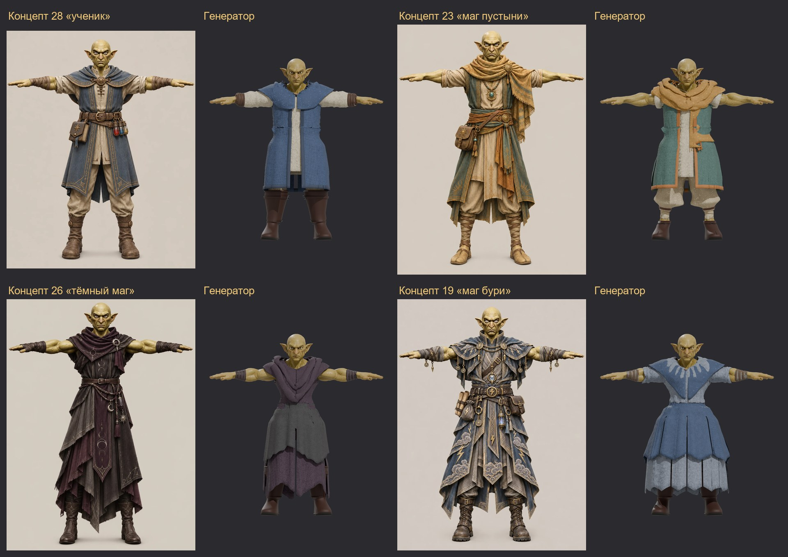
*Слева в каждой паре концепт пользователя, справа костюм из генератора на гоблине. Сверху «ученик» (без пояса, кафтан
свободно падает от груди) и «маг пустыни», снизу «тёмный маг» и «маг бури».*

## Что было не так

Пользователь сделал десять картинок: лысый гоблин-маг в Т-позе, на каждой свой наряд. Хотелось одеть в них героев игры.

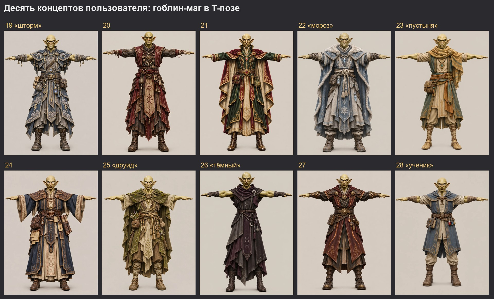
*Все десять концептов. Сделаны четыре: 28, 23, 26 и 19.*

Рисовать одежду руками в 3D долго. Поэтому у нас есть процедурный генератор одежды. Это программа, которая шьёт вещь
прямо по телу персонажа: берёт его кожу, отступает от неё на пару миллиметров и строит ткань. Так одна и та же рубаха
садится и на мускулистого гоблина, и на тонкую девушку.

Но генератор знал только одежду горожан: рубахи, жилеты, фартуки, пояса, короткие накидки. Длинных мантий,
высоких сапог и шалей у него не было.

## Почему так происходило

Концепт — это не выкройка. На одной картинке шесть–восемь слоёв: штаны, рубаха, жилет, пояс, накидка, обмотки,
сапоги. Всё нарисовано вместе, как на фотографии.

Генератор работает иначе. Он одевает персонажа как куклу, по слоям, и у каждой вещи свой номер слоя: штаны первые,
рубаха поверх них, жилет поверх рубахи, накидка поверх всего. Поэтому картинку сначала надо разобрать на вещи
и понять, какие из них уже есть.

Кроме одежды, на концептах много мелочей: бутылочки, свитки, сумки, подвески, вышитые молнии и луны, толстые верёвки.
Пользователь сразу сказал: нужна только одежда. Безделушки станут отдельными вещами потом. Символы — это рисунок
на ткани, а не её крой.

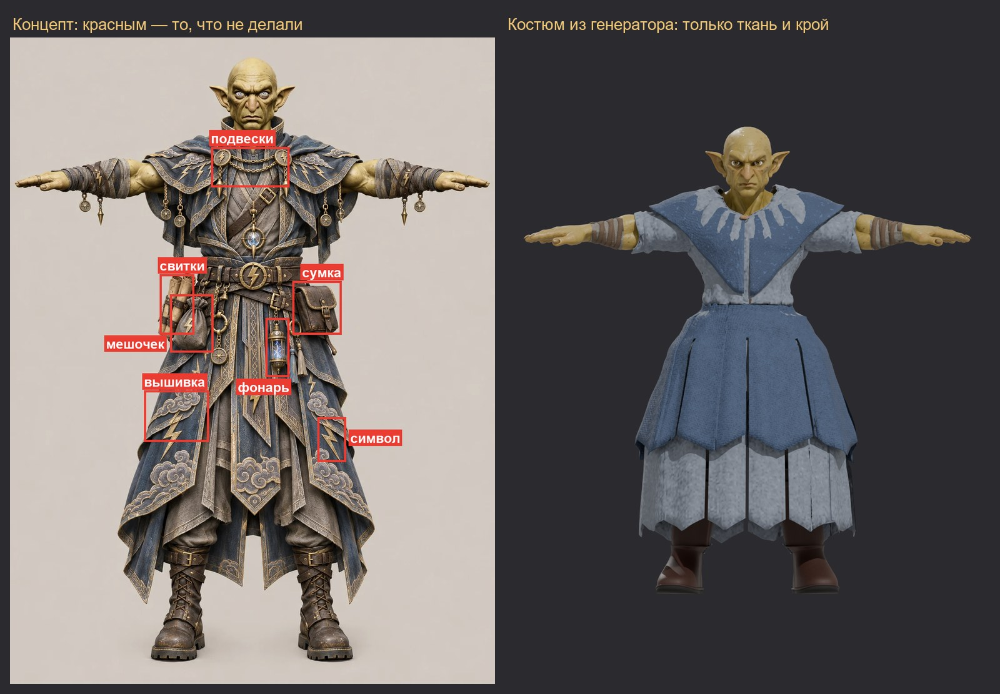
*Слева концепт «мага бури»: красным обведено то, что не делали. Справа его костюм — только ткань и крой.*

## Что пробовали

Работали тремя кругами. Первый — один костюм, «ученик» (концепт 28). Второй — сразу три: «маг пустыни» (23),
«тёмный маг» (26) и «маг бури» (19). Третий — замечание пользователя по кафтану.

| Задача | Что вышло сначала | Что сделали |
|---|---|---|
| Длинный жилет «ученика» | Обычный жилет, удлинённый до колена, сел сразу. Но пользователь заметил: «линии не плавные, на бёдрах поднято». | Угол, где край полочки встречается с низом, скруглялся на 5 мм наружу. Подол начинался на 3–4 градуса дальше от середины — ступенька. Угол развернули на линию края. |
| Высокие сапоги | Генератор обуви делал голенище не выше 21 см на рост человека, а у гоблина ноги другие. Первый высокий сапог пропускал штаны наружу. | Голенище меряется на каждом персонаже, до трёх четвертей голени, и строится поверх надетых штанов. В примерочной закрытый сапог прячет штаны внутри себя, как шлем прячет подшлемник. |
| Обмотки на предплечьях | Легли под рукав рубахи, видна была только полоска у кисти. | Редактор не пересчитывал, что надето «под» вещью, когда стиль менял её слой. Теперь пересчитывает. |
| Пояс | Вышел обрывком в 2 сантиметра. | Это была не ошибка кода. Две ветки работали с копиями одного персонажа и писали в одну папку, перезаписывая друг друга. Вещам дали уникальные имена. |
| Шаль | Валики ткани вокруг шеи торчали над плечами, как садовый шланг. Конец шали уходил внутрь жилета. | Сечение валика сплющили по ткани, на которой он лежит. Каждую полоску конца шали кладут на то, что под ней. |
| Длинные мантии | В шаге колено и голень проходили сквозь передний подол: до 8 % кожи насквозь. | Ниже колена подол идёт и с голенью. Полотнища поставили каждое над своей ногой. |

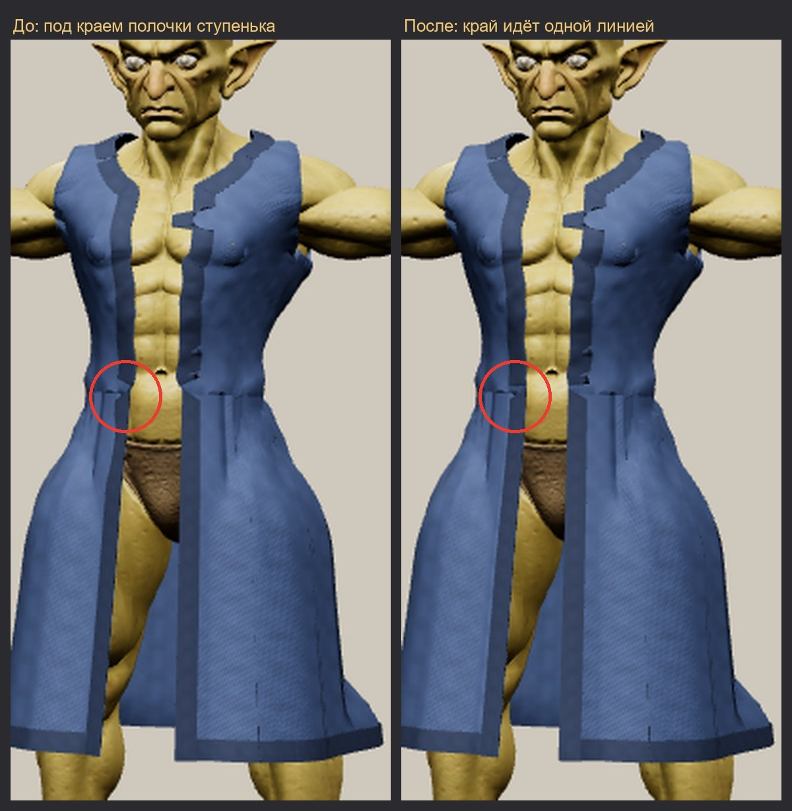
*Слева край полочки и край подола расходятся ступенькой у талии (обведено). Справа край идёт одной линией.*

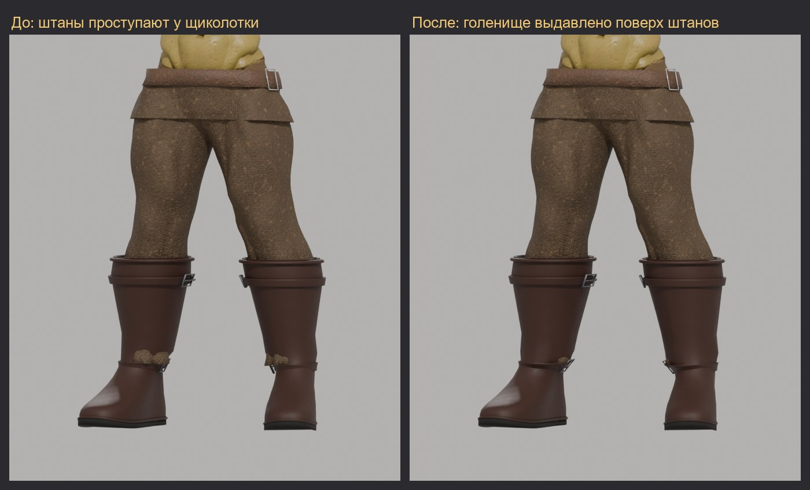
*Слева светлые пятна у щиколотки — это штаны проступают сквозь сапог. Справа голенище выдавлено поверх них.*

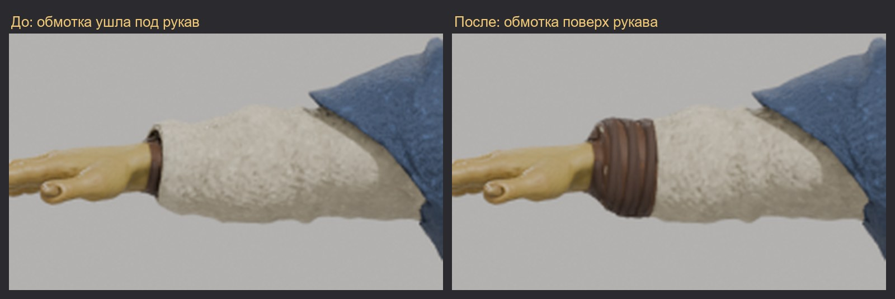
*Слева обмотка спряталась под рукав. Справа она лежит поверх, как на концепте.*

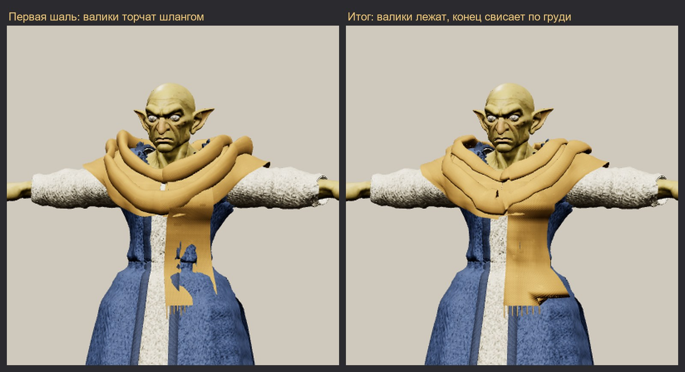
*Слева первая шаль: валики стоят кольцами над плечами. Справа они лежат на плечах, конец свисает по груди, внизу бахрома.*

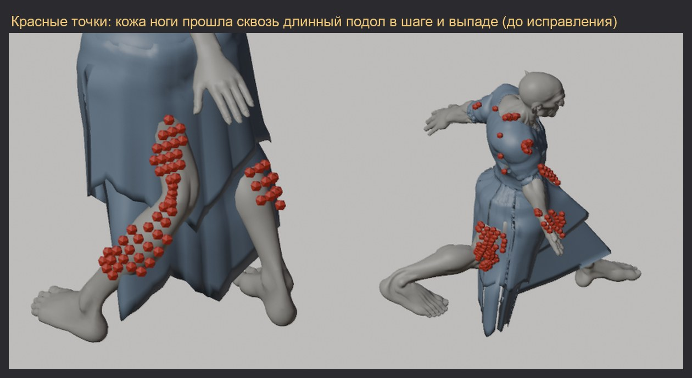
*Так программа проверки показывает ошибку: красные точки — кожа, которая в этом кадре вышла сквозь ткань.*

Был и честный компромисс. У туники «тёмного мага» верхний серый слой с разрезом спереди давал меньше всего ошибок,
2,4 %. Но он распахивался, как пальто, а на концепте он цельный. Выбрали вид как на концепте: около 5 %. В костюме
ноги всё равно закрыты штанами и сапогами.

### Третий круг: кафтан без пояса

Пользователь посмотрел «ученика» и прислал свою картинку, как должен сидеть такой кафтан. Его слова: «слишком широко,
слишком сильно учитывает бёдра; сзади он не должен так точно повторять спину, как будто лежит на заднице. Кафтан
так работает, только если есть ремень на поясе. Без него — свободное падение».

Он прав. Генератор шил кафтан как рубаху: ткань шла по телу, у талии заходила внутрь, на бёдрах и ягодицах
выпирала наружу. Так ткань сидит только под поясом. Без пояса тяжёлая ткань висит от самого широкого места — груди
и лопаток — и дальше падает прямо, как штора с карниза.

Теперь у кафтана другая точка подвеса. Генератор находит самый широкий ряд груди под руками и ведёт контур от него
прямо вниз: ниже он может стать только шире, но никогда не уже. Каждую точку ткани ниже груди он выносит наружу на этот
контур, прямо от середины тела.

По дороге было два провала. В первый раз руки в Т-позе попали в контур груди, и кафтан вырос крыльями во все стороны.
Руки из замера убрали. Во второй раз ткань выталкивали по направлению поверхности: у поясницы её сносило на 3–5 см,
и на шве подола она сминалась в валик. Её стали выносить прямо от оси тела.

Пользователь сам предложил честный размен: «лучше скрыть часть кожи, если надо, но ближе по форме к референсу».
Так и вышло. На голом гоблине колено в выпаде теперь касается полы изнутри (до 4,9 % кожи). В костюме колено в штанах,
и этого не видно. На девушке-гоблине ошибок нет совсем.

У мантии с рукавами так не получилось: ширина груди под рукой тянула ткань перепонкой до талии. Мантия и многослойная
туника (на концепте она под поясом) остались облегающими. Свободное падение — только у кафтана без рукавов.

Ещё одна мелочь всплыла уже на картинках для этого разбора. На неподвижных рендерах пояса «тёмного мага» и «мага бури»
не видно: он прячется внутри мантии. Пояс сделан тугим, по телу. Ткань под ним стягивает сама игра в момент, когда пояс
надевают. В примерочной Godot он лежит сверху и собирает мантию в складки, а на простом рендере этого шага нет. «Ученик»
на картинках — без пояса, как на референсе пользователя.

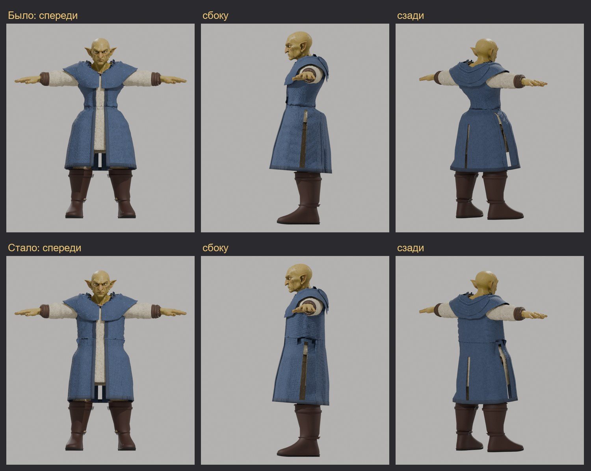
*Сверху кафтан повторяет талию, бёдра и ягодицы. Снизу он висит от груди прямо, как на картинке пользователя.*

## Как решили

В редакторе появились новые виды вещей. Их выбирают, как обычные стили:

- длинный распашной жилет до колена и кайма из второй ткани без узора;
- высокие сапоги на пряжках;
- обмотки на предплечьях поверх рукава;
- шаль вокруг шеи со свисающим концом и бахромой;
- драпированный ворот с капюшоном;
- шаровары, собранные на голени;
- многослойная туника без рукавов с подолом острыми углами;
- мантия из зубчатых полотнищ до щиколотки.

Всё остальное в костюмах — вещи, которые уже были: рубахи, штаны, пояса, кушак, обмотки на ногах, мягкие туфли,
накидка. Длина подола теперь задаётся почти до щиколотки.

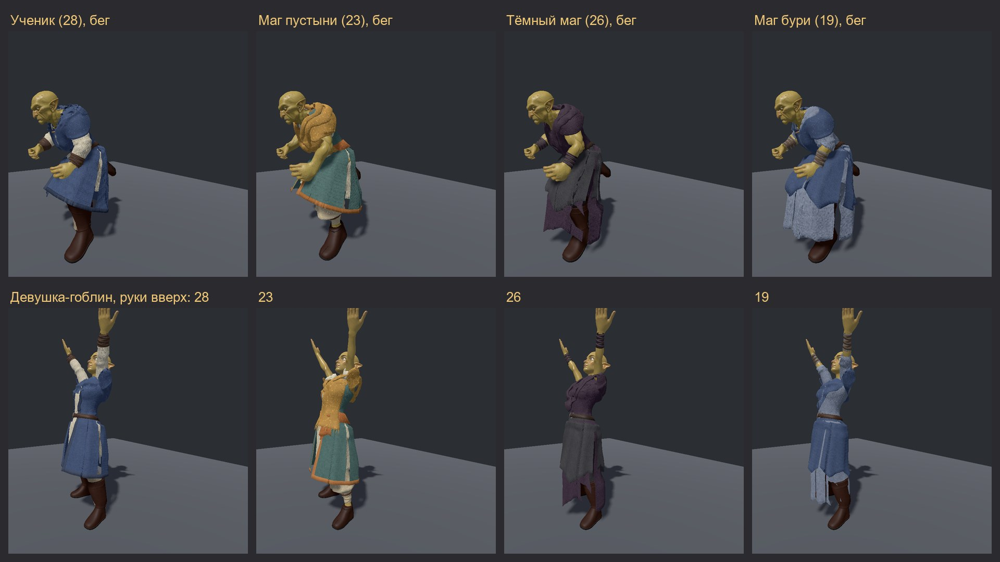
*Четыре костюма в примерочной игрового движка Godot. Сверху гоблин на бегу, снизу девушка-гоблин с поднятыми руками: ткань не рвётся и не отстаёт.*

## Как проверили

Каждый костюм надели на два разных тела: мускулистого гоблина и стройную девушку-гоблина. Голых человеческих тел
в проекте нет. Люди tanya и woman_3d_v2 смоделированы сразу в одежде.

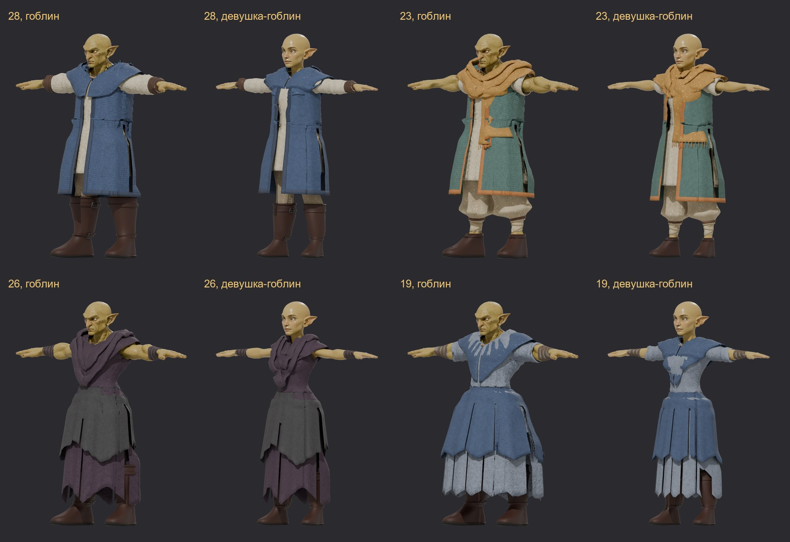
*Одни и те же костюмы, сшитые генератором по фигуре: в каждой паре слева мускулистый гоблин, справа стройная девушка-гоблин.*

Дальше три проверки:

1. Рендеры в покое, ходьбе, беге и ударе.
2. «Проверить в движении»: программа проигрывает 12 клипов анимации и считает точки кожи, которые вышли сквозь ткань.
   Меряли на голом теле, без остальных вещей.
3. Примерочная в Godot, как в игре.

| Вещь | Кожа сквозь ткань, худший клип | Было до правок |
|---|---|---|
| Кафтан (длинный жилет), свободное падение: гоблин / девушка | 4,9 % / 0 % (колени в выпаде) | 0,6 % / 0 % облегающий |
| Высокие сапоги | 0 % | — |
| Обмотки на предплечьях | 0–1 % | — |
| Пелерина с капюшоном | 0,7–1,4 % | — |
| Шаль | 2,5–2,7 % (руки над головой) | — |
| Драпированный ворот | 4,6–5,0 % (руки над головой) | — |
| Мантия из полотнищ, гоблин / девушка | 2,3 % / 5,7 % | 6,5 % / 7,9 % |
| Многослойная туника, гоблин / девушка | 4,9 % / 7,1 % | 5,7 % / 8,4 % |

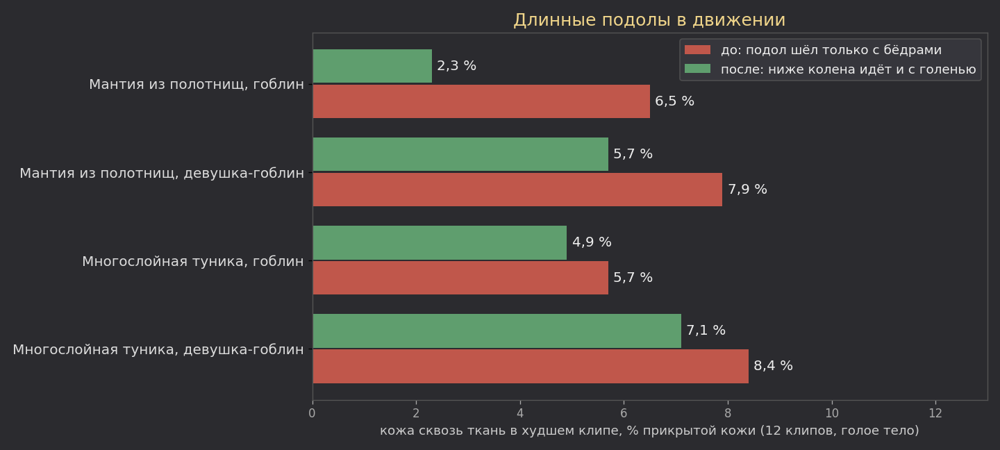
*Длинные подолы до и после того, как ниже колена они стали двигаться вместе с голенью.*

*Замеры: Blender, 12 клипов, каждый третий кадр. Одна вещь шьётся от 40 секунд до пяти с небольшим минут на
процессоре (две вещи шились одновременно), видеокарта для одежды не нужна. Вид костюмов сравнивали с концептами на глаз.*

## Что осталось

- Шесть концептов не сделаны: 20, 21, 22, 24, 25, 27. Там плащи с мехом, кафтаны, рукава-колокола.
- У шаровар тугая манжета на голени в беге пропускает кожу. В костюме «мага пустыни» под ней обмотки, и этого не видно.
  Но сама манжета требует доработки.
- Мантии на девушке-гоблине ещё пропускают 5–7 % в беге. Под мантией штаны и сапоги, поэтому кожу не видно.
- Свободное падение сделано только для кафтана без рукавов. Для мантий с рукавами нужен свой способ: под рукой ткань тянется перепонкой.
- Безделушки, символы и вышивка — отдельная задача на потом.

## Словарик

| Термин | Простыми словами |
|---|---|
| Концепт | Картинка-идея, как должен выглядеть персонаж. Не чертёж, а настроение. |
| Т-поза | Персонаж стоит с разведёнными в стороны руками. В ней удобно одевать и настраивать. |
| Процедурный генератор | Программа, которая строит вещь по правилам, а не по готовому рисунку. Как выкройка, которая сама подстраивается под фигуру. |
| Слой | Порядок вещей, как у одежды на человеке: штаны под рубахой, рубаха под жилетом. |
| Кость, веса | Невидимый скелет внутри персонажа. Веса говорят, за какой костью тянется каждая точка ткани. |
| Клип | Одна анимация: шаг, бег, удар. |
| Примерочная | Маленькая сцена в игровом движке, где персонаж в вещах проигрывает анимации. |
| Голенище | Верхняя часть сапога, которая обхватывает ногу. |
| Пелерина | Короткая накидка на плечи. |
| Рендер | Картинка, которую программа рисует с 3D-модели. |

## Для видео

**Озвучка** (около 1450 знаков, около полутора минут вслух):

Пользователь прислал десять картинок: гоблин-маг в разных нарядах. Задача — одеть в эти наряды героев игры, не моделируя
одежду руками. У нас есть генератор: он шьёт ткань прямо по телу персонажа. Но он знал только рубахи и фартуки горожан.

Сначала картинку разбираем на вещи. Штаны, рубаха, жилет, пояс, накидка, сапоги. А бутылочки, свитки, подвески
и вышитые молнии сознательно выкидываем. Нам нужна ткань и крой.

Первый костюм — ученик мага. Почти всё нашлось готовым. Не хватало длинного жилета, высоких сапог и обмоток на руках.
Жилет сел сразу. Но пользователь заметил: на бёдрах линия ломается. Причина — ступенька в пять миллиметров, где край
полочки встречается с подолом. Угол развернули — линия стала цельной.

Сапоги пропускали штаны у щиколотки. Теперь голенище строится поверх штанов, а в игре закрытый сапог прячет штаны
внутри себя, как шлем.

Второй круг — сразу три мага. Шаль сначала торчала вокруг шеи, как садовый шланг. Её валики сплющили по плечам.
Длинная мантия в шаге пропускала колено насквозь. Теперь ниже колена подол идёт вместе с голенью. Ошибок стало
меньше, у гоблина почти втрое.

Третий круг — замечание пользователя: кафтан сидит, как под поясом, и сзади будто лежит на ягодицах. Без пояса тяжёлая
ткань висит от груди и падает прямо, как штора. Теперь генератор так и делает.

Итог: четыре костюма из десяти, восемь новых видов вещей, два разных тела, ходьба и бег в игровом движке.

**Вау-момент:** концепт и 3D-костюм рядом, а потом этот гоблин идёт и бежит в игре. Второй — шторка «кафтан на ягодицах» → «кафтан как штора».

**Обложка:** концепт «мага бури» слева, его 3D-костюм справа; надпись «С КАРТИНКИ — В ИГРУ».

**Оценка для видео:** 4 — наглядно, концепт против результата и понятные ошибки (шланг, ступенька, колено сквозь юбку,
кафтан «на заднице»).
Минус — сделана только половина концептов.

## Для любопытных

- Файлы: `tool/armour_gen_editor.html` (вещи в редакторе: `vest_long`, `drape()`, `skirtLayers()`, `pointsAt`,
  `legRide` в `clothSkirt`), `tool/armour_gen_ui.py`, `tool/footwear_extra.py` и `tool/blender_footwear_gen.py`
  (высокие сапоги: `tall()`, `push_out()`), `tool/blender_layer_hide.py` (закрытая обувь прячет слои под собой),
  `tool/lang/*.json`.
- Коммиты: `0b2eb32` — первый круг (жилет, сапоги, обмотки, правка краёв); `34f02dd` — поправка в документации про пояс;
  `972d3d0` — второй круг (шаль, ворот, шаровары, туники с углами, подол за голенью); `47ae442` — кафтан свободно падает
  от груди (`hangFrom`, `skinCloth` `o.place`).
- Ветки: одежда воинов-магов (эта сессия), координатор «Правки проекта» (`local_e34b3455`); с веткой повседневной
  одежды (`local_9142bdcf`) договаривались, кто правит какие функции.
- Как повторить: стенд `work/mage_clothes` (копии двух тел, вещи с суффиксами `_m28`, `_m23`, `_m26`, `_m19`;
  наборы в `work/mage_clothes/specs/`), рендеры `render_pose.py`, `render_clean.py`, проверка `qa_run.py`,
  примерочная `godot_set.py`.
