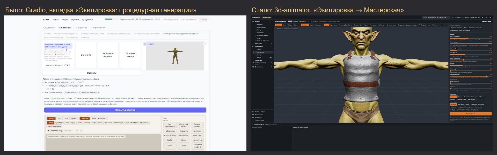
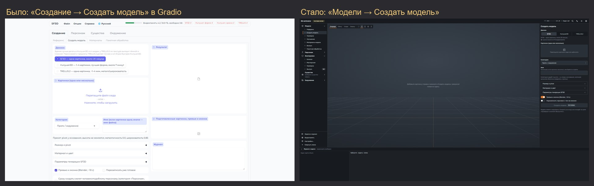
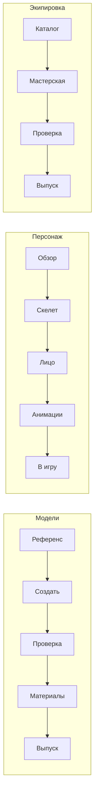
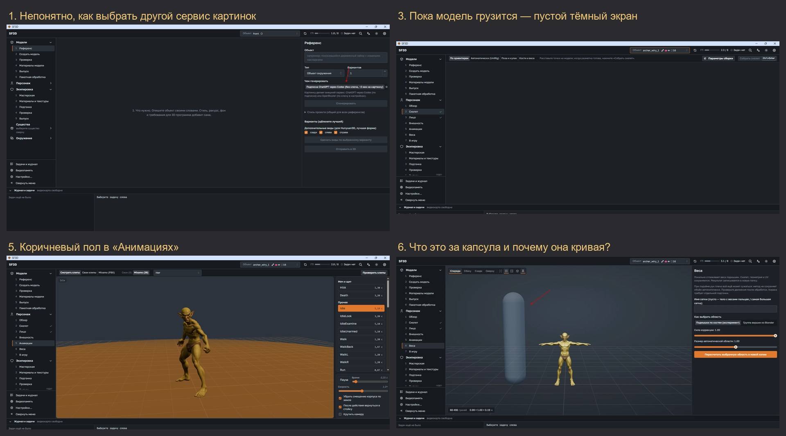
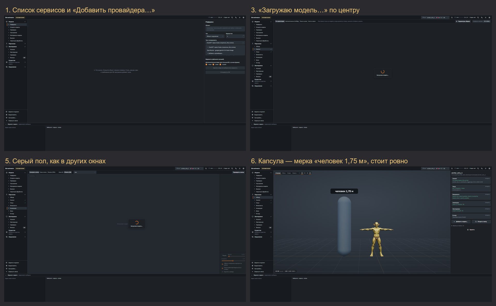
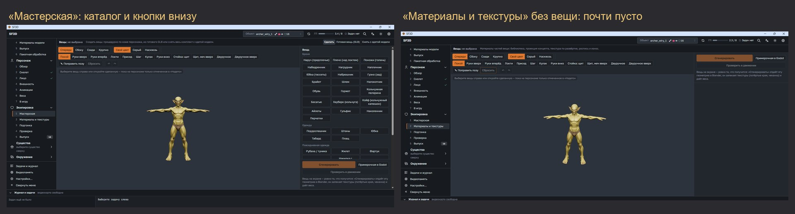
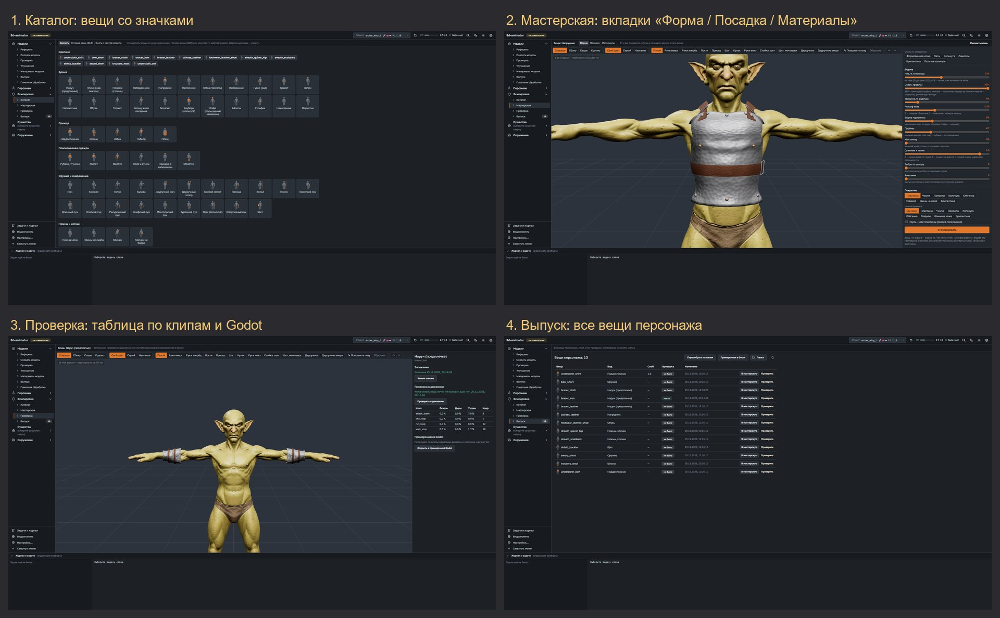
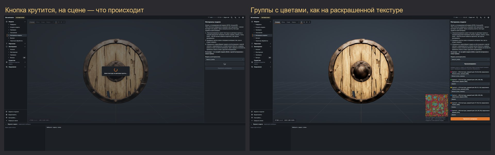
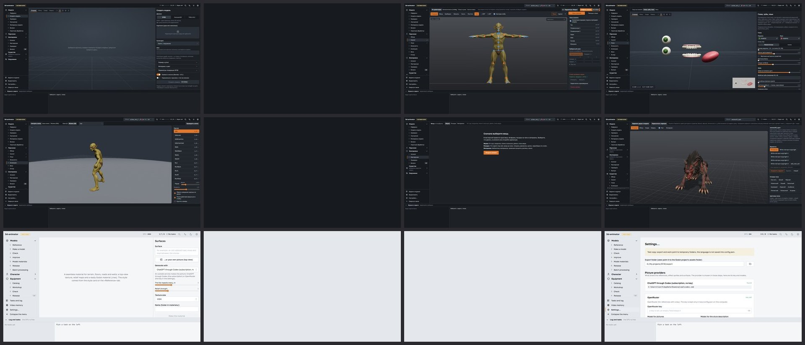

# Как переселить программу из тесной вкладки в настоящую мастерскую?

> Переписать интерфейс оказалось проще, чем понять, в каком порядке человек на самом деле работает: пять шагов
> «Экипировки» были одним и тем же экраном с разными спрятанными кусками.

**Статус:** решено · **Дата:** 2026-11-26 · **Ветка:** Новый веб-интерфейс вместо Gradio (вместе с координатором «Правки проекта»)

## Коротко

- **Было:** всё приложение жило во вкладках Gradio. Длинная лента в узкой колонке, у «Персонажа» девять вкладок в два ряда, 3D-окно размером с открытку.
- **Стало:** своя программа на весь экран. Слева меню по шагам работы, посередине большое 3D, справа настройки, внизу журнал задач. Gradio удалён целиком.
- **Как:** «мозг» на Python оставили, а лицо написали заново. Переносили по разделу, после каждого робот прокликивал все экраны. Потом пользователь прислал два раунда замечаний, и мы переделали то, что было неудобно.

*Слева старая вкладка Gradio «Экипировка: процедурная генерация», справа тот же редактор в новой «Мастерской»: 3D на весь экран, настройки справа.*

## Что было не так

Наше приложение делает 3D-модели для игры: персонажей, броню, существ, подземелья. Раньше у него было лицо на Gradio.
Gradio — это конструктор страничек для показа нейросетей: «загрузи картинку, нажми кнопку, получи результат». Для
одной нейросети это удобно.

Но приложение выросло до десятков инструментов. Каждый новый инструмент становился ещё одной вкладкой. Вкладки
вложены во вкладки, всё идёт одной длинной лентой сверху вниз. 3D-редактор брони открывался внутри этой ленты, и,
чтобы дойти до кнопки, приходилось листать.

*Слева Gradio: настройки, картинки и результат стоят друг под другом. Справа новый экран: модель в центре, настройки сбоку, ничего не надо листать.*

## Почему так происходило

Gradio сам решает, как расставить блоки: сверху вниз, в одну-две колонки. Положить большое 3D-окно в центр, а
настройки сбоку он не умеет. Это как если бы все комнаты квартиры выстроили в один длинный коридор: всё есть,
но жить неудобно.

Решение было в разделении. «Мозг» приложения — функции на Python, которые делают модели, скелеты и броню. Он
остаётся как есть. А «лицо» — то, что видит человек, — делаем сами, как обычную веб-страницу. Страница отправляет
команды мозгу, мозг отвечает.

Меню разложили по тому, как идёт работа: от «сделать» к «поправить» и к «отдать в игру».

## Что пробовали

| Попытка | Что вышло | Почему не подошло или что поправили |
|---|---|---|
| Новая страница рядом с Gradio, перенос по разделу в день | Работало: две программы жили бок о бок, каждый раздел сначала проверяли | Подошло. Gradio убрали, только когда пользователь сказал «да». |
| Убрать Gradio в два шага: сначала вкладки, потом сам пакет | Сработало | На первом шаге удалили вспомогательную функцию, которой ещё пользовались. Перенос клипов на существо писал «ОШИБКА», хотя клипы делал. Нашла соседняя ветка, исправили. |
| «Экипировка» из пяти шагов одного редактора | У каждого шага были спрятаны разные куски | Пользователь: «четыре почти одинаковых экрана». Переделали в четыре разных шага (ниже). |
| Защита от падения страницы | Если ломается один экран, остальное работает | Первая версия при каждой смене шага заново загружала редактор брони, около 11 секунд. Поправили: редактор живёт, пока выбран тот же персонаж. |

Отдельная история — чёрный экран. В списке объектов одна модель попала и в «Персонажей», и в «Существа», и страница
падала целиком. Координатор закрыл дыру, а мы добавили «предохранитель»: теперь сломанная часть показывает сообщение,
а не гасит всё окно.

## Как решили

У программы теперь одно рабочее место:

- **Меню слева** по цепочкам «создание → правка → выпуск». Пять разделов: Модели, Персонаж, Экипировка, Существа, Окружение.
- **Сверху** текущий персонаж или существо, загрузка видеокарты, поиск по всем шагам.
- **Внизу** журнал. Всё, что считает видеокарта, встаёт в одну очередь, и ход работы видно сразу.
- **Черновики.** Новая модель сначала попадает в черновики. В игру она уходит только после кнопки «Выпустить».
- **Старые 3D-редакторы** (броня, скелет, раскраска) не переписывали. Их вставили в новую страницу через «переходник», который подстраивает их под общий вид.

Потом пришли замечания пользователя. Первый раунд — одиннадцать пунктов со снимками экрана.

*Снимки пользователя: неясно, как выбрать другой сервис картинок; чёрный экран, пока грузится модель; коричневый пол; непонятная кривая капсула.*

*Те же места после правок: список сервисов с пунктом «Добавить провайдера…», надпись «Загружаю модель…» по центру, серый пол, капсула с подписью «человек 1,75 м» стоит ровно.*

Капсула кривой не была. Камера смотрела чуть сверху, и всё, что стоит у края кадра, «заваливалось», как высотка на
фото с телефона. Мы опустили камеру на уровень середины модели, и вертикали встали ровно.

Самым большим пунктом была «Экипировка». Пять шагов меню оказались одним редактором: на каждом шаге прятались разные
части правой колонки, а внизу везде стояли одни и те же кнопки.

*До: «Мастерская» и «Материалы и текстуры». Без выбранной вещи «Материалы» почти пустые, а кнопки внизу те же.*

Мы сделали страницу с двумя вариантами раскладки и таблицей «что видно на каждом шаге». Пользователь выбрал вариант
с четырьмя разными шагами.

*После: Каталог со значками вещей, Мастерская с тремя вкладками, Проверка с таблицей по клипам, Выпуск с таблицей всех вещей.*

На значке каждой вещи — фигурка, на которой подсвечено, куда эта вещь надевается. Во втором раунде пользователь
попросил различать оружие: у лука в руке лук с тетивой, посох и копьё длинные, у двуручного меча обе руки на рукояти,
колчан за спиной торчит над плечом.

Второй раунд был про понятность. Например, у «Материалов модели» появилось объяснение, зачем этот инструмент
и что получится на выходе, и кнопка, которая крутится, пока идёт анализ.

*Пока идёт анализ, кнопка крутится и на сцене написано, что происходит. Потом у каждой группы цвет, как на раскрашенной текстуре.*

## Как проверили

Мы написали робота. Он сам открывает каждый экран на двух языках, в тёмной и светлой теме, на большом и маленьком
мониторе, и ищет ошибки. Ещё он гоняет настоящие задачи на копии моделей: генерацию, скелеты, клипы, броню.

*Двенадцать из 126 снимков, которые робот делает за один проход.*

| Что мерили | Было | Стало |
|---|---|---|
| Экранов, которые прокликивает робот | 90 | 126, ошибок 0 |
| Настоящих задач на копии моделей | — | 34 подряд без ошибок |
| Строк в файле интерфейса Gradio | 3502 | 2250 (только «мозг») |
| Пакетов Gradio в программе | 3 | 0 |
| Шагов «Экипировки» | 5 почти одинаковых | 4 разных |
| Перезагрузка редактора брони при смене шага | около 11 с | нет |

*Замеры: тестовая копия на RTX 4060 8 ГБ, Windows 11. Приложение пользователя не трогали.*

## Что осталось

- Если переключить язык прямо в программе, часть подписей остаётся на старом языке до перезапуска.
- Подтормаживание при разметке точек лица у нас не повторилось. Ждём, когда пользователь покажет, на каком действии.
- Ход фоновой «пересборки по слоям» пока не виден в журнале задач.
- Значки у сделанных вещей — фигурки. Настоящие миниатюры самих вещей — на потом.

## Словарик

| Термин | Простыми словами |
|---|---|
| Интерфейс | То, что видит человек: кнопки, меню, окна. |
| Gradio | Конструктор страничек для показа нейросетей. Быстро собрать можно, сделать удобно — трудно. |
| Сервер | Программа-«мозг», которая делает работу. Страница посылает ей команды. |
| Черновик | Модель, которую сделали, но ещё не отдали в игру. |
| Выпуск | Перенос готовой модели туда, откуда её берёт игра. |
| Очередь задач | Список дел для видеокарты. Она делает их по одному, чтобы хватило памяти. |
| Переходник (адаптер) | Кусок кода, который подстраивает старый редактор под новую страницу, не трогая сам редактор. |
| Робот-проверка (автотест) | Программа, которая сама прокликивает экраны и сообщает об ошибках. |
| Предохранитель (граница ошибок) | Если ломается одна часть страницы, она показывает сообщение, а остальное работает. |
| Пиктограмма | Маленький значок-картинка: здесь — фигурка с подсвеченным местом вещи. |

## Для видео

**Озвучка:**

Наша программа делает 3D-модели для игры. Раньше у неё было лицо на Gradio. Это конструктор для показа нейросетей:
загрузи картинку, нажми кнопку. Пока инструмент один, удобно. Когда их десятки, получается длинный коридор из
вкладок. У персонажа их было девять, в два ряда.

Мы оставили мозг программы, а лицо написали заново. Меню слева идёт по шагам работы: сделать, поправить, отдать
в игру. Посередине большое 3D, справа настройки, внизу журнал. Переносили по разделу за раз. После каждого робот
прокликивал все экраны. Под конец их было сто двадцать шесть.

Потом пришли замечания. Одиннадцать штук, со снимками. Чёрный экран при загрузке. Коричневый пол. Кривая капсула.
Капсула оказалась меркой роста в метр семьдесят пять. Кривой её делала камера, которая смотрела сверху.

Самым интересным была экипировка. Пять шагов меню оказались одним и тем же экраном, у которого просто прятались
разные куски. Мы сделали четыре настоящих шага: каталог, мастерская, проверка, выпуск.

А Gradio удалили целиком. Две недели назад без него программа не запускалась. Теперь она его даже не помнит.

**Вау-момент:** шторка между старой вкладкой Gradio и новой «Мастерской» с гоблином в нагруднике на весь экран.

**Обложка:** кадр новой «Мастерской» с гоблином, сверху «ПРОЩАЙ, GRADIO».

**Оценка для видео:** 3 — сильное «было/стало» и живые раунды замечаний пользователя, но это интерфейс, без нейросетевых чудес.

## Для любопытных

- Файлы: `tool/web/` (сервер `server.py`, очередь `tasks.py`, разделы `models.py`, `character.py`, `equip.py`…),
  страница `tool/web/front/` (React, Mantine, three.js), переходники к редакторам `tool/web/adapters/`, запуск `3d-animator.vbs`.
- Коммиты:
  - `e18f18d` — новая страница рядом с Gradio: меню по цепочкам, одна очередь для видеокарты, «Модели: создать → проверка → выпуск»;
  - `a233dca`, `234d922`, `82ebf78`, `a1cc691`, `71a3ead`, `9285eca`, `3e7c853`, `f9830f8` — перенос разделов;
  - `50b6d2c` — вкладки Gradio убраны; `7e3d0e4` — сам пакет Gradio удалён;
  - `b3f49ab` (координатор) — чёрный экран из-за повторной модели в списке; `9aa16ea` — предохранитель;
  - `8f1fd07` — замечания 1–6; `e56c73c` — «Экипировка» в четыре шага;
  - `9979f40`, `e99c1f4` — имя «3d-animator», ярлыки, второй раунд замечаний.
- Ветки: «Новый веб-интерфейс вместо Gradio» (запущена из «Правки проекта», `local_e34b3455`).
- Как повторить: запустить `3d-animator.vbs`; тестовая копия — `D:\conda\tmp\sf3d_web_test\run_test_server.bat` (порт 7891);
  робот — `node work/wear_test/ui/web_ui_smoke.mjs <папка>`; задачи — `work/web_ui/jobs_test.py`.
