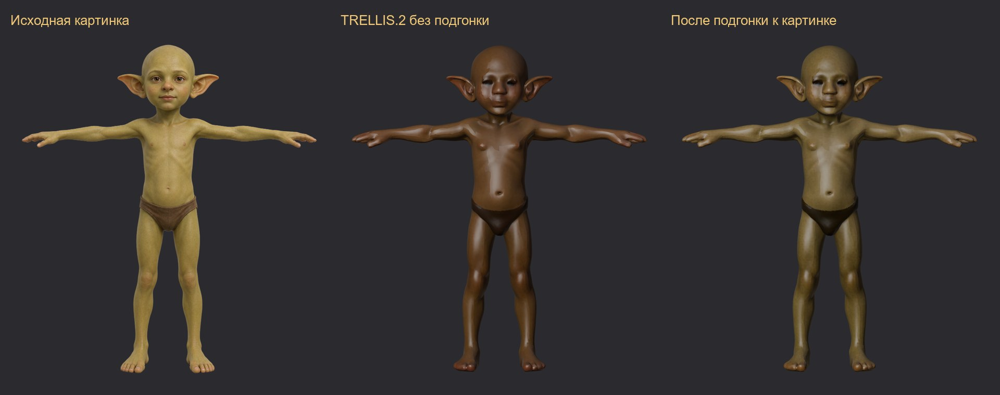
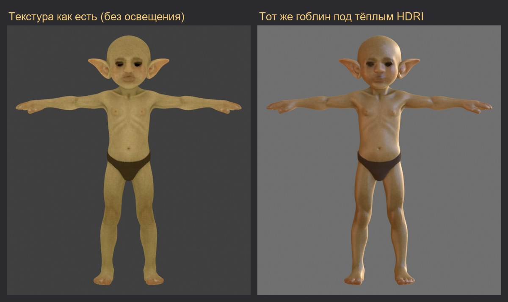
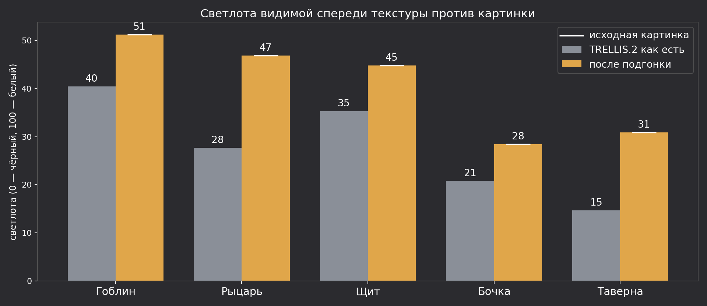
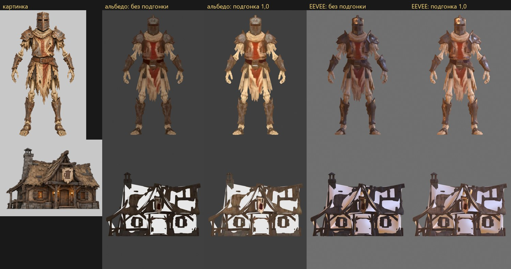

# Почему зелёный гоблин стал коричневым и как вернуть ему цвет?

> Подгонка цвета честно сравнивала модель с картинкой — только смотрела ещё и на спину, которой на картинке нет.

**Статус:** решено · **Дата:** 2026-11-26 · **Ветка:** TRELLIS.2 — проверка и встраивание (запущена из «Правки проекта»)

## Коротко

- **Было:** гоблин на картинке оливково-жёлто-зелёный, а модель от TRELLIS.2 вышла оранжево-коричневой и тёмной.
- **Стало:** цвет видимой спереди модели совпадает с картинкой: оттенок 84° при 85° на картинке (было 65°).
- **Как:** программа сравнивает картинку только с той частью модели, которая на ней видна, и поворачивает оттенок, а не просто сдвигает цвета.

*Слева картинка, посередине модель TRELLIS.2 как есть, справа после подгонки. Смотрите на кожу: коричневый ушёл, вернулся оливковый.*

## Что было не так

Пользователь сделал мальчика-гоблина двумя нейросетями. Форма лучше вышла у TRELLIS.2: глазницы, нос и губы на месте.
А цвет уплыл. На картинке кожа оливковая с жёлто-зелёным, у модели — оранжево-коричневая и заметно темнее.

В приложении уже была «Подгонка палитры под ваши картинки», и для TRELLIS она стояла на 0,7. Но зелень она не вернула.
Пользователь решил, что подгонка тянет цвет к общей палитре проекта, а не к картинке.

## Почему так происходило

Подгонка и правда смотрела на исходную картинку. Проблем было три.

1. **Она смотрела на всю текстуру.** Текстура — это «выкройка» всей модели: спереди, сзади, с боков, подмышки, подошвы.
   А на картинке видна только передняя сторона. Это как подбирать краску по фото фасада, а сравнивать с цветом всех
   стен дома вместе с подвалом.
2. **Она двигала цвет сдвигом, а не поворотом.** Оранжевый и оливковый различаются оттенком — это поворот по цветовому
   кругу. Сдвиг средних цветов на 70% довёл оттенок только до 77°, а нужно 85°.
3. **Свет на листах сравнения обманывал.** Листы рисовались с тёплым «уличным» освещением (HDRI). Оно рыжит любую
   модель, даже правильную.

*Один и тот же гоблин после подгонки. Слева цвет текстуры как есть, справа он же под тёплым освещением — кожа рыжеет.*

## Что пробовали

| Попытка | Что вышло | Почему не подошло |
|---|---|---|
| Старая подгонка, сила 0,7 | Оттенок 77° (картинка 85°), кожа всё ещё рыжая | Смотрела на всю текстуру и сдвигала цвет только на 70%. |
| Одна общая яркость для всех моделей | Одни модели темнее картинки в 1,4 раза, другие в 2,2 | Одна цифра одних пересветит, других оставит тёмными. |
| Подгонка по видимой стороне, сила 0,7 | Оттенок 79° | Ближе, но не до конца. |
| То же, сила 1,0 | Оттенок 84° | Подошло. |

## Как решили

Новая подгонка работает так:

1. Берёт только ту часть текстуры, которую видно на картинке. Если картинок несколько (спереди, сзади, слева, справа),
   каждую сравнивает со своей стороной модели. Чем прямее кусок поверхности смотрит на картинку, тем больше его вес.
2. Сравнивает три вещи: светлоту, насыщенность и оттенок.
3. Светлоту подтягивает, насыщенность растягивает, оттенок поворачивает по цветовому кругу. Серое остаётся серым:
   металл не позеленеет.
4. Делает одно преобразование на всю модель, поэтому спина меняется так же, как перед.

Для TRELLIS.2 подгонка включена на полную силу (1,0). У других движков ползунок по-прежнему на нуле, но если его
включить, работает тот же новый способ.

## Как проверили

Пять моделей TRELLIS.2: гоблин, рыцарь, щит, бочка, таверна. Сравнивали видимую спереди часть текстуры с объектом на картинке.

*Серые столбцы — модель как есть, оранжевые — после подгонки, белая черта — картинка. После подгонки столбцы дотягиваются до черты.*

| Модель | Оттенок: было → стало (картинка) | Светлота: было → стало (картинка) |
|---|---|---|
| Гоблин | 65° → 84° (85°) | 40 → 51 (51) |
| Рыцарь | 60° → 66° (66°) | 28 → 47 (47) |
| Щит | 71° → 69° (68°) | 35 → 45 (45) |
| Бочка | 83° → 71° (71°) | 21 → 28 (28) |
| Таверна | 64° → 64° (64°) | 15 → 31 (31) |

*Цвета мерили по пикселям, в пространстве Lab. Модели — те же сырые файлы TRELLIS.2, что в проверке 24 ноября.*

*Рыцарь и таверна до и после подгонки: без освещения и при тёплом свете. Кость у рыцаря стала кремовой, как на картинке,
таверна посветлела. Пятен и разводов на текстуре не появилось. Белые пятна на таверне в первом ряду — коробка
столкновений, которую тогда не спрятали в рендере.*

## Что осталось

- Готовый черновик гоблина пользователя сам не перекрасится: его нужно сделать заново.
- Тёмные глазницы на текстуре остались. Это не страшно: глаза вставляются отдельными яблоками.
- У гоблина и таверны программа хотела усилить контраст сильнее, чем позволяет предел (×1,6). Картинка несёт своё
  освещение, и копировать его контраст в текстуру опасно. Поэтому предел и стоит.

## Словарик

| Термин | Простыми словами |
|---|---|
| Текстура | Картинка, натянутая на модель, как обои. Даёт ей цвет. |
| Развёртка | «Выкройка» модели: поверхность, разложенная на плоскость, чтобы на неё нарисовать текстуру. |
| Альбедо | Цвет поверхности без освещения и теней. |
| HDRI | Фотография окружения, которой освещают модель при рендере. Тёплая HDRI делает всё рыжее. |
| Оттенок | Где цвет на цветовом круге: красный, оранжевый, жёлтый, зелёный… Измеряется в градусах. |
| Насыщенность | Насколько цвет яркий, а не серый. |
| Светлота | Насколько цвет светлый: 0 — чёрный, 100 — белый. |
| Lab / LCh | Способ записывать цвет так, как его видит глаз: светлота, насыщенность и оттенок отдельно. |

## Для видео

**Озвучка:**

Пользователь нарисовал зелёного гоблина и сделал из него 3D-модель новой нейросетью. Форма вышла отличная, а гоблин
— коричневый. В программе была подгонка цвета к картинке, но она не помогла. Мы померили цвета. Оттенок на картинке —
восемьдесят пять градусов, у модели — шестьдесят пять. Подгонка дотягивала только до семидесяти семи. Почему? Она
сравнивала с картинкой всю текстуру — со спиной, подошвами и подмышками, которых на картинке нет. И сдвигала цвета,
а надо было повернуть оттенок по цветовому кругу. Теперь программа смотрит только на ту сторону модели, что видна на
картинке, и поворачивает оттенок. Восемьдесят четыре градуса из восьмидесяти пяти. Гоблин снова зелёный. И ещё
урок: тёплое освещение на листах сравнения рыжит любую модель. Цвет надо проверять без него.

**Вау-момент:** коричневый гоблин рядом с картинкой — щелчок — и кожа становится оливковой.

**Обложка:** `src/goblin_after_tex_front.png` рядом с `src/goblin_before_tex_front.png`, текст «ВЕРНУЛИ ЦВЕТ».

**Оценка для видео:** 4 — наглядное «было/стало» на одном персонаже, простая причина и ловушка с освещением.

## Для любопытных

- Файлы: `tool/sf3d_tool.py` (`color_match_fn`, `seen_texels`, `_lch_stats`, `_view_dir`), `tool/sf3d_ui.py` (`TRELLIS_COLOR_MATCH = 1.0`).
- Проверка: `work/trellis_test/colormatch_test.py` → `work/trellis_test/colormatch/stats.json`; рендеры: `work/trellis_test/render_pair.py` с `RP_LOOKS=albedo,tex`.
- Коммиты: `462597d` — подгонка к картинке по видимой стороне.
- Ветки: «TRELLIS.2 — проверка и встраивание», запущена из «Правки проекта» (`local_e34b3455`); замечание пришло от пользователя через «Правки проекта».
