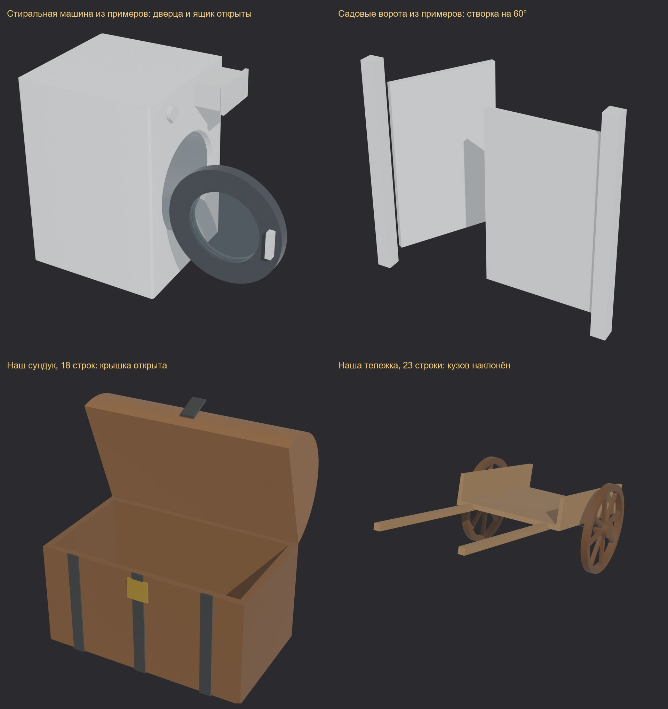
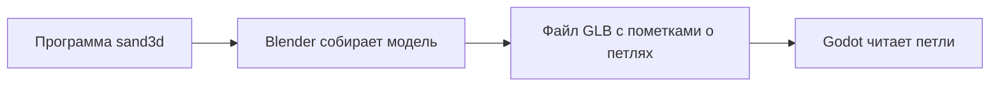
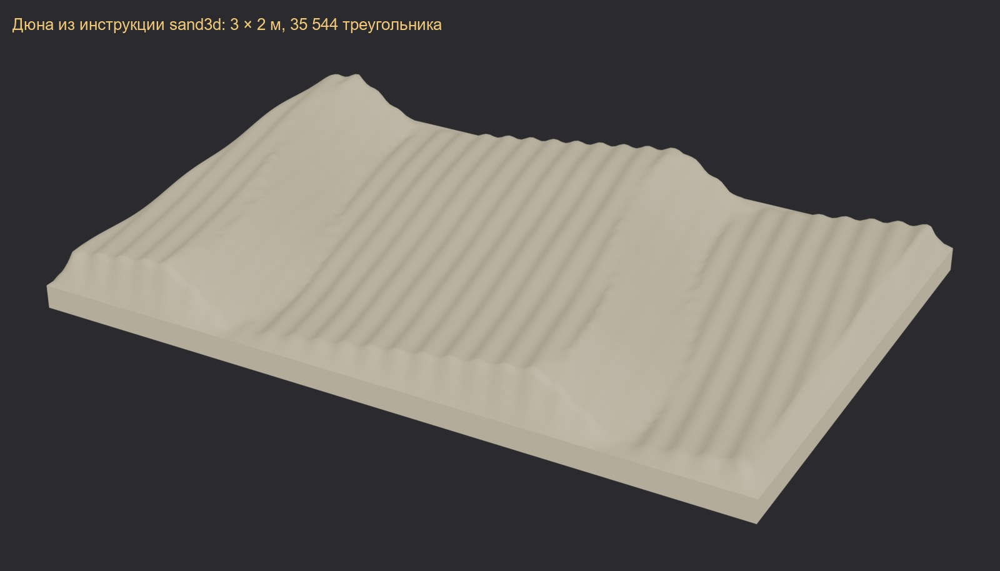

# Нам прислали проект, где «много объектов, которыми можно управлять». Подойдёт ли он для игры?

> Под «управляемыми объектами» оказалась не физика и не движок, а способ писать 3D-модели как программу. Пригодился он
> совсем не так, как казалось по галерее.

**Статус:** решено · **Дата:** 2026-11-26 · **Ветка:** sand3d-research (`claude/sand3d-research-c5af5c`), задание от
сессии «Расширение карты Home до большого мира»

## Коротко

- **Было:** пользователь прислал ссылку на проект sand3d. В его галерее стиральная машина открывает дверцу, ворота
  распахиваются, клавиатура жмёт клавиши — всё ползунками. Было непонятно, что это такое и можно ли взять это в игру.
- **Стало:** вердикт «сначала прототип». sand3d годится как инструмент для предметов с подвижными частями. На следующий
  день в игре появились сундук и лебёдка колодца — это отдельный разбор
  ([2026-11-27_chest-and-well-winch](../2026-11-27_chest-and-well-winch/README.md)).
- **Как:** прочитали код и лицензию, запустили библиотеку в нашем Blender без установки, собрали пять объектов и
  загрузили их в Godot.

*Четыре из пяти пробных объектов в позе «открыто». Верхние два — примеры авторов, нижние два мы написали сами за пару минут.*

## Что было не так

Наша игра — ролевой экшен на движке Godot. В городе почти всё неподвижно. Двери и подъёмный мост крутятся, но для
каждого написан свой скрипт, а точка, вокруг которой крутится деталь, вписана в код руками.

Пользователь увидел в галерее sand3d двенадцать предметов, которые двигаются, и спросил, подойдёт ли это нам. Прежде чем
брать чужой проект, надо понять, что он такое. От этого зависит всё остальное: лицензия, цена в кадре, нужно ли тащить в
игру новую программу.

## Почему так происходило

Галерея обманчива. Кажется, что это физика или движок, где объекты «живут». На деле sand3d — библиотека на Python,
которая работает внутри Blender. Модель в ней пишется как программа: «коробка 90 на 52 сантиметра, сделать её полой,
сверху полукруглая крышка, крышка поворачивается на петле вдоль задней кромки до 110 градусов».

Это как инструкция к шкафу из ИКЕА, в которой петли уже нарисованы и подписаны. Шкаф собирает Blender. А в готовую
модель sand3d кладёт пометку: «эта деталь поворачивается вокруг этой оси, от сих до сих».

Ползунки в галерее двигают как раз эти петли. Масс, трения и моторов в sand3d нет, авторы так и пишут в описании.

## Что пробовали

| Попытка | Что вышло | Почему не подошло или что поняли |
|---|---|---|
| Запустить сразу | Ноутбук был загружен на 100 % чужими задачами: семь копий Blender | По правилам проекта ждали свободную машину, 14 минут |
| Первые снимки пяти объектов | Пять одинаковых пустых серых кадров | sand3d строит в миллиметрах. Камера Blender по умолчанию видит на 100 единиц вперёд, то есть на 10 сантиметров. Отодвинули дальнюю границу камеры |
| Пять объектов: стиральная машина и ворота авторов, наши сундук, тележка и кусок пустыни | Все собрались, наши программы — с первой попытки | Сундук — 18 строк, тележка — 23 |
| Открыть модели в Godot 4.7.2 | Пометки о петлях доходят до игры | — |
| Зеркальные копии деталей | Вторая створка ворот выгружается с «отрицательным масштабом» | Для столкновений в Godot это плохо. Правило: не зеркалить, строить обе стороны |
| Миллиметры | У модели в файле масштаб 0,001 | Для физики плохо. Правило: писать сразу в метрах |
| Готовые наборы: 116 151 объект | Почти всё современное: камеры, станки, капельницы | На каждый объект из набора Objaverse нужна строчка в титрах. Отложили |
| Пустыня из инструкции sand3d | 35 544 треугольника на кусок 3 на 2 метра | Для пустыни в километры годится только сама мысль о форме дюн |

*Дюна по рецепту sand3d: длинный пологий склон и короткий крутой. Красиво, но слишком подробно для большой карты.*

## Как решили

По шкале проекта у каждой идеи четыре исхода: «делать сейчас», «сначала прототип», «записать на потом» и «отказать».

- **Инструмент для предметов с подвижными частями — «сначала прототип».** Ворота, сундуки, лебёдки, телеги, осадные
  машины. Пометки о петлях лежат в модели, поэтому один общий скрипт в игре может двигать их все.
- **Физика, толпы, «живые» объекты — «отказать».** Этого в sand3d просто нет.
- **Готовые наборы моделей — «записать на потом».** Стиль не наш, и с титрами много возни.
- **Деревья, вода, пустыня — только идеи.** У нас свои, уже одобренные способы.

Лицензия кода — Apache-2.0, наборов — CC BY 4.0. В коммерческой игре можно. В саму игру sand3d не попадает: он работает
только в Blender, когда мы делаем модель. Игроку достаётся обычная модель.

Пользователь ответил: «да это нужно мне кажется довольно применимая вещь». Прототип сделали на следующий день.

## Как проверили

| Объект | Сборка | Треугольники | Подвижных частей |
|---|---|---|---|
| Стиральная машина (пример авторов) | 1,0–1,5 с | 2 942 | 4 |
| Садовые ворота (пример авторов) | 0,01 с | 296 | 2 |
| Сундук (наш, 18 строк) | 0,14–0,17 с | 264 | 1 |
| Тележка (наша, 23 строки) | 0,09–0,13 с | 1 900 | 3 |
| Кусок пустыни 3 × 2 м | 3,2–3,7 с | 35 544 | 0 |

*Замеры: ноутбук с RTX 4060 8 ГБ, сборка идёт на процессоре. Несколько прогонов, разброс — от загрузки машины другими задачами.
На сильно загруженной машине пустыня собиралась 7,6 с.*

Отдельно проверили, что Godot 4.7.2 видит пометки о петлях: у каждого узла-петли в модели появились ось, тип движения и
пределы.

## Что осталось

- Готовые наборы моделей не использовали.
- У моделей sand3d нет развёртки и текстур: цвет задаётся на каждую грань. Нашим «трёхпроекционным» материалам города
  развёртка не нужна, а вот для покраски нейросетью придётся готовить модель отдельно.
- Каждая деталь выгружается отдельно, а значит, рисуется отдельной командой видеокарте. Как с этим справились — во
  втором разборе.
- Попутная находка: по формуле нашей пустыни подветренный склон самых высоких дюн выходит 38–58 градусов. Настоящий
  песок круче 32–34 градусов не держится. В игре это не проверяли.
- Проекту sand3d три недели. Мы держим у себя одну проверенную версию 1.7.0 и обновляем её только намеренно.

## Словарик

| Термин | Простыми словами |
|---|---|
| sand3d | Библиотека на Python от Sandflow: 3D-модели пишутся как короткие программы. |
| Blender | Бесплатная программа для 3D. У нас она собирает модели по скриптам, без окна. |
| Godot | Движок, на котором сделана наша игра. |
| GLB | Файл с 3D-моделью, который понимают и Blender, и Godot. |
| Шарнир (петля) | Пометка в модели: эта деталь поворачивается или выдвигается вдоль такой-то оси, от сих до сих. |
| Треугольники | Из них состоит любая 3D-модель. Больше треугольников — подробнее модель и тяжелее для игры. |
| Команда отрисовки (draw call) | Одно «нарисуй это» от игры видеокарте. Каждая отдельная деталь — ещё одна команда. |
| Отрицательный масштаб | Зеркальное отражение, записанное как «размер минус один». Физике движка от этого плохо. |
| Развёртка (UV) | Выкройка модели, на которую натягивается картинка-текстура. |
| Набор данных (датасет) | Большая коллекция готовых примеров, здесь — 3D-объектов с их программами. |
| Apache-2.0, CC BY 4.0 | Свободные лицензии: можно в коммерческой игре; для CC BY нужно указать автора. |
| Прототип | Маленькая проверка идеи в игре до того, как делать по-взрослому. |

## Для видео

**Озвучка:**

Нам прислали ссылку. Проект называется sand3d, и в его галерее стиральная машина сама открывает дверцу, а ворота
распахиваются. Подпись: «много объектов, которыми можно управлять». Вопрос простой: подойдёт ли это для нашей игры?

Сначала разобрались, что это вообще такое. Это не физика и не движок. Это способ писать трёхмерные модели как программу.
Коробка, крышка, петля вдоль задней кромки, поворот до ста десяти градусов. Модель собирает Blender, а в готовый файл
кладётся пометка: вот эта деталь крутится вокруг вот этой оси.

Мы запустили его в нашем Blender, ничего не устанавливая. Первые пять картинок вышли пустыми и серыми. Оказалось,
sand3d строит в миллиметрах, а камера по умолчанию видит всего на сто единиц вперёд. То есть на десять сантиметров.

Камеру отодвинули, и всё собралось. Стиральная машина — за секунду. Наш сундук — восемнадцать строк, и с первой попытки.
Godot прочитал петли, а значит, игра может сама двигать такие детали без отдельного скрипта на каждую.

Вердикт: сначала прототип. Для предметов с подвижными частями sand3d подходит, а для физики и толп — нет. Чем кончился
прототип, расскажем в следующем ролике: там будут сундук и колодец.

**Вау-момент:** пять пустых серых кадров подряд — и разгадка: камера видела на десять сантиметров.

**Обложка:** стиральная машина с открытой дверцей рядом с нашим сундуком, сверху «ЭТО НЕ ФИЗИКА».

**Оценка для видео:** 3 — понятный поворот (не то, чем кажется) и смешная неудача с камерой, но картинка скромная.
Хорошо работает как первая серия перед роликом про сундук и колодец.

## Для любопытных

- Проект: https://github.com/Sandflow-ai/sand3d, версия 1.7.0, коммит 2a8ea58 (2026-11-24).
- Отчёт в игре: `game:Docs/Research/sand3d_review.md`. Решения: G-D206, G-D207 (`game:DECISIONS.md`).
- Коммиты игры: `game:c00184be` (исследование, библиотека и сундук), `game:72300b0f` (колодец), слияние `game:95e93fb2`.
- Библиотека в игре: `game:source_assets/sand3d/lib/` (копия версии 1.7.0 с LICENSE), сборка — `game:source_assets/sand3d/build_props.py`.
- Пробные модели и скрипт снимков: `src/models/*.glb`, `src/probe_render_2k.py`. Скрипту нужен клон sand3d.
- Ветка: sand3d-research (`claude/sand3d-research-c5af5c`), задание от сессии `local_b6e54bdd-a00f-4d8a-b379-a81d691da2ec`.
