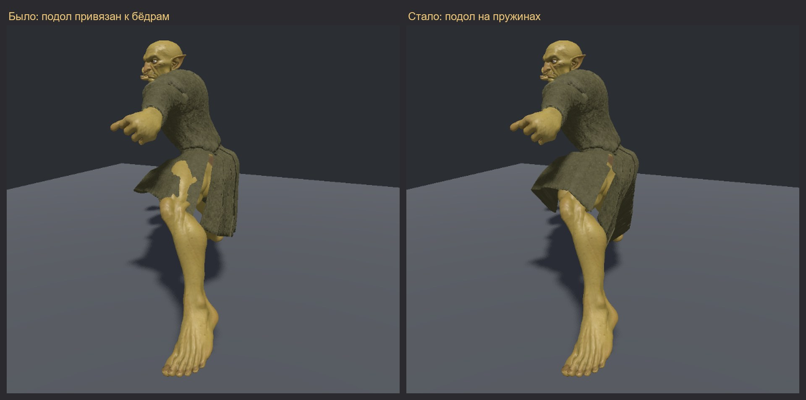
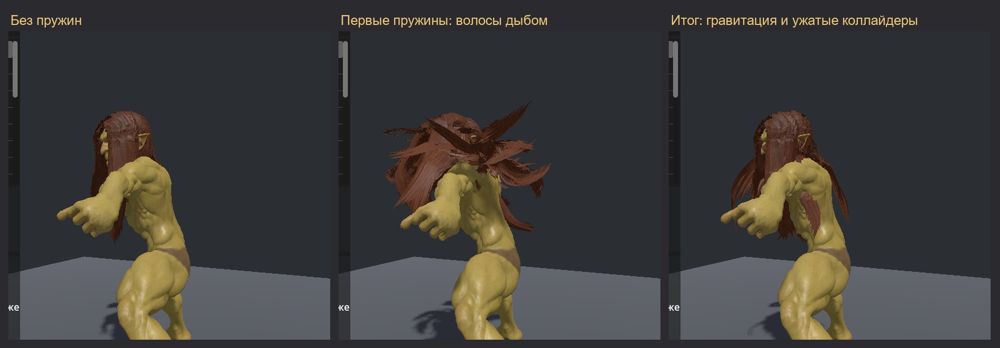
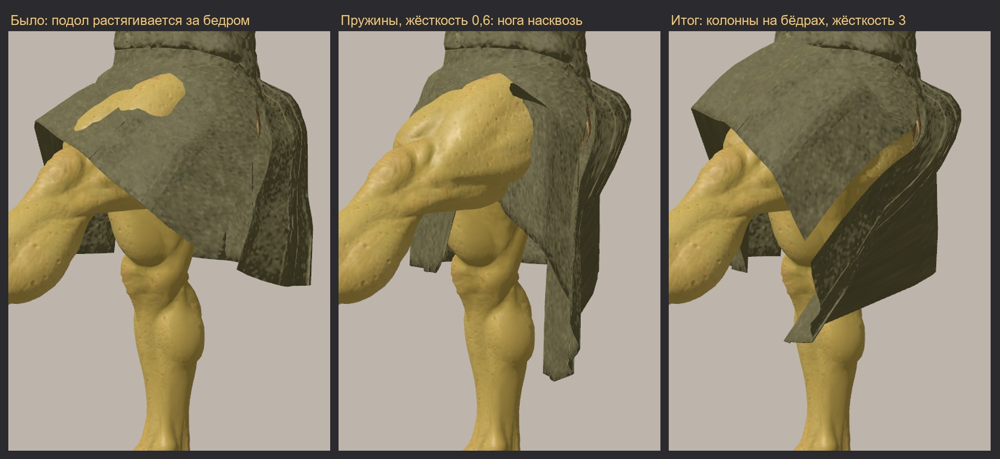
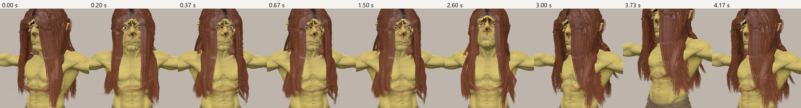
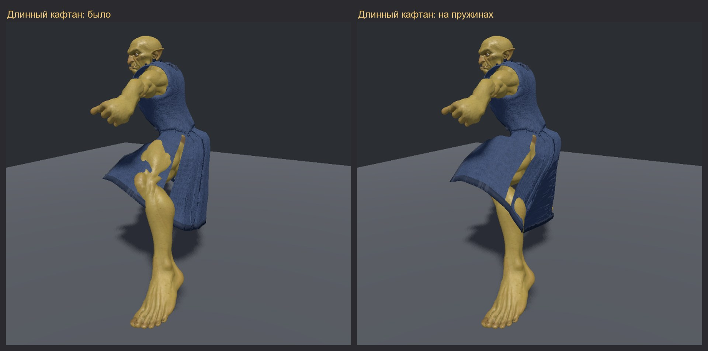
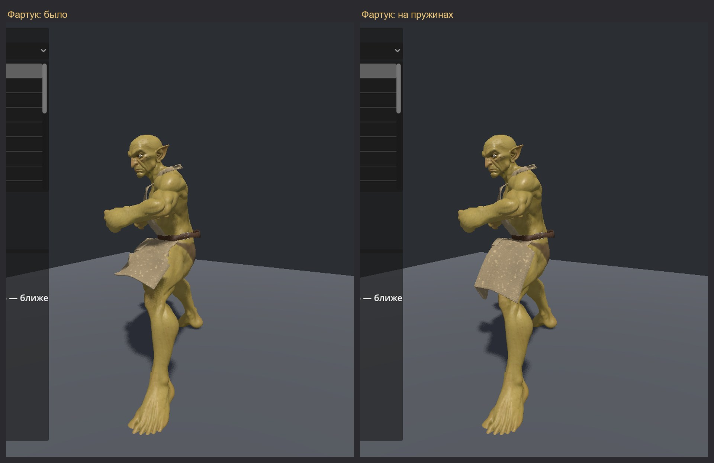

# Как заставить волосы и подол качаться, а не стоять колом?

> Пружины в движке есть готовые, но первые попытки дали волосы дыбом и ногу, проходящую сквозь юбку.

**Статус:** решено · **Дата:** 2026-11-26 · **Ветка:** проверка HairDeck (запущена из «Правки проекта»)

## Коротко

- **Было:** длинные волосы двигались вместе с головой одним куском, как шлем. Подол туники был прилеплен к бёдрам:
  растягивался за ногой, и сквозь ткань проступала кожа.
- **Стало:** волосы и подол висят на цепочках костей-пружин. При повороте и шаге они отстают и качаются. Это
  включается флажком: «Пружины» у причёски и «Подол на пружинах» у туники, жилета и фартука.
- **Как:** в игровом движке Godot есть готовые пружины для костей. Мы научили генератор строить для них цепочки
  костей и долго подбирали, к чему эти цепочки крепить и как сильно им сопротивляться.

*Один и тот же кадр ходьбы. Слева старый подол: тянется за бедром, в ткани дыры. Справа подол на пружинах лежит на бедре.*

## Что было не так

Одежду и причёски для гоблинов делает наш генератор. Каждая вещь «привязана» к костям скелета, как кожа: часть к
голове, часть к бедру. Это называется скиннинг.

У такой привязки две беды. Волосы на голове ведут себя как шлем: голова повернулась — вся причёска повернулась
вместе с ней, без малейшего отставания. А подол туники привязан к бёдрам: нога шагнула вперёд — ткань растянулась за
ней, как резиновая. Там, где растяжка сильная, сквозь ткань проступала кожа ноги.

## Почему так происходило

Настоящие волосы и ткань — инерционные. Они хотят остаться на месте, их тянет вниз сила тяжести, а голова или нога
их догоняет. Обычная привязка к костям ничего об этом не знает: точка ткани жёстко едет за своей костью.

Нужны «пружины»: внутри пряди или полосы ткани ставится цепочка маленьких костей. Каждая кость хочет вернуться в
своё положение, но отстаёт и раскачивается, как маятник на резинке. Движок считает это сам на каждом кадре.

## Что пробовали

| Попытка | Что вышло | Почему не подошло |
|---|---|---|
| Пружины без силы тяжести, как у аниме-аватаров | Персонаж наклоняет голову — волосы торчат назад | Без тяжести прядь держит форму относительно головы и не падает вниз |
| Коллайдеры (тело, о которое бьются волосы) по размеру тела | Волосы вставали дыбом, «взрыв» | Часть прядей в покое лежала внутри коллайдера: их каждый кадр выталкивало, а пружина тянула назад |
| Пружины подола от таза | Нога шла вперёд и проходила сквозь ткань | Редкие цепочки соскальзывали с бедра вбок, а ткань между ними ничем не держалась |
| Жёсткость 0,6 и тяжесть 1,5 для подола | Подол висел отвесно, нога насквозь | Тяжесть перетягивала, ткань не шла за ногой |

*Слева волосы без пружин. В середине первые пружины: коллайдеры чуть толще тела, и волосы встали дыбом. Справа итог.*

*Бедро поднято вперёд. Слева старый подол растягивается и рвётся. В середине пружины от таза: нога прошла насквозь.
Справа колонны подола висят на бёдрах, ткань ложится на ногу.*

## Как решили

**Волосы.** Генератор делит пряди на 14 групп вокруг головы и строит для каждой цепочку костей по средней линии
прядей. Верх пряди держит голова, а ниже она всё больше слушается цепочки. В Godot цепочки качают встроенные
пружины. Включена сила тяжести, а коллайдеры головы, лица, шеи, груди и плеч сами ужимаются так, чтобы ни одна
прядь в покое не лежала внутри.

**Подол.** Ниже тазобедренных суставов туника висит на 12 цепочках вокруг тела. Колонны над бедром крепятся к
бедру: подол идёт за ногой и при этом качается. Две средние колонны, спереди и сзади между ног, крепятся к тазу.
Пружины подола жёстче, чем у волос (3 против 0,5), а тяжесть слабее. Кожа под подолом больше не прячется: подол от
неё отходит. Плащ, юбка и табард остались со своей, более сложной тканью.

**Мелочь, без которой не работало.** Когда клип анимации стартует, поза резко прыгает. Пружины от этого
«выстреливают», и ткань оказывается за ногой. Теперь при каждом старте клипа пружины сбрасываются в новую позу.

*Гоблин поворачивается, кивает и подпрыгивает. Пряди отстают и за секунду успокаиваются.*

*Длинный кафтан мага. Слева полы прилипли к бёдрам и рвутся, справа висят и качаются.*

*Фартук кузнеца. Раньше он прилипал к бёдрам и пропадал в шаге, теперь висит впереди.*

## Как проверили

Волосы — на гоблине (поворот, кивок, прыжок) и на мускулистом гоблине в примерочной Godot (покой, шаг, бег).
Подол — на длинной и короткой туниках, длинном кафтане и фартуке, в ходьбе и беге. Всё на копиях персонажей.

| Что мерили | Было | Стало |
|---|---|---|
| Цепочек в длинной причёске | 0 | 14 (около 100 суставов) |
| Цепочек в подоле туники | 0 | 12 (60 суставов) |
| Скрытых точек кожи под туникой | 3403 | 2626 (бёдра больше не прячутся) |
| Кадр, 40 гоблинов с туникой | 6,9 мс | около 12 мс |
| Кадр, 40 гоблинов с длинными волосами | 6,9 мс | около 23,5 мс |

*Замеры: ноутбук с RTX 4060 Laptop, Godot 4.7 без окна. 6,9 мс — потолок кадра в этом режиме, реальная работа без
пружин меньше. Отсюда около 0,2–0,3 мс на подол и около 0,5 мс на длинные волосы на одного персонажа, то есть около
5 микросекунд на сустав. Качество — на глаз по кадрам.*

## Что осталось

- Пружины не бесплатные. Для героя и нескольких персонажей рядом — нормально, для толпы нет. У дальних их выключает
  одна команда.
- Складок сами пружины не дают: ткань качается полосами.
- При сильном наклоне головы передние пряди частично ложатся на лицо.
- На широком шаге бега видны разрезы туники.

## Словарик

| Термин | Простыми словами |
|---|---|
| Кость | Невидимая палочка внутри модели. Двигаешь кость — двигается кусок модели вокруг неё. |
| Скиннинг (веса) | Какая точка модели к какой кости привязана и насколько сильно. |
| Пружинные кости | Кости, которые движок раскачивает сам, как маятник на резинке. |
| Цепочка | Несколько костей подряд от корня к кончику, как позвонки хвоста. |
| Жёсткость | Насколько сильно пружина тянется обратно в своё положение. |
| Коллайдер | Невидимая форма (шар, капсула), сквозь которую пружины не проходят. |
| Подол | Нижняя часть туники или кафтана, ниже пояса. |
| Godot | Игровой движок, на котором делается игра. |
| Клип | Одна анимация: ходьба, бег, удар. |
| Миллисекунда (мс) | Тысячная доля секунды. На кадр при 60 кадрах в секунду есть около 16 мс. |

## Для видео

**Озвучка:**

Посмотрите на этого гоблина. Он поворачивает голову, а длинные волосы едут вместе с ней, как шлем. А подол туники
при шаге растягивается за ногой, как резина, и рвётся.

Настоящие волосы и ткань отстают и качаются. В игровом движке для этого есть пружинные кости: цепочки, которые
раскачиваются, как маятник на резинке. Казалось бы, поставь — и готово.

Первая попытка: волосы встали дыбом. Невидимое тело, о которое они бьются, оказалось чуть толще настоящего. Пряди
каждый кадр выталкивало наружу, а пружина тянула назад.

Вторая беда: голова наклонилась — волосы торчат назад. Забыли про силу тяжести.

С подолом ещё хуже. Цепочки висели от таза. Нога шла вперёд — и проходила прямо сквозь ткань. Помогло прицепить
цепочки над бедром к самому бедру и сделать пружины в пять раз жёстче.

Теперь волосы и подол качаются. Но это не бесплатно: около половины миллисекунды на одну причёску. Поэтому у дальних
персонажей пружины выключаются.

**Вау-момент:** ролик ходьбы рядом «до» и «после»: слева подол рвётся, справа ложится на ногу и качается.

**Обложка:** кадр `img/02_hair_bush.jpg` посередине (волосы дыбом), крупно «ВОЛОСЫ ДЫБОМ».

**Оценка для видео:** 5 — смешные провалы (взрыв волос, нога сквозь юбку), понятная физика и видимый результат в движении.

## Для любопытных

- Генератор волос: `tool/blender_hair_gen.py` (`hair_springs`). Подол: `tool/blender_armour_gen.py` (блок `HEM_KINDS`).
- Godot: `tool/godot/sf3d_equip.gd` (`_springs`, `_hair_springs`, `_hem_springs`, `reset_springs`, `springs_active`),
  примерочная `tool/godot/sf3d_wardrobe.gd` (сброс при старте клипа, `--nosprings`).
- Флажки: `tool/armour_gen_editor.html`, параметры `tool/armour_gen_ui.py`.
- Коммиты: `9648ef8` — пружины волос и подола, флажки, Godot. Генератор подола попал раньше в `2a3cda0` (чужой
  коммит взял файл целиком).
- Замер цены: `work/hairdeck_test/godot_equip/bench.gd`. Подъём бедра: `work/hairdeck_test/godot_equip/main.gd --leg --low`.
  Пересборка вещей с подолом: `work/hairdeck_test/hem_job.py`.
- Ветки: проверка HairDeck (идея пружин взята оттуда, разбор `2026-11-26_hairdeck-hair-from-picture`), запущена из
  «Правки проекта» (`local_e34b3455`).
