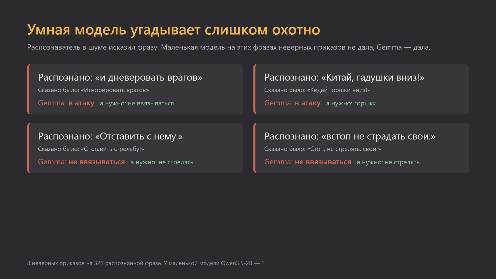
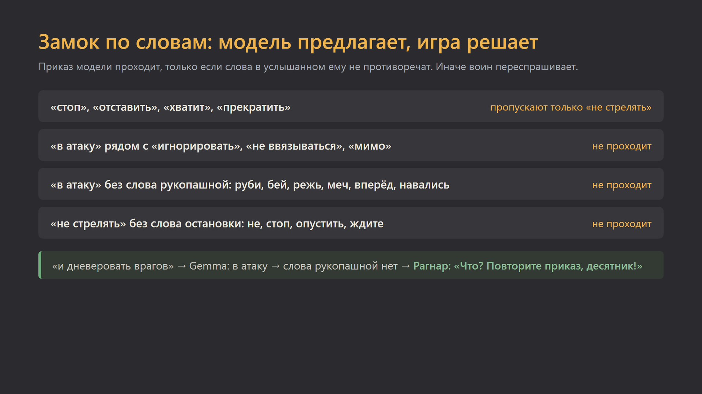
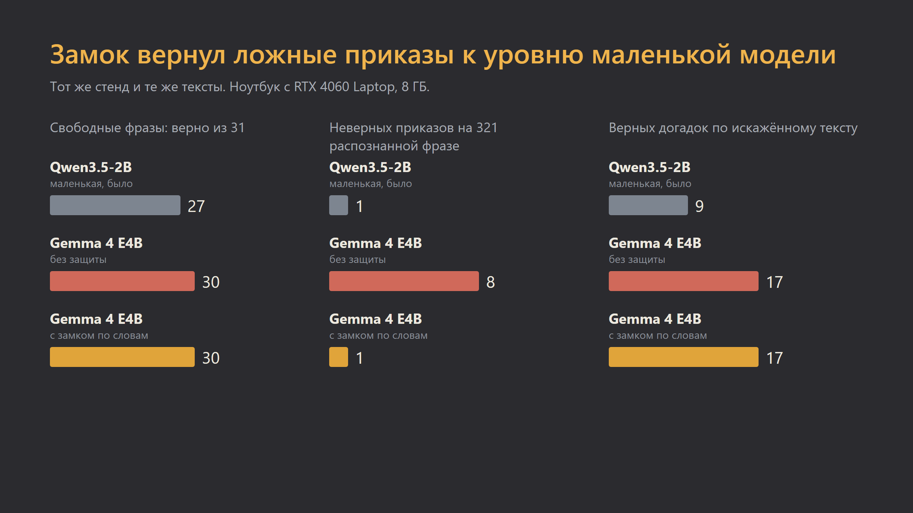
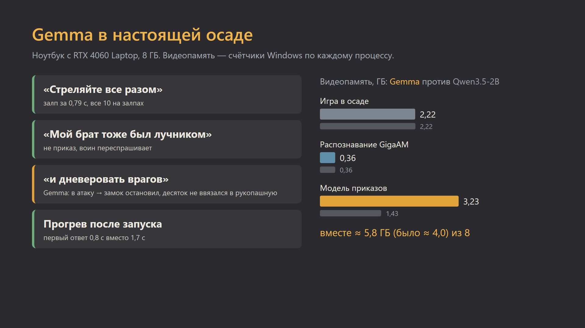

# Как не дать умной нейросети отдать солдатам неверный приказ?

> Модель покрупнее понимала больше — и в восемь раз чаще приказывала то, чего никто не говорил.

**Статус:** решено (прототип) · **Дата:** 2026-11-26 · **Ветка:** Голосовые команды НПЦ (`claude/voice-commands-62e907`)

## Коротко

- **Было:** свободные приказы десятку разбирала маленькая модель Qwen3.5-2B. Её заменили на Gemma 4 E4B, чтобы одна модель
  служила и для речи жителей, и для приказов. Gemma поняла больше, но на искажённом тексте выдала 8 неверных приказов
  вместо 1.
- **Стало:** Gemma с «замком по словам» — 1 неверный приказ, как было. Понимает она по-прежнему больше: 30 свободных
  фраз из 31 против 27.
- **Как:** модель только предлагает приказ. Игра сверяет его со словами, которые реально прозвучали, и при
  противоречии воин переспрашивает.

*Распознаватель исказил фразу в шуме, а Gemma уверенно нашла в ней приказ — не тот.*

## Что было не так

Голосом десятку можно приказать двумя путями ([первый разбор](../2026-11-24_voice-orders-squad/README.md)). Знакомые фразы
вроде «Десяток, за мной!» игра понимает по списку. Всё остальное разбирает языковая модель: «Стреляйте все разом» → залп.

Другая ветка проекта выбирала модель для разговоров жителей. Победила Gemma 4 E4B. Две модели в одной видеокарте —
дорого, и пользователь решил: одна модель на всё. Gemma на стенде приказов поняла больше: 30 свободных фраз из 31 и 17
верных догадок по искажённому тексту против 9. Но был подвох.

Распознаватель речи в шуме иногда пишет кашу: «Игнорировать врагов» превращается в «и дневеровать врагов». Маленькая
модель на такой каше обычно честно отвечала «не приказ». Gemma находила приказ: «врагов» — значит, «в атаку». На 321
распознанной фразе — 8 неверных приказов. Неверный приказ в бою хуже переспроса: десяток полезет в рукопашную, вместо того чтобы обходить нурглов.

## Почему так происходило

Чем умнее модель, тем охотнее она достраивает смысл. Это как сообразительный новобранец: недослышал команду, но не
переспросит, а сделает то, что «наверняка имелось в виду». Когда слышно хорошо, это достоинство. Когда половина слов —
каша, это беда.

## Что пробовали

| Попытка | Что вышло | Почему не подошло |
|---|---|---|
| Пусть модель сама скажет, уверена ли она | Gemma ни разу не сказала «не уверена». Лишняя строка в задании испортила два её ответа: «Хватит болтать» стало «не стрелять» | Модели не умеют честно оценивать свою уверенность. Выключили |
| То же у маленькой модели | Она отсекла 4 своих же верных приказа | Хуже, чем без этого |
| Оставить маленькую модель | Неверных приказов 1 | Две модели не поместятся рядом с игрой и речью жителей |
| **Замок по словам** | Неверных приказов 8 → 1, верные догадки не потеряны | Подошло |

## Как решили

Модель предлагает приказ, но решает игра. Перед тем как отдать приказ, игра смотрит, какие слова на самом деле
прозвучали:

- «стоп», «отставить», «хватит», «прекратить» — пропускают только «не стрелять»;
- «в атаку» не проходит рядом с «игнорировать», «не ввязываться», «мимо»;
- «в атаку» не проходит, если нет ни одного слова рукопашной: «руби», «бей», «режь», «меч», «вперёд», «навались»;
- «не стрелять» не проходит без слова остановки: «не», «стоп», «опустить», «ждите».

Не прошёл приказ — воин переспрашивает: «Что? Повторите приказ, десятник!»

*Каша «и дневеровать врагов» → модель: «в атаку» → слова рукопашной нет → переспрос.*

Попутно нашлась одна ловушка самих правил. Слово «хватит» прячется внутри «с**хватит**есь»: «Схватитесь с ними
врукопашную» замок сначала резал. Теперь такие слова сверяются только целиком.

И ещё одно: первый вопрос к Gemma после запуска шёл 1,7 секунды — модель впервые читала своё задание. Теперь сразу
после старта игра задаёт ей пустой вопрос, и первый настоящий приказ занимает 0,8 секунды.

## Как проверили

Тот же стенд, что для маленькой модели: 31 свободная фраза, 321 текст, который распознаватели действительно написали,
и 26 новых фраз, написанных уже после того, как замок был готов.

*Замок вернул неверные приказы к уровню маленькой модели и не отнял ни одной верной догадки.*

| Что мерили | Qwen3.5-2B | Gemma без замка | Gemma с замком |
|---|---|---|---|
| Свободные фразы, верно из 31 | 27 | 30 | 30 |
| Неверные приказы на 321 распознанной фразе | 1 | 8 | 1 |
| Верные догадки по искажённому тексту | 9 | 17 | 17 |
| Новые фразы (после замка), верно из 26 | — | 26 | 24 |
| Ответ модели, медиана | 0,21 с | 0,53 с | 0,45 с |
| Видеопамять модели | 1,43 ГБ | 3,23 ГБ | 3,23 ГБ |

А потом — в настоящей осаде. «Стреляйте все разом» — залп за 0,79 секунды. Каша «и дневеровать врагов» — Gemma сказала
«в атаку», замок остановил, десяток в рукопашную не пошёл.

*Игра, распознавание и Gemma вместе заняли 5,8 ГБ видеопамяти из 8 — с маленькой моделью было 4,0.*

*Замеры: ноутбук с RTX 4060 Laptop, 8 ГБ, llama.cpp; рядом работали другие задачи, поэтому задержки с запасом.
Фразы стенда — синтезированный голос, в осаде — текстом, как его написал бы распознаватель.*

## Что осталось

- Замок подбирали по тем же ошибкам, которые он ловит. На 26 новых фразах он зря остановил две верные: «Луки вниз» и
  «Порвите их». Там воин переспросит. Нужны живые записи игрока.
- Остался один неверный приказ: «Где мой лук?» распознано как «Иди мой гулк!», и любая модель слышит «за мной».
  По словам его не отличить.
- Видеопамяти впритык: 5,8 ГБ в осаде плюс то, что карта держит без игры, — около 7,2–7,7 ГБ из 8. Если жители
  заговорят через вторую копию Gemma, памяти не хватит. Нужен один общий сервер модели.

## Словарик

| Термин | Простыми словами |
|---|---|
| Языковая модель (LLM) | Нейросеть, которая понимает и пишет текст. Здесь она только выбирает приказ из восьми. |
| Gemma 4 E4B, Qwen3.5-2B | Названия моделей. Цифры — примерный размер: 4 и 2 миллиарда параметров. |
| Распознаватель речи | Нейросеть, которая переводит голос в текст. В шуме может написать кашу. |
| Неверный (ложный) приказ | Приказ, которого игрок не отдавал: сказал «игнорировать», а десяток пошёл в атаку. |
| Замок по словам | Правила игры, которые проверяют ответ модели по словам, реально прозвучавшим во фразе. |
| Прогрев | Пустой вопрос сразу после запуска, чтобы модель заранее прочла своё задание. |
| Видеопамять | Память видеокарты. Игра и нейросети делят её: не хватит — всё тормозит. |
| Медиана | Середина: половина ответов быстрее, половина медленнее. |

## Для видео

**Озвучка:**

Десятком можно командовать голосом. Знакомые фразы игра понимает сама, а необычные отдаёт языковой модели.

Мы решили взять модель поумнее — ту же, что пишет реплики жителям. Две модели держать дорого. Умная модель и правда
поняла больше: тридцать фраз из тридцати одной. Но появилась беда.

В шуме распознаватель речи иногда пишет кашу. «Игнорировать врагов» превращается в «и дневеровать врагов». Маленькая
модель на каше обычно честно говорила «не понял». А умная находила приказ: раз «врагов» — значит, «в атаку». Таких
ошибок стало восемь вместо одной. В бою это значит, что десяток полезет в рукопашную, когда его просили обойти врага.

Сначала мы спросили модель, уверена ли она. Она была уверена всегда. Даже когда ошибалась.

Тогда решать стала игра. Модель только предлагает приказ, а игра смотрит, какие слова прозвучали на самом деле. Если
модель говорит «в атаку», а во фразе нет ни «руби», ни «бей», ни «вперёд» — приказ не проходит. Солдат переспрашивает:
«Что? Повторите приказ, десятник!»

Ошибок снова одна, как у маленькой модели. А всё, что умная модель понимала лучше, осталось.

**Вау-момент:** каша «и дневеровать врагов» → модель: «В атаку!» → игра останавливает → «Что? Повторите приказ, десятник!»

**Обложка:** карточка «и дневеровать врагов» → «В АТАКУ», крупно «НЕ ТОТ ПРИКАЗ».

**Оценка для видео:** 4 — понятный парадокс «умнее значит опаснее», смешные искажения речи и простое решение, которое
видно в игре. Минус: кадров из игры нет, только карточки и графики; переспрос солдата надо снять в осаде отдельно.

## Для любопытных

- Файлы игры (`game:`): `data/voice/squad_voice_llm.json` — модель, задание, замок (`check`) и прогрев (`warm`);
  `game/voice/voice_llm_client.gd` — проверка по словам `word_check`, прогрев; `game/voice/voice_orders.gd` — переспрос
  при остановленном приказе; `tools/voice_bench/llm_bench.py` — стенд (`--model`, `--no-sure`, `--no-words`, набор
  `fresh`); `tools/voice_bench/voice_intent_check.gd` — правила в игре совпадают со стендом (76 ответов, 0 расхождений);
  `tools/voice_bench/voice_siege_check.gd` — проверка в осаде; `Docs/Research/voice_commands.md` §13;
  `Docs/PendingDecisions/voice_commands.md` — решение G-D:voice_commands.1.
- Коммит игры: `cbf160d0` (ветка `claude/voice-commands-62e907`, в main не слита) — Gemma за замком по словам.
- Ветки: Голосовые команды НПЦ (`local_158bdd70-3235-47c9-9959-9986dcc7b6d7`) — замок, замеры, осада; Тест ИИ: диалоги
  жителей (`local_b43fc0c7-fd06-4976-8e25-0f816e541c38`) — выбрала Gemma и первой замерила её на стенде приказов.
- Как повторить: `tools/voice_bench/README.md`. Модели — только через очередь `tools/run_queued.ps1 -Lane heavy`, Godot — `-Lane godot`.
- Картинки: `node "docs/Solve problems/2026-11-26_voice-orders-gemma-locks/pictures.mjs"`.
