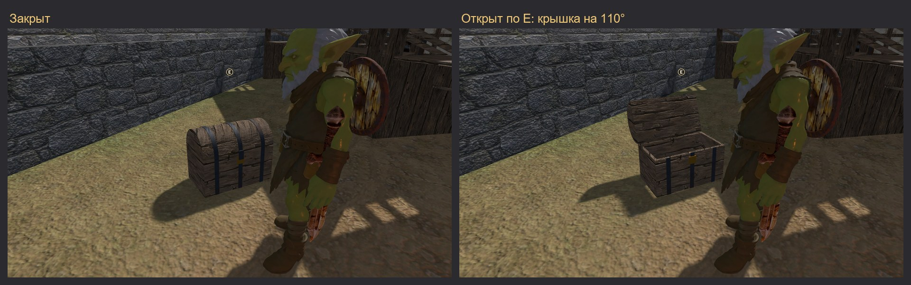
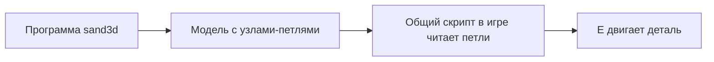
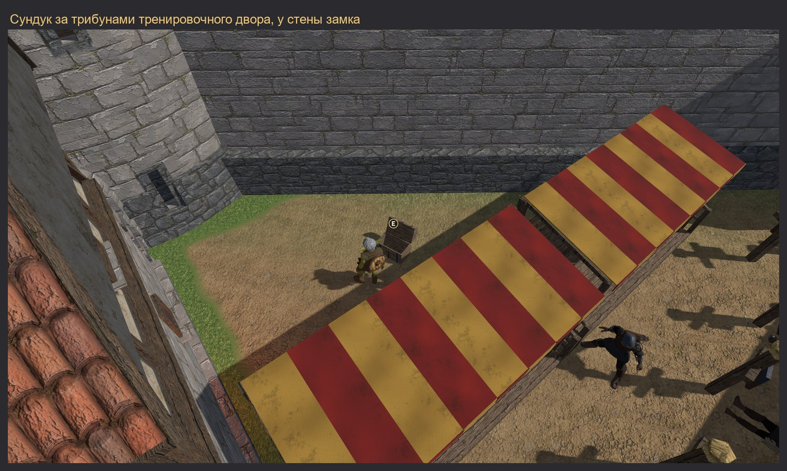
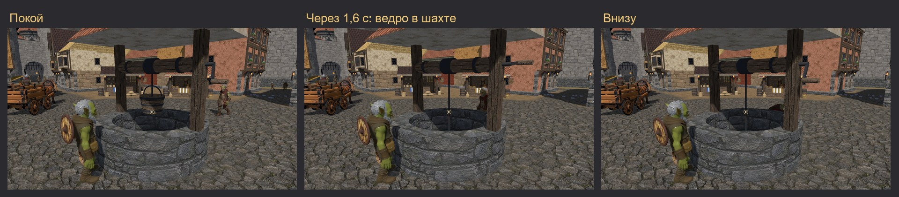
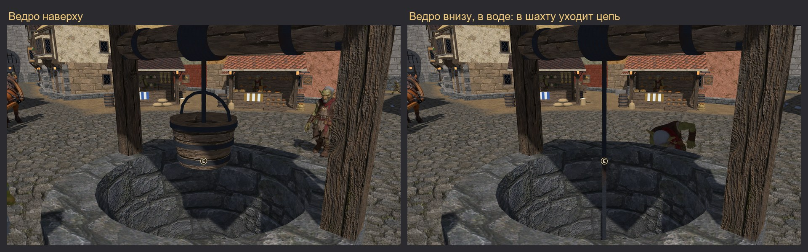
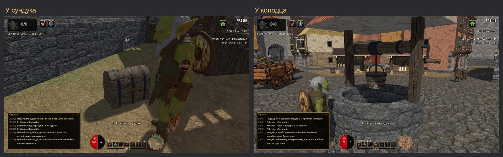

# Как заставить сундук открываться, а ведро — опускаться в колодец?

> Цепь не умеет растягиваться, поэтому её собрали телескопом из восьми кусков. А старое ведро продолжало висеть у края,
> потому что игра показывала копию копии.

**Статус:** решено · **Дата:** 2026-11-27 · **Ветка:** sand3d-research (`claude/sand3d-research-c5af5c`)

## Коротко

- **Было:** в городе нечего было открыть или покрутить. У рыночного колодца стоял красивый ворот с ведром, но он был
  «запечён» в декорацию и не двигался.
- **Стало:** сундук на тренировочном дворе открывается по E, крышка встаёт на 110 градусов за 0,9 секунды. У колодца E
  опускает ведро в воду, почти на 4 метра вниз, примерно за 2,6 секунды, и поднимает обратно.
- **Как:** модели написаны программами sand3d, в них сказано, какая деталь вокруг какой оси крутится. Один общий скрипт в
  игре читает эти оси прямо из модели и двигает детали.

*Один кадр, одна камера: слева сундук закрыт, справа открыт по E. Крышка повернулась вокруг задней кромки.*

## Что было не так

Игроку хочется трогать мир. В нашем городе двери замка и подъёмный мост уже двигались, но каждый — со своим скриптом.
Где у двери петля, программист вписывал в код цифрами. У телеги точка поворота оглобель тоже записана в коде.

Значит, каждый новый подвижный предмет — это новый скрипт и новые цифры, которые легко перепутать. А хотелось сундуков,
колодцев, ворот и телег без отдельной работы программиста над каждым.

## Почему так происходило

Модели города собирает наш набор кубиков в Blender. В файл попадает только форма и материалы. Где петля, знает только
тот, кто модель делал.

Это как шкаф, к которому приложили инструкцию, но не положили петли: где они должны стоять, приходится угадывать по
картинке.

В исследовании ([2026-11-26_sand3d-review](../2026-11-26_sand3d-review/README.md)) мы нашли sand3d. Модель в нём пишется
как программа, и петля — часть этой программы. В готовом файле она лежит отдельным узлом с осью и пределами.

## Что пробовали

| Попытка | Что вышло | Почему не подошло или что поняли |
|---|---|---|
| Поставить сундук по плану двора | Сундук оказался внутри стены замка: луч сверху упёрся в стену на высоте 1,6 м | Прямоугольник двора на плане заходит под стену. Перенесли сундук за трибуны и проверили место лучом и снимком сверху |
| Сундук из отдельных деталей | 10 команд отрисовки на один сундук | Склеили детали — железные обручи стали деревянными: склейка оставляет материал первой детали |
| Клеить по материалу: дерево к дереву, железо к железу | 5 команд отрисовки | Подошло |
| Колодец: цепь одним куском | Деталь в модели не растягивается: цепь либо обрывается над ведром, либо торчит над валом | Сделали телескоп из восьми кусков: каждый следующий опускается чуть дальше предыдущего |
| Ведро следует за бесконечно вращающимся валом | sand3d отказался: «ползун пойдёт без конца» | Дали валу предел: 2,9 оборота, ровно от края до воды |
| Вырезали старый ворот из декораций | В игре у края всё ещё висело старое ведро, а наша цепь уходила сквозь него в шахту | Игра показывала не сами декорации, а их обрезанную копию для большой карты. Вырезали и там |

*Сундук за трибунами тренировочного двора, у стены замка. Первое место по плану было внутри этой стены.*

*Одна камера: в покое, через 1,6 секунды после E (рукоять повернулась, ведро уже в шахте) и внизу.*

Телескоп устроен так. Верхний кусок цепи висит на месте. Второй опускается на одну восьмую пути ведра, третий на две
восьмых, последний — почти вместе с ведром. Каждый кусок длиннее своего шага, поэтому щелей нет. Шаг равен ровно восьми
звеньям, и внизу звенья соседних кусков совпадают: цепь выглядит сплошной.

## Как решили

- **Общий скрипт подвижного предмета.** Он находит в модели все петли, проверяет их и двигает детали в пределах. Детали,
  которые «следуют» за другой, двигаются сами. По E скрипт ведёт выбранную петлю туда и обратно, подсказку и звук
  предмет называет сам.
- **Сундук** на тренировочном дворе: крышка от 0 до 110 градусов. Подсказки «E: Открыть сундук» и «E: Закрыть сундук».
- **Лебёдка колодца** тех же размеров, что старый ворот: бревно с обручами и намотанной цепью, рукоять, цепь и ведро.
  Вал поворачивается на 2,9 оборота. Ведро опускается на 3,97 метра: его дно уходит с высоты 1,3 метра над землёй в воду,
  которая стоит на 2,5 метра ниже земли. Подсказки «E: Опустить ведро» и «E: Поднять ведро», звук скрипучего ворота.
- **Старый ворот** вырезан из декораций и их копии для большой карты, а в рецепте сборки декораций его больше нет.
  Иначе он вернулся бы при следующей пересборке.

*Крупно, одна камера: ведро у края и ведро в воде. Цепь из восьми кусков выглядит одной.*

*Так это видит игрок: подсказка внизу экрана говорит, что сделает E.*

## Как проверили

Временный стенд запускал настоящую игру, ставил героя рядом с предметом, сам нажимал E и проверял результат.

| Что мерили | Было | Стало |
|---|---|---|
| Сундук: время открытия | — | 0,9 с до 110° |
| Сундук: команды отрисовки | 10 | 5 |
| Сундук: треугольники | — | 1 044 |
| Ведро: высота дна | 1,30 м (у края) | −2,67 м (в воде) и обратно ровно 1,300 м |
| Ведро: время спуска | — | около 2,6 с |
| Колодец: команды отрисовки | 0 (ворот был частью общих декораций) | 13 |
| Колодец: треугольники | — | 7 164 |
| Вырезано из декораций | — | 248 треугольников дерева и 820 железа, в двух местах |

*Замеры: ноутбук с RTX 4060 8 ГБ, игра Godot 4.7.2. Время — по часам стенда. Частоту кадров не мерили.*

Ещё стенд проверил, что E у сундука и у колодца выбирает именно их, и что подсказка меняется после нажатия.

## Что осталось

- Колодец пока только для вида. Герой воду не набирает, жажда не меняется, горожане у колодца ворот не крутят.
- Сундук пустой, а звук у него — скрип двери.
- Автоматический тест общего скрипта написан, но не запускался: тесты в проекте запускают по просьбе пользователя.
- Колодец добавил 13 команд отрисовки. Для одной площади это немного, но десятки таких колодцев стоили бы заметно.
- Следующие кандидаты на тот же скрипт: ворота, телега, осадные машины.

## Словарик

| Термин | Простыми словами |
|---|---|
| sand3d | Библиотека, в которой 3D-модель пишется как программа, вместе с петлями. |
| Петля (шарнир) | Пометка в модели: деталь поворачивается вокруг такой-то оси, от сих до сих. |
| Ползун | Петля наоборот: деталь не поворачивается, а едет по прямой, как ящик стола или ведро на цепи. |
| «Следует за» | Деталь двигается сама, когда двигается другая, с заданной долей: ведро опускается, когда крутится вал. |
| Телескоп | Несколько кусков, которые выдвигаются друг из друга, как подзорная труба или удочка. |
| Запечь (bake) | Заранее склеить много деталей в одну большую неподвижную модель, чтобы игре было легче её рисовать. |
| Команда отрисовки (draw call) | Одно «нарисуй это» от игры видеокарте. Чем меньше команд, тем легче кадр. |
| Треугольники | Из них состоит любая 3D-модель. |
| Материал | Из чего «сделана» поверхность: дерево, железо, камень. |
| Стенд | Временный скрипт, который запускает игру и сам проверяет нужное место: жмёт кнопки, меряет, снимает кадры. |
| Godot | Движок нашей игры. |
| Blender | Программа для 3D, в которой собираются модели. |

## Для видео

**Озвучка:**

В нашем городе почти ничего нельзя потрогать. Даже красивый ворот у колодца — просто часть декорации.

Мы нашли способ: писать модель как программу и прямо в ней указывать, какая деталь вокруг какой оси крутится. Тогда
игре не нужен свой скрипт на каждый предмет. Один общий скрипт читает петли из модели и двигает что угодно.

Первым стал сундук. Поставили его по плану двора — и он оказался внутри стены замка. План врал: двор на нём заходил под
стену. Перенесли за трибуны. Нажимаешь E — крышка встаёт за секунду.

Дальше колодец. Тут засада: цепь не растягивается. Если ведро уходит на четыре метра вниз, цепь либо рвётся, либо торчит
над валом. Мы собрали её телескопом из восьми кусков. Каждый опускается чуть дальше предыдущего, а шаг равен восьми
звеньям. Внизу звенья совпадают, и цепь выглядит целой.

Старый ворот мы вырезали. Запускаем игру — а старое ведро всё ещё висит у края, и наша цепь проходит сквозь него.
Оказалось, игра показывает не сами декорации, а их копию для большой карты. Вырезали и там. Теперь ведро уходит в воду
и возвращается ровно на место.

**Вау-момент:** призрачное ведро — старое висит у края, а новая цепь уходит сквозь него в шахту.

**Обложка:** колодец крупно, цепь уходит в тёмную шахту, сверху «ЦЕПЬ-ТЕЛЕСКОП».

**Оценка для видео:** 4 — видимый результат прямо в игре, две смешные ловушки (сундук в стене, призрачное ведро) и
хитрая цепь.

## Для любопытных

- Общий скрипт: `game:game/worlds/articulated_prop.gd` (`ArticulatedProp`), подсказка — `game:game/ui/g3_hud.gd`, тест —
  `game:tests/articulated_prop_tests.gd` (не запускался).
- Программы моделей: `game:source_assets/sand3d/props/training_chest.py`, `game:source_assets/sand3d/props/market_well_winch.py`;
  сборка — `game:source_assets/sand3d/build_props.py`, библиотека — `game:source_assets/sand3d/lib/` (sand3d 1.7.0).
- Модели: `game:assets/models/home/town_blocks/props/training_chest.glb`, `game:assets/models/home/town_blocks/props/market_well_winch.glb`;
  в сцене — `game:game/worlds/g10_home_town_props.tscn` (`TrainingChest`, `WellWinch`).
- Старый ворот убран из `game:source_assets/home_environment/build_home_details.gd` и вырезан из
  `game:assets/models/home/details/home_wood.res`, `home_iron.res` и копий `game:assets/models/home/wilds/cut/details_Wood.res`,
  `details_Iron.res`.
- Коммиты игры: `game:c00184be` (сундук), `game:72300b0f` (колодец), слияние `game:95e93fb2`. Решения G-D206 и G-D207.
- Кадры сняты стендом `src/zz_case_shots_tmp.gd` (запуск — `src/run_case_shots.ps1`), подсказки в HUD — снимки
  проверочных прогонов.
- Ветка: sand3d-research (`claude/sand3d-research-c5af5c`); колодец заказан сессией `local_b6e54bdd-a00f-4d8a-b379-a81d691da2ec`.
