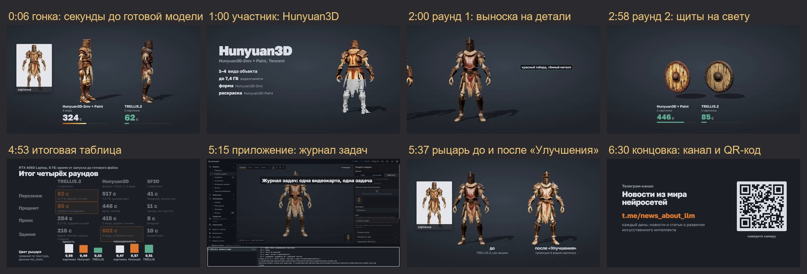
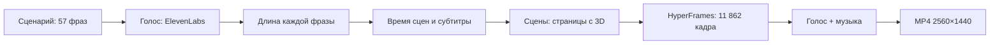
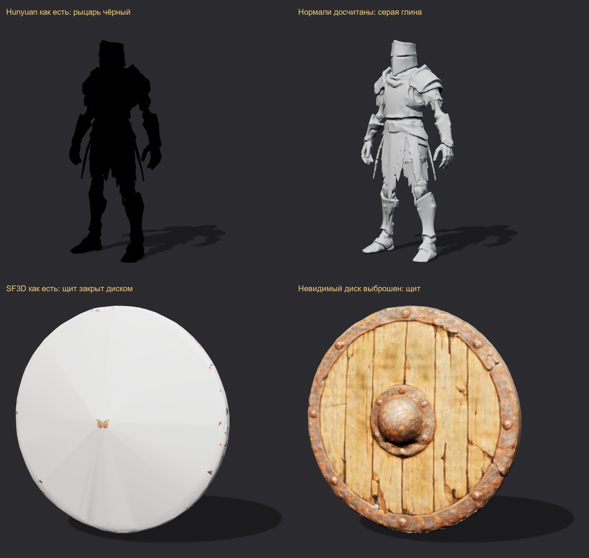
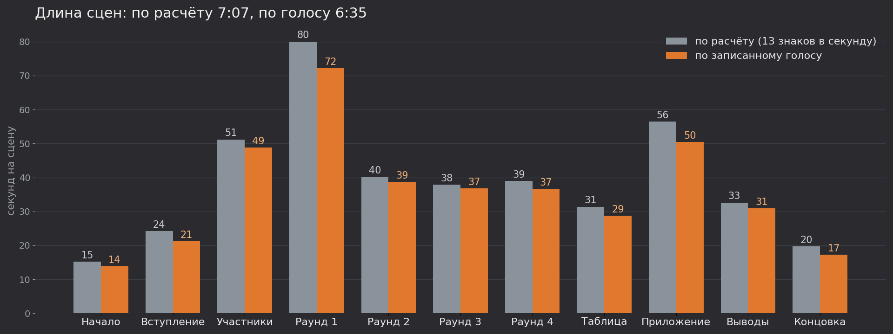
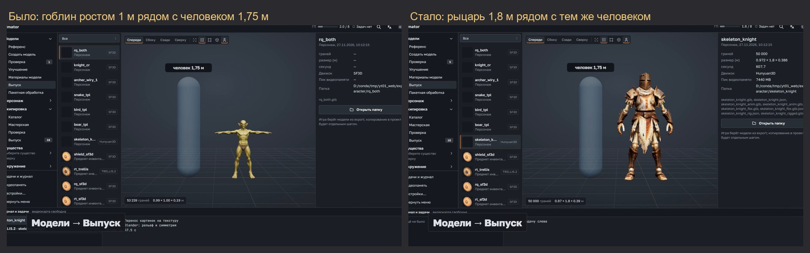
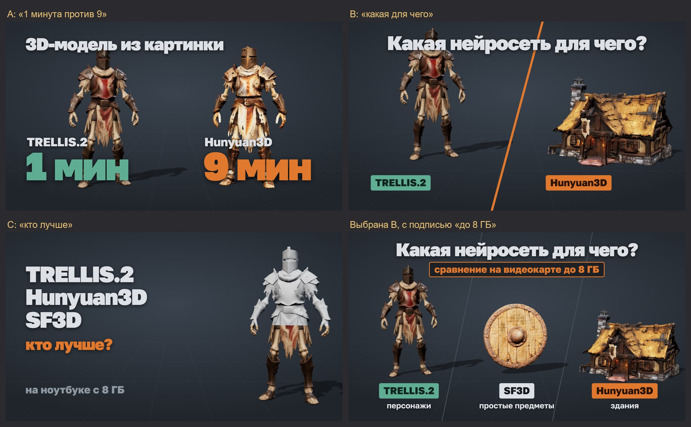
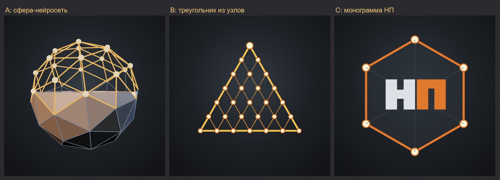

# Как собрать ролик для YouTube без видеоредактора?

> Ролик о нейросетях собрала нейросеть, и ни одной склейки в видеоредакторе не было. Но гоблина ростом с ребёнка
> в кадре заметил только человек.

**Статус:** решено · **Дата:** 2026-11-27 · **Ветка:** YouTube №1: сравнение генераторов 3D (SF3D, Hunyuan, TRELLIS.2)

## Коротко

- **Было:** для канала «Нейрополигон» нужен первый ролик: сравнить три нейросети, которые делают 3D-модель из картинки.
  Монтажёра и видеоредактора нет.
- **Стало:** готовый ролик 6 минут 35 секунд в 2K (2560 × 1440) с голосом автора, музыкой, субтитрами на русском и
  английском, обложкой и аватаром канала. От задания до исправленного ролика прошло меньше четырёх часов.
- **Как:** каждая сцена свёрстана как веб-страница, а программа HyperFrames снимает её кадр за кадром. Голос — клон голоса
  автора в ElevenLabs. Музыку сгенерировала локальная нейросеть.

*Кадры готового ролика по порядку: гонка по секундам, участники, раунды, таблица, приложение, концовка с QR-кодом.*

## Что было не так

Задание: сравнить TRELLIS.2, Hunyuan3D (обычный и быстрый) и SF3D на ноутбуке с видеокартой RTX 4060 на 8 ГБ. Четыре
раунда: персонаж, предмет, пропс, здание. Потом показать, как это выглядит в нашем приложении 3d-animator.

Условия были жёсткие:

- Ролик собирает Claude, а у него нет мыши и монтажного стола: только код и командная строка.
- Видеокарта одна, и ею в это же время пользуются другие ветки. Задачи на неё идут по одной.
- Рабочее приложение автора трогать нельзя. Интерфейс снимаем на копии.
- Платный сервис озвучки — только после «да» автора.
- Каждая цифра в ролике — из замера.

## Почему так происходило

Видеоредакторы сделаны для человека с мышкой. Программе проще думать о видео как о веб-странице. Каждая сцена — страница,
движение на ней расписано по секундам. HyperFrames открывает страницу в браузере, переводит время на следующий кадр и
делает снимок. Тридцать снимков на секунду видео, как в мультфильме из блокнота: каждая страница нарисована отдельно, а
потом их быстро листают.

Почти все спотыкания были об одно и то же. Вещь, сделанная для одной цели, ломалась в другой. Файлы моделей сделаны для
игры, а не для кино. Скрипт съёмки брал первую модель в списке. Время сцен сначала считали по средней скорости речи, а
не по настоящему голосу.

## Что пробовали

| Попытка | Что вышло | Почему не подошло и что сделали |
|---|---|---|
| Показать модели Hunyuan как есть | Рыцарь — чёрный силуэт | В файле нет нормалей, и свет «не знает», как падать. Досчитываем их при загрузке. |
| Показать щит SF3D как есть | Вместо щита белый диск | В игровой файл спрятан невидимый диск для столкновений. Игра его не рисует, а браузер нарисовал. Выбрасываем его. |
| Снимать интерфейс на общем тестовом сервере | Другая ветка переключила его на английский | Подняли свою копию на отдельном порту. |
| Рендер: 3D рисуется во всех сценах сразу | 4 секунды видео — за 3,5 минуты | Теперь 3D рисует только текущая сцена: 45 секунд, весь ролик — около 15 минут. |
| Первый полный рендер | Заголовок раунда слишком крупный | Заметили на листе кадров уже после рендера. Ещё 15 минут на повтор. |
| Время сцен по расчёту: 13 знаков в секунду | Ролик 7:08 | Голос читает быстрее, 14,4 знака в секунду. Пересчитали сцены по длине каждой фразы: 6:35, третий рендер. |
| Озвучить в окне Subtitle Edit мышкой | Окно пряталось за другими окнами на двух мониторах | Автор подсказал готовую консольную программу для Subtitle Edit. Дальше через неё. |
| Первый запрос к ElevenLabs | Нет связи: старый прокси молчал, а VPN выходил в регион, где сервис закрыт | Автор убрал прокси из настроек. До платной озвучки проверили связь бесплатным запросом. |
| Фраза «тот же рыцарь после „Улучшения“» в концовке | Оторвана от своей картинки, заметил автор | Перенесли в блок про «Улучшение». Голос взяли уже записанный: нашли запись по тексту, а не по номеру. |
| Экран «Выпуск» | Скрипт выбрал первого в списке — гоблина ростом 1 м рядом с человеком 1,75 м | Пересняли с рыцарем ростом 1,8 м. Четвёртый, последний рендер. |
| Цифра SF3D из задания: «около 20 секунд» | Замер: около 10 секунд, первый запуск — около 40 | В ролик пошли замеры. |

*Слева файлы как есть, справа после исправления, камера та же. Рыцарь без нормалей чёрный, щит закрыт диском для столкновений.*

*Серые столбцы — время сцен по средней скорости речи, оранжевые — по настоящему голосу. Каждая сцена вышла короче.*

*Слева прошлая версия: гоблин в 1 метр рядом с человеком 1,75 м выглядит ребёнком. Справа рыцарь 1,8 м. Кадры из двух
версий ролика, камера почти та же.*

## Как решили

Конвейер ролика теперь такой:

1. **Сценарий в одном файле:** 11 сцен, 57 фраз. У каждой фразы два текста. Для экрана — с цифрами и латиницей. Для
   голоса — как читать: «Хуньюань», «Треллис», «три-ди». Из файла собираются сценарий RU/EN, субтитры и время сцен.
2. **Обложка и раскадровка до сборки.** Три варианта обложки. Автор выбрал B и попросил дописать «до 8 ГБ» и названия
   моделей.
3. **3D в кадре — настоящие модели из тестов.** Они крутятся в браузере, текстура «стирается» до серой глины, камера
   наезжает на детали.
4. **Интерфейс снят на копии.** Через страницу прошла настоящая генерация рыцаря на TRELLIS.2: 74,3 секунды. Сняли и
   «Проверку», и «Улучшение» (47,5 секунды), и «Выпуск».
5. **Голос.** Клон голоса автора в ElevenLabs, через консольную программу. Сначала проба на трёх фразах, потом остальные
   54. Всего 5 109 знаков.
6. **Музыка.** ACE-Step 1.5 на своей видеокарте, бесплатно. Две дорожки по 3 минуты 45 секунд, склеены плавным
   переходом. Первая генерировалась 18 минут.
7. **Звук сведён:** голос −16 LUFS, музыка на 12 дБ тише, итог −15,4 LUFS. Это обычная громкость для YouTube.
8. **Концовка** — телеграм-канал автора и QR-код.
9. **Аватар канала:** три варианта, автор выбрал монограмму «НП» в шестиграннике.

*Три варианта обложки 1280 × 720 и итог: вариант B с подписью «сравнение на видеокарте до 8 ГБ» и названиями моделей.*

*Варианты аватара в цветах ролика. Выбран C: в 40 пикселях он читается лучше остальных.*

## Как проверили

- **Кадры.** Перед каждым рендером — снимки ключевых моментов и лист кадров.
- **Голос.** Всю запись прогнали через локальное распознавание речи Whisper. Текст совпал, имена и числа прочитаны
  правильно. «Щип» вместо «щит» — ошибка распознавателя на быстрой речи. Целиком на слух ролик слушал только автор.
- **Синхронность.** Модель подсвечивается, когда диктор её называет. Печать раунда встаёт на фразу «Раунд за Треллис».
  QR-код появляется на фразе про канал.
- **QR-код** распознаётся даже в кадре 720p.

| Что мерили | Было | Стало |
|---|---|---|
| Длина ролика | 7:08 (по расчёту) | 6:35 (по голосу) |
| Скорость голоса | 13 знаков в секунду (расчёт) | 14,4 знака в секунду |
| Рендер 4 секунд видео | 3,5 минуты | 45 секунд |
| Рендер всего ролика | — | 15–25 минут, всего 4 рендера |
| Знаков ElevenLabs | — | 5 109, перенос фразы — 0 новых |
| Рост модели на экране «Выпуск» | 1,0 м (гоблин) | 1,8 м (рыцарь) |
| SF3D, время модели | «около 20 с» (задание) | рыцарь 41 с (первый запуск), щит, бочка, таверна — 8–11 с |
| Громкость ролика | — | −15,4 LUFS, пик −1,4 дБ |

*Замеры: RTX 4060 Laptop, 8 ГБ. Рендер занимал около 7 ГБ видеопамяти.*

## Что осталось

- Английской озвучки нет, только английские субтитры.
- Голос проверен распознаванием. На слух целиком — только автором при просмотре.
- Конвейер ролика лежит в `work/` вне git. Для второго ролика его стоит вынести в навык.
- Для этого голоса считать время по 14,4 знака в секунду, а не по 13.
- Ролик ещё не загружен: это сделает автор.

**Что в следующий раз делаем иначе:**

1. **Сначала голос, потом рендер.** Текст, проба на трёх фразах, весь голос, длины фраз, время сцен — и только потом
   один рендер. В этот раз два рендера ушли впустую, около получаса видеокарты.
2. **Перед платным — бесплатная проверка связи.** Самопроверка программы говорила «всё в порядке», а связи не было.
3. **Сразу консольная программа,** а не окно с мышкой.
4. **Каждая фраза рядом со своей картинкой.** Перед озвучкой — таблица «фраза — что в кадре».
5. **Экраны интерфейса:** модель выбирать по имени и смотреть рост рядом с человеком 1,75 м.
6. **3D-файлы перед монтажом:** проверить нормали и спрятанные диски для столкновений.
7. **Лист кадров — до полного рендера,** а не после.
8. **Свой тестовый сервер** на своём порту.
9. **Цифры из задания перепроверять замером.**

## Словарик

| Термин | Простыми словами |
|---|---|
| Рендер | Запись готового видео из сцен, кадр за кадром. |
| HyperFrames | Программа, которая превращает веб-страницу с анимацией в видео: листает время и снимает кадры. |
| three.js | Библиотека, которая рисует 3D прямо в браузере. Ею в ролике крутятся модели. |
| Раскадровка | Несколько главных кадров будущего ролика, чтобы договориться до сборки. |
| Обложка (превью) | Картинка ролика в ленте YouTube, 1280 × 720. |
| Субтитры (SRT) | Файл с текстом и временем каждой фразы. YouTube показывает его под видео. |
| Озвучка (TTS) | Чтение текста синтезированным голосом. |
| Клон голоса | Синтезированный голос, обученный на записях конкретного человека. |
| ElevenLabs | Платный сервис синтеза голоса. Платят за знаки текста. |
| Консольная программа (CLI) | Программа без окон: ей пишут команду, она делает работу. |
| Нормали | Стрелки «куда смотрит поверхность» в каждой точке модели. По ним считается свет. Без них модель чёрная. |
| Коллизия | Невидимая упрощённая форма предмета, о которую в игре ударяются. Её не рисуют. |
| GLB | Файл 3D-модели вместе с текстурами. |
| Whisper | Нейросеть, которая превращает речь в текст. Ею проверили озвучку. |
| ACE-Step | Нейросеть, которая пишет музыку. Работает на своей видеокарте. |
| LUFS | Единица громкости, какой её слышит человек. YouTube выравнивает ролики около −14 LUFS. |
| 2K | Разрешение 2560 × 1440. |
| Тестовая копия | Отдельный экземпляр приложения с копиями файлов. Его не жалко сломать. |
| Видеопамять | Память видеокарты. Нейросети и рендер в неё должны помещаться. |

## Для видео

**Озвучка** (около полутора минут):

Первый ролик канала собирал не монтажёр, а нейросеть. У неё нет мыши и монтажного стола, только код.

Поэтому каждая сцена ролика — это веб-страница. Специальная программа листает её время и снимает тридцать кадров в
секунду. Как мультфильм из блокнота.

Модели в кадре — настоящие, из наших тестов. И первая же из них вышла чёрной. В файле не было нормалей — стрелок,
которые говорят свету, куда смотрит поверхность. А щит из другой нейросети оказался закрыт белым диском. В игровой файл
спрятан невидимый диск для столкновений. Игра его не рисует. А браузер нарисовал.

Пробный рендер шёл три с половиной минуты на четыре секунды видео: трёхмерные модели рисовались во всех сценах сразу.
Стали рисовать только текущую — и весь ролик собирается за пятнадцать минут.

Время сцен сначала считали по средней скорости речи. Ролик вышел на семь минут восемь секунд. Потом записали настоящий
голос, клон голоса автора. Он читает быстрее, и ролик сжался до шести тридцати пяти. Пришлось рендерить заново.

А потом автор посмотрел ролик и нашёл то, чего не заметила программа. На экране выпуска рядом с человеком ростом метр
семьдесят пять стоял гоблин ростом с ребёнка. Скрипт съёмки просто взял первую модель в списке. Пересняли с рыцарем.

Урок для следующего ролика: сначала голос, потом картинка. И последний взгляд — всё равно человеческий.

**Вау-момент:** чёрный силуэт рыцаря шторкой превращается в серую глину, а белый диск — в деревянный щит.

**Обложка:** чёрный рыцарь слева, серый справа, сверху «РОЛИК СОБРАЛ КОД».

**Оценка для видео:** 4 — зрелищные поломки, понятная цифра (7:08 против 6:35) и честный финал: ошибку нашёл человек.

## Для любопытных

- Папка ролика (вне git): `work/youtube_01_models/`. Готовый файл — `render/youtube01_2560_ru.mp4`, инструкция —
  `README_RU.md`.
- Сценарий: `script/script_data.py` → `script/build_script.py` (сценарий RU/EN, `subs/*.srt`, `script/timing.json`).
  Настоящие длины фраз: `script/timing_override.json`.
- Сцены: `video/compositions/*.html`, общее время сцен — `video/lib/timing.js` (его пишет `video/build_index.py`).
  3D: `video/lib/turntable.js` — досчитывает нормали и выбрасывает узлы `*-colonly`.
- Ускорение рендера: каждая 3D-сцена рисует себя только на `hf-seek` внутри своего отрезка.
- Съёмка интерфейса: `capture/shots.mjs` (Puppeteer, 1600 × 900 × 1,6 = 2560 × 1440), копия сервера на порту 7893
  (`D:\conda\tmp\yt01_web`).
- Голос: CLI для Subtitle Edit из соседнего проекта автора (`D:\My projects\veda-tarot\www`, `npm run subtitle --
  doctor | plan | speak`), пресет голоса и задание — в `voice/` (`voice/job_ru/`), модель `eleven_v4_turbo`. Ключ CLI
  берёт из своего файла настроек, его не открывали. Проверка: `npx hyperframes transcribe -l ru -m small`.
- Музыка: ACE-Step 1.5 Turbo (GGUF) через `audiocpp_cli.exe` из Subtitle Edit, склейка — `audio/mix_bed.sh`.
- Кадры этого разбора: `work/youtube_01_models/writeup/` (поломки 3D заново, с флагом `raw`) и `timing_chart.py`.
- Рендер: `npx hyperframes render --workers 3 --video-frame-format png`, HyperFrames 0.9.102.
- Коммитов в SF3D нет: ролик и его исходники тяжёлые и лежат вне git.
- Ветка: YouTube №1: сравнение генераторов 3D (`local_c3c325a1`). Задание дала ветка «Правки проекта» (`local_e34b3455`).
