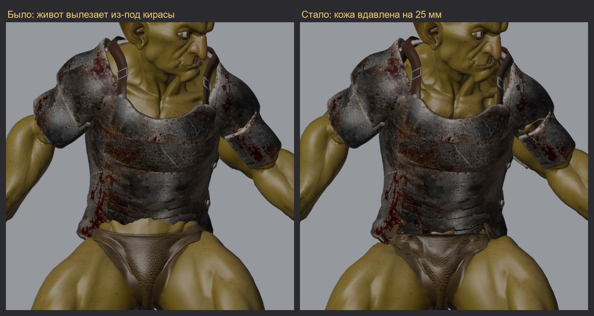
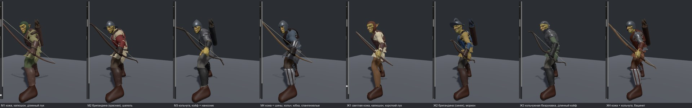
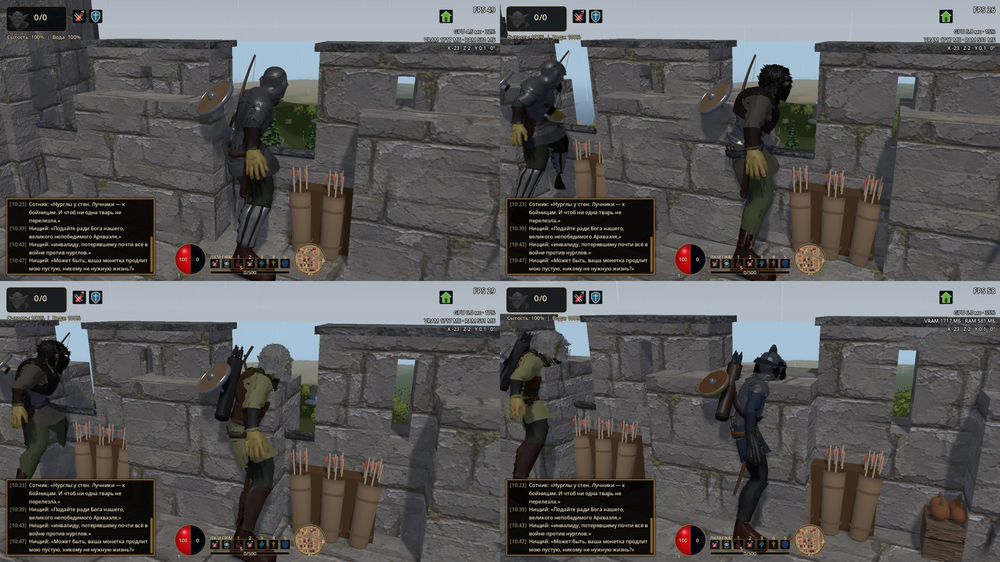
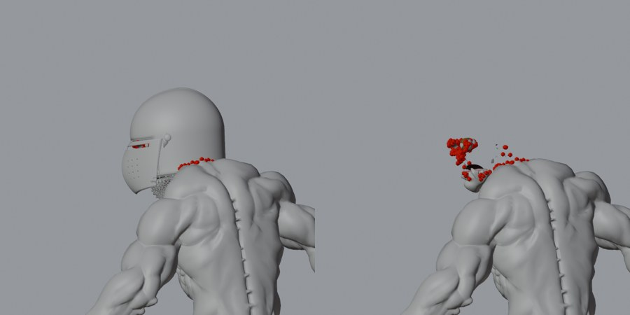

# Почему живот гоблина проходил сквозь кирасу?

> Кожу под бронёй решили не прятать, а вдавить внутрь тела. Это идея пользователя, и она убрала дыры совсем.

**Статус:** решено · **Дата:** 2026-11-27 · **Ветка:** Лучники: мускулистые и жилистые (начата из «Правки проекта»)

## Коротко

- **Было:** в анимации из брони то вылезала кожа, то под ней открывались дыры, и сквозь них было видно пустоту.
- **Стало:** на 61 анимации стражи дыр под кирасой, набедренниками, наплечниками и кольчугой — ноль. Кожи наружу
  в два-три раза меньше (под кирасой — втрое).
- **Как:** кожу под бронёй больше не вырезаем, а сдвигаем на 1–4 см внутрь тела. Рубаху под бронёй сдвигаем вместе с ней.

*Один и тот же гоблин в одной позе. Смотрите на нижний край кирасы: слева из-под него лезет живот, справа край чистый.*

## Что было не так

Для обороны стен мы собрали гоблинов-лучников. Их восемь: четыре мускулистых и четыре жилистых. У каждого свой
комплект брони из десятка вещей: кожа, бригантина, кольчуга, латы, шлемы, луки.

*Восемь лучников с натянутым луком: слева четыре мускулистых, справа четыре жилистых. Подписи — из чего броня.*

Потом из этих вещей собрали 28 стражей для стен осады. Восемь из них — в латах, которые пользователь сделал сам.

*Стражи у бойниц в игре.*

Броня жёсткая, а тело гнётся. Гоблин бежит, бьёт, стреляет, падает. Живот и грудь выпирают и проходят сквозь кирасу.
Из-под шлема и сапог, наоборот, открывается пустота.

## Почему так происходило

Тело и броня — две разные модели. Броня сидит на теле с зазором, но в движении тело гнётся сильнее, чем броня.

Раньше программа просто вырезала кожу под бронёй, как ножницами: всё равно не видно. Но броня в движении сдвигается.
Край выреза выходит наружу, и сквозь него видно, что внутри гоблин пустой, как шоколадное яйцо.

Если не вырезать совсем, кожа проходит сквозь броню. Если вырезать с запасом, растут дыры. Нужен был третий путь.

## Что пробовали

| Попытка | Что вышло | Почему не подошло |
|---|---|---|
| Оставить полосу кожи под краем брони | Дыр стало 0 | Кожи наружу стало почти вдвое больше (стальная кираса: 1340 → около 2500 точек). |
| Мягче привязать низ кирасы к телу | Почти ничего | Кираса всё равно жёсткая на груди. |
| Сделать зазор между кирасой и телом больше | Минус 29 % вылезаний | Мало, а броня с большим зазором смотрится раздутой. |
| Прятать кожу по анимациям: где она выходила | Ничего | Места, где кожа выходит, и места, где открываются дыры, совпадают. |
| **Вдавить кожу внутрь (идея пользователя)** | **0 дыр, вылезаний втрое меньше** | Подошло. |

## Как решили

Пользователь посмотрел снимки и предложил: «прогибать кожу вглубь тела вслед за кирасой». Так и сделали.

- Кожа под бронёй остаётся на месте, только уходит внутрь: под кирасой на 2,5 см, под наплечником, гульфиком и
  кольчугой на 4 см, под наручем на 1,2 см. Это на человеке ростом 1,75 м, гоблин меньше.
- У края брони кожа выходит обратно плавно, на 3 см. Вмятины снаружи не видно.
- Рубаха и штаны под бронёй вдавливаются вместе с кожей. Иначе вместо кожи из-под кирасы лезла бы рубаха.
- Заправленная в штаны рубаха вдавливается под штаны на 1,2 см.

Для закрытых вещей вроде шлема и сапог правило другое: голову и стопу целиком прятать можно, их не видно. Но у края
оставляем полосу кожи. Под бацинетом при наклоне головы открывался затылок. Теперь кожа шеи ниже глаз сохраняется,
а уши остаются спрятанными.

28 ноября пользователь заметил в галерее стражей рваную рубаху на пояснице под кирасой. Рубаху под бронёй при запекании
вырезали и оставляли только узкую полоску у края. Когда кираса в позе приподнималась, вырез открывался. Теперь у края
остаётся полоса шириной 6 % роста, а рубаха смещается ровно так же, как кожа под ней.

*Красное — места, где кожа вырезана, а в анимации её видно. Слева гоблин в бацинете со спины, справа без шлема. Это было до исправления.*

## Как проверили

Сделали проверку, которая проигрывает 61 анимацию стражи. В каждом четвёртом кадре она пускает лучи от кожи наружу
и считает два вида ошибок:

- **дыра:** вырезанная кожа видна снаружи;
- **вылезание:** оставленная кожа прошла сквозь броню.

| Что мерили | Было | Стало |
|---|---|---|
| Дыры под набедренником | 2071 точка | 0 |
| Дыры под стальной кирасой | 1341 точка | 0 |
| Дыры под кольчугой, наплечником, гульфиком, накидкой, щитками | 361–3648 точек | 0 |
| Рубаха сквозь латы (тяжёлый комплект) | 2528 точек | 499 |
| Рубаха сквозь кирасу лучника | 2359 точек | 389 |
| Дыры под бацинетом (затылок) | 1621 точка | 1 |
| Кожа сквозь гибридный сапог | 111 точек | 0 |

*Замеры: 61 анимация стражи, каждый четвёртый кадр, Blender 5.2. Точки — вершины кожи или рубахи.*

После этого перепекли всех 28 стражей и перенесли в игру. Тесты стражи прошли: 849 проверок, 0 ошибок. Тесты лучников:
263 проверки, 0 ошибок.

## Что осталось

- Кожа ещё вылезает в самых резких позах. Например, плечо выходит из-под кольчужной накидки в широком замахе.
- Накидку вдавили только на 2,5 см. При 4 см плечо, выходя из-под неё, рвалось на клочья. Это смотрелось хуже.
- У перчаток и капюшонов остались узкие щели по краю. Их видно только вблизи, оставили как есть.
- На стражах видны тёмные точки. Это изнанка граней, а не кожа. Причину нашла другая ветка, исправление ещё впереди.

## Словарик

| Термин | Простыми словами |
|---|---|
| Маска тела | Список мест кожи, которые броня прячет или сдвигает. Игра применяет его, когда вещь надета. |
| Вершина | Точка, из которых складывается поверхность модели. Треугольники натянуты между вершинами. |
| Вдавливание | Сдвиг кожи внутрь тела под бронёй, вместо того чтобы её вырезать. |
| Дыра | Место, где кожа вырезана, но в движении его видно. Сквозь него видна пустота внутри модели. |
| Вылезание | Место, где кожа или рубаха прошла сквозь броню наружу. |
| Запекание | Сборка гоблина из тела и десятка вещей в одну модель для игры, упрощённую до 26 тысяч треугольников. |
| Слой | Порядок вещей снаружи внутрь: рубаха, кольчуга, кираса. Вдавливает только тот, кто снаружи. |

## Для видео

**Озвучка:**

Мы одели гоблинов-лучников в броню и пустили их на стены. И тут они начали рассыпаться. Гоблин бежит, а живот
проходит прямо сквозь стальную кирасу.

Обычный приём — вырезать кожу под бронёй. Её же не видно. Но броня в движении сдвигается, и под ней открываются дыры.
Сквозь них видно, что гоблин внутри пустой.

Мы пробовали оставлять полосу кожи, отодвигать броню, привязывать её мягче. Дыры уходили — кожа лезла сильнее.

Тогда пользователь предложил: а давайте не вырезать кожу, а вдавить её внутрь тела. На два с половиной сантиметра под
кирасой, на четыре под кольчугой. Кожа на месте, только глубже.

Мы написали проверку, которая прогоняет шестьдесят одну анимацию и считает каждую точку. Дыр стало ноль. Кожи наружу
втрое меньше.

Но под кирасой ещё и рубаха. Где раньше вылезала кожа, полезла она. Рубаху вдавили вместе с кожей, и вылезаний стало
в шесть раз меньше: было две тысячи триста, осталось меньше четырёхсот.

**Вау-момент:** шторка на нижнем крае кирасы: слева живот вылезает, справа край чистый.

**Обложка:** гоблин в кирасе крупно, надпись «ВДАВИТЬ, А НЕ ВЫРЕЗАТЬ».

**Оценка для видео:** 4 — понятная беда, идея пользователя и цифры «тысячи → ноль». Минус: много мелких шагов.

## Для любопытных

- Файлы: `tool/body_mask.py` (`press_under`, `keep_rim`, `drop_islands`), `tool/blender_armour_gen.py` (ветки масок),
  `tool/blender_helmet_gen.py`, `tool/blender_footwear_gen.py`, `tool/armour_gen_editor.html` (`PRESS_IN`),
  `tool/godot/sf3d_equip.gd` (примерочная), игра: `game/characters/armour_dressing.gd`.
- Проверка: `work/wear_test/torso_band/measure.py`, `make_mask.py`, `look_holes.py`; запекание стражи `work/archers/game_bake.py`.
- Коммиты SF3D: `2f25168`, `edfcc2d`, `5fccacf`, `4c914e8`, `2a3cda0`, `42cc904`, `cfe76f8`.
- Коммиты игры: `49e4429b`, `7e9cd8f3`, `3756c93b`, `f35d2c09`, `c69868fe`, `0a853890`, `bab02f27`.
- Ветки: «Лучники: мускулистые и жилистые»; координатор «Правки проекта» (`local_e34b3455`); казарма перепекла свои
  стадии (`local_1e53064e`).
