# Можно ли починить 3D-модель, которую нейросеть сделала по картинке плохо?

> Гоблину дорисовали спину, которой нет ни на одной картинке. Дорисовал ChatGPT, и вышло почти так же, как по настоящим рисункам художника.

**Статус:** решено · **Дата:** 2026-11-27 · **Ветка:** «Улучшение сгенерированной модели» (запущена из «Правок проекта»)

## Коротко

- **Было:** нейросети делали гоблина по картинке. Кожа выходила рыжей вместо оливковой, губы ярко-красными, вместо глаз — тёмные пятна.
- **Стало:** в приложении есть шаг «Модели → Улучшение». За одну-полторы минуты на процессоре он возвращает модели цвета и черты с картинки. Видеокарта не нужна.
- **Как:** пиксели картинки «проецируются» на модель, как кадр проектора на стену. Стороны, которых нет на картинке, дорисовывает ChatGPT. Мелкие неточности подтягиваются вручную булавками.

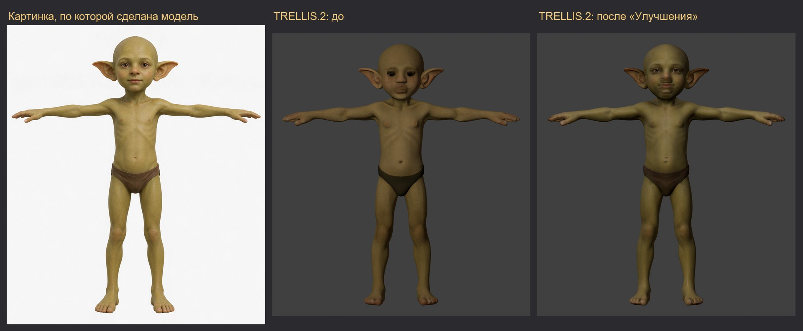
*Слева картинка, по которой сделан гоблин. В середине модель TRELLIS.2 как она вышла, справа после «Улучшения». Смотрите на лицо и цвет кожи.*

## Что было не так

Наше приложение делает 3D-модели для игры из картинок. Мы проверили двух «скульпторов»-нейросетей на мальчике-гоблине:

- **Hunyuan3D** от Tencent: берёт три вида (спереди, сзади, сбоку), работает около семи минут.
- **TRELLIS.2** от Microsoft: берёт одну картинку, работает 78 секунд.

Формы у обоих получились неплохие. А покраска — нет.

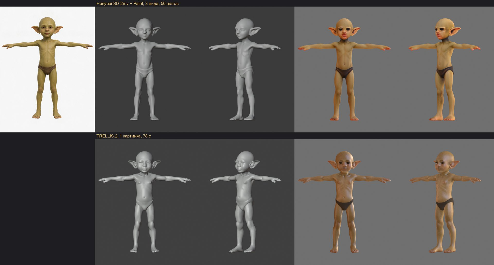
*Слева картинка. Сверху модель Hunyuan3D: красные губы, нос и кончики пальцев, глаза заглажены. Снизу TRELLIS.2: кожа темнее, в глазницах чёрные пятна.*

Оба потеряли оливково-зелёную кожу. Hunyuan3D накрасил гоблину губы, как помадой. У TRELLIS.2 вместо глаз остались тёмные ямы. Такую модель в игру не поставишь: лицо видно в каждом диалоге.

## Почему так происходило

Нейросеть не копирует пиксели картинки. Она «смотрит» на картинку и потом раскрашивает модель по памяти. Это как художник, которому показали фото на секунду, а дальше он рисует сам. Общий вид он помнит, а глаза и губы додумывает.

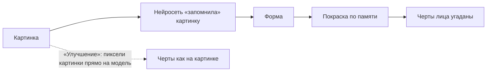

А картинка ведь у нас есть. Значит, её цвета можно вернуть на модель напрямую.

## Что пробовали

Проверили семь способов. Каждый — отдельно и в сочетаниях, на гоблине от обеих нейросетей, рыцаре-скелете и щите.

| Способ | Что вышло | Решение |
|---|---|---|
| **A. Проекция картинки** | Пиксели каждой картинки (спереди, сзади, сбоку) ложатся на ту сторону модели, которую она показывает. Кожа, глаза, губы — как на картинке. | Главный шаг |
| **B. Подогнать цвет целиком** | Общий тон ближе к картинке, но красные губы и тёмные глазницы остаются: исправляется вся модель разом, а не отдельные места. | Не нужен, если есть A |
| **C. Симметрия** | Лучшая половина модели зеркалится на другую — вместе с покраской. 4 секунды. | Для персонажей, по галочке |
| **D. Рельеф из подробной формы** | Нейросеть сначала делает очень подробную форму, потом её упрощают до 50 тысяч треугольников. Мелкий рельеф переносим в «карту нормалей». У Hunyuan3D чуть чётче рёбра и ключицы. У TRELLIS.2 прибавки нет, а на тонкой ткани появляются блёстки-артефакты. | Только для Hunyuan3D |
| **E. ChatGPT дорисовывает стороны** | Модель снимается сзади и сбоку, ChatGPT перекрашивает снимок по картинке спереди, результат снова проецируется. | По кнопке |
| **F. Ретопология** | Модель пересобирается из ровной сетки квадратиков. Уши и пальцы грубеют, текстура мягче, а нашему скелету квадратики не нужны. | Отбросили |
| **G. Нормали вершин** (находка по пути) | У TRELLIS.2 модель выглядела «пятнистой». Оказалось, это ошибка в нашей же обработке после нейросети. | Исправила ветка TRELLIS |

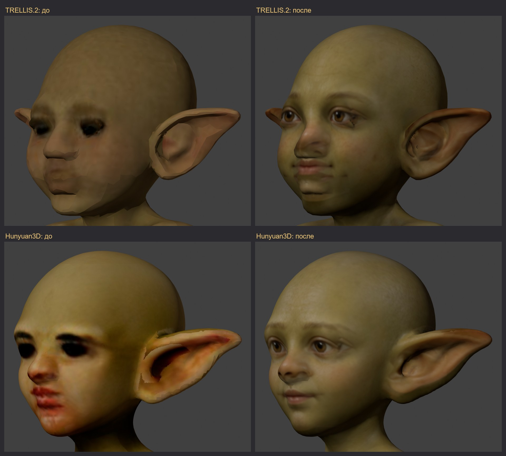
*Тот же ракурс до и после. Вверху TRELLIS.2: вместо тёмных ям — глаза. Внизу Hunyuan3D: пропали «помада» и красный нос.*

**Первая неудача A — двоение.** Сначала каждый участок кожи красили сразу две картинки поровну: спереди и сбоку. Но на этих картинках глаз нарисован чуть в разных местах. На стыке выходило два уголка глаза и тень ноздри рядом с носом. Пользователь это сразу заметил.

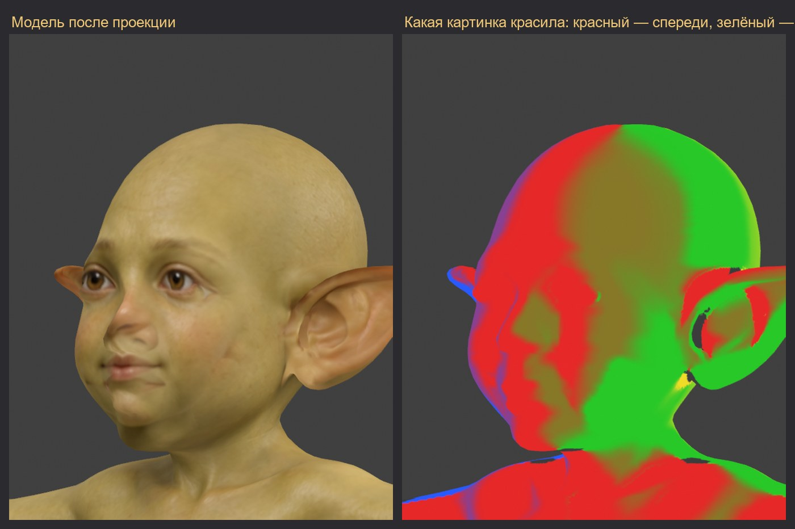
*Справа карта: красное красила картинка спереди, зелёное — сбоку. Оливковые полосы на щеках и у глаз — места, где две картинки смешались. Там и двоилось.*

Решение — пусть каждый участок берёт одну картинку, ту, что смотрит на него прямее. Картинка спереди главная: лицо почти целиком её.

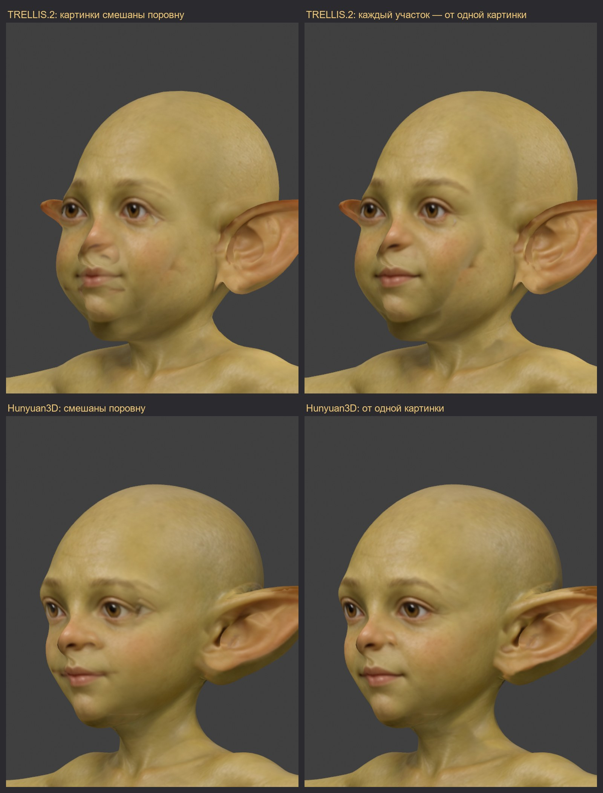
*Слева картинки смешаны поровну, справа каждый участок от одной картинки. Двоение у носа и глаз ушло.*

**Самое неожиданное — E.** Для TRELLIS.2 есть только одна картинка, спереди. Спину и бока гоблина не видно. Мы сняли модель с этих сторон и попросили ChatGPT перекрасить снимок по картинке спереди.

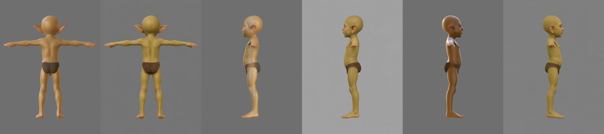
*Пары «снимок модели → перекраска ChatGPT»: сзади, слева, справа. Силуэт остался на месте, кожа стала оливковой, на трусах появилась ткань.*

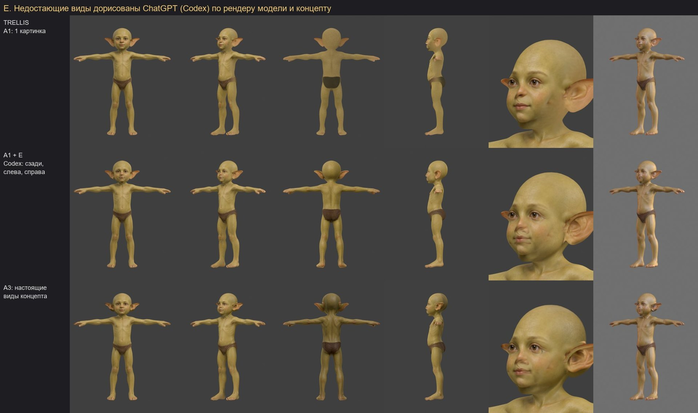
*Верх: только картинка спереди. Середина: плюс три стороны от ChatGPT. Низ: три настоящих вида художника. Середина и низ почти одинаковы.*

Силуэты рисунков ChatGPT совпали с моделью даже лучше, чем рисунки художника. Это понятно: ChatGPT раскрашивал снимок самой модели.

Отброшенные варианты тоже сняли:

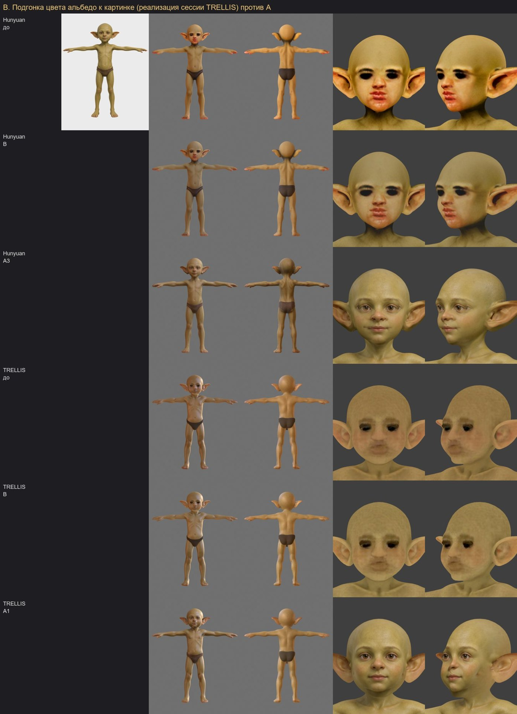
*B: общий тон ближе, но губы и глазницы остались прежними. Для сравнения — строки A.*

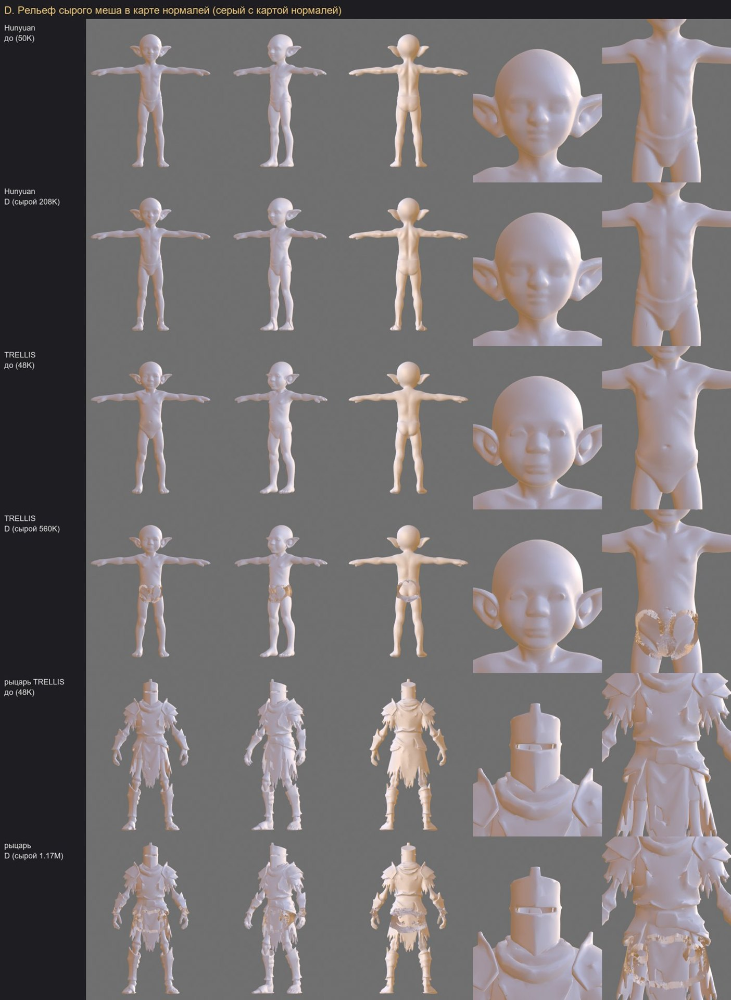
*D: серая модель с картой рельефа. У Hunyuan3D рёбра чуть чётче. У TRELLIS.2 на трусах и на поясе рыцаря блёстки-ошибки.*

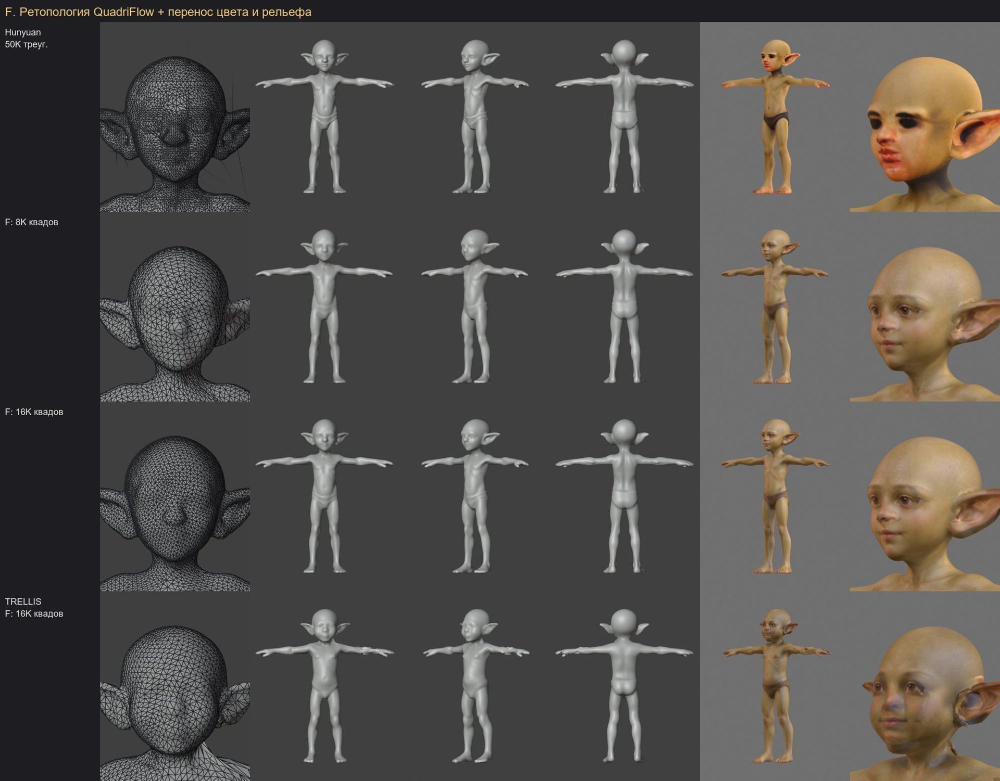
*F: ровная сетка из 8 и 16 тысяч квадратиков. На 8 тысячах уши грубеют, текстура мягче.*

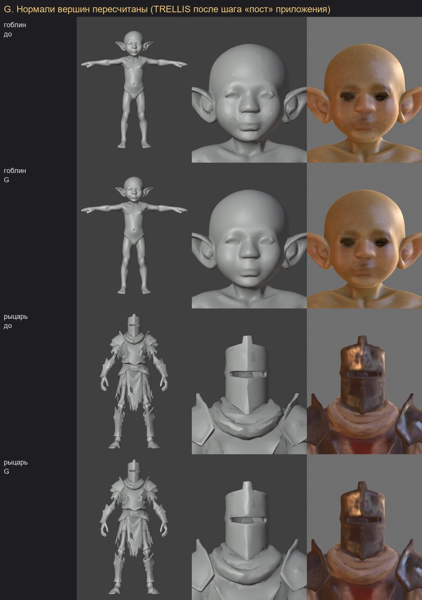
*G: слева «пятнистые» грани TRELLIS.2, справа после исправления. Это была ошибка в нашей обработке, а не в нейросети.*

## Как решили

В приложении появился шаг **«Модели → Улучшение»**, между «Проверкой» и «Материалами модели». Он работает с черновиком, до того как модель уходит в игру.

- **Картинки по сторонам.** Шаг сам находит картинки, по которым сделана модель. Можно добавить свою для любой стороны.
- **Дорисовать стороны через ChatGPT.** Для сторон без картинки. От одной до пяти минут на сторону, по подписке ChatGPT. Каждый вид можно взять или отбросить.
- **Симметрия, рельеф.** Галочками: симметрия для персонажей, рельеф для Hunyuan3D.
- **Булавки.** Если черта картинки всё же легла мимо (рот чуть выше рта модели), её подтягивают мышкой. Модель видна серой, картинка поверх. Тянете уголок глаза к месту на модели, картинка плавно изгибается. Включена симметрия — вторая булавка на другом глазу ставится сама.
- **Улучшить** — одна задача в очереди. **Вернуть как было** — исходный черновик хранится.

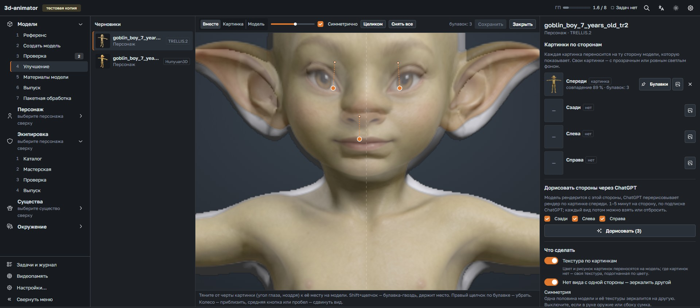
*Редактор булавок: три булавки — рот и пара на глазах, пунктир — линия симметрии. Справа панель шага.*

Булавки и «одна картинка на участок» появились по замечанию пользователя: он увидел двоение глаз и ноздрей и попросил ручную подгонку.

Способ работает не только на лицах:

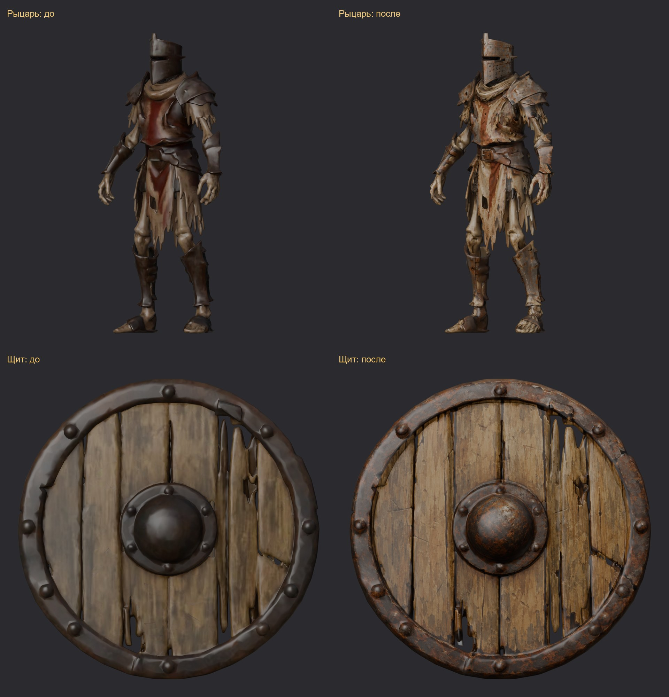
*Рыцарь по четырём рисункам и щит по одному. После проекции видны дырки решётки шлема, ржавчина, заклёпки и доски, как на картинках.*

## Как проверили

Каждый способ — на гоблине от обеих нейросетей, рыцаре-скелете и щите. Листы «до/после» с одной камерой, спереди и в три четверти. Потом весь шаг прогнали через интерфейс на тестовой копии приложения, с копиями черновиков.

| Что мерили | Было | Стало |
|---|---|---|
| Шаг «Улучшение» целиком, гоблин TRELLIS.2 | — | 46–66 с |
| Шаг «Улучшение» целиком, гоблин Hunyuan3D (с рельефом и симметрией) | — | 78 с |
| Видеокарта для шага «Улучшение» | — | не нужна: всё считается на процессоре |
| Совпадение силуэта модели и картинки | рисунки художника: 86–91 % | рисунки ChatGPT: 96–97 % |
| Время ChatGPT на одну сторону | — | 76, 108 и 328 с |
| «Пятнистость» TRELLIS.2: у каждой десятой вершины нормаль отклонялась больше чем на… | гоблин 34°, рыцарь 90° | 0° |
| Сколько рельефа теряет упрощение Hunyuan3D (на персонаже ростом 1,8 м) | — | обычно 0,55 мм, у 99 % точек меньше 1,4 мм |
| Ретопология (8 и 16 тысяч квадратиков) | — | 14 и 26 с |

*Замеры: ноутбук с RTX 4060 (8 ГБ), параллельно работали другие задачи. Похожесть лиц оценивали на глаз.*

## Что осталось

- Кнопку «Дорисовать через ChatGPT» из нового экрана не запускали, чтобы не тратить подписку. Та же функция дала хорошие рисунки в испытании.
- Булавки на испытании ставили грубо, ради проверки механики. Насколько хорошо выйдет лицо, зависит от руки.
- Свет и тени с картинки переносятся в цвет модели. Мягкий студийный свет терпим, но «убрать свет картинки» пока помогает мало.
- Лицо на картинке всего около 120 пикселей в ширину (на глаз). Вблизи кожа мягковата.
- На существах и зданиях не проверяли. Нет галочки «Улучшать по картинкам» в пакетной обработке.

## Словарик

| Термин | Простыми словами |
|---|---|
| Текстура | Картинка, натянутая на модель, как обои. Из неё модель получает цвет. |
| Развёртка (UV) | Модель, разрезанная и разложенная на плоскости, как выкройка одежды. На ней рисуется текстура. |
| Проекция | Перенос картинки на модель, как кадр проектора на стену. |
| Силуэт | Контур модели или рисунка на фоне. По нему картинка подгоняется к модели. |
| Hunyuan3D, TRELLIS.2 | Нейросети Tencent и Microsoft, которые делают 3D-модель из картинок. |
| ChatGPT через Codex | Программа OpenAI, через которую приложение просит ChatGPT нарисовать картинку по подписке пользователя. |
| Треугольники | Из них состоит любая 3D-модель. Чем их больше, тем подробнее модель и тяжелее для игры. |
| Карта нормалей | Картинка, которая «рисует» мелкий рельеф светом, без лишних треугольников. |
| Нормаль вершины | Направление «наружу» в точке модели. По нему считается свет. Если нормали кривые, модель выглядит пятнистой. |
| Ретопология | Пересборка модели из ровной сетки, обычно из квадратиков. |
| Булавка | Точка, за которую тянут картинку, чтобы черта легла на своё место на модели. |
| Черновик | Модель, которая уже сделана, но ещё не отправлена в игру. |

## Для видео

**Озвучка:**

Наша программа делает 3D-персонажей для игры из картинок. Мы дали двум нейросетям мальчика-гоблина. Формы вышли неплохие, а лица — нет. Кожа рыжая вместо оливковой, у одного гоблина накрашены губы, у другого вместо глаз тёмные ямы.

Почему? Нейросеть не копирует картинку. Она запоминает её и раскрашивает модель по памяти. Глаза и губы она додумывает.

Но картинка-то у нас есть. Мы проецируем её на модель, как кадр проектора на стену. Каждая точка кожи берёт цвет с той картинки, которая смотрит на неё прямее всего.

Первая попытка — и глаз раздвоился. Картинки спереди и сбоку рисуют его чуть в разных местах, а мы смешивали их поровну. Теперь каждый кусочек берёт одну картинку, и двоение ушло.

Самое интересное — спина. У одной нейросети была только картинка спереди. Тогда мы сняли модель сзади и сбоку и попросили ChatGPT перекрасить эти снимки по картинке. И получилось почти так же, как по настоящим рисункам художника.

А если черта всё же легла мимо, её можно подтянуть мышкой. Булавками.

Все шаги заняли около минуты на обычном процессоре. Теперь это одна кнопка в программе: «Улучшить».

**Вау-момент:** спина гоблина, которую нарисовал ChatGPT по снимку модели, рядом с настоящим рисунком художника, — и разницы почти не видно.

**Обложка:** лицо гоблина крупно: слева тёмные ямы вместо глаз, справа живые глаза. Надпись «ВЕРНУЛИ ЛИЦО».

**Оценка для видео:** 5 — сильные пары «до/после» на лицах, ChatGPT дорисовывает невидимое, честная неудача с двоением и ручные булавки.

## Для любопытных

- Файлы: `tool/model_improve.py` (проекция, подгонка по силуэту, булавки, заливка невидимого, симметрия и рельеф через Blender, ChatGPT), `tool/blender_improve.py`, `tool/web/improve.py`, `tool/web/front/src/screens/ModelImprove.tsx`, `tool/web/front/src/components/PinEditor.tsx`; `tool/hy_pipeline.py` теперь сохраняет подробную форму `shape_raw.ply`.
- Коммиты: `cc19142` — шаг «Модели → Улучшение» с булавками; `623d476` и `7a138e7` (ветка TRELLIS) — нормали вершин в постобработке.
- Ветки: эта ветка (запущена из «Правок проекта», `local_e34b3455`); «Прототип TRELLIS.2» (`local_daf06cad`) — исправила нормали; «Новый интерфейс» (`local_7e21e9b7`) — согласовала встраивание.
- Стенд испытаний: `work/model_improve/` — отчёт `REPORT.md`, листы `sheets/`, скрипты по вариантам (`project.py`, `sym.py`, `bake_normals.py`, `e_codex.py`, `retopo.py`), отдельный тестовый сервер `webtest/` (порт 7896).
- Как повторить: Модели → Проверка → выбрать черновик → Улучшение → «Улучшить»; для сторон без картинки — «Дорисовать через ChatGPT»; булавки — кнопка «Булавки» у картинки.
