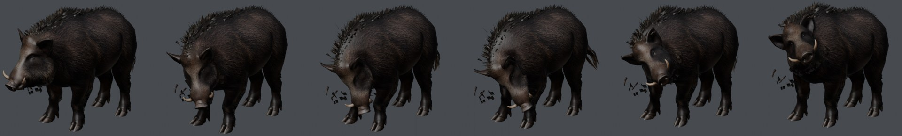
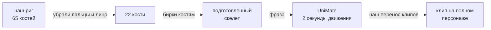
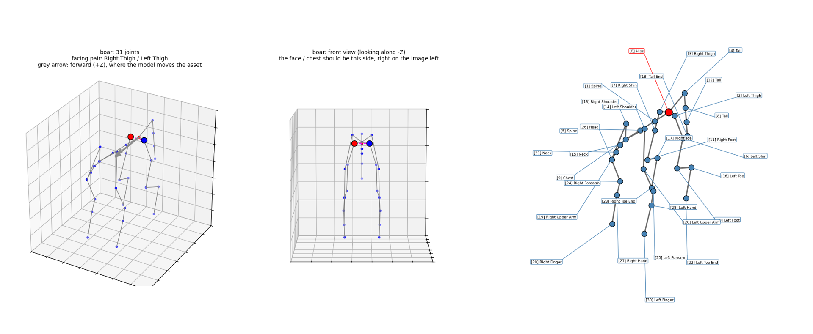
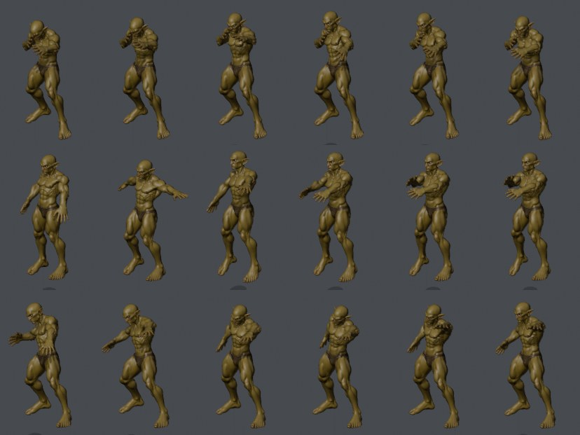
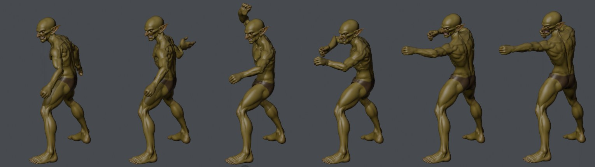
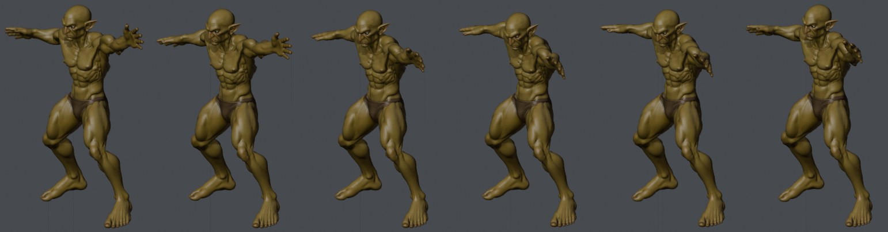
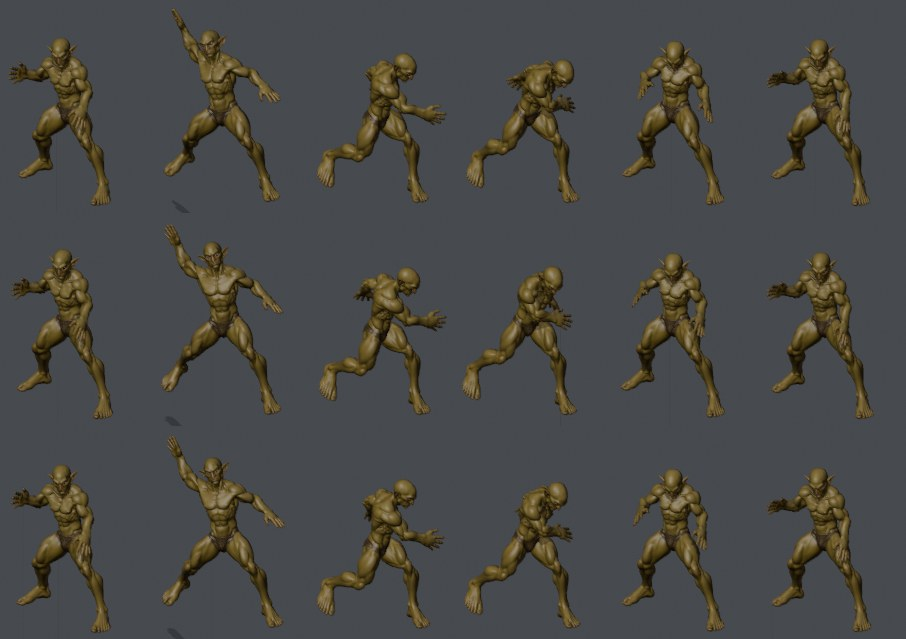
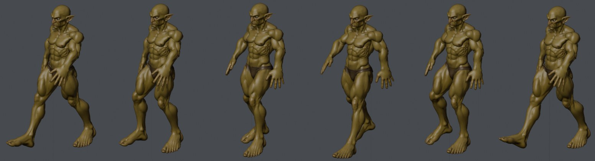
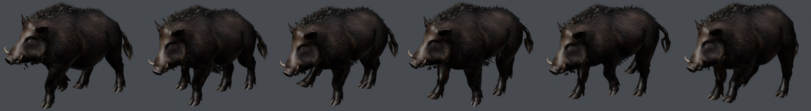
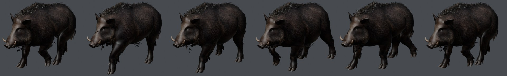

# Может ли нейросеть оживить нашего кабана по одной фразе?

> Кабан «роет землю рылом» по одной английской фразе вышел живым — а «удар мечом» нейросеть так и не поняла,
> и вдобавок её нельзя брать в продаваемую игру.

**Статус:** не решено (проверено, встраивать не стали) · **Дата:** 2026-11-27 · **Ветка:** проверка UniMate

## Коротко

- **Было:** анимации у нас из трёх мест: свои процедурные клипы, клипы Mixamo и галерея из ~320 клипов. Нового
  движения «по описанию» сделать нельзя.
- **Стало:** проверили UniMate — нейросеть, которая по фразе двигает скелет любой формы. 69 клипов на человеке и
  кабане, перенесли на нашего персонажа. Шаг, поза усталости и «кабан роет рылом» получаются; удар мечом и выстрел
  из лука — нет. Веса некоммерческие, в игру нельзя.
- **Как:** отдельная среда на диске D:, 1,2 ГБ весов, до 1,4 ГБ видеопамяти, 7–34 секунды на клип.

*Шесть кадров одного клипа: кабан опускает голову, водит рылом у земли и поднимает голову. Ничего не рисовали руками.*

## Что было не так

Для игры нужны десятки движений. Для людей есть Mixamo, для зверей — наши процедурные походки: шаг, рысь, галоп,
атака. Но стоит захотеть «кабан роет землю» или «усталый лучник натягивает тетиву» — такого клипа нет нигде.
Его пришлось бы ставить руками по кадрам.

В ноябре вышла UniMate (Принстон, Беркли, MIT и NTU, конференция SIGGRAPH Asia). Обещание звучит как мечта:
даёшь ей готовый скелет любой формы — робота, кошку, дракона — и фразу, а она выдаёт движение. Мы проверили,
работает ли это на наших моделях.

## Почему так происходило

Скелет — это набор костей, как у куклы на шарнирах. Обычная нейросеть-аниматор знает только один скелет, чаще всего
человеческий. UniMate хитрее: каждой кости даёт «бирку» из общего словаря — «левое бедро», «хвост», «голова» — и
смотрит, как кости соединены. Поэтому один и тот же «шаг вперёд» она умеет и для человека, и для кабана.

Учили её на 13 тысячах клипов: Mixamo, животные из платного пакета Truebones и модели из интернета.
Отсюда и её сила, и её пределы: что было в учебных клипах, то она и умеет.

*Подготовка кабана: слева — куда он смотрит (серая стрелка), справа — бирка на каждой кости. Стороны ног пришлось
дописать руками: правила поставили «задняя нога» обеим ногам сразу.*

## Что пробовали

| Попытка | Что вышло | Почему не подошло |
|---|---|---|
| Кабан с автоматическим скелетом из UniRig | у скелета 6 «ног» и «хвосты» на шее | взяли кабана со скелетом по нашему шаблону |
| Человек со всеми 65 костями | лицо и пальцы мешают, модель берёт до 70 костей | оставили 22 кости тела, лицо и пальцы потом стоят на месте |
| Фразы своими словами: «удар мечом», «натягивает лук» | боксёрская стойка, «зомби» с вытянутыми руками, взмах пустой рукой | модель не знает слов про оружие |
| Фразы в стиле учебных подписей: «поднимает руку над головой и рубит вниз» | 1 из 3 вариантов похож на удар | лука в учебных клипах нет вовсе |
| Отдельная модель, обученная только на Mixamo | живой выпад, но все 3 варианта одинаковые, персонаж висит над полом на 6–8 % роста | она просто повторяет заученный клип Mixamo |
| Быстрый способ решения (Euler, 50 шагов) вместо медленного | 11 секунд на клип вместо 34 | работает, качество на глаз то же |

*Три варианта по фразе «бьёт мечом в правой руке». Сверху вниз: стойка боксёра, руки вперёд, взмах. Удара нет.*

*Для сравнения — клип Mixamo у нашего лучника: рука тянется за стрелой, натягивает, целится.*

*А это UniMate по той же идее: руки в стороны, лука не видно.*

*Mixamo-версия UniMate на «рубит сверху вниз»: три варианта — три копии одного движения. Это не придумывание,
а воспоминание учебного клипа.*

## Как решили

Встраивать UniMate в приложение не стали. Причин две.

1. **Лицензия.** Программа открытая, но веса (то, чему сеть научилась) выложены под некоммерческой лицензией
   CC BY-NC. Клип, сделанный ими, в продаваемую игру класть нельзя. Обучить свои веса можно, но авторы учили сеть
   на 4–8 серверных видеокартах по полтора-два дня — нам это не по силам.
2. **Качество.** Получается простое и «телесное»: шаг, сгорбленная усталая поза, рытьё рылом. Боевое — удар, выстрел —
   нет. А для ARPG важнее всего именно боевые клипы, и у нас их уже больше и лучше из паков Mixamo.

Вся цепочка собрана и проверена: подготовить скелет, сгенерировать, надеть на сетку, перенести на полный риг.
Если авторы выпустят веса с коммерческой лицензией, встроить можно за день: в раздел «Анимации» как источник
«по описанию».

*Лучшее у человека — шаг. Клип перенесён на полный риг нашим обычным переносом клипов, как клипы Mixamo.*

## Как проверили

69 клипов: 14 фраз по 3 варианта, две модели. Человек — копия нашего мускулистого персонажа (рост на копии 0,9 м),
кабан — копия кабана со скелетом по шаблону (0,57 м). Каждый клип проверили нашей же проверкой: насколько кожа
уходит под пол, насколько скользит стоящая нога, дёргается ли стык петли.

| Что мерили | UniMate | Наши клипы |
|---|---|---|
| Кабан, «роет»: провал под пол | до 94 мм (16 % роста) | атака: 4 мм |
| Кабан, шаг: провал под пол | 39–49 мм | 0 мм |
| Кабан, шаг: скольжение ноги | 28–160 мм | 0 мм |
| Кабан, шаг: рывок на стыке петли | в 9–13 раз больше обычного шага кадра | 0 |
| Человек, шаг: провал / скольжение | до 16 мм / 15–77 мм | Mixamo: 4 мм / 63 мм |
| Длина клипа | ровно 2 секунды | любая |
| Время на клип, основная модель | 34 с (11 с с быстрым решением) | секунды |
| Время на клип, Mixamo-модель | 7–10 с | — |
| Видеопамять | 0,4–1,4 ГБ | — |

*Шаг кабана от UniMate: ноги двигаются правдоподобно, но копыта уходят под пол.*

*Наш процедурный шаг того же кабана: копыта стоят на полу, петля без рывка.*

Провал — ошибка самой UniMate, а не нашего переноса: на её собственной копии сетки тот же клип проваливается так же.

*Замеры: RTX 4060, 8 ГБ, повторные запуски (сеть уже загружена). В Godot клипы не открывали.*

## Что осталось

- Ждать новых весов. Авторы называют модель «ранним шагом» и обещают обновления.
- Если выйдут веса с коммерческой лицензией: поставить в «Анимации» источник «по описанию», добавить чистку —
  стопы на пол, склейку петли — и проверку клипа.
- Сама идея бирок на костях полезна: наши шаблонные существа уже названы так, что бирки ставятся без человека.
- Не проверены: склейка петли через «дорисовку между позами» и правка части тела текстом.

## Словарик

| Термин | Простыми словами |
|---|---|
| Скелет, риг | Набор костей внутри модели, как шарниры у куклы. Двигаешь кость — двигается кожа вокруг. |
| Клип | Одна записанная анимация: шаг, удар, прыжок. |
| Перенос клипа (ретаргет) | Пересадка анимации с одного скелета на другой, похожий. Как переодеть костюм с манекена на актёра. |
| Бирка кости | Подпись «левое бедро», «хвост». По ней нейросеть узнаёт кость на любом скелете. |
| Веса | То, чему нейросеть научилась. Файл на 1,2 ГБ. Без него программа пустая. |
| Некоммерческая лицензия (CC BY-NC) | Можно пробовать и показывать, нельзя использовать в том, что продаётся. |
| Mixamo | Бесплатная библиотека готовых анимаций людей от Adobe. |
| Процедурная анимация | Движение, которое считает формула, а не записанный клип. Наши походки существ такие. |
| Провал под пол | Нога или копыто уходит ниже земли. В игре выглядит так, будто персонаж идёт по болоту. |
| Петля | Клип, у которого конец плавно переходит в начало. Шаг крутится бесконечно. |
| Решатель | Способ, которым нейросеть шаг за шагом превращает шум в движение. Быстрый делает меньше шагов. |

## Для видео

**Озвучка:**

Можно ли оживить кабана одной фразой? В ноябре вышла нейросеть ЮниМейт. Ей дают скелет любой формы — человека,
кошку, робота — и фразу по-английски. Она выдаёт движение. Мы проверили её на своих моделях: на мускулистом
человеке и на кабане.

Сначала скелет подготовили. Каждой кости нужна бирка: левое бедро, хвост, голова. Человека программа разметила сама,
без ошибок. У кабана перепутала ноги — пришлось подписать стороны руками.

Шестьдесят девять клипов. Человек идёт — нормально. Стоит уставший, сгорбившись, — хорошо. А кабан по фразе
«опускает голову и толкает рылом землю» роет так, будто его снимали в лесу.

Теперь бой. «Удар мечом» — получилась стойка боксёра. «Натянуть лук» — руки в стороны. Отдельная модель, обученная
только на Миксамо, выдала живой выпад. Но все три попытки оказались одинаковыми. Она не придумывает движение, а
вспоминает заученное.

И по замерам видно. Копыта кабана уходят под пол на шестнадцать процентов роста. Клип длится ровно две секунды и
не крутится по кругу. Наш процедурный шаг стоит на полу ровно.

Последний гвоздь — лицензия. Сеть учили в том числе на платных анимациях, а её веса разрешено использовать только
некоммерчески. В продаваемую игру такой клип не положишь.

Итог: встраивать не стали. Вся цепочка собрана и ждёт. Выйдут свободные веса — подключим за день.

**Вау-момент:** кабан опускает рыло и роет землю — по одной фразе, без единого ключевого кадра руками.

**Обложка:** кадр кабана с рылом у земли и текст «КАБАН ПО ФРАЗЕ».

**Оценка для видео:** 4 — зрелищный кабан и честный провал с мечом; тема «нейросеть делает анимацию» понятна всем.

## Для любопытных

- Код UniMate: github.com/Friedrich-M/UniMate (MIT), веса: huggingface.co/Linzhan/UniMate (CC BY-NC 4.0),
  статья: arxiv.org/abs/2609.05415.
- Полный отчёт с цифрами и путями: `work/unimate_test/REPORT.md` (локально, `work/` не в git).
- Скрипты прототипа: `work/unimate_test/scripts/` — `prune_rig.py` (скелет 65 → 22 кости), `run_sample.py` и
  `run_sample_fast.py` (генерация с замером времени и памяти, подмена решателя), `drive_all.py` (надеть на сетку),
  `retarget_any.py` (копия `tool/blender_retarget_fbx.py` с поиском `hips` без учёта регистра), `frames_many.py`,
  `crop_rows.py`.
- Наши инструменты без изменений: `tool/blender_retarget_fbx.py` (перенос), `tool/blender_clip_check.py` (замеры).
- Среда: `D:\conda\envs\unimate` (6,4 ГБ), веса `D:\conda\hf\unimate` (1,9 ГБ) и flan-t5 в `D:\conda\hf\hub`.
- Ветка: проверка UniMate, запущена из сессии-координатора.
- Как повторить: `rig_preprocess run --input <риг.glb> --annotate rule` → правка `annotation.json` →
  `run_sample.py --exp_dir D:/conda/hf/unimate/unimate_uniml3d_f60_v3 --test_cases_json <фразы>.json` →
  `drive_all.py` → `blender_retarget_fbx.py <полный риг> <выход> <map.json>`; всё тяжёлое — через общую очередь.
