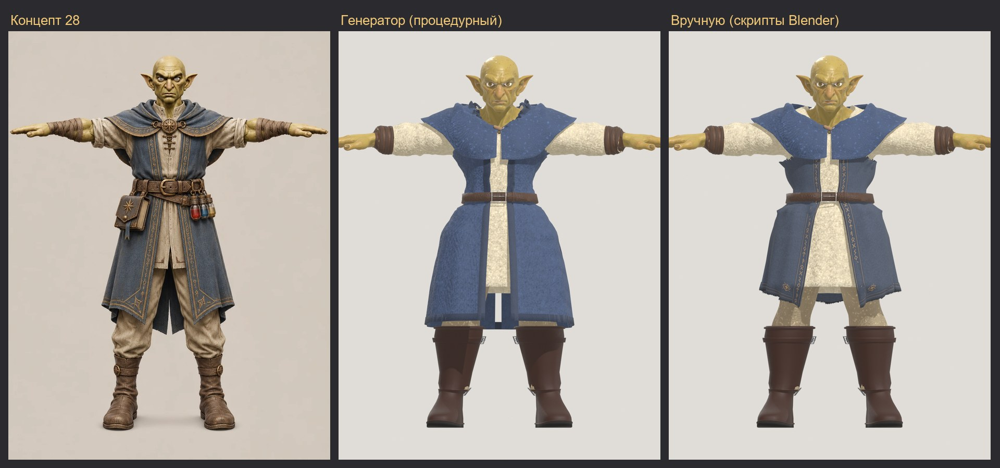
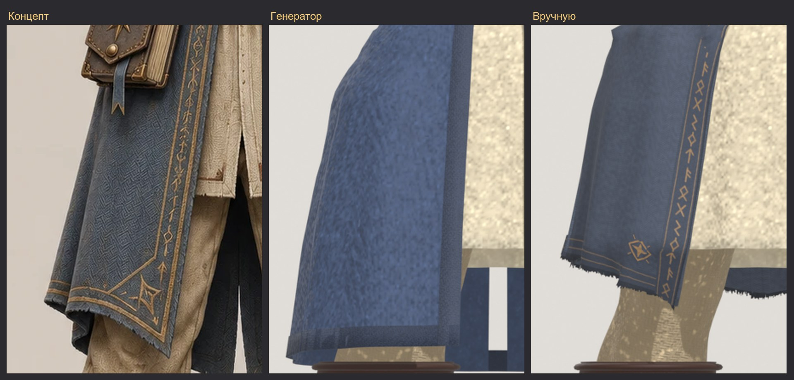
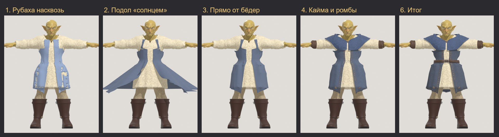
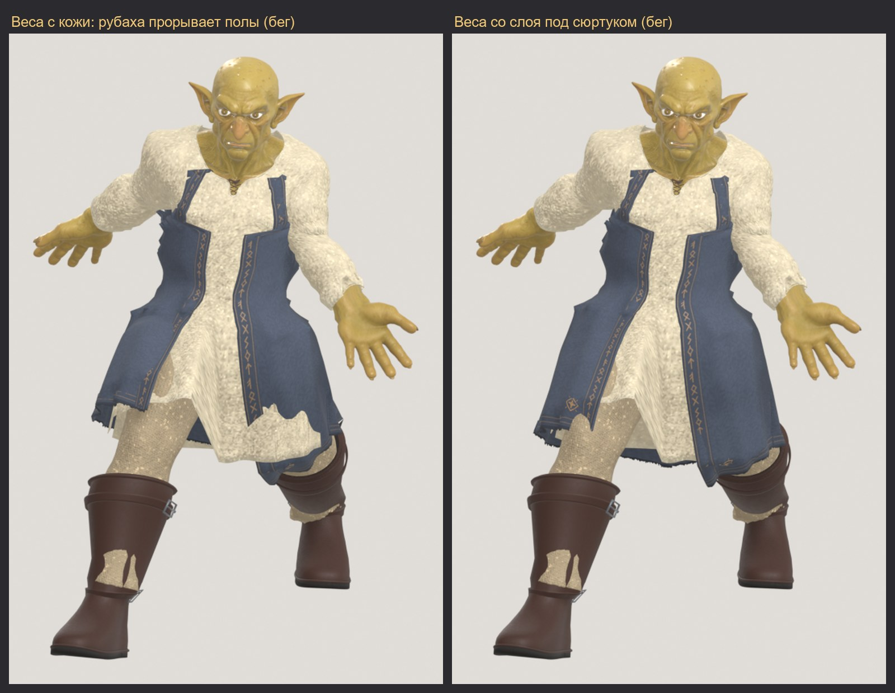
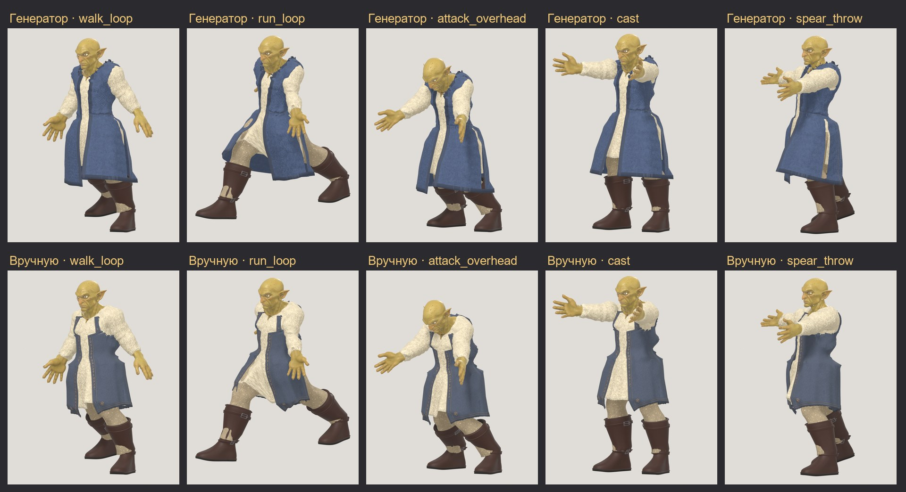
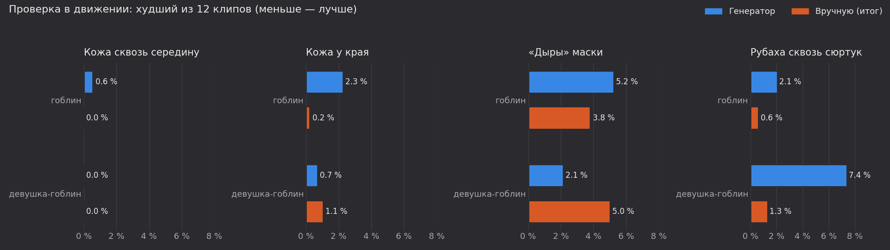
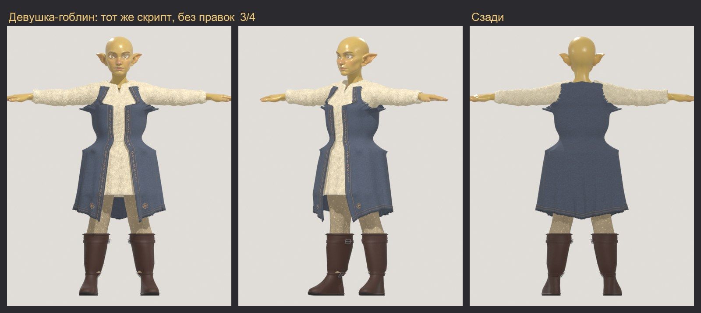

# Сшить сюртук «руками» в Blender — лучше генератора одежды или нет?

> Руками вышло ближе к картинке и даже чище в движении. Но «руками» — это тоже программа, а главную ошибку нашли
> не глаза, а замер: рубаха прорывала полы в каждом шаге.

**Статус:** решено (пилот на одной вещи) · **Дата:** 2026-11-28 · **Ветка:** пилот «вещь руками» (по заданию координатора «Правок проекта»)

## Коротко

- **Было:** одежду героев шьёт процедурный генератор. Для концепта 28 («ученик мага») он уже сделал длинный
  распашной сюртук. Пользователь спросил: а если Claude будет сам «рисовать» вещь в Blender поверх гоблина, сверяясь
  с концептом на каждом шаге, — выйдет лучше?
- **Стало:** тот же сюртук сделан вручную на том же гоблине. Похож на концепт заметно больше: А-силуэт, острые углы
  полы, кайма с рунами, ромбы, бахрома. В движении кожа не выходит сквозь него ни в одном из 12 клипов, рубаха — в
  0,6 % (у генератора 2,1 %). Ушло 8 шагов и около 1 ч 45 мин.
- **Как:** сюртук строился скриптами Blender. После каждого шага — рендер с ракурса концепта и сверка наложением.
  Веса перенесены методом Robust Weight Transfer, причём не с кожи, а с рубахи под сюртуком.

*Слева концепт 28, в середине сюртук из генератора, справа ручной. Остальные вещи комплекта одинаковые, из генератора.*

## Что было не так

Генератор одевает персонажа по правилам: берёт кожу, отступает на пару миллиметров и строит ткань. Поэтому одна вещь
садится и на мускулистого гоблина, и на стройную девушку. Но правила общие для всех вещей, и мелочи конкретной картинки
в них не попадают.

*Угол левой полы. На концепте кайма с рунами, две золотые линии по подолу, ромб и бахрома. У генератора гладкая тёмная
полоса. У ручного всё это есть, но складки ровнее, чем на рисунке.*

## Почему так происходило

Генератор — как швейная фабрика: одна выкройка, любой размер. Ручная работа — как портной: одна вещь на одного
человека по эскизу. У портного ближе к эскизу, зато каждая следующая вещь стоит снова.

Чтобы не гадать, сделали честный пилот. Одна вещь, один концепт, одно тело, одни и те же проверки. Работали на копии
персонажа, приложение и папку `export` пользователя не трогали.

## Что пробовали

Каждый шаг заканчивался рендером «как на концепте» и сравнением наложением: концепт и рендер полупрозрачно друг на
друге.

*От первой сетки, сквозь которую торчала рубаха, до итога с каймой, ромбами и бахромой.*

| Шаг | Что увидели при сверке | Что поправили |
|---|---|---|
| 1 | Рубаха проступает пятнами. Проймы огромные, спинка — узкая полоска. Полы раздуты колоколом. | Каждая точка ткани идёт по своему лучу от оси тела и не подходит к одежде под ней ближе 8–12 мм. Пройма — ровный овал. |
| 2 | Полы разлетелись «солнцем». | Наклон юбки считался прямо под поясом, где бёдра резко шире. Теперь ткань переваливает через самое широкое место бёдер и падает прямо, как натянутая. |
| 3 | Похоже на жилет до колена. Пояс утонул под тканью, видны грани. | Под поясом ткань прижата к его внутренней стороне. Гладкое затенение, складки заметнее. |
| — | Руны, вырезанные из концепта, вышли кляксами: на картинке вся кайма шириной 25 пикселей. | Руны и ромб перерисованы чёткими штрихами в тех же формах: стебли с ветками, стрелы, ромбы, кольца. |
| 4 | Кайма, ромбы, бахрома на месте. Пояс всё ещё спрятан. | Пояс из генератора туже рубахи: в игре его выдвигает поверх одежды сама примерочная. Для рендеров сделали так же, для обоих сюртуков. |
| 5–6 | Расклёшенность слабее, чем на концепте: у нашего гоблина широкие бёдра и короткая талия. | Подол шире пояса в 2,05 раза, спинка опущена до колена, задний разрез раскрыт. |
| 7 | На виде сбоку под проймой торчат острые «крылышки». | Овал проймы считается от настоящей ширины ткани, а не от ширины груди. |
| 8 | В беге рубаха прорывает полы большими пятнами (см. ниже). Проверка кожи этого не видит. | Веса берутся с ближайшего слоя под сюртуком: с рубахи и штанов, с кожи — только где их нет. |

Самая поучительная ошибка — восьмая. Сначала веса переносили с кожи, как обычно. Кожа под сюртуком в движении не
выходила. А рубаха выходила: у неё свои веса, и в беге она шла за бедром иначе, чем сюртук.

*Бег, один и тот же кадр. Слева веса с кожи: рубаха прорывает обе полы. Справа веса с рубахи: полы целые. Светлые
пятна на сапогах — штаны сквозь голенище, это общая беда комплекта, у генератора так же.*

## Как решили

Итоговый ручной сюртук:

- силуэт снят с концепта по ориентирам тела: пояс, колено, подмышка. Пиксели напрямую не годились: гоблин в 3D
  коренастее нарисованного;
- полы распахнуты буквой «А», острые углы полы ниже колена, разрезы по бокам и сзади;
- кайма 2,8 см с рунами по краю полочек, две золотые линии по подолу, ромб со звездой в углах, бахрома из ниток;
- ткань «ёлочкой» в цвет концепта, своя бесшовная текстура;
- веса перенесены методом Robust Weight Transfer: у гоблина 86 % точек ткани лежат у рубахи или кожи и берут их веса как есть,
  остальные 14 % программа плавно «дорисовала»;
- вещь выгружена как обычная вещь приложения: `.glb`, маска кожи, `.src.glb`, `.fit.json`.

*Ходьба, бег, удар сверху, заклинание, бросок копья. Сверху генератор, снизу ручной сюртук.*

## Как проверили

Оба сюртука прошли одну и ту же «Проверку в движении»: 12 клипов, каждый третий кадр. Её запускали на двух телах:
мускулистом гоблине и девушке-гоблине. Отдельно мерили рубаху сквозь сюртук — тем же правилом, что и кожу.

*Худший из 12 клипов, меньше — лучше. Синий — генератор, оранжевый — ручной сюртук (итог).*

| Что мерили | Генератор | Вручную |
|---|---|---|
| Кожа сквозь середину ткани, худший клип (гоблин / девушка) | 0,6 % / 0 % | 0 % / 0 % |
| Кожа у края ткани | 2,3 % / 0,7 % | 0,2 % / 1,1 % |
| «Дыры» маски | 5,2 % / 2,1 % | 3,8 % / 5,0 % |
| Рубаха сквозь сюртук | 2,1 % / 7,4 % | 0,6 % / 1,3 % |
| То же, ручной с весами кожи (шаг 7) | — | 12,7 % (гоблин, бег) |
| Треугольников (гоблин / девушка) | 38 020 / 17 814 | 25 286 / 26 432 |
| Шагов до вещи, прошедшей обе проверки | — (стиль уже был) | 8 шагов + 2 попытки текстуры |
| Время на вещь | 40 с – 5 мин счёта на тело | ≈ 1 ч 45 мин работы, из них ≈ 20 мин ожидания общей очереди Blender |
| На второе тело | те же 40 с – 5 мин | тот же скрипт без правок: 2,3 мин сборки + 4,5 мин весов и выгрузки (с очередью) |

На глаз, по сходству с концептом:

| Деталь концепта | Генератор | Вручную |
|---|---|---|
| А-силуэт от пояса | почти прямой, подол узкий | да, подол в 2 раза шире пояса |
| Острые углы полы | нет, подол ровный | да |
| Кайма с рунами по краю | гладкая тёмная полоса | руны и золотые линии |
| Ромб в углу, бахрома | нет | есть |
| Ткань «ёлочкой», серо-синяя | ворсистая, ярко-синяя | ёлочка, цвет снят с концепта |
| Складки | почти нет | есть, но слишком ровные, как волна |

*Замеры: ноутбук RTX 4060 8 ГБ, Blender 5.2 без окна через общую очередь, CPU. Сходство с концептом оценено на глаз.*

*Тот же скрипт на девушке-гоблине, без единой правки. Сел, но под проймой торчат «коготки»: на этом теле нужна ещё одна правка.*

## Что осталось

- На девушке-гоблине под проймой остались острые «коготки». Правка шага 7 помогла гоблину, но не ей.
- Процедурная накидка была сшита поверх процедурного жилета. На девушке плечи ручного сюртука проступают сквозь неё.
  Ручная вещь не знает о слоях, которые генератор строит над ней.
- «Дыры» маски у ручного сюртука на девушке — 5,0 %, на границе, которую проверка считает плохой. Маска спрятала
  много кожи: 4 608 точек против 3 278 у генератора.
- Складки — ровная волна. Настоящий драп (как на концепте) скриптом так не получить.
- Ручной сюртук не правится ползунками в редакторе. Любая правка — снова скрипт.
- Сюртук не проверен в примерочной Godot: только в Blender.

**Вердикт.** Ручной путь стоит затрат для «геройских» вещей: уникальная отделка по концепту, вещь видна крупно,
и её носит один-два персонажа. Он не стоит затрат для базовой одежды, вещей для многих тел и вещей, которые должны
лежать в стопке слоёв с другими: там генератор надёжнее и в сотни раз дешевле. И главное: самое ценное из ручного стоит
перенести в генератор новым стилем — тогда оно будет у каждой вещи:

1. юбка-«натянутая линия»: ткань переваливает через самое широкое место бёдер и падает прямо до подола заданной ширины;
2. острые углы полы: подол опускается к краю полочки;
3. кайма отдельной лентой поверх ткани с орнаментом из атласа (руны, линии), ромб-нашивка в углу, бахрома с отсечкой
   прозрачности;
4. ткань «ёлочкой» как ещё один узор плетения;
5. веса внешнего слоя — со слоя под ним (сопоставление + заполнение, как в RWT). Это лечит и сам генератор: его сюртук
   пропускал рубаху в 2,1–7,4 %, ручной с такими весами — в 0,6–1,3 %.

## Словарик

| Термин | Простыми словами |
|---|---|
| Концепт | Картинка-идея: как должен выглядеть персонаж. Не чертёж. |
| Процедурный генератор | Программа, которая строит вещь по правилам. Как выкройка, которая сама подгоняется под фигуру. |
| Силуэт | Контур вещи, как тень на стене. |
| А-силуэт | Вещь расширяется книзу, как буква «А». |
| Кайма | Полоса отделки по краю ткани. Здесь с рунами и золотыми линиями. |
| Наложение | Концепт и рендер полупрозрачно друг на друге: сразу видно, где контуры расходятся. |
| Веса | Невидимые «нитки» от каждой точки ткани к костям скелета. Говорят, за какой костью точка тянется в движении. |
| Robust Weight Transfer (RWT) | Способ перенести веса на одежду. Где ткань близко к тому, что под ней, берёт его веса. Где далеко — плавно заполняет. |
| Маска | Список точек кожи, которые игра прячет под вещью, чтобы кожа не проступала. |
| «Дыра» маски | Кожа спрятана, а ткань в этом кадре уехала: видно пустоту. |
| Проверка в движении | Программа проигрывает 12 клипов и считает точки кожи, вышедшие сквозь ткань. |
| Треугольники | Из них состоит любая 3D-модель. Чем их больше, тем тяжелее модель для игры. |

## Для видео

**Озвучка** (около полутора минут):

Пользователь спросил: а что, если одежду для героя не генерировать, а сшить вручную, как художник, глядя на картинку?
Мы проверили на одной вещи. Длинный сюртук ученика мага. Генератор его уже умеет. Значит, есть с чем сравнить.
Сюртук строился за восемь шагов. После каждого — снимок с того же ракурса, что концепт, и сравнение наложением.
Первая сетка была дырявой: рубаха торчала насквозь. Вторая разлетелась юбкой-солнцем. К шестому шагу появились
острые углы полы, кайма с рунами, ромб в углу и бахрома. Всё как на картинке.
Потом сюртук пустили бегать. Кожа не выходила наружу ни разу за двенадцать клипов. Казалось, готово.
Но на кадрах бега рубаха прорывала полы большими пятнами. Веса взяли с кожи, а сюртук лежит на рубахе.
Взяли веса с рубахи — пятна ушли. Рубаха сквозь сюртук: ноль целых шесть десятых процента. У генератора — два и одна.
Итог: ручная вещь ближе к картинке. Но стоит около двух часов. Генератор — минуты.
Поэтому руками — только геройские вещи. А лучшие находки переедут в генератор, чтобы достались всем.

**Вау-момент:** кадр бега «до/после» — рубаха прорывает полы, а после смены весов полы целые.

**Обложка:** угол полы крупно: концепт · генератор · вручную. Надпись «ВРУЧНУЮ ИЛИ ПО ПРАВИЛАМ?».

**Оценка для видео:** 4 — понятный спор «художник против программы», наглядные кадры и поворот с рубахой.

## Для любопытных

- Пилот: `work/handmade_pilot/` (в git не попадает). Скрипты: `scripts/build_coat.py` (сюртук по лучам от оси тела,
  юбка — верхняя огибающая, пройма-овал, разрезы, складки), `coat_extras.py` (ленты каймы, бахрома, ромбы, материалы),
  `make_tex.py` (ёлочка, атлас каймы), `export_coat.py` + `rwt_coat.py` (RWT из `tool/vendor/rwt`, маска
  `body_mask`, 4 файла вещи), `chain.sh` (сборка → веса → проверка для одного тела), `cloth_check.py` (рубаха сквозь
  сюртук правилом `blender_wear_qa.py`), `render_views.py` / `render_pair.py` / `render_motion.py` (рендеры),
  `chart.py`. Журнал шагов: `work/handmade_pilot/LOG.md`.
- Вещь: `work/handmade_pilot/export/character/<тело>/clothes/vest_coat_hm28.*` (гоблин и девушка), вариант с весами
  кожи — `vest_coat_hm28skin.*` (только гоблин).
- Процедурный сюртук: стиль `vest_long`, коммит `0b2eb32`, стенд `work/mage_clothes`.
- Как повторить: `bash work/handmade_pilot/scripts/chain.sh <шаг> <тело> vest_coat_hm28` с `HM_LAYERS=1`
  (веса со слоя под сюртуком); проверки лежат в `work/handmade_pilot/qa/<шаг>/qa.json` и `qa/cloth/*.json`.
