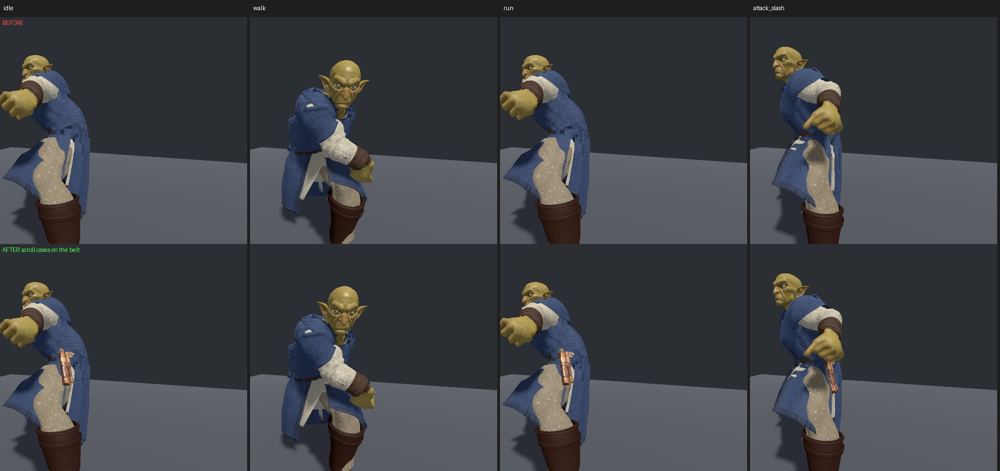
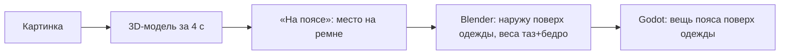
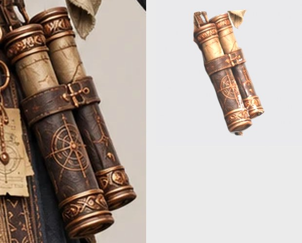
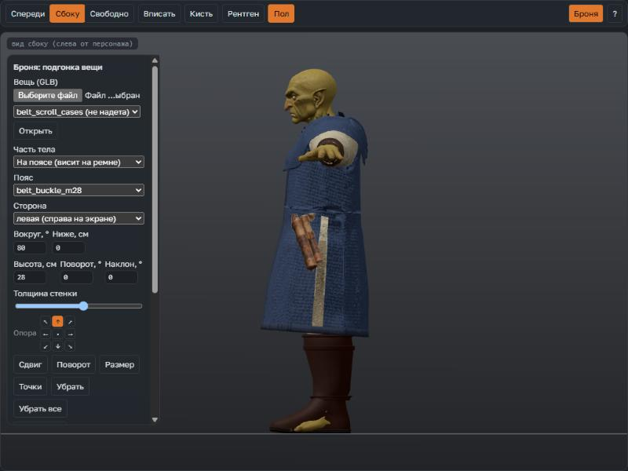

# Как повесить на пояс вещь, сгенерированную по картинке?

> Свиток с картинки мага за пару секунд стал 3D-моделью. Но надеть его было некуда: у редактора не было места «на поясе».

**Статус:** решено · **Дата:** 2026-11-28 · **Ветка:** одежда магов и пояса (запущена из «Правки проекта»)

## Коротко

- **Было:** сгенерированный по референсу предмет можно было надеть только как броню: на бедро (он обжимался трубой
  по ноге), на торс (шёл за грудью, а не за бедром) или «как сделан» (стоял в воздухе и не знал о поясе).
- **Стало:** в «Броне» есть часть тела «На поясе». Вещь сама встаёт на нижний край надетого ремня сбоку, висит вниз,
  выходит поверх одежды и в движении идёт за тазом и бедром, как ножны и колчан.
- **Как:** вещь не гнётся, её не обжимают по телу, а целиком сдвигают наружу. Веса у неё те же, что у сумок
  процедурного пояса: таз и бедро своей стороны. Имя `belt_…` подключает к ней правила поясных вещей в игре.

*Один персонаж в костюме «ученика» в покое, при ходьбе, беге и ударе. Сверху без вещи, снизу с футляром для свитков на
левом бедре: он висит на поясе поверх штанов и края жилета и качается вместе с ногой.*

## Что было не так

Пользователь сгенерировал предмет по картинке: свитки, как у магов на концептах. И захотел повесить его на пояс
персонажа. В редакторе подгонки («Броня») были только части тела для брони: предплечье, плечо, кисть, бедро, голень,
стопа, сапог, наплечник, торс, голова. И ещё «Готовая вещь», которая стоит там, где её поставили руками.

Ни одна не подходит:

- на «Бедре» вещь обтягивается вокруг ноги, как поножи: футляр сплющивается трубой по бедру;
- на «Торсе» она привязана к груди: при шаге не отходит с ногой, а остаётся на месте и пропускает бедро сквозь себя;
- «Готовую вещь» можно поставить у пояса вручную, но она не знает ни о поясе, ни об одежде: висит внутри жилета, а в
  игре правила «вещь поверх одежды» её не касаются.

## Почему так происходило

Подгонка брони устроена «по конечности»: у каждой части есть ось (кость), вокруг которой вещь облегает тело. У вещи на
поясе такой оси нет. Она висит на ремне, ремень лежит на одежде, а сама вещь твёрдая и только качается вместе с бедром.
Как кошелёк на ремне джинсов: он не облегает ногу, а висит.

## Что пробовали

| Попытка | Что вышло | Почему не подошло |
|---|---|---|
| Повесить как «Бедро» | Футляр обжался трубой по ноге | Подгонка по конечности гнёт вещь по телу |
| «Готовая вещь», поставить руками | Стоит, но без привязки к поясу | Веса и правила «поверх одежды» её не касаются |
| Новое место: верх вещи на ремне, без выталкивания | Плоский футляр, повёрнутый к боку, ушёл наполовину в бедро и был не виден | Бедро шире талии: висящая с ремня вещь утыкается в него |
| То же с выталкиванием наружу | Футляр висит поверх бедра и одежды | Подошло |

## Как решили

**В редакторе.** Новая часть тела «На поясе (висит на ремне)». Выбираются:

- надетый пояс (или ремень ножен, колчана);
- сторона;
- числа: где вокруг талии (0° — спереди, 90° — сбоку, 180° — сзади), ниже ремня, высота, поворот, наклон.

Программа находит нижний край ремня в этом месте (только саму ленту, а не пряжку или петли ниже), ставит туда середину
верха вещи и разворачивает её лицом наружу. Потом сдвигает наружу, пока вещь не выйдет из бедра и показанной одежды.
Дальше её можно поправить мышкой: «Сдвиг», «Поворот», «Размер», как готовую вещь.

*Слева фрагмент концепта мага №24, справа модель, которую из него за 4 секунды сделал SF3D.*

**При надевании (Blender).** Вещь не гнётся. Она получает одинаковые веса: таз 0,55 и бедро своей стороны 0,45, как
сумки процедурного пояса. Потом её целиком отодвигают наружу, пока она не отойдёт на зазор от кожи, ремня и одежды под
ним. Маску (что прятать на теле) она не делает, как колчан.

**В игре и примерочной.** Вещь сохраняется под именем `belt_<имя>`. Поэтому для Godot и для запекания стражей это
вещь пояса: правила, которые держат ножны и колчаны поверх одежды, работают и для неё.

*Редактор, вид сбоку: футляр висит с ремня у бедра поверх длинного жилета.*

## Как проверили

- Генерация. Свитки вырезаны с концепта №24 и сделаны в SF3D. На копии, не в папку пользователя: 10 тысяч граней,
  4 секунды.
- Надевание. Тестовая копия приложения (порт 7893) и тестовый персонаж в костюме «ученика»: туника, длинный жилет,
  штаны, пояс. «Надеть» прошло через сервер приложения, как у пользователя.
- Движение. Примерочная Godot в покое, ходьбе, беге и ударе: вещь у бедра, поверх одежды, движется с ногой.

| Что мерили | Было | Стало |
|---|---|---|
| Куда можно повесить готовую вещь | 12 частей тела, пояса среди них нет | 13, есть «На поясе» |
| Кости, за которыми идёт вещь на поясе | одна кость конечности | таз 0,55 + бедро 0,45 |
| На сколько Blender отодвинул футляр поверх одежды | — | 4 см (в единицах модели) |

*Замеры: RTX 4060 Laptop 8 ГБ; тестовая копия персонажа `work/belt_item`.*

## Что осталось

- Пружинной кости нет. Вещь, которая должна болтаться на шнурке (кошель, амулет), пока качается только с бедром.
- Вещь не следует за ремнём, если ремень в игре сам сдвинется наружу (например, надели ещё один слой). Её место
  задаётся при «Надеть».
- Плоская модель из одной картинки (SF3D) выглядит плоской сбоку. Для круглых свитков лучше Hunyuan по 2–4 видам.
- «Экипировка → Проверка» (подсчёт кожи сквозь вещи в клипах) для неё не запускали. Проверено в примерочной Godot.

## Словарик

| Термин | Простыми словами |
|---|---|
| Веса (скиннинг) | Какие кости и насколько тянут каждую точку модели |
| Подгонка по конечности | Вещь облегает руку или ногу вокруг её кости |
| Маска | Части тела, которые прячутся под вещью, чтобы не просвечивать |
| Слой | Порядок надевания: что поверх чего рисуется |

## Для видео

**Озвучка:**

Мы взяли концепт мага, у которого на поясе висят свитки. Вырезали свитки с картинки, и за четыре секунды нейросеть
сделала из них трёхмерную модель. Осталось повесить её на пояс. И тут выяснилось, что повесить некуда. Редактор знал
руки, ноги, торс и голову, но не пояс. На бедре свиток сплющивался трубой по ноге. На торсе висел неподвижно, а нога
проходила сквозь него. Мы добавили новое место: на поясе. Выбираешь ремень, сторону и угол, и свиток сам встаёт на
нижний край ремня. Первая попытка удивила: свиток исчез. Бедро шире талии, и висящая вещь просто ушла в него. Тогда
мы научили редактор выталкивать вещь наружу, пока она не выйдет из тела и одежды. А в движении свиток держится на тазе
и чуть-чуть на бедре своей стороны. Как кошелёк на ремне: идёшь, и он качается вместе с ногой.

**Вау-момент:** свиток с картинки за секунды стал моделью и уже висит на поясе бегущего гоблина.

**Обложка:** гоблин в синем жилете с медными футлярами на бедре, надпись «СВИТОК НА ПОЯС».

**Оценка для видео:** 3 — понятная задача и быстрый результат, но мало зрелищных провалов.

## Для любопытных

- Файлы: `tool/landmark_editor.html` (`beltPlace`, `beltOut`, `wearRequest`), `tool/blender_wear_fit.py` (`hang_out`),
  `tool/landmarks.py` (без маски у подвешенной вещи), `tool/lang/*.json`.
- Ветки: одежда магов и пояса; «Правки проекта» (`local_e34b3455`).
- Как повторить: «Модели → Создать модель» по картинке вещи. Затем «Экипировка → Готовая вещь (GLB)» → часть тела
  «На поясе», выбрать пояс и сторону, «Надеть». Примерочная Godot: кнопка «Godot» там же.
