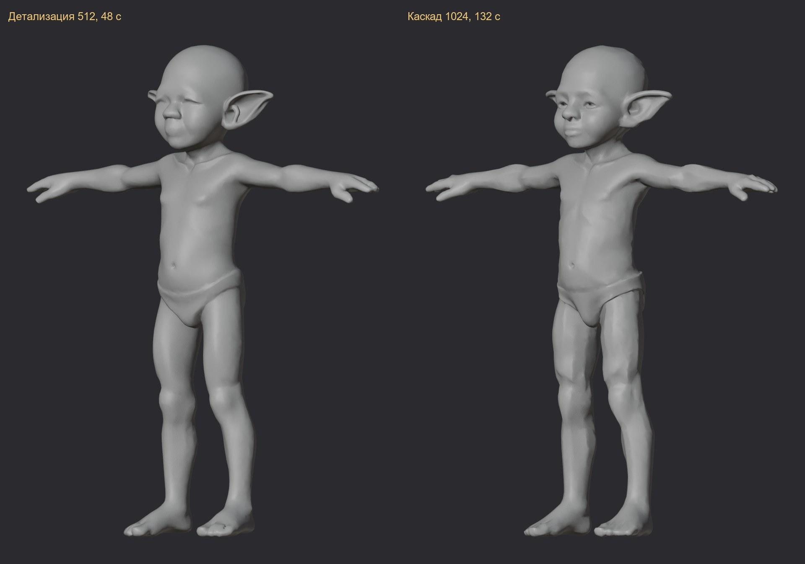
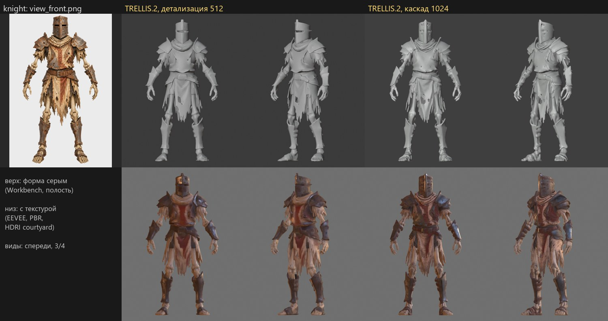
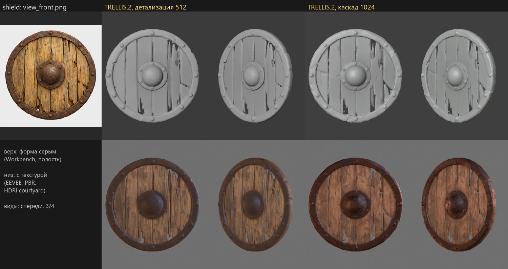

# Как выжать из видеокарты на 8 ГБ режим, которому «нужно 16»?

> Автор писал, что подробному режиму нужно 16 ГБ видеопамяти. На нашей восьмигигабайтной он занял пять с небольшим — и у гоблина открылись глаза.

**Статус:** решено · **Дата:** 2026-11-28 · **Ветка:** TRELLIS.2 — проверка и встраивание (запущена из «Правки проекта»)

## Коротко

- **Было:** TRELLIS.2 работал в лёгком режиме 512: быстро, но лицо и мелочи размыты. У гоблина — закрытые глаза и пухлое детское лицо.
- **Стало:** подробный режим 1024 работает на нашей видеокарте и стоит по умолчанию. Пик видеопамяти — 5,3 ГБ из 8.
- **Как:** просто попробовали. Скачали недостающие веса, прогнали три модели и сравнили форму.

*Слева режим 512: глаза закрыты, лицо пухлое. Справа 1024: глаза открыты, видны скулы, мышцы рук и колени — как на картинке.*

## Что было не так

TRELLIS.2 делал форму на сетке 512 × 512 × 512 «кубиков» (вокселей). На голову персонажа приходится всего несколько десятков кубиков. Глаз — это два-три кубика, поэтому лицо выходит размытым, как фото с маленьким разрешением.

## Почему так происходило

У TRELLIS.2 есть подробный режим — «каскад». Сначала он лепит грубую форму на 512, потом уточняет её на сетке вдвое мельче — 1024. На странице программы сказано, что каскаду нужна видеокарта на 16 ГБ, поэтому при первой проверке мы его не трогали. Но пользователь заметил, что в лёгком режиме TRELLIS брал меньше половины нашей памяти.

## Что пробовали

| Попытка | Что вышло |
|---|---|
| Каскад 1024 как есть, без ограничений | Влез: пик 3,3–5,3 ГБ вместе с рабочим столом. Ограничивать число кусочков не понадобилось. |

## Как решили

В «Параметрах TRELLIS.2» появился переключатель **«Детализация: 512 / 1024»**. По умолчанию стоит 1024. В подсказке честно написано, что 1024 работает в 2,7–4 раза дольше. Если веса каскада не скачаны, программа делает 512 и пишет об этом в журнале.

*Рыцарь: на 1024 появились отверстия в шлеме, кости пальцев и острые края рваной ткани.*

*Щит: ржавый обод и мелкие трещины. Сквозные дыры на месте трещин остались и здесь.*

## Как проверили

| Модель | 512 | 1024 | Пик видеопамяти на 1024 |
|---|---|---|---|
| Рыцарь | 62 с | 218 с | 4,6 ГБ |
| Щит | 85 с | 346 с | 5,3 ГБ |
| Гоблин | 48 с | 132 с | 3,3 ГБ |

*Замеры: RTX 4060, 8 ГБ, время одной нейросети без доводки. В приложении рыцарь на 1024 с доводкой — 251 с.*

## Что осталось

- Ждать дольше: персонаж 2–4 минуты вместо одной.
- Дыры на трещинах щита каскад не лечит.
- Цвет и глаза «по памяти» всё равно рисует нейросеть, точность референса даёт шаг «Улучшение». Но сырьё для него теперь лучше.

## Словарик

| Термин | Простыми словами |
|---|---|
| Воксель | «Кубик» объёма, как пиксель, только трёхмерный. |
| Детализация 512 / 1024 | Сколько кубиков по каждой стороне: чем больше, тем мельче детали. |
| Каскад | Сначала грубо, потом подробно: форма 512 уточняется на сетке 1024. |
| Веса | Числа, из которых состоит нейросеть. Для каскада нужны ещё два файла по 1,4 ГБ. |
| Видеопамять | Память видеокарты. У нас её 8 ГБ. |

## Для видео

**Озвучка:**

В инструкции к нейросети написано: подробному режиму нужна видеокарта на шестнадцать гигабайт. У нас восемь. Мы и не пробовали. Пока пользователь не спросил: а почему нейросеть берёт меньше половины памяти? Попробовали. Подробный режим занял пять с небольшим гигабайт. А у гоблина открылись глаза. В лёгком режиме на его лицо приходилось несколько десятков кубиков, и глаза слипались. В подробном — вдвое мельче сетка, видны скулы, колени, мышцы. Цена — время: две минуты вместо одной.

**Вау-момент:** гоблин с закрытыми глазами — щелчок — глаза открыты, лицо взрослеет.

**Обложка:** `src/goblin_1024_clay_q34.png` рядом с `src/goblin_512_clay_q34.png`, текст «НУЖНО 16 ГБ?».

**Оценка для видео:** 4 — короткая история с сильной картинкой и уроком «проверь, а не верь инструкции».

## Для любопытных

- Файлы: `tool/sf3d_ui.py` (`generate_trellis(tr_res)`, `TRELLIS_CASCADE_WEIGHTS`), `tool/web/models.py`, `tool/web/front/src/screens/ModelCreate.tsx`, `trellis2-weights.ps1 -Cascade`.
- Проверка: `work/trellis_test/cascade_queue.sh` (через общую очередь heavy), листы `work/trellis_test/sheets/c1024_*.png`, `work/trellis_test/gen1024_test.py`.
- Коммиты: `353e3f7` — переключатель детализации и каскад по умолчанию.
- Ветки: «TRELLIS.2 — проверка и встраивание», запущена из «Правки проекта» (`local_e34b3455`).
