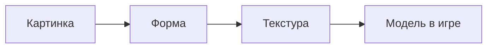

# <Вопрос, который задал бы зритель: «Почему у рыцаря рвались ботинки?»>

> <Одна фраза-крючок: самое неожиданное в этой истории.>

**Статус:** решено | частично | не решено · **Дата:** ГГГГ-ММ-ДД · **Ветка:** <название сессии>

## Коротко

- **Было:** <что видел пользователь, одной фразой>.
- **Стало:** <что теперь, с главной цифрой>.
- **Как:** <суть решения без терминов>.

*<Подпись: что видно и куда смотреть.>*

## Что было не так

<Что видно глазами. Где это мешало: в игре, в приложении, в работе. Картинка проблемы крупно.>

## Почему так происходило

<Причина простыми словами и сравнение из жизни. Если помогает, схема:>

## Что пробовали

| Попытка | Что вышло | Почему не подошло |
|---|---|---|
| <1> | <…> | <…> |

<Если какая-то попытка зрелищная, дайте её картинку.>

## Как решили

<Суть решения. Что теперь делает программа и что видит пользователь. Картинка «после».>

## Как проверили

<Как убедились, что работает: на каких моделях, сколько раз, чем мерили.>

| Что мерили | Было | Стало |
|---|---|---|
| <…> | <…> | <…> |

*Замеры: <на чём, например RTX 4060, 8 ГБ>.*

## Что осталось

- <Ограничения, нерешённые хвосты, идеи на потом.>

## Словарик

| Термин | Простыми словами |
|---|---|
| <…> | <…> |

## Для видео

**Озвучка** (1–2 минуты вслух, это 900–1700 знаков; имена пишите по-русски, числа и единицы — словами, как их надо
произнести):

<Текст подряд. Это те же сцены, что в case.json → beats.>

**Вау-момент:** <что зацепит зрителя.>

**Обложка:** <какой кадр и 2–4 слова крупно.>

**Оценка для видео:** <1–5> — <почему.>

## Для любопытных

- Файлы: `<tool/…>`
- Коммиты: `<abc1234>` — <что в нём>
- Ветки: <название> (`local_…`)
- Как повторить: <команды или шаги>
